# 《编译原理》第3章 词法分析（正规表达式）课件

原件的每一页，下面附识别出的文字。

### 编译原理

原文：

编译原理

南京郵電大學 Nanjing University of Posts and Telecommunications aand

### 第三章 词法分析

原文：

第三章 词法分析

◼正规表达式（正则表达式）

正规表达式广泛应用于模式识别和文献目录检索等

2

### §3.3.1正规表达式的定义

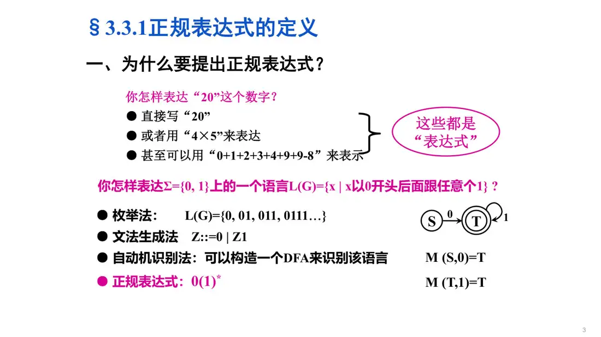

原文：

§3.3.1正规表达式的定义

一、为什么要提出正规表达式？

你怎样表达“20”这个数字？

● 直接写 ${ } ^ { 6 6 } 2 \mathbf { 0 } ^ { 9 9 }$

● 或者用“4×5”来表达

● 甚至可以用 $^ { 6 6 } 0 + 1 + 2 + 3 + 4 + 9 + 9 - 8 ^ { 3 9 }$ 来表示

这些都是“表达式”

你怎样表达Σ={0, 1}上的一个语言L(G)={x | x以0开头后面跟任意个1} ?

● 枚举法： $\operatorname { L } ( \mathbf { G } ) { = } \{ \mathbf { 0 } , \mathbf { 0 } 1 , \mathbf { 0 } 1 1 , \mathbf { 0 } 1 1 1 { \ldots } \}$

● 文法生成法 $\mathbf { Z } { \boldsymbol { : } } { \boldsymbol { : } } { = } \mathbf { 0 } ~ | ~ \mathbf { Z 1 }$

● 自动机识别法：可以构造一个DFA来识别该语言

$$
\mathbf {M} (\mathbf {S}, \mathbf {0}) = \mathbf {T}
$$

● 正规表达式： $0 ( 1 ) ^ { * }$

$$
\mathbf {M} (\mathbf {T}, \mathbf {1}) = \mathbf {T}
$$

3

### §3.3.1正规表达式的定义

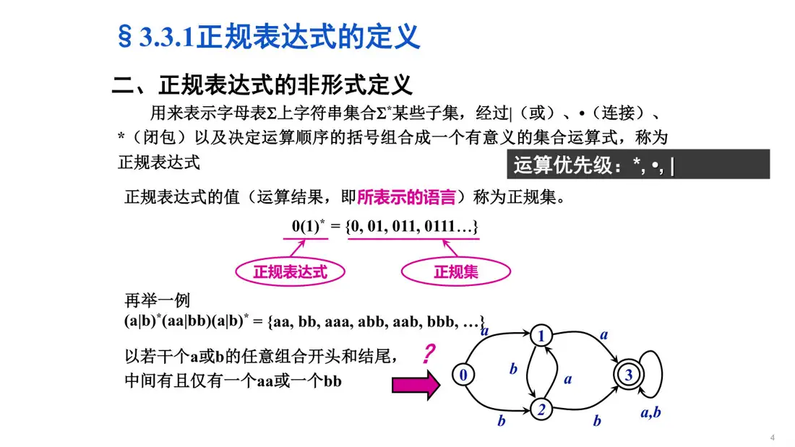

原文：

§3.3.1正规表达式的定义

二、正规表达式的非形式定义

用来表示字母表Σ上字符串集合Σ\*某些子集，经过（或）、·（连接）、\*（闭包）以及决定运算顺序的括号组合成一个有意义的集合运算式，称为

运算优先级：\*, •, |

正规表达式的值（运算结果，即所表示的语言）称为正规集。

再举一例

(a|b)\*(aa|bb)(a|b)\* = {aa, bb, aaa, abb, aab, bbb, …}

以若干个a或b的任意组合开头和结尾，

中间有且仅有一个aa或一个bb

4

### §3.3.1正规表达式的定义

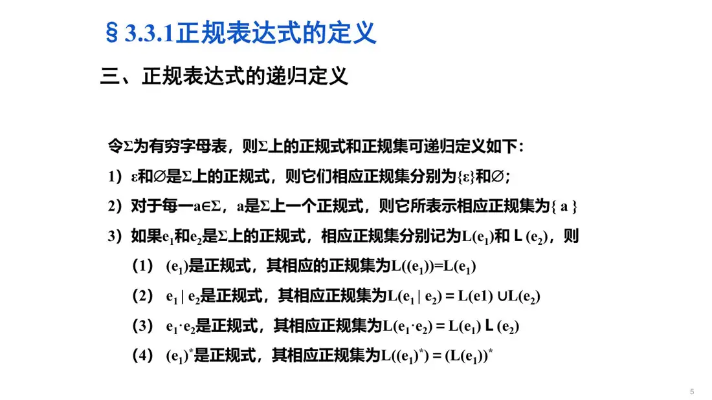

原文：

§3.3.1正规表达式的定义

三、正规表达式的递归定义

令Σ为有穷字母表，则Σ上的正规式和正规集可递归定义如下：

1）ε和是Σ上的正规式，则它们相应正规集分别为 $\{ \mathfrak { c } \}$ 和 $\bigtriangledown$ ；

2）对于每 $- \mathbf { a } \in \Sigma$ ，a是Σ上一个正规式，则它所表示相应正规集为{ a }

3）如果 ${ \bf \delta _ { 1 } }$ 和 $| \mathbf { e } _ { 2 } |$ 是Σ上的正规式，相应正规集分别记为L $\mathbf { \nabla } _ { \mathfrak { A } } ( \mathbf { e } _ { 1 } )$ )和 $\mathsf { L } \left( \mathbf { e } _ { 2 } \right)$ ，则

（1） $( \mathbf { e _ { 1 } } )$ 是正规式，其相应的正规集为 $\scriptstyle \mathbf { L } ( ( \mathbf { e } _ { 1 } ) ) = \mathbf { L } ( \mathbf { e } _ { 1 } )$

（2） $\mathbf { e _ { 1 } } | \mathbf { e } _ { 2 } $ 是正规式，其相应正规集为 $\operatorname { L } ( \mathbf { e } _ { 1 } | \ \mathbf { e } _ { 2 } ) = \operatorname { L } ( \mathbf { e } \mathbf { 1 } ) \ \cup \mathbf { L } ( \mathbf { e } _ { 2 } )$

（3） $\mathbf { e _ { 1 } } { \cdot } \mathbf { e _ { 2 } }$ 是正规式，其相应正规集为 $\operatorname { L } ( \mathbf { e } _ { 1 } { \cdot } \mathbf { e } _ { 2 } ) = \operatorname { L } ( \mathbf { e } _ { 1 } ) \operatorname { L } ( \mathbf { e } _ { 2 } )$

（4） $\bf ( e _ { 1 } ) ^ { : \cdot }$ \*是正规式，其相应正规集为 $\mathrm { L } ( ( \mathbf { e _ { 1 } } ) ^ { * } ) = \left( \mathrm { L } ( \mathbf { e _ { 1 } } ) \right) ^ { * }$

5

### §3.3.1正规表达式的定义

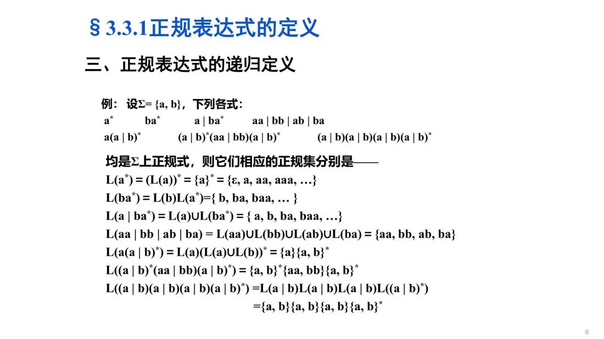

原文：

§3.3.1正规表达式的定义

三、正规表达式的递归定义

例： 设 $\boldsymbol { \Sigma } \mathbf { = } \left\{ \mathbf { a } , \mathbf { b } \right\}$ ，下列各式：a ba\* a | ba\* aa | bb | ab | ba$\mathbf { a ( a \mid b ) } ^ { * }$ (a $\mid \mathbf { b } ) ^ { * } ( \mathbf { a } \mathbf { a } \mid \mathbf { b } \mathbf { b } ) ( \mathbf { a } \mid \mathbf { b } ) ^ { * }$ (a ${ \left| \textbf { b } \right. } ( \mathbf { a } \mid \mathbf { b } ) ( \mathbf { a } \mid \mathbf { b } ) ( \mathbf { a } \mid \mathbf { b } ) ^ { * }$ 例如： $\mathrm { { e 1 } = \mathrm { { b } \left( a b \right) ^ { * } , \ e 2 = \left( b a \right) ^ { * } b } }$

6

### 求解 L(e1)和L(e2)

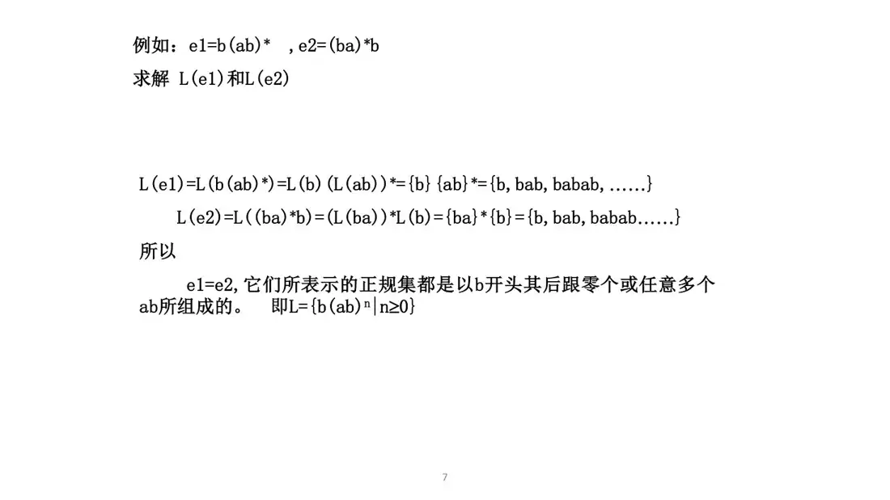

原文：

求解 L(e1)和L(e2)

$$
\mathrm{L} (\mathrm{e} 1) = \mathrm{L} (\mathrm{b} (\mathrm{ab}) ^ {*}) = \mathrm{L} (\mathrm{b}) (\mathrm{L} (\mathrm{ab})) ^ {*} = \{\mathrm{b} \} \{\mathrm{ab} \} ^ {*} = \{\mathrm{b}, \mathrm{bab}, \mathrm{babab}, \dots \dots \}
$$

$$
L (e 2) = L ((b a) ^ {*} b) = (L (b a)) ^ {*} L (b) = \{b a \} ^ {*} \{b \} = \{b, b a b, b a b a b \dots \dots \}
$$

所以

$\mathsf { e l } = \mathsf { e 2 } ,$ ,它们所表示的正规集都是以b开头其后跟零个或任意多个ab所组成的。即 $\mathrm { L } { = } \left\{ \mathrm { b } \left( { \mathrm { a b } } \right) { \mathrm { n } } \left| { \mathrm { n } } { \geq } 0 \right. \right\}$

7

### §3.3.2正规表达式的性质及其构造

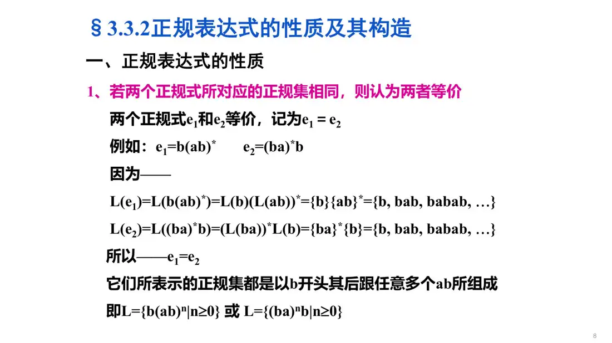

原文：

§3.3.2正规表达式的性质及其构造

一、正规表达式的性质

1、若两个正规式所对应的正规集相同，则认为两者等价 两个正规式 $\bf { ; e _ { 1 } }$ 和 $\vert \mathbf { e } _ { 2 }$ 等价，记为 $\mathbf { e } _ { 1 } = \mathbf { e } _ { 2 }$ 例如： $\begin{array} { r l r } { \mathbf { e } _ { 1 } { = } \mathbf { b } ( \mathbf { a b } ) ^ { * } } & { { } } & { \mathbf { e } _ { 2 } { = } ( \mathbf { b a } ) ^ { * } \mathbf { b } } \end{array}$ 因为—— L(e )=L(b(ab)\*)=L(b)(L(ab))\*={b}{ab}\*={b, bab, babab, } L(e )=L((ba)\*b)=(L(ba))\*L(b)={ba}\*{b}={b, bab, babab, } 所以— $\mathbf { \cdot e _ { 1 } } { = } \mathbf { e } _ { 2 }$

它们所表示的正规集都是以b开头其后跟任意多个ab所组成即 $\scriptstyle \mathbf { L } = \left\{ \mathbf { b } ( \mathbf { a b } ) ^ { \mathbf { n } } | \mathbf { n } { \geq } \mathbf { 0 } \right\}$ 或 $\scriptstyle \mathbf { L } = \left\{ ( \mathbf { b } \mathbf { a } ) ^ { \mathbf { n } } \mathbf { b } | \mathbf { n } { \geq } \mathbf { 0 } \right\}$

8

### §3.3.2正规表达式的性质及其构造

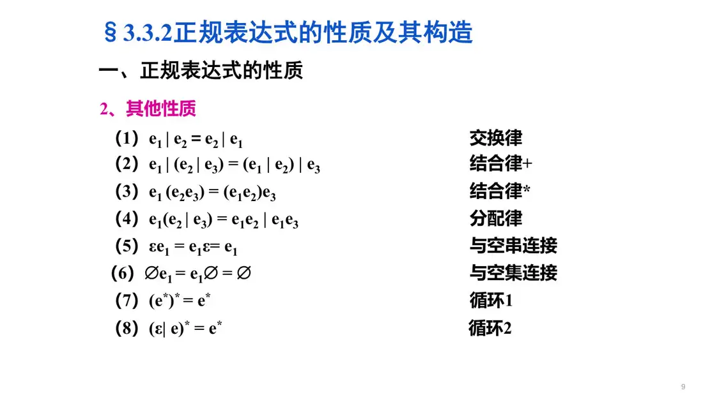

原文：

§3.3.2正规表达式的性质及其构造

一、正规表达式的性质

2、其他性质

<table><tr><td>(1)  $e_1 \mid e_2 = e_2 \mid e_1$ </td><td>交换律</td></tr><tr><td>(2)  $e_1 \mid (e_2 \mid e_3) = (e_1 \mid e_2) \mid e_3$ </td><td>结合律+</td></tr><tr><td>(3)  $e_1(e_2e_3) = (e_1e_2)e_3$ </td><td>结合律*</td></tr><tr><td>(4)  $e_1(e_2 \mid e_3) = e_1e_2 \mid e_1e_3$ </td><td>分配律</td></tr><tr><td>(5)  $\varepsilon e_1 = e_1\varepsilon = e_1$ </td><td>与空串连接</td></tr><tr><td>(6)  $\emptyset e_1 = e_1\emptyset = \emptyset$ </td><td>与空集连接</td></tr><tr><td>(7)  $(e^*)^* = e^*$ </td><td>循环1</td></tr><tr><td>(8)  $(\varepsilon \mid e)^* = e^*$ </td><td>循环2</td></tr></table>

9

### §3.3.2正规表达式的性质及其构造

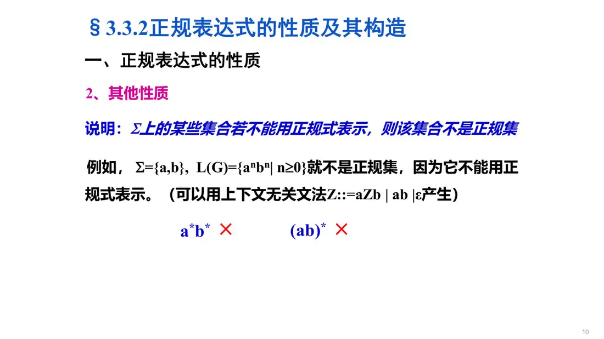

原文：

§3.3.2正规表达式的性质及其构造

一、正规表达式的性质

2、其他性质

说明：上的某些集合若不能用正规式表示 则该集合不是正规集例如， $\Sigma { = } \{ \mathbf { a } , \mathbf { b } \} , \ \mathrm { L } ( \mathbf { G } ) { = } \{ \mathbf { a } ^ { \mathrm { n } } \mathbf { b } ^ { \mathrm { n } } | \ \mathbf { n } { \geq } \mathbf { 0 } \}$ 就不是正规集，因为它不能用正规式表示。（可以用上下文无关文法 $\mathbf { Z } { \boldsymbol { : } } { \boldsymbol { : } } = \mathbf { a } \mathbf { Z } \mathbf { b } \mid \mathbf { a } \mathbf { b } \mid \mathbf { { \boldsymbol { \varepsilon } } }$ 产生）

$$
\mathbf {a} ^ {*} \mathbf {b} ^ {*} \times
$$

$$
(\mathbf {a b}) ^ {*} \times
$$

10

### 思考

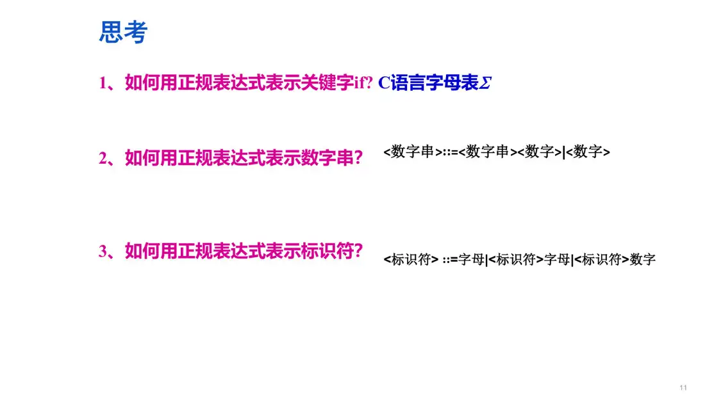

原文：

思考

1、如何用正规表达式表示关键字if?C语言字母表

2、如何用正规表达式表示数字串？

3、如何用正规表达式表示标识符？

<数字串>∷=<数字串><数字>|<数字>

<标识符> ∷=字母|<标识符>字母|<标识符>数字

11

### §3.3.2正规表达式的性质及其构造

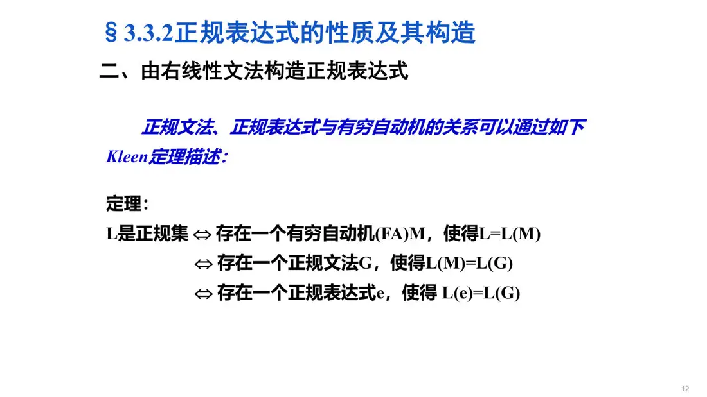

原文：

§3.3.2正规表达式的性质及其构造

二、由右线性文法构造正规表达式

正规文法、正规表达式与有穷自动机的关系可以通过如下$K l e e n$ 定理描述：

定理：

L是正规集  存在一个有穷自动机(FA)M，使得 $\mathbf { L } { = } \mathbf { L } ( \mathbf { M } )$

存在一个正规文法G，使得 $\scriptstyle { \mathrm { L } } ( \mathbf { M } ) = \mathbf { L } ( \mathbf { G } )$

 存在一个正规表达式e，使得 $\scriptstyle \mathbf { L } ( \mathbf { e } ) = \mathbf { L } ( \mathbf { G } )$

12

### §3.3.2正规表达式的性质及其构造

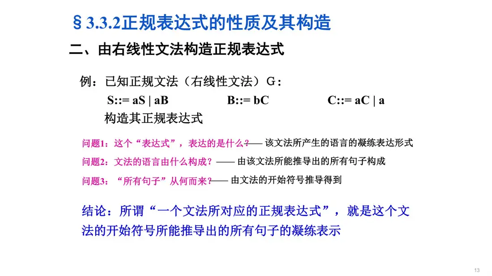

原文：

§3.3.2正规表达式的性质及其构造

二、由右线性文法构造正规表达式

例：已知正规文法（右线性文法） $\mathbf { G }$ :

$$
\mathbf {S}: := \mathbf {a S} \mid \mathbf {a B}
$$

$$
\mathbf {B}: := \mathbf {b C}
$$

$$
\mathbf {C}: := \mathbf {a C} \mid \mathbf {a}
$$

构造其正规表达式

问题1：这个“表达式”，表达的是什么？——该文法所产生的语言的凝练表达形式

问题2：文法的语言由什么构成？——由该文法所能推导出的所有句子构成

问题3：“所有句子”从何而来？—— 由文法的开始符号推导得到

结论：所谓“一个文法所对应的正规表达式”，就是这个文法的开始符号所能推导出的所有句子的凝练表示

13

### 正规表达式的性质及其构造

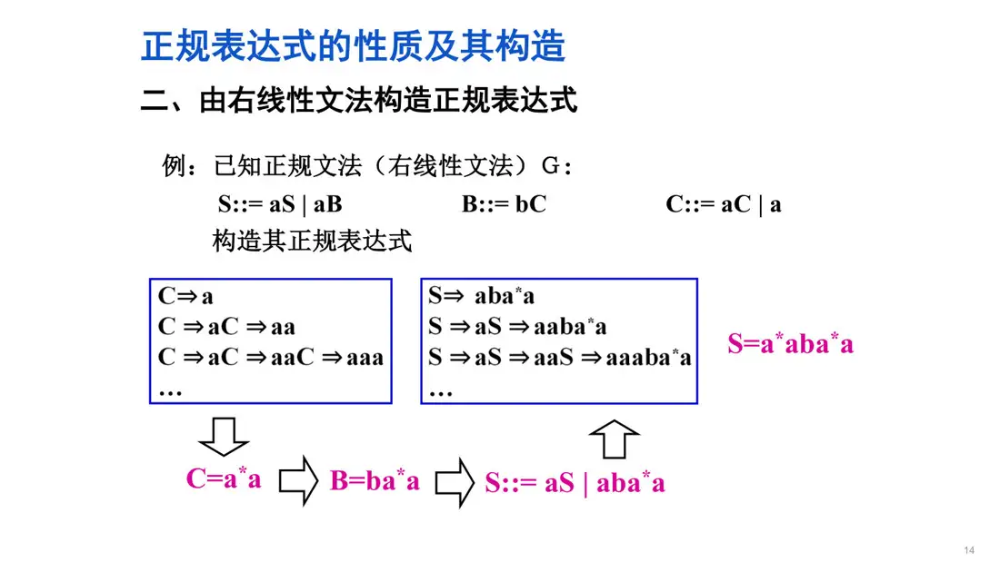

原文：

正规表达式的性质及其构造

二、由右线性文法构造正规表达式

例：已知正规文法（右线性文法） $\mathbf { G }$ :

$$
\mathbf {S}: := \mathbf {a S} \mid \mathbf {a B}
$$

$$
\mathbf {B}: := \mathbf {b C}
$$

$$
\mathbf {C}: := \mathbf {a C} \mid \mathbf {a}
$$

构造其正规表达式

$$
\begin{array}{l} \hline \mathrm{C} \Rightarrow \mathrm{a} \\ \mathrm{C} \Rightarrow \mathrm{aC} \Rightarrow \mathrm{aa} \\ \mathrm{C} \Rightarrow \mathrm{aC} \Rightarrow \mathrm{aaC} \Rightarrow \mathrm{aaa} \\ \dots \\ \hline \end{array}
$$

$$
\begin{array}{l} \hline \mathrm {S\Rightarrow aba^ {*} a} \\ \mathrm {S\Rightarrow aS\Rightarrow aaba^ {*} a} \\ \mathrm {S\Rightarrow aS\Rightarrow aaS\Rightarrow aaaba^ {*} a} \\ \dots \end{array}
$$

$$
\mathrm{S} = \mathrm{a} ^ {*} \mathrm{aba} ^ {*} \mathrm{a}
$$

C=a\*a B=ba\*a S::= aS | aba\*a

14

### §3.3.2正规表达式的性质及其构造

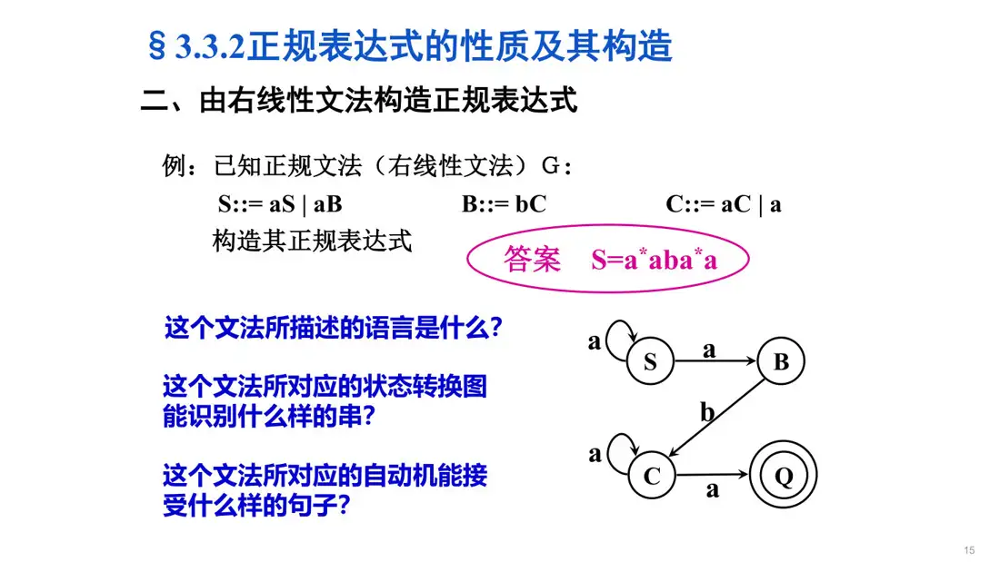

原文：

§3.3.2正规表达式的性质及其构造

二、由右线性文法构造正规表达式

例：已知正规文法（右线性文法） $\mathbf { G }$ :

$$
\mathbf {S}: := \mathbf {a S} \mid \mathbf {a B}
$$

$$
\mathbf {B}: := \mathbf {b C}
$$

构造其正规表达式

答案

C::= aC | a

$$
\mathrm{S} = \mathrm{a} ^ {*} \mathrm{aba} ^ {*} \mathrm{a}
$$

这个文法所描述的语言是什么？

这个文法所对应的状态转换图能识别什么样的串？

这个文法所对应的自动机能接受什么样的句子？

15

### 二、由右线性文法构造正规表达式（通用解法）

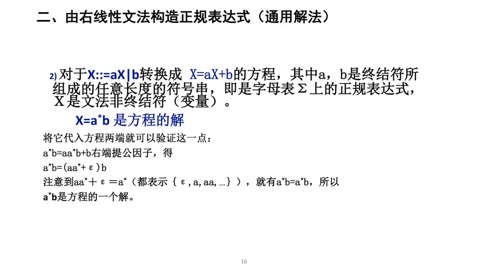

原文：

二、由右线性文法构造正规表达式（通用解法）

2) 对于 $x : = a \times 1 6$ 转换成 $\mathtt { X } { = } \mathtt { a X } { + } \mathtt { b }$ 的方程，其中a，b是终结符所组成的任意长度的符号串，即是字母表 $\Sigma$ 上的正规表达式，X是文法非终结符（变量）。

$x = a ^ { 4 } b$ 是方程的解

将它代入方程两端就可以验证这一点：

$a ^ { * } b = a a ^ { * } b + b$ 右端提公因子，得

$$
a ^ {*} b = (a a ^ {*} + \varepsilon) b
$$

注意到 $\mathrm { \tt { a a } } ^ { * } + \mathrm { \tt { e } } = \mathrm { \tt { a } } ^ { * }$ （都表示 $\{ \texttt { \small e } , \mathrm { a } , \mathrm { a a } , \ldots \} \ )$ ，就有 $\partial ^ { * } \mathbf { b } = _ { \mathbf { a } } + \mathbf { b }$ ，所以$\exists ^ { * } b$ 是方程的一个解。

16

### 例：已知正规文法（右线性文法）G：

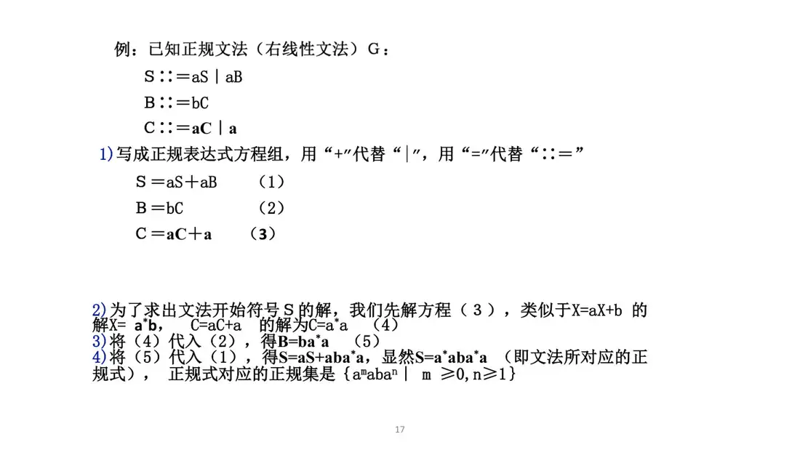

原文：

例：已知正规文法（右线性文法）G：

$$
\mathbf {C}: := \mathbf {a C} \mid \mathbf {a}
$$

1)写成正规表达式方程组，用 $^ { 6 6 } + \prime \prime .$ 代替“|”，用 $^ { 6 6 } = \prime \prime ,$ 代替 $\cdots = { } ^ { \mathfrak { s } }$

$$
\mathrm{S} = \mathrm{aS} + \mathrm{aB}\tag{1}
$$

$$
\mathbf {B} = \mathbf {b C}\tag{2}
$$

$$
\mathbf {C} = \mathbf {a C} + \mathbf {a}\tag{3}
$$

X= a+b,

C=aC+a

C=a\*a

X=aX+b

B=ba\*a

2)为了求出文法开始符号S的解，我们先解方程（3），类似于X=aX+b 的解X= a\*b， C=aC+a的解为 （4）

S=aS+aba\*a

4)将（5）代入（1），得S=aS+aba\*a，显然S=a\*aba\*a （即文法所对应的正 S=a\*aba\*a规式）， 正规式对应的正规集是｛amaban｜ m ≥0,n≥1｝ {amabaⁿ|m ≥0,n≥1}

3)将（4）代入（2），得B=ba\*a （5）

17

### 三、由左线性文法构造正规表达式

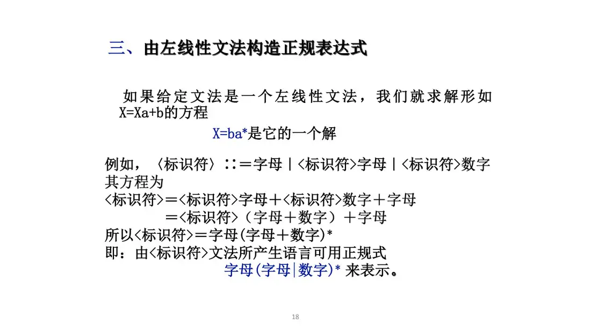

原文：

三、由左线性文法构造正规表达式

如果给定文法是一个左线性文法，我们就求解形如${ \tt X } { = } { \tt X } { \tt a } { + } { \tt b }$ 的方程

$$
\mathrm{X} = \mathrm{ba} ^ {*} \text {是它的一个解}
$$

例如，〈标识符〉∷＝字母｜<标识符>字母｜<标识符>数字其方程为

$$
\begin{array}{r l} \langle \text {标识符} \rangle & = \langle \text {标识符} \rangle \text {字母} + \langle \text {标识符} \rangle \text {数字} + \text {字母} \\ & = \langle \text {标识符} \rangle (\text {字母} + \text {数字}) + \text {字母} \end{array}
$$

$$
\text {所以<   标识符> = 字母(字母+数字)*}
$$

即：由<标识符>文法所产生语言可用正规式字母(字母|数字)\* 来表示。

18

### §3.3.3由正规表达式构造转换系统

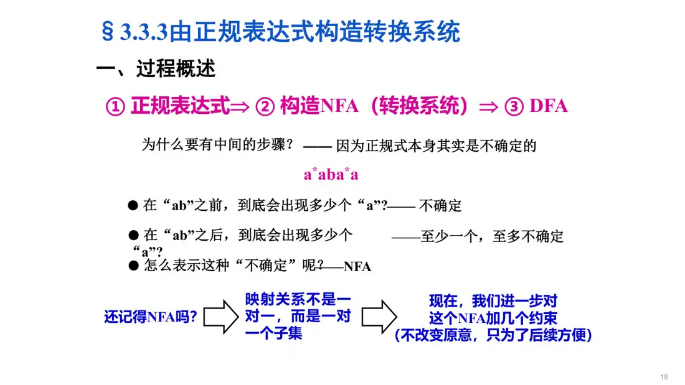

原文：

§3.3.3由正规表达式构造转换系统

一、过程概述

①正规表达式→②构造NFA（转换系统）⇒③DFA

为什么要有中间的步骤？ —— 因为正规式本身其实是不确定的

$$
\mathbf {a} ^ {*} \mathbf {a b a} ^ {*} \mathbf {a}
$$

● 在“ab”之前，到底会出现多少个“a”?—— 不确定

● 在“ab”之后，到底会出现多少个 至少一个，至多不确定“a”?

● 怎么表示这种“不确定”呢？——NFA

映射关系不是一 现在，我们进一步对还记得NFA吗？ 对一，而是一对 这个NFA加几个约束一个子集 （不改变原意，只为了后续方便）

19

### §3.3.3由正规表达式构造转换系统

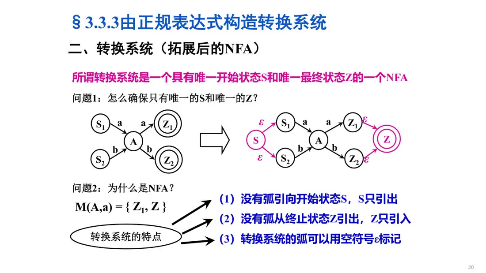

原文：

§3.3.3由正规表达式构造转换系统

二、转换系统（拓展后的NFA）

所谓转换系统是一个具有唯一开始状态S和唯一最终状态Z的一个NFA

问题1：怎么确保只有唯一的S和唯一的Z？

问题2：为什么是NFA？

$$
\mathbf {M} (\mathbf {A}, \mathbf {a}) = \{\mathbf {Z} _ {1}, \mathbf {Z} \}
$$

转换系统的特点

（1）没有弧引向开始状态S，S只引出

（2）没有弧从终止状态Z引出，Z只引入

（3）转换系统的弧可以用空符号ε标记

20

### §3.3.3由正规表达式构造转换系统

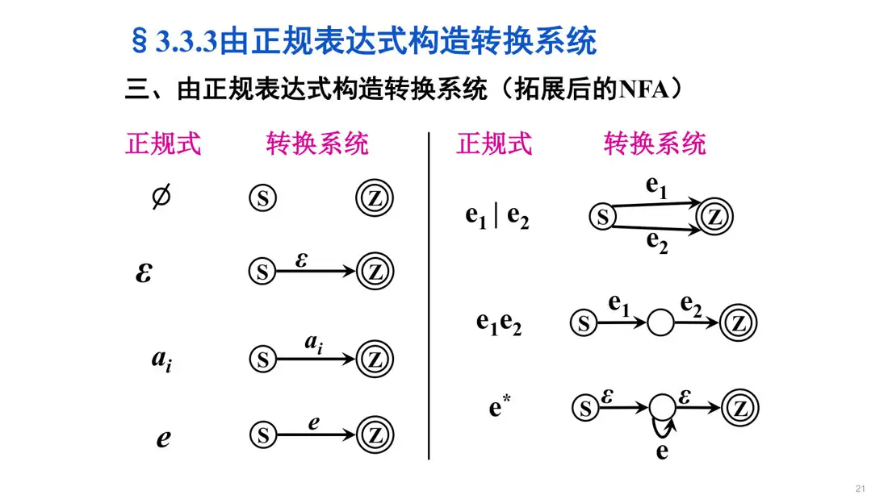

原文：

§3.3.3由正规表达式构造转换系统

三、由正规表达式构造转换系统（拓展后的NFA）

正规式

转换系统

正规式

转换系统

$$
\varnothing
$$

$$
\mathbf {e} _ {1} | \mathbf {e} _ {2}
$$

$$
\pmb {\varepsilon}
$$

$$
a _ {i}
$$

$$
\mathbf {e} _ {1} \mathbf {e} _ {2}
$$

$$
\mathbf {e} ^ {*}
$$

$$
e
$$

21

### § 3.4.3 由正规表达式构造转换系统

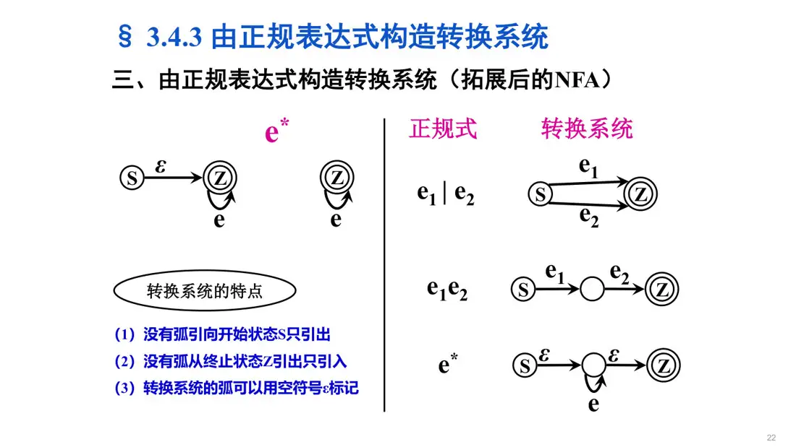

原文：

§ 3.4.3 由正规表达式构造转换系统

三、由正规表达式构造转换系统（拓展后的NFA）

转换系统的特点

（1）没有弧引向开始状态S只引出

（2）没有弧从终止状态Z引出只引入

（3）转换系统的弧可以用空符号ε标记

正规式

$$
\mathbf {e} _ {1} | \mathbf {e} _ {2}
$$

$$
\mathbf {e} _ {1} \mathbf {e} _ {2}
$$

$$
\mathbf {e} ^ {*}
$$

转换系统

22

### § 3.4.3 由正规表达式构造转换系统

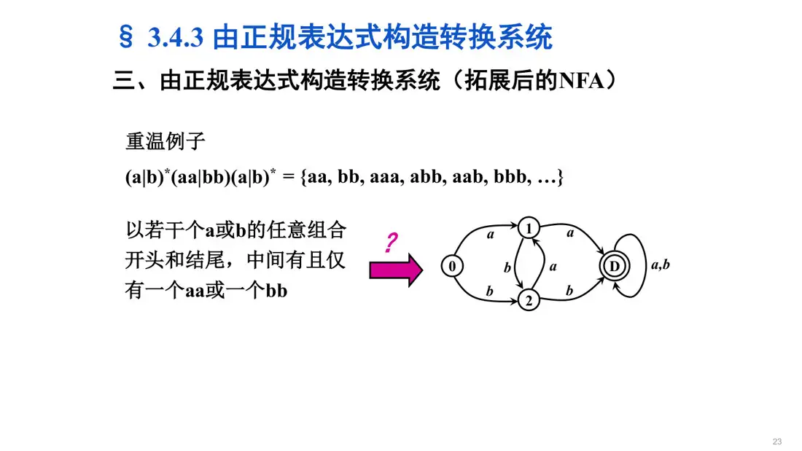

原文：

§ 3.4.3 由正规表达式构造转换系统

三、由正规表达式构造转换系统（拓展后的NFA）

重温例子

$$
| \mathbf {b}) ^ {*} (\mathbf {a a} | \mathbf {b b}) (\mathbf {a} | \mathbf {b}) ^ {*} = \{\mathbf {a a}, \mathbf {b b}, \mathbf {a a a}, \mathbf {a b b}, \mathbf {a a b}, \mathbf {b b b}, \dots \}
$$

以若干个a或b的任意组合开头和结尾，中间有且仅有一个aa或一个bb

23

### 24

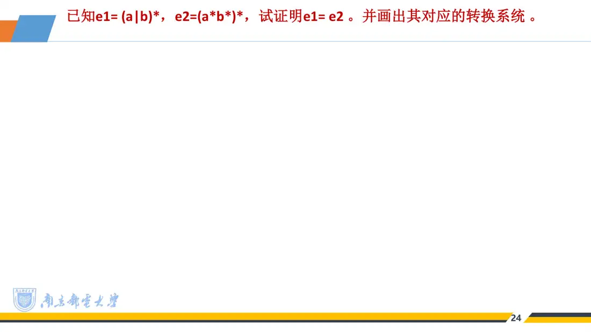

原文：

已知 ${ \bf e 1 } = ( { \bf a } | { \bf b } ) ^ { * }$ ， $\mathtt { e } 2 \mathtt { = } \big ( \mathtt { a } ^ { \ast } \big \mathbf { b } ^ { \ast } \big )$ \*，试证明 ${ \tt e 1 } = { \tt e 2 }$ 。并画出其对应的转换系统 。

24

### §3.3.3由正规表达式构造转换系统

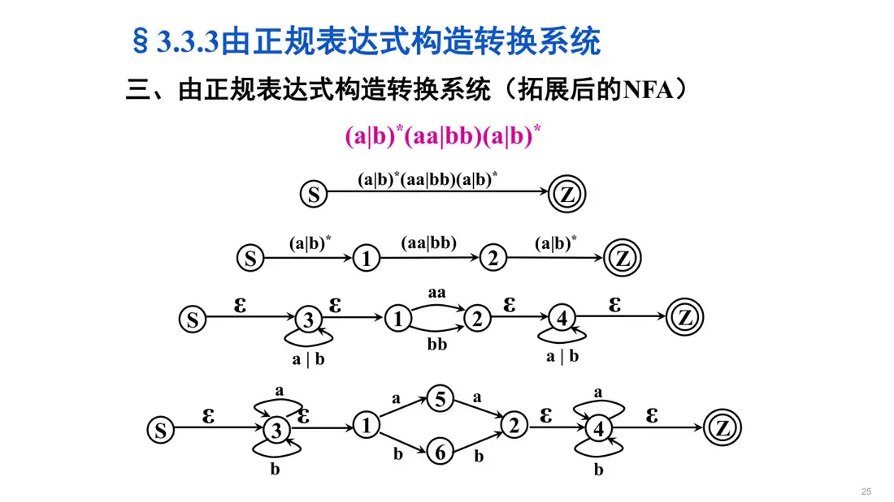

原文：

§3.3.3由正规表达式构造转换系统

三、由正规表达式构造转换系统（拓展后的NFA）

25

### §3.3.4将转换系统变为DFA

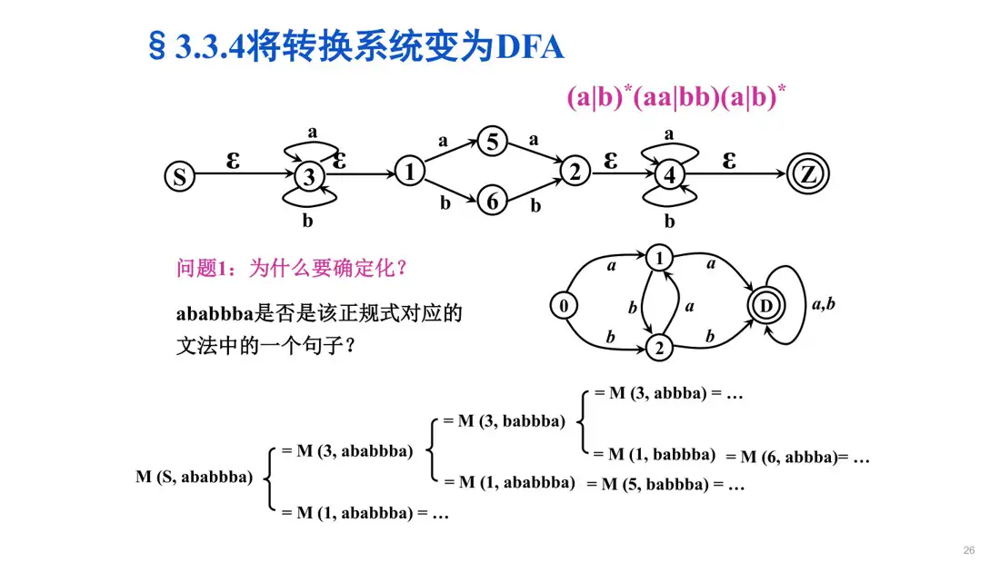

原文：

§3.3.4将转换系统变为DFA

(a|b)\*(aa|bb)(a|b)

问题1：为什么要确定化？

ababbba是否是该正规式对应的文法中的一个句子？

$$
\mathbf {M} \left(\mathrm{S}, \text {ababbba}\right) \left\{ \begin{array}{l} = \mathbf {M} \left(3, \text {ababbba}\right) \\ = \mathbf {M} \left(1, \text {ababbba}\right) = \dots \end{array} \left\{ \begin{array}{l} = \mathbf {M} \left(3, \text {babbba}\right) \\ = \mathbf {M} \left(1, \text {ababbba}\right) = \mathbf {M} \left(5, \text {babbba}\right) = \dots \end{array} \right. \right.
$$

26

### §3.3.4将转换系统变为DFA

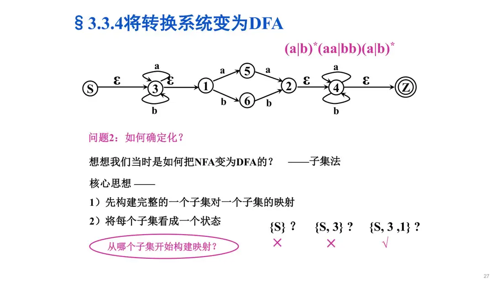

原文：

§3.3.4将转换系统变为DFA

(a|b)\*(aa|bb)(a|b)

问题2：如何确定化？

想想我们当时是如何把NFA变为DFA的？ ——子集法

核心思想 ——

1）先构建完整的一个子集对一个子集的映射

2）将每个子集看成一个状态

从哪个子集开始构建映射？

{S} ？ {S, 3} ? {S, 3 ,1} ? × × √

27

### §3.3.4将转换系统变为DFA

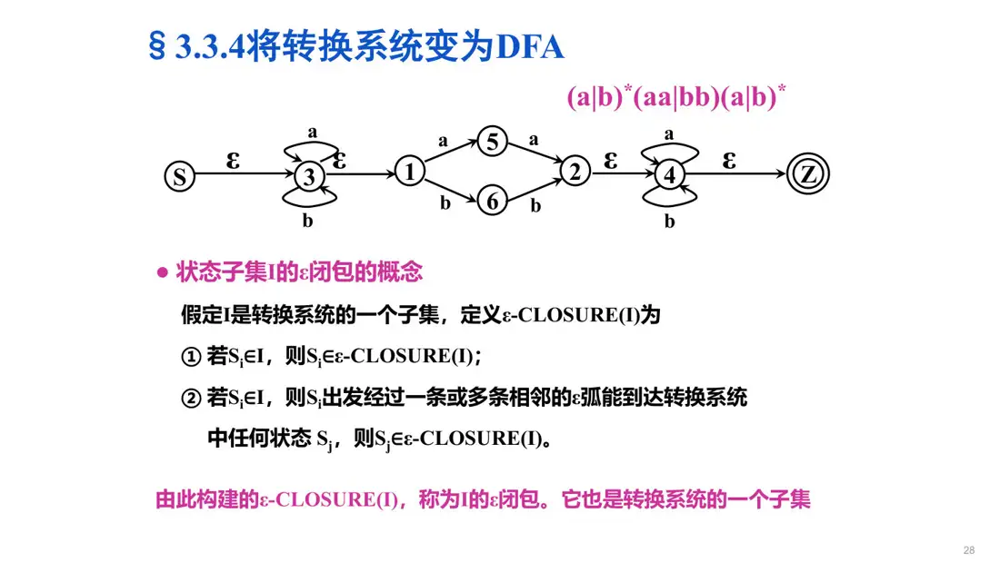

原文：

§3.3.4将转换系统变为DFA

$$
(a | b) ^ {*} (a a | b b) (a | b) ^ {*}
$$

● 状态子集I的ε闭包的概念

假定I是转换系统的一个子集，定义 ${ \bf { \varepsilon } } _ { \bf { { \varepsilon } } } - { \bf { C L O S U R E } } ( { \bf { I } } )$ 为

① 若 $\mathbf { S _ { i } } { \in } \mathbf { I }$ ，则 $\mathbf { S _ { i } } { \in } \mathbf { \pmb { \mathscr { E } } } { \mathbf { - } } \mathbf { C } \mathbf { L } \mathbf { O } \mathbf { S } \mathbf { U } \mathbf { R } \mathbf { E } ( \mathbf { I } )$ ；

② 若 $\mathbf { S _ { i } } { \in } \mathbf { I } .$ ，则 $| \bf { S _ { i } }$ 出发经过一条或多条相邻的ε弧能到达转换系统中任何状态 $\mathbf { S _ { j } } _ { \pmb { l } }$ ，则 $\mathbf { S _ { j } } \mathbf { \in } \mathbf { \pmb { z } } \mathbf { - } \mathbf { C } \mathbf { L O S U R E } ( \mathbf { I } )$ )。

由此构建的ε-CLOSURE(I)，称为I的ε闭包。它也是转换系统的一个子集

28

### §3.3.4将转换系统变为DFA

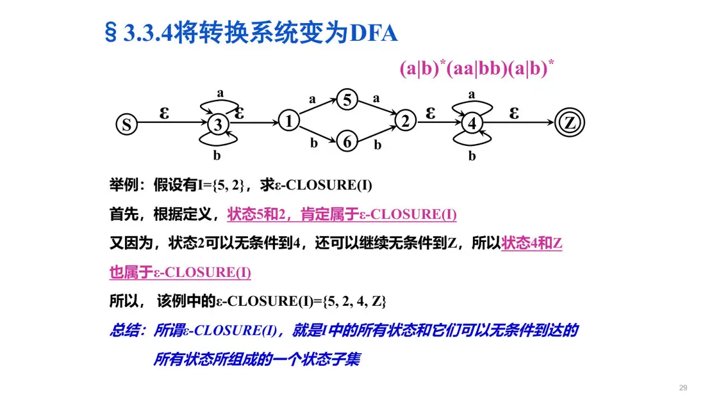

原文：

§3.3.4将转换系统变为DFA

$$
(a | b) ^ {*} (a a | b b) (a | b) ^ {*}
$$

举例：假设有I={5, 2}，求 $\mathbf { \dot { c } } \mathbf { - C L O S U R E } ( \mathbf { I } )$

首先，根据定义，状态5和2，肯定属于 $\mathbf { \bar { c } } \mathbf { - } \mathbf { C L O S U R E } ( \mathrm { I } )$

又因为，状态2可以无条件到4，还可以继续无条件到Z，所以状态4和Z

也属于 $\mathbf { \underline { { e } } } { - } \mathbf { C L O S U R E } ( \mathrm { I } )$

所以， 该例中的 $\scriptstyle \mathtt { \mathfrak { c } - C L O S U R E } ( \mathrm { I } ) = \{ 5 , 2 , 4 , \mathrm { Z } \}$

总结：所谓8 $\AA ^ { - C L O S U R E ( I ) }$ ，就是I中的所有状态和它们可以无条件到达的所有状态所组成的一个状态子集

29

### 子集Ia

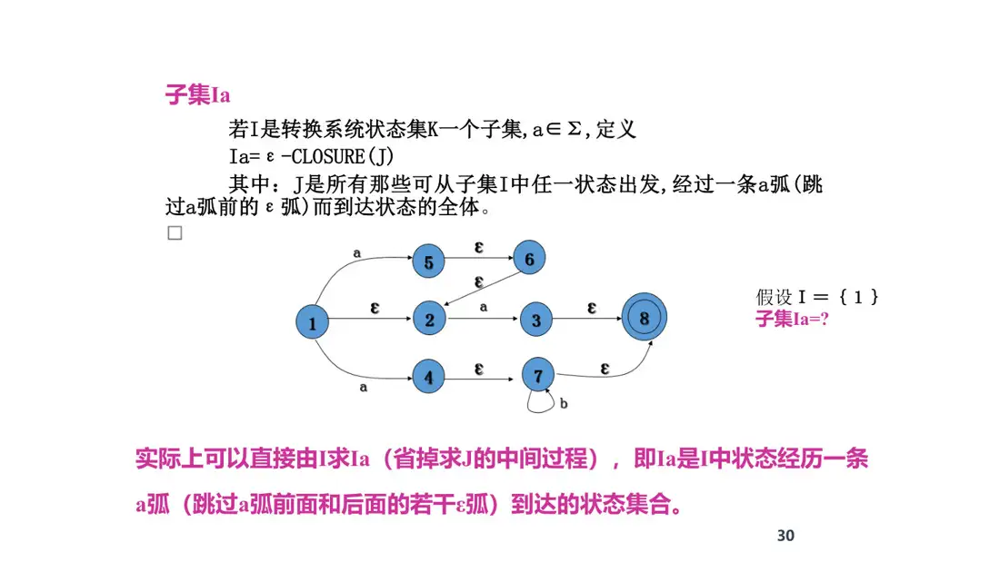

原文：

子集Ia

若I是转换系统状态集K一个子集, $\mathsf { a } \in \Sigma$ ,定义

Ia=ε-CLOSURE(J)

其中：J是所有那些可从子集I中任一状态出发,经过一条a弧(跳过a弧前的ε弧)而到达状态的全体。

假设I＝｛1｝ 子集Ia=?

实际上可以直接由I求Ia（省掉求J的中间过程），即Ia是I中状态经历一条a弧（跳过a弧前面和后面的若干ε弧）到达的状态集合。

30

### §3.3.4将转换系统变为DFA

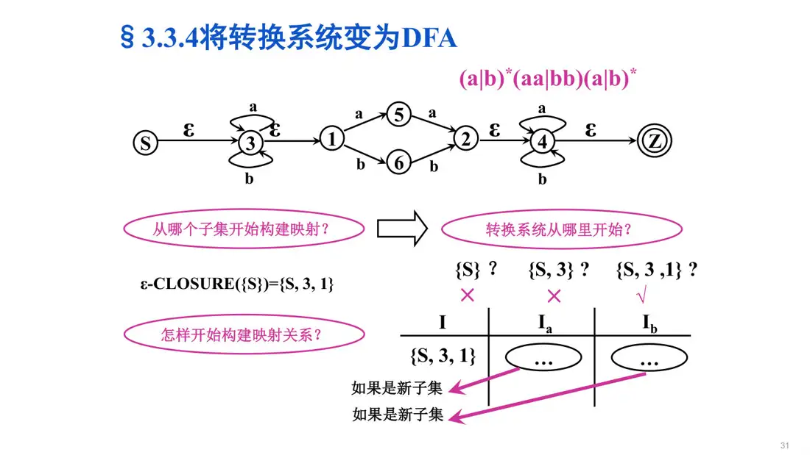

原文：

§3.3.4将转换系统变为DFA

31

### §3.3.4将转换系统变为DFA

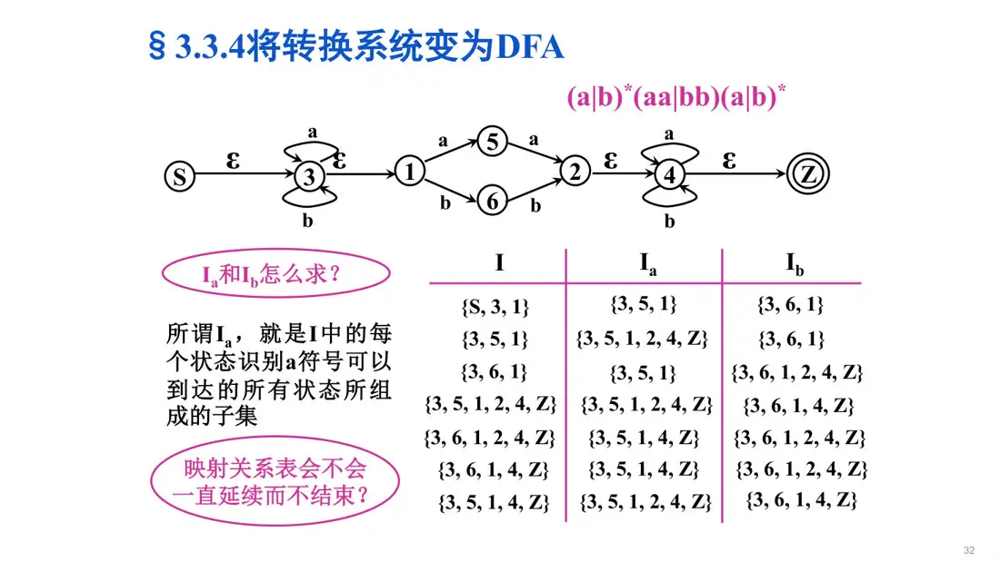

原文：

§3.3.4将转换系统变为DFA

(a|b)\*(aa|bb)(a|b)

<table><tr><td rowspan="2">Ia和Ib怎么求?</td><td>I</td><td>Ia</td><td>Ib</td></tr><tr><td>{S,3,1}</td><td>{3,5,1}</td><td>{3,6,1}</td></tr><tr><td rowspan="4">所谓Ia,就是I中的每个状态识别a符号可以到达的所有状态所组成的子集</td><td>{3,5,1}</td><td>{3,5,1,2,4,Z}</td><td>{3,6,1}</td></tr><tr><td>{3,6,1}</td><td>{3,5,1}</td><td>{3,6,1,2,4,Z}</td></tr><tr><td>{3,5,1,2,4,Z}</td><td>{3,5,1,2,4,Z}</td><td>{3,6,1,4,Z}</td></tr><tr><td>{3,6,1,2,4,Z}</td><td>{3,5,1,4,Z}</td><td>{3,6,1,2,4,Z}</td></tr><tr><td rowspan="2">映射关系表会不会一直延续而不结束?</td><td>{3,6,1,4,Z}</td><td>{3,5,1,4,Z}</td><td>{3,6,1,2,4,Z}</td></tr><tr><td>{3,5,1,4,Z}</td><td>{3,5,1,2,4,Z}</td><td>{3,6,1,4,Z}</td></tr></table>

32

### §3.3.4将转换系统变为DFA

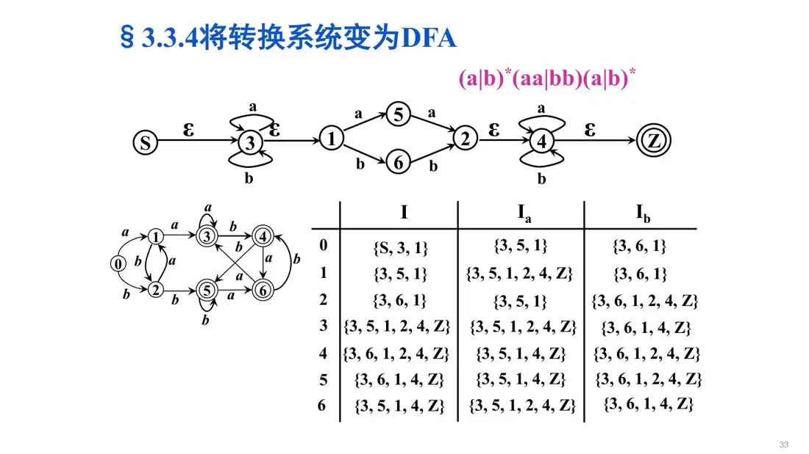

原文：

§3.3.4将转换系统变为DFA

(a|b)\*(aa|bb)(a|b)

<table><tr><td rowspan="8"></td><td colspan="2">[I]</td><td> $I_a$ </td><td> $I_b$ </td></tr><tr><td>0</td><td>{S, 3, 1}</td><td>{3, 5, 1}</td><td>{3, 6, 1}</td></tr><tr><td>1</td><td>{3, 5, 1}</td><td>{3, 5, 1, 2, 4, Z}</td><td>{3, 6, 1}</td></tr><tr><td>2</td><td>{3, 6, 1}</td><td>{3, 5, 1}</td><td>{3, 6, 1, 2, 4, Z}</td></tr><tr><td>3</td><td>{3, 5, 1, 2, 4, Z}</td><td>{3, 5, 1, 2, 4, Z}</td><td>{3, 6, 1, 4, Z}</td></tr><tr><td>4</td><td>{3, 6, 1, 2, 4, Z}</td><td>{3, 5, 1, 4, Z}</td><td>{3, 6, 1, 2, 4, Z}</td></tr><tr><td>5</td><td>{3, 6, 1, 4, Z}</td><td>{3, 5, 1, 4, Z}</td><td>{3, 6, 1, 2, 4, Z}</td></tr><tr><td>6</td><td>{3, 5, 1, 4, Z}</td><td>{3, 5, 1, 2, 4, Z}</td><td>{3, 6, 1, 4, Z}</td></tr></table>

33

### 子集法由转换系统构造确定有穷自动机DFA步骤

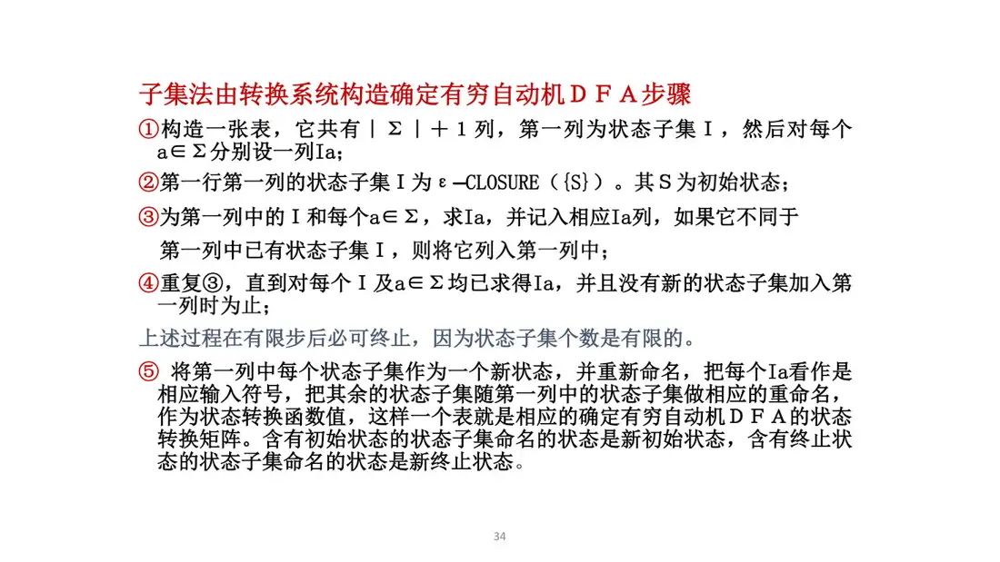

原文：

子集法由转换系统构造确定有穷自动机DFA步骤

①构造一张表，它共有｜Σ｜＋1列，第一列为状态子集I，然后对每个$\mathsf { a } \in \Sigma$ 分别设一列Ia；

②第一行第一列的状态子集I为ε—CLOSURE（{S}）。其S为初始状态；

③为第一列中的I和每个 $\mathbf { \hat { a } } \in \Sigma$ ，求Ia，并记入相应Ia列，如果它不同于第一列中已有状态子集I，则将它列入第一列中；

④重复③，直到对每个I及a∈Σ均已求得Ia，并且没有新的状态子集加入第一列时为止；

上述过程在有限步后必可终止，因为状态子集个数是有限的。

⑤ 将第一列中每个状态子集作为一个新状态，并重新命名，把每个Ia看作是相应输入符号，把其余的状态子集随第一列中的状态子集做相应的重命名，作为状态转换函数值，这样一个表就是相应的确定有穷自动机DFA的状态转换矩阵。含有初始状态的状态子集命名的状态是新初始状态，含有终止状态的状态子集命名的状态是新终止状态。

34

### 确定有穷自动机的化简

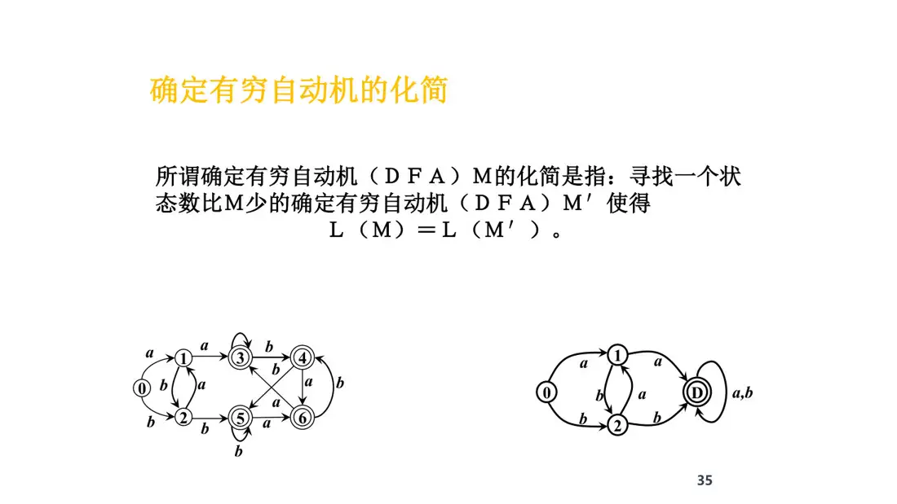

原文：

确定有穷自动机的化简

所谓确定有穷自动机（DFA）M的化简是指：寻找一个状 态数比M少的确定有穷自动机 $( \mathrm { ~ D ~ F ~ A ~ } ) \mathrm { ~ M ~ } ^ { \prime }$ 使得

${ \bf { L } } { \bf { \Lambda } } ( { \bf { M } } ) = { \bf { L } } { \bf { \Lambda } } ( { \bf { M } } ^ { \prime } { \bf { \Lambda } } )$ 0

35

### 确定有穷自动机的化简

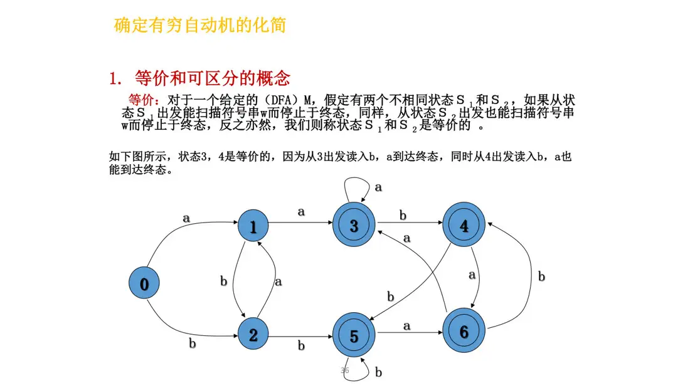

原文：

确定有穷自动机的化简

1. 等价和可区分的概念

等价：对于一个给定的（DFA）M，假定有两个不相同状态S 和S ，如果从状态S 出发能扫描符号串w而停止于终态，同样，从状态 $\mathrm { ~ \mathsf ~ { ~ S ~ } ~ } _ { \mathfrak { ~ 2 ~ } }$ 出发也能扫描符号串w而停止于终态，反之亦然，我们则称状态S 和 $\mathrm { ~ \mathsf ~ { ~ S ~ } ~ } _ { 2 }$ 是等价的 。

如下图所示，状态3，4是等价的，因为从3出发读入b，a到达终态，同时从4出发读入b，a也能到达终态。

### 两个状态等价的条件:

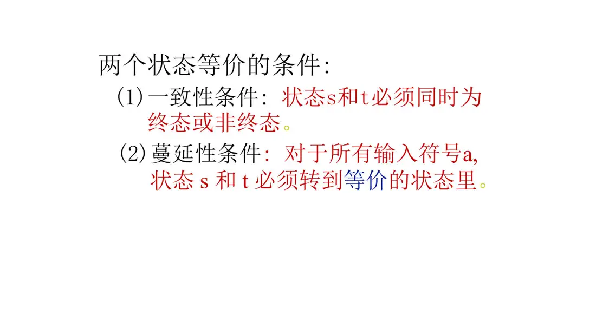

原文：

两个状态等价的条件:

(1)一致性条件: 状态s和t必须同时为终态或非终态。

(2)蔓延性条件: 对于所有输入符号a,状态 s 和t 必须转到等价的状态里。

### 可区分： 若两不同状态不等价，则称它们是可区分的。

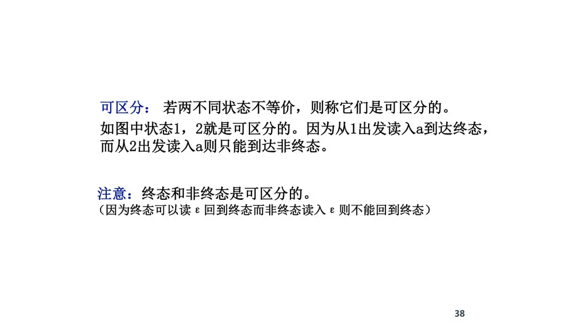

原文：

可区分： 若两不同状态不等价，则称它们是可区分的。

如图中状态1，2就是可区分的。因为从1出发读入a到达终态，而从2出发读入a则只能到达非终态。

注意：终态和非终态是可区分的。

（因为终态可以读ε回到终态而非终态读入ε则不能回到终态）

38

### 化简方法:

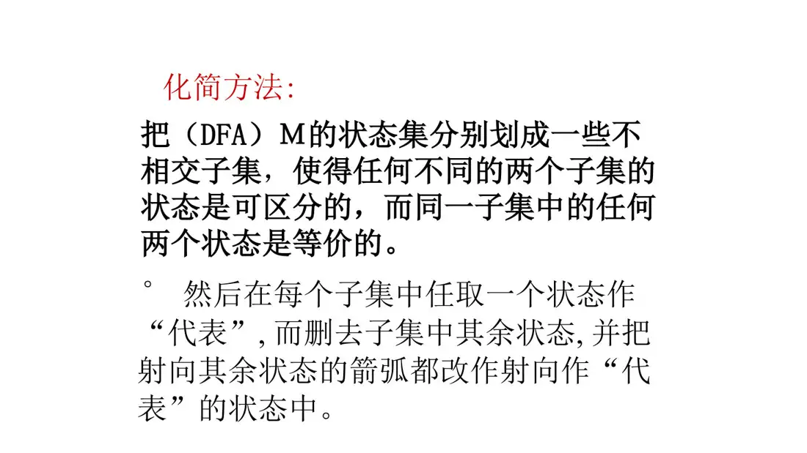

原文：

化简方法:

把（DFA）M的状态集分别划成一些不相交子集，使得任何不同的两个子集的状态是可区分的，而同一子集中的任何两个状态是等价的。

然后在每个子集中任取一个状态作“代表”, 而删去子集中其余状态, 并把射向其余状态的箭弧都改作射向作“代表”的状态中。

### 下面给出化简算法的具体执行步骤:

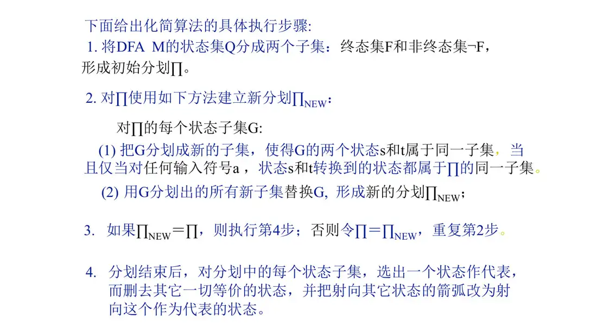

原文：

下面给出化简算法的具体执行步骤:

1. 将DFA M的状态集Q分成两个子集：终态集F和非终态集¬F，形成初始分划∏。

2. 对∏使用如下方法建立新分划 $\prod _ { \mathrm { N E W } }$

对∏的每个状态子集G:

(1) 把G分划成新的子集，使得G的两个状态s和t属于同一子集，当且仅当对任何输入符号a ，状态s和t转换到的状态都属于∏的同一子集。

(2) 用G分划出的所有新子集替换G, 形成新的分划 $\Pi _ { \mathrm { N E W } } ;$

3. 如果 $\Pi _ { \mathrm { N E W } } { = } \Pi$ ，则执行第4步；否则令 $\Pi { = } \Pi _ { \mathrm { N E W } }$ ，重复第2步。

4. 分划结束后，对分划中的每个状态子集，选出一个状态作代表，而删去其它一切等价的状态，并把射向其它状态的箭弧改为射向这个作为代表的状态。

### 例 将右面的DFA最小化

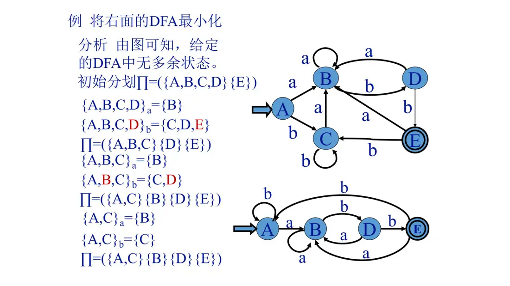

原文：

例 将右面的DFA最小化

分析 由图可知，给定的DFA中无多余状态。初始分划 $\scriptstyle \prod = ( \left\{ { \mathrm { A } } , { \mathrm { B } } , { \mathrm { C } } , { \mathrm { D } } \right\} \left\{ { \mathrm { E } } \right\} )$ $\{ \mathrm { A } , \mathrm { B } , \mathrm { C } , \mathrm { D } \} _ { \mathrm { a } } { = } \{ \mathrm { B } \}$ $\{ { \mathrm { A } } , { \mathrm { B } } , { \mathrm { C } } , { \mathrm { D } } \} _ { \mathrm { b } } { = } \{ { \mathrm { C } } , { \mathrm { D } } , { \mathrm { E } } \}$ $\scriptstyle \prod = ( \{ \mathrm { A } , \mathrm { B } , \mathrm { C } \} \{ \mathrm { D } \} \{ \mathrm { E } \} )$ $\{ \mathrm { A } , \mathrm { B } , \mathrm { C } \} _ { \mathrm { a } } = \{ \mathrm { B } \}$ $\{ \mathrm { A } , \mathrm { B } , \mathrm { C } \} _ { \mathrm { b } } { = } \{ \mathrm { C } , \mathrm { D } \}$ $\scriptstyle { \prod = ( \{ \mathrm { A } , \mathrm { C } \} \{ \mathrm { B } \} \{ \mathrm { D } \} \{ \mathrm { E } \} ) }$ $\{ \mathrm { A } , \mathrm { C } \} _ { \mathrm { a } } { = } \{ \mathrm { B } \}$ $\{ \mathrm { A } , \mathrm { C } \} _ { \mathrm { b } } { = } \{ \mathrm { C } \}$ $\scriptstyle \prod = ( \{ { \mathrm { A } } , { \mathrm { C } } \} \{ { \mathrm { B } } \} \{ { \mathrm { D } } \} \{ { \mathrm { E } } \} )$

### 第 42 页

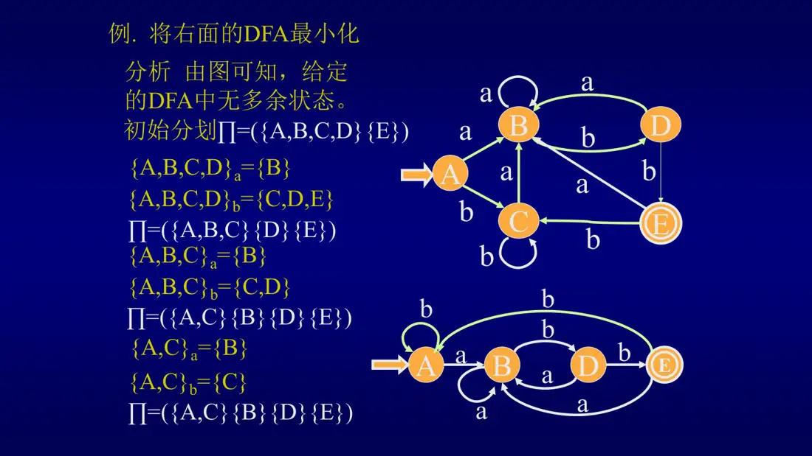

原文：

例. 将右面的DFA最小化分析 由图可知，给定的DFA中无多余状态。初始分划∏=({A,B,C,D}{{A,B,C,D}a={B}{A,B,C,D} ={C,D,E}∏=({A,B,C}{D}{E}){A,B,C}a={B}{A,B,C}b={C,D}∏=({A,C}{B}{D}{E}){A,C}a={B}{A,C}b={C}∏=({A,C}{B}{D}{E})

### 终态集｛3，4，5，6｝和非终态集｛0，1，2｝，形成初始分划∏

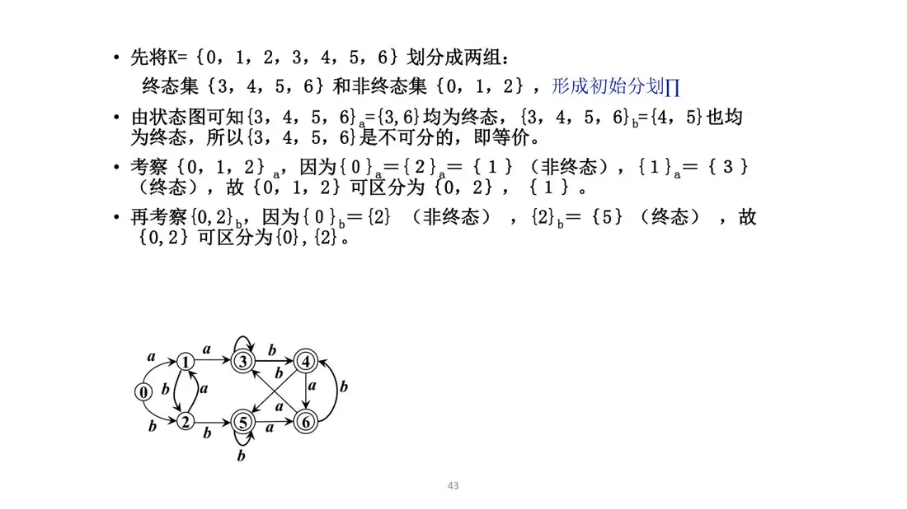

原文：

• 先将 $\mathrm { K = \{ 0 , ~ 1 , ~ 2 , ~ 3 , ~ 4 , ~ 5 , ~ 6 \} }$ 划分成两组：

终态集｛3，4，5，6｝和非终态集｛0，1，2｝，形成初始分划∏

• 由状态图可知 $\{ 3 , \ 4 , \ 5 , \ 6 \} _ { \mathrm { a } } = \{ 3 , 6 \}$ 均为终态， $\left\{ 3 , \ 4 , \ 5 , \ 6 \right\} _ { \mathrm { b } } = \left\{ 4 \right.$ ，5}也均为终态，所以{3，4，5，6}是不可分的，即等价。

• 考察 $\{ 0 , \ 1 , \ 2 \} _ { \mathrm { ~ a } } ,$ 因为 $\{ \ 0 \ \} _ { \mathrm { a } } = \{ \ 2 \} _ { \mathrm { a } } = \{ \ 1 \ \}$ （非终态）， $\{ 1 \} _ { \mathrm { a } } = \{ 3 \}$ （终态），故｛0，1，2｝可区分为｛0，2｝，｛1｝。

• 再考察 $\left\{ 0 , 2 \right\} _ { \mathbf { b } } ,$ 因为 $\{ \textbf { 0 } \} _ { \mathrm { b } } = \{ 2 \}$ （非终态） ， $\{ 2 \} _ { \mathrm { { b } } } \equiv \{ 5 \}$ （终态） ，故｛0,2｝可区分为{0},{2}。

43

### 44

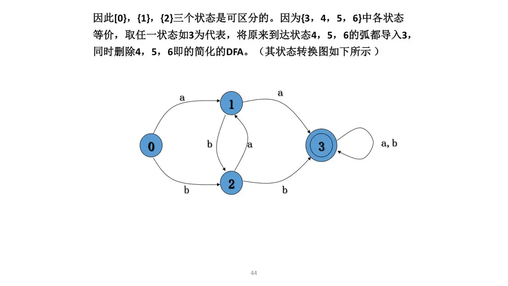

原文：

因此[0}，{1}，{2}三个状态是可区分的。因为{3，4，5，6}中各状态等价，取任一状态如3为代表，将原来到达状态4，5，6的弧都导入3，同时删除4，5，6即的简化的DFA。（其状态转换图如下所示）

44

### 该DFA是否可以再化简？

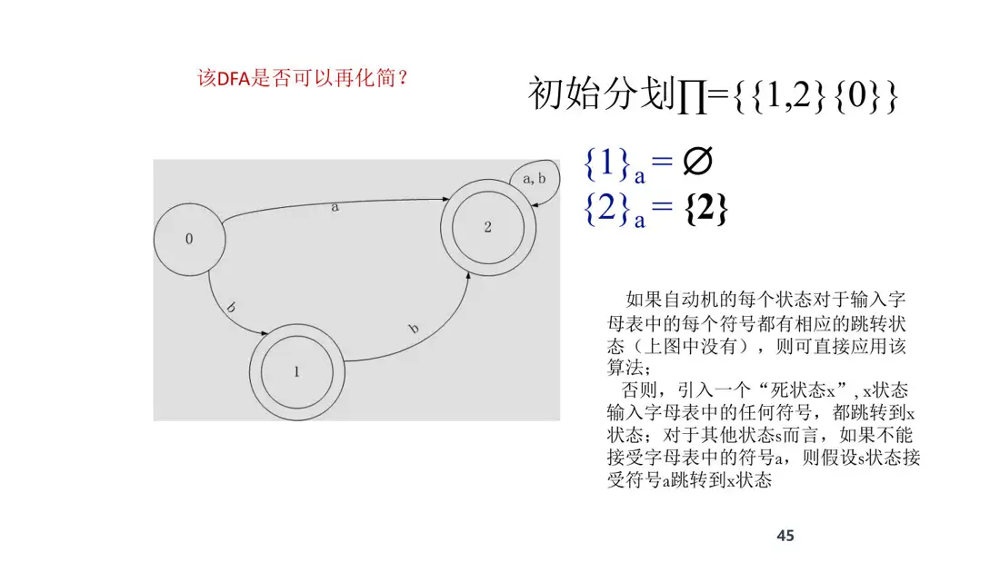

原文：

该DFA是否可以再化简？

初始分划∏={{1,2}{0}}

$$
\begin{array}{l} \left\{1 \right\} _ {a} = \varnothing \\ \left\{2 \right\} _ {a} = \left\{2 \right\} \end{array}
$$

如果自动机的每个状态对于输入字母表中的每个符号都有相应的跳转状态（上图中没有），则可直接应用该算法；

否则，引入一个“死状态x”, x状态输入字母表中的任何符号，都跳转到x状态；对于其他状态s而言，如果不能接受字母表中的符号a，则假设s状态接受符号a跳转到x状态

45

### 该DFA是否可以再化简？

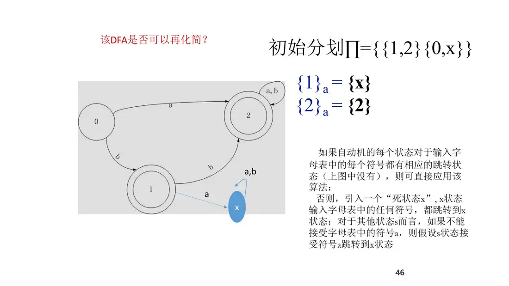

原文：

该DFA是否可以再化简？

初始分划∏={{1,2}{0,x}}

$$
\begin{array}{l} \left\{1 \right\} _ {a} = \left\{\mathbf {x} \right\} \\ \left\{2 \right\} _ {a} = \left\{\mathbf {2} \right\} \end{array}
$$

如果自动机的每个状态对于输入字母表中的每个符号都有相应的跳转状态（上图中没有），则可直接应用该算法；

否则，引入一个“死状态x”, x状态输入字母表中的任何符号，都跳转到x状态；对于其他状态s而言，如果不能接受字母表中的符号a，则假设s状态接受符号a跳转到x状态

46

### 该DFA是否可以再化简？

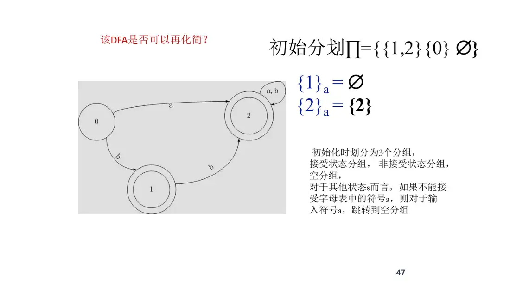

原文：

该DFA是否可以再化简？

初始分划∏={{1,2}{0} }

$$
\{1 \} _ {a} = \varnothing
$$

$$
\{2 \} _ {a} = \{2 \}
$$

初始化时划分为3个分组，

接受状态分组，非接受状态分组，空分组，

对于其他状态s而言，如果不能接受字母表中的符号a，则对于输入符号a，跳转到空分组

47
