# 《编译原理》第3章 词法分析（自编参考教材）

原件经识别和整理；“参考解答”是我们补的。

## 第三章 词法分析

单词是指语言中具有独立含义的最小语法单位。正如我们阅读一篇英文文献是从理解每个单词的意思开始一样，编译程序也是首先在单词的基础上对源程序进行分析处理。词法分析是编译过程的第一阶段，其主要任务是识别单词。

通常将编译程序中完成词法分析任务的程序段称为词法分析程序、词法分析器或词法扫描器。本章主要讨论词法分析器设计和实现的有关问题，包括手工方式实现时所涉及到的正规文法与状态转换图问题，以及自动构造过程所涉及到的正规表达式和自动机问题。

### 3.1 词法分析概述

#### 3.1.1 词法分析的任务

在第一章已经指出，词法分析器的主要功能是从左到右地依次读入源程序的字符，根据所读入字符和该语言的构词规则识别出一个个单词符号。具体来说，词法分析器的主要任务包括以下几个方面：

1. 消除无用字符。对源程序文本进行处理，消除源程序文本中的注释、空格、换行符以及其他一切对语法分析和代码生成均无关的信息。
2. 识别单词。扫描源程序的一个个字符，按照语言的词法规则，识别出各类有独立意义的单词。
3. 对识别出来的单词进行内部编码。将长度不一、种类不同的单词变成长度统一、格式规整、分类清晰的一种内部编码表示。
4. 建立各种表格（例如名词特征表、常数表等）。

**例3.1** 下面有一段C 语言程序

词法分析程序将剔除那些不影响程序语义的注释、无用的空格和回车等符号，识别出这些单词序列：`void`、`main`、`(`、`)`、`{`、`float`、`a`、`,`、`b`、`;`、`a`、`=`、`3.0`、`;`、`b`、`=`、`5.4`、`;`、`a`、`=`、`a`、`+`、`b`、`}`

编译程序具体实现词法分析程序时，有两种方案。

1. 将词法分析单独作为一遍扫描来完成，此时可将词法分析程序输出的单词符号流存放在一个中间文件上，这个文件作为语法分析程序的输入，如图3.1所示。这种方案结构清晰，各遍功能单一，但由于要读写和保存中间文件，因此编译的效率较低。

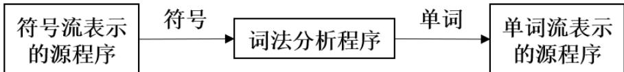

2. 将词法分析和语法分析放在同一遍扫描来完成，如图3.2所示。通常将词法分析程序设计成一个子程序，供语法分析程序随时调用。每调用一次，则从源程序字符串中读出一个具有独立意义的单词。采用这种结构，避免了中间文件的读写，可以提高编译器的工作效率。

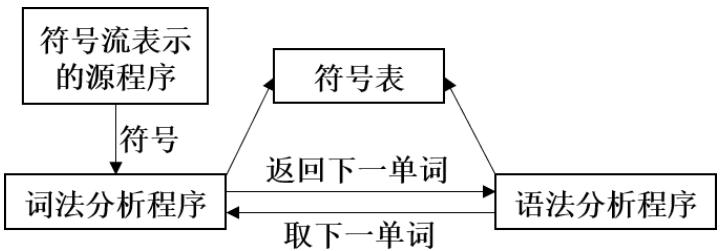

词法分析程序完成“字符流”到“单词流”的一个等价转换。字符流与被编译的语言密切相关（例如C语言的字符流由ASCII码组成），“单词流”就是编译器内部定义的数据结构。

#### 3.1.2 单词的分类与表示

根据单词在程序设计语言中所起的作用不同，通常可以将单词分为如下几种类型：

1. **关键字（key word）**，也称为基本字（basic word），它们具有基本的意义，往往起到标识的作用。例如，Pascal语言中标识一个程序开始的关键字是 `program`，标识一个复合语句开始的关键字是 `begin`，C语言中标识for循环语句开始的关键字是 `for`，`void` 标识空值，等等。如果这些关键字在程序中只能表述某些规定的标识，而不可以用于其它用途（例如，不可以再做变量名，甚至不能做变量名的前缀等），则将它们称为**保留字（reserved word）**。
2. **界限符（separator）**，也称为分界符，包括逗号、分号和各种括号等。
3. **运算符（operator）**，可分为算数运算符（`+`、`-`、`*`、`/`等）、逻辑运算符（`not`、`and`、`or`等）和关系运算符（`==`、`<`、`>`等）等；
4. **标识符（identifier）**，用来表示各种名字，例如变量名、函数名和数组名等；
5. **常数（constant）**，分为整常数、实常数、符号串常量等，例如 `35`、`3.14` 和 `"kid"` 等。

一个程序设计语言的单词如何分类，本身没有特别的规定，纯属技术问题。不同的语言可以有不同的分类方式，主要以具体处理时方便为准。

以上五种类型中的前三种（关键字、界限符和运算符）都是设计该语言之初就预先定义的，所以它们的数量是固定的，而标识符和常数则由程序设计人员根据具体的需要而自行定义，其数量上虽然不是无穷的（基于形式语言的理论，很多程序设计语言支持产生无穷多个标识符和常数，但在实际中受到机器字长的限制），但也是非常巨大的。

为了便于处理已经识别的单词，通常按照一定的方式对单词进行分类和编码。如何对单词进行分类和编码，本身也没有特别的规定，但编码的目的是为了编译程序处理上方便。通常将单词内部编码分成两部分：**类别编码**（code of kind）和**单词自身的编码**（attribute value），将这两部分表示成二元组（binary tuple，2-tuple）的形式：（类别编码，单词自身编码）。单词的类别编码通常用整数编码表示，通常可以采用以下两种编码形式。

1. **一类一种**：根据单词的几大种类，为每一种类分配一个类型码。例如，例3.1中，可以将关键字编码为1，运算符编码为2，界限符编码为3，标识符编码为4，常量编码为5。
2. **一字一种**：对于那些在设计语言之初就能确定下来具有特定含义的每个关键字、运算符和界限符，分别指定一个相应的编码，例如对Pascal语言中的“and”编码为1，“for”编码为12，“(”编码为50。

单词自身的编码也被称为单词的属性值，用来刻画单词符号的特性或特征，通过单词的属性值将同一种类的单词区别开来。对于关键字及运算符、界限符等专用符号，由于这些单词在语言设计之初就确定不会发生变化，因此其属性值可以采用固定的编码值；而对于标识符、常量等这些变化的单词值，可以采用其在相应的名词特征表、常量表中的相对地址码作为其单词的值。

按照一类一种的编码原则，上述单词序列经过内部编码后得到了如下二元组序列（关键字及运算符、界限符用自身值代替其编码），如表3.1所示：

**表3.1 例3.1中单词的编码结果**

| 单词 | 类别编码 | 单词自身编码 |
| :--- | :--- | :--- |
| void | 1 | void |
| main | 4 | 名词特征表中的相对地址 |
| ( | 3 | ( |
| ) | 3 | ) |
| { | 3 | { |
| float | 1 | float |
| a | 4 | 名词特征表中的相对地址 |
| , | 3 | , |
| b | 4 | 名词特征表中的相对地址 |
| ; | 3 | ; |
| = | 2 | = |
| 3.0 | 5 | 常量表中的相对地址 |
| 5.4 | 5 | 常量表中的相对地址 |
| + | 2 | + |
| } | 3 | } |

### 3.2 手动编写词法分析程序

#### 3.2.1 单词的描述——正规文法与状态转换图

在第二章已经指出，许多程序设计语言的单词符号可以用乔姆斯基3 型文法（正规文法）来描述。由形式语言和自动机的理论可知，对于正规文法所描述的语言，可以用有穷自动机来识别。为了简化问题，本节首先介绍有穷自动机的非形式化表示——状态转换图（3.3 节中将引入有穷自动机的形式化描述），并讨论如何利用状态转换图识别和分析单词符号，构造词法分析程序。

##### 1. 状态转换图

状态转换图是设计词法分析器的一种有效工具。状态转换图实际上是一个有限方向图，图中结点代表状态，用圆圈表示。状态之间由有向边连接，有向边上标记某个符号，其含义是某一状态下，如果当前的输入符号是边上标记的符号时，则转换到另一状态或仍停留在原状态。如图3.3所示，在0状态下，如果词法分析器读入符号a，则跳转到状态1；如果读入的是符号 b，则跳转到状态 2。在状态 1 下，如果词法分析器读入符号 d，则跳转到状态 3。在状态2 下，如果词法分析器读入符号c，则跳转到状态1。

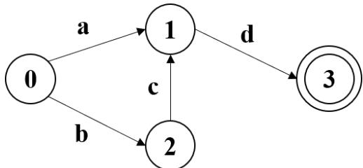

一张状态转换图只能包含有限个状态，且其中至少有一个是初态，至少要有一个终态（用双圆圈表示）。在图3.3 中，状态0为初始状态，状态3为终止状态。

一个状态转换图可以用于识别（或接受）某些字符串。例如，识别C 语言标识符的状态转换图如图 3.4 所示（这里暂时不考虑标识符的长度限制）。其中，S 为初态，Z 为终态。这个转换图识别（接受）标识符过程是：从初态 S开始，若在状态 S下编译器扫描到了一个字母或下划线，则读入该字母或下划线，并转入状态 1。在状态 1 下，若编译器又扫描到了一个字母或下划线或数字，则仍然读进它，并再次进入状态 1。这个过程重复执行，直到在状态 1下发现编译器扫描到的符号不再是字母或下划线或数字时，就进入状态Z。状态 Z是终态，它意味着到此已识别出一个 C语言的标识符，识别过程宣告终止。终态 Z 的右上角有一个星号，这表示多读进了一个不属于标识符的符号（如界限符、空格符等），应把它退还给输入串，用于识别下一个单词。

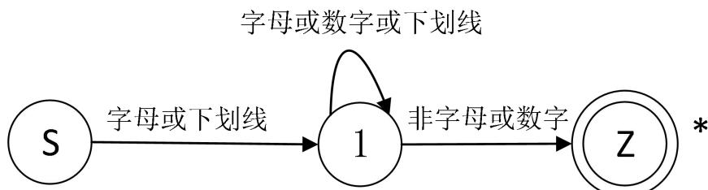

我们在第二章中学习了正规文法，包含左线性文法和右线性文法。词法规则往往可以采用正规文法来构造，而状态转换图恰恰又可用于识别单词，因此它们之间实际存在“等价”关系。下述的内容将阐释如何将正规文法转换为状态转换图。

##### 2. 由左线性文法构造状态转换图

令文法 $G = (V_N, V_T, P, Z)$ 是一个左线性文法，并假设 $|V_N| = n$，则构造出的状态转换图共有 $n+1$ 个状态，其对应的状态转换图构造步骤如下（其中，$U, B \in V_N, a, c \in V_T$）：

（1）将每个非终结符设置成一个对应的状态，文法的开始符号 $Z$ 所对应的状态为终止状态；
（2）在图中增加一个结点 $S$ 为初始状态，显然，$S$ 并非文法中的符号；
（3）对于 $G$ 中形如 $U \rightarrow a$ 的规则，从初始状态 $S$ 向状态 $U$ 引一条箭弧，并标记为 $a$；
（4）对于 $G$ 中形如 $U \rightarrow Bc$ 的规则，从状态 $B$ 向状态 $U$ 引一条箭弧，并标记为 $c$。

**例3.2** 设有左线性文法 $G = (V_N, V_T, P, Z)$，$V_N = \{ Z, A, B \}$，$V_T = \{ 0, 1 \}$，其中 $P$ 为：

$$
\begin{aligned}
Z &\rightarrow A0 \mid B1 \\
A &\rightarrow Z1 \mid 1 \\
B &\rightarrow Z0 \mid 0
\end{aligned}
$$

根据上述规则，该文法对应的状态转换图如图3.5 所示。

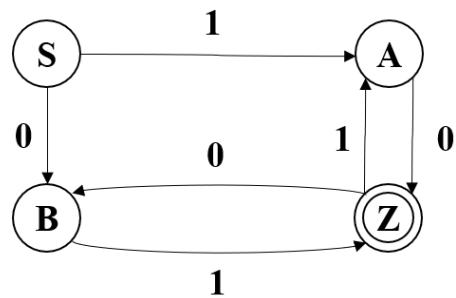

我们根据状态转换图 3.5，很容易识别出字符串 x 是否为该文法的句子（单词）。从初始状态 S 出发，按与 x余留部分中最左字符相匹配的原则，游历状态转换图，直到 x读入最后一个符号为止。如果这时恰好达到状态 Z（也即文法的开始符号），则x是该文法所产生的句子（单词）之一，否则不是。

图 3.6 描述了识别字符串 101001的具体过程。不难看出，这种识别过程采用了自底向上的归约分析方法。编译器每一步所读入的符号与读入该符号之前的状态编号所组成的串，恰好是当前句型的句柄，该句柄所归约的结果便是下一个状态（此归约对应了文法中的某一条产生式）。该归约过程对应的语法树如图3.7所示（语法树中标注的序号①到⑥分别对应了图3.6中的每次处理过程）。

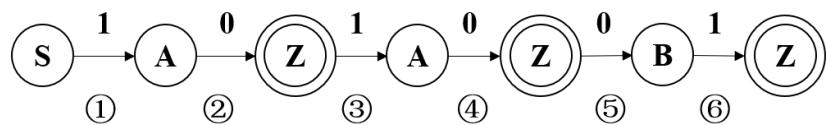

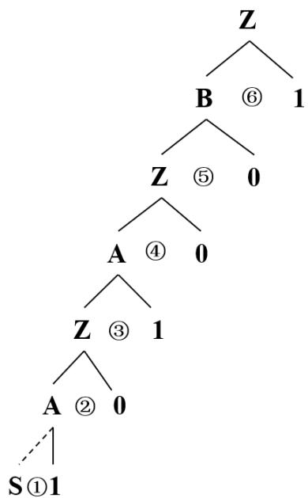

实际上，图 3.5 所示的状态转换图所能接受的语言是 $\{01,10\}^{+}$，即任意个数的“01”或者“10”以任意次序组成的任意长度的非空符号串。

### 3. 由右线性文法构造状态转换图

令文法 $G=(V_N,V_T,P,S)$ 是一个右线性文法，并假设 $|V_N|=n$，则构造出来的状态转换图共有 $n+1$ 个状态，其对应的状态转换图构造步骤如下（其中，$U,B \in V_N$，$a,c \in V_T$）：

（1）将每个非终结符号设置成一个对应的状态，文法的开始符号 $S$ 所对应的状态为初始状态；

（2）在图中增加一个结点 $Z$ 为终止状态，显然，$Z$ 并非文法中的符号；

（3）对于 $G$ 中形如 $U \to a$ 的规则，从状态 $U$ 向终止状态 $Z$ 引一条箭弧，并标记为 $a$；

（4）对于 $G$ 中形如 $U \to cB$ 的规则，从状态 $U$ 向状态 $B$ 引一条箭弧，并标记为 $c$。

例 3.3 设有右线性文法 $G[S]=(V_N,V_T,P,S)$，$V_N=\{S,A,B,C\}$，$V_T=\{0,1\}$，其中 $P$：$S \to 1A \mid 0B$，$A \to 0C \mid 0$，$B \to 1C \mid 1$，$C \to 0 \mid 1A$。

根据上述构造状态转换图的规则，该文法对应的状态转换图如图 3.8 所示。

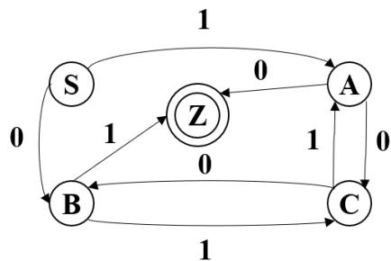

图 3.9 描述了利用图 3.8 所示的状态转换图识别字符串 101001 的过程，不难看出，这种识别过程采用了自上向下的推导分析方法，其对应的是自上而下构建语法树的过程，构造的语法树如图 3.10 所示。

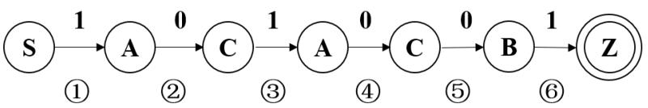

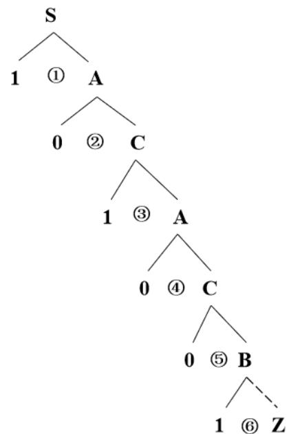

不难看出，图 3.8 所示的状态转换图所能接受的语言也是 $\{01,10\}^{+}$。也就是说，尽管例 3.2 和例 3.3 所示的文法各不相同，其对应的状态转换图也各不相同，但它们所接受的语言是完全相同的，我们可以将这种情况称为“左、右线性文法等价”、“不同的状态转换图之间等价”、“正规文法和状态转换图等价”。它们之间的等价转换方法的内涵和外延将在后续章节中详细讨论。

### 3.2.2 “C--”语言词法分析程序的设计与实现

如前所述，大多数程序设计语言的单词符号都可以用正规文法来生成，并可由此构造出相应状态转换图。与此同时，利用状态转换图可以方便地判断某个字符串是否是一个合法的单词。由此可见，由状态转换图不难构造出相应程序语言的词法分析程序。下面我们通过一个简单例子来说明如何设计和实现一个 C++ 语言子集（即 C-- 语言）的词法分析程序。

表 3.2 给出了 C-- 语言中的单词符号及内部编码。

表 3.2 C-- 语言的单词符号

| 基本符号 | 类型 | 类型说明 | 编码（助记符） |
| --- | --- | --- | --- |
| void | 1 | 关键字 | $void |
| main | 1 | 关键字 | $main |
| cin | 1 | 关键字 | $cin |
| cout | 1 | 关键字 | $cout |
| { | 2 | 界限符 | $LEFT |
| } | 2 | 界限符 | $RIGHT |
| ; | 2 | 界限符 | $COLON |
| + | 3 | 运算符 | $PLUS |
| * | 3 | 运算符 | $MULT |
| 标识符 | 4 | 标识符 | &ID |
| 整常数 | 5 | 常量 | &INT |

根据文法：

<程序>∷=void main() <语句块>

<语句块>∷={<语句串>}

<语句串>∷=<语句串><语句>|$\varepsilon$

<语句>∷=<赋值语句>|<输入语句>|<输出语句>

<赋值语句>∷=<标识符> = E;

<标识符>∷=字母|\_|<标识符>(<字母>|\_|<数字>)

<整数>∷=<整数串><数字>|<数字>

<整数串>∷=<整数串><数字>|<非0数字>

<非 0 数字>∷=1|2|3|…|9

<数字>∷=0|<非 0 数字>

<字母>∷= A|B|C|…|Z|a|b|c|…|z

E∷=T|E+T

T∷=F|T\*F

F∷=(E)|<整数>|<标识符>

<输入语句>∷=cin>><标识符>;

<输出语句>∷=cout<<<计算结果>;

<界限符>∷=;|{|}

<运算符>∷=\*|+

可以画出该文法所对应的部分状态转换图如图 3.11 所示：

### 字母/数字/下划线

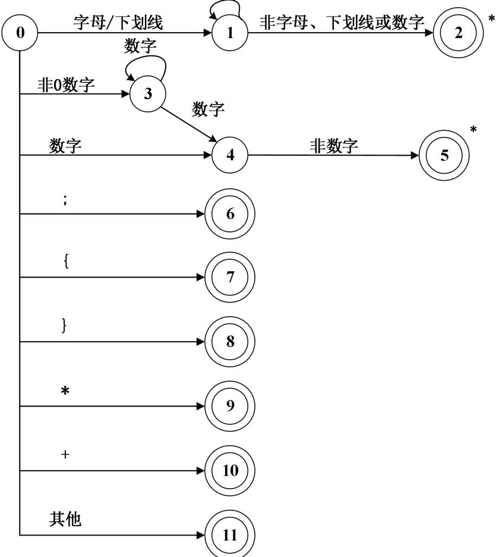

有了状态转换图，就可以写出相应的词法分析程序。下面考虑把词法分析程序作为语法分析程序的一个子程序来构造，每当语法分析程序需要一个单词符号时就调用这个子程序。在此对保留字不专设状态转换图，只在识别出标识符后，再去查保留字表，以确定是保留字还是普通标识符。

下面我们根据前述的状态转换图来构造由表 3.2 给出的 C-- 语言的单词的词法分析程序。首先我们引入一些变量和过程：

1. 字符变量 char，它存放着新读入的源程序字符；

2. 字符数组 token，它存放构成单词符号的字符串；

3. 过程 getchar，读入下一个源程序字符至 char 中，并把指向字符的指针后移一个位置；

4. 过程 getnbc，检查 char 中是否为空白字符，若是，则反复调用 getchar 直至 char 中读入的是一个非空白字符；

5. 过程 concat，将 char 字符连接到 token 后面。例如，假定 token 原来的值为‘STUDENT’，而 char 中存放着‘S’，则调用过程 concat 之后，token 的新值为‘STUDENTS’；

6. 布尔函数 letter，若 char 中字符为字母则返回 true，否则返回 false；

7. 布尔函数 digit，若 char 中字符为数字则返回 true，否则返回 false；

8. 函数 reserve，由 token 字符串查保留字表，若 token 中字符串为保留字则返回其种别编码，否则返回值为 0；

9. 过程 retract，将字符指针向前移一个位置，char 置空白字符。

现在，我们可以写出前面所述的 C-- 语言的词法分析程序：

### 3.3 自动生成词法分析程序的原理

词法分析程序既可以通过手动编写的方式构造，也可以通过自动生成的方式构造。上一节给出了如何利用正规文法描述单词，并借助状态转换图手动编写词法分析程序。本节将介绍词法分析程序自动生成的原理：如何使用正规表达式描述单词，如何自动地生成词法分析程序。由于我们的目的是为了介绍词法分析程序的自动生成，因此对所述的某些结果不予形式化地证明，对证明有兴趣的读者可以参阅“形式语言与自动机理论”的相关书籍。

## 3.3.1 单词的描述——正规表达式

正规表达式是一种通过符号组成的式子来表达语言（符号串集合）的方式。它的表达简单、直观，与集合的表现形式更为相近，因此应用起来也更为方便。

每一类程序设计语言都有它自己的字符集 $\Sigma$，语言中每一个单词可以是 $\Sigma$ 上的单个有意义的字符（如运算符、分隔符等），也可以是 $\Sigma$ 上的字符按一定方式组成有意义的字符串（如常数、保留字、标识符以及关系运算符等）。如果我们把每类单词均视为一种“语言”，那么每一类单词都可用一个正规表达式来描述。正规表达式表示的“语言”叫做正规集。

在给出正规表达式的正式定义之前，我们先通过一个例子看看正规表达式大致是什么样子的，它又是如何表达某些集合的。

### 例 3.4

在字母表 $\Sigma = \{ \mathsf{a}, \mathsf{b} \}$ 中，$\mathbf{a}^* \mathbf{b} \mid \mathbf{b}^* \mathbf{a}$ 就是一个正规表达式，它代表了出现若干个 a 后以一个 b 结尾，或者出现若干个 b 后以 a 结尾的一切符号串的集合。用传统的集合形式来表示就是 $\{ \mathbf{a} \}^* \{ \mathbf{b} \} \cup \{ \mathbf{b} \}^* \{ \mathbf{a} \}$，从中可以发现正规表达式表示法和集合表示法的相同之处和不同之处。

下面给出正规表达式和正规集的形式化定义。

1. $\varepsilon$ 和 $\Phi$ 是 $\Sigma$ 上的正规表达式，定义它们所表示的相应正规集分别为 $\{ \varepsilon \}$ 和 $\{ \phi \}$；

2. 对于每个 $a \in \Sigma$，$a$ 是 $\Sigma$ 上一个正规表达式，定义它所表示的相应正规集为 $\{ \mathbf{a} \}$；

3. 如果 $\mathbf{e}_1$ 和 $\mathbf{e}_2$ 是 $\Sigma$ 上的正规表达式，定义它们所表示的相应正规集分别为 $\mathrm{L}(\mathbf{e}_1)$ 和 $\mathrm{L}(\mathbf{e}_2)$，则：

   （1）$\mathbf{e}_1 \mid \mathbf{e}_2$ 是正规表达式，其相应正规集为 $\mathrm{L}(\mathbf{e}_1 \mid \mathbf{e}_2) = \mathrm{L}(\mathbf{e}_1) \cup \mathrm{L}(\mathbf{e}_2)$；

   （2）$\mathbf{e}_1 \cdot \mathbf{e}_2$ 是正规表达式，其相应正规集为 $\mathrm{L}(\mathbf{e}_1 \cdot \mathbf{e}_2) = \mathrm{L}(\mathbf{e}_1)\mathrm{L}(\mathbf{e}_2)$；

   （3）$(\mathbf{e}_1)^*$ 是正规表达式，其相应正规集为 $\mathrm{L}((\mathbf{e}_1)^*) = (\mathrm{L}(\mathbf{e}_1))^*$。

仅由有限次使用上述步骤定义的表达式才是 $\Sigma$ 上正规表达式，仅由这些正规表达式所表示的符号串集合才是 $\Sigma$ 上的正规集。

正规表达式使用三个基本操作符：“·”为连结，一般可省略不写，“｜”为选择，“\*”为闭包。前两者为二目操作符，闭包是一目操作符，它表示任意有限次的自重复连结。上述操作运算符次序是：“\*”最优先，“·”次之，最后是“｜”。在上述定义中，圆括号并非正规表达式的运算符，而仅用于指示正规表达式中的子表达式，我们也可以在一个正规表达式中加一些括号来改变运算顺序。

### 例 3.5

给出字母表 $\Sigma = \{ \mathsf{a}, \mathsf{b} \}$，下列各式均是 $\Sigma$ 上正规表达式：

$$
\begin{array}{c c c c}
a^* & b a^* & a \mid b a^* & a a \mid b b \mid a b \mid b a \\
a (a \mid b)^* & (a \mid b)^* (a a \mid b b) (a \mid b)^* & (a \mid b) (a \mid b) (a \mid b) (a \mid b)^*
\end{array}
$$

请求出它们相应的正规集。

$$
\begin{array}{l}
\mathrm{L}(a^*) = (\mathrm{L}(a))^* = \{a\}^* = \{\varepsilon, a, aa, aaa, \ldots\} \\
\mathrm{L}(ba^*) = \mathrm{L}(b)\mathrm{L}(a^*) = \{b, ba, baa, \ldots\} \\
\mathrm{L}(a \mid ba^*) = \mathrm{L}(a) \cup \mathrm{L}(ba^*) = \{a, b, ba, baa, \ldots\} \\
\mathrm{L}(aa \mid bb \mid ab \mid ba) = \mathrm{L}(aa) \cup \mathrm{L}(bb) \cup \mathrm{L}(ab) \cup \mathrm{L}(ba) = \{aa, bb, ab, ba\}
\end{array}
$$

$$
\begin{array}{l}
\mathrm{L}(a(a \mid b)^*) = \mathrm{L}(a)(\mathrm{L}(a) \cup \mathrm{L}(b))^* = \{a\}\{a, b\}^* \\
\mathrm{L}((a \mid b)^*(aa \mid bb)(a \mid b)^*) = \{a, b\}^*\{aa, bb\}\{a, b\}^* \\
\mathrm{L}((a \mid b)(a \mid b)(a \mid b)(a \mid b)^*) = \mathrm{L}(a \mid b)\mathrm{L}(a \mid b)\mathrm{L}(a \mid b)\mathrm{L}((a \mid b)^*) = \{a, b\}\{a, b\}\{a, b\}\{a, b\}^*
\end{array}
$$

### 例 3.6

用正规表达式描述“标识符”这种类型的单词。

$$
(\text{字母} \mid \_) \mid (\text{字母} \mid \_ \mid \text{数字})^*
$$

### 例 3.7

$\Sigma = \{ \mathrm{a}, \mathrm{b} \}$，$e_1 = b(ab)^*$，$e_2 = (ba)^*b$，请求出 $e_1$ 和 $e_2$ 的正规集。

$$
\mathrm{L}(e_1) = \mathrm{L}(b(ab)^*) = \mathrm{L}(b)(\mathrm{L}(ab))^* = \{b\}\{ab\}^* = \{b, bab, babab, \ldots\}
$$

$$
\mathrm{L}(e_2) = \mathrm{L}((ba)^*b) = (\mathrm{L}(ba))^*\mathrm{L}(b) = \{ba\}^*\{b\} = \{b, bab, babab, \ldots\}
$$

从上述结论可以看出，$e_1$ 和 $e_2$ 的表达式虽然各不相同，但它们所表示的正规集都是以 b 开头其后跟零个或任意多个 ab 所组成的，即 $\mathrm{L} = \{ \mathbf{b}(\mathbf{ab})^n \mid n \geq 0 \}$。通过例 3.7 可以论证正规表达式等价的概念。

**定义 3.2（正规表达式等价）**：令 $\Sigma$ 为有穷字母表，如果 $\Sigma$ 上的正规表达式 $e_1$ 和 $e_2$ 所表示的正规集相同，则认为两者等价，记为 $\mathbf{e}_1 = \mathbf{e}_2$。

从正规表达式等价的定义，我们可以得到以下关系成立：

（1）$\mathbf{e}_1 \mid \mathbf{e}_2 = \mathbf{e}_2 \mid \mathbf{e}_1$

（2）$\mathbf{e}_1 \mid (\mathbf{e}_2 \mid \mathbf{e}_3) = (\mathbf{e}_1 \mid \mathbf{e}_2) \mid \mathbf{e}_3$

（3）$\mathbf{e}_1(\mathbf{e}_2 \mathbf{e}_3) = (\mathbf{e}_1 \mathbf{e}_2)\mathbf{e}_3$

（4）$\mathbf{e}_1(\mathbf{e}_2 \mid \mathbf{e}_3) = \mathbf{e}_1 \mathbf{e}_2 \mid \mathbf{e}_1 \mathbf{e}_3$

（5）$\varepsilon \mathbf{e}_1 = \mathbf{e}_1 \varepsilon = \mathbf{e}_1$

（6）$\varnothing \mathbf{e}_1 = \mathbf{e}_1 \varnothing = \varnothing$

（7）$(\mathbf{e}_1^*)^* = \mathbf{e}_1^*$

（8）$(\varepsilon \mid \mathbf{e}_1)^* = \mathbf{e}_1^*$

根据定义 3.2 比较容易证明上述性质，利用这些性质可以化简正规表达式，证明正规表达式的等价关系。

## 3.3.2 单词的识别——有穷自动机

如前所述，使用正规文法和正规表达式可以定义语言的词法结构，在手动编写的词法分析方式中，我们将正规文法转换成状态转换图，根据状态转换图可以较为方便地编写出词法分析程序。虽然对于人类而言，状态转换图直观清楚地描述了如何分析一个符号串是否是文法所定义的句子（如果某符号串能够被状态转换图所接受，则该符号串是文法所定义的单词），但对于计算机而言，状态转换图的描述方式是不容易理解的，也不适合自动生成词法分析程序。因此本小节介绍状态转换图的形式化描述工具——有穷自动机，从识别语言的角度出发，确定某种模型来判断一个符号串是否是给定语言的句子。

有穷自动机（Finite Automata，FA）也被称为有穷状态自动机或有穷状态系统，它是一种数学模型，这种模型对应的系统具有有穷数目的内部状态，系统的状态概括了对过去输入处理状况的信息。系统只需要根据当前所处的状态和面临的输入就可以决定系统的后续行为。每当系统处理了当前的输入后，系统的内部状态也将发生改变。电梯控制装置就是有穷自动机的一个典型例子：用户的服务要求（即所到达的楼层）是该装置的输入信息，而电梯所处的层数及运动方向则表示该装置的状态。电梯控制装置并不需要记忆先前全部的服务要求，只需要记忆电梯当前所处的层数和运动方向以及还没有满足的服务要求即可。

# 编译原理第 3 章：有穷自动机

本节内容整理自《编译原理》第 3 章（自编参考教材）第 13–15 页，主要介绍有穷自动机（FA）的基本模型、确定的有穷自动机（DFA）与非确定的有穷自动机（NFA）的形式化定义及示例。

## 一、有穷自动机模型

在计算机科学中，可以找到很多利用有穷自动机原理设计的系统的应用实例，例如开关电路、文本编辑程序和词法分析程序。计算机本身也可以认为是一个有穷状态系统，尽管其状态数目可能很大。甚至人脑也可以看作是有穷状态系统：根据脑科学的研究，人脑的神经元的数目可能高达 $2^{35}$ 个。正是基于对神经元细胞模型的研究，1943 年，麦克卡洛克（Mcculloch）和皮特斯（W.Pitts）首先提出了 FA 的模型。

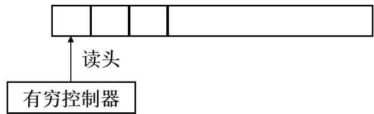

模型由一条有穷长度的输入带、一个读头和一个有穷控制器组成。在这个模型中：
- 单个的输入信息被抽象表示成一个输入符号；
- 输入带存放所有的输入符号，每个输入符号占一个单元（方格），输入带的长度和输入串的长度相同；
- 在有穷控制器控制下，读头从左到右逐个扫描并读入每个符号，且根据控制器的当前状态和当前输入符号控制转入下一状态；
- 控制器的状态数是有限的，读头具有只读功能，不能修改输入带上的符号，不能后退，只能向前读取；
- 和各种具体的机器一样，FA 具有初始状态和终止状态。在初始状态下，读头指向输入带的最左单元，准备读入第一个符号；
- 终止状态可以有多个，表示在该状态下可以接收输入串；
- 如果读头在读入带上最后一个符号时，恰好进入了某个终止状态，则表示该输入串可以被 FA 识别，否则，不能被识别。

可以看出，前面所述的状态转换图就是 FA 模型直观的图形化表示。为了实现可计算，需要给出它的形式化定义。有穷自动机分为**确定的有穷自动机**（Deterministic Finite Automata，简记为 DFA）和**非确定的有穷自动机**（Non-Deterministic Finite Automata，简记为 NFA）。

### 1. 确定的有穷自动机

#### 定义 3.3（确定的有穷自动机）

一个确定的有穷自动机 (DFA) $M$ 是一个五元组，即 $M = (K, V_T, M, S, Z)$，其中：

1.  **$K$** 是状态有穷的非空集合，$K$ 中每一个元素是一个状态；
2.  **$V_T$** 是一个有穷输入字母表，$V_T$ 中的每一个元素称为输入字符；
3.  **$M$** 是 $K \times V_T$ 到 $K$ 的单值映射（或函数），即 $M(q, a) = p$，其中 $q, p \in K, a \in V_T$。
    -   它表示：当前状态为 $q$，输入字符为 $a$ 时，将转到下一状态 $p$，$p$ 是 $q$ 的一个后继状态。由于映射是单值，所以称确定的有穷自动机。
4.  **$S$** 为开始状态，是唯一一个初态 $S \in K$；
5.  **$Z$** 是终止状态集合，$Z$ 是 $K$ 的子集。

#### 例 3.7

设 (DFA) $M = (\{0,1,2,3\}, \{a,b\}, M, 0, \{3\})$，其中：

$$
V_T = \{a, b\}
$$

状态转换函数 $M$ 如下：

$$
\begin{array}{ll}
M(0,a) = 1 & M(0,b) = 2 \\
M(1,a) = 3 & M(1,b) = 2 \\
M(2,a) = 1 & M(2,b) = 3 \\
M(3,a) = 3 & M(3,b) = 3 \\
S = 0 \\
Z = \{3\}
\end{array}
$$

利用映射 $M$ 很容易识别定义在输入字母表 $V_T$ 上的字符串是否为确定有穷自动机 DFA 所接受（即最后到达终止状态）。例如对于输入字符串 `abb`，因为从开始状态 0 出发，有：

$$
M(0, a) = 1 \quad M(1, b) = 2 \quad M(2, b) = 3
$$

当输入完毕最后一个字符 `b` 时，到达了最终状态 3，所以字符串 `abb` 能被此 DFA 所接受（识别）。

一个有穷自动机 DFA 可唯一表示一张确定的状态转换图。假定一个 (DFA) $M$ 有 $m$ 个状态和 $n$ 个输入字符，则它的状态转换图含有 $m$ 个状态，每个结点最多有 $n$ 条箭弧和别的状态相连接，每条弧用 $V_T$ 中的一个输入字符作标记，整个图含有唯一的一个初态和若干个终态。

为此我们可以作出上例 3.7 的状态转换图，如图 3.13 所示。

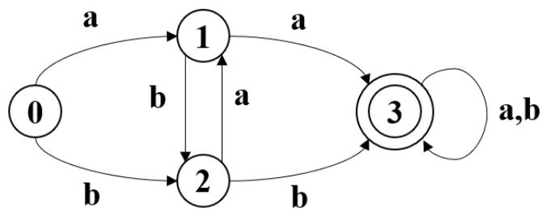

对于 $V_T$ 中任意字符串 $x$，若存在一条从初始状态到终结状态的路径，且这条路径上所有的字符连接成的字符串等于 $x$，则称字符串 $x$ 可为 (DFA) $M$ 所接受（识别）。例如对于字符串 `abb`，能找到一条从初始状态到终止状态的路径，如图 3.14 所示。

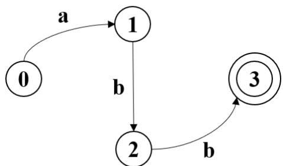

一个 DFA 还可以用一个状态转换矩阵来表示，矩阵的行表示状态，列表示输入字符，矩阵元素表示映射 $M(q, a) = p$。同样我们可以作出上例的状态转换矩阵，如表 3.3 所示。

**表 3.3 例 3.7 自动机所对应的状态转换矩阵**

| 状态 | a | b |
| :---: | :---: | :---: |
| 0 | 1 | 2 |
| 1 | 3 | 2 |
| 2 | 1 | 3 |
| 3 | 3 | 3 |

为了形式化定义有穷自动机 DFA 所接受的字符串，我们给出了输入符号串在确定有穷自动机上运行的定义和 DFA 接受的语言的定义。

#### 定义 3.4（输入符号串在 DFA 上运行）

一个输入符号串在 DFA 上运行定义为：

1.  $M(q, \epsilon) = q \quad q \in K$ （注：原文 $\mathfrak{c}$ 推测为空串 $\epsilon$ 或起始状态保持，此处按标准定义修正逻辑，原文公式排版有误，通常指空串处理或基础情况）
2.  $M(q, at) = M(M(q, a), t) = M(p, t) = \dots \dots a \in V_T, t \in V_T^*$

表示：当状态为 $q$ 时，输入字符串为 $at$ 时，利用映射 $M(q, a)$ 得到状态 $p$，然后再利用映射 $M(p, t)$，如此继续下去。直至最后，如果对某一字符串 $x$，有 $M(S, x) = r$，而 $r \in Z$，则称字符串 $x$ 被 (DFA) $M$ 接受。

对于例 3.7 的自动机，对于输入字符串 `abb`，从初始状态 0 出发，其一系列映射如下：

$$
M(0, abb) = M(M(0, a), bb) = M(1, bb) = M(M(1, b), b) = M(2, b) = 3
$$

最后到达状态 3，而 $3 \in \{3\}$，所以 `abb` 为此 DFA 所接受。

#### 定义 3.5（(DFA)M 接受句子集合（语言）的定义）

我们把一个 (DFA) $M$ 所接受 $V_T^*$ 中的全体字符串称为 $M$ 的接受集或 $M$ 所接受的语言，记为 $L(M)$，即：

$$
L(M) = \{ x \mid M(S, x) \in Z, x \in V_T^* \}
$$

上例 3.7 自动机所接受的语言 $L(M)$ 为 "$\{a, b\}^+$ 且至少含有相继两个 a 或相继两个 b"。

### 2. 非确定的有穷自动机

#### 定义 3.6（非确定的有穷自动机）

一个非确定的有穷自动机 (NFA) $M$ 是一个五元组，即 $M = (K, V_T, M, S, Z)$，其中：

1.  **$K$** 是状态有穷的非空集合，$K$ 中每一个元素是一个状态；
2.  **$V_T$** 是一个有穷输入字母表，$V_T$ 中的每一个元素称为输入字符；
3.  **$M$** 是 $K \times V_T$ 到 $K$ 子集上的映射，即 $M: K \times V_T \to 2^K$，其中 $2^K$ 是幂集，是 $K$ 的所有子集所组成的集合。
    $$
    M(q, a) = \{p_1, p_2, \dots, p_n\} \in 2^K, q \in K, a \in V_T
    $$
    它表示：当前状态为 $q$，输入字符为 $a$ 时，映射 $M$ 将产生一个状态集合 $\{p_1, p_2, \dots, p_n\}$（可能是空集），而不是单个状态，所以称非确定有穷自动机。
4.  **$S$** 是开始状态集，$S$ 包含于 $K$；
5.  **$Z$** 是终止状态集，$Z$ 包含于 $K$。

#### 例 3.8

(NFA) $M = (\{S_0, S_1, S_2, S_3, S_4\}, \{0, 1\}, M, \{S_0\}, \{S_2, S_4\})$，其中：

-   $K = \{S_0, S_1, S_2, S_3, S_4\}$
-   $V_T = \{0, 1\}$
-   $S = \{S_0\}$
-   $Z = \{S_2, S_4\}$
-   $M$:
    -   $M(S_0, 0) = \{S_0, S_3\}$

$$
\begin{array}{l l} \mathrm {M(S_ {2} ,0) = \{S_ {2} \}} & \quad \mathrm {M(S_ {2} ,1) = \{S_ {2} \}} \\ \mathrm {M(S_ {3} ,0) = \{S_ {4} \}} & \quad \mathrm {M(S_ {3} ,1) = \varnothing} \\ \mathrm {M(S_ {4} ,0) = \{S_ {4} \}} & \quad \mathrm {M(S_ {4} ,1) = \{S_ {4} \}} \end{array}
$$

类似地，我们可以作出上例 3.8 的状态转换图，如下图 3.15。

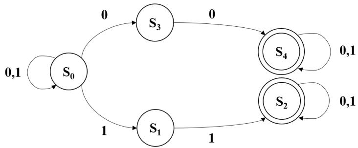

同样我们可以作出上例的状态转换矩阵，如下表 3.4 所示。

表 3.4 例 3.8 的 NFA 状态转换矩阵

| | 0 | 1 |
|---|---|---|
| $S_0$ | $\{S_0,S_3\}$ | $\{S_0,S_1\}$ |
| $S_1$ | ∅ | $\{S_2\}$ |
| $S_2$ | $\{S_2\}$ | $\{S_2\}$ |
| $S_3$ | $\{S_4\}$ | ∅ |
| $S_4$ | $\{S_4\}$ | $\{S_4\}$ |

为了形式化定义有穷自动机 NFA 所接受的字符串，我们给出了输入符号串在非确定有穷自动机上运行的定义和 NFA 接受的语言的定义。

定义 3.7（输入符号串在 NFA 上运行）：一个输入串在 NFA 上的运行定义为：

$$
\begin{array}{r l}
& \text{①}\ \mathrm{M(q,} \varepsilon) = \{\mathrm{q} \} \qquad \mathrm{q} \in \mathrm{K} \\
& \text{②}\ \mathrm{M(q,at)} = \mathrm{M(M(q,a),t)} \\
& \qquad = \mathrm{M} (\{\mathrm{p} _ {1}, \mathrm{p} _ {2}, \dots , \mathrm{p} _ {\mathrm{n}} \}, \mathrm{t}) \\
& \qquad = \cup \mathrm{M(p} _ {\mathrm{i}}, \mathrm{t}) \qquad (\mathrm{i} \text{从} 1 \text{变到} \mathrm{n})
\end{array}
$$

其中，$\mathrm{p_i} \in \mathrm{M(q,a)},\ \mathrm{a} \in \mathrm{V_T},\ \mathrm{t} \in \mathrm{V_T^*}$。

如此继续下去，直至最后，对于 $\mathrm{V_T^*}$ 上的字符串 x，令 $\mathrm{S_0} \in \mathrm{S}$，若集合 $\mathrm{M(S_0,x)}$ 中含有属于终态集 Z 中的状态，或者说至少存在一条从某一个初态结点到某一个终态结点的路径，且这些路径上所有箭弧的标记字符连接起来的字符串等于 x，我们就说 x 为 (NFA)M 所接受（识别）。

定义 3.8（(NFA)M 接受句子集合（语言）的定义）：我们把一个 (NFA)M 所接受 $\mathrm{V_T^*}$ 中字符串全体称为 M 的接受集或 M 所接受的语言，记为 L(M)，即

$$
\mathrm{L(M)} = \{\mathrm{x} \mid \mathrm{M(S_0,x)} \cap \mathrm{Z} \neq \varnothing,\ \mathrm{S_0} \in \mathrm{S},\ \mathrm{x} \in \mathrm{V_T^*}\}
$$

如上例 3.8 自动机接受的语言 L(M) 为 “$\{0,1\}^+$ 且至少含有相继两个 0 或相继两个 1”。

对于此 (NFA)M，若输入字符 10010，从开始状态集 $\{S_0\}$ 中状态 $S_0$ 出发根据映射 M 的扩充定义，其一系列映射如下：

$$
\begin{array}{r l}
\mathrm{M(S_0,10010)} & = \mathrm{M(S_0,0010)} \cup \mathrm{M(S_1,0010)} \\
& = \mathrm{M(S_0,010)} \cup \mathrm{M(S_3,010)}
\end{array}
$$

$$
\begin{array}{l}
= \mathrm{M(S_0,10)} \cup \mathrm{M(S_3,10)} \cup \mathrm{M(S_4,10)} \\
= \mathrm{M(S_0,0)} \cup \mathrm{M(S_1,0)} \cup \mathrm{M(S_4,0)} \\
= \{S_0,S_3,S_4\}
\end{array}
$$

因为 $\mathrm{M(S_0,10010)} = \{S_0,S_3,S_4\} \cap \mathrm{Z} \neq \varnothing$，所以字符串 10010 为此 NFA 所接受，显然，从状态转换图的开始状态 $S_0$ 出发，有路径至终止状态 $S_4$。此 NFA 所接受的语言为 $\mathrm{L(M)} = \{0,1\}^+$ 且含有相连 0 或相连 1。

如果把例 3.8 中的输入符号 0 和 1 分别改成 a 和 b，那么例 3.8 的 NFA 和例 3.7 的 DFA 所接受的语言相同。可以证明：凡是一个语言被 NFA 接受，一定能被 DFA 接受。

### 3. 将非确定的有穷自动机确定化的一种方法

首先我们思考一下为何要将非确定性有穷自动机确定化，这显然要归结于两者之间的区别。确定的有穷自动机开始状态唯一且状态转移是单值映射，因此其在识别单词符号串的时候，可以由开始状态出发读入字符经过一系列单值映射的路径最终停留在终止状态（面向合法单词符号串）或者无法停留在终态（面向非法单词符号串）。而非确定性的有穷自动机由于存在多个开始状态，且在单词符号串识别进入某一状态时，继续读入某一字符可能到达多个状态，如何在多个状态中做出选择即选择合适的一条路径最终停留在终止状态（面向合法单词符号串）或者甚至回溯和遍历所有可能的路径却最终无法停留在终态（面向非法单词符号串）是一个难题。因而，需要提供一种方法可以将给定的 NFA 确定化。

设 (NFA)M = (K, $V_T$, M, S, Z) 是 $V_T$ 上一个 NFA，构造一个等价的 (DFA)M′ = (K′, $V_T'$, M′, S′, Z′)，其方法如下：

（1）K′ 由 K 的全部子集组成，即 K′ = $2^K$（在 K 的全部子集组成的幂集中，空集可以删去）；

例如，若 K = $\{S_1,S_2,S_3\}$，则 K 的一个子集 $\{S_1,S_2\}$ 表示 K′ 的一个状态，我们用记号 $[S_1,S_2]$ 表示，也可重新命名。

（2）$V_T' = V_T$；

（3）S′ = [S]（例如：S = $\{S_1,S_2\}$，则 S′ = $[S_1,S_2]$）；

（4）Z′ = $\{[S_1,S_2,\dots,S_n] \mid [S_1,S_2,\dots,S_n] \in K' \text{ 且 } \{S_1,S_2,\dots,S_n\} \cap Z \neq \varnothing\}$；

（5）M′($[S_1,S_2,\dots,S_i]$, a) = $[R_1,R_2,\dots,R_j]$，a ∈ $V_T$。

我们可以举一个例子来说明该方法。

例 3.9 设 (NFA)M = ($\{S_0,S_1\}$, $\{a,b\}$, M, $\{S_0\}$, $\{S_1\}$)，其中 K = $\{S_0,S_1\}$，$V_T = \{a,b\}$。

$$
\begin{array}{r l}
\mathrm{M}: & \mathrm{M(S_0,a)} = \{S_0,S_1\} \\
& \mathrm{S} = \{S_0\} \quad \mathrm{Z} = \{S_1\}
\end{array}
\qquad
\begin{array}{r l}
\mathrm{M(S_0,b)} = \{S_1\} & \quad \mathrm{M(S_1,a)} = \varnothing \\
& \quad \mathrm{M(S_1,b)} = \{S_0,S_1\}
\end{array}
$$

其状态转换矩阵见表 3.5，状态转换图如图 3.16 所示。

表 3.5 例 3.9 的 NFA 状态转换矩阵

| | a | b |
|---|---|---|
| $S_0$ | $\{S_0,S_1\}$ | $\{S_1\}$ |
| $S_1$ | ∅ | $\{S_0,S_1\}$ |

## 例 3.9 NFA 到 DFA 的转换

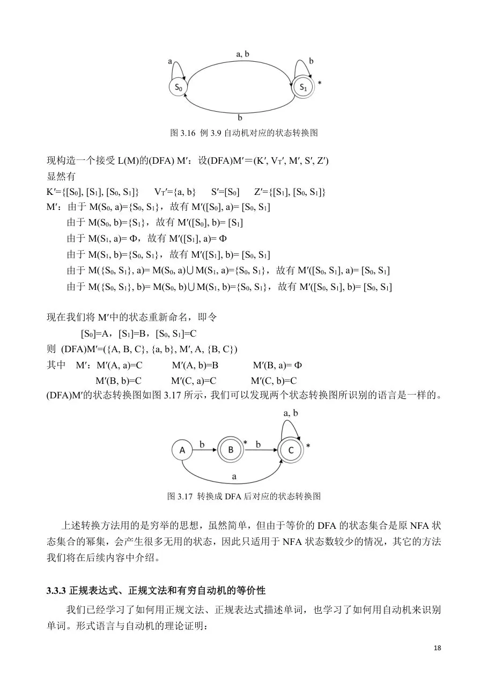

现构造一个接受 $L(M)$ 的 DFA $M'$：设 $(\mathrm{DFA}) M' = (K', V_T', M', S', Z')$。显然有：
$$
\begin{aligned}
K' &= \{ [S_0], [S_1], [S_0, S_1] \} \\
V_T' &= \{ a, b \} \\
S' &= [S_0] \\
Z' &= \{ [S_1], [S_0, S_1] \}
\end{aligned}
$$

**转换过程推导：**

- 由于 $M(S_0, a) = \{ S_0, S_1 \}$，故有 $M'([S_0], a) = [S_0, S_1]$
- 由于 $M(S_0, b) = \{ S_1 \}$，故有 $M'([S_0], b) = [S_1]$
- 由于 $M(S_1, a) = \Phi$，故有 $M'([S_1], a) = \Phi$
- 由于 $M(S_1, b) = \{ S_0, S_1 \}$，故有 $M'([S_1], b) = [S_0, S_1]$
- 由于 $M(\{ S_0, S_1 \}, a) = M(S_0, a) \cup M(S_1, a) = \{ S_0, S_1 \}$，故有 $M'([S_0, S_1], a) = [S_0, S_1]$
- 由于 $M(\{ S_0, S_1 \}, b) = M(S_0, b) \cup M(S_1, b) = \{ S_0, S_1 \}$，故有 $M'([S_0, S_1], b) = [S_0, S_1]$

现在我们将 $M'$ 中的状态重新命名，即令 $[S_0] = A$, $[S_1] = B$, $[S_0, S_1] = C$。

则 $(\mathrm{DFA}) M' = (\{ A, B, C \}, \{ a, b \}, M', A, \{ B, C \})$。其中转换函数 $M'$ 为：
- $M'(A, a) = C$
- $M'(A, b) = B$
- $M'(B, a) = \Phi$
- $M'(B, b) = C$
- $M'(C, a) = C$
- $M'(C, b) = C$

$(\mathrm{DFA}) M'$ 的状态转换图如图 3.17 所示，我们可以发现两个状态转换图所识别的语言是一样的。

上述转换方法用的是穷举的思想，虽然简单，但由于等价的 DFA 的状态集合是原 NFA 状态集合的幂集，会产生很多无用的状态，因此只适用于 NFA 状态数较少的情况，其它的方法我们将在后续内容中介绍。

### 3.3.3 正规表达式、正规文法和有穷自动机的等价性

我们已经学习了如何用正规文法、正规表达式描述单词，也学习了如何用自动机来识别单词。形式语言与自动机的理论证明：

**定理 3.1**：对于字母表 $V_T$ 上任一 NFA $M$，其接受语言为 $L(M)$，必存在 $V_T$ 上与 $M$ 等价的 DFA $M'$，使得 $L(M')=L(M)$。

**定理 3.2**：若 $G$ 为一个已知正规文法，它产生语言 $L(G)$，那么一定存在一个有穷自动机 (FA) $M$，它所接受的语言 $L(M)$ 与 $L(G)$ 相同，即 $L(M)=L(G)$。

**定理 3.3**：已知一个有穷自动机 (FA) $M$，所接受的语言 $L(M)$，那么一定存在一个正规文法 $G$，使得 $G$ 所产生的语言 $L(G)$ 和 $L(M)$ 相同，即 $L(G)=L(M)$。

**定理 3.4**：对于每一个左线性文法 $G_L$ 都存在一个右线性文法 $G_R$，有 $L(G_R)=L(G_L)$。

**定理 3.5**：对于每一个右线性文法 $G_R$ 都存在一个左线性文法 $G_L$，有 $L(G_L)=L(G_R)$。

**定理 3.6**：$L$ 是正规集 $\iff$ 存在一个有穷自动机 (FA) $M$，使得 $L=L(M)$ $\iff$ 存在一个正规文法 $G$，使得 $L(M)=L(G)$ $\iff$ 存在一个正规表达式 $e$，使得 $L(e)=L(G)$。

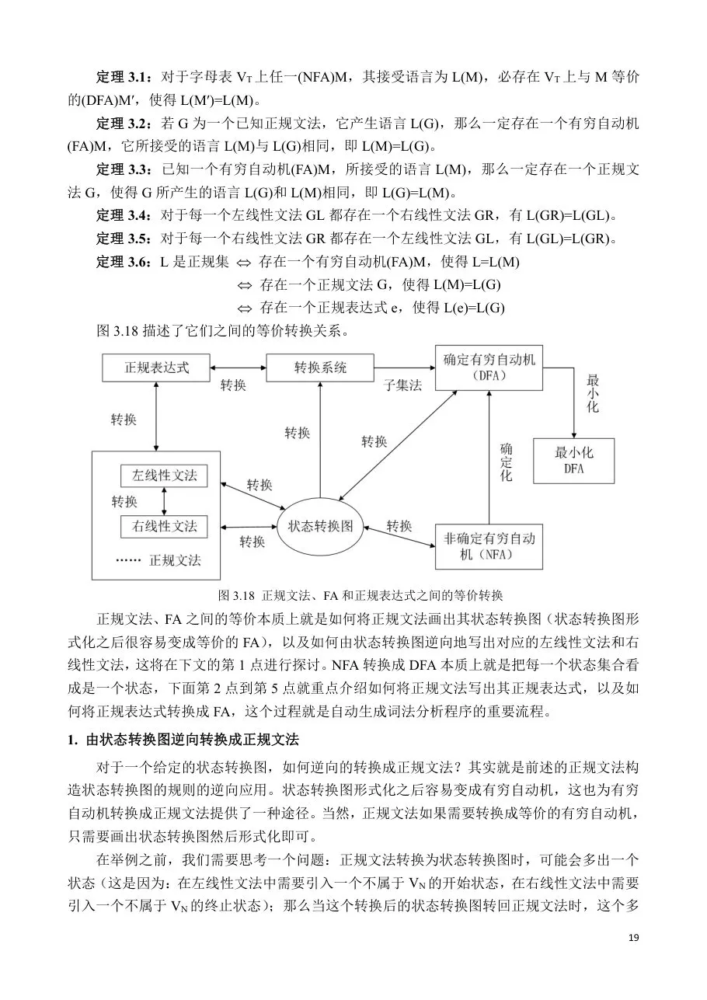

正规文法、FA 之间的等价本质上就是如何将正规文法画出其状态转换图（状态转换图形式化之后很容易变成等价的 FA），以及如何由状态转换图逆向地写出对应的左线性文法和右线性文法，这将在下文的第 1 点进行探讨。NFA 转换成 DFA 本质上就是把每一个状态集合看成是一个状态，下面第 2 点到第 5 点就重点介绍如何将正规文法写出其正规表达式，以及如何将正规表达式转换成 FA，这个过程就是自动生成词法分析程序的重要流程。

#### 1. 由状态转换图逆向转换成正规文法

对于一个给定的状态转换图，如何逆向的转换成正规文法？其实就是前述的正规文法构造状态转换图的规则的逆向应用。状态转换图形式化之后容易变成有穷自动机，这也为有穷自动机转换成正规文法提供了一种途径。当然，正规文法如果需要转换成等价的有穷自动机，只需要画出状态转换图然后形式化即可。

在举例之前，我们需要思考一个问题：正规文法转换为状态转换图时，可能会多出一个状态（这是因为：在左线性文法中需要引入一个不属于 $V_N$ 的开始状态，在右线性文法中需要引入一个不属于 $V_N$ 的终止状态）；那么当这个转换后的状态转换图转回正规文法时，这个多余的状态如何处理？如果不加以约束，这样多次互相转换以后状态数将会越来越多。

# 《编译原理》第3章 词法分析（自编参考教材）

本节内容整理自《编译原理》第3章词法分析部分，主要涵盖正规文法与状态转换图的转换规则、正规文法到正规表达式的求解方法，以及正规表达式到状态转换系统的构造。

### 节 1：正规文法转换为状态转换图的情形分析

仔细审视正规文法转换为状态转换图的规则，不难发现状态转换图不外乎存在以下几种情形：

#### 情形 1

开始状态只有箭弧引出没有引入，终止状态既有箭弧引出又有引入，例如图3.17。

对于上述第（1）种情况，我们认为适合构造左线性文法。可以将开始状态作为不属于 $V_N$ 的状态，开始状态 S 引出箭弧（不妨假设箭弧上方标记为 a）指向状态 U，只需要将 $U \to a$ 这条规则加入左线性文法，而无需添加规则 $U \to Sa$，因而最后的文法中不会出现非终结符 S。

#### 情形 2

终止状态只有箭弧引入没有引出，开始状态既有箭弧引出又有引入，例如图3.19。

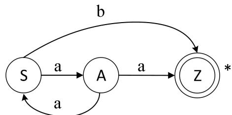

对于上述第（2）种情况，我们认为适合构造右线性文法。可以将终止状态作为不属于 $V_N$ 的状态，某个状态 U 引出箭弧（不妨假设箭弧上方标记为 a）指向终止状态 Z，只需要将 $U \longrightarrow a$ 这条规则加入右线性文法，而无需添加规则 $U \longrightarrow aZ$，因而最后的文法中不会出现非终结符 Z。

再以图3.19为例，符合上述的第2种情况，我们认为终止状态 Z 是一个多余的状态，因此与 Z 相关联的两条引入箭弧只产生规则 $S \to b$ 和 $A \to a$，最终该右线性文法 $G[S]$ 的规则有：
$$
\begin{array}{r l} 
S & \longrightarrow b | aA \\ 
A & \longrightarrow aS | a 
\end{array}
$$
所能识别的语言为 $\{ a^{2n}, n \geqslant 1 \} \bigcup \{ a^{2m}b, m \geqslant 0 \}$。

#### 情形 3

开始状态只有箭弧引出没有引入，终止状态只有箭弧引入没有引出，例如图3.24。

对于上述第（3）种情况，我们认为既适合构造左线性文法也适合构造右线性文法，构造左线性按照第1种情况来处理，构造右线性按照第2种情况来处理即可。

#### 情形 4

开始状态既有箭弧引出又有引入，终止状态既有箭弧引出又有引入，例如图3.15。

对于上述第（4）种情况，说明状态转换图中的开始状态和终止状态都并非多余的状态。
*   决定构造左线性文法时，开始状态 S 引出箭弧（不妨假设箭弧上方标记为 a）指向状态 U，需要将 $U \to a$ 和 $U \to Sa$ 这两条规则均加入左线性文法，最后的文法中会出现非终结符 S；
*   决定构造右线性文法时，某个状态 U 引出箭弧（不妨假设箭弧上方标记为 a）指向终止状态 Z，需要将 $U \to a$ 和 $U \to aZ$ 这两条规则加入右线性文法，最后的文法中会出现非终结符 Z。

例如图 3.15 中，构造左线性文法时，我们会将 $S_1 \longrightarrow 1$ 和 $S_1 \to S_0 1$ 这两条规则加入左线性文法；构造右线性文法时，我们会将 $S_3 \longrightarrow 0$ 和 $S_3 \longrightarrow 0 S_4$ 这两条规则加入右线性文法。

### 节 2：由正规文法转换成正规表达式

对于给定的正规文法 G，视为定义所含各非终结符号所产生的正规集的一个联立方程，再通过求解此联立方程以求得相应正规表达式。下面通过具体例子来描述这一方法。

#### 例 3.10

设已知正规文法（右线性文法）G：

$$
\begin{array}{l} 
\mathrm{S} := \mathrm{aS} | \mathrm{aB} \\ 
\mathrm{B} := \mathrm{bC} \\ 
\mathrm{C} := \mathrm{aC} | \mathrm{a} 
\end{array}
$$

可以写成如下关于非终结符 S, B, C 的一个正规表达式方程组：

$$
\begin{array}{l} 
\mathrm{S = aS + aB} \tag{1} \\ 
\mathrm{B=bC} \tag{2} \\ 
\mathrm{C = aC+ a} \tag{3} 
\end{array}
$$

由于该文法第一个产生式为 $\mathrm{S} := \mathrm{aS} | \mathrm{aB}$，若用“+”代之以“|”，用“=”代之以“::=”，这样就得到 $\mathrm{S} = \mathrm{aS} + \mathrm{aB}$，即(1)式。可用类似方法求得(2)和(3)式。解此方程组可以得到仅含有终结符的一个正规表达式，它所表示的语言与原正规文法产生的语言相同。

为了解这个方程组，可先从只含一个非终结符（变量）的方程开始，然后用代入法求其它非终结符（变量）的解，最后得到的开始符号的解就是所求的正规表达式。为此，我们首先需要求解形如

$$
\mathrm{X} = \mathrm{aX} + \mathrm{b} \tag{4}
$$

的方程，其中 a，b 是字母表 $\Sigma$ 上的正规表达式，X 是文法非终结符（变量）。

方程(4)的一个解是：$\mathrm{X} = \mathrm{a}^* \mathrm{b}$。将它代入方程(4)两端就可以验证这一点：
$$
\mathrm{a}^* \mathrm{b} = \mathrm{aa}^* \mathrm{b} + \mathrm{b}
$$
右端提公因子，得：
$$
\mathrm{a}^* \mathrm{b} = (\mathrm{aa}^* + \varepsilon) \mathrm{b}
$$
注意到 $\mathrm{aa}^* + \varepsilon = \mathrm{a}^*$ （都表示 $\{ \varepsilon, \mathrm{a}, \mathrm{aa}, ... \}$），就有 $\mathrm{a}^* \mathrm{b} = \mathrm{a}^* \mathrm{b}$，所以 $\mathrm{a}^* \mathrm{b}$ 是方程的一个解。

为了求出文法开始符号 S 的解，我们先解方程(3)，类似于 $\mathrm{X}=\mathrm{a}\mathrm{X}+\mathrm{b}$ 的解 $\mathrm{X}=\mathrm{a}^*\mathrm{b}$，$\mathrm{C} = \mathrm{aC} + \mathrm{a}$ 的解为 $\mathrm{C} = \mathrm{a}^* \mathrm{a}$ (5)。

将(5)代入(2)，得 $\mathrm{B} = \mathrm{ba}^* \mathrm{a}$ (6)。

将(6)代入(1)，得 $\mathrm{S} = \mathrm{aS} + \mathrm{aba}^* \mathrm{a}$，显然 $\mathrm{S} = \mathrm{a}^* \mathrm{aba}^* \mathrm{a}$（即文法所对应的正规表达式）。正规表达式对应的正规集是 $\{ \mathrm{a}^{\mathrm{m}} \mathrm{b} \mathrm{a}^{\mathrm{n}} | \mathrm{m} \geqslant 1, \mathrm{n} \geqslant 1 \}$。

类似的，对于给定文法是一个左线性文法，我们就求解形如 $\mathrm{X} = \mathrm{Xa} + \mathrm{b}$ 的方程，$\mathrm{X} = \mathrm{ba}^*$ 是它的一个解。

#### 例 3.11

$$
\langle \text{标识符} \rangle := \text{字母} | _{-} | \langle \text{标识符} \rangle \text{字母} | \langle \text{标识符} \rangle \text{数字} | \langle \text{标识符} \rangle _{-}
$$

其方程为

$$
\begin{array}{r l} 
\langle \text{标识符} \rangle & = \langle \text{标识符} \rangle \text{字母} + \langle \text{标识符} \rangle \text{数字} + \langle \text{标识符} \rangle _{-} + \text{字母} | _{-} \\ 
& = \langle \text{标识符} \rangle (\text{字母} + \text{数字} + _{-}) + (\text{字母} | _{-}) 
\end{array}
$$

所以 $\langle \text{标识符} \rangle = (\text{字母}|_-) (\text{字母}|\text{数字}|_-)^*$。

即：由 $\langle \text{标识符} \rangle$ 文法所产生语言可用正规表达式 $(\text{字母}|_-)(\text{字母}|\text{数字}|_-)^*$ 来表示。

### 节 3：由正规表达式转换成状态转换系统

所谓转换系统是一个具有唯一开始状态 S 和唯一最终状态 Z 的一种特殊状态图。其条件是：

1.  没有弧向开始状态 S 引入；
2.  没有弧从终止状态 Z 引出；
3.  转换系统的弧可以用空符号 $\varepsilon$ 标记。

**转换系统与有穷自动机状态转换图的区别：**

1.  有穷自动机状态转换图开始状态和终止状态不唯一；
2.  有穷自动机状态转换图弧上没有空符号 $\varepsilon$ 标记；
3.  有穷自动机状态转换图开始状态有引入，终止状态有引出。

对于每一个正规表达式 e，存在一个接受正规集 L(e) 的转换系统。设 S 和 Z 是转换系统的开始状态和最终状态，构造字母表 $\Sigma = \{ \mathrm{a}_1, \mathrm{a}_2, ..., \mathrm{a}_n \}$ 上正规表达式转换系统方法如图 3.20 所示。

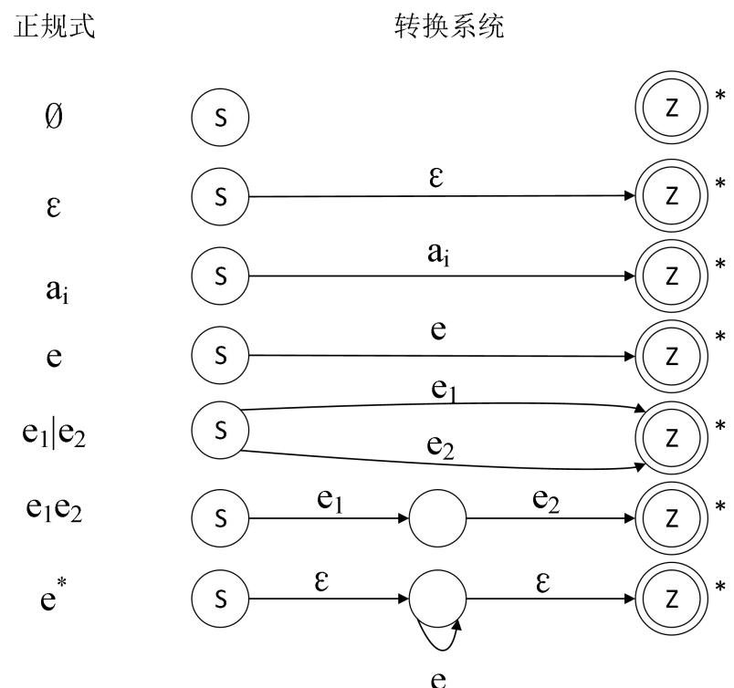

#### 例 3.12

已知正规表达式 $1 ( 0 | 1 ) ^ { * } 1 0 1$ ，构造该正规表达式的转换系统如图 3.21 所示。

### 4. 由状态转换系统构造 DFA（子集法）

介绍子集法之前，首先介绍状态子集 I 的 ε-闭包和子集 $\mathrm{I_a}$ 这两个重要的定义。这两个定义是采用子集法构造确定性有穷自动机的重要理论基础。

#### （1）状态子集 I 的 ε-闭包

假定 I 是转换图状态集 K 一个子集，定义 ε-CLOSURE(I) 为：

① 若 $\mathrm{S_i} \in \mathrm{I}$，则 $\mathrm{S_i} \in \varepsilon\text{-}\mathrm{CLOSURE(I)}$。

② 若 $\mathrm{S_i} \in \mathrm{I}$，且 $\mathrm{S_i}$ 出发经过一条或多条相邻的 ε 弧能到达 K 中的任一状态 $\mathrm{S_j}$，则 $\mathrm{S_j} \in \varepsilon\text{-}\mathrm{CLOSURE(I)}$。ε-CLOSURE(I) 称为 I 的 ε-闭包。它是状态集 K 的一个子集。

#### （2）子集 $\mathrm{I_a}$

若 I 是转换系统状态集 K 的一个子集，$\mathsf{a} \in \Sigma$，定义 $\mathrm{I_a} = \varepsilon\text{-}\mathrm{CLOSURE(J)}$，其中：J 是所有那些可从子集 I 中任一状态出发，经过一条 a 弧（跳过 a 弧前的 ε 弧）而到达的状态的全体。

例如，如图 3.22 为正规表达式 $\mathbf{e} = (\mathbf{a}|\mathbf{b})^*(\mathbf{aa}|\mathbf{bb})(\mathbf{a}|\mathbf{b})^*$ 对应的转换系统。

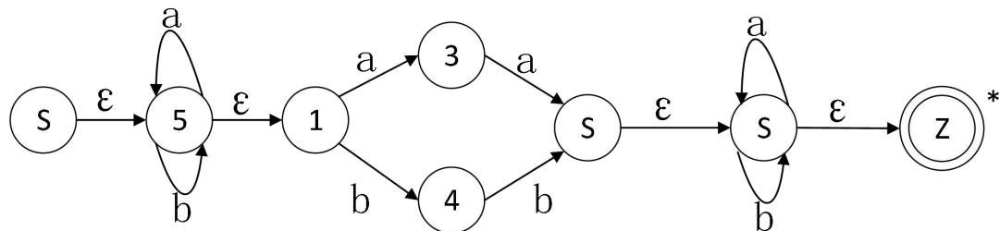

设 I={S}，则根据定义，$\mathrm{S} \in \mathrm{I}$，故 $\mathrm{S} \in \varepsilon\text{-}\mathrm{CLOSURE(I)}$，则 S 出发经过一条 ε 弧到达 5 状态，故 $5 \in \varepsilon\text{-}\mathrm{CLOSURE(I)}$，经过两条相邻的 ε 弧能到达 1 状态，故 $1 \in \varepsilon\text{-}\mathrm{CLOSURE(I)}$。综上所述，$\varepsilon\text{-}\mathrm{CLOSURE(I)} = \{S,\ 5,\ 1\}$，求解 ε-CLOSURE(I)，大多数读者都能看懂，不容易出错，但是求解 $\mathrm{I_a}$ 时，很多读者就容易犯错误。

假设 I 等于 {S} 的 ε-闭包，即 I={S, 5, 1}，根据定义，为了求 $\mathrm{I_a}$，首先要求 J。J 是所有那些可从子集 I 中任一状态出发，经过一条 a 弧（跳过 a 弧前的 ε 弧）而到达的状态的全体。我们首先从 S 状态出发求得 $5 \in \mathrm{J}$，再从 5 状态出发，求得 $3 \in \mathrm{J}$，再从 1 状态出发求得 $3 \in \mathrm{J}$，综上所求，$\mathrm{J}=\{5,3\}$。再求解 J 子集的 ε-闭包，首先 J 的 ε-闭包包括其自身，其次从 5 状态出发经过一条 ε 弧到达 1 状态，故 $1 \in \varepsilon\text{-}\mathrm{CLOSURE(J)}$，综合得到 $\mathrm{I_a}=\{5,3,1\}$。

设计子集法的目的是将转换系统构造出确定的有穷自动机（DFA），所以我们可以从识别的观点理解子集法。我们对状态子集 I 的 ε-闭包和子集 $\mathrm{I_a}$ 进行重新定义。

（1）状态子集 I 的 ε-闭包重新定义为“从状态子集 I 中的每个状态开始识别 ε 所到达的状态的全体”。

因为 $\varepsilon = \varepsilon\varepsilon = \varepsilon\varepsilon\varepsilon = \cdots$，所以从某个状态出发识别一个 ε 和识别若干个 ε，其本质是相同的，都是识别一个 ε。例如假设 $\mathrm{I}=\{S\}$，图 3.22 中从 S 出发识别一个 ε 到达 5 状态，即 $\mathrm{M}(S,\varepsilon)=5$；从 S 出发识别两个 ε 到达 1 状态，即 $\mathrm{M}(S,\varepsilon\varepsilon)=\mathrm{M}(\mathrm{M}(S,\varepsilon),\varepsilon)=\mathrm{M}(5,\varepsilon)=1$；而 ε 是一个空符号串，显然有 $\mathrm{M}(S,\varepsilon)=S$。那么从 S 状态出发识别 ε 所到达的状态全体为 {S, 5, 1}。

（2）子集 $\mathrm{I_a}$ 重新定义为“从状态子集 I 中的每个状态开始识别一个 a 符号所到达的状态的全体”。

因为 $\mathrm{a} = \varepsilon\mathrm{a} = \mathrm{a}\varepsilon = \varepsilon\varepsilon\mathrm{a}\varepsilon\varepsilon$，所以从某个状态出发识别一个 a 符号和识别 $\varepsilon\cdots\varepsilon\mathrm{a}\varepsilon\cdots\varepsilon$ 其本质是相同的，都是识别一个 a 符号。例如假设 $\mathrm{I}=\{S,5,1\}$，首先从 S 出发识别一个 εa 到达 5 状态，即 $\mathrm{M}(S,\varepsilon\mathrm{a})=\mathrm{M}(\mathrm{M}(S,\varepsilon),\mathrm{a})=\mathrm{M}(5,\mathrm{a})=5$；从 S 出发识别 εaε 到达 1 状态，即 $\mathrm{M}(S,\varepsilon\mathrm{a}\varepsilon)=\mathrm{M}(\mathrm{M}(S,\varepsilon),\mathrm{a}\varepsilon)=\mathrm{M}(5,\mathrm{a}\varepsilon)=\mathrm{M}(\mathrm{M}(5,\mathrm{a}),\varepsilon)=\mathrm{M}(5,\varepsilon)=1$；那么从 S 状态出发识别 a 所到达的状态全体为 {5,1}。同理，从 5 状态出发识别 a 所到达的状态全体为 {5,1}，从 1 状态出发识别 a 所到达的状态全体为 {3}，综合得到 $\mathrm{I_a}=\{5,3,1\}$。

根据重新定义后的状态子集 I 的 ε-闭包和子集 $\mathrm{I_a}$，只需要利用原来自动机状态转换图识别符号串的知识就可以求出子集 I 的 ε-闭包和子集 $\mathrm{I_a}$，使原来抽象的定义变得更加可操作，更容易掌握和理解。在此基础上，讨论将构造出的转换系统转换成 DFA 的详细步骤。

（1）构造一张表，它共有 $|\Sigma|+1$ 列（$|\Sigma|$ 表示正规表达式或转换系统中不包含 ε 的字符的个数），第一列为状态子集 I，然后对每个字符 $\mathsf{a} \in \Sigma$ 依次单独设一列 $\mathrm{I_a}$；

（2）约定表中第一行第一列的状态子集 I 为 $\varepsilon\text{-}\mathrm{CLOSURE(S)}$，其中 S 为初始状态；

（3）依次以第一列中的 I 为子集（初始是第一列第一行的 ε-CLOSURE(S) 为子集），针对每个字符 $\mathsf{a} \in \Sigma$，依次求得 $\mathrm{I_a}$，并填入子集 I 所对应行中相应的 $\mathrm{I_a}$ 列，如果所求的 $\mathrm{I_a}$ 不同于第一列中已有的任一状态子集 I，则将其依次列入第一列中；

（4）针对表格第一列中新填入的每个状态子集 I，重复步骤（3）的操作，直到对每个 I 及 $\mathsf{a} \in \Sigma$ 均已求得 $\mathrm{I_a}$，并且没有新的状态子集加入第一列时过程终止（即新求出的 $\mathrm{I_a}$ 均已在第一列中存在）。

上述过程在有限步后必可终止，因为状态子集个数是有限的。

（5）上述过程终止后，含有原初始状态 S 的状态子集成为新的唯一的初始状态，含有原终止状态 Z 的若干状态子集成为新的终止状态的集合。接下来对第一列中的每个状态子集重新命名，然后再以新命名更新从第二列开始的每一 $\mathrm{I_a}$ 列中的状态集合，将最终得到相应的确定有穷自动机 DFA 的状态转换矩阵。

下面我们将通过例 3.13 来演示上述的转换步骤。

### 例 3.13

已知正规表达式 $0(0|1)^*1$ 对应的转换系统如下图 3.23 所示，采用子集法构造出其 DFA。

$$
\text{图 3.23 正规表达式 } 0(0|1)^*1 \text{ 对应的转换系统}
$$

首先，根据步骤（1）列出表格，应该是 3 列，分别对应 I 列，$\mathrm{I_0}$ 列和 $\mathrm{I_1}$ 列。根据步骤（2）

可以得到第一行第一列中的状态子集 $\mathrm{I} = \varepsilon\text{-}\mathrm{CLOSURE}(\mathrm{S}) = \{\mathrm{S}\}$。根据步骤（3），先以 $\{\mathrm{S}\}$ 为子集，针对字符 0 和 1 分别计算得到 $\{1, 2, 3\}$ 和空集，由于 $\{1, 2, 3\}$ 未出现在 I 列中，因此添加入 I 列。根据步骤（4），依次对 I 列中新填入的状态子集重复步骤（3）的操作，直到整个过程终止。

用子集法将图3.23 中所示的转换系统进行确定化得到表3.6，其中状态子集 $\{\mathrm{S}\}$ 为新的唯一开始状态，状态子集 $\{2, 3, \mathrm{Z}\}$ 为新的终止状态。

**表 3.6 状态子集转换表**

| I | $I_0$ | $I_1$ |
| :--- | :--- | :--- |
| {S} | {1,2,3} | $\Phi$ |
| {1,2,3} | {2,3} | {2,3,Z} |
| {2,3} | {2,3} | {2,3,Z} |
| {2,3,Z} | {2,3} | {2,3,Z} |

根据步骤（5）对表3.6中的所有子集重新命名，得到DFA的状态转换矩阵如表3.7所示，状态转换图如图 3.24 所示。由表 3.7可见，状态 0 为唯一的初始状态，且所有映射皆为单值映射，满足DFA的条件。

读者也可以尝试着将图3.21和图3.22中的转换系统的例子按照子集法转换为DFA。

**表 3.7 状态转换矩阵**

| I | 0 | 1 |
| :--- | :--- | :--- |
| 0 | 1 | $\Phi$ |
| 1 | 2 | 3 |
| 2 | 2 | 3 |
| 3 | 2 | 3 |

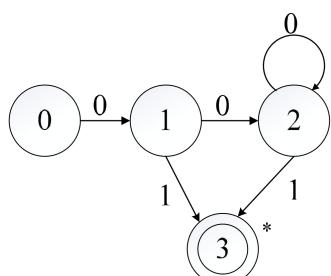

### 5. DFA 化简

所谓确定有穷自动机(DFA)M 的化简是指：寻找一个状态数比 M 少的确定性有穷自动机(DFA)M′使得 $\mathrm{L}(\mathrm{M}) = \mathrm{L}(\mathrm{M}')$。

对 DFA进行化简，可以使得生成词法分析程序更加简洁。要理解 DFA化简的方法，首先理解等价和可区分的概念。

**等价**：对于一个给定的(DFA)M，假定有两个不相同状态 $\mathrm{S}_1$ 和 $\mathrm{S}_2$，如果从状态 $\mathrm{S}_1$ 出发能扫描符号串 w 而停止于终态，同样，从状态 $\mathrm{S}_2$ 出发也能扫描符号串 w 而停止于终态，我们则称状态 $\mathrm{S}_1$ 和 $\mathrm{S}_2$ 是等价的。若两不同状态不等价，则称它们是可区分的。

终态和非终态是可区分的。因为终态可以读 $\varepsilon$ 符号回到终态而非终态读入 $\varepsilon$ 符号则不能回到终态。

确定有穷自动机的化简方法的基本思想：把(DFA)M 的状态集分别划成一些不相交子集，使得任何不同的两个子集的状态是可区分的，而同一子集中的任何两个状态是等价的。随着子集数量的增多，新产生的子集可能会影响当前子集中状态的等价关系。最后，从每个子集选出一个状态以代表该子集，同时消去该子集中的其它等价状态。

例如对上例3.13的DFA进行化简，如表3.7所示，其步骤如下。

（1）将状态集 $\mathrm{S}=\{0, 1, 2, 3\}$ 划分为终态集 $\{3\}$ 和非终态集 $\{0, 1, 2\}$。

（2）考察 $\{0,1,2\}$：对符号1的处理结果：1状态时读入符号1 到达3状态，2状态时读入符号 1 到达 3 状态，0 不能识别输入字符 1，故将 $\{0, 1, 2\}$ 划分为 $\{0\}$ 和 $\{1, 2\}$。

（3）再考察 $\{1,2\}$：1状态时读入符号0到达2状态，2状态时读入符号0到达2状态，因此1 状态和 2状态等价，不能再进行划分。

（4）按顺序重新命名状态子集 $\{0\}$，$\{1,2\}$，$\{3\}$ 为0状态、1状态、2状态，得到化简后的状态转换矩阵如表3.8所示和化简后的状态转换图如图3.25所示。

**表3.8 化简后的状态转换矩阵**

| S | 0 | 1 |
| :--- | :--- | :--- |
| 0 | 1 | $\Phi$ |
| 1 | 1 | 2 |
| 2 | 1 | 2 |

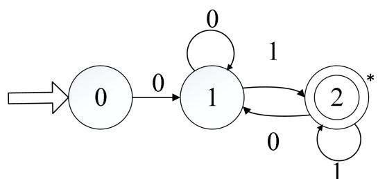

我们可以再举出一个例子来详细说明化简的步骤。假设化简之前的 DFA(M)有 6 个状态，表示为状态集合 $\mathrm{K} = \{0, 1, 2, 3, 4, 5\}$，其中状态集合 $\{4,5\}$ 为终止状态集合，$\mathrm{V}_{\mathrm{T}} = \{\mathrm{a}, \mathrm{b}\}$。这些状态分别读入字符 a 和 b 所转移到的状态如表 3.9所示。根据前文所述，首先划分为终态集合 $\{4,5\}$ 以及非终态集合 $\{0, 1, 2, 3\}$，在率先考察集合 $\{4, 5\}$ 时，虽然 $\{4\}_{\mathrm{b}} = \{2\}$（状态 4 读入字符 b 到达状态2）而 $\{5\}_{\mathrm{b}} = \{3\}$（状态5读入字符b到达状态3），但由于此时非终态集合 $\{0,1,2,3\}$ 暂时不可区分，因此集合 $\{4, 5\}$ 也不可区分。当我们考察非终态集合 $\{0,1,2,3\}$，我们会发现：

由于 $\{0\}_{\mathrm{b}} = \Phi$，而进一步地 $\{3\}_{\mathrm{b}} = \{0\}$，因此可以划分出 $\{0\}$、$\{1,2\}$（此时状态 4和5不可区分）以及 $\{3\}$ 三个子集。再回过头来看看集合 $\{4, 5\}$，由于此时状态 2和状态 3 可区分，因此分裂成 $\{4\}$ 和 $\{5\}$ 两个子集。再考察集合 $\{1, 2\}$，由于 $\{1\}_{\mathrm{b}} = \{4\}$ 且 $\{2\}_{\mathrm{b}} = \{5\}$ 且此时状态4 和5可区分，因此最终 $\{1\}$ 和 $\{2\}$ 也可区分。因此，结论是该 DFA(M)没有任何两个状态是等价的，都是可区分的。从这个例子我们可以看出，DFA的化简是一个需要反复回头看的动态调整过程，但是经过多次的可区分之后，最终将静止或收敛在某个状态。

**表3.9 各状态读入字符a和b之后转移到的状态**

| K | a | b |
| :--- | :--- | :--- |
| 0 | 3 | $\Phi$ |
| 1 | 1 | 4 |
| 2 | 1 | 5 |
| 3 | 2 | 0 |
| 4 | 0 | 2 |
| 5 | 0 | 3 |

### 3.4 本章小结

词法分析是编译过程的第一步也是非常重要的环节，它的主要功能就是基于源程序符号串，识别出一个个独立意义的单词，经过内部编码等处理之后，将单词流作为语法分析的输入。词法分析和正规文法以及有穷自动机密切相关。通常高级程序设计语言的词法规则均能用正规文法来描述，将正规文法等价转换为正规表达式之后，正规表达式可以构造出等价的转换系统，通过子集法等方法可将转换系统进一步构造出等价的有穷自动机（状态转换图、状态转换矩阵），用于单词符号串的识别。上述概念的等价关系贯穿于本章的始终，也是理解和掌握词法分析原理的重要基础。

### 习题

#### 简答 1

什么叫超前搜索？扫描缓冲区的作用是什么？

#### 作图与检查 2

画出下列文法的状态图, 并使用该状态图检查下列句子是否该文法的合法句子：f, eeff, eefe。

$$
\begin{aligned}
\mathrm{Z} &::= \mathrm{Be} \\
\mathrm{B} &::= \mathrm{Af} \\
\mathrm{A} &::= \mathrm{e} | \mathrm{Ae}
\end{aligned}
$$

#### 作图 3

设右线性文法 $\mathrm{G}=(\{\mathrm{S}, \mathrm{A}, \mathrm{B}\}, \{\mathrm{a}, \mathrm{b}\}, \mathrm{S}, \mathrm{P})$，其中 P 组成如下：

$$
\begin{aligned}
\mathrm{S} &::= \mathrm{bA} \\
\mathrm{A} &::= \mathrm{bB} \\
\mathrm{A} &::= \mathrm{aA} \\
\mathrm{A} &::= \mathrm{b} \\
\mathrm{B} &::= \mathrm{a}
\end{aligned}
$$

画出该文法的状态转换图。

#### 构造与判断 4

构造下述文法 $\mathrm{G}[\mathrm{Z}]$ 的自动机，该自动机是确定的吗？它相应的语言是什么？

$$
\begin{aligned}
\mathrm{Z} &::= \mathrm{A}0 \\
\mathrm{A} &::= \mathrm{A}0 | \mathrm{Z}1 | 0
\end{aligned}
$$

#### 构造 5

构造一个DFA，它接受 $\{0,1\}$ 上所有满足下述条件的字符串，其条件是：字符串中每个 1都有0直接跟在右边，然后，再构造该语言的正规文法。

#### 确定化 6

设 $(\mathrm{NFA}) \mathrm{M} = (\{\mathrm{A}, \mathrm{B}\}, \{\mathrm{a}, \mathrm{b}\}, \mathrm{M}, \{\mathrm{A}\}, \{\mathrm{B}\})$，其中 M 定义如下：

$$
\begin{aligned}
\mathrm{M}(\mathrm{A}, \mathrm{a}) &= \{\mathrm{A}, \mathrm{B}\} \\
\mathrm{M}(\mathrm{A}, \mathrm{b}) &= \{\mathrm{B}\} \\
\mathrm{M}(\mathrm{B}, \mathrm{a}) &= \varnothing \\
\mathrm{M}(\mathrm{B}, \mathrm{b}) &= \{\mathrm{A}, \mathrm{B}\}
\end{aligned}
$$

请构造相应确定有穷自动机 $(\mathrm{DFA}) \mathrm{M}'$。

#### 左线性文法构造 7

设有穷自动机 $\mathrm{M} = (\{\mathrm{S}, \mathrm{A}, \mathrm{E}\}, \{\mathrm{a}, \mathrm{b}, \mathrm{c}\}, \mathrm{M}, \mathrm{S}, \{\mathrm{E}\})$，其中 M 定义为：

$$
\begin{aligned}
\mathrm{M}(\mathrm{S}, \mathrm{c}) &= \mathrm{A} \\
\mathrm{M}(\mathrm{A}, \mathrm{b}) &= \mathrm{A} \\
\mathrm{M}(\mathrm{A}, \mathrm{a}) &= \mathrm{E}
\end{aligned}
$$

请构造一个左线性文法。

#### 等价自动机构造 8

已知正规文法 $\mathrm{G} = (\{\mathrm{S}, \mathrm{B}, \mathrm{C}\}, \{\mathrm{a}, \mathrm{b}, \mathrm{c}\}, \mathrm{P}, \mathrm{S})$，其中 P 内包含如下产生式：

$$
\begin{aligned}
\mathrm{S} &::= \mathrm{aS} | \mathrm{aB} \quad \text{①} \\
\mathrm{B} &::= \mathrm{bB} | \mathrm{bC} \quad \text{②} \\
\mathrm{C} &::= \mathrm{cC} | \mathrm{c} \quad \text{③}
\end{aligned}
$$

请构造一个等价的有穷自动机。

#### 构造与最小化 9

构造下列正规表达式相应的DFA，并进行最小化的化简。

(1) $\mathrm{b}(\mathrm{a}|\mathrm{b})^*\mathrm{bab}$

(2) $(\mathrm{a}|\mathrm{bb}^*\mathrm{a})^*$

(3) $((0|1)^*|(11))^*$

#### 确定化和最少化 10

将下图非确定有穷自动机NFA确定化和最少化：

（1）假设1为开始状态；

（2）假设0既是开始状态又是终止状态。

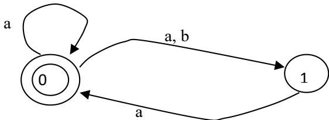

#### 证明 11

已知 $\mathrm{e}_1 = (\mathrm{a}|\mathrm{b})^*$，$\mathrm{e}_2 = (\mathrm{a}^*\mathrm{b}^*)^*$，试证明 $\mathrm{e}_1 = \mathrm{e}_2$。

#### 正规表达式构造 12

根据下面正规文法构造等价的正规表达式。

$$
\begin{aligned}
\mathrm{S} &::= \mathrm{cC} | \mathrm{a} \quad \text{①} \\
\mathrm{A} &::= \mathrm{cA} | \mathrm{aB} \quad \text{②} \\
\mathrm{B} &::= \mathrm{aB} | \mathrm{c} \quad \text{③} \\
\mathrm{C} &::= \mathrm{aS} | \mathrm{aA} | \mathrm{bB} | \mathrm{cC} | \mathrm{a} \quad \text{④}
\end{aligned}
$$
