# 《编译原理》第3章 词法分析（课件）

原件的每一页，下面附识别出的文字。

### 编译原理 Compiler Principles

原文：

编译原理 Compiler Principles

南京邮电大学计算机学院

徐 康

My E-mail: kxu@njupt.edu.cn

教材：《编译技术原理及方法》黄海平 等编著

### 第 2 页

原文：

第三章 词法分析§3.1 引言§3.2 单词的内部编码§3.3 正规文法和状态转换图§3.4 词法分析程序设计§3.5 正规文法和有穷自动机§3.6 正规表达式和有穷自动机§3.7 词法分析程序的自动生成

### 第 3 页

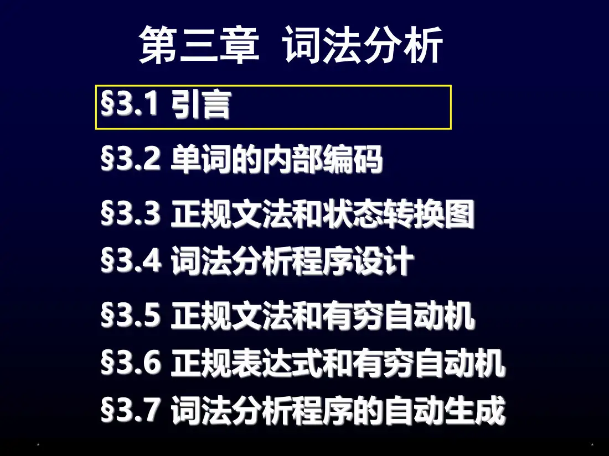

原文：

第三章 词法分析§3.1 引言§3.2 单词的内部编码§3.3 正规文法和状态转换图§3.4 词法分析程序设计§3.5 正规文法和有穷自动机§3.6 正规表达式和有穷自动机§3.7 词法分析程序的自动生成

### §3.1 引言一、词法分析的基本思想

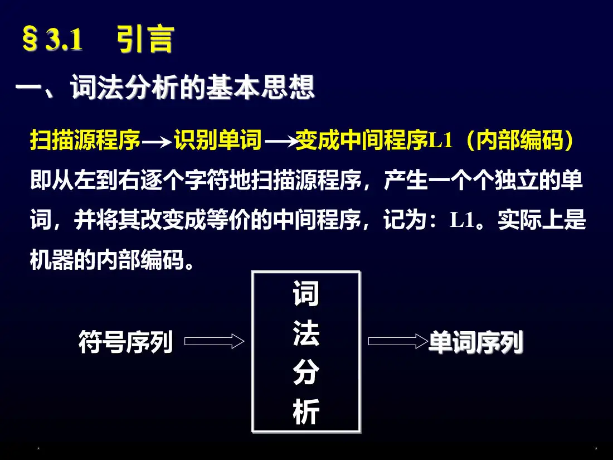

原文：

§3.1 引言一、词法分析的基本思想

扫描源程序 识别单词 变成中间程序L1（内部编码）即从左到右逐个字符地扫描源程序，产生一个个独立的单词，并将其改变成等价的中间程序，记为：L1。实际上是机器的内部编码。

符号序列

词

法

分

析

单词序列

### §3.1 引言

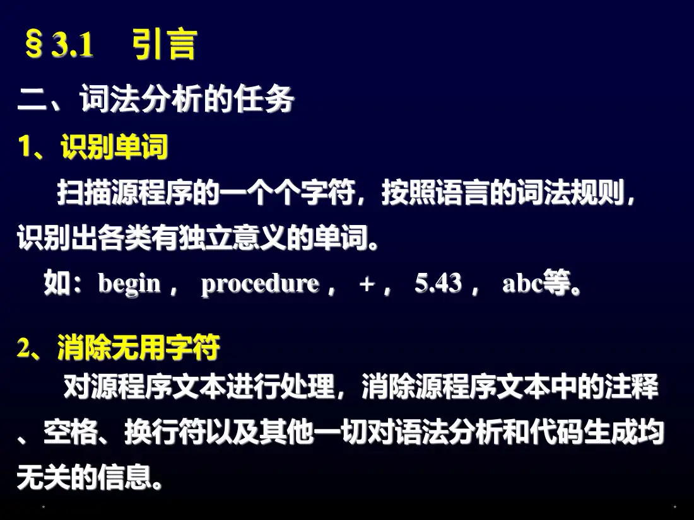

原文：

§3.1 引言

二、词法分析的任务

1、识别单词

扫描源程序的一个个字符，按照语言的词法规则，识别出各类有独立意义的单词。

如：begin ， procedure ， + ， 5.43 ， abc等。

2、消除无用字符对源程序文本进行处理，消除源程序文本中的注释空格、换行符以及其他一切对语法分析和代码生成均无关的信息。

### §3.1 引言

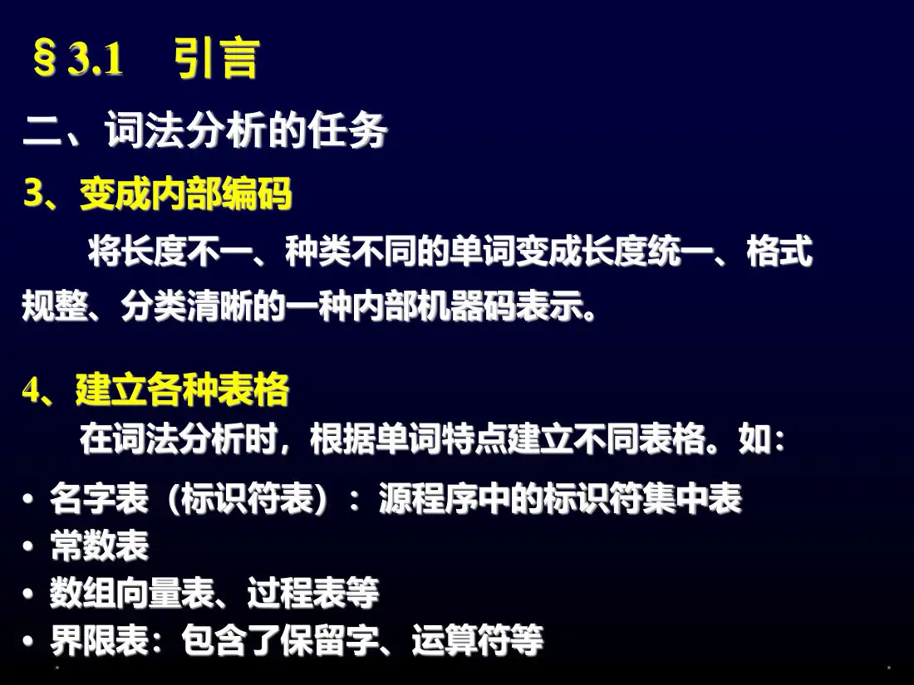

原文：

§3.1 引言

二、词法分析的任务

3、变成内部编码

将长度不一、种类不同的单词变成长度统一、格式规整、分类清晰的一种内部机器码表示。

建立各种表格在词法分析时，根据单词特点建立不同表格。如：

• 名字表（标识符表）：源程序中的标识符集中表

• 常数表

• 数组向量表、过程表等

• 界限表：包含了保留字、运算符等

### §3.1 引言

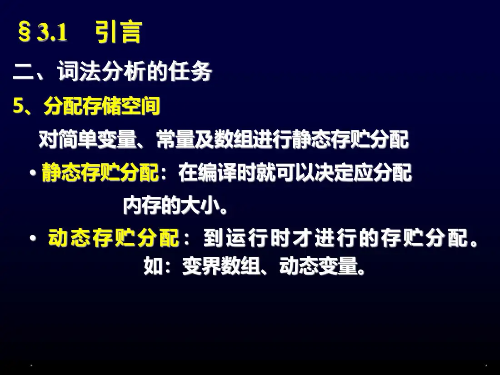

原文：

§3.1 引言

二、词法分析的任务

5、分配存储空间对简单变量、常量及数组进行静态存贮分配

• 静态存贮分配：在编译时就可以决定应分配内存的大小。

• 动态存贮分配：到运行时才进行的存贮分配。

如：变界数组、动态变量。

### §3.1 引言

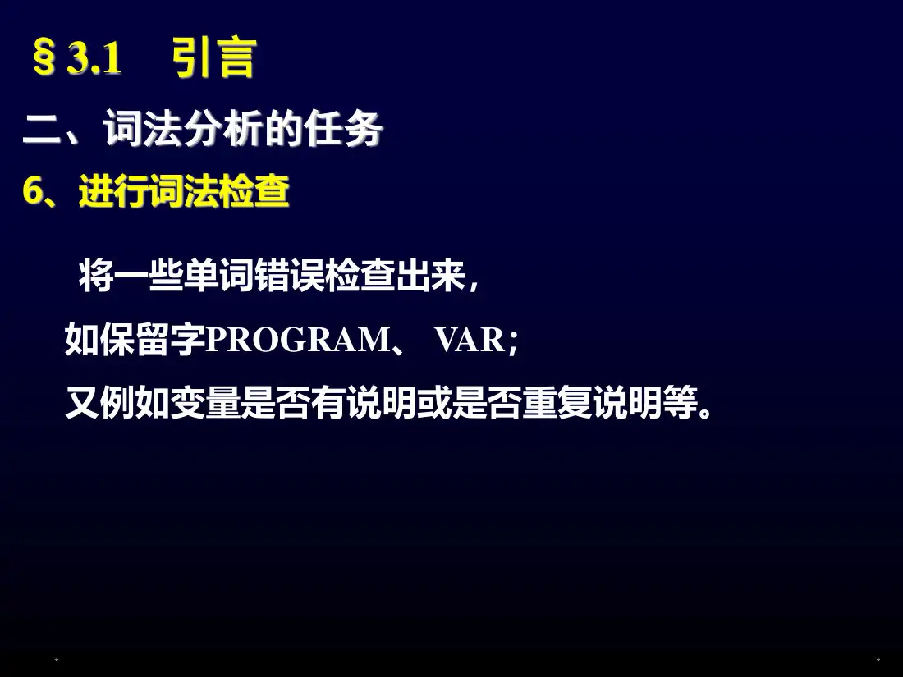

原文：

§3.1 引言

二、词法分析的任务

6、进行词法检查

将一些单词错误检查出来，

如保留字PROGRAM、 VAR；

又例如变量是否有说明或是否重复说明等。

### §3.1 引言

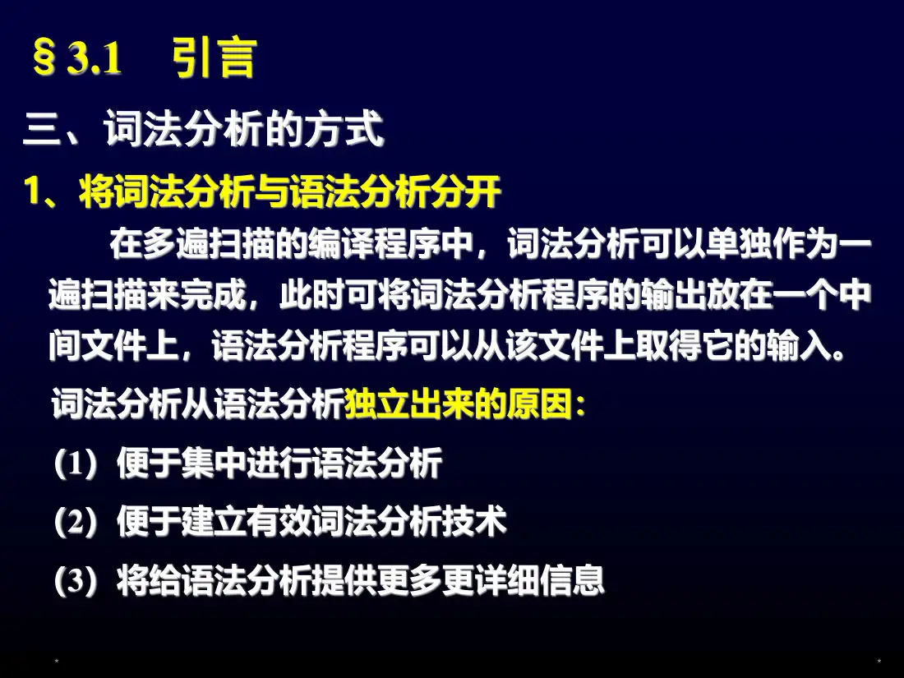

原文：

§3.1 引言

三、词法分析的方式

1、将词法分析与语法分析分开

在多遍扫描的编译程序中，词法分析可以单独作为一遍扫描来完成，此时可将词法分析程序的输出放在一个中间文件上，语法分析程序可以从该文件上取得它的输入。

词法分析从语法分析独立出来的原因：

（1）便于集中进行语法分析

（2）便于建立有效词法分析技术

（3）将给语法分析提供更多更详细信息

### §3.1 引言

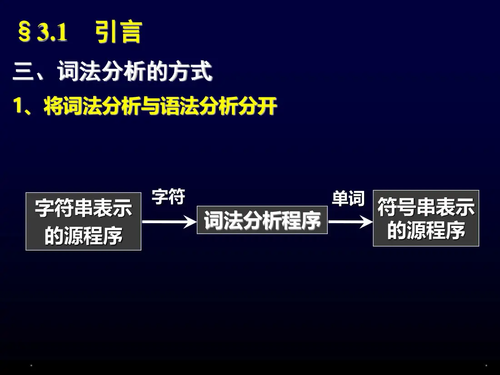

原文：

§3.1 引言

三、词法分析的方式

1、将词法分析与语法分析分开

字符串表示的源程序

字符

词法分析程序

单词

符号串表示的源程序

### §3.1 引言

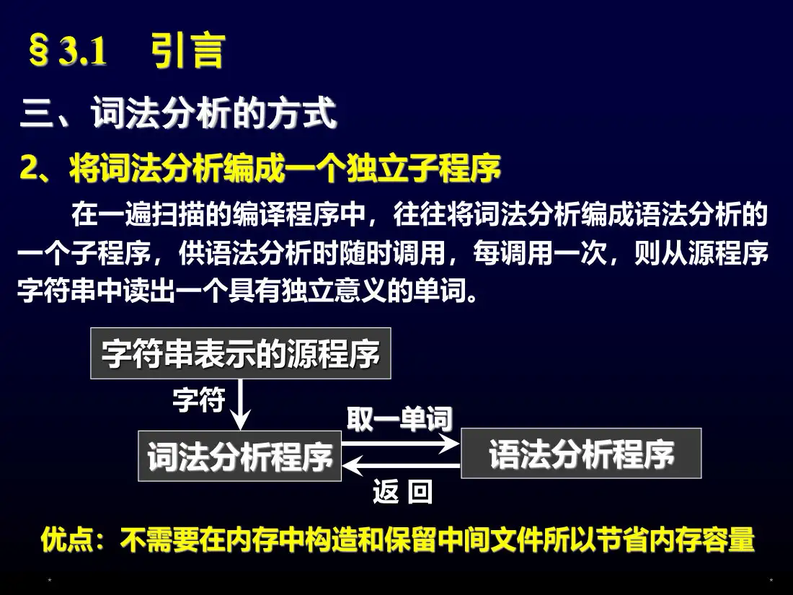

原文：

§3.1 引言

三、词法分析的方式

2、将词法分析编成一个独立子程序

在一遍扫描的编译程序中，往往将词法分析编成语法分析的一个子程序，供语法分析时随时调用，每调用一次，则从源程序字符串中读出一个具有独立意义的单词。

字符串表示的源程序

字符

词法分析程序

取一单词

语法分析程序

返 回

优点：不需要在内存中构造和保留中间文件所以节省内存容量

### 第 12 页

原文：

第三章 词法分析§3.1 引言§3.2 单词的内部编码§3.3 正规文法和状态转换图§3.4 词法分析程序设计§3.5 正规文法和有穷自动机§3.6 正规表达式和有穷自动机§3.7 词法分析程序的自动生成

### 第 13 页

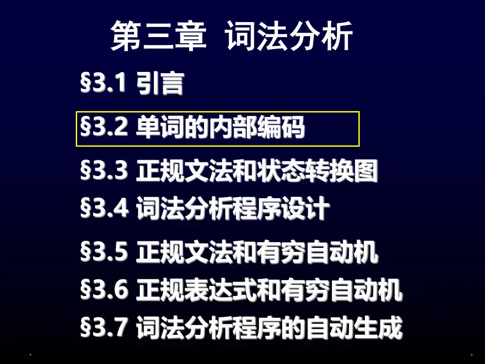

原文：

第三章 词法分析§3.1 引言§3.2 单词的内部编码§3.3 正规文法和状态转换图§3.4 词法分析程序设计§3.5 正规文法和有穷自动机§3.6 正规表达式和有穷自动机§3.7 词法分析程序的自动生成

### §3.2 单词的内部编码

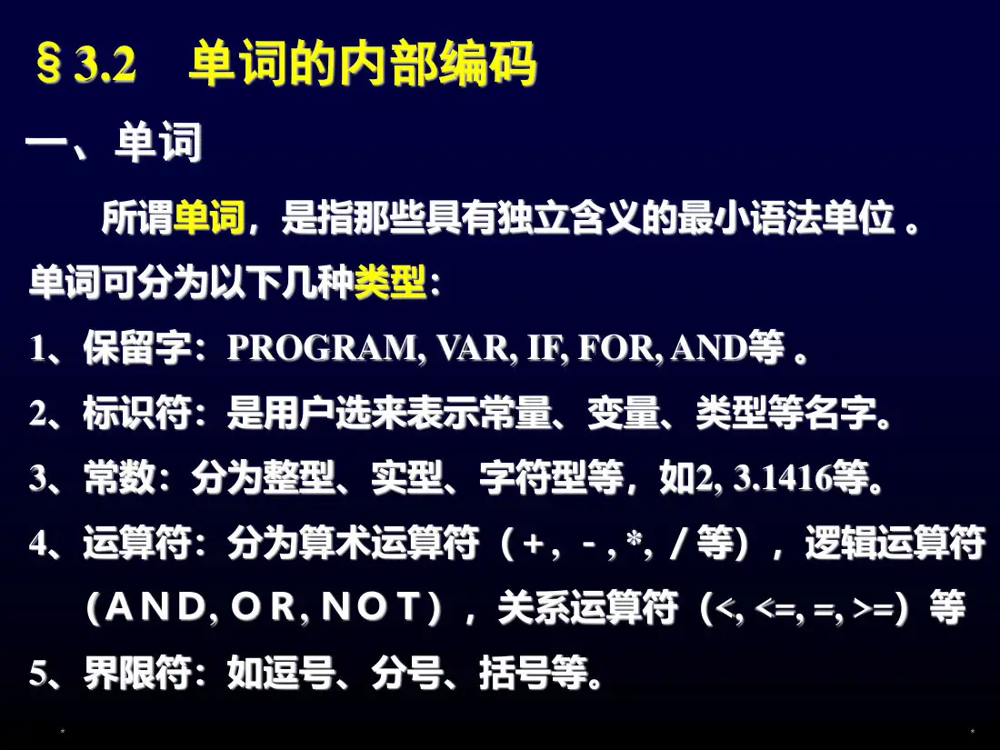

原文：

§3.2 单词的内部编码

一、单词

所谓单词，是指那些具有独立含义的最小语法单位单词可分为以下几种类型：

1、保留字：PROGRAM, VAR, IF, FOR, AND等 。

2、标识符：是用户选来表示常量、变量、类型等名字。

3、常数：分为整型、实型、字符型等，如2, 3.1416等。

4、运算符：分为算术运算符（＋, －, \*, ／等），逻辑运算符（AND, OR, NOT），关系运算符 $( \cos \angle A = \cos \angle B = \cos \angle C$ 等

5、界限符：如逗号、分号、括号等。

### §3.2 单词的内部编码

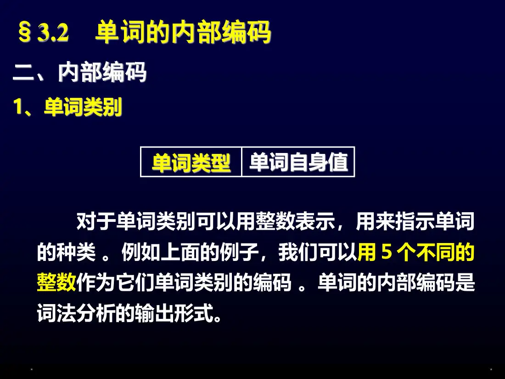

原文：

§3.2 单词的内部编码

二、内部编码

1、单词类别

单词类型 单词自身值

对于单词类别可以用整数表示，用来指示单词的种类 。例如上面的例子，我们可以用5个不同的整数作为它们单词类别的编码 。单词的内部编码是词法分析的输出形式。

### §3.2 单词的内部编码

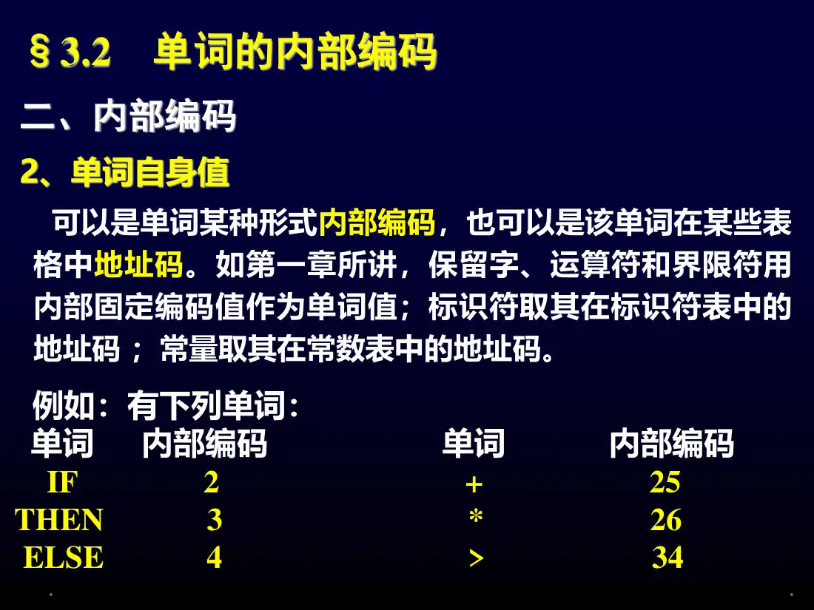

原文：

§3.2 单词的内部编码

二、内部编码

2、单词自身值

可以是单词某种形式内部编码，也可以是该单词在某些表格中地址码。如第一章所讲，保留字、运算符和界限符用内部固定编码值作为单词值；标识符取其在标识符表中的地址码 ；常量取其在常数表中的地址码。

例如：有下列单词：单词 内部编码IF 2THEN 3ELSE 4

单词内部编码252634

### 第 17 页

原文：

第三章 词法分析§3.1 引言§3.2 单词的内部编码§3.3 正规文法和状态转换图§3.4 词法分析程序设计§3.5 正规文法和有穷自动机§3.6 正规表达式和有穷自动机§3.7 词法分析程序的自动生成

### 第 18 页

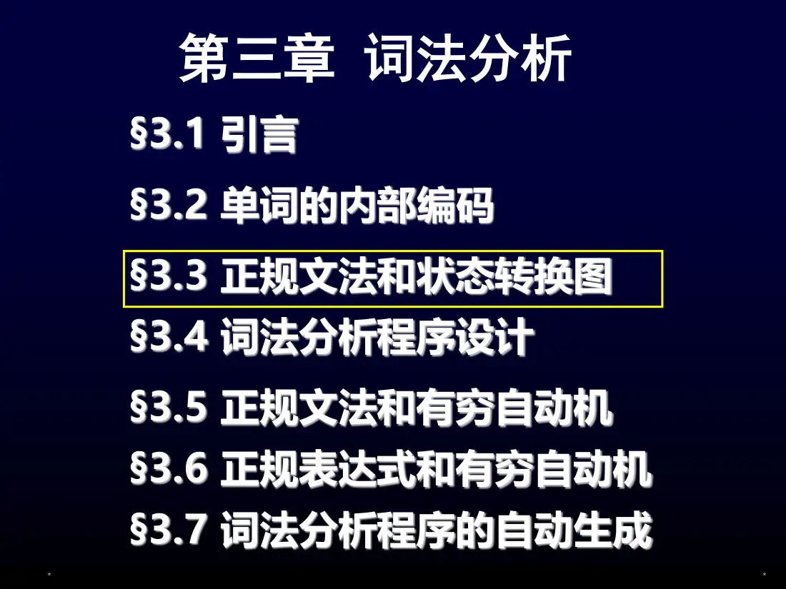

原文：

第三章 词法分析§3.1 引言§3.2 单词的内部编码§3.3 正规文法和状态转换图§3.4 词法分析程序设计§3.5 正规文法和有穷自动机§3.6 正规表达式和有穷自动机§3.7 词法分析程序的自动生成

### §3.3 正规文法和状态转换图

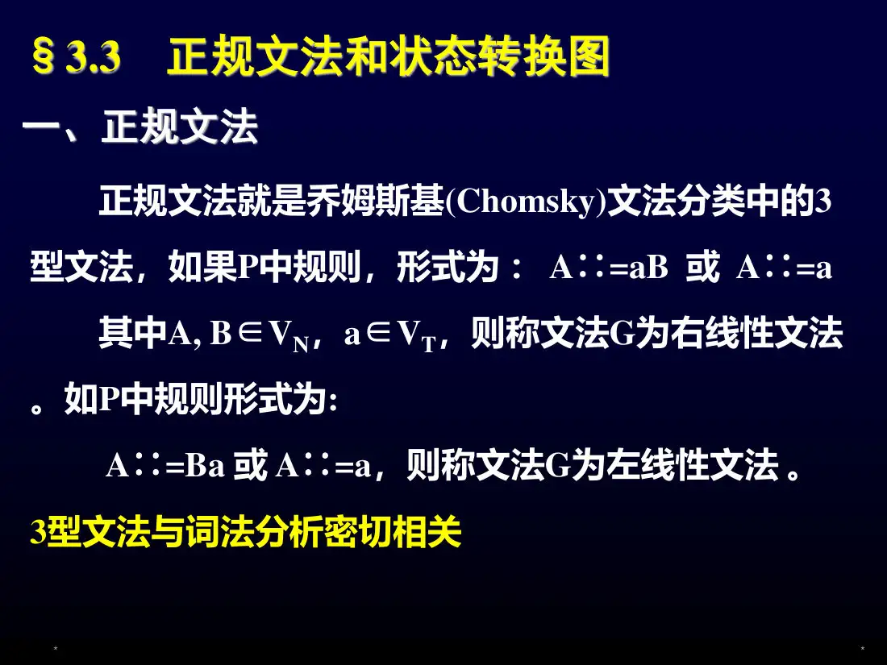

原文：

§3.3 正规文法和状态转换图

一、正规文法

正规文法就是乔姆斯基(Chomsky)文法分类中的3型文法，如果P中规则，形式为： $\bf \delta \mathbf { \Sigma } \mathbf { \Sigma } \mathbf { \Sigma } \mathbf { \Sigma } \mathbf { \Sigma } \mathbf { \Sigma } \mathbf { \Sigma } \mathbf { \Sigma } \mathbf { \Sigma } \mathbf { \Sigma } \mathbf { \Sigma } \mathbf { \Sigma } \mathbf { \Sigma } \mathbf { \Sigma } \mathbf { \Sigma } \mathbf { \Sigma } \mathbf { \Sigma } \mathbf { \Sigma } \mathbf { \Sigma } \mathbf { \Sigma } \mathbf { \Sigma } \mathbf { \Sigma }$ 或 $\mathbb { A } \mathbb { \mathrm { ~ \frac { ~ 6 ~ 9 ~ } { ~ 9 ~ } ~ } } \mathbb { Q } \mathbb { \mathrm { ~ \stackrel { ~ 5 ~ 9 ~ } { ~ 9 ~ } ~ } }$

其中A, $1 1 7 = 1 1 9 7 9 9 = 1 9 9 9$ 则称文法G为右线性文法。如P中规则形式为:

$\vartriangle A$ 或 $\pmb { \mathrm { R e } } \mathbf { \mathrm { = } } \mathbf { \mathrm { 0 } }$ 则称文法G为左线性文法

3型文法与词法分析密切相关

### §3.3 正规文法和状态转换图

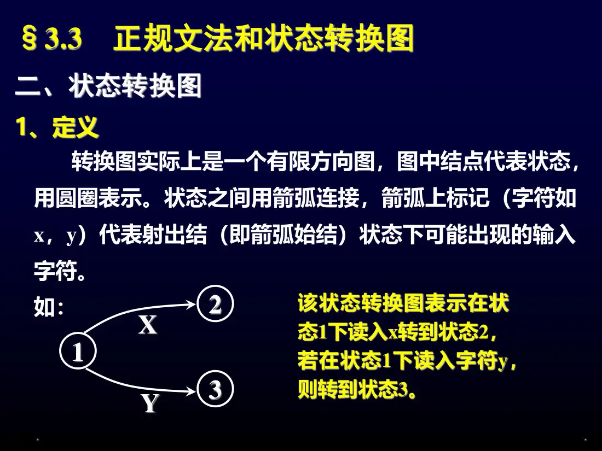

原文：

§3.3 正规文法和状态转换图

二、状态转换图

1、定义

转换图实际上是一个有限方向图，图中结点代表状态，用圆圈表示。状态之间用箭弧连接，箭弧上标记（字符如x，y）代表射出结（即箭弧始结）状态下可能出现的输入字符。

如：

该状态转换图表示在状 态1下读入x转到状态2， 若在状态1下读入字符y， 则转到状态3。

### §3.3 正规文法和状态转换图

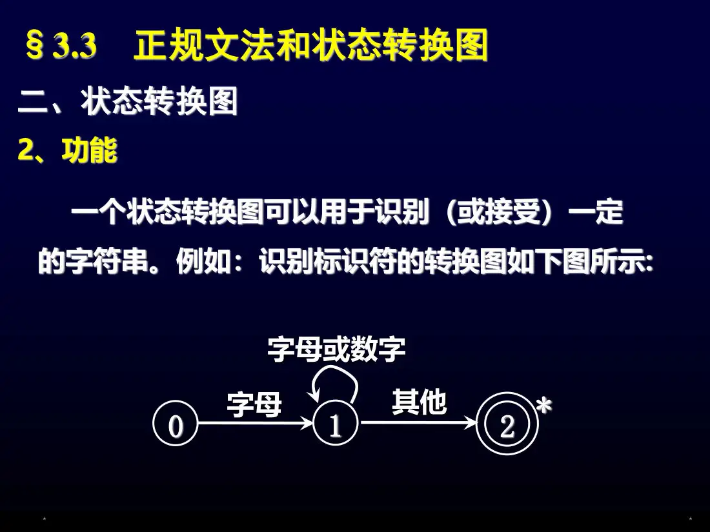

原文：

§3.3 正规文法和状态转换图

二、状态转换图

2、功能

一个状态转换图可以用于识别（或接受）一定的字符串。例如：识别标识符的转换图如下图所示:

字母或数字

字母 其他0 1 2

### §3.3 正规文法和状态转换图

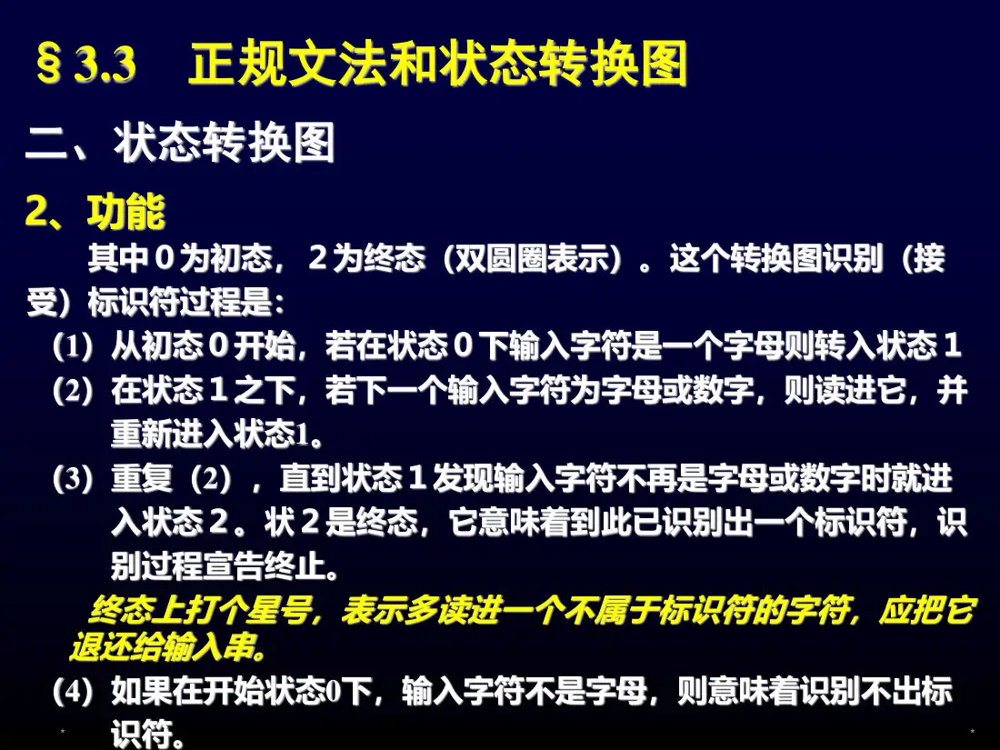

原文：

§3.3 正规文法和状态转换图

二、状态转换图

2、功能

其中0为初态，2为终态（双圆圈表示）。这个转换图识别（接

受）标识符过程是：

（1）从初态0开始，若在状态0下输入字符是一个字母则转入状态1

（2）在状态1之下，若下一个输入字符为字母或数字，则读进它，并重新进入状态1。

（3）重复（2），直到状态1发现输入字符不再是字母或数字时就进入状态2。状2是终态，它意味着到此已识别出一个标识符，识别过程宣告终止。

终态上打个星号，表示多读进一个不属于标识符的字符，应把它退还给输入串。

（4）如果在开始状态0下，输入字符不是字母，则意味着识别不出标识符。

### §3.3 正规文法和状态转换图

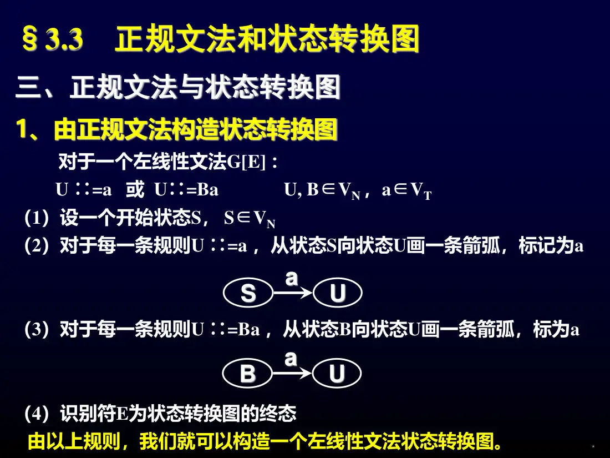

原文：

§3.3 正规文法和状态转换图

三、正规文法与状态转换图

1、由正规文法构造状态转换图对于一个左线性文法G[E] ：$\boxed { 1 } \boxed { 6 } \boxed { 6 } \boxed { 6 }$ 或 $\boxed { 1 0 } \boxed { 6 0 } \boxed { 6 } \boxed { 1 } \boxed { 9 }$ $1 0 0 0 0 - 1 0 0 0 0 = 1 0 0 0 0$

（1）设一个开始状态S， $\mathfrak { S } \equiv \mathfrak { N }$

（2）对于每一条规则U $8 0 - 9 = 9$ ，从状态S向状态U画一条箭弧，标记为a

a S U

（3）对于每一条规则U $\boxed { 2 0 } \boxed { 6 } \boxed { 6 } \boxed { 6 }$ ，从状态B向状态U画一条箭弧，标为a

a B U

（4）识别符E为状态转换图的终态由以上规则，我们就可以构造一个左线性文法状态转换图。

### 1、由正规文法构造状态转换图

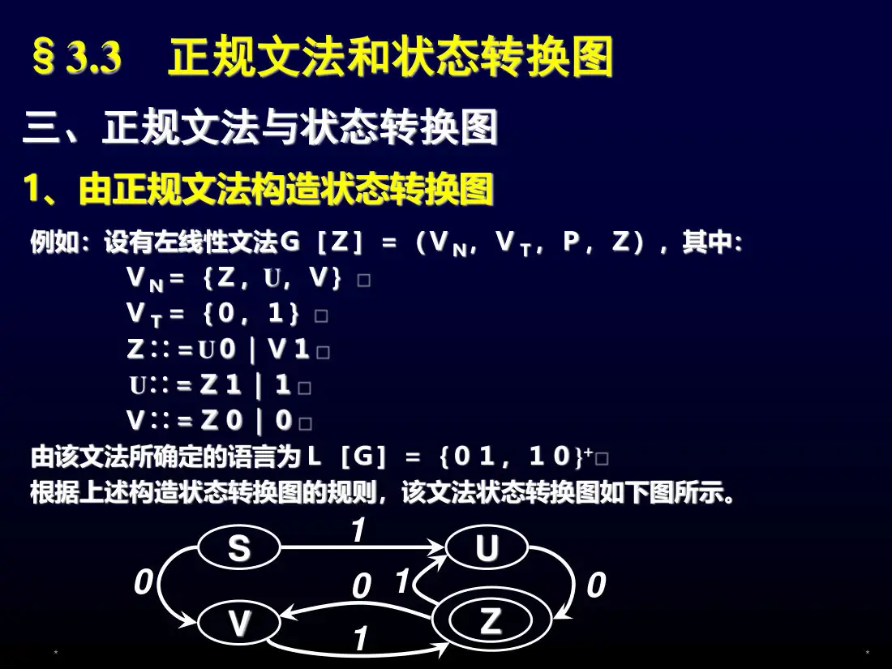

原文：

1、由正规文法构造状态转换图

例如：设有左线性文法G $\vert \overrightarrow { a } \vert = ( \overrightarrow { a } \cdot \overrightarrow { b } \cdot \overrightarrow { b } \cdot \overrightarrow { b } \cdot \overrightarrow { b } )$ ，其中：$V _ { 1 1 } = \frac { \sqrt { 3 } } { 2 } \times 1 0 ^ { - 3 } k g / m ^ { 3 }$ $\nabla _ { 4 } = \left( \mathbf { 0 } \times \mathbf { 0 } \right) = \mathbf { 0 } .$ Z∷＝UU::=Z1|1□$\pmb { \Vert 2 6 6 - 4 6 \Vert 1 0 } \pmb { \Vert 2 1 }$ 由该文法所确定的语言为L［G］＝｛01，10}+根据上述构造状态转换图的规则，该文法状态转换图如下图所示。

### §3.3 正规文法和状态转换图

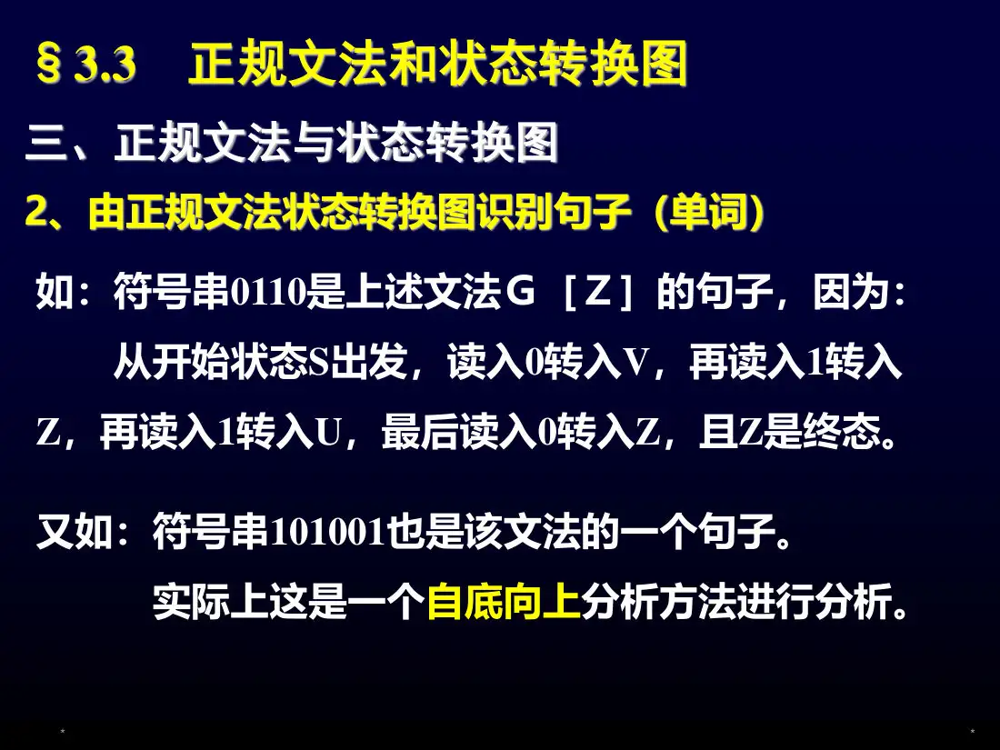

原文：

§3.3 正规文法和状态转换图

三、正规文法与状态转换图

2、由正规文法状态转换图识别句子（单词）

如：符号串0110是上述文法G［Z］的句子，因为：从开始状态S出发，读入0转入V，再读入1转入Z，再读入1转入U，最后读入0转入Z，且Z是终态。

又如：符号串101001也是该文法的一个句子。实际上这是一个自底向上分析方法进行分析。

### §3.3 正规文法和状态转换图

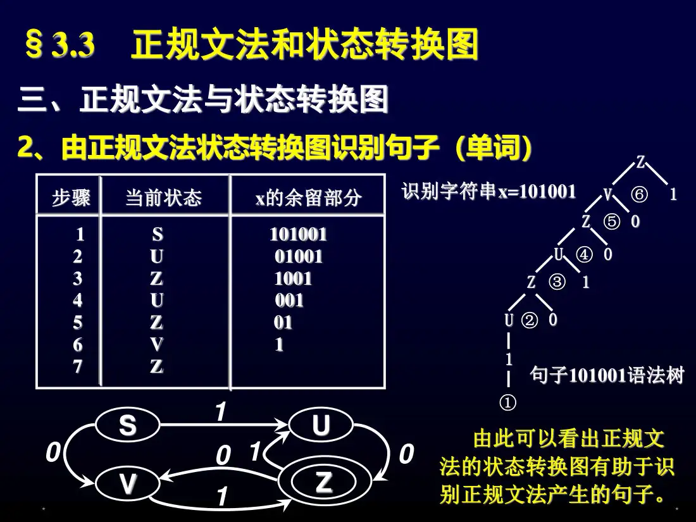

原文：

§3.3 正规文法和状态转换图

三、正规文法与状态转换图

2、由正规文法状态转换图识别句子（单词）

<table><tr><td>步骤</td><td>当前状态</td><td>x的余留部分</td></tr><tr><td>1</td><td>S</td><td>101001</td></tr><tr><td>2</td><td>U</td><td>01001</td></tr><tr><td>3</td><td>Z</td><td>1001</td></tr><tr><td>4</td><td>U</td><td>001</td></tr><tr><td>5</td><td>Z</td><td>01</td></tr><tr><td>6</td><td>V</td><td>1</td></tr><tr><td>7</td><td>Z</td><td></td></tr></table>

识别字符串x=101001

句子101001语法树

由此可以看出正规文法的状态转换图有助于识别正规文法产生的句子。

### 第 27 页

原文：

第三章 词法分析§3.1 引言§3.2 单词的内部编码§3.3 正规文法和状态转换图§3.4 词法分析程序设计§3.5 正规文法和有穷自动机§3.6 正规表达式和有穷自动机§3.7 词法分析程序的自动生成

### 第 28 页

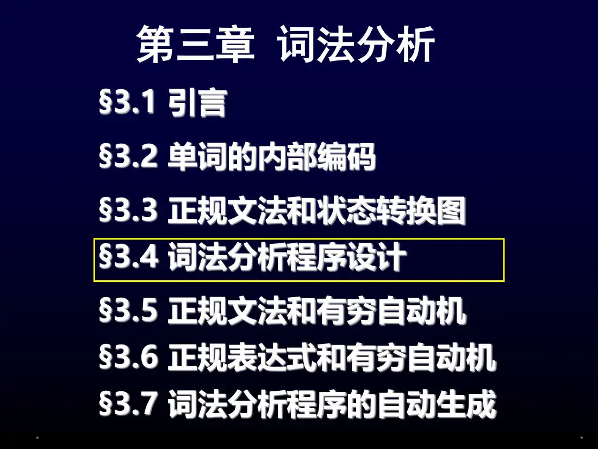

原文：

第三章 词法分析§3.1 引言§3.2 单词的内部编码§3.3 正规文法和状态转换图§3.4 词法分析程序设计§3.5 正规文法和有穷自动机§3.6 正规表达式和有穷自动机§3.7 词法分析程序的自动生成

### §3.4 词法分析程序设计

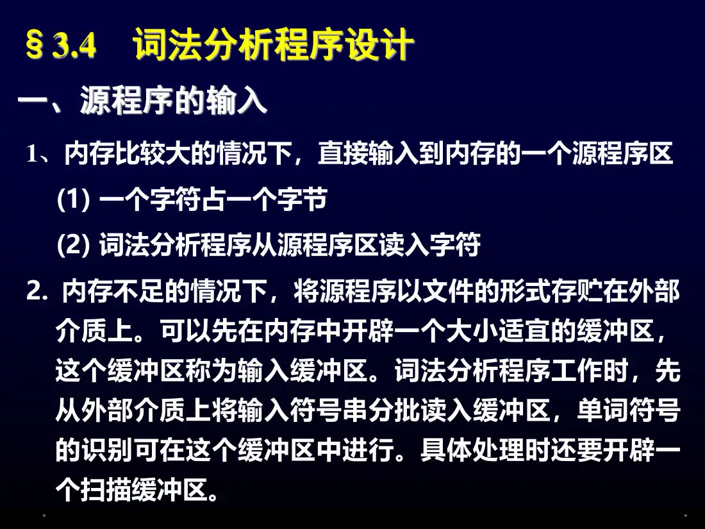

原文：

§3.4 词法分析程序设计

一、源程序的输入

1、内存比较大的情况下，直接输入到内存的一个源程序区

(1) 一个字符占一个字节

(2) 词法分析程序从源程序区读入字符

2. 内存不足的情况下，将源程序以文件的形式存贮在外部介质上。可以先在内存中开辟一个大小适宜的缓冲区，这个缓冲区称为输入缓冲区。词法分析程序工作时，先从外部介质上将输入符号串分批读入缓冲区，单词符号的识别可在这个缓冲区中进行。具体处理时还要开辟一个扫描缓冲区。

### §3.4 词法分析程序设计

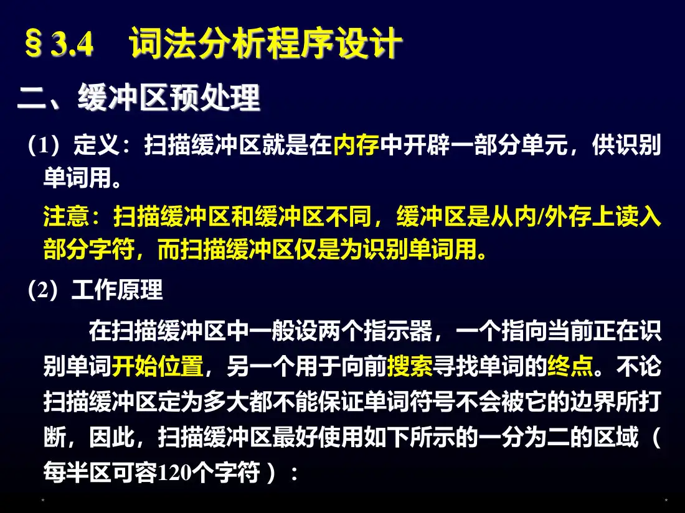

原文：

§3.4 词法分析程序设计

二、缓冲区预处理

（1）定义：扫描缓冲区就是在内存中开辟一部分单元，供识别单词用。

注意：扫描缓冲区和缓冲区不同，缓冲区是从内/外存上读入部分字符，而扫描缓冲区仅是为识别单词用。

（2）工作原理

在扫描缓冲区中一般设两个指示器，一个指向当前正在识别单词开始位置，另一个用于向前搜索寻找单词的终点。不论扫描缓冲区定为多大都不能保证单词符号不会被它的边界所打断，因此，扫描缓冲区最好使用如下所示的一分为二的区域每半区可容120个字符 ）：

### §3.4 词法分析程序设计二、缓冲区预处理

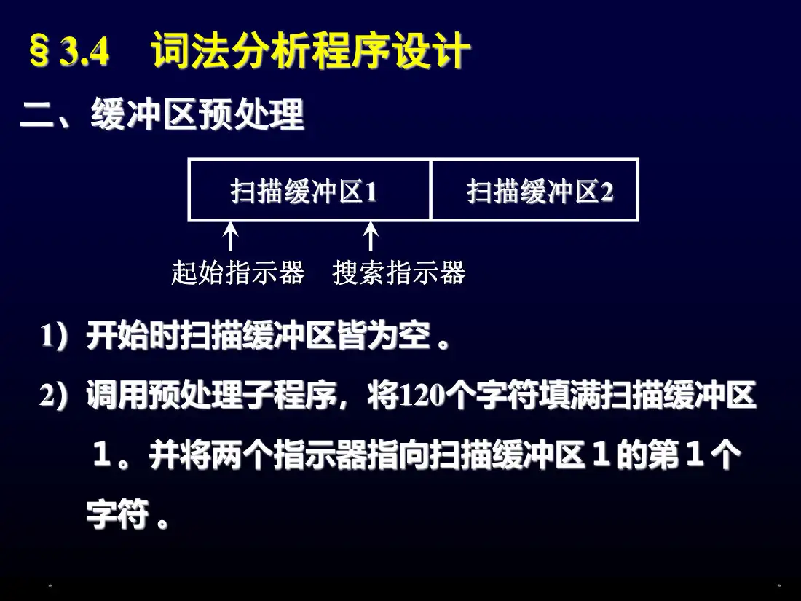

原文：

§3.4 词法分析程序设计二、缓冲区预处理

扫描缓冲区1

扫描缓冲区2

1起始指示器 搜索指示器

1）开始时扫描缓冲区皆为空 。

2）调用预处理子程序，将120个字符填满扫描缓冲区1。并将两个指示器指向扫描缓冲区1的第1个字符 。

### §3.4 词法分析程序设计

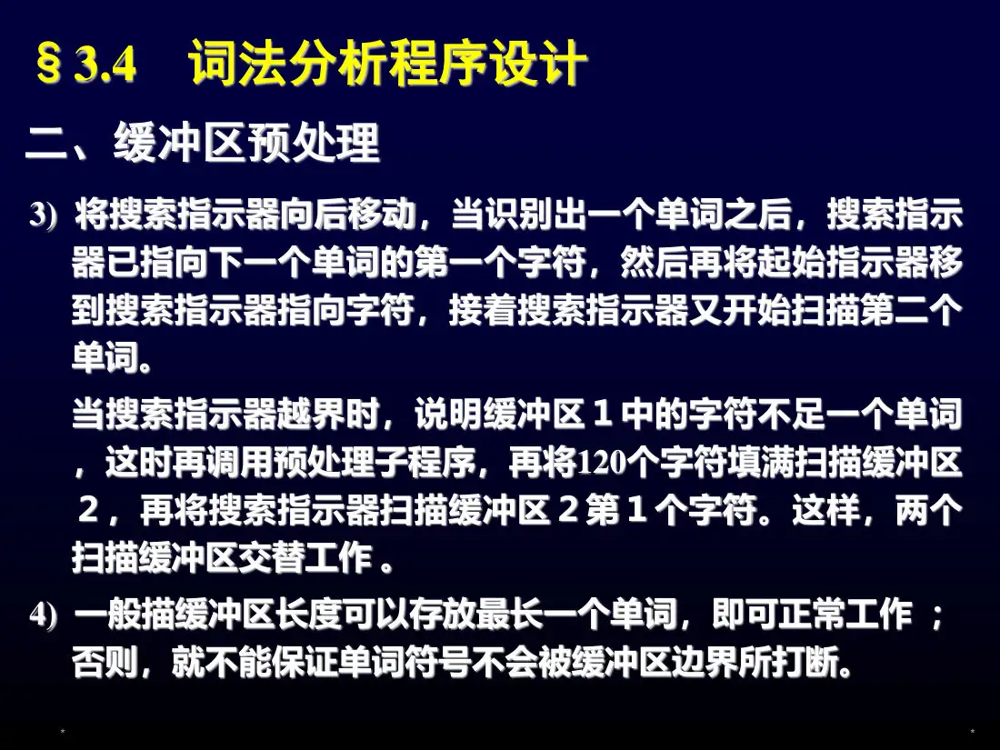

原文：

§3.4 词法分析程序设计

二、缓冲区预处理

3) 将搜索指示器向后移动，当识别出一个单词之后，搜索指示器已指向下一个单词的第一个字符，然后再将起始指示器移到搜索指示器指向字符，接着搜索指示器又开始扫描第二个单词。

当搜索指示器越界时，说明缓冲区1中的字符不足一个单词这时再调用预处理子程序，再将120个字符填满扫描缓冲区2，再将搜索指示器扫描缓冲区2第1个字符。这样，两个扫描缓冲区交替工作 。

般描缓冲区长度可以存放最长一个单词，即可正常工作 ；否则，就不能保证单词符号不会被缓冲区边界所打断。

### §3.4 词法分析程序设计

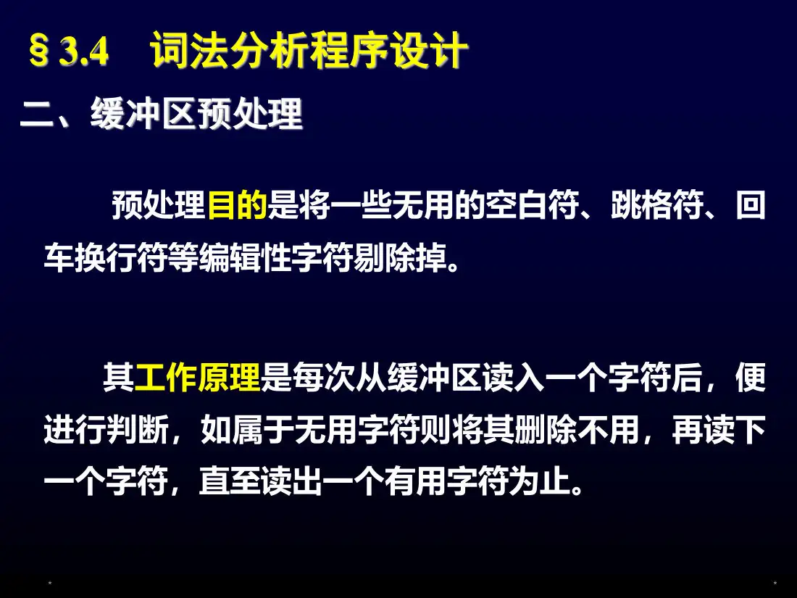

原文：

§3.4 词法分析程序设计

二、缓冲区预处理

预处理目的是将一些无用的空白符、跳格符、回车换行符等编辑性字符剔除掉。

其工作原理是每次从缓冲区读入一个字符后，便进行判断，如属于无用字符则将其删除不用，再读下一个字符，直至读出一个有用字符为止。

### §3.4 词法分析程序设计

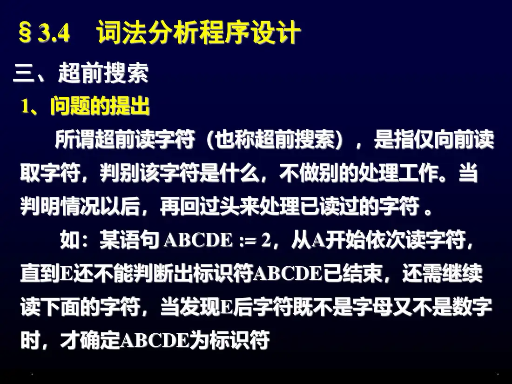

原文：

§3.4 词法分析程序设计

三、超前搜索

1、问题的提出

所谓超前读字符（也称超前搜索），是指仅向前读取字符，判别该字符是什么，不做别的处理工作。当判明情况以后，再回过头来处理已读过的字符 。

如：某语句 ABCDE := 2，从A开始依次读字符，直到E还不能判断出标识符ABCDE已结束，还需继续读下面的字符，当发现E后字符既不是字母又不是数字时，才确定ABCDE为标识符

### §3.4 词法分析程序设计

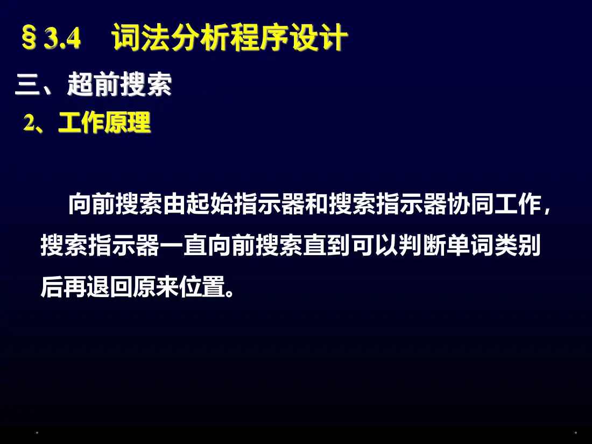

原文：

§3.4 词法分析程序设计

三、超前搜索

2、工作原理

向前搜索由起始指示器和搜索指示器协同工作，搜索指示器一直向前搜索直到可以判断单词类别后再退回原来位置。

### 第 36 页

原文：

第三章 词法分析§3.1 引言§3.2 单词的内部编码§3.3 正规文法和状态转换图§3.4 词法分析程序设计§3.5 正规文法和有穷自动机§3.6 正规表达式和有穷自动机§3.7 词法分析程序的自动生成

### 第 37 页

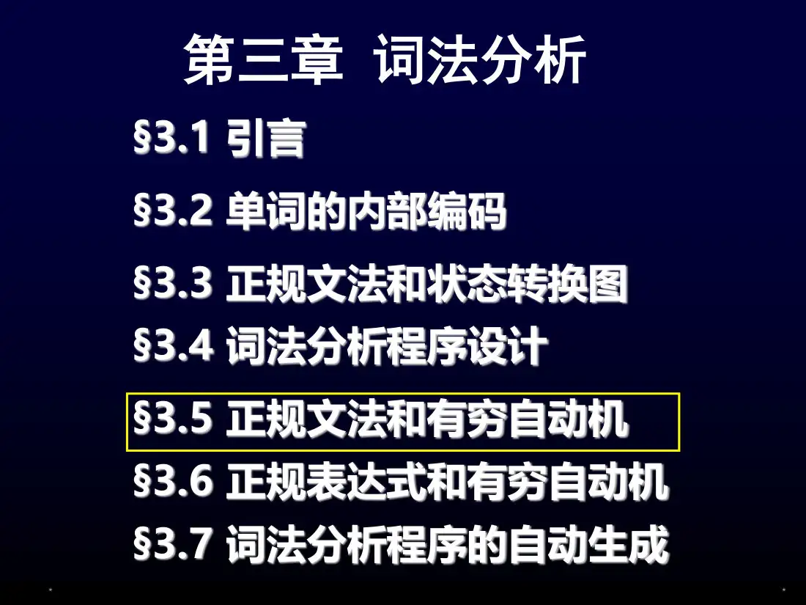

原文：

第三章 词法分析§3.1 引言§3.2 单词的内部编码§3.3 正规文法和状态转换图§3.4 词法分析程序设计§3.5 正规文法和有穷自动机§3.6 正规表达式和有穷自动机§3.7 词法分析程序的自动生成

### §3.5 正规文法和有穷自动机

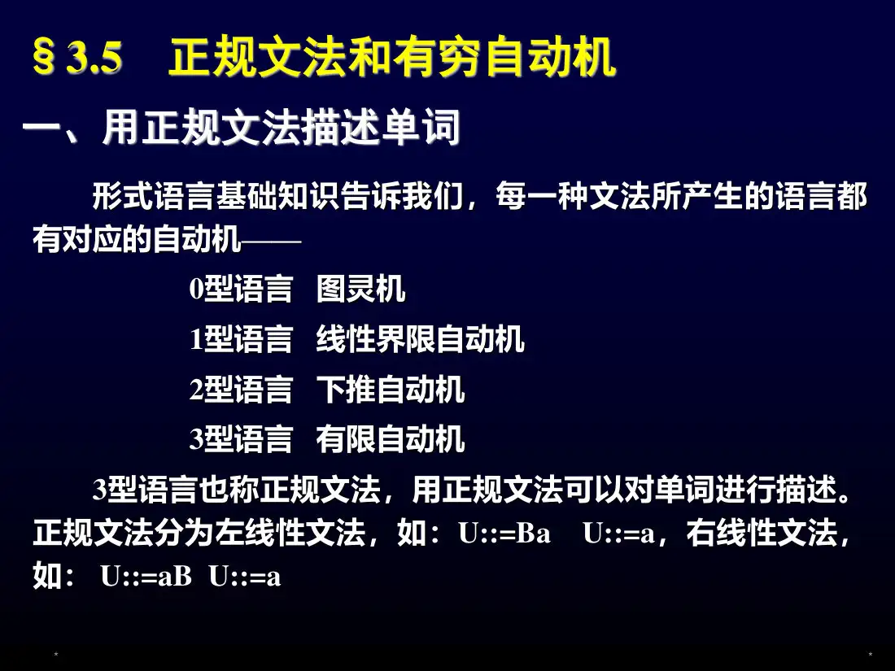

原文：

§3.5 正规文法和有穷自动机

一、用正规文法描述单词

形式语言基础知识告诉我们，每一种文法所产生的语言都有对应的自动机

0型语言 图灵机

1型语言 线性界限自动机

2型语言 下推自动机

3型语言 有限自动机

3型语言也称正规文法，用正规文法可以对单词进行描述。正规文法分为左线性文法，如：U::=Ba U::=a，右线性文法，如： U::=aB U::=a

### §3.5 正规文法和有穷自动机

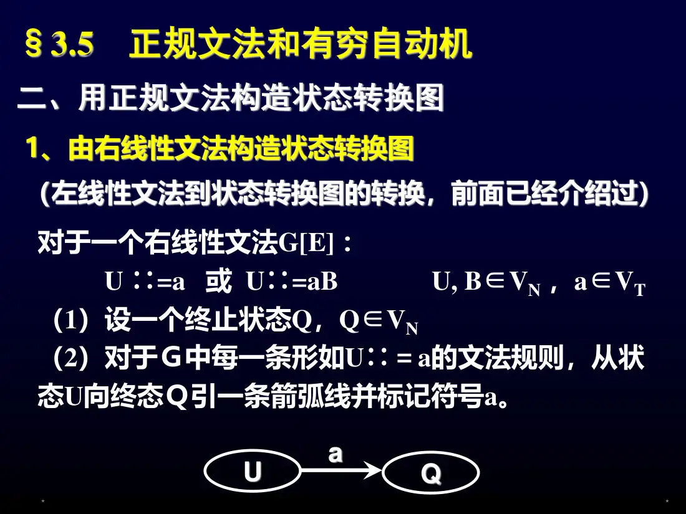

原文：

§3.5 正规文法和有穷自动机

二、用正规文法构造状态转换图

1、由右线性文法构造状态转换图

（左线性文法到状态转换图的转换，前面已经介绍过）

对于一个右线性文法G[E] ：

$\boxed { 1 0 } \boxed { 6 0 } \boxed { 6 }$ 或 $\mathbf { | 0 | \beta \mathbf { \times } \beta \mathbf { \equiv } \beta \mathbf { 0 } | \beta \mathbf { ) } }$ $1 0 0 0 - 3 0 0 0 0 = 3 0 0 0$

（1）设一个终止状态Q， $\textcircled { 1 } 2 \equiv \textcircled { 1 } 2$

（2）对于G中每一条形如U∷＝a的文法规则，从状态U向终态Q引一条箭弧线并标记符号a。

### §3.5 正规文法和有穷自动机

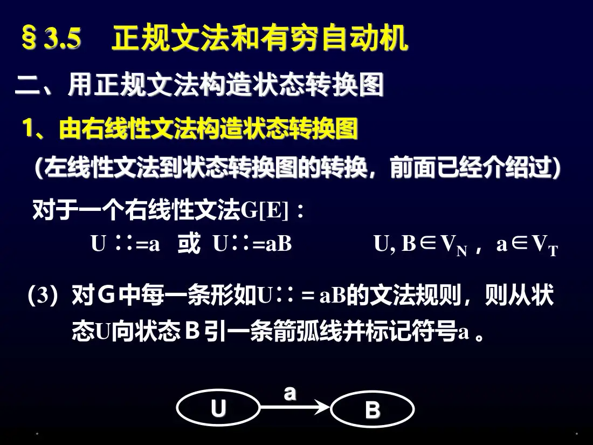

原文：

§3.5 正规文法和有穷自动机

二、用正规文法构造状态转换图

1、由右线性文法构造状态转换图

（左线性文法到状态转换图的转换，前面已经介绍过）

对于一个右线性文法G[E] ：

U ∷=a 或 $\pmb { | 0 \pmb { | 0 \pmb { \alpha } | } } \pmb { | 0 \pmb { \alpha } | } \pmb { | 0 \pmb { \alpha } | } \pmb { | 0 \pmb { \alpha } | }$

$$
\mathbf {U}, \mathbf {B} \in \mathbf {V} _ {\mathrm{N}}, \mathbf {a} \in \mathbf {V} _ {\mathrm{T}}
$$

（3）对G中每一条形如U $\mathbb { B } \mathbf { \equiv } \mathbf { \Theta } ^ { \ast \mathbf { 0 } } \mathbf { \equiv } \mathbf { \Theta } ^ { \ast \mathbf { 0 } }$ 的文法规则，则从状态U向状态B引一条箭弧线并标记符号a 。

### §3.5 正规文法和有穷自动机

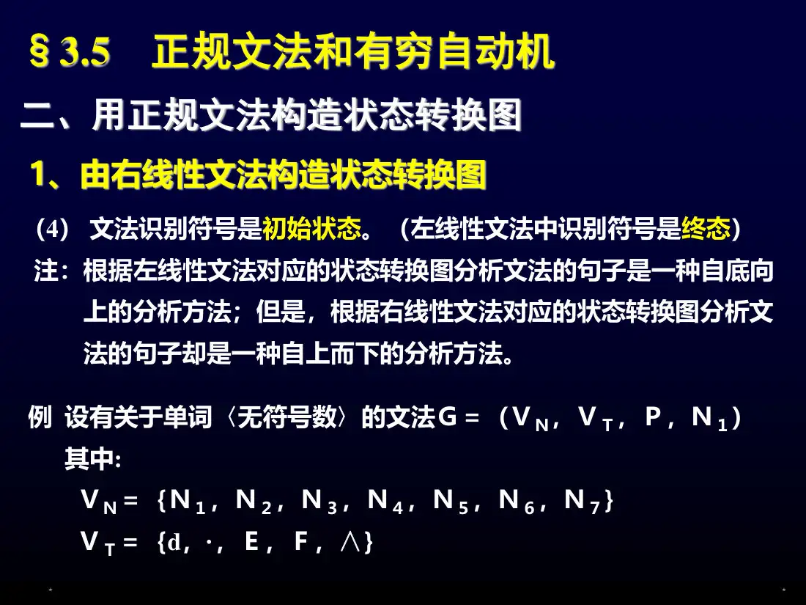

原文：

§3.5 正规文法和有穷自动机

二、用正规文法构造状态转换图

1、由右线性文法构造状态转换图

（4） 文法识别符号是初始状态。（左线性文法中识别符号是终态）

注：根据左线性文法对应的状态转换图分析文法的句子是一种自底向上的分析方法；但是，根据右线性文法对应的状态转换图分析文法的句子却是一种自上而下的分析方法。

例 设有关于单词〈无符号数〉的文法 $( \overrightarrow { a } - \overrightarrow { b } + \overrightarrow { b } - \overrightarrow { b } + \overrightarrow { b } - \overrightarrow { b } ) = 0 ,$ 其中:

$$
\begin{array}{r l} & {V _ {N} = \{N _ {1}, N _ {2}, N _ {3}, N _ {4}, N _ {5}, N _ {6}, N _ {7} \}} \\ & {V _ {T} = \{d, \cdot , E, F, \wedge \}} \end{array}
$$

### §3.5 正规文法和有穷自动机

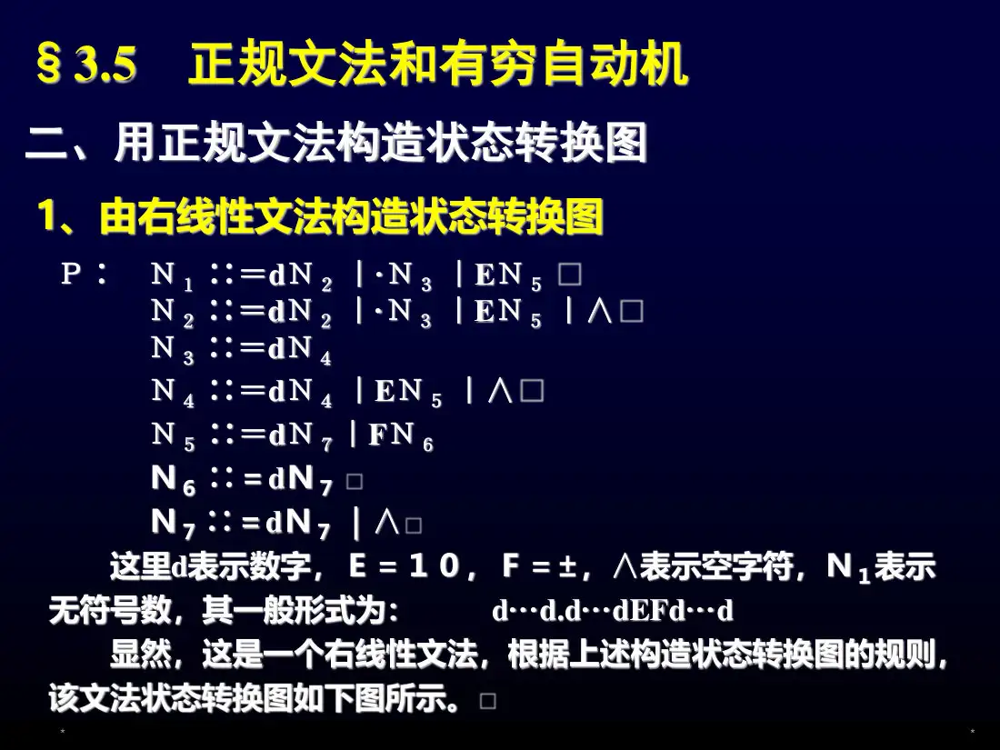

原文：

§3.5 正规文法和有穷自动机

二、用正规文法构造状态转换图

1、由右线性文法构造状态转换图

P N1 ＝dN 2 ·N3 EN 5 N ＝dN ● ·N EN 2 2 3 5 N3 ＝dN 4 N 4 ＝dN 4 EN5 $\angle A = \angle A = \angle B = \angle C = 9 0 ^ { \circ }$ $\mathrm { a d } \ z = \mathrm { a l } \ z = \mathrm { a } \ z = \mathrm { a } \ z = \mathrm { a } \ z$ $1 2 0 0 0 0 0 0 0 0 0 0 0 0 0 0 0 0 0 0 0 0 0 0 0 0 0 0 0 0 0 0 0 0 0 0 0 0 0 0 0 0 0 0 0 0 0 0 0 0 0 0 0 0 0 0 0 0 0 0 0 0 0 0 0 0 0 0 0 0 0 0 0 0 0 0 0 0 0 0 0 0 0 0 0 0 0 0 0 0 0 0 0 0 0 0 0 0 0 0 0 0 0 0 0 0 0 0 0 0 0 0 0 0 0 0 0 0 0 0 0 0 0 0$

这里d表示数字， $\exists x = \Delta \lor \cdots \lor \cdots$ ，∧表示空字符， $\mathbb { M }$ 表示无符号数，其一般形式为： $\scriptstyle ( 1 , 2 , 1 , 1 , 2 , 2 , 1 , 1 , 2 , 1 , 2 , 1 )$

显然，这是一个右线性文法，根据上述构造状态转换图的规则，该文法状态转换图如下图所示。□

### §3.5 正规文法和有穷自动机

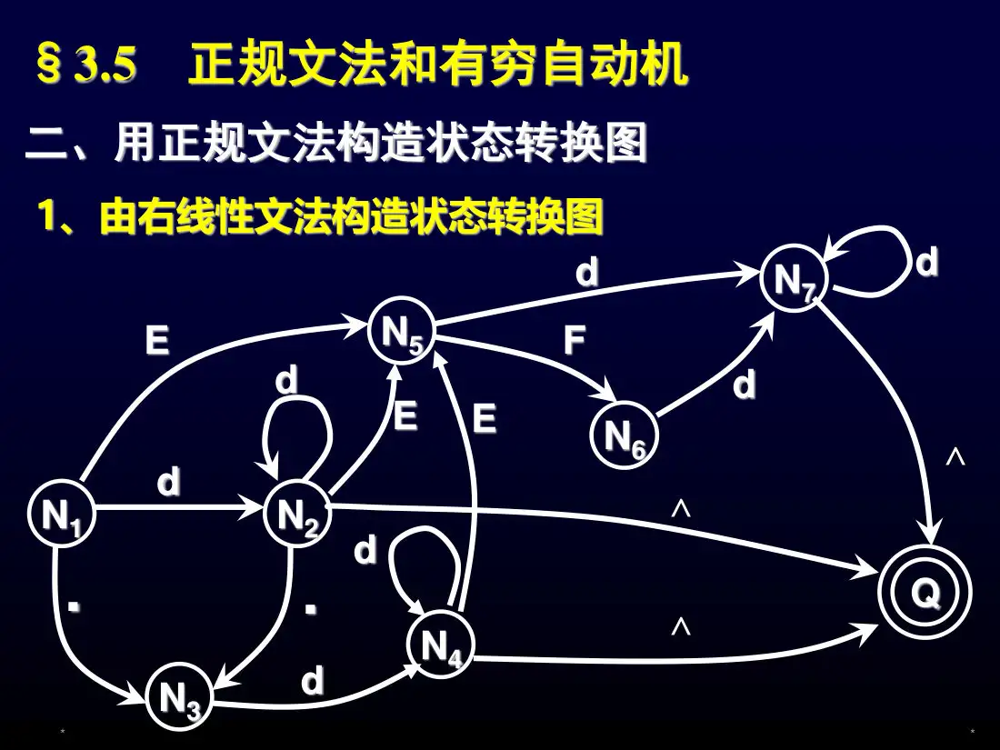

原文：

§3.5 正规文法和有穷自动机

二、用正规文法构造状态转换图

1、由右线性文法构造状态转换图

### §3.5 正规文法和有穷自动机

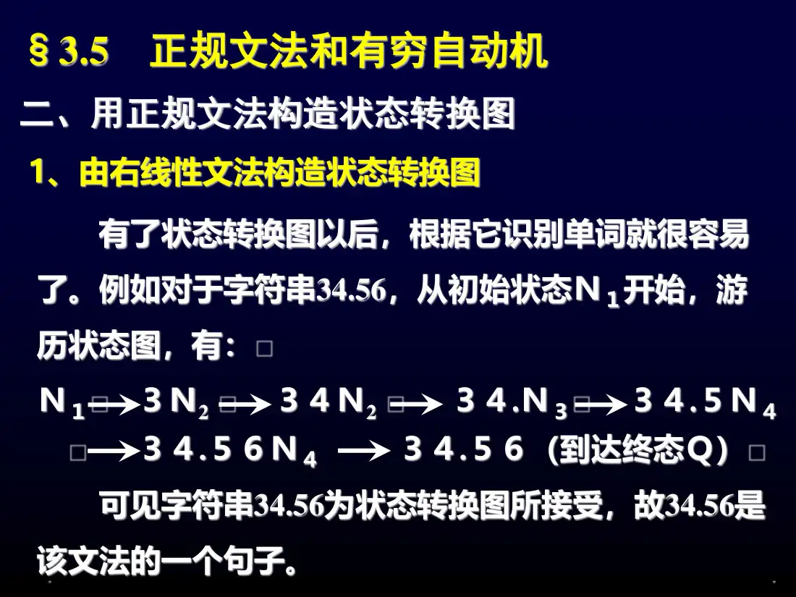

原文：

§3.5 正规文法和有穷自动机

二、用正规文法构造状态转换图

1、由右线性文法构造状态转换图

有了状态转换图以后，根据它识别单词就很容易了。例如对于字符串34.56，从初始状态N 开始，游历状态图，

$\angle B = \angle A B C = \angle C A B = \angle C A B = \angle C A B = \angle C A B$ 34.56N 34.56（到达终态Q）可见字符串34.56为状态转换图所接受，故34.56是该文法的一个句子。

### §3.5 正规文法和有穷自动机

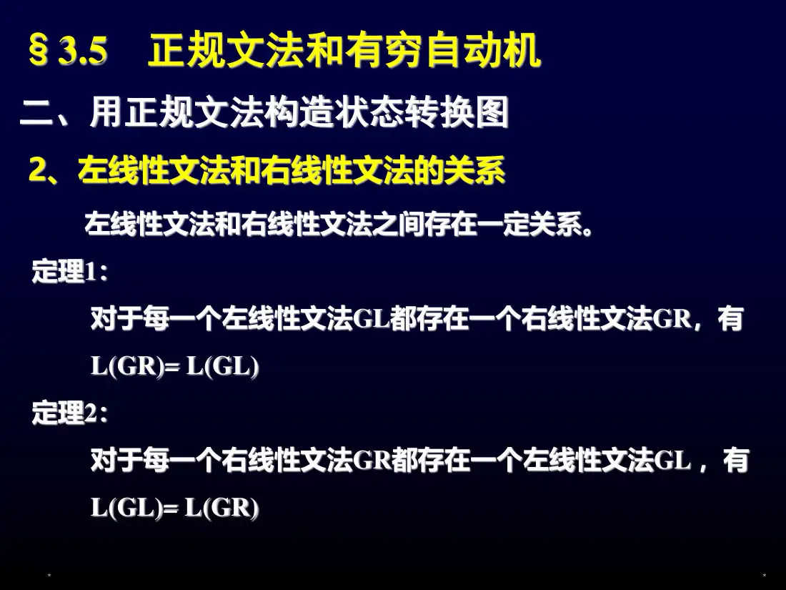

原文：

§3.5 正规文法和有穷自动机

二、用正规文法构造状态转换图

2、左线性文法和右线性文法的关系

左线性文法和右线性文法之间存在一定关系。

定理1：

对于每一个左线性文法GL都存在一个右线性文法GR，有

L(GR)= L(GL)

定理2：

对于每一个右线性文法GR都存在一个左线性文法GL ，有

L(GL)= L(GR)

### §3.5 正规文法和有穷自动机

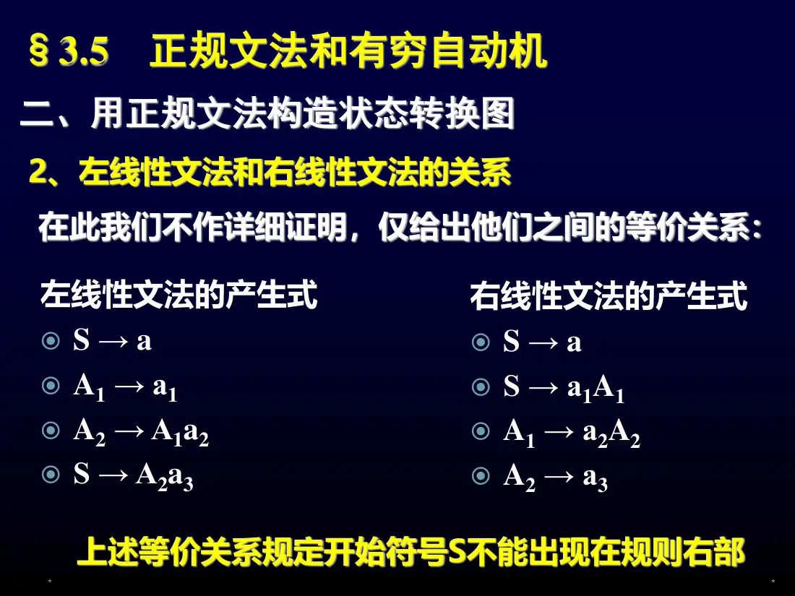

原文：

§3.5 正规文法和有穷自动机

二、用正规文法构造状态转换图

2、左线性文法和右线性文法的关系

在此我们不作详细证明，仅给出他们之间的等价关系：

左线性文法的产生式

右线性文法的产生式

 S → a

 S → a

$$
ⓞ \mathrm{A} _ {1} \rightarrow \mathrm{a} _ {1}
$$

$$
oS \to a _ {1} A _ {1}
$$

$$
ⓞ \mathrm{A} _ {2} \rightarrow \mathrm{A} _ {1} \mathrm{a} _ {2}
$$

$$
ⓞ \mathrm{A} _ {1} \rightarrow \mathrm{a} _ {2} \mathrm{A} _ {2}
$$

$$
oS \rightarrow A _ {2} a _ {3}
$$

$$
ⓞ \mathrm{A} _ {2} \rightarrow \mathrm{a} _ {3}
$$

上述等价关系规定开始符号S不能出现在规则右部

### §3.5 正规文法和有穷自动机

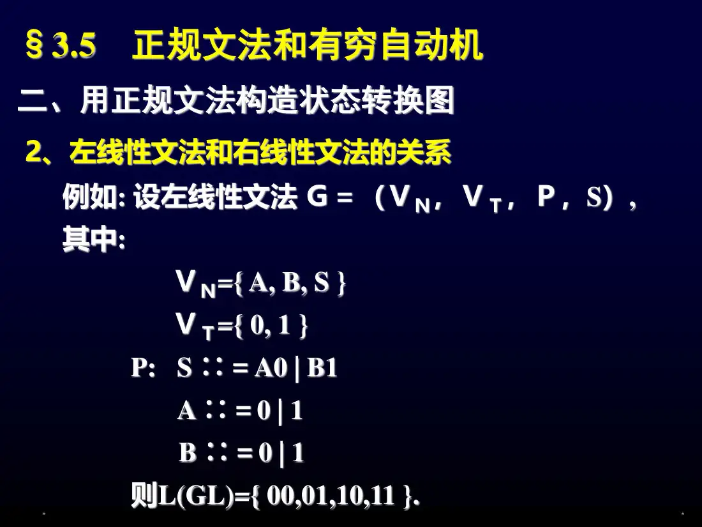

原文：

§3.5 正规文法和有穷自动机

二、用正规文法构造状态转换图

2、左线性文法和右线性文法的关系例如: 设左线性文法 $( \mathrm { d } - \mathrm { d } \langle \mathrm { d } | \mathrm { d } - \mathrm { d } | \mathrm { d } | \mathrm { d } - \mathrm { d } | \mathrm { d } )$ 其中:

VN={ A, B, S } VT={ 0, 1 } P: S ∷＝A0 | B1 A ∷＝0 | 1 B ∷＝0 | 1 则L(GL)={ 00,01,10,11 }.

### §3.5 正规文法和有穷自动机

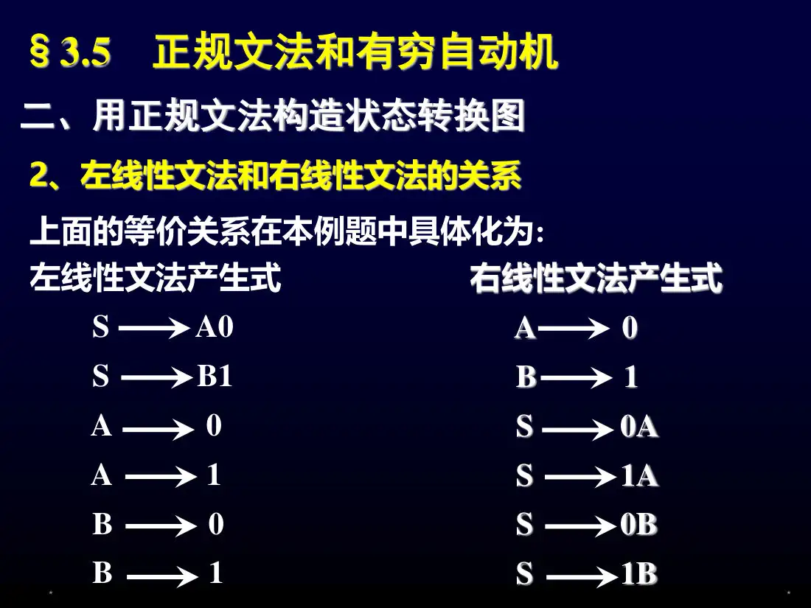

原文：

§3.5 正规文法和有穷自动机

二、用正规文法构造状态转换图

2、左线性文法和右线性文法的关系

上面的等价关系在本例题中具体化为:

左线性文法产生式

右线性文法产生式

$$
\mathrm{S} \longrightarrow \mathrm{A0}
$$

$$
\mathrm{A} \longrightarrow 0
$$

$$
\mathrm{S} \longrightarrow \mathrm{B1}
$$

$$
\mathrm{B} \longrightarrow 1
$$

$$
\mathrm{A} \longrightarrow 0
$$

$$
\mathrm{S} \longrightarrow 0 \mathrm{A}
$$

$$
\mathrm{A} \longrightarrow 1
$$

$$
\mathrm{S} \longrightarrow 1 \mathrm{A}
$$

$$
\mathrm{B} \longrightarrow 0
$$

$$
\mathrm{S} \longrightarrow 0 \mathrm{B}
$$

$$
\mathrm{B} \longrightarrow 1
$$

$$
\mathrm{S} \longrightarrow 1 \mathrm{B}
$$

### §3.5 正规文法和有穷自动机

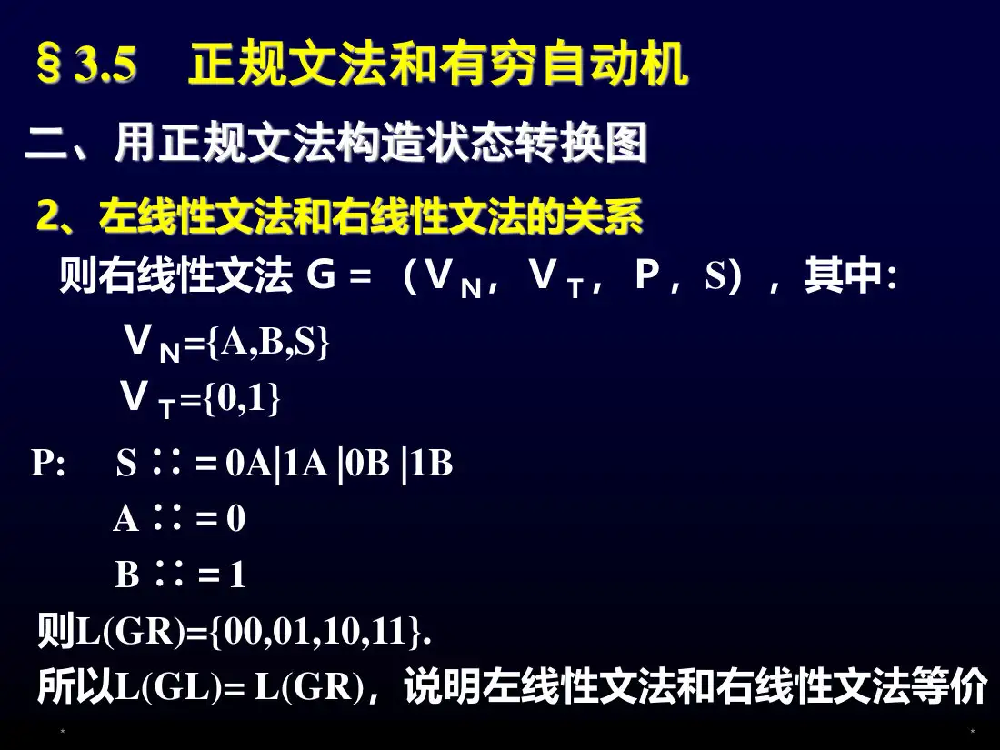

原文：

§3.5 正规文法和有穷自动机

二、用正规文法构造状态转换图

2、左线性文法和右线性文法的关系

则右线性文法 $( \mathbf { c } ) - ( \mathbf { v } ( \mathbf { z } ) - \mathbf { v } ( \mathbf { z } ) ) = 0$ ），其中：

$$
V _ {N} = \{A, B, S \}
$$

$$
\mathbf {S}: := 0 \mathbf {A} | 1 \mathbf {A} | 0 \mathbf {B} | 1 \mathbf {B}
$$

则L $( \Theta ^ { 1 3 } ) { = } \left( | \mathrm { T } | \right) \operatorname { V } | | \mathrm { T } | \mathrm { T } | \mathrm { T } | \mathrm { T } | \mathrm { T } | \mathrm { T } |$ .

所以L(GL)= L(GR)，说明左线性文法和右线性文法等价

### §3.5 正规文法和有穷自动机 三、有穷自动机FA

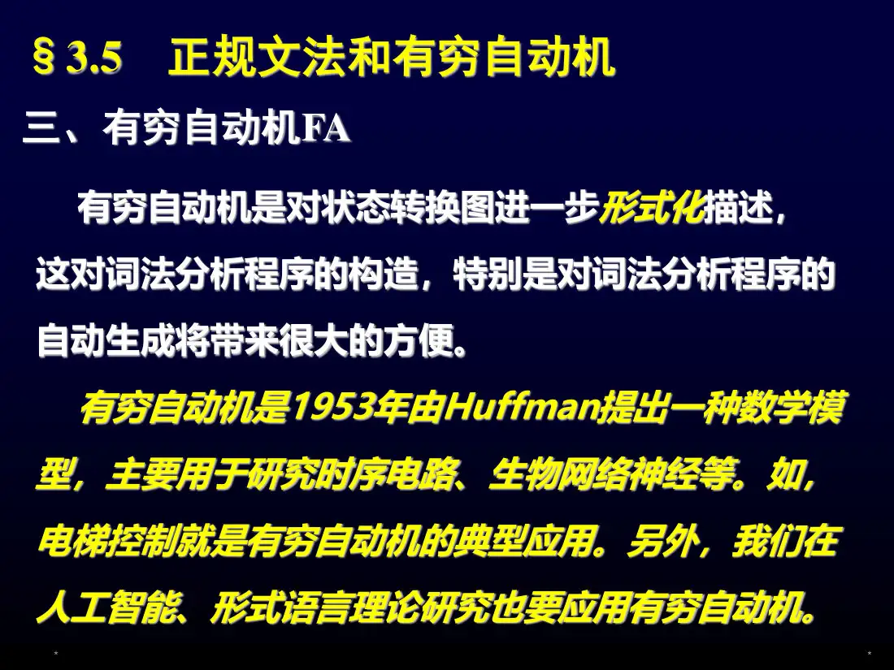

原文：

§3.5 正规文法和有穷自动机 三、有穷自动机FA

有穷自动机是对状态转换图进一步形式化描述，这对词法分析程序的构造，特别是对词法分析程序的自动生成将带来很大的方便。

有穷自动机是1953年由Huffman提出一种数学模型，主要用于研究时序电路、生物网络神经等。如，电梯控制就是有穷自动机的典型应用。另外，我们在人工智能、形式语言理论研究也要应用有穷自动机。

### §3.5 正规文法和有穷自动机

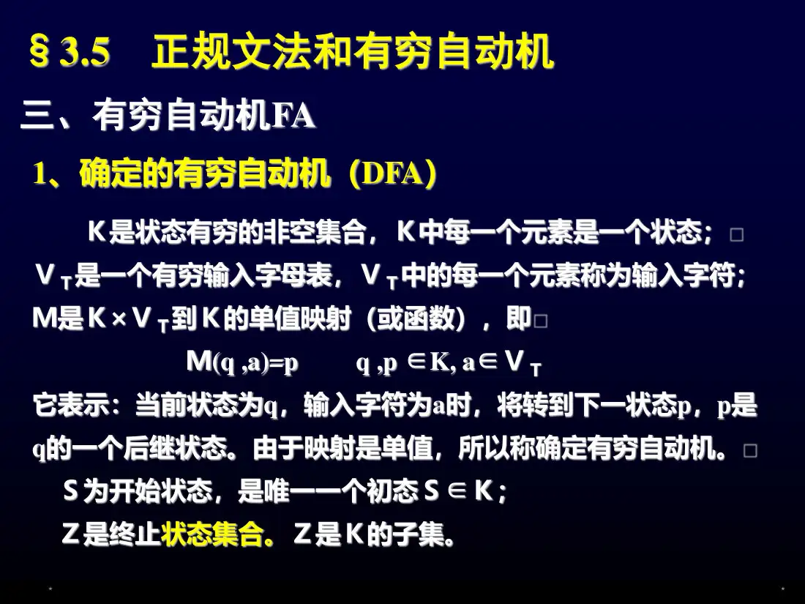

原文：

§3.5 正规文法和有穷自动机

三、有穷自动机FA

1、确定的有穷自动机（DFA）

K是状态有穷的非空集合，$\mathbb { u }$ 是一个有穷输入字母表， $\mathbb { u }$ 中的每一个元素称为输入字符；M是 $\mathtt { W M }$ 到K的单值映射（或函数），$\mathbb { U } ( { \mathfrak { g } } ) \equiv \sqcup$ $( \mathbf { l } \mathbf { v } ) ( = 1 \mathrm { s g } \mathbf { \eta } ) = \mathbf { \eta } \nabla L$

它表示：当前状态为q，输入字符为a时，将转到下一状态p，p是q的一个后继状态。由于映射是单值，所以称确定有穷自动机。S为开始状态，是唯一一个初态 $\Xi { \equiv } \breve { \emptyset }$ Z是终止状态集合。Z是K的子集。

### §3.5 正规文法和有穷自动机

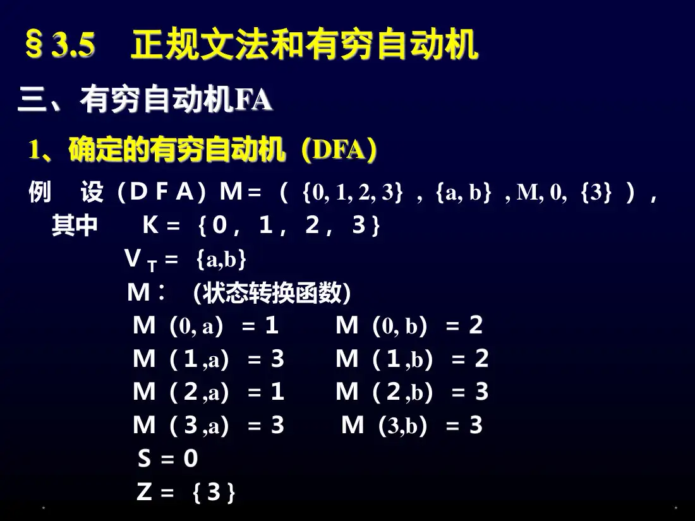

原文：

§3.5 正规文法和有穷自动机

三、有穷自动机FA

1、确定的有穷自动机（DFA）

例 设（DFA）M＝（｛0, 1, 2, 3｝,｛a, b｝, M, 0,｛3｝），

其中 $\angle A = \angle C D = \angle C A C = 9 0 ^ { \circ }$

$$
V _ {T} = \{a, b \}
$$

M∶ （状态转换函数）

$$
M (0, a) = 1
$$

$$
M (0, b) = 2
$$

$$
M (1, a) = 3
$$

$$
M (1, b) = 2
$$

$$
M (2, a) = 1
$$

$$
M (2, b) = 3
$$

$$
M (3, a) = 3
$$

$$
M (3, b) = 3
$$

$$
S = 0
$$

$$
Z = \{3 \}
$$

### §3.5 正规文法和有穷自动机

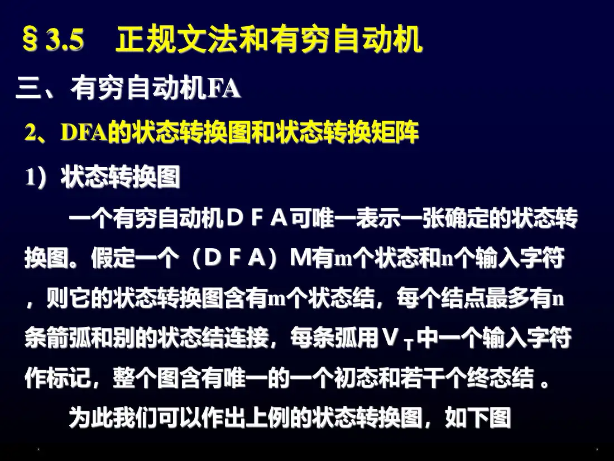

原文：

§3.5 正规文法和有穷自动机

三、有穷自动机FA

2、DFA的状态转换图和状态转换矩阵

1）状态转换图

一个有穷自动机DFA可唯一表示一张确定的状态转换图。假定一个（DFA）M有m个状态和n个输入字符则它的状态转换图含有m个状态结，每个结点最多有n条箭弧和别的状态结连接，每条弧用 $\mathbb { Z } _ { \parallel }$ 中一个输入字符作标记，整个图含有唯一的一个初态和若干个终态结 。

为此我们可以作出上例的状态转换图，如下图

### §3.5 正规文法和有穷自动机

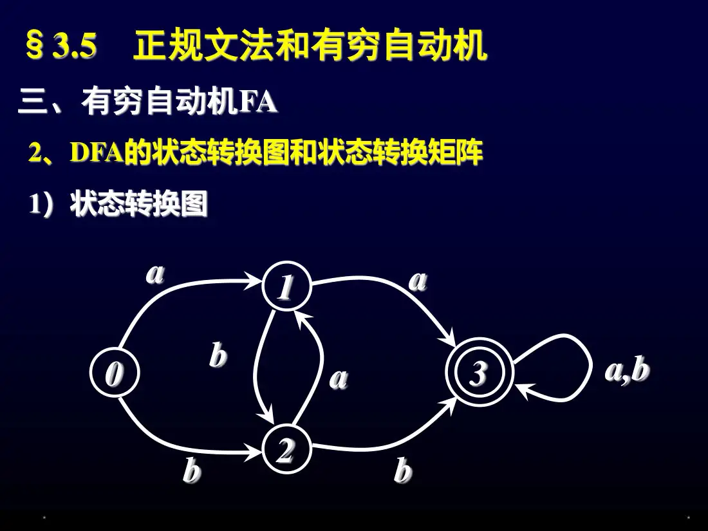

原文：

§3.5 正规文法和有穷自动机

三、有穷自动机FA

2、DFA的状态转换图和状态转换矩阵

1）状态转换图

### §3.5 正规文法和有穷自动机

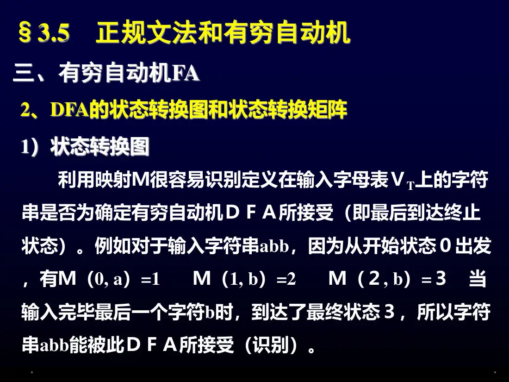

原文：

§3.5 正规文法和有穷自动机

三、有穷自动机FA

2、DFA的状态转换图和状态转换矩阵

1）状态转换图

利用映射M很容易识别定义在输入字母表 $y _ { 1 1 }$ 上的字符串是否为确定有穷自动机DFA所接受（即最后到达终止状态）。例如对于输入字符串abb，因为从开始状态0出发，有M $\mathbf { ( 0 . 9 2 ) }$ M（1, b）=2 $\langle \Psi ( \cdot , \cdot , 0 ) \rangle = 0 .$ 当输入完毕最后一个字符b时，到达了最终状态3，所以字符串abb能被此DFA所接受（识别）

### §3.5 正规文法和有穷自动机

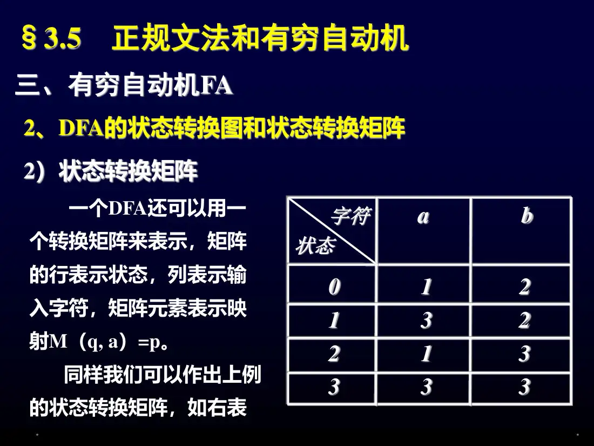

原文：

§3.5 正规文法和有穷自动机

三、有穷自动机FA

2、DFA的状态转换图和状态转换矩阵

2）状态转换矩阵

一个DFA还可以用一个转换矩阵来表示，矩阵的行表示状态，列表示输入字符，矩阵元素表示映射M $( 0 , 0 , 0 )$

同样我们可以作出上例的状态转换矩阵，如右表

<table><tr><td>字符状态</td><td>a</td><td>b</td></tr><tr><td>0</td><td>1</td><td>2</td></tr><tr><td>1</td><td>3</td><td>2</td></tr><tr><td>2</td><td>1</td><td>3</td></tr><tr><td>3</td><td>3</td><td>3</td></tr></table>

### 第 57 页

原文：

§3.5 正规文法和有穷自动机三、有穷自动机FA3、DFA所接受（识别）的语言例 设（DFA）M＝（｛0,1,2,3｝,｛a,b｝, M, 0,｛3｝），K＝｛0，1，2，3｝ VT＝｛a,b｝M∶（状态转换函数）M（0, a）＝1 M（0, b）M（1,a）＝3 M（1,b）M（2,a）＝1 M（2,b）M（3,a）＝3 M（3,b）S = 0 Z＝｛3｝对于输入字符串abb，从初始状态0出发，M（0,abb）＝M（M（0,a）,bb）＝M（1,bb）＝M（M（1,b）,b）＝M（2,b）最后到达状态3，而3∈｛3｝，所以abb为此DFA所接受。

### §3.5 正规文法和有穷自动机

原文：

§3.5 正规文法和有穷自动机

三、有穷自动机FA

3、DFA所接受（识别）的语言

我们把一个（DFA）M所接受V \*中字符串全体称为M的接受集或M所接受的语言，记为L（M），即—

$( 1 , ( \chi ) ) = ( 1 , ( \chi ) ) ( ( \chi ) ) ( 1 , ( \chi ) ) = ( \chi ) ( 1 , ( \chi ) )$ 如上例M接受语言，L（M）＝｛a, b}+且含有相继两个a或相继两个b

### §3.5 正规文法和有穷自动机

原文：

§3.5 正规文法和有穷自动机

三、有穷自动机FA

非确定的有穷自动机（NFA）一个非确定的有穷自动机（NFA）M是一个五元组，即$\mathrm { L E } = ( \mathrm { C E } \times \mathrm { L E } = \mathrm { L E } \times \mathrm { L E } = \mathrm { L E } ) = 0$ 其中：

K是状态有穷的非空集合；□$\mathbb { u }$ 是一个有穷输入字母表；M是 $\mathtt { W M }$ 到K子集上映射， $\angle B A C = \angle C$ 2k是幂集，是K中所有子集组成。

### §3.5 正规文法和有穷自动机

原文：

§3.5 正规文法和有穷自动机

三、有穷自动机FA

4、非确定的有穷自动机（NFA）

2K的含义有集合A，它的所有子集组成A的幂集，记为P(A)。如 $\mathtt { A } \mathtt { = e n } \mathtt { = m o }$ 则：$( 2 ) ( 1 0 0 0 0 0 0 0 0 0 0 0 0 0 0 0 0 0 0 0 0 0 0 0 0 0 0 0 0 0 0 0 0 0 0 0 0 0 0 0 0 0 0 0 0 0 0 0 0 0 0 0 0 0 0 0 0 0 0 0 0 0 0 0 0 0 0 0 0 0 0 0 0 0 0 0 0 0 0 0 0 0 0 0 0 0 0 0 0 0 0 0 0 0 0 0 0 0 0 0 0 0 0 0 0 0 0 0 0 0 0 0 0 0 0 0 0 0 0 0 0 0 0 0 0 0 0 0 0 0 0 0 0 0 0 0 0 0 0 0 0 0 0 0 0 0 0 0 0 0 0 0 0 0 0 0 0 0 0 0 0 0 0 0 0 0 0 0 0 0 0 0 0 0 0 0 0 0 0 0 0 0 0 0 0 0 0 0 0 0 0 0 0 0 0$ 由此可以看出，有n个元素，则P(A)就有2n个元素。所以当集合K中有K个元素时，其幂集元素的个数就是2k

### §3.5 正规文法和有穷自动机

原文：

§3.5 正规文法和有穷自动机

三、有穷自动机FA

4、非确定的有穷自动机（NFA）

即 ——

$\operatorname { T r } ( \operatorname { T r } ( 0 ) ) = \operatorname { T r } ( \operatorname { T r } ( 0 ) ) = \operatorname { T r } ( 0 ) = \operatorname { T r } ( 0 ) = \operatorname { T r } ( 0 ) = \operatorname { T r } ( 0 )$ 它表示：当前状态为q，输入字符为a 时，映射M将产生一个状态集合 $( 1 0 0 0 - 1 ) \times ( 1 0 0 0 - 1 ) \times ( 1 0 0 0 0 - 1 ) = 1 0 0 0$ （可能是空集），而不是单个状态，所以称为非确定有穷自动机。□S是开始状态集，S包含于KZ是终止状态集，Z包含于K。

### §3.5 正规文法和有穷自动机

原文：

§3.5 正规文法和有穷自动机

三、有穷自动机FA

4、NFA所接受（识别）的语言

例 设（NFA）M＝（｛S0，S1，S2，S3，S4｝，｛0,1｝，M，｛S0 ｝，｛S2 ，S4 ｝）

其中□

$$
\begin{array}{r l} & K = \{S _ {0}, S _ {1}, S _ {2}, S _ {3}, S _ {4} \} \\ & V _ {T} = \{0, 1 \} \\ & M: M (S _ {0}, 0) = \{S _ {0}, S _ {3} \} \\ & M (S _ {1}, 0) = \varnothing \\ & M (S _ {2}, 0) = \{S _ {2} \} \\ & M (S _ {3}, 0) = \{S _ {4} \} \\ & M (S _ {4}, 0) = \{S _ {4} \} \end{array}
$$

$$
\begin{array}{r l} & {\square \quad Z = \{S _ {2}, S _ {4} \} \square} \\ & {M (S _ {0}, 1) = \{S _ {0}, S _ {1} \}} \\ & {M (S _ {1}, 1) = \{S _ {2} \} \square} \\ & {M (S _ {2}, 1) = \{S _ {2} \}} \\ & {M (S _ {3}, 1) = \emptyset \square} \\ & {M (S _ {4}, 1) = \{S _ {4} \}} \end{array}
$$

### §3.5 正规文法和有穷自动机

原文：

§3.5 正规文法和有穷自动机

三、有穷自动机FA

4、NFA所接受（识别）的语言

<table><tr><td>字符状态</td><td>0</td><td>1</td></tr><tr><td> $S_0$ </td><td> $\{S_0, S_3\}$ </td><td> $\{S_0, S_1\}$ </td></tr><tr><td> $S_1$ </td><td> $\Phi$ </td><td> $\{S_2\}$ </td></tr><tr><td> $S_2$ </td><td> $\{S_2\}$ </td><td> $\{S_2\}$ </td></tr><tr><td> $S_3$ </td><td> $\{S_4\}$ </td><td> $\Phi$ </td></tr><tr><td> $S_4$ </td><td> $\{S_4\}$ </td><td> $\{S_4\}$ </td></tr></table>
状态转换矩阵

### §3.5 正规文法和有穷自动机

原文：

§3.5 正规文法和有穷自动机

三、有穷自动机FA

4、NFA所接受（识别）的语言

状态转换图

$$
M (S _ {0}, 1 0 0 1 0) = M (S _ {0}, 0 0 1 0) \cup M (S _ {1}, 0 0 1 0)
$$

因为M（S ，10010）＝｛S , S , S ｝∩Z≠ ø，所以字符串10010为此NFA所接受，显然，从状态转换图开始状态S 出发，有路径至终止状态S 。L（M）＝｛0, 1｝+ 且含有相连0或相连1

### §3.5 正规文法和有穷自动机

原文：

§3.5 正规文法和有穷自动机

三、有穷自动机FA

4、NFA所接受（识别）的语言

对于 $\textcircled { 1 } \textcircled { 2 }$ 上的字符串x，令 $\Xi$ 若集合M $\textcircled { 4 9 }$ 中含有属于终态集Z中的状态，或者说至少存在一条从某一个初态结点到某一个终态结点的路径，且这些路径上所有箭弧的标记字符连接起来的字符串等于x，我们就说x为（NFA）M所接受（识别）。

所有这样的x所组成的集合称之为（NFA）M接受集或（NFA）M所接受的语言，记为L（M），即—$1 0 0 0 - 1 0 0 0 0 0 0 0 0 0 0 0 0 0 0 0 0 0 0 0 0 0 0 0 0 0 0 0 0 0 0 0 0 0 0 0 0 0 0 0 0 0 0 0 0 0 0 0 0 0 0 0 0 0 0 0 0 0 0 0 0 0 0 0 0 0 0 0 0 0 0 0 0 0 0 0 0 0 0 0 0 0 0 0 0 0 0 0 0 0 0 0 0 0 0 0 0 0 0 0 0 0 0 0 0 0 0 0 0 0 0 0 0 0 0 0 0 0 0 0 0 0 0 0 0 0 0 0 0 0 0 0 0 0 0 0 0 0 0 0 0 0 0 0 0 0 0 0 0 0 0 0 0 0 0 0 0 0 0 0 0 0 0 0 0 0 0 0 0 0 0 0 0 0 0 0 0 0 0 0 0 0 0 0 0 0 0 0 0 0 0 0 0 0 0 0 0 0 0 0 0 0 0 0 0 0 0 0 0 0 0 0 0 0 0 0 0 0 0 0 0 0 0 0 0 0 0 0 0 0 0 0 0 0 0 0 0 0 0 0 0 0 0 0 0 0 0 0 0 0 0 0 0 0 0 0 0 0 0 0 0 0 0 0 0 0 0 0 0 0 0 0 0 0 0 0 0 0 0 0 0 0 0 0 0 0 0 0 0 0 0 0 0 0 0 0 0 0 0 0 0 0 0 0 0 0 0 0 0 0 0 0 0 0 0 0 0 0 0 0 0 0 0 0 0 0 0 0 0 0 0 0 0 0 0 0 0 0 0 0 0 0 0 0 0 0 0 0 0 0 0 0 0 0 0 0 0 0 0 0 0 0 0 0 0 0 0 0 0 0 0 0 0 0 0 0 0 0 0 0 0 0 0 0 0 0 0 0 0 0 0 0 0 0 0 0 0 0 0 0 0 0 0 0 0 0 0 0 0 0 0 0 0 0 0 0 0 0 0 0 0 0 0 0 0 0 0 0 0 0 0 0 0 0 0 0 0 0 0 0 0 0 0 0 0 0 0 0 0 0 0 0 0 0 0 0 0 0 0 0 0 0 0 0 0 0 0 0 0 0 0 0 0 0 0 0 0 0 0 0 0 0 0 0 0 0 0 0 0 0 0 0 0 0 0 0 0 0 0 0 0 0 0 0 0 0 0 0 0 0 0 0 0 0 0 0 0 0 0 0 0 0 0 0 0 0 0 0 0 0 0 0 0 0 0 0 0 0 0 0 0 0 0 0 0 0 0 0 0 0 0 0 0 0 0 0 0 0 0 0 0 0 0 0 0 0 0 0 0 0 0$ 同样可以证明：凡是一个语言被NFA接受，一定能被DFA接受。类似于DFA，我们也可以画出NFA的状态转换图。

### §3.5 正规文法和有穷自动机四、有穷自动机和正规文法的关系

原文：

§3.5 正规文法和有穷自动机四、有穷自动机和正规文法的关系

1、两个定理

定理1——若G为一个已知正规文法，它产生语言L（G），那么一定存在一个有穷自动机（FA）M，它所接受的语言L（M）与L（G）相同，

L（M）＝L（G）

定理2——已知一个有穷自动机（FA）M，所接受的语言L（M），那么一定存在一个正规文法G，使G所产生的语言L（G）和L（M）相同，即：

L（G）＝L（M）

即，有一个正规文法G就一定可以构造一个有穷自动机（FA）M；反之，有一个有穷自动机（FA）M，则一定可以构造一个正规文法。

### 第 67 页

原文：

§3.5 正规文法和有穷自动机四、有穷自动机和正规文法的关系2、由正规文法构造有穷自动机设已知右线性文法 $\langle \pm ( \pm \mathrm { v } \hbar \pm \frac { 1 } { 2 } \pm \frac { 1 } { 2 } \pm \frac { 1 } { 2 } \pm \frac { 1 } { 2 } \pm \frac { 1 } { 2 } \pm \frac { 1 } { 2 } \pm \frac { 1 } { 2 } \pm \frac { 1 } { 2 } \pm \frac { 1 } { 2 } \pm \frac { 1 } { 2 } \pm \frac { 1 } { 2 } \pm \frac { 1 } { 2 } \pm \frac { 1 } { 2 } \pm \frac { 1 } { 2 } \pm \frac { 1 } { 2 } \pm \frac { 1 } { 2 } \pm \frac { 1 } { 2 } \pm \frac { 1 } { 2 } \pm \frac { 1 } { 2 } \pm \frac { 1 } { 2 } \pm \frac { 1 } { 2 } \pm \frac { 1 } { 2 } \pm \frac { 1 } { 2 } \pm \frac { 1 } { 2 } \pm \frac { 1 } { 2 } \pm \frac { 1 } { 2 } \pm \frac { 1 } { 2 } \pm \frac { 1 } { 2 } \pm \frac { 1 } { 2 } \pm \frac { 1 } { 2 } \pm \frac { 1 } { 2 } \pm \frac { 1 } { 2 } \pm \frac { 1 } { 2 } \pm \frac { 1 } { 2 } \pm \frac { 1 } { 2 } \pm \frac { 1 } { 2 } \pm \frac { 1 } { 2 } \pm \frac { 1 } \pm \frac { 1 } { 2 } \pm \frac { 1 } { 2 } \pm \frac { 1 } \pm \frac { 1 } { } 2 \pm \frac 1  \pm \frac { 1 } { 2 } \pm \frac 1 $ ，其相应的(FA) $\chi \in ( \operatorname { i s o r } ( 0 . 5 ) )$ 其中：(FA) M中V 和S就是G中V 和S；令K={T}∪ V 且T不在V 中，T是(FA)M的一个终态；如果P中含有S→ε，则 $\angle C = \angle C = \angle C$ 否则， $\mathtt { L } \equiv \mathbb { M }$ (FA) M的M(1)对P中每一条形如A1→aA2的产生式，则有定义式 $\pm ( \pm \infty ) = \pm \infty$ (2) 对P中每一条形如A1→a的产生式，则有定义式M(A1，a)=T；

### §3.5 正规文法和有穷自动机四、有穷自动机和正规文法的关系

原文：

§3.5 正规文法和有穷自动机四、有穷自动机和正规文法的关系

2、由正规文法构造有穷自动机

例 已知正规文法G=({S,A, B}, {0, 1}, P, S)，其中P内包含以下产生式：$\Re \Re \equiv \mathbb { D } \pmb { \downarrow }$ A∷=1B | 0 B∷=0A根据上述转换方法，与G等价的(FA)M为—$( 1 0 , 0 ) \times 1 5 = ( 1 5 , 0 . 0 ) \times 1 0 \times 1 0 = 1 0 0 ( c m )$ 因为 $\mathfrak { S } \mathfrak { P } \mathfrak { q } \equiv \mathbb { D } \mathfrak { a }$ 所以 M(S，0)=AA∷=1B M(A，1)=BA∷=0 M(A，0)=TB∷=0A M(B，0)=A

上面对G是右线性文法情况，若G是一个左线性文法，可以利用前面介绍的左、右线性文法的等价关系，将左线性文法转换成等价的右线性文法，再按上述方法构造。

### §3.5 正规文法和有穷自动机

原文：

§3.5 正规文法和有穷自动机

2、由有穷自动机构造正规文法（右线性文法）

$( ( 1 7 . 5 ) ) ( 1 5 . 5 ) \times ( 1 5 . 5 ) = ( 1 5 . 5 ) ( 1 5 . 5 ) ( 1 5 . 5 ) ( 1 5 . 5 )$ 则 $( 0 = ( 1 4 0 0 0 0 0 0 0 0 0 0 0 0 ) )$ 其中VN=K $V _ { 1 1 } = V _ { 1 1 }$ S=SP的确定方法如下：

(1) 若 $0 . 0 7 \times ( 0 . 5 - 0 . 5 ) = 1 3$ 则将产生式A→aB加到P；(包括B∈Z和B不∈Z两种情况)

(2) 若M(A，a)=B， $\mathbf { \equiv } \mathbf { \underline { { I } } : \mu } ( \equiv \mathbf { \bar { \Gamma } } \mathbf { \mathcal { U } }$ 则将产生式A→ a加到P

(3) 若S也是一个终态，则将产生式S →ε加到P。

### 第 70 页

原文：

§3.5 正规文法和有穷自动机四、有穷自动机和正规文法的关系2、由有穷自动机构造正规文法（右线性文法）例 已知(FA) M=({A, B, C}, {0, 1}, M, A, {B})，其中MM(A，0)=B M(B，1)=C M(C，0)=B根据上述转换方法，与(FA)M等价的G$( 0 = ( 1 . 5 ) : 2 \times ( 4 . 5 ) : ( 1 . 5 ) : ( 1 . 5 ) : ( 1 . 5 )$ 因为 M(A，0)=B 且 B ∈Z 所以有 A→0B 和 A→0由 M(B，1)=C 得 B→1C由 M(C，0)=B 且B∈Z 得 C→0B和C→0所以P A∷=0B | 0 B∷=1C C∷=0B | 0(将生成的右线性文法转换成等价的左线性文法 就实现了有穷机到左线性文法的转换。）

### §3.5 正规文法和有穷自动机五、DFA和NFA的关系

原文：

§3.5 正规文法和有穷自动机五、DFA和NFA的关系

定理：对于字母表 $\sqrt [ 3 ] { \frac { 3 } { 1 1 } }$ 上任一（NFA）M，其接受语言为L（M）， 必存在 $\frac { \nabla } { \sin C } = \frac { \sqrt { 3 } } { 2 }$ 上与M等价的（DFA） $\| \pmb { \nabla } \pmb { \mathrm { h } } \|$ 使得—

L（M′）＝L（M）。

因此，对于任一个（NFA）M，我们总能构造出与其等价的（DFA） M′。

### 第 72 页

原文：

设（NFA）M=（K，V ，M，S，Z）是V 上一个NFA，今构造一个等价的（DFA ） M′＝（K′，V ′，M′，S′，Z′）其方法如下：1）K′由K的全部子集组成，即 $\pmb { \bigtriangledown } \pmb { \bigtriangledown } \pmb { \bigtriangledown }$ （一般空集无用可除去）例如，若 $\cos \angle A = \cos \angle C = \frac { 1 } { 2 } \cos \angle C$ 则K的一个子集 $\bigstar$ 表示K′一个状态，我们用记号 $\mathbf { s }$ 表示，也可重新命名

2） $\mathtt { U } _ { \mathtt { U } } \mathtt { a } \mathtt { a } \mathtt { m } \mathtt { a } \mathtt { m } \mathtt { a } \mathtt { m }$ 3） $\mathbf { s u s }$ (例如： $\bigcirc = \bigcirc \bigcirc \bigcirc \bigcirc \bigcirc \bigcirc \bigcirc \bigcirc$ 则 $\bigcirc = \bigcirc \bigcirc \bigcirc \bigcirc \bigcirc \bigcirc \bigcirc \bigcirc \bigcirc$ 4） $1 2 \div 1 0 0 \cdots 0 0 0 0 0 0 0 0 0 0 0 0 0 0 0 0 0 0 0 0 0 0 0 0 0 0 0 0 0 0 0 0 0 0 0 0 0 0 0 0 0 0 0 0 0 0 0 0 0 0 0 0 0 0 0 0 0 0 0 0 0 0 0 0 0 0 0 0 0 0 0 0 0 0 0 0 0 0 0 0 0 0 0 0 0 0 0 0 0 0 0 0 0 0 0 0 0 0 0 0 0 0 0 0 0 0 0 0 0 0 0 0 0 0 0 0 0 0 0 0 0 0 0 0 0 0 0 0 0 0 0 0 0 0 0 0 0 0 0 0 0 0 0 0 0 0 0 0 0 0 0 0 0 0 0 0 0 0 0 0 0 0 0 0 0 0 0 0 0 0 0 0 0 0 0 0 0 0 0 0 0 0 0 0 0 0 0 0 0 0 0 0 0 0 0 0 0 0 0 0 0 0 0 0 0 0 0 0 0 0 0 0 0 0 0 0 0 0 0 0 0 0 0 0 0 0 0 0 0 0 0 0 0 0 0 0 0 0 0 0 0 0 0 0 0 0 0 0 0 0 0 0 0 0 0 0 0 0 0 0 0 0 0 0 0 0 0 0 0 0 0 0 0 0 0 0 0 0 0 0 0 0 0 0 0 0 0 0 0 0 0 0 0 0 0 0 0 0 0 0 0 0 0 0 0 0 0 0 0 0 0 0 0 0 0 0 0 0 0 0 0 0 0 0 0 0 0 0 0 0 0 0 0 0 0 0 0 0 0 0 0 0 0 0 0 0 0 0 0 0 0 0 0 0 0 0 0 0 0 0 0 0 0 0 0 0 0 0 0 0 0 0 0 0 0 0 0 0 0 0 0 0 0 0 0 0 0 0 0 0 0 0 0 0 0 0 0 0 0 0 0 0 0 0 0 0 0 0 0 0 0 0 0 0 0 0 0 0 0 0 0 0 0 0 0 0 0 0 0 0 0 0 0 0 0 0 0 0 0 0 0 0 0 0 0 0 0 0 0 0 0 0 0 0 0 0 0 0 0 0 0 0 0 0 0 0 0 0 0 0 0 0 0 0 0 0 0 0 0 0 0 0 0 0 0 0 0 0 0 0 0 0 0 0 0 0 0 0 0 0 0 0 0 0 0 0 0 0 0 0 0 0 0 0 0 0 0 0 0 0 0 0 0 0 0 0 0 0 0 0 0 0 0 0 0 0 0 0 0 0 0 0 0 0 0 0 0 0 0 0 0 0 0 0 0 0 0 0 0 0 0 0 0 0 0 0 0 0$ $1 \equiv 1 6 ( c m ) + 2 0 ( m ) = 1 7 ( m ) = 2 0 ( m )$ 5） $\angle A ( 1 + \angle A ) = \angle B ( 1 + \angle B ) = \angle A ( 1 + \angle A ) = \angle C$ $\angle A = \angle A ( A + B + A ) = ( \angle A + B ) = \angle C ( A + B + A ) = \angle A ( A + B + A )$

### §3.5 正规文法和有穷自动机

原文：

§3.5 正规文法和有穷自动机

五、DFA和NFA的关系

例3.5 设 $( ( 1 1 1 , 1 ) ) ( 1 1 0 - ( 1 0 0 0 0 0 0 0 0 0 0 0 0 0 0 0 0 0 0 0 0 0 0 0 0 0 0 0 0 0 0 0 0 0 0 0 0 0 0 0 0 0 0 0 0 0 0 0 0 0 0 0 0 0 0 0 0 0 0 0 0 0 0 0 0 0 0 0 0 0 0 0 0 0 0 0 0 0 0 0 0 0 0 0 0 0 0 0 0 0 0 0 0 0 0 0 0 0 0 0 0 0 0 0 0 0 0 0 0 0 0 0 0 0 0 0 0 0 0 0 0 0 0 0 0 0 0 0 0 0 0 0 0 0 0 0 0 0 0 0 0 0 0 0 0 0 0 0 0 0 0 0 0 0 0 0 0 0 0 0 0 0 0 0 0 0 0 0 0 0 0 0 0 0 0 0 0 0 0 0 0 0 0 0 0 0 0 0 0 0 0 0 0 0 0 0 0 0 0 0 0 0 0 0 0 0 0 0 0 0 0 0 0 0 0 0 0 0 0 0 0 0 0 0 0 0 0 0 0 0 0 0 0 0 0 0 0 0 0 0 0 0 0 0 0 0 0 0 0 0 0 0 0 0 0 0 0 0 0 0 0 0 0 0 0 0 0 0 0 0 0 0 0 0 0 0 0 0 0 0 0 0 0 0 0 0 0 0 0 0 0 0 0 0 0 0 0 0 0 0 0 0 0 0 0 0 0 0 0 0 0 0 0 0 0 0 0 0 0 0 0 0 0 0 0 0 0 0 0 0 0 0 0 0 0 0 0 0 0 0 0 0 0 0 0 0 0 0 0 0 0 0 0 0 0 0 0 0 0 0 0 0 0 0 0 0 0 0 0 0 0 0 0 0 0 0 0 0 0 0 0 0 0 0 0 0 0 0 0 0 0 0 0 0 0 0 0 0 0 0 0 0 0 0 0 0 0 0 0 0 0 0 0 0 0 0 0 0 0 0 0 0 0 0 0 0 0 0 0 0 0 0 0 0 0 0 0 0 0 0 0 0 0 0 0 0 0 0 0 0 0 0 0 0 0 0 0 0 0 0 0 0 0 0 0 0 0 0 0 0 0 0 0 0 0 0 0 0 0 0 0 0 0 0 0 0 0 0 0 0 0 0 0 0 0 0 0 0 0 0 0 0 0 0 0 0 0 0 0 0 0 0 0 0 0 0 0 0 0 0 0 0 0 0 0 0 0 0 0 0 0 0 0 0 0 0 0 0 0 0 0 0 0 0 0 0 0 0 0 0 0 0 0 0 0 0 0 0 0 0 0$ ，其中 $\because \angle C = \angle C = 9 0 ^ { \circ }$

$$
V _ {T} = \{a, b \}
$$

$$
\mathrm{M:M} (\mathrm{S} _ {0}, \mathrm{a}) = \{\mathrm{S} _ {0}, \mathrm{S} _ {1} \}
$$

$$
\mathrm{M} (\mathrm{S} _ {0}, \mathrm{b}) = \{\mathrm{S} _ {1} \}
$$

$$
\mathrm{M} \left(\mathrm{S} _ {1}, \mathrm{a}\right) = \emptyset
$$

$$
\mathrm {\bf M} (\mathrm{S} _ {1}, \mathrm{b}) = \{\mathrm{S} _ {0}, \mathrm{S} _ {1} \}
$$

$$
S = \{S _ {0} \}
$$

$$
Z = \{\mathrm{S} _ {1} \}
$$

其状态转换矩阵见下表及状态转换图见下图所示。

### §3.5 正规文法和有穷自动机五、DFA和NFA的关系

原文：

§3.5 正规文法和有穷自动机五、DFA和NFA的关系

<table><tr><td>字符状态</td><td>a</td><td>b</td></tr><tr><td> $S_0$ </td><td> $\{S_0, S_1\}$ </td><td> $\{S_1\}$ </td></tr><tr><td> $S_1$ </td><td> $\Phi$ </td><td> $\{S_0, S_1\}$ </td></tr></table>

\*

### §3.5 正规文法和有穷自动机五、DFA和NFA的关系

原文：

§3.5 正规文法和有穷自动机五、DFA和NFA的关系

现构造一个接受L( M )的( DFA )M′ 设( DFA )M′＝( K′，VT′，M′，S′，Z′) 显然□

K′＝｛［S0］，［S1］，［S0，S1］｝ V ′＝｛a, b｝

### 第 76 页

原文：

§3.5 正规文法和有穷自动机五、DFA和NFA的关系M′∶由于 M $( 4 7 1 2 - 2 ) = 4 7 0 ( m ^ { 2 } )$ 故有 $\mathrm { V L } = ( \mathrm { I R } \cdot \mathrm { R } ) ( 2 0 ) = \mathrm { V } \cdot \mathrm { V o r s e }$ 由于 $\mathrm { P r } ( \mathbf { 0 } , \mathbf { 0 } , \mathbf { 0 } ) = \mathrm { P r } ( \mathbf { 0 } , \mathbf { 0 } )$ 故有 $1 2 \times ( 1 0 - 2 ) \times 2 = 1 8 ( c m )$ 由于 M $( \bullet , \bullet , \bullet , \bullet )$ 故有 $1 1 0 ( 1 1 0 - 1 1 0 ) = 1 0 0 ( c m )$ 由于 M $( 4 7 , 7 ) = 4 7 , 9 9 , 9 9$ 故有 $\because \angle B = \angle C A ( 1 8 0 ^ { \circ } , 1 2 0 ^ { \circ } ) = 1 8 0 ^ { \circ } , 1 2 0 ^ { \circ } = 1 8 0 ^ { \circ }$

### §3.5 正规文法和有穷自动机五、DFA和NFA的关系

原文：

§3.5 正规文法和有穷自动机五、DFA和NFA的关系

由于

$$
\begin{array}{r l} \textbf {M} (\{\textsf {S} _ {0}, \textsf {S} _ {1} \}, \textsf {a}) & = \textbf {M} (\textsf {S} _ {0}, \textsf {a}) \cup \textbf {M} (\textsf {S} _ {1}, \textsf {a}) \\ & = \{\textsf {S} _ {0}, \textsf {S} _ {1} \} \\ \textbf {M} (\{\textsf {S} _ {0}, \textsf {S} _ {1} \}, \textsf {b}) & = \textbf {M} (\textsf {S} _ {0}, \textsf {b}) \cup \textbf {M} (\textsf {S} _ {1}, \textsf {b}) \\ & = \{\textsf {S} _ {0}, \textsf {S} _ {1} \} \end{array}
$$

故有

$$
\begin{array}{r l} & {\mathsf {M ^ {\prime}} ([ \mathsf {S} _ {0}, \mathsf {S} _ {1} ], \mathsf {a}) = [ \mathsf {S} _ {0}, \mathsf {S} _ {1} ]} \\ & {\mathsf {M ^ {\prime}} ([ \mathsf {S} _ {0}, \mathsf {S} _ {1} ], \mathsf {b}) = [ \mathsf {S} _ {0}, \mathsf {S} _ {1} ]} \\ & {\mathsf {S ^ {\prime}} = [ \mathsf {S} _ {0} ]} \\ & {\mathsf {Z ^ {\prime}} = \{[ \mathsf {S} _ {1} ], [ \mathsf {S} _ {0}, \mathsf {S} _ {1} ] \}} \end{array}
$$

### §3.5 正规文法和有穷自动机

原文：

§3.5 正规文法和有穷自动机

五、DFA和NFA的关系

现在我们将M′中状态重新命名，

$$
[ S _ {0} ] = A, [ S _ {1} ] = B, [ S _ {0}, S _ {1} ] = C
$$

（DFA)M′＝（｛A，B，C｝，｛a, b｝，M′，A，｛B，C｝）

其中

$$
\mathbf {M} ^ {\prime} (\mathrm{A}, \mathrm{b}) = \mathbf {B}
$$

$$
\mathbf {M} ^ {\prime} (\mathbf {B}, \mathbf {a}) = \varnothing
$$

$$
\mathbf {M} ^ {\prime} (\mathbf {B}, \mathbf {b}) = \mathbf {C}
$$

M′(C，a)＝C

M′(C, b)

（DFA）M′的状态转换图如下图所示。

### §3.5 正规文法和有穷自动机五、DFA和NFA的关系

原文：

§3.5 正规文法和有穷自动机五、DFA和NFA的关系

由于NFA与DFA接受相同语言，我们可以对NFA和DFA不加区别，而统称为有穷自动机FA

### 第 80 页

原文：

第三章 词法分析§3.1 引言§3.2 单词的内部编码§3.3 正规文法和状态转换图§3.4 词法分析程序设计§3.5 正规文法和有穷自动机§3.6 正规表达式和有穷自动机§3.7 词法分析程序的自动生成第三章 词法分析

### §3.1 引言

原文：

§3.1 引言

§3.2 单词的内部编码

§3.3 正规文法和状态转换图

§3.4 词法分析程序设计

§3.5 正规文法和有穷自动机

§3.6 正规表达式和有穷自动机

§3.7 词法分析程序的自动生成

### §3.6 正规表达式和有穷自动机一、为什么要引入正规表达式？

原文：

§3.6 正规表达式和有穷自动机一、为什么要引入正规表达式？

由正规文法构造状态转换图，再根据状态转换图可以构造有穷自动机，往往很麻烦，但是，对于一些复杂的正规文法，如果将其先转换成正规表达式，再由正规表达式来产生有穷自动机就方便得多。而且正规表达式的引入有助于词法分析程序的自动生成，它还广泛应用于模式识别和文献目录检索等。

### §3.6 正规表达式和有穷自动机

原文：

§3.6 正规表达式和有穷自动机

二、什么叫正规表达式？

如：对于数字集合 $1 1 0 \div ( 1 ) = ( 1 \div 2 ) = ( \cdots )$ 现在要用一个表达式刻画符号串20这个数，可以将20看成2和0组成的符号串，也可以用4\*5表示，或用0+1+2+3+4+9+9-8表示。

再如：Σ＝{0, 1} 上一个语言L(G)={x｜x以0开头后面跟任意个1} ，可以采用如下方法表示—

枚举法： L (G)={0，01，011，0111.....}文法生成法 $\mathcal { W } \mathcal { H } \mathcal { H } \mathcal { = } \mathcal { V } \mathcal { W }$ 自动机识别法：可以构造一个DFA来识别该语言

正规表达式：可用正规表达式来表示一个正规语言，象用4\*5表示20一样，可以用0(1)\* 表示0后跟若干个1的二进制数。

### §3.6 正规表达式和有穷自动机三、正规表达式和正规集的定义

原文：

§3.6 正规表达式和有穷自动机三、正规表达式和正规集的定义

1、形式定义

用来表示字母表Σ上字符串集合Σ\*某些子集，经过运算符（和)（积）、\*（闭包）以及决定运算顺序的括号组合成一个有意义的集合运算式，称为正规表达式；正规表达式的值称正规集。

注意：正规表达式是表示运算的一个式子，而正规集是一个符号串集合，是正规表达式的运算结果。例如上面的例子， $\angle 2 = \angle C D E = \angle C D C$ 是正规表达式，而集合{0，01，011，0111.……}是0开头后面跟任意个1，是正规集，也可以写成 $( 1 1 0 ) \div ( 1 0 \times 1 ) = ( 1 1 0 ) ( 1 1 ) ( 1 1 ) ( 1 1 ) ( 1 1 ) ( 1 1 \times 1 )$

### §3.6 正规表达式和有穷自动机三、正规表达式和正规集的定义

原文：

§3.6 正规表达式和有穷自动机三、正规表达式和正规集的定义

2、递归定义

令Σ为有穷字母表，则Σ

1） ε和∅是Σ上的正规式，则它们相应正规集分别为{ε}和∅；

2）对于每一a∈Σ，a是Σ上一个正规式，则它所表示相应正规集为｛a｝

3）如果e1和e2是Σ上的正规式，则相应正规集分别为L(e1)和L(e2)，则

（1） (e1)是正规式，其相应的正规集为 $\pmb { \mathbb { m } } ( \pmb { \Theta } ) \pmb { \mathbb { m } } ( \pmb { \Theta } )$

（2） e1｜e2是正规式，其相应正规集为 $\mathrm { I I } ( 9 ) | \mathrm { C 2 } ( 9 ) \mathrm { E } | \mathrm { I } ( 9 ) | \mathrm { I } ( 9 ) | \mathrm { I } ( 9 ) |$

（3） e1·e2是正规式，其相应正规集为 $| | \langle | \langle | | \langle | \langle | \cdot \rangle | \rangle | = | | \langle | | \langle | | \cdot | | \langle | \cdot | | \rangle | |$

（4） (e1)\*是正规式，其相应正规集为 $\mathbf { I } ( \mathbf { Q } ) \mathbf { \dot { x } } ( \mathbf { I } ) = ( \mathbf { I } \mathbf { I } ( \mathbf { Q } \mathbf { U } ) ) \mathbf { I }$ 。

### 三、正规表达式和正规集的定义

原文：

三、正规表达式和正规集的定义

2、递归定义 例3.5 设Σ＝｛a,b a\* ba\* a｜ba\* aa｜bb｜ab｜ba a(a｜b)\* (a｜b)\*(aa｜bb)(a｜b)\* (a|b)(a|b)(a|b)(a|b)\* 均是Σ上正规式，则它们相应的正规集分别是— $[ \mathrm { I ( E ) } ] = ( \mathrm { I ( E ) } ) = [ \mathrm { O } ] \mathrm { = / \Omega \Omega \Omega \Omega \Omega \Omega \Omega \Omega \Omega } = [ \mathrm { G e } ] \mathrm { = / \Omega \Omega \Omega \Omega \Omega \Omega \Omega \Omega \Omega } = 0 . 5 \mathrm { I } \Omega \mathrm { = / \Omega \Omega \Omega \Omega \Omega \Omega \Omega }$ $\mathrm { I m } ( \mathrm { P r o / \Omega [ \Omega ] / \Omega [ \mathrm { C o / \Omega ] / \Omega [ \mathrm { C o / \Omega ] / \Omega [ \mathrm { C o / \Omega / \Omega + \Omega / \Omega } ] } } } ) = \mathrm { I m } ( \mathrm { P r o / \Omega / \Omega [ \mathrm { P r o / \Omega / \Omega ] / \Omega } } )$ $[ \mathrm { \bf { y } } ( \mathrm { \bf { y } } ) ] = [ \mathrm { \bf { y } } ( \mathrm { \bf { y } } ) ] \mathrm { \bf { y } } ( \mathrm { \bf { y } } ) = [ \mathrm { \bf { y } } ( \mathrm { \bf { y } } ) ] \mathrm { \bf { x } } ( \mathrm { \bf { y } } ) = \mathrm { \bf { y } } ( \mathrm { \bf { y } } )$ □ L(aa｜bb｜ab｜ba) ＝L(aa)∪L(bb)∪L(ab)∪L(ba)＝{aa, bb, ab, ba} $[ \mathrm { r e ( E ) } \vert \mathcal { D } ] \geq [ \mathrm { e } ] ( [ \mathrm { e } ] [ \mathrm { i } ] \mathrm { e } ] [ 0 ) [ 0 ] [ 0 ] [ \mathrm { e } ] [ \mathrm { e } ] [ \mathrm { i } ] [ 0 ] [ \mathrm { i } ]$ $\mathrm { \Delta [ ( e I L ) ] ( e i n ) [ e ] [ \Delta ] [ \Gamma ] = \langle e i n / \Gamma ] ( e i n ) [ e i n / \Gamma ] = }$ L((a|b)(a|b)(a|b)(a|b)\*) =L(a|b)L(a|b)L(a|b)L((a|b)\*)={a,b}{a,b}{a,b}{a,b}\*

### §3.6 正规表达式和有穷自动机 四、正规表达式的性质

原文：

§3.6 正规表达式和有穷自动机 四、正规表达式的性质

1、若两个正规式所表示正规集相同，则认为两者等价两个正规式e1和e2等价，记为 $\circledast$

$$
\mathrm{e} 1 = \mathrm{b} (\mathrm{ab}) ^ {*}, \mathrm{e} 2 = (\mathrm{ba}) ^ {*} \mathrm{b}
$$

因为—

$1 0 ( \div 1 ) = ( \mathrm { m ( 1 0 ( 1 ) ) } = ( \mathrm { m ( 1 0 ( 1 0 ) ) } = \mathrm { U ( 1 0 ) } = \mathrm { 0 . 0 ( 1 0 ) } = \mathrm { U n ( 1 0 ( 1 0 ) ) } = \mathrm { 0 . 0 ( 1 0 ( 1 0 ) ) }$ $[ \langle 2 | \Xi | ] = [ \langle ( \mathrm { i g } ) | \partial | \rangle = ( | \cal J ( \mathrm { i g } ) ) \partial | \cal J ( \mathrm { i g } ) = \langle \mathrm { i g } | \partial | \mathrm { i g } | \partial | \rangle = \langle \mathrm { i g } | \mathrm { i g } | \mathrm { i g } | \mathrm { i g } | \partial | \mathrm { i g } | \partial | \mathrm { i g } | \partial | \mathrm { i g } | \partial | \mathrm { i g } | \partial | \mathrm { i g } | \partial | \mathrm { i g } | \partial | \mathrm { i g } | \partial | \mathrm { i g } | \partial | \mathrm { i g } | \partial | \mathrm { i g } | \partial | \mathrm { i g } | \partial | \mathrm { i g } | \partial | \mathrm { i g } | \partial | \mathrm { i g } | \partial | \mathrm { i g } | \partial | \mathrm { i g } | \partial | \mathrm { i g } | \partial | \mathrm { i g } | \partial | \mathrm { i g } | \partial | \mathrm { i g } | \partial \mathrm { i g } | \partial | \mathrm { i g } | \partial \mathrm { i g } | \partial | \mathrm { i g } | \partial \mathrm { i g } | \partial | \mathrm { i g } | \partial \mathrm { i g } | \partial | \mathrm { i g } | \partial \mathrm { i g } | \partial \mathrm { i g } | \mathrm { i g } | \partial \mathrm { i g } | \partial \mathrm { i g } | \mathrm { i g } | \partial \mathrm { i g } | \mathrm { i g } | \partial \mathrm { i g } | \mathrm { i g } | \partial \mathrm { i g } | \mathrm { i g } | \partial \mathrm { i g } | \mathrm { i g } | \partial \mathrm { i g } | \mathrm { i g } | \mathrm { i g } | \partial \mathrm { i g } | \mathrm { i g } | \mathrm { i g } | \mathrm { i g } | \mathrm { i g } | \mathrm { i g } | \mathrm { i g } | \mathrm { i g } | \mathrm { i g } | \mathrm { i g } | \mathrm { i g } | \mathrm { i g } | \mathrm { i g } | \mathrm { i g } | \mathrm { i g } | \mathrm { i g } | \mathrm { i g } | \mathrm { i g } | \mathrm { i g } | \mathrm { i g } | \mathrm { i g } | \mathrm { i g } | \mathrm  i g \mathrm { i g } | \mathrm { i g } | \mathrm { i g } | \mathrm \mathrm { i g } | \mathrm  i g \mathrm { i g } $ 所以—

$\mathfrak { Q } \in \mathfrak { P }$ 它们所表示的正规集都是以b开头其后跟零个或任意多个ab $: [ [ \Gamma ] ] \big [ \Gamma \big [ \big [ \big [ \big ] \big ) \big ] + [ \Gamma \big [ \big [ \big ] \big ] ] \big ] \big [ \big [ \big < \big < \big < \big < \big < \big < \big < \big < \big < \big < \big < \big < \big < \big < \big < \big < \big < \big < \big < \big < \big < \big < \big < \big < \big < \big < \big < \big < \big < \big < \big < \big < \big < \big < \big < \big < \big < \big < \big < \big < \big < \big < \big < \big < \big < \big < \big < \big < \big < \big < < \big < \big < < \big < \big < < \big < \big < < \big < \big < < \big < \big < < \big < \big < < \big < \big < < \big < \big < < \big < \big < < \big < \big < < \big < \big < \big < < \big < \big < \big < < \big < \big < \big < \big < < \big < \big < \big < \big < \big < \big < \big < \big < \big < \big < \big < \big < \big < \big < \big < \big < \big < \big < \big < \big < \big < \big < \big < \big < \big < \big < \big < \big < \big < \big < \big < \big < \big < \big < \big < \big < \big < \big < \big \big < < \big \big < \big < \big < \big < \big < \big < \big < \big \big < \big < \big < \big \big < \big < \big < \big < \big < \big \big < \big < \big < \big \big < \big < \big < \big < \big \big < \big \big < \big < \big \big < \big < \big \big < \big < \big < \big \big \big < \big \big < \big \big < \big < \big \big < \big \big \big < \big < \big \big < \big \big \big \big < \big < \big \big < \big \big < \big \big \big > \big > \big > \big \big > \big > \big > \big > \big > \big > \big \big > \big \big > \big > \big > \big \big > \big > \big \big > \big > \big > \big \big > \big > > \big \big \big > \big \big \big > \big >$

### §3.6 正规表达式和有穷自动机 四、正规表达式的性质

原文：

§3.6 正规表达式和有穷自动机 四、正规表达式的性质

2、其他性质

（1）e1｜e2＝e2｜e1

（2） $\mathrm { 9 1 1 } ( \mathrm { 9 1 1 } ( \mathrm { 9 } ) - \mathrm { 9 1 1 } ( \mathrm { 9 1 } ( \mathrm { 9 } ) - \mathrm { 9 1 } ( \mathrm { 9 } ) ) - \mathrm { 9 1 } ( \mathrm { 9 } )$

（3）e1（e2e3）＝（e1e2）e3

（4） $\Theta ( | \langle \phi | | \langle \langle \cdot | ) | ) = \Theta ( \phi | | \phi \rangle ) = \Theta ( | \langle \cdot | )$

（5）εe1＝e1ε＝e1

(6) ∅e1 = e1∅ = ∅

（7） $( 0 . 0 ) \times ( 0 . 0 ) = 0 . 0 3$

（8）（ε｜e）\*＝e\*

规式，证明正规式的等价关系

根据定义比较容易证明上述性质，利用这些性质可以化简正

交换律

结合律+

结合律\*

分配律

与空串联结

与空集积

循环1

循环2

### §3.6 正规表达式和有穷自动机 四、正规表达式的性质

原文：

§3.6 正规表达式和有穷自动机 四、正规表达式的性质

2、其他性质

说明：上的某些集合若不能用正规表达式表示 则该集合不是正规集。

如： $\because ( 1 0 0 - 2 0 ) \times ( 0 ) = ( 1 0 0 - 2 0 ) \times ( 1 0 - 2 0 )$ }就不是正规集，因为它不能用正规式表示。 （可以用上下文无关文法 $( \frac { 1 } { 2 } + \frac { 1 } { 2 } + \frac { 1 } { 2 } + \frac { 1 } { 2 } ) \times 2 = \frac { 1 } { 2 }$ 可以证明 凡是由正规文法所产生的语言一定是正规集 即可由正规式表示。

### §3.6 正规表达式和有穷自动机五、正规文法、正规表达式和有穷自动机的关系

原文：

§3.6 正规表达式和有穷自动机五、正规文法、正规表达式和有穷自动机的关系

正规文法、正规表达式与有穷自动机的关系可以通过Kleen

定理：

L是正规集  存在一个有穷自动机(FA)M，使得 L=L(M)

 存在一个正规文法G，使得L(M)=L(G)

存在一个正规表达式e，使得 L(e)=L(G)

### §3.6 正规表达式和有穷自动机六、由正规表达式构造有穷自动机

原文：

§3.6 正规表达式和有穷自动机六、由正规表达式构造有穷自动机

由Kleen定理知，对应于一个正规表达式，总存在一个DFA，使得该DFA所识别的语言就是正规表达式的值（正规集）。下面我们就来介绍由正规表达式构造有穷自动机的方法步骤：

①正规表达式→②构造转换系统→③DFA§3.6 正规表达式和有穷自动机六、由正规表达式构造有穷自动机1、由正规表达式e构造转换系统 （广义转换图）

### （1）没有弧引向开始状态S

原文：

1）转换系统的定义所谓转换系统是一个具有唯一开始状态S和唯一最终状态Z的一种特殊状态图。其条件是：

（1）没有弧引向开始状态S

（2）没有弧从终止状态Z引出

只引出

只引入

（3）转换系统的弧可以用空符号ε标记。

一个转换系统的例子，如: S 1 2 Za ε ε

### §3.6 正规表达式和有穷自动机

原文：

§3.6 正规表达式和有穷自动机

六、由正规表达式构造有穷自动机

1、由正规表达式e构造转换系统 （广义转换图）

2）转换系统与有穷自动机状态转换图的区别

（1）有穷自动机状态转换图开始状态和终止状态可以不唯一

（2）有穷自动机状态转换图弧上没有空符号ε标记

（3）有穷自动机状态转换图开始状态有引入，终止态有引出

3） 有穷自动机状态转换图与转换系统的关系定理：对于任何一个有穷自动机状态转换图存在一个 相应转换系统。

### §3.6 正规表达式和有穷自动机六、由正规表达式构造有穷自动机

原文：

§3.6 正规表达式和有穷自动机六、由正规表达式构造有穷自动机

1、由正规表达式e构造转换系统 （广义转换图）

### §3.6 正规表达式和有穷自动机六、由正规表达式构造有穷自动机

原文：

§3.6 正规表达式和有穷自动机六、由正规表达式构造有穷自动机

由正规表达式e构造转换系统 （广义转换图）由状态图构造转换系统方法如下：设状态图具有 $\beta _ { n } = \gamma _ { n } \sqrt { 1 + \frac { n } { 2 } } , n = \gamma _ { n }$ S 的开始状态, $\boxed { 7 } \boxed { 4 } \boxed { 1 } \boxed { 2 }$ $\boxed { 7 } \boxed { 4 } \boxed { 7 }$ 的终态 。

1）首先，我们增加一个新状态S作为转换系统唯一开始状态，并增加n条标记为ε，分别引到S1， $\sqrt { 2 } = \sqrt { 2 }$ 的弧。

2）然后再增加一个新状态Z作为转换系统最终状态，并增加m条标记为ε的弧自Z1，Z2，…， $\sqrt { 2 }$ 引到Z。

### §3.6 正规表达式和有穷自动机

原文：

§3.6 正规表达式和有穷自动机

六、由正规表达式构造有穷自动机

1、由正规表达式e构造转换系统 （广义转换图）

定理：对于每一个正规式e，存在一个接受正规集L(e)的转换系统。

设S和Z是转换系统的开始状态和最终状态，构造字母表

$) 2 = ( 1 0 - 5 ) \times ( 2 0 - 1 ) \times ( 2 0 - 1 ) \times ( 2 0 - 1 )$ 上正规表达式转换系统方法下图所示§3.6 正规表达式和有穷自动机六、由正规表达式构造有穷自动机1、由正规表达式e构造转换系统 （广义转换图）

### 正规式

原文：

正规式

转换系统

### 第 98 页

原文：

§3.6 正规表达式和有穷自动机六、由正规表达式构造有穷自动机1、由正规表达式e构造转换系统 （广义转换图）

例3.9 设字母表Σ＝｛a,b｝，在Σ上正规式e＝aa｜bb，试构造转换系统。利用上图构造转换系统方法，其相应转换系统如下图所示。 aa｜bb

### §3.6 正规表达式和有穷自动机

原文：

§3.6 正规表达式和有穷自动机

六、由正规表达式构造有穷自动机

例3.10 设Σ＝｛a,b｝，在Σ上正规式e=(a｜b) \*(aa｜bb)(a｜b) \*，试构造转换系统。其相应转换系统如下图所示。

S (a｜b)\* 1 (aa｜bb) 2 (a｜b)\* Z

### §3.6 正规表达式和有穷自动机

原文：

§3.6 正规表达式和有穷自动机

六、由正规表达式构造有穷自动机

2、由转换系统构造确定的有穷自动机

1）状态子集I的ε—闭包假定I是转换图状态集K一个子集，定义ε-CLOSURE(I)为

① 若Si∈I，则Si∈ε-CLOSURE(I)

② 若S∈I，则S出发经过一条或多条相邻的ε弧能到达K中任何状态 $\textcircled { \bullet }$ $\therefore A B = \frac { 1 } { 2 } ( 1 0 - 1 0 ) \times ( 1 0 - 1 ) \times ( 1 0 - 1 )$ ε-CLOSURE(I)称为I的ε—闭包。它是状态集K的一个子集。

### §3.6 正规表达式和有穷自动机

原文：

§3.6 正规表达式和有穷自动机

六、由正规表达式构造有穷自动机

2、由转换系统构造确定的有穷自动机

1）状态子集I的ε—闭包

唯一的开始状态只有引出无引入唯一的终止状态只有引入无引出

### §3.6 正规表达式 六、由正规表达式构

原文：

§3.6 正规表达式 六、由正规表达式构

2、由转换系统构造确定

1）状态子集I的ε—闭包

显然，状态集K＝｛1，2，3，4，5，6，7，8｝设I＝｛1｝，求ε—CLOSURE(I)， 即 求ε—CLOSURE({1})因为 1∈I 所以1∈ε—CLOSURE(I)；又因为从1出发经过一个ε到达2，所以2∈ε—CLOSURE(I)所以ε—CLOSURE(I)={1，2}。若令I={4，5}，求ε—CLOSURE(I)由4，5∈I得4，5∈ε—CLOSURE(I)由4出发经过一个ε到达7，经过两个ε到达8，所以7，8∈ε—CLOSURE(I)；同样从5出发经过ε可到达6，2，得6，2∈ε—CLOSURE(I)所以ε—CLOSURE(I)={2，4，5，6，7，8}。

### §3.6 正规表达式 六、由正规表达式构 2、由转换系统构造确定 2）子集Ia

原文：

§3.6 正规表达式 六、由正规表达式构 2、由转换系统构造确定 2）子集Ia

若I是转换系统状态集K一个子集， $\bf { Q } \equiv \bf { \dot { \rho } }$ 定义Ia=ε-CLOSURE(J)其中：J是所有那些可从子集I中任一状态出发，经过一条a弧（跳过a弧前的ε弧）而到达状态的全体。设I＝｛1｝，求Ia=ε-CLOSURE(J)由图知，从1出发经过a弧或经过若干ε弧和一个a弧可到达5，4，3，所以J={5，4，3}，由前面求I的ε—闭包的方法，可得Ia=ε—CLOSURE（J）=ε—CLOSURE（{5，4，3}）={5，4，3，6，2，8，7}

### §3.6 正规表达式和有穷自动机

原文：

§3.6 正规表达式和有穷自动机

六、由正规表达式构造有穷自动机

2、由转换系统构造确定的有穷自动机

3）由子集法将转换系统构造成DFA设有正规式e为(a|b)\*(aa|bb)(a|b)\*试构造一个确定有穷自动机

（DFA）M，使得 L(M)＝L(e)

已知此正规式的转换系统如下图。它的状态集K＝{S, 1, 2, 3, 4, 5,

6, Z}，其中S为初始状态，Z为终止状态 。Σ={a, b}，所以——

① 构造一张表，共3列，分别为I，Ia，Ib;

② 求ε—CLOSURE(S)， ε—CLOSURE(S)={S，5，1}，将{S，5，1} 填到表格的第一行第一列；

令I={S，5，1}，求Ia，Ib(分别为{5，3，1}和{5，4，1}）并填入表格的第一行Ia、Ib列;

### §3.6 正规表达式和有穷自动机

原文：

§3.6 正规表达式和有穷自动机

六、由正规表达式构造有穷自动机

2、由转换系统构造确定的有穷自动机

3）由子集法将转换系统构造成DFA

### §3.6 正规表达式和有穷自动机

原文：

§3.6 正规表达式和有穷自动机

六、由正规表达式构造有穷自动机

2、由转换系统构造确定的有穷自动机

3）由子集法将转换系统构造成DFA

检查上一步Ia, Ib两个子集是否在I列中出现，将未出现的Ia或Ib作为表格第二或第三行I列的值，类似步骤（3）求第二行的Ia, Ib的值。再检查，再求第三行的Ia,Ib的值。直到所有I的Ia, Ib都已求，并且没有新的状态子集加入第一列为止。（参见下表）

### §3.6 正规表达式和有穷自动机

原文：

§3.6 正规表达式和有穷自动机

六、由正规表达式构造有穷自动机

2、由转换系统构造确定的有穷自动机

3）由子集法将转换系统构造成DFA

<table><tr><td>I</td><td> $I_a$ </td><td> $I_b$ </td></tr><tr><td>{S,5,1}</td><td>{5,3,1}</td><td>{5,4,1}</td></tr><tr><td>{5,3,1}</td><td>{5,3,1,2,6,Z}</td><td>{5,4,1}</td></tr><tr><td>{5,4,1}</td><td>{5,3,1}</td><td>{5,4,1,2,6,Z}</td></tr><tr><td>{5,3,1,2,6,Z}</td><td>{5,3,1,2,6,Z}</td><td>{5,4,1,6,Z}</td></tr><tr><td>{5,4,1,2,6,Z}</td><td>{5,3,1,6,Z}</td><td>{5,4,1,2,6,Z}</td></tr><tr><td>{5,4,1,6,Z}</td><td>{5,3,1,6,Z}</td><td>{5,4,1,2,6,Z}</td></tr><tr><td>{5,3,1,6,Z}</td><td>{5,3,1,2,6,Z}</td><td>{5,4,1,6,Z}</td></tr></table>

### §3.6 正规表达式和有穷自动机

原文：

§3.6 正规表达式和有穷自动机

六、由正规表达式构造有穷自动机

2、由转换系统构造确定的有穷自动机

3）由子集法将转换系统构造成DFA

⑤ 将I中各子集DFA中一状态并给予重命名。(参见下表)

### §3.6 正规表达式和有穷自动机

原文：

§3.6 正规表达式和有穷自动机

六、由正规表达式构造有穷自动机

2、由转换系统构造确定的有穷自动机

3）由子集法将转换系统构造成DFA

⑥ 确定DFA的初态为重命名后的状态0（重命名前为{S，5，1}含原初态S），终态为3，4，5，6（它们在重命名前都含原终态Z）下图是DFA的状态转换图

### §3.6 正规表达式和有穷自动机

原文：

§3.6 正规表达式和有穷自动机

六、由正规表达式构造有穷自动机

2、由转换系统构造确定的有穷自动机

3）由子集法将转换系统构造成DFA

### §3.6 正规表达式和有穷自动机

原文：

§3.6 正规表达式和有穷自动机

六、由正规表达式构造有穷自动机

2、由转换系统构造确定的有穷自动机

3）由子集法将转换系统构造成DFA

① 构造一张表，它共有｜Σ｜＋1列，第一列为状态子集I，然后对每个a∈Σ分别设一列Ia

第一行第一列的状态子集I为ε—CLOSURE（S）。其S为初始状态；

③为第一列中的I和每个a∈Σ，求Ia，并记入相应Ia列，如果它不同于第一列中已有状态子集I，则将它列入第一列中；

### §3.6 正规表达式和有穷自动机

原文：

§3.6 正规表达式和有穷自动机

六、由正规表达式构造有穷自动机

2、由转换系统构造确定的有穷自动机

3）由子集法将转换系统构造成DFA

重复③，直到对每个I及a∈Σ均已求得Ia，并且没有新的状态子集加入第一列时为止；上述过程在有限步后必可终止，因为状态子集个数是有限的

⑤ 将第一列中每个状态子集作为一个新状态，并重新命名，把每个Ia看作是相应输入符号，把其余的状态子集随第一列中的状态子集做相应的重命名，作为状态转换函数值，这样一个表就是相应的确定有穷自动机DFA的状态转换矩阵。含有初始状态的状态子集命名的状态是新初始状态，含有终止状态的状态子集命名的状态是新终止状态。

### §3.6 正规表达式和有穷自动机

原文：

§3.6 正规表达式和有穷自动机

六、由正规表达式构造有穷自动机

3、由正规文法构造正规表达式

1）由右线性文法构造正规表达式

例：已知正规文法（右线性文法）G：

S∷＝aS｜aB B∷＝bC C∷＝aC a

（1）写成正规表达式方程组，用“+”代替“|”，用“=”代替“∷＝S＝aS＋aB （1）B＝bC （2）C＝aC＋a （3）

（2）求解形如X=aX+b的方程，其中a，b是终结符串，即是字母表Σ上的正规表达式，X是文法非终结符（变量）。

### 第 114 页

原文：

§3.6 正规表达式和有穷自动机六、由正规表达式构造有穷自动机3、由正规文法构造正规表达式1）由右线性文法构造正规表达式$) : ( - \infty )  [ 0 ]$ 是方程的解将它代入方程两端就可以验证这一点：$: \mathrm { \mu } ( 1 ) = : \mathrm { \mu } ( 1 ) = : \mathrm { \mu } ( 1 )$ 右端提公因子，得— $\therefore \angle D = ( \overrightarrow { A B } + \overrightarrow { B D } ) = ( \overrightarrow { A B } + \overrightarrow { A D } ) ( \overrightarrow { A B } + \overrightarrow { B C } ) ( \overrightarrow { A B } + \overrightarrow { B C } ) ( \overrightarrow { A B } + \overrightarrow { B C } ) ( \overrightarrow { A B } + \overrightarrow { B C } ) ( \overrightarrow { A B } + \overrightarrow { B C } ) ( \overrightarrow { A B } + \overrightarrow { B C } ) ( \overrightarrow { A B } + \overrightarrow { B C } ) ( \overrightarrow { A B } + \overrightarrow { B C } ) ( \overrightarrow { A B } + \overrightarrow { B C } ) ( \overrightarrow { A B } + \overrightarrow { B C } ) ( \overrightarrow { A B } + \overrightarrow { B C } ) ( \overrightarrow { A B } + \overrightarrow { B C } ) ( \overrightarrow { A B } + \overrightarrow { B C } ) ( \overrightarrow { A B } + \overrightarrow { B C } ) ( \overrightarrow { A B C } )$ 注意到 $\mathbf { \dot { \rho } }$ （都表示 $( ( 3 9 , 1 9 , 1 9 , 1 9 ) )$ ，就有a $\bf \delta m = 0 . 0 1 \eta ^ { \mathrm { m } }$ 所以a\*b是方程的一个解。

（3）为了求出文法开始符号S的解，我们先解方程（3），类似于$) : ( - \infty ) : ( - 1 )$ 的解 $\pmb { \mathrm { J e } } \pmb { \mathrm { P } } ( \pmb { \mathrm { J } } )$ $\bf { 0 } \equiv \bf { 0 } \equiv \bf { 0 }$ 的解为 $\textcircled { 4 } = \textcircled { 2 }$ （4）

（4）将（4）代入（2），得 $| { \bf \small i } \equiv | { \bf \small i } \rangle \langle { \bf \small j } |$ （5）

（5）将（5）代入（1），得 $1 0 0 \times 1 0 0 0 0 0$ 显然 $\pmb { \mathrm { s } } \pmb { \mathrm { s } } \pmb { \mathrm { s } } \pmb { \mathrm { s } } \pmb { \mathrm { s } } \pmb { \mathrm { s } } \pmb { \mathrm { s } } \pmb { \mathrm { s } }$ （即文法所对应的正规式）， 正规式对应的正规集是 $\mathbb { H } ^ { \mathrm { m e l m p l i m } }$ $1 1 1 \div 2 1 1 \div 2 1$ §3.6 正规表达式和有穷自动机

### 六、由正规表达式构造有穷自动机

原文：

六、由正规表达式构造有穷自动机

3、由正规文法构造正规表达式

1）由左线性文法构造正规表达式

如果给定文法是一个左线性文法，我们就求解形如X=Xa+b的方程 X=ba\*是它的一个解

例如，〈标识符〉∷＝字母｜<标识符>字母｜<标识符>其方程为□

<标识符>＝<标识符>字母＋<标识符>＝<标识符>(字母＋数字)

所以<标识符>＝字母(字母＋数字)\*

即：由<标识符>文法所产生语言可用正规式

字母(字母|数字)\* 来表示。

### §3.6 正规表达式和有穷自动机七、确定的有穷自动机的化简1、什么叫做化简？

原文：

§3.6 正规表达式和有穷自动机七、确定的有穷自动机的化简1、什么叫做化简？

所谓确定有穷自动机（DFA）M的化简是指：寻找一个状态数比M少的确定有穷自动机

（DFA）M′使得—

L（M）＝L（M′）。

### §3.6 正规表达式和有穷自动机七、确定的有穷自动机的化简2、等价和可区分的概念

原文：

§3.6 正规表达式和有穷自动机七、确定的有穷自动机的化简2、等价和可区分的概念

等价：对于一个给定的（DFA）M，假定有两个不相同状态S 和S ，如果从状态 $\mathbb { S }$ 出发能扫描符号串w而停止于终态，同样，从状态 $\Theta$ 出发也能扫描符号串w而停止于终态，反之亦然，我们则称状态 $\mathcal { \bar { S } }$ 和S 是等价的 。

### §3.6 正规表达式和有穷自动机

原文：

§3.6 正规表达式和有穷自动机

七、确定的有穷自动机的化简

2、 等价和可区分的概念

可区分： 若两不同状态不等价，则称它们是可区分的。

如图中状态1，2就是可区分的。因为从1出发读入a到达终态，

而从2出发读入a则只能到达非终态。

注意：

终态和

非终态

是可区分的。

### 第 119 页

原文：

 先将K=｛0，1，2，3，4，5，6｝划分成两组：终态集｛3，4，5，6｝和非终态集｛0，1，2｝

 由状态图可知{ 3，4，5，6 } ={ 3，6 }均为终态， $( 1 8 ) \times 2 = 1 8 ( m ^ { 2 } )$ 4，5 }也均为终态，所以{ 3，4，5，6 }是不可分的，即等价。

 考察｛0，1，2｝a，因为{ $\mathrm { ( ) } \chi _ { \mathrm { ( ) } } = \mathrm { ( ) } \psi _ { \mathrm { ( ) } } = \mathrm { ( ) } \psi _ { \mathrm { ( ) } }$ （非终态）， $\boxed { 1 } \boxed { 1 } \boxed { 2 }$ ｛3｝（终态），故｛0，1，2｝可区分为｛0，2｝，｛1｝。

 再考察{0，2} ，因为{0} ＝{2} （非终态），{2} ＝｛5｝（终态），故｛0，2｝可区分为{0}, {2}。

### §3.6 正规表达式和有穷自动机

原文：

§3.6 正规表达式和有穷自动机

七、确定的有穷自动机的化简

3、化简方法

因此{0}，{1}，{2}三个状态是可区分的。因为{3，4，5，6}中各状态等价，取任一状态如3为代表，将原来到达状态4，5，的弧都导入3，同时删除4，5，6即得化简的DFA。（其状态转换图如、下所示 )

### 第 121 页

原文：

第三章 词法分析§3.1 引言§3.2 单词的内部编码§3.3 正规文法和状态转换图§3.4 词法分析程序设计§3.5 正规文法和有穷自动机§3.6 正规表达式和有穷自动机§3.7 词法分析程序的自动生成第三章 词法分析

### §3.1 引言

原文：

§3.1 引言

§3.2 单词的内部编码

§3.3 正规文法和状态转换图

§3.4 词法分析程序设计

§3.5 正规文法和有穷自动机

§3.6 正规表达式和有穷自动机

§3.7 词法分析程序的自动生成

### §3.7 词法分析程序的自动生成

原文：

§3.7 词法分析程序的自动生成

一、词法分析程序的两种实现方式

1、手工构造方式

如：根据文法和状态转换图来编写词法分析程序

2、词法分析程序的自动生成

用正规式对语言中的各类单词进行词型描述，并分别指出在识别单词时，词法分析程序应该进行的语义处理工作，然后，由一个词法分析程序的生成程序对上述信息进行加工，便可以得到所需要的词法分析程序。

### §3.7 词法分析程序的自动生成

原文：

§3.7 词法分析程序的自动生成

二、LEX系统

Lex是是Unix环境下非常著名的工具，主要功能是生成一个词法分析器的C源码，描述规则采用正规表达式。描述词法分析器的文件\*.l，经过lex编译后，生成一个lex.yy.c的文件，然后由C编译器编译生成一个词法分析器。词法分析器，简单来说，其任务就是将输入的各种符号，转化成相应的标识符，转化后的标识符 很容易被后续阶段处理。Lex可用于词法分析程序的自动生成。
