# 《编译原理》第3章 词法分析：有穷自动机（课件）

原件的每一页，下面附识别出的文字。

### 编译原理

原文：

编译原理

南京郵電大学 Nanjing University of Posts and Telecommunications aand

### 第三章 词法分析

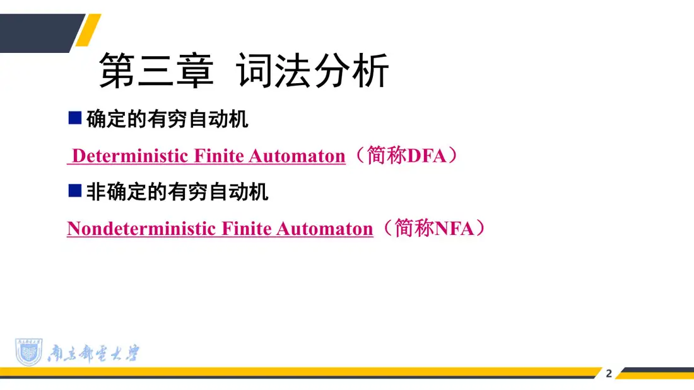

原文：

第三章 词法分析

确定的有穷自动机

Deterministic Finite Automaton（简称DFA）

◼非确定的有穷自动机

Nondeterministic Finite Automaton（简称NFA）

2

### 第 3 页

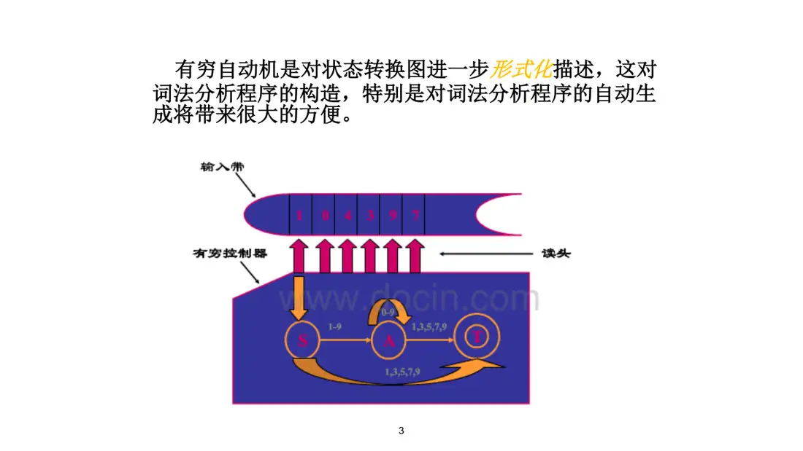

原文：

有穷自动机是对状态转换图进一步形式化描述，这对词法分析程序的构造，特别是对词法分析程序的自动生成将带来很大的方便。

3

### （1）有穷自动机的物理模型

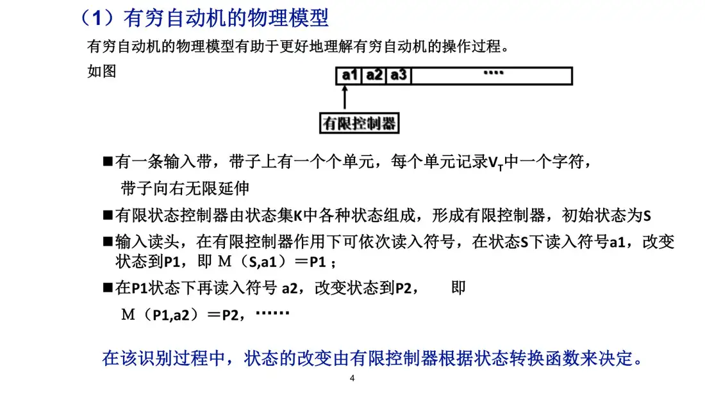

原文：

（1）有穷自动机的物理模型

有穷自动机的物理模型有助于更好地理解有穷自动机的操作过程。

如图

◼有一条输入带，带子上有一个个单元，每个单元记录 ${ \sf V } _ { \sf \sf T }$ 中一个字符，带子向右无限延伸

◼有限状态控制器由状态集K中各种状态组成，形成有限控制器，初始状态为S

◼输入读头，在有限控制器作用下可依次读入符号，在状态S下读入符号a1，改变状态到P1，即 $\textbf { M } \left( \pmb { \mathscr { s } } , \mathbf { \vec { a } } \mathbf { 1 } \right) = \mathbf { \vec { p } } \mathbf { 1 }$ ；

◼在P1状态下再读入符号 a2，改变状态到P2， 即

M（P1,a2）＝P2，

在该识别过程中，状态的改变由有限控制器根据状态转换函数来决定。

4

### （2）形式定义

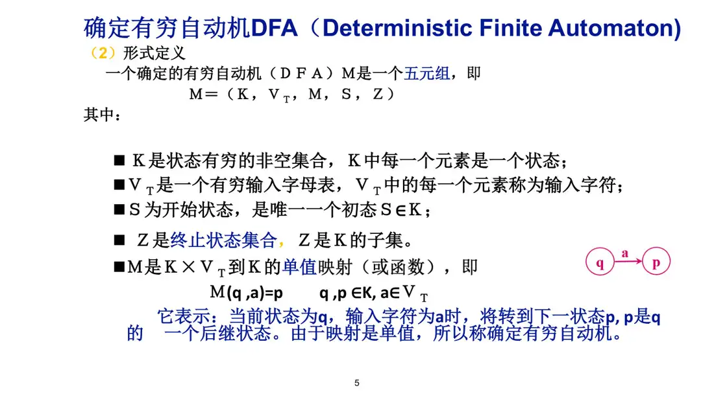

原文：

确定有穷自动机DFA（Deterministic Finite Automaton)

（2）形式定义

一个确定的有穷自动机（DFA）M是一个五元组，即

$$
\mathrm{M} = (\mathrm{K}, \mathrm{V} _ {\mathrm{T}}, \mathrm{M}, \mathrm{S}, \mathrm{Z})
$$

其中：

◼K是状态有穷的非空集合，K中每一个元素是一个状态；

◼ $\mathrm { ~ V ~ } _ { \mathrm { T } }$ 是一个有穷输入字母表， $\mathrm { ~ v ~ } _ { \mathrm { T } }$ 中的每一个元素称为输入字符；

◼S为开始状态，是唯一一个初态 $\mathbf { S } \in \mathbb { K }$

◼ Z是终止状态集合，Z是K的子集。

◼M是 $\mathbb { K } \times \mathbb { V } _ { \textrm { T } }$ 到K的单值映射（或函数），即

$$
\mathrm{M} (\mathsf {q}, \mathsf {a}) = \mathsf {p} \quad \mathsf {q}, \mathsf {p} \in \mathrm{K}, \mathsf {a} \in \mathrm{V} _ {\mathrm{T}}
$$

它表示：当前状态为q，输入字符为a时，将转到下一状态p, p是q的 一个后继状态。由于映射是单值，所以称确定有穷自动机。

5

### V 是一个有穷输入字母表，VT中的每一个元素称为输入字符

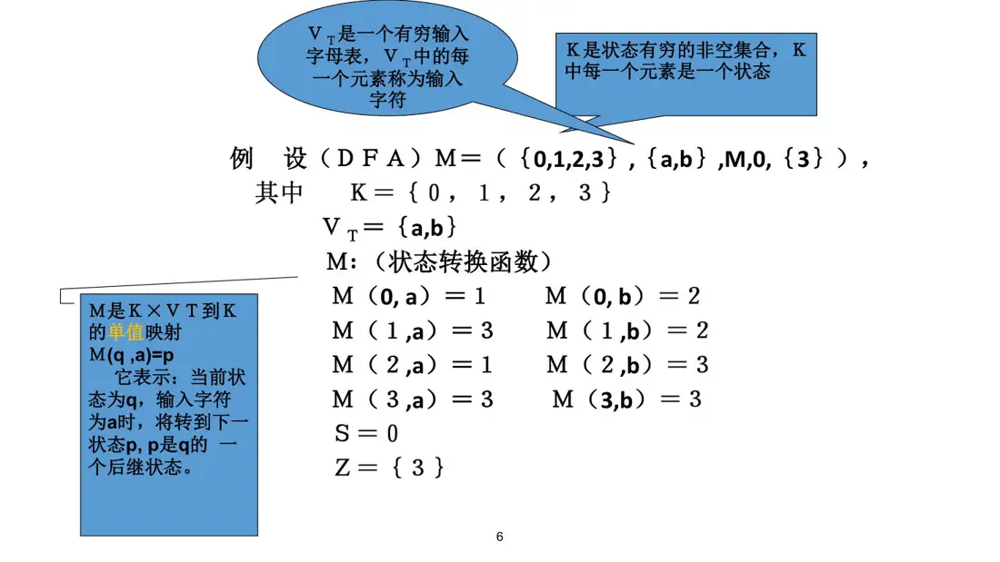

原文：

V 是一个有穷输入字母表，VT中的每一个元素称为输入字符

M是K×VT到K的单值映射M(q ,a)=p它表示：当前状态为q，输入字符为a时，将转到下一状态p, p是q的 一个后继状态。

K是状态有穷的非空集合，K 中每一个元素是一个状态

6

### （3）（DFA）M状态转换图及状态转换矩阵

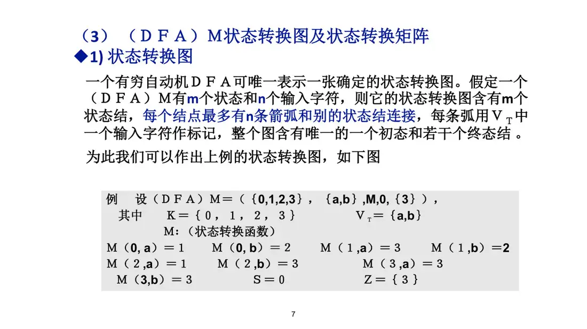

原文：

（3）（DFA）M状态转换图及状态转换矩阵

◆1) 状态转换图

一个有穷自动机DFA可唯一表示一张确定的状态转换图。假定一个（DFA）M有m个状态和n个输入字符，则它的状态转换图含有m个状态结，每个结点最多有n条箭弧和别的状态结连接，每条弧用 $\mathrm { ~ v ~ } _ { \mathrm { T } }$ 中一个输入字符作标记，整个图含有唯一的一个初态和若干个终态结。

为此我们可以作出上例的状态转换图，如下图利用映射M很容易识别定义在输入字母表 $\mathbf { V } _ { \textrm { T } }$ 上的字符串是否为确定有穷自动机DFA所接受（即最后到达终止状态）。例如对于输入字符串abb，因为从开始状态0出发，有M（0,a）=1 M（1,b）=2 M（2,b）=3

7

### 第 8 页

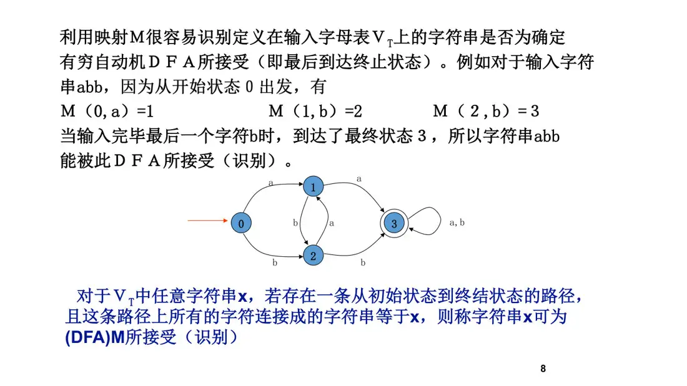

原文：

当输入完毕最后一个字符b时，到达了最终状态3，所以字符串abb能被此DFA所接受（识别）。

对于 $\mathbf { V } _ { \textrm { T } }$ 中任意字符串x，若存在一条从初始状态到终结状态的路径，且这条路径上所有的字符连接成的字符串等于x，则称字符串x可为(DFA)M所接受（识别）

8

### $$

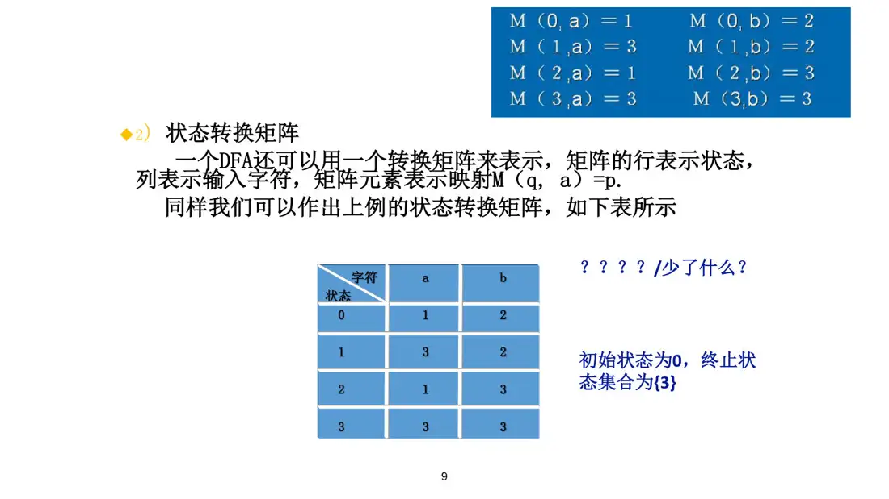

原文：

$$
\begin{array}{l} \mathrm{M(0,a)=1} \\ \mathrm{M(1,a)=3} \\ \mathrm{M(2,a)=1} \\ \mathrm{M(3,a)=3} \end{array}
$$

$$
\begin{array}{r l} & \mathrm{M(0,b)=2} \\ & \mathrm{M(1,b)=2} \\ & \mathrm{M(2,b)=3} \\ & \mathrm{M(3,b)=3} \end{array}
$$

◆2) 状态转换矩阵

一个DFA还可以用一个转换矩阵来表示，矩阵的行表示状态，列表示输入字符，矩阵元素表示映射M $( { \mathsf { q } } , { \mathsf { a } } ) = { \mathsf { p } }$

同样我们可以作出上例的状态转换矩阵，如下表所示

<table><tr><td>字符状态</td><td>a</td><td>b</td></tr><tr><td>0</td><td>1</td><td>2</td></tr><tr><td>1</td><td>3</td><td>2</td></tr><tr><td>2</td><td>1</td><td>3</td></tr><tr><td>3</td><td>3</td><td>3</td></tr></table>

？？？？/少了什么？

初始状态为0，终止状态集合为{3}

9

### 到此为止，有穷自动机可以用形式化的五元组、状态转换图和状态转换矩阵三种方式表示

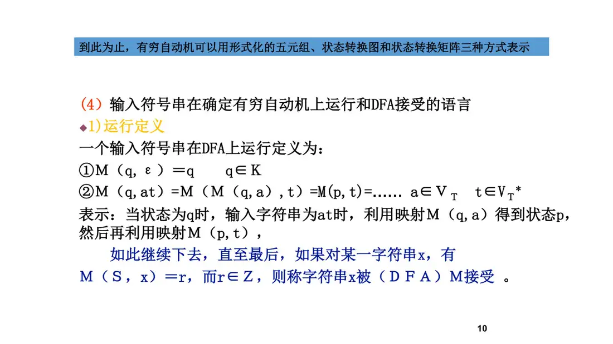

原文：

到此为止，有穷自动机可以用形式化的五元组、状态转换图和状态转换矩阵三种方式表示

(4）输入符号串在确定有穷自动机上运行和DFA接受的语言

◆1)运行定义

一个输入符号串在DFA上运行定义为：

① $\begin{array} { r } { \mathrm { ~ { ~ \bf ~ M ~ } ~ } ( \mathrm {  ~ q , ~ } \varepsilon { \mathrm {  ~ \sigma ~ } } ) = \mathrm {  ~ q ~ } \qquad \mathrm {  ~ \sf ~ q } \in \mathrm {  ~ K ~ } } \end{array}$

$$
M (q, a t) = M (M (q, a), t) = M (p, t) = \dots \dots . a \in V _ {T} \quad t \in V _ {T} ^ {*}
$$

表示：当状态为q时，输入字符串为at时，利用映射 $\textbf { M } \left( \mathbf { q } , \mathbf { a } \right)$ 得到状态p，然后再利用映射 $\textbf { M } \left( \mathbf { p } , \mathbf { t } \right)$ 9

如此继续下去，直至最后，如果对某一字符串x，有$\textbf { M } ( \textbf { S } , \textbf { x } ) = \mathbf { r }$ ，而 $\mathbf { r } \in \mathbf { Z }$ ，则称字符串x被（DFA）M接受 。

10

### 例 设（DFA）M＝（｛0,1,2,3｝，｛a,b｝,M,0,｛3｝），

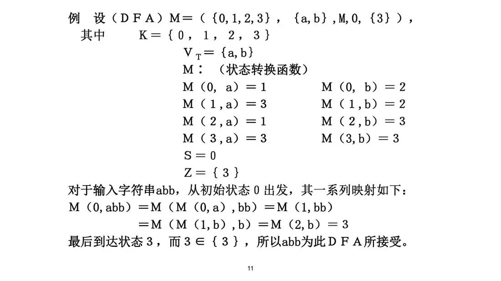

原文：

例 设（DFA）M＝（｛0,1,2,3｝，｛a,b｝,M,0,｛3｝），

其中 K＝｛0，1，2，3｝

对于输入字符串abb，从初始状态0出发，其一系列映射如下：

$$
\begin{array}{r l} \mathrm{M(0,abb)} & = \mathrm{M(M(0,a),bb)} = \mathrm{M(1,bb)} \\ & = \mathrm{M(M(1,b),b)} = \mathrm{M(2,b)} = 3 \end{array}
$$

最后到达状态3，而 $3 \in \{ \ 3 \ \}$ ，所以abb为此DFA所接受。

11

### $$

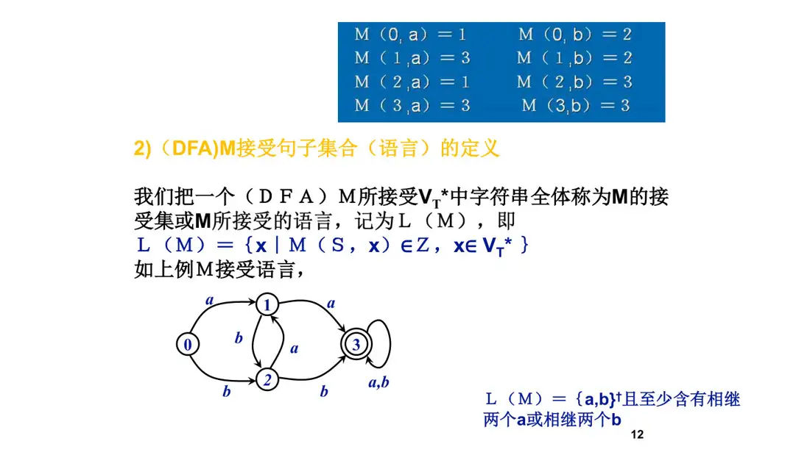

原文：

$$
M (0, a) = 1
$$

$$
M (0, b) = 2
$$

$$
M (1, a) = 3
$$

$$
M (1, b) = 2
$$

$$
M (2, a) = 1
$$

$$
M (2, b) = 3
$$

$$
\mathrm{M} (3, \mathrm{a}) = 3
$$

$$
M (3, b) = 3
$$

2)（DFA)M接受句子集合（语言）的定义

我们把一个（DFA）M所接受 ${ \sf V } _ { \mathrm { T } } ^ { \mathrm { ~ \star ~ } }$ 中字符串全体称为M的接受集或M所接受的语言，记为L（M），即$\mathrm { ~ L ~ } \left( \mathbb { M } \right) = \lbrace \mathbf { x } \mid \mathbb { M } \mathrm { ~ ( ~ S ~ , ~ } \mathbf { x } ) \in \mathrm { Z } , \ \mathbf { x } \in \mathbf { V } _ { \mathsf { T } } ^ { \star } \ \rbrace$ 如上例M接受语言，

$\begin{array} { r } { \mathrm { ~ L ~ } \left( \mathbb { M } \right) = \{ \mathbf { a } , \mathbf { b } \} ^ { \dagger } } \end{array}$ 且至少含有相继两个a或相继两个b

12

### 非确定的有穷自动机

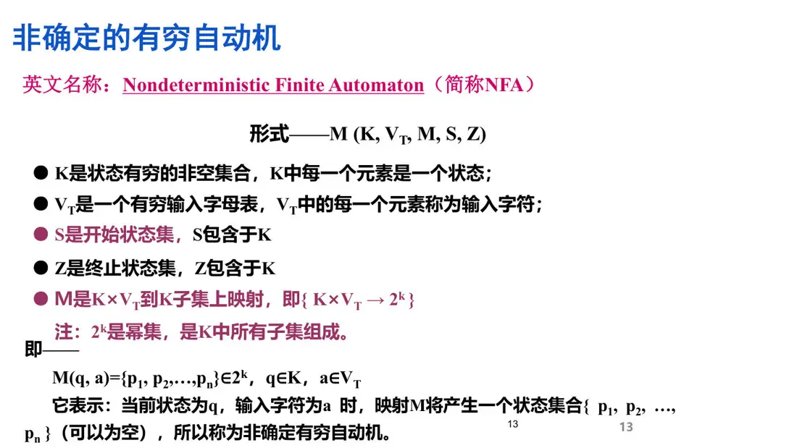

原文：

非确定的有穷自动机

英文名称：Nondeterministic Finite Automaton（简称NFA）

$$
\text {形式——} \mathbf {M} (\mathbf {K}, \mathbf {V} _ {\mathrm{T}}, \mathbf {M}, \mathbf {S}, \mathbf {Z})
$$

● K是状态有穷的非空集合，K中每一个元素是一个状态；

● $\mathbf { V } _ { \mathbf { T } }$ 是一个有穷输入字母表， $\mathbf { V } _ { \mathbf { T } }$ 中的每一个元素称为输入字符；

● S是开始状态集，S包含于K

● Z是终止状态集，Z包含于K

● M是 $\bf { K } \times \bf { V } _ { \mathrm { I } }$ 到K子集上映射，即 $\{ { \bf K } { \times } { \bf V } _ { \mathrm { T } } \stackrel { } { \longrightarrow } 2 ^ { { \bf k } } \}$

注：2k是幂集，是K中所有子集组成。即—

$$
\mathbf {M} (\mathbf {q}, \mathbf {a}) = \{\mathbf {p} _ {1}, \mathbf {p} _ {2}, \dots , \mathbf {p} _ {\mathrm{n}} \} \in 2 ^ {\mathrm{k}}, \quad \mathbf {q} \in \mathbf {K}, \quad \mathbf {a} \in \mathbf {V} _ {\mathrm{T}}
$$

它表示：当前状态为q，输入字符为a 时，映射M将产生一个状态集合{ ${ \bf p _ { 1 } } , \ { \bf p } _ { 2 } , \ \ldots ,$ ${ \bf p _ { n } } \}$ （可以为空），所以称为非确定有穷自动机。 13 13

### 非确定的有穷自动机

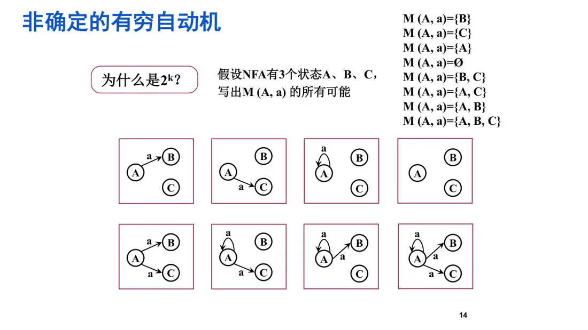

原文：

非确定的有穷自动机

为什么是 $2 ^ { \mathbf { k } } ?$

假设NFA有3个状态A、B、C，写出M (A, a) 的所有可能

M (A, a)={B} M (A, a)={C} M (A, a)={A} M (A, a)=Ø M (A, a)={B, C} M (A, a)={A, C} M (A, a)={A, B} M (A, a)={A, B, C}

14

### 15

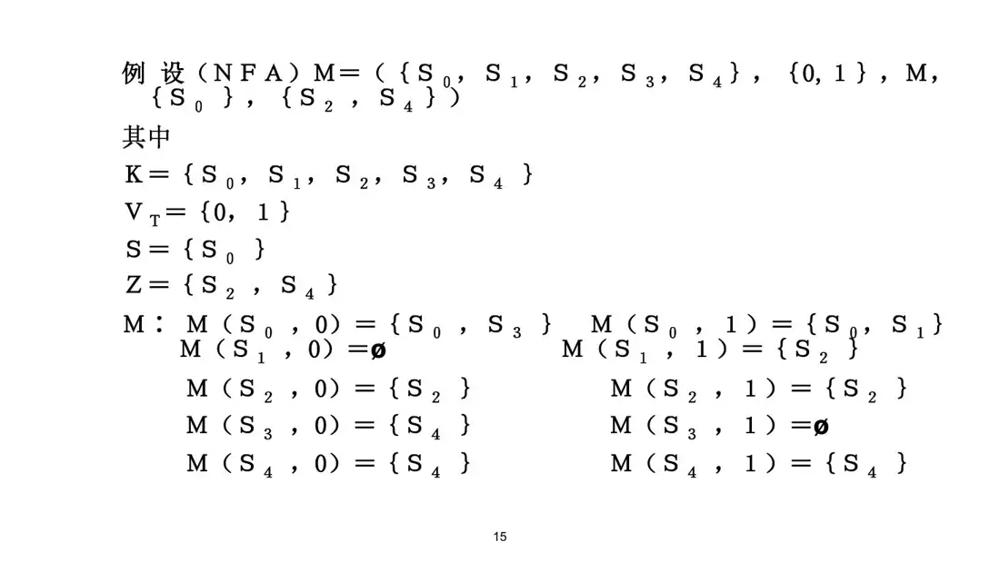

原文：

15

### 第 16 页

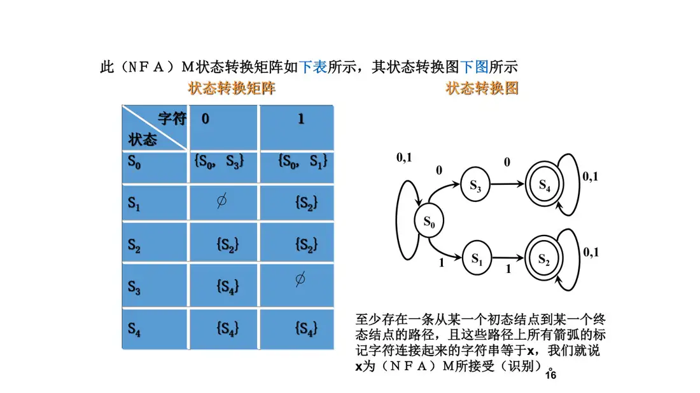

原文：

此（NFA）M状态转换矩阵如下表所示，其状态转换图下图所示状态转换矩阵 状态转换图
<table><tr><td>字符状态</td><td>0</td><td>1</td></tr><tr><td> $S_0$ </td><td> $\{S_0, S_3\}$ </td><td> $\{S_0, S_1\}$ </td></tr><tr><td> $S_1$ </td><td> $\emptyset$ </td><td> $\{S_2\}$ </td></tr><tr><td> $S_2$ </td><td> $\{S_2\}$ </td><td> $\{S_2\}$ </td></tr><tr><td> $S_3$ </td><td> $\{S_4\}$ </td><td> $\emptyset$ </td></tr><tr><td> $S_4$ </td><td> $\{S_4\}$ </td><td> $\{S_4\}$ </td></tr></table>

至少存在一条从某一个初态结点到某一个终态结点的路径，且这些路径上所有箭弧的标记字符连接起来的字符串等于x，我们就说x为（NFA）M所接受（识别） 16

### $$

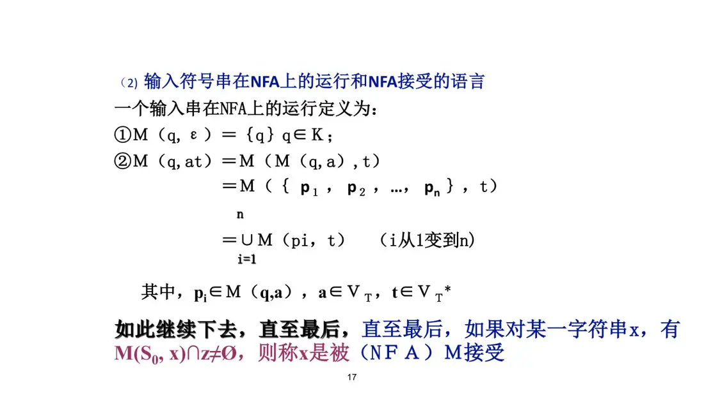

原文：

（2) 输入符号串在NFA上的运行和NFA接受的语言一个输入串在NFA上的运行定义为：

①M $\begin{array} { r } { \mathrm { ~ ( ~ q , ~ \varepsilon ~ ) ~ } = \mathrm { ~ \{ ~ q \} ~ q \in \mathbb { K } ~ } } \end{array}$

$$
\begin{array}{r l} \text {②} & \mathrm{M(q,at)} = \mathrm{M(M(q,a),t)} \\ & = \mathrm{M}({p} _ {1}, \mathrm{p} _ {2}, \dots , \mathrm{p} _ {n} \}, t) \\ & \quad \mathrm{n} \\ & = \cup_ {\mathrm{i=1}} \mathrm{M(pi,t)} \quad (\mathrm{i从1变到n}) \end{array}
$$

其中， $\mathbf { p _ { i } } { \in } \mathbf { M } \left( \mathbf { \mathrm { q } } , \mathbf { a } \right) ~ , ~ \mathbf { a } { \in } \mathrm { V } _ { \mathrm { ~ T ~ } } , ~ { \mathrm { t } } { \in } \mathrm { V } _ { \mathrm { ~ T ~ } } { ^ { * } }$

如此继续下去，直至最后，直至最后，如果对某一字符串x，有$\mathbf { M } ( \mathbf { S _ { 0 } } , \mathbf { x } ) \cap \mathbf { z } \neq \mathbf { O }$ ，则称x是被（NFA）M接受

17

### $$

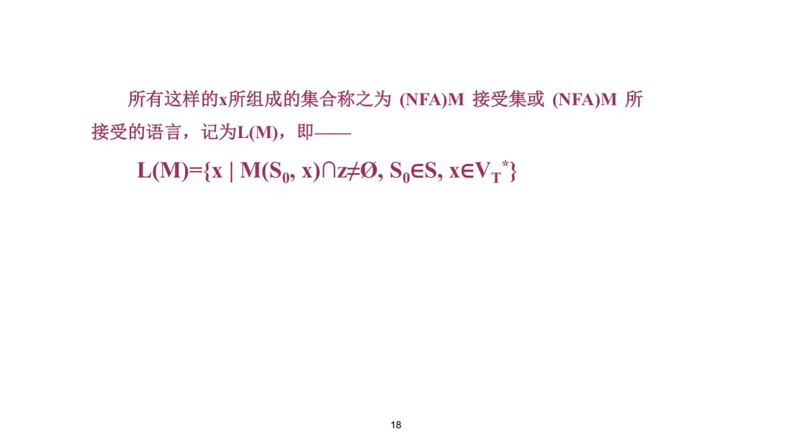

原文：

所有这样的x所组成的集合称之为 (NFA)M 接受集或 (NFA)M 所接受的语言，记为 $\mathbf { L ( M ) }$ ，即——

$$
\mathbf {L} (\mathbf {M}) = \{\mathbf {x} \mid \mathbf {M} (\mathbf {S _ {0}}, \mathbf {x}) \cap \mathbf {z} \neq \emptyset , \mathbf {S _ {0}} \in \mathbf {S}, \mathbf {x} \in \mathbf {V _ {\mathrm{T}}} ^ {*} \}
$$

18

### 出发

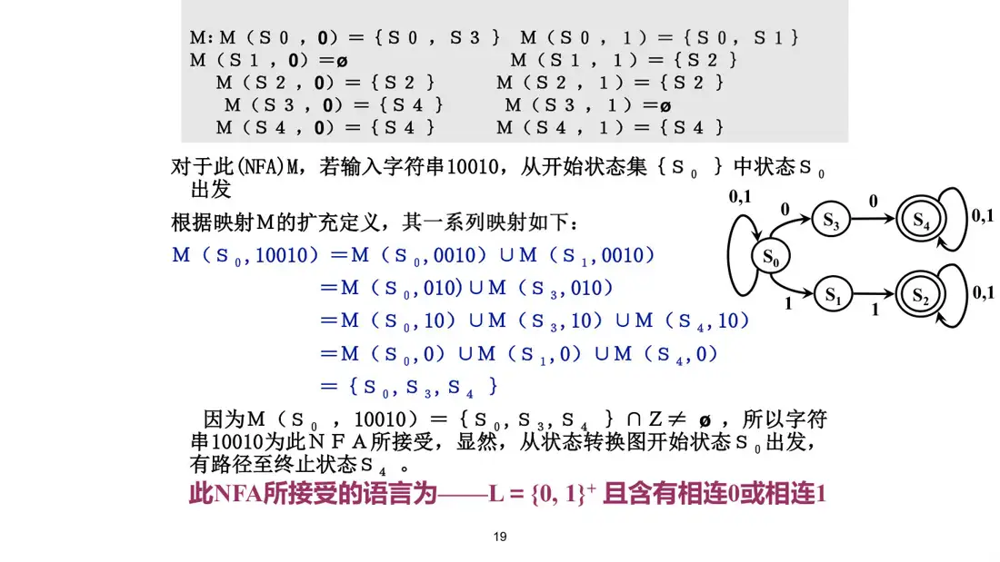

原文：

对于此(NFA)M，若输入字符串10010，从开始状态集 $\{ \textsf { S } _ { 0 } \}$ 中状态 $\mathrm { ~ \mathsf ~ { ~ S ~ } ~ } _ { 0 }$

出发

根据映射M的扩充定义，其一系列映射如下：

$$
\begin{array}{r l} \mathrm{M} (\mathrm{S} _ {0}, 1 0 0 1 0) & = \mathrm{M} (\mathrm{S} _ {0}, 0 0 1 0) \cup \mathrm{M} (\mathrm{S} _ {1}, 0 0 1 0) \\ & = \mathrm{M} (\mathrm{S} _ {0}, 0 1 0) \cup \mathrm{M} (\mathrm{S} _ {3}, 0 1 0) \\ & = \mathrm{M} (\mathrm{S} _ {0}, 1 0) \cup \mathrm{M} (\mathrm{S} _ {3}, 1 0) \cup \mathrm{M} (\mathrm{S} _ {4}, 1 0) \\ & = \mathrm{M} (\mathrm{S} _ {0}, 0) \cup \mathrm{M} (\mathrm{S} _ {1}, 0) \cup \mathrm{M} (\mathrm{S} _ {4}, 0) \\ & = \{\mathrm{S} _ {0}, \mathrm{S} _ {3}, \mathrm{S} _ {4} \} \end{array}
$$

因为M $( \mathrm { ~ S ~ } _ { \mathrm { ~ 0 ~ } } , \ 1 0 0 1 0 ) = \{ \mathrm { ~ S ~ } _ { \mathrm { ~ 0 ~ } } , \mathrm { ~ S ~ } _ { \mathrm { ~ 3 ~ } } , \mathrm { ~ S ~ } _ { \mathrm { ~ 4 ~ } } \} \ \cap \mathrm { ~ Z } \neq \mathrm { ~ \mathfrak { g } ~ }$ ，所以字符串10010为此NFA所接受，显然，从状态转换图开始状态 $\mathrm { ~ S ~ } _ { 0 }$ 出发，有路径至终止状态 $\mathrm { ~ S ~ } _ { 4 }$ o

此NFA所接受的语言为— $\mathbf { \partial } \mathbf { L } = \{ \mathbf { 0 } , \mathbf { 1 } \} ^ { + }$ 且含有相连0或相连1

19

### 20

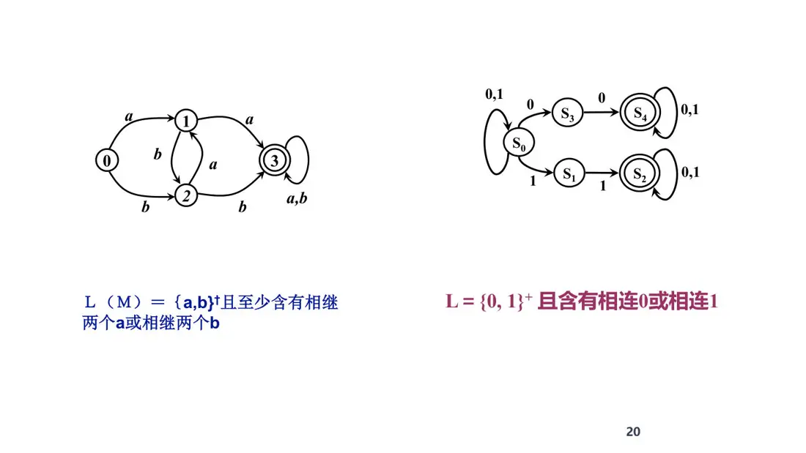

原文：

L $( \mathbf { M } ) \ = \ \{ \mathbf { a } , \mathbf { b } \} ^ { \dagger }$ 且至少含有相继两个a或相继两个b

${ \bf L } = \{ { \bf 0 } , 1 \} ^ { + }$ 且含有相连0或相连1

20

### 四、DFA与NFA的关系

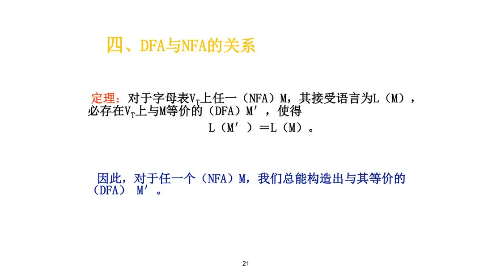

原文：

四、DFA与NFA的关系

定理：对于字母表 ${ \sf V } _ { \sf T } .$ 上任一（NFA）M，其接受语言为L（M），必存在 ${ \tt V } _ { \mathrm { T } }$ 上与M等价的（DFA） $\mathbb { M } ^ { \prime }$ ′，使得

${ \textsc { L } } ( { \mathbb { M } } ^ { \prime } ) = { \textsc { L } } ( { \mathbb { M } } )$

因此，对于任一个（NFA）M，我们总能构造出与其等价的（DFA） $\mathbb { M } ^ { \prime }$ o

21

### 其方法如下：

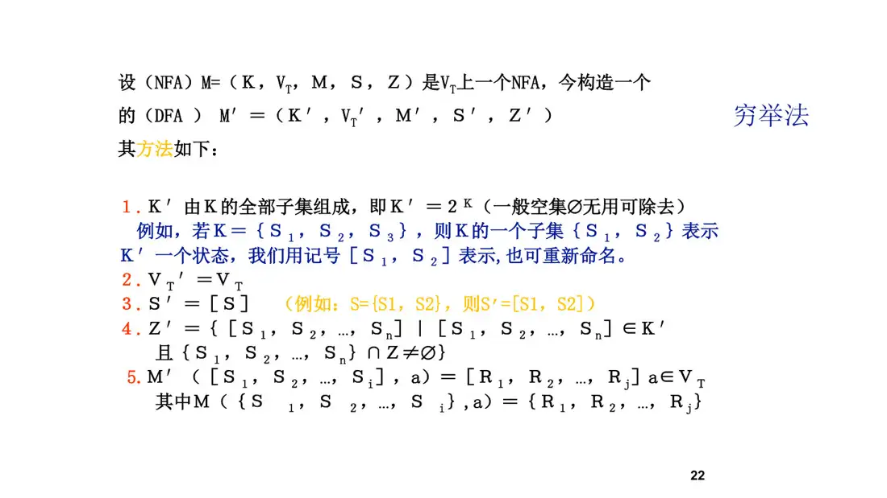

原文：

设（NFA） $\mathbb { M } = \mathrm { ~ ( ~ K ~ , ~ } \mathrm { ~ V _ { T } , ~ } \mathrm { ~ M ~ , ~ } \mathrm { ~ S ~ , ~ } \mathrm { ~ Z ~ ) ~ }$ 是 $\mathtt { V } _ { \mathrm { T } } .$ 上一个NFA，今构造一个

的（DFA ） $\mathbb { M } ^ { \prime } = ( \mathbb { K } ^ { \prime } , \mathbb { V } _ { \mathbb { T } } ^ { \prime } , \mathbb { M } ^ { \prime } , \mathbb { S } ^ { \prime } , \mathbb { Z } ^ { \prime } )$

其方法如下：

穷举法

1. $\textrm { \textbf { K } } ^ { \prime }$ 由K的全部子集组成，即 $\mathrm { ~ K ~ } ^ { \prime } = 2 ^ { \mathrm { ~ K ~ } }$ （一般空集无用可除去）例如，若 $\mathrm { K } = \{ \textbf { S } _ { 1 } , \textbf { S } _ { 2 } , \textbf { S } _ { 3 } \}$ ，则K的一个子集 $\{ \textbf { S } _ { 1 } , \textbf { S } _ { 2 } \}$ 表示$\textrm { \textbf { K } } ^ { \prime }$ 一个状态，我们用记号 $[ \textbf { S } _ { 1 } , \textbf { S } _ { 2 } ]$ 表示,也可重新命名。

2. ${ \mathbf { V } _ { \mathrm { ~ T ~ } } } ^ { \prime } =  { \mathbf { V } _ { \mathrm { ~ T ~ } } }$

3. $\mathrm { ~ \bf ~ S ~ } ^ { \prime } = [ \mathrm { ~ \bf ~ S ~ } ]$ （例如： $\mathrm { S } { = } \{ \mathrm { S } 1 , \mathrm { S } 2 \}$ ，则 $\mathrm { ~ S ~ } ^ { \prime } = [ \mathrm { S } 1 , \mathrm { ~ } \mathrm { S } 2 ] )$

$$
Z ^ {\prime} = \left\{\left[ S _ {1}, S _ {2}, \dots , S _ {n} \right] \mid \left[ S _ {1}, S _ {2}, \dots , S _ {n} \right] \in K ^ {\prime} \right.
$$

且 $\{ \textbf { S } _ { 1 } , ~ \textbf { S } _ { 2 } , ~ . . . , ~ \textbf { S } _ { \mathrm { n } } \} ~ \cap ~ \mathbb { Z } \neq \emptyset \}$

5. $\begin{array} { r } { \begin{array} { r l } { \mathbf { M } ^ { \prime } } & { ( \texttt { [ S _ { 1 } , ~ S _ { 2 } , ~ . . . , ~ S _ { i } ] } , \texttt { a } ) = [ \texttt { R } _ { 1 } , \texttt { ~ R } _ { 2 } , \texttt { . . . , ~ R } _ { i } ] \mathbf { a } \in \mathbb { V } _ { \texttt { T } } } \end{array} } \end{array}$ 其中M $( \mathrm { ~  ~ \left\{ ~ S ~ \right\} ~ } _ { 1 } , \mathrm { ~  ~ S ~ \Lambda ~ } _ { 2 } , . . . , \mathrm { ~  ~ S ~ \Lambda ~ } _ { \mathrm { i } } \mathrm  ~  ~ \} , \mathrm { a ) = \left\{ ~ R ~ \right\} _ { 1 } , \mathrm { ~  ~ R ~ } _ { 2 } , . . . , \mathrm { ~  ~ R ~ } _ { \mathrm { j } } } $

22

### $$

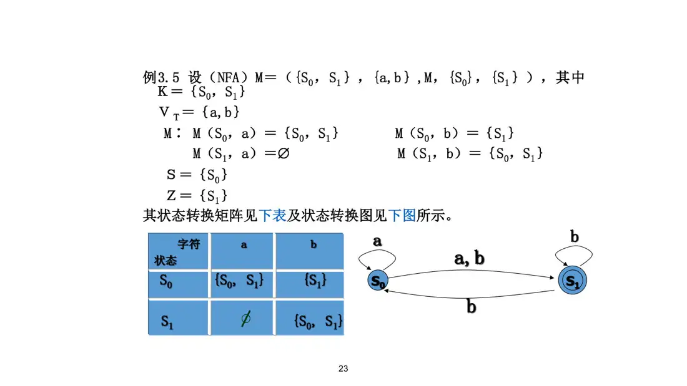

原文：

$$
\begin{array}{r l} & {{\mathrm{例} 3. 5 \mathrm{设} (\mathrm{NFA}) \mathsf {M} = (\{\mathsf {S} _ {0}, \mathsf {S} _ {1} \}, \{\mathsf {a}, \mathsf {b} \}, \mathsf {M}, \{\mathsf {S} _ {0} \}, \{\mathsf {S} _ {1} \}), \mathrm{其中}}} \\ & {{\mathsf {K} = \{\mathsf {S} _ {0}, \mathsf {S} _ {1} \}}} \\ & {{\mathsf {V} _ {\textup {T}} = \{\mathsf {a}, \mathsf {b} \}}} \\ & {{\mathsf {M}: \mathsf {M} (\mathsf {S} _ {0}, \mathsf {a}) = \{\mathsf {S} _ {0}, \mathsf {S} _ {1} \} \qquad \qquad \mathsf {M} (\mathsf {S} _ {0}, \mathsf {b}) = \{\mathsf {S} _ {1} \}}} \\ & {{\quad \mathsf {M} (\mathsf {S} _ {1}, \mathsf {a}) = \emptyset \qquad \qquad \mathsf {M} (\mathsf {S} _ {1}, \mathsf {b}) = \{\mathsf {S} _ {0}, \mathsf {S} _ {1} \}}} \\ & {{\mathsf {S} = \{\mathsf {S} _ {0} \}}} \\ & {{\mathsf {Z} = \{\mathsf {S} _ {1} \}}} \end{array}
$$

其状态转换矩阵见下表及状态转换图见下图所示。

<table><tr><td>字符状态</td><td>a</td><td>b</td></tr><tr><td> $S_0$ </td><td> $\{S_0, S_1\}$ </td><td> $\{S_1\}$ </td></tr><tr><td> $S_1$ </td><td>∅</td><td> $\{S_0, S_1\}$ </td></tr></table>

23

### 24

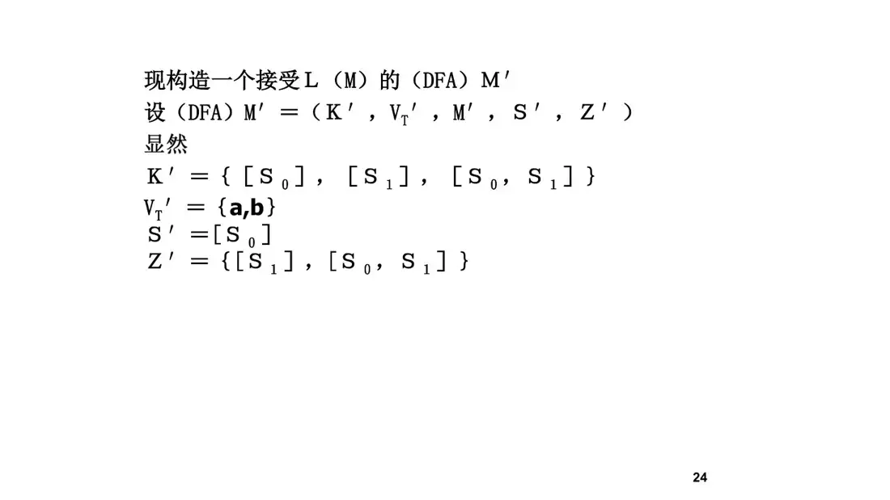

原文：

24

### 第 25 页

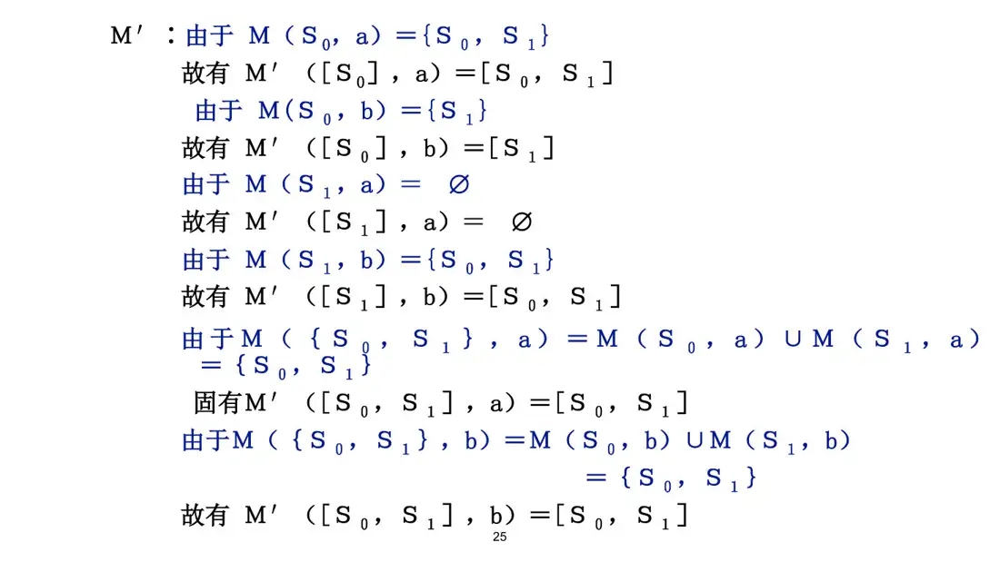

原文：

$\mathbf { M } ^ { \prime }$ ∶由于 $\mathrm { ~ \bf ~ M ~ } \left( \mathrm { \bf ~ S } _ { 0 } , \mathrm { \bf ~ a } \right) = \{ \mathrm { \bf ~ S } _ { \mathrm { ~ 0 ~ } } , \mathrm { \bf ~ S } _ { \mathrm { ~ 1 ~ } } \}$ 故有 $\begin{array} { r l } { \mathbf { M } ^ { \prime } } & { { } ( [ \mathbf { S } _ { 0 } ] \ , \ \mathbf { a } ) = [ \mathbf { S } _ { \ 0 } , \ \mathbf { S } _ { \ 1 } ] } \end{array}$ 由于 $\mathrm { ~  ~ { ~ M ~ } ~ } ( \mathrm { ~  ~ { ~ S ~ } ~ } _ { 0 } , \mathrm { ~  ~ { ~ b ~ } ~ } ) = \{ \mathrm { ~ \bf ~ S ~ } _ { 1 } \}$ 故有 $\begin{array} { r l } { \mathbf { M } ^ { \prime } } & { { } ( \left[ \mathbf { S } _ { \mathrm { ~ 0 ~ } } \right] \ , \ \mathbf { b } ) = [ \mathbf { S } _ { \mathrm { ~ 1 ~ } } ] } \end{array}$ 由于 $\begin{array} { r l } { \textbf { M } \left( \textbf { S } _ { 1 } , \textbf { a } \right) = } & { { } \boldsymbol { \emptyset } } \end{array}$ 故有 $\begin{array} { r l r } { \mathrm { ~  ~ \cal ~ M ~ } ^ { \prime } } & { { } ( \left[ { \bf \cal ~ S } _ { \mathrm { ~ 1 ~ } } \right] , \{ \bf ~ a } ) =  & { \emptyset } \end{array}$ 由于 $\mathrm { ~ \bf ~ M ~ } ( \mathrm { ~ \bf ~ S ~ } _ { 1 } , \mathrm { ~ \bf ~ b ~ } ) = \{ \mathrm { ~ \bf ~ S ~ } _ { 0 } , \mathrm { ~ \bf ~ S ~ } _ { 1 } \}$ 故有 $\begin{array} { r l } { \mathbf { M } ^ { \prime } } & { { } ( [ \mathbf { S } _ { \mathrm { ~ 1 ~ } } ] \ , \ \mathbf { b } ) = [ \mathbf { S } _ { \mathrm { ~ 0 ~ } } , \ \mathbf { S } _ { \mathrm { ~ 1 ~ } } ] } \end{array}$ $\begin{array} { r l } & { \mathbb { H } \equiv \mathbb { M } ^ { \mathrm { ~ \texttt ~ ( ~ S ~ } _ { 0 } ~ , ~ \texttt ~ S ~ \ _ 1 ~ ) ~ } ~ , ~ \mathbf { a } ) = \mathbf { M } ^ { \mathrm { ~ \texttt ~ ( ~ S ~ } _ { 0 } ~ , ~ \mathbf { \Delta } \mathrm { ~ a } ~ ) ~ \cup ~ \mathbf { M } ~ \mathrm { ~ \texttt ~ ( ~ S ~ } _ { 1 } ~ , ~ \mathbf { a } ~ ) ~ } } \\ & { ~ = \{ \textsc { S } _ { 0 } , ~ \textsc { S } _ { 1 } \} } \end{array}$ 固有 $\begin{array} { r l } { \mathbf { M } ^ { \prime } } & { { } ( [ \mathbf { S } _ { \mathrm { ~ 0 ~ } } , \textbf { S } _ { 1 } ] \ , \ \mathbf { a } ) = [ \mathbf { S } _ { \mathrm { ~ 0 ~ } } , \ \mathbf { S } _ { \mathrm { ~ 1 ~ } } ] } \end{array}$ 由于 $\textbf { M ( \{ S _ { \ i } , \ S _ { \ i } \} , \ b ) } = \mathbf { M } \ ( \ S _ { \ i } , \ \mathbf { b } ) \ \cup \mathbf { M } \ ( \ S _ { \ i } , \ \mathbf { b } )$ $\mathbf { \Omega } = \{ \textbf { S } _ { 0 } , \textbf { S } _ { 1 } \}$ 故有 $\begin{array} { r l } { \mathbf { M } ^ { \prime } } & { { } ( [ \mathbf { S } _ { \mathrm { ~ 0 ~ } } , \textbf { S } _ { 1 } ] \textbf { , } \mathbf { b } ) = [ \mathbf { S } _ { \mathrm { ~ 0 ~ } } , \textbf { S } _ { 1 } ] } \end{array}$

### $$

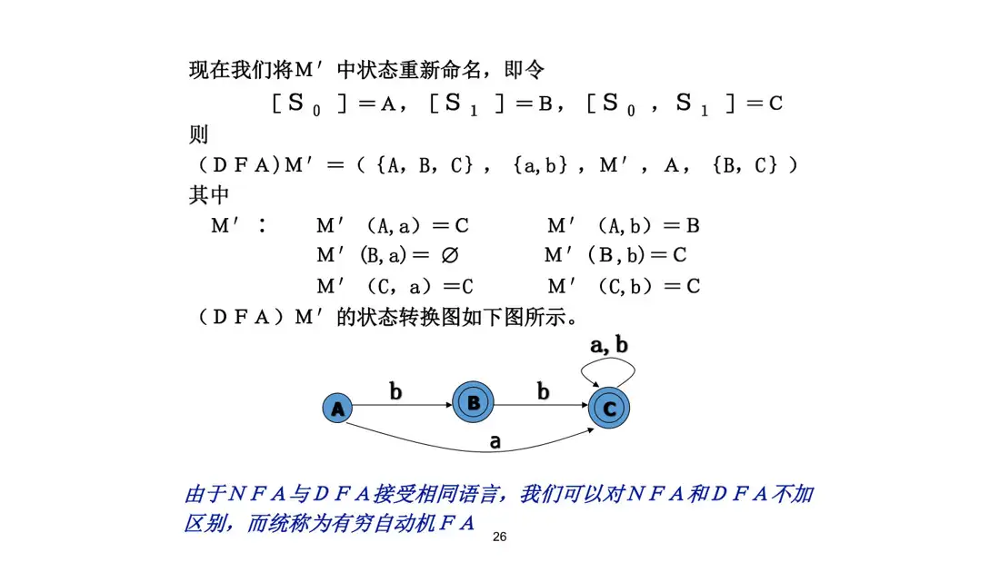

原文：

现在我们将 $\mathbf { M } ^ { \prime }$ 中状态重新命名，即令

$$
[ \textbf {S} _ {0} ] = \mathrm{A}, [ \textbf {S} _ {1} ] = \mathrm{B}, [ \textbf {S} _ {0}, \textbf {S} _ {1} ] = \mathrm{C}
$$

则

（DFA)M′＝（｛A，B，C｝，｛a,b｝，M′，A，｛B，C｝）其中

$$
\begin{array}{l l} \mathrm{M} ^ {\prime}: & \quad \mathrm{M} ^ {\prime} (\mathrm{A}, \mathrm{a}) = \mathrm{C} \\ & \quad \mathrm{M} ^ {\prime} (\mathrm{B}, \mathrm{a}) = \varnothing \\ & \quad \mathrm{M} ^ {\prime} (\mathrm{C}, \mathrm{a}) = \mathrm{C} \end{array} \qquad \begin{array}{l l} \mathrm{M} ^ {\prime} (\mathrm{A}, \mathrm{b}) = \mathrm{B} \\ & \quad \mathrm{M} ^ {\prime} (\mathrm{B}, \mathrm{b}) = \mathrm{C} \\ & \quad \mathrm{M} ^ {\prime} (\mathrm{C}, \mathrm{b}) = \mathrm{C} \end{array}
$$

（DFA） $\mathbf { M } ^ { \prime }$ 的状态转换图如下图所示。

由于 $N F A$ 与DFA接受相同语言，我们可以对NFA和D $F A$ 不加区别，而统称为有穷自动机 $F A$ 26

26

### ● 对于映射结果中新产生的“子集”，进一步探寻其对于每个输入符号的映射结果

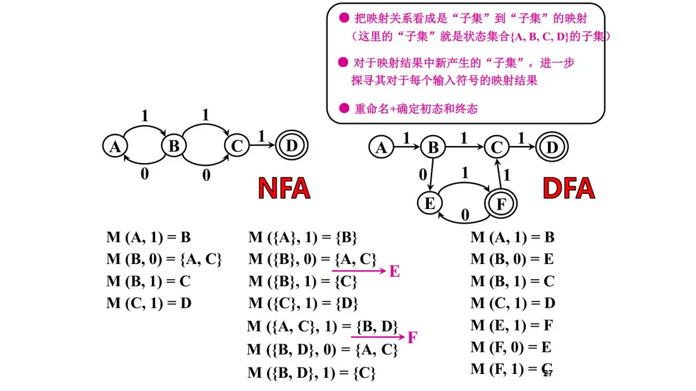

原文：

● 把映射关系看成是“子集”到“子集”的映射（这里的“子集”就是状态集合{A, B, C, D}的子集）

● 对于映射结果中新产生的“子集”，进一步探寻其对于每个输入符号的映射结果

重命名+确定初态和终态

$$
\mathbf {M} (\mathbf {A}, \mathbf {1}) = \mathbf {B}
$$

$$
\mathbf {M} (\{\mathbf {A} \}, 1) = \{\mathbf {B} \}
$$

$$
\mathbf {M} (\mathbf {A}, \mathbf {1}) = \mathbf {B}
$$

$$
\mathbf {M} (\mathbf {B}, \mathbf {0}) = \{\mathbf {A}, \mathbf {C} \}
$$

$$
\mathbf {M} (\{\mathbf {B} \}, \mathbf {0}) = \{\mathbf {A}, \mathbf {C} \}
$$

$$
\mathbf {M} (\mathbf {B}, \mathbf {0}) = \mathbf {E}
$$

$$
\mathbf {M} (\mathbf {B}, \mathbf {1}) = \mathbf {C}
$$

$$
\mathbf {M} (\{\mathbf {B} \}, 1) = \{\mathbf {C} \}
$$

$$
\mathbf {M} (\mathbf {B}, \mathbf {1}) = \mathbf {C}
$$

$$
\mathbf {M} (\mathbf {C}, \mathbf {1}) = \mathbf {D}
$$

$$
\mathbf {M} (\{\mathbf {C} \}, \mathbf {1}) = \{\mathbf {D} \}
$$

$$
\mathbf {M} (\mathbf {C}, \mathbf {1}) = \mathbf {D}
$$

$$
\mathbf {M} (\{\mathbf {A}, \mathbf {C} \}, 1) = \underbrace {\{\mathbf {B} , \mathbf {D} \}} _ {\mathbf {F}}
$$

$$
\mathbf {M} (\mathbf {E}, \mathbf {1}) = \mathbf {F}
$$

$$
\mathbf {M} (\{\mathbf {B}, \mathbf {D} \}, \mathbf {0}) = \{\mathbf {A}, \mathbf {C} \}
$$

$$
\mathbf {M} (\mathbf {F}, \mathbf {0}) = \mathbf {E}
$$

$$
\mathbf {M} (\{\mathbf {B}, \mathbf {D} \}, 1) = \{\mathbf {C} \}
$$

$$
\mathbf {M} (\mathbf {F}, \mathbf {1}) = \mathbf {G _ {7}}
$$

### 五、有穷自动机和正规文法的关系

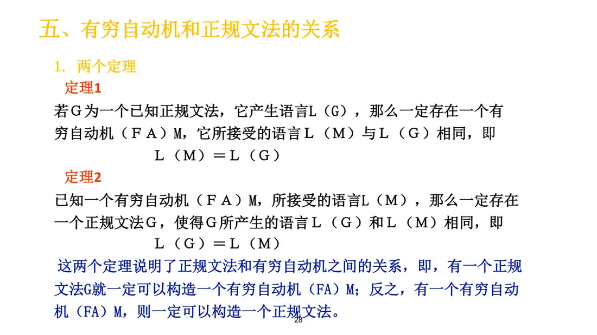

原文：

五、有穷自动机和正规文法的关系

1. 两个定理

定理1

若G为一个已知正规文法，它产生语言L（G），那么一定存在一个有穷自动机（FA）M，它所接受的语言L（M）与L（G）相同，即L（M）＝L（G）

定理2

已知一个有穷自动机（FA）M，所接受的语言L（M），那么一定存在一个正规文法G，使得G所产生的语言L（G）和L（M）相同，即L（G）＝L（M）

这两个定理说明了正规文法和有穷自动机之间的关系，即，有一个正规文法G就一定可以构造一个有穷自动机（FA）M；反之，有一个有穷自动机（FA）M，则一定可以构造一个正规文法。

### 五、有穷自动机和正规文法的关系

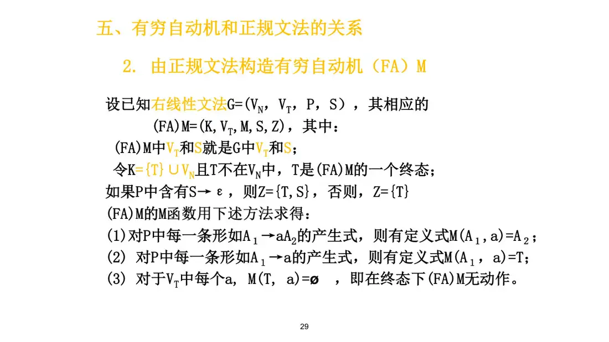

原文：

五、有穷自动机和正规文法的关系

2. 由正规文法构造有穷自动机（FA）M

设已知右线性文法 $\mathsf { G } { = } ( \mathsf { V } _ { \mathrm { N } } , ~ \mathsf { V } _ { \mathrm { T } } , ~ \mathsf { P } , ~ \mathsf { S } )$ ，其相应的

(FA) $\mathsf { M } { = } \left( \mathrm { K } , \mathrm { V } _ { \mathrm { T } } , \mathrm { M } , \mathrm { S } , \mathrm { Z } \right)$ ，其中：

(FA)M中 $\mathrm { v } _ { \mathrm { T } } .$ 和S就是G中 $\mathrm { v } _ { \mathrm { T } } .$ 和S；

令 $\boldsymbol { \cdot } \boldsymbol { \mathrm { K } } \mathrm { = } \left\{ \mathrm { T } \right\} \cup \mathrm { V } _ { \mathrm { N } }$ 且T不在 $\mathtt { V _ { N } }$ 中，T是(FA)M的一个终态；

如果P中含有 $s \mathrm { \pmb { \mathrm { \varepsilon } } }$ ，则 $Z = \{ \mathrm { T } , \mathrm { S } \}$ ，否则， $Z { = } \{ \mathrm { T } \}$

(FA)M的M函数用下述方法求得：

(1)对P中每一条形如 $\mathsf { A } _ { 1 } \to \mathsf { a } \mathsf { A } _ { 2 }$ 的产生式，则有定义式M $( \mathtt { A } _ { 1 } , \mathtt { a } ) { = } \mathtt { A } _ { 2 }$ ●

(2) 对P中每一条形如 $| \mathtt { A _ { 1 } } \to \mathtt { a }$ 的产生式，则有定义式M $( \mathsf { A } _ { 1 } , \mathsf { a } ) { = } \mathsf { T }$

(3) 对于 $\cdot \mathtt { V } _ { \mathrm { T } }$ 中每个a, $\mathbb { M } \left( \mathrm { T } , \mathrm { \Large ~ \mathfrak ~ { a } } \right) = \pmb { \sigma }$ ，即在终态下(FA)M无动作。

29

### 30

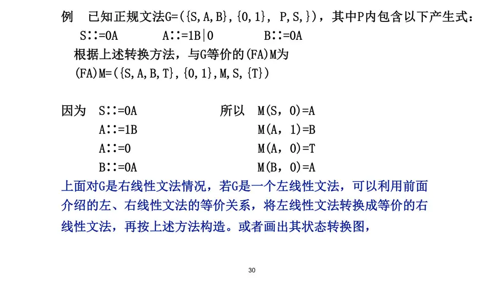

原文：

例 已知正规文法G=({S,A,B},{0,1}, P,S,})，其中P内包含以下产生式：$\mathrm { S } \colon \mathrel { \mathop { : } } = 0 \mathrm { A }$ $\mathtt { A } \because = 1 \mathtt { B } | 0$ B $: \because 0 \mathsf { A }$

根据上述转换方法，与G等价的(FA)M为(FA)M=({S,A,B,T},{0,1},M,S,{T})

上面对G是右线性文法情况，若G是一个左线性文法，可以利用前面介绍的左、右线性文法的等价关系，将左线性文法转换成等价的右线性文法，再按上述方法构造。或者画出其状态转换图，

30

### 3.由有穷自动机(FA)M构造正规文法(右线性文法）

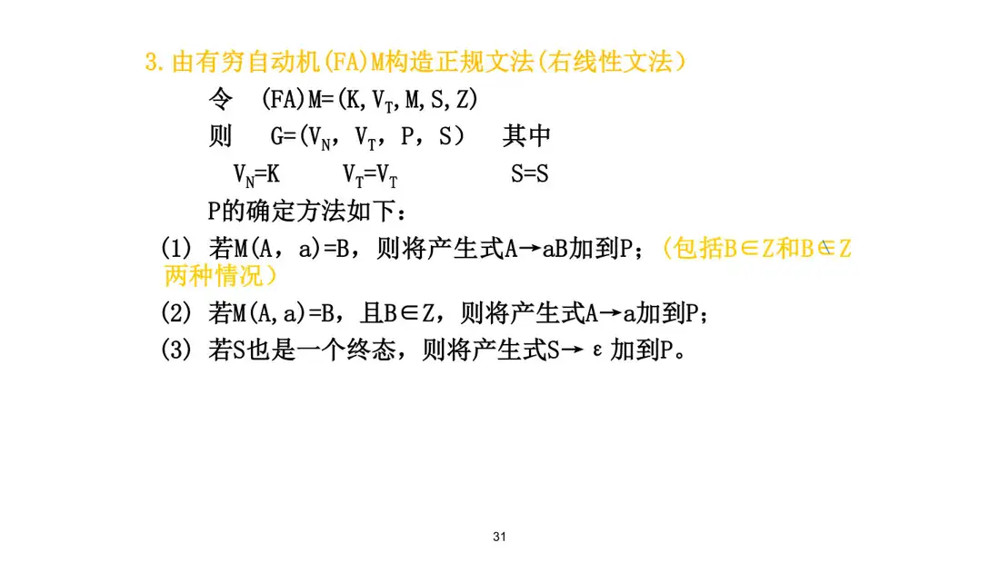

原文：

3.由有穷自动机(FA)M构造正规文法(右线性文法）

令 ( $\mathrm { F A } ) \mathrm { M } { = } ( \mathrm { K } , \mathrm { V } _ { \mathrm { T } } , \mathrm { M } , \mathrm { S } , \mathrm { Z } )$

则 $\mathrm { G = ( V } _ { \mathrm { N } } , ~ V _ { \mathrm { T } } , ~ P ,$ S） 其中

$$
\mathbf {V} _ {\mathrm{N}} = \mathbf {K} \quad \mathbf {V} _ {\mathrm{T}} = \mathbf {V} _ {\mathrm{T}}
$$

P的确定方法如下：

(1) 若M(A，a)=B，则将产生式 $\mathtt { A } \mathtt { \Gamma } \mathtt { \Gamma } \mathtt { \Gamma } \mathtt { a } \mathtt { B }$ 加到P；(包括B∈Z和B∈Z两种情况）

(2) 若M $( \mathtt { A } , \mathtt { a } ) { = } \mathtt { B }$ ，且 $\mathrm { B } \in \mathrm { Z }$ ，则将产生式 $\mathtt { A \to a }$ 加到P；

(3) 若S也是一个终态，则将产生式S→ε加到P。

31

### 32

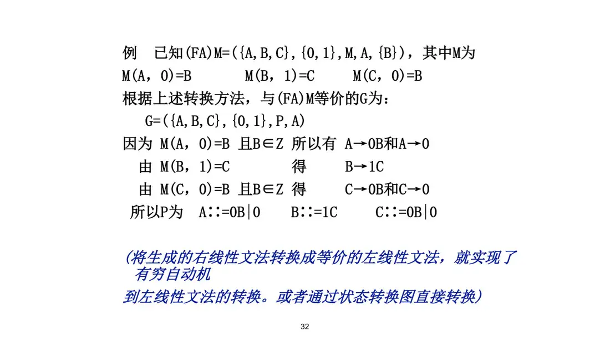

原文：

例 已知(FA)M=({A,B,C},{0,1},M,A,{B})，其中M为M(A，0)=B M(B，1)=C M(C，0)=B

根据上述转换方法，与(FA)M等价的G为：$\mathrm { G } { = } ( \left\{ \mathrm { A , B , C } \right\} , \left\{ 0 , 1 \right\} , \mathrm { P , A } )$ 因为 M(A，0)=B 且 $\mathrm { B } \in \mathrm { Z }$ 所以有 A→0B和A→0由 M(B，1)=C 得 B→1C由 M(C，0)=B 且 $\mathrm { B } \in \mathrm { Z }$ 得 C→0B和C→0所以P为 $\mathtt { A } \because = 0 \mathtt { B } | 0$ B $: : = 1 0$ $\mathrm { C } \because = 0 \mathrm { B } | 0$

(将生成的右线性文法转换成等价的左线性文法，就实现了有穷自动机到左线性文法的转换。或者通过状态转换图直接转换

32

### 作业：

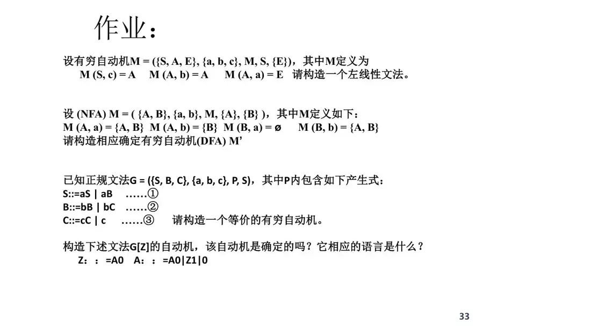

原文：

作业：

设有穷自动机 $\begin{array} { r } { [ \mathbf { M } = ( \{ \mathbf { S } , \mathbf { A } , \mathbf { E } \} , \{ \mathbf { a } , \mathbf { b } , \mathbf { c } \} , \mathbf { M } , \mathbf { S } , \{ \mathbf { E } \} ) } \end{array}$ ，其中M定义为$\begin{array} { r } { \mathbf { M _ { \delta } } ( \mathbf { S } , \mathbf { c } ) = \mathbf { A _ { \delta } } \quad \mathbf { M _ { \delta } } ( \mathbf { A } , \mathbf { b } ) = \mathbf { A _ { \delta } } \quad \mathbf { M _ { \delta } } ( \mathbf { A } , \mathbf { a } ) = \mathbf { E } } \end{array}$ 请构造一个左线性文法。

设 $\begin{array} { r } { \left( \mathrm { N F A } \right) \mathrm { M } = \left( \ \{ \mathrm { A } , \mathrm { B } \} , \{ \mathrm { a } , \mathrm { b } \} , \{ \mathrm { M } , \{ \mathrm { A } \} , \{ \mathrm { B } \} \ \right) \mathrm { ~ } } \end{array}$ ，其中M定义如下：$\mathrm { ~ \bf ~ M ~ } ( { \bf A } , { \bf a } ) = \{ { \bf A } , { \bf B } \} \mathrm { ~ \bf ~ M ~ } ( { \bf A } , { \bf b } ) = \{ { \bf B } \} \mathrm { ~ \bf ~ M ~ } ( { \bf B } , { \bf a } ) = \pmb { \varpi } \mathrm { ~ \bf ~ M ~ } ( { \bf B } , { \bf b } ) = \{ { \bf A } , { \bf B } \}$ 请构造相应确定有穷自动机(DFA) M’

已知正规文法 ${ \bf G } = ( \{ { \sf S } , { \sf B } , { \sf C } \} , \{ { \sf a } , { \sf b } , { \sf c } \} , { \sf P } , { \sf S } )$ ，其中P内包含如下产生式：S::=aS | aB ……①$\mathbf { B } { \boldsymbol { : } } { \boldsymbol { : } } { = } { \mathbf { b } } \mathbf { B } \mid \mathbf { b } \mathbf { C } \ldots ( 2 )$ $\mathsf { C } { : : = } \mathsf { c c } \mid \mathsf { c } \qquad \ldots \bigotimes$ 请构造一个等价的有穷自动机。

构造下述文法G[Z]的自动机，该自动机是确定的吗？它相应的语言是什么？

$$
Z: := A 0 \quad A: := A 0 | Z 1 | 0
$$

33

### 思考题：

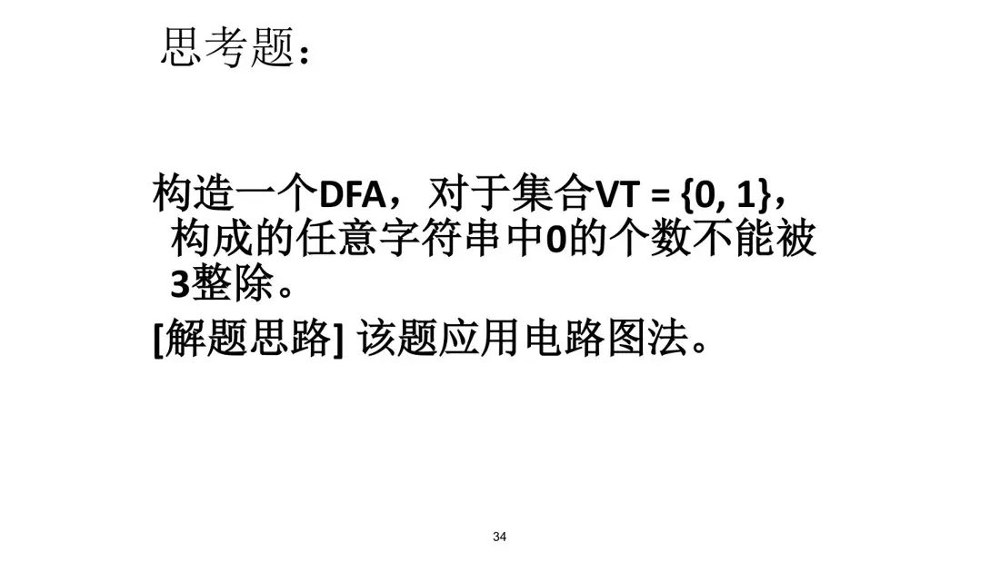

原文：

思考题：

构造一个DFA，对于集合 $\mathsf { V T } = \{ 0 , 1 \}$ 构成的任意字符串中0的个数不能被3整除。

[解题思路] 该题应用电路图法。

34
