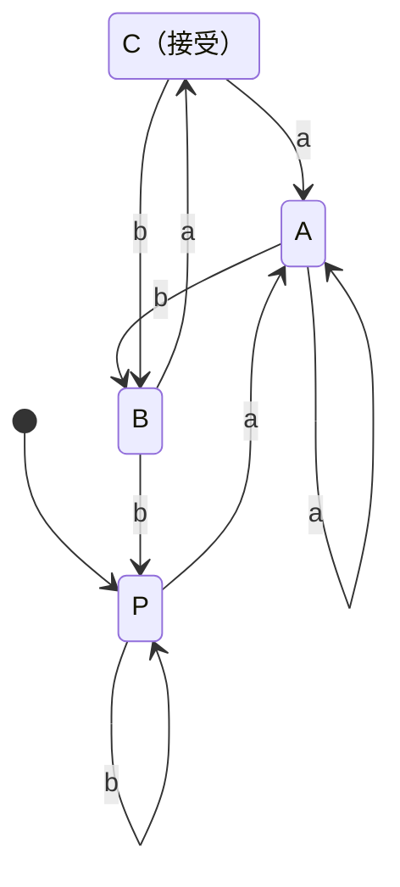

# 《编译原理》第3章 词法分析：有穷自动机（课件）

词法分析器不需要保留已经读过的所有字符，只须记住**会影响后续识别的历史信息**。什么时候一个状态就够，什么时候必须记一组候选状态？这正是 DFA 和 NFA 的差别。以下导读用新图与独立算例对照原件，页码沿用原课件。

## DFA：只记会影响下一步的信息（原件第 1–12 页）

把输入看成一次从左到右的读取：每次读一个字符，控制器依状态和字符确定下一状态。[有穷自动机](../../../topics/编译原理/有穷自动机.md)只在状态中保留摘要，不回头读取已消费字符。设状态集为 $K$，字母表为 $\Sigma$、初态为 $s$、接受状态集合为 $F$，DFA 的转移是单值函数 $\delta:K\times\Sigma\to K$。没有字符要读时状态不变，整个串读完才检查是否处于 $F$：

$$
\delta^*(q,\varepsilon)=q,\qquad
\delta^*(q,aw)=\delta^*(\delta(q,a),w),\qquad
L=\{w\in\Sigma^*:\delta^*(s,w)\in F\}.
$$

同一台 DFA 可用五元组、转移图、转移表描述。图上要标出初态入口与接受状态；表的行是状态、列是字符、单元格是后继，但表格还需明确初态和接受集合。**只知道转移，不知道从哪开始、在哪结束，不能判定语言。** 若使用严格的全函数定义，图上省画的失败边应统一指向拒绝陷阱，陷阱对所有字符回到自己。

原件的四状态例子识别“曾经出现过相邻的两个相同字符”。一旦有见证，后面再读什么也不会抹掉这个事实，所以接受状态会吸收后续字符；还未见证时，只需区分前一个字符是什么，空输入还没有前一个字符。这和“==末尾必须匹配某模式==”不同：后一种性质会随继续读取而丢失，接受状态不能一律做成自环。

## NFA：保存仍然可能成功的分支（第 13–20 页）

一个状态遇到同一个字符可以有零、一个或多个后继，于是转移值是集合，初态也可写成集合 $S$。将原件的无空边模型扩展到已经读入的整段输入时，不必猜单条路径：维护能到达的所有状态，读字符就合并它们的后继。

$$
Q_\varepsilon=S,\qquad
Q_{wa}=\bigcup_{q\in Q_w}\delta(q,a).
$$

在有 $k$ 个状态的自动机中，给定一个状态和一个输入字符，各状态独立选择是否加入后继集合，共 $2^k$ 种集合可能；这不是说一次必须走 $2^k$ 条边。最后只要 $Q_w\cap F\ne\varnothing$ 就接受。第 15–19 页的两个检测分支分别判断两个相邻的 0 或两个相邻的 1；一支走到死路，不影响另一支最终接受。用上式复算，原件的 `10010` 读完仍有三个候选，其中一个是接受态，所以整串接受。允许空边的扩展模型需在开始及每次消耗字符后取空边闭包；不要把空边误当成输入中真的有一个 $\varepsilon$ 字符。

> [!WARNING]
> ==存在一条完整接受路径==，不等于每条路径都成功，也不等于曾经进入过接受状态。已经成功的分支若还必须读字符却没有出边，它不能为完整输入作证。

## 用子集造出 DFA（第 21–27 页）

把 $Q_w$ 整组命名为 DFA 的一个状态，字符转移仍按上式计算。这样，无论有多少条 NFA 路径，DFA 在每一步只有一个确定的集合状态。等价性的理由不在于“状态名字改了”，而在于归纳不变量：任意前缀读完时，此集合恰好记录原 NFA 在该前缀后的全部可能状态。初始取 S，接受看与 F 是否相交。参见 [DFA 与 NFA 的等价转换](../../../topics/编译原理/DFA与NFA等价转换.md)。

从初态集合出发，只为新发现的可达子集建行，最多 $2^k$ 行。空集若不可达可以不列；若可达，又要求全函数，就必须保留它作为陷阱。原件第 23–26 页的两状态 NFA 中，先读 `b` 再读 `a` 会到空集，所以完整 DFA 有四个可达集合，原课件省略的是失败行，而非第四个集合在数学上不可达。第 27 页则展示如何随构造发现新集合：开始集合出发可形成两个非单元素集合，其中包含原接受态的一个也要标成接受，不能只在单元素集合中寻找接受态。

### 独立算例：只认以 `aba` 结束的串

令 NFA 从 `q0` 开始，`q0` 在 `a`、`b` 上自环；读到 `a` 还可从 `q0` 出发到 `q1`，猜测从这里开始匹配末尾。再走 `q1 --b--> q2 --a--> q3`，只把 `q3` 标为接受，且不再从它引出边。于是最后一个匹配位置必须恰好碰上输入末尾。

| DFA 状态 | 所含 NFA 状态 | 读 `a` | 读 `b` | 接受 |
|---|---|---|---|---|
| `P`（初态） | `q0` | `A` | `P` | 否 |
| `A` | `q0,q1` | `A` | `B` | 否 |
| `B` | `q0,q2` | `C` | `P` | 否 |
| `C` | `q0,q1,q3` | `A` | `B` | 是 |

图中的 `C` 是唯一接受态。对 `ababa`，读到第三个字符时已到 `C`，最后两个字符还能从 `B` 回到 `C`；共享的中间 `a` 既是第一次匹配的末尾，又可以是第二次的开头。若输入改为 `abab`，最后只到 `B`。两串都曾经过 `C`，最终只有前者满足“以它结束”。如果题目改成“曾出现过 `aba`”，则要额外保留这个历史事实，不可沿用同一接受判定。

## 状态图与正规文法怎么互写（第 28–32 页）

[正规文法与自动机转换](../../../topics/编译原理/正规文法与自动机转换.md)的关键是同一步究竟做了什么：右线性产生式 $A\to aB$ 表示先输出 $a$、再从 $B$ 继续，对应转移 $A\xrightarrow{a}B$；$A\to a$ 表示读完 $a$ 即可停止，可连到专用接受状态；若允许 $A\to\varepsilon$，$A$ 本身就是接受态。原件的构造只显式处理开始符号的空产生式，这条推广说明了为什么要处理“非初态也能在不读字时结束”。

反向由自动机写右线性文法：每条带字符的边 $A\xrightarrow{a}B$ 给 $A\to aB$；每个接受态加空产生式即可在该处结束。原课件采用另一种等价写法：所有边照常保留，对落在接受态的边再加 $A\to a$；若初态就是接受态，还补开始符号的空产生式。不能只保留停下的规则，否则会丢掉穿过接受态再继续的字符串。

同理需要左线性时，可令带字符的边 $A\xrightarrow{a}B$ 给 $B\to Aa$，把原初态转成可生成空串的非终结符，从原接受态对应的非终结符开始推导（若有多个，另设开始符号分支）。选择顺序是从终点回溯，但每步将字符接到剩余非终结符右侧，因此最终串仍是原路径的**正向字符顺序**，不是原语言的反转。参见 [正规文法与状态图](../../../topics/编译原理/正规文法与状态图.md)。

## 参考解答：原件末两页自检（第 33–34 页）

| 题目定位 | 参考推导与验证 |
|---|---|
| 第 33 页第 1 题：状态图转左线性文法 | 从唯一终点对应符号 `E` 开始，`E → A a`、`A → A b \| S c`、`S → ε`。每次展开 `A → A b` 多出一个 `b`，所以语言是 `cb*a`；`ca` 也要接受。 |
| 第 33 页第 2 题：二状态 NFA 确定化 | 记 `P={A}`、`Q={B}`、`R={A,B}`、`D=∅`。按 `a,b` 的列顺序，各行后继为 `P:(R,Q)`、`Q:(D,R)`、`R:(R,R)`、`D:(D,D)`；初态 P，接受 Q、R。可用 `ba` 单独验陷阱是否真的可达。 |
| 第 33 页第 3 题：右线性文法转自动机 | 从 S 读至少一个 `a`，可以继续留在 S，或转到 B；在 B 读至少一个 `b` 并作同样选择，到 C 后读至少一个 `c` 才能经规则进入专用终态。因此语言是 `a+b+c+`，不是允许某段为空。 |
| 第 33 页第 4 题：左线性文法构造并判定性质 | 增设初态 I，设接受态 Z。边为 `I --0--> A`、`A --0--> A`、`A --0--> Z`、`Z --1--> A`，所以所得自动机非确定。到 A 后可反复走标记为 `0` 或 `01` 的回路，最后用一个 `0` 到 Z，语言为 `0(0\|01)*0`。这不妨碍另用子集法构造等价 DFA。 |
| 第 34 页：0 的个数不能被 3 整除 | 只记当前 0 个数对 3 取模的余数。初态余 0；读 `0` 时按 0→1→2→0 循环，读 `1` 时状态不变；余 1、余 2 为接受。空串与全由 `1` 构成的串都拒绝，因为 0 本身能被 3 整除。 |

> [!TIP]
> 看到“次数能否被固定整数整除”，先尝试让状态表示**余数**；看到“是否曾出现”和“末尾是否为”，先用“已匹配后再追加一个不合条件的字符”区分它们。能说出状态到底记着什么，比先画圈连线更容易验对。
