# 《编译原理》第3章 词法分析：正规表达式（课件）

原件的每一页，下面附识别出的文字。

### 编译原理

原文：

编译原理

南京郵電大學 Nanjing University of Posts and Telecommunications aand

### 第三章 词法分析

原文：

第三章 词法分析

◼正规表达式（正则表达式）

正规表达式广泛应用于模式识别和文献目录检索等

2

### 正规表达式的定义

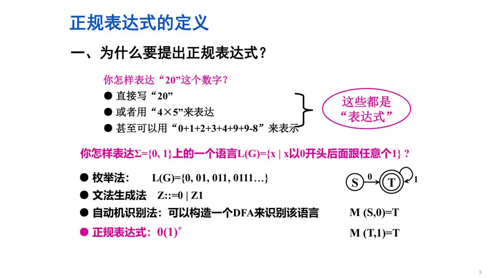

原文：

正规表达式的定义

一、为什么要提出正规表达式？

你怎样表达“20”这个数字？

● 直接写 ${ } ^ { 6 6 } 2 \mathbf { 0 } ^ { 9 9 }$

● 或者用“4×5”来表达

● 甚至可以用 $^ { 6 6 } 0 + 1 + 2 + 3 + 4 + 9 + 9 - 8 ^ { 3 9 }$ 来表示

这些都是“表达式”

你怎样表达Σ={0, 1}上的一个语言L(G)={x | x以0开头后面跟任意个1} ?

● 枚举法： $\operatorname { L } ( \mathbf { G } ) { = } \{ \mathbf { 0 } , \mathbf { 0 } 1 , \mathbf { 0 } 1 1 , \mathbf { 0 } 1 1 1 { \ldots } \}$

● 文法生成法 $\mathbf { Z } { \boldsymbol { : } } { \boldsymbol { : } } { = } \mathbf { 0 } ~ | ~ \mathbf { Z 1 }$

● 自动机识别法：可以构造一个DFA来识别该语言

$$
\mathbf {M} (\mathbf {S}, \mathbf {0}) = \mathbf {T}
$$

● 正规表达式： $0 ( 1 ) ^ { * }$

$$
\mathbf {M} (\mathbf {T}, \mathbf {1}) = \mathbf {T}
$$

3

### 正规表达式的定义

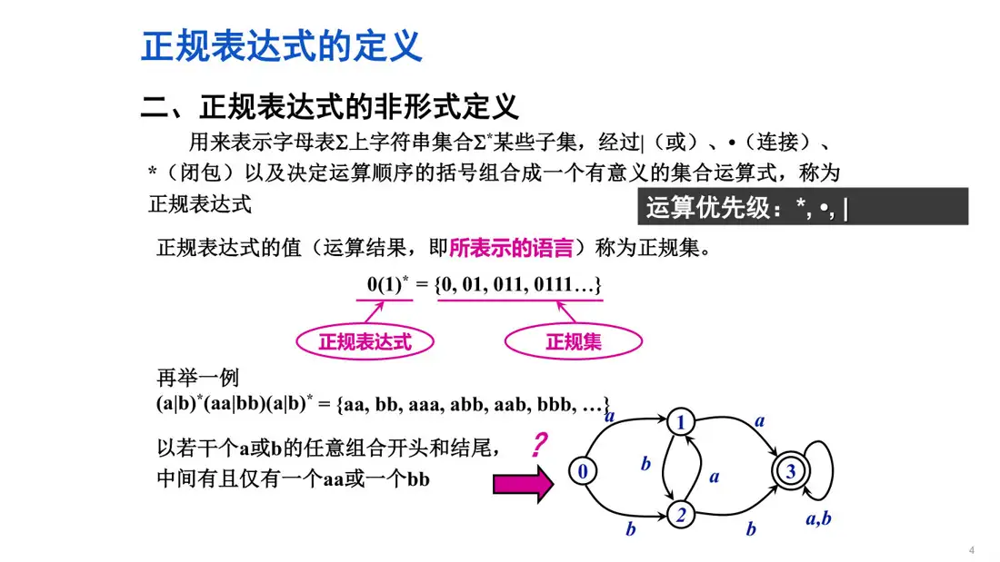

原文：

正规表达式的定义

二、正规表达式的非形式定义

用来表示字母表Σ上字符串集合Σ\*某些子集，经过（或）、·（连接）、\*（闭包）以及决定运算顺序的括号组合成一个有意义的集合运算式，称为

运算优先级：\*, •, |

正规表达式的值（运算结果，即所表示的语言）称为正规集。

再举一例

(a|b)\*(aa|bb)(a|b)\* = {aa, bb, aaa, abb, aab, bbb, …}

以若干个a或b的任意组合开头和结尾，

中间有且仅有一个aa或一个bb

4

### 正规表达式的定义

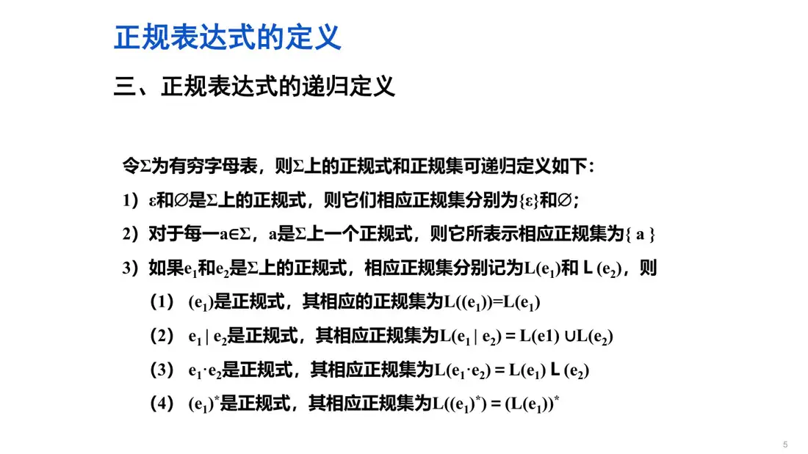

原文：

正规表达式的定义

三、正规表达式的递归定义

令Σ为有穷字母表，则Σ上的正规式和正规集可递归定义如下：

1）ε和是Σ上的正规式，则它们相应正规集分别为 $\{ \mathfrak { c } \}$ 和 $\bigtriangledown$ ；

2）对于每 $- \mathbf { a } \in \Sigma$ ，a是Σ上一个正规式，则它所表示相应正规集为{ a }

3）如果 ${ \bf \delta _ { 1 } }$ 和 $| \mathbf { e } _ { 2 } |$ 是Σ上的正规式，相应正规集分别记为L $\mathbf { \nabla } _ { \mathfrak { A } } ( \mathbf { e } _ { 1 } )$ )和 $\mathsf { L } \left( \mathbf { e } _ { 2 } \right)$ ，则

（1） $( \mathbf { e _ { 1 } } )$ 是正规式，其相应的正规集为 $\scriptstyle \mathbf { L } ( ( \mathbf { e } _ { 1 } ) ) = \mathbf { L } ( \mathbf { e } _ { 1 } )$

（2） $\mathbf { e _ { 1 } } | \mathbf { e } _ { 2 } $ 是正规式，其相应正规集为 $\operatorname { L } ( \mathbf { e } _ { 1 } | \ \mathbf { e } _ { 2 } ) = \operatorname { L } ( \mathbf { e } \mathbf { 1 } ) \ \cup \mathbf { L } ( \mathbf { e } _ { 2 } )$

（3） $\mathbf { e _ { 1 } } { \cdot } \mathbf { e _ { 2 } }$ 是正规式，其相应正规集为 $\operatorname { L } ( \mathbf { e } _ { 1 } { \cdot } \mathbf { e } _ { 2 } ) = \operatorname { L } ( \mathbf { e } _ { 1 } ) \operatorname { L } ( \mathbf { e } _ { 2 } )$

（4） $\bf ( e _ { 1 } ) ^ { : \cdot }$ \*是正规式，其相应正规集为 $\mathrm { L } ( ( \mathbf { e _ { 1 } } ) ^ { * } ) = \left( \mathrm { L } ( \mathbf { e _ { 1 } } ) \right) ^ { * }$

5

### 正规表达式的定义

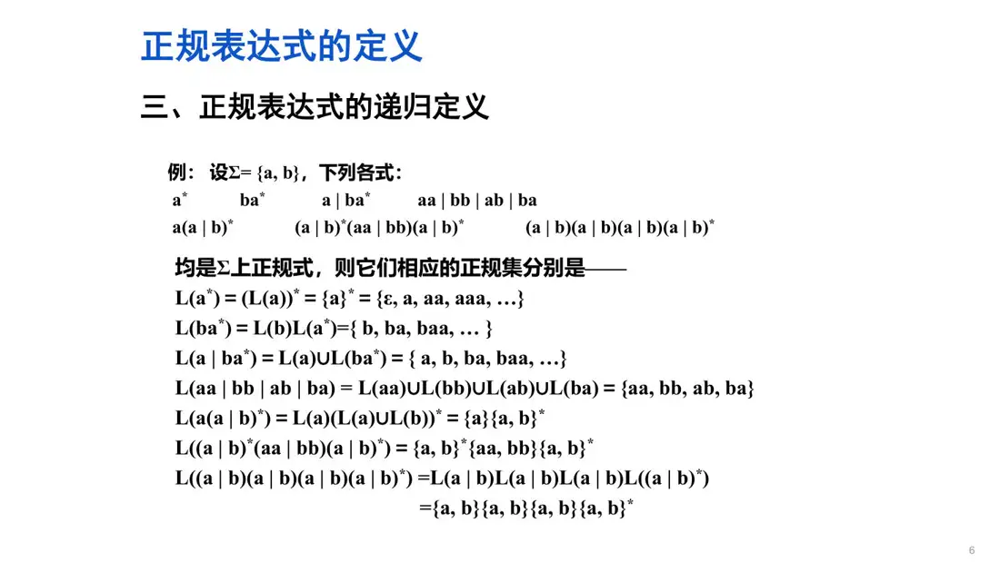

原文：

正规表达式的定义

三、正规表达式的递归定义

例： 设 $\boldsymbol { \Sigma } \mathbf { = } \left\{ \mathbf { a } , \mathbf { b } \right\}$ ，下列各式：a ba\* a | ba\* aa | bb | ab | ba$\mathbf { a ( a \mid b ) } ^ { * }$ (a $\mid \mathbf { b } ) ^ { * } ( \mathbf { a } \mathbf { a } \mid \mathbf { b } \mathbf { b } ) ( \mathbf { a } \mid \mathbf { b } ) ^ { * }$ (a ${ \left| \textbf { b } \right. } ( \mathbf { a } \mid \mathbf { b } ) ( \mathbf { a } \mid \mathbf { b } ) ( \mathbf { a } \mid \mathbf { b } ) ^ { * }$

均是Σ上正规式，则它们相应的正规集分别是—

6

### 求解 L(e1)和L(e2)

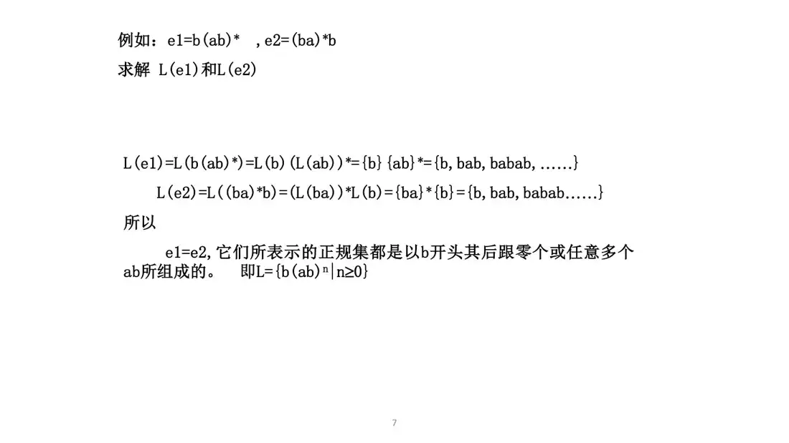

原文：

例如： $\mathrm { { e 1 } = \mathrm { { b } \left( a b \right) ^ { * } , \ e 2 = \left( b a \right) ^ { * } b } }$

求解 L(e1)和L(e2)

$$
\mathrm{L} (\mathrm{e} 1) = \mathrm{L} (\mathrm{b} (\mathrm{ab}) ^ {*}) = \mathrm{L} (\mathrm{b}) (\mathrm{L} (\mathrm{ab})) ^ {*} = \{\mathrm{b} \} \{\mathrm{ab} \} ^ {*} = \{\mathrm{b}, \mathrm{bab}, \mathrm{babab}, \dots \dots \}
$$

$$
L (e 2) = L ((b a) ^ {*} b) = (L (b a)) ^ {*} L (b) = \{b a \} ^ {*} \{b \} = \{b, b a b, b a b a b \dots \dots \}
$$

所以

$\mathsf { e l } = \mathsf { e 2 } ,$ ,它们所表示的正规集都是以b开头其后跟零个或任意多个ab所组成的。即 $\mathrm { L } { = } \left\{ \mathrm { b } \left( { \mathrm { a b } } \right) { \mathrm { n } } \left| { \mathrm { n } } { \geq } 0 \right. \right\}$

7

### 正规表达式的性质及其构造

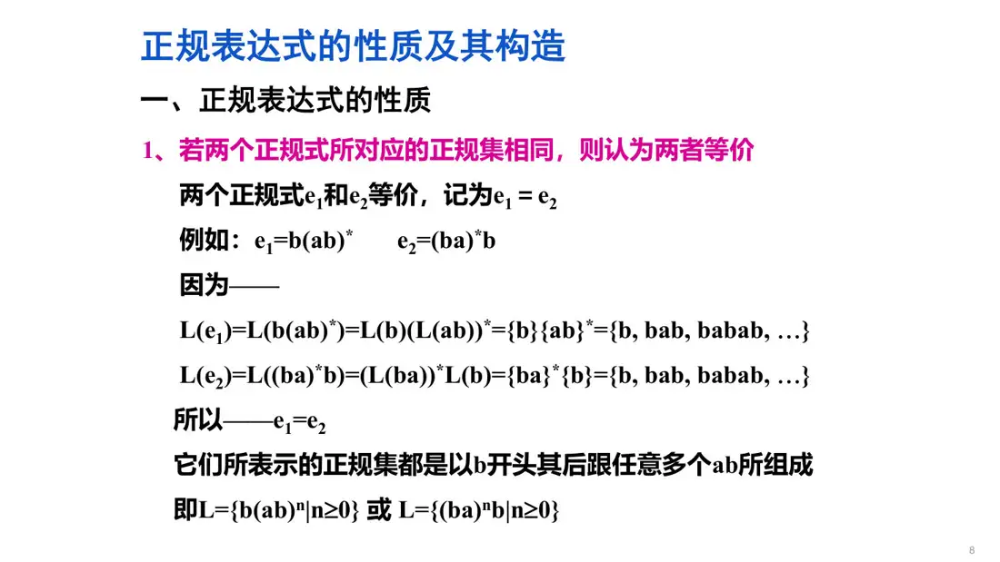

原文：

正规表达式的性质及其构造

一、正规表达式的性质

1、若两个正规式所对应的正规集相同，则认为两者等价 两个正规式 $\bf { ; e _ { 1 } }$ 和 $\vert \mathbf { e } _ { 2 }$ 等价，记为 $\mathbf { e } _ { 1 } = \mathbf { e } _ { 2 }$ 例如： $\begin{array} { r l r } { \mathbf { e } _ { 1 } { = } \mathbf { b } ( \mathbf { a b } ) ^ { * } } & { { } } & { \mathbf { e } _ { 2 } { = } ( \mathbf { b a } ) ^ { * } \mathbf { b } } \end{array}$ 因为— L(e )=L(b(ab)\*)=L(b)(L(ab))\*={b}{ab}\*={b, bab, babab, } L(e )=L((ba)\*b)=(L(ba))\*L(b)={ba}\*{b}={b, bab, babab, } 所以— $\mathbf { \cdot e _ { 1 } } { = } \mathbf { e } _ { 2 }$

它们所表示的正规集都是以b开头其后跟任意多个ab所组成即 $\scriptstyle \mathbf { L } = \left\{ \mathbf { b } ( \mathbf { a b } ) ^ { \mathbf { n } } | \mathbf { n } { \geq } \mathbf { 0 } \right\}$ 或 $\scriptstyle \mathbf { L } = \left\{ ( \mathbf { b } \mathbf { a } ) ^ { \mathbf { n } } \mathbf { b } | \mathbf { n } { \geq } \mathbf { 0 } \right\}$

8

### 正规表达式的性质及其构造

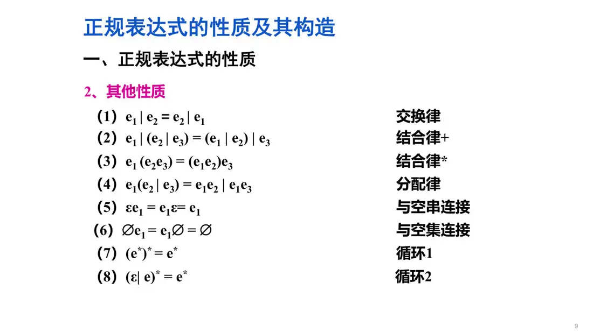

原文：

正规表达式的性质及其构造

一、正规表达式的性质

2、其他性质

（1） $\mathbf { e } _ { 1 } | \mathbf { e } _ { 2 } = \mathbf { e } _ { 2 } | \mathbf { e } _ { 1 }$

（2） $\mathbf { e } _ { 1 } \mid ( \mathbf { e } _ { 2 } \mid \mathbf { e } _ { 3 } ) = ( \mathbf { e } _ { 1 } \mid \mathbf { e } _ { 2 } ) \mid \mathbf { e } _ { 3 }$

（3） $\mathbf { e } _ { 1 } ( \mathbf { e } _ { 2 } \mathbf { e } _ { 3 } ) = ( \mathbf { e } _ { 1 } \mathbf { e } _ { 2 } ) \mathbf { e } _ { 3 }$

（4） $\mathbf { e } _ { 1 } ( \mathbf { e } _ { 2 } \mid \mathbf { e } _ { 3 } ) = \mathbf { e } _ { 1 } \mathbf { e } _ { 2 } \mid \mathbf { e } _ { 1 } \mathbf { e } _ { 3 }$

（5） $\bf \delta t e _ { 1 } = e _ { 1 } \varepsilon = e _ { 1 }$

（6） $\mathcal { O } \mathbf { e } _ { 1 } = \mathbf { e } _ { 1 } \mathcal { O } = \mathcal { O }$

（7） $( \mathbf { e } ^ { * } ) ^ { * } = \mathbf { e } ^ { * }$

（8） $( \mathbf { \vec { \varepsilon } } | \mathbf { \sigma } \mathbf { e } ) ^ { * } = \mathbf { \vec { e } } ^ { * }$

交换律

结合律+

结合律\*

分配律

与空串连接

与空集连接

循环1

循环2

9

### 正规表达式的性质及其构造

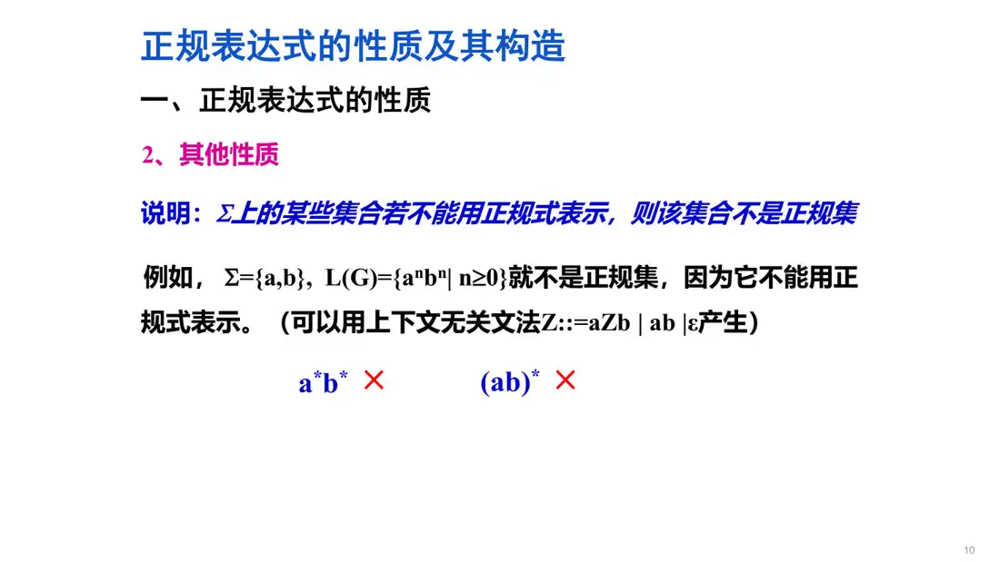

原文：

正规表达式的性质及其构造

一、正规表达式的性质

2、其他性质

说明：上的某些集合若不能用正规式表示 则该集合不是正规集例如， $\Sigma { = } \{ \mathbf { a } , \mathbf { b } \} , \ \mathrm { L } ( \mathbf { G } ) { = } \{ \mathbf { a } ^ { \mathrm { n } } \mathbf { b } ^ { \mathrm { n } } | \ \mathbf { n } { \geq } \mathbf { 0 } \}$ 就不是正规集，因为它不能用正规式表示。（可以用上下文无关文法 $\mathbf { Z } { \boldsymbol { : } } { \boldsymbol { : } } = \mathbf { a } \mathbf { Z } \mathbf { b } \mid \mathbf { a } \mathbf { b } \mid \mathbf { { \boldsymbol { \varepsilon } } }$ 产生）

$$
\mathbf {a} ^ {*} \mathbf {b} ^ {*} \times
$$

$$
(\mathbf {a b}) ^ {*} \times
$$

10

### 正规表达式的性质及其构造

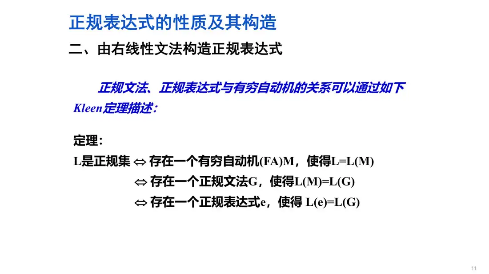

原文：

正规表达式的性质及其构造

二、由右线性文法构造正规表达式

正规文法、正规表达式与有穷自动机的关系可以通过如下$K l e e n$ 定理描述：

定理：

L是正规集  存在一个有穷自动机(FA)M，使得 $\mathbf { L } { = } \mathbf { L } ( \mathbf { M } )$

存在一个正规文法G，使得 $\scriptstyle \mathbf { L } ( \mathbf { M } ) = \mathbf { L } ( \mathbf { G } )$

 存在一个正规表达式e，使得 $\scriptstyle \mathbf { L } ( \mathbf { e } ) = \mathbf { L } ( \mathbf { G } )$

11

### 正规表达式的性质及其构造

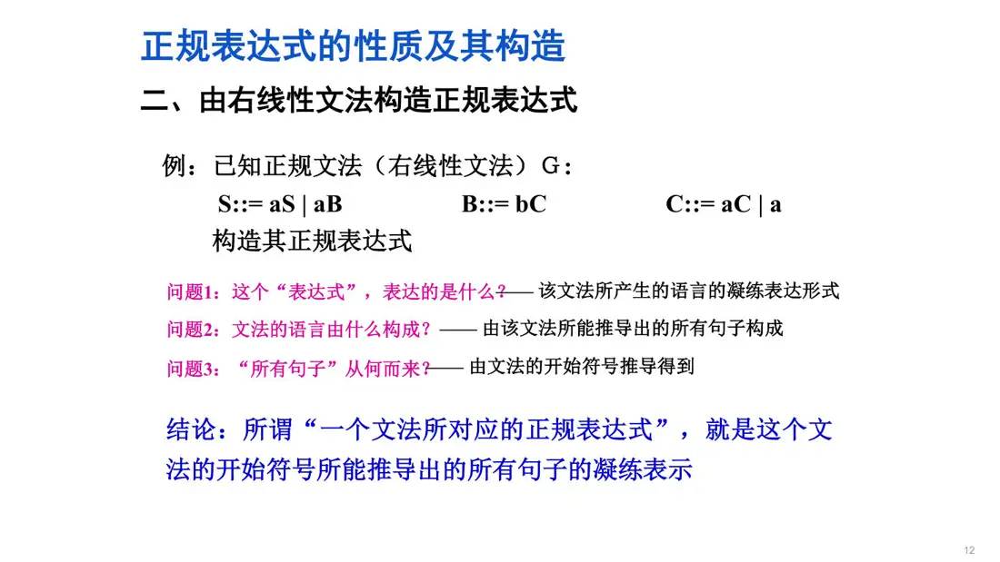

原文：

正规表达式的性质及其构造

二、由右线性文法构造正规表达式

例：已知正规文法（右线性文法） $\mathbf { G }$ :

$$
\mathbf {S}: := \mathbf {a S} \mid \mathbf {a B}
$$

$$
\mathbf {B}: := \mathbf {b C}
$$

$$
\mathbf {C}: := \mathbf {a C} \mid \mathbf {a}
$$

构造其正规表达式

问题1：这个“表达式”，表达的是什么？——该文法所产生的语言的凝练表达形式

问题2：文法的语言由什么构成？——由该文法所能推导出的所有句子构成

问题3：“所有句子”从何而来？——由文法的开始符号推导得到

结论：所谓“一个文法所对应的正规表达式”，就是这个文法的开始符号所能推导出的所有句子的凝练表示

12

### 正规表达式的性质及其构造

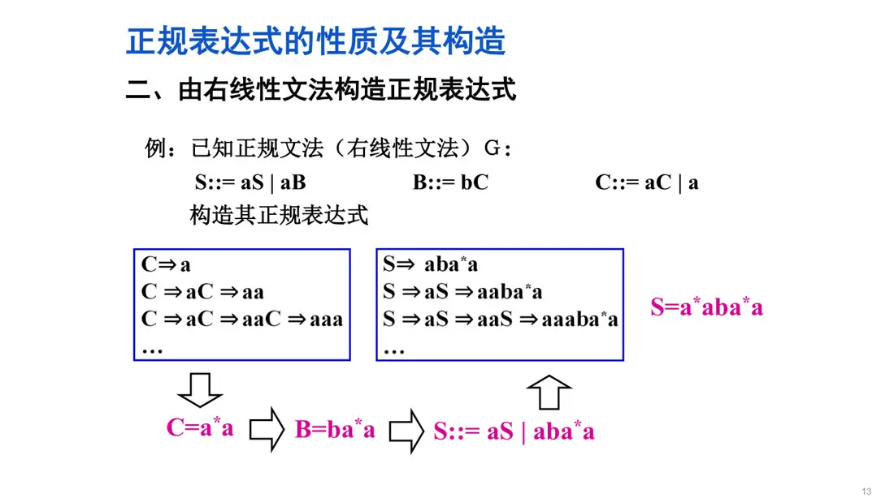

原文：

正规表达式的性质及其构造

二、由右线性文法构造正规表达式

例：已知正规文法（右线性文法） $\mathbf { G }$ :

$$
\mathbf {S}: := \mathbf {a S} \mid \mathbf {a B}
$$

$$
\mathbf {B}: := \mathbf {b C}
$$

$$
\mathbf {C}: := \mathbf {a C} \mid \mathbf {a}
$$

构造其正规表达式

$$
\begin{array}{l} \hline \mathrm{C} \Rightarrow \mathrm{a} \\ \mathrm{C} \Rightarrow \mathrm{aC} \Rightarrow \mathrm{aa} \\ \mathrm{C} \Rightarrow \mathrm{aC} \Rightarrow \mathrm{aaC} \Rightarrow \mathrm{aaa} \\ \dots \\ \hline \end{array}
$$

$$
\begin{array}{l} \hline \mathrm {S\Rightarrow aba^ {*} a} \\ \mathrm {S\Rightarrow aS\Rightarrow aaba^ {*} a} \\ \mathrm {S\Rightarrow aS\Rightarrow aaS\Rightarrow aaaba^ {*} a} \\ \dots \end{array}
$$

$$
\mathrm{S} = \mathrm{a} ^ {*} \mathrm{aba} ^ {*} \mathrm{a}
$$

C=a\*a B=ba\*a S::= aS | aba\*a

13

### 正规表达式的性质及其构造

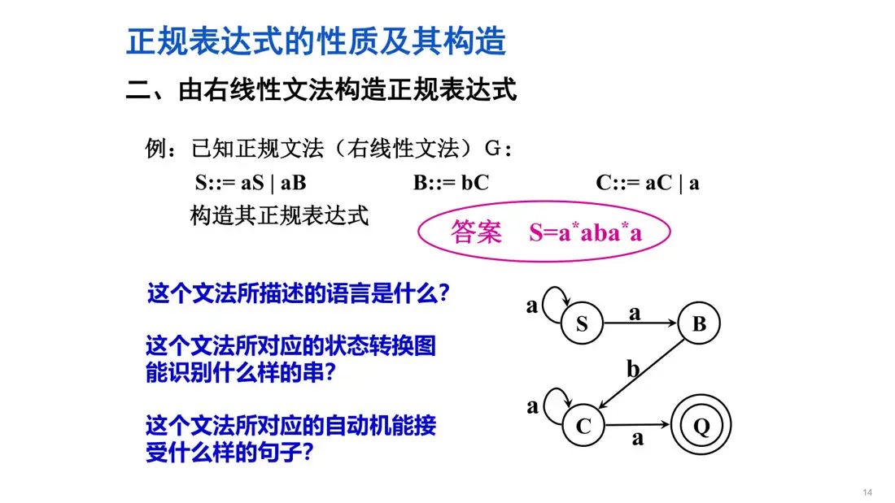

原文：

正规表达式的性质及其构造

二、由右线性文法构造正规表达式

例：已知正规文法（右线性文法）G:

$$
\mathbf {S}: := \mathbf {a S} \mid \mathbf {a B}
$$

$$
\mathbf {B}: := \mathbf {b C}
$$

构造其正规表达式

$$
\mathbf {C}: := \mathbf {a C} \mid \mathbf {a}
$$

答案 $\mathbf { S } { = } \mathbf { a } ^ { * } { \mathbf { a b } } { \mathbf { a } } ^ { * } { \mathbf { a } }$

这个文法所描述的语言是什么？

这个文法所对应的状态转换图能识别什么样的串？

这个文法所对应的自动机能接受什么样的句子？

14

### 二、由右线性文法构造正规表达式（通用解法）

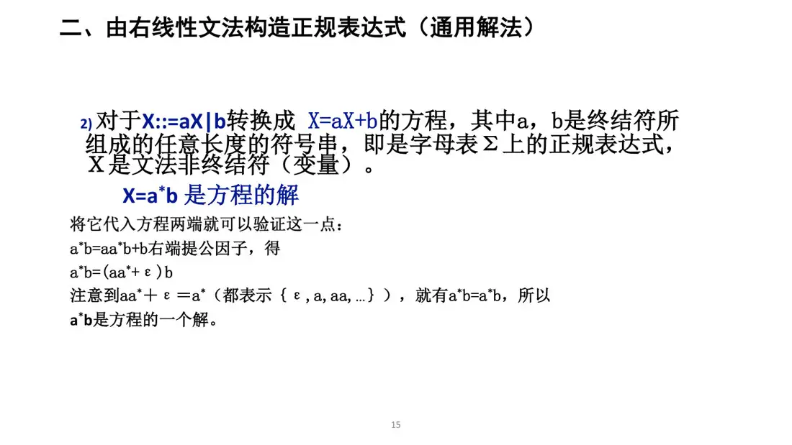

原文：

二、由右线性文法构造正规表达式（通用解法）

2) 对于 $x : = a \times 1 6$ 转换成 $\mathtt { X } { = } \mathtt { a X } { + } \mathtt { b }$ 的方程，其中a，b是终结符所组成的任意长度的符号串，即是字母表 $\Sigma$ 上的正规表达式，X是文法非终结符（变量）。

$x = a ^ { 4 } b$ 是方程的解

将它代入方程两端就可以验证这一点：

$a ^ { * } b = a a ^ { * } b + b$ 右端提公因子，得

$$
a ^ {*} b = (a a ^ {*} + \varepsilon) b
$$

注意到 $\mathrm { \tt { a a } } ^ { * } + \mathrm { \tt { e } } = \mathrm { \tt { a } } ^ { * }$ （都表示 $\{ \texttt { \small e } , \mathrm { a } , \mathrm { a a } , \ldots \} \ )$ ，就有 $\partial ^ { * } \mathbf { b } = _ { \mathbf { a } } + \mathbf { b }$ ，所以$\exists ^ { * } b$ 是方程的一个解。

15

### 例：已知正规文法（右线性文法）G：

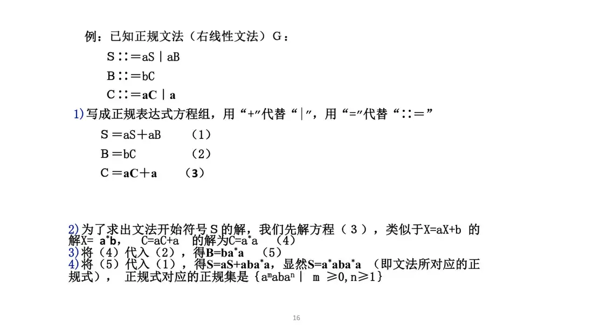

原文：

例：已知正规文法（右线性文法）G：

$$
\mathbf {C}: := \mathbf {a C} \mid \mathbf {a}
$$

1)写成正规表达式方程组，用 $^ { 6 6 } + \prime \prime .$ 代替“|”，用 $^ { 6 6 } = \prime \prime ,$ 代替 $\cdots = { } ^ { \mathfrak { s } }$

$$
\mathrm{S} = \mathrm{aS} + \mathrm{aB}\tag{1}
$$

$$
\mathbf {B} = \mathbf {b C}\tag{2}
$$

$$
\mathbf {C} = \mathbf {a C} + \mathbf {a}\tag{3}
$$

X= a+b,

C=aC+a

C=a\*a

X=aX+b

B=ba\*a

2)为了求出文法开始符号S的解，我们先解方程（3），类似于X=aX+b 的解X= a\*b， C=aC+a的解为 （4）

4)将（5）代入（1），得S=aS+aba\*a，显然S=a\*aba\*a （即文法所对应的正 S=aS+aba\*a S=a\*aba\*a规式）， 正规式对应的正规集是｛amaban｜ m ≥0,n≥1｝ {amabaⁿ|m ≥0,n≥1}

3)将（4）代入（2），得B=ba\*a （5）

16

### 三、由左线性文法构造正规表达式

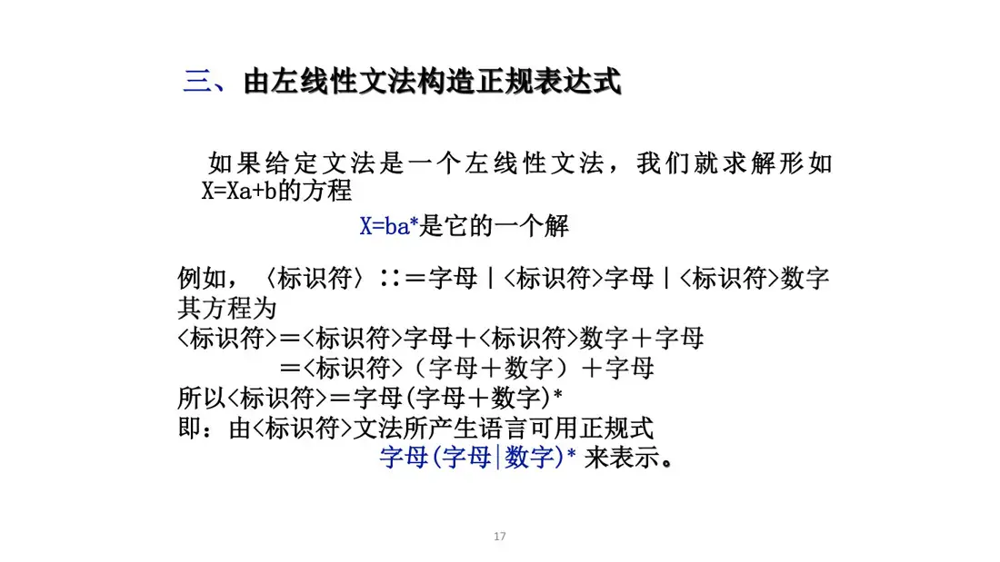

原文：

三、由左线性文法构造正规表达式

如果给定文法是一个左线性文法，我们就求解形如${ \tt X } { = } { \tt X } { \tt a } { + } { \tt b }$ 的方程

$$
\mathrm{X} = \mathrm{ba} ^ {*} \text {是它的一个解}
$$

例如，〈标识符〉∷＝字母｜<标识符>字母｜<标识符>数字其方程为

$$
\begin{array}{r l} \langle \text {标识符} \rangle & = \langle \text {标识符} \rangle \text {字母} + \langle \text {标识符} \rangle \text {数字} + \text {字母} \\ & = \langle \text {标识符} \rangle (\text {字母} + \text {数字}) + \text {字母} \end{array}
$$

$$
\text {所以<   标识符 > = 字母(字母 + 数字) *}
$$

即：由<标识符>文法所产生语言可用正规式字母(字母|数字)\* 来表示。

17
