# 《编译原理》第4章 LR分析法（课件）

原件的每一页，下面附识别出的文字。

### 编译原理

原文：

编译原理

第四章

南京郵電大學 Nanjing University of Posts and Telecommunications aand

### 已知文法G[S]:

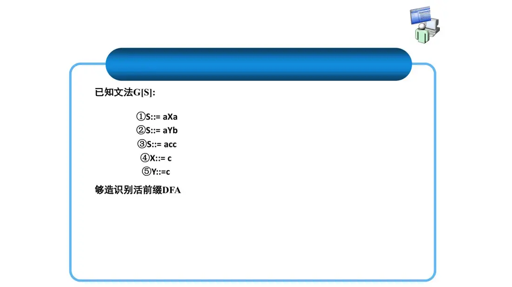

原文：

已知文法G[S]:

$$
① S: := a X a
$$

$$
② S: := a Y b
$$

$$
③ \mathbf {S}: := \mathbf {a c c}
$$

$$
④ \mathbf {X}: := \mathbf {c}
$$

$$
⑤ \mathbf {Y}: := \mathbf {c}
$$

够造识别活前缀DFA

### $$

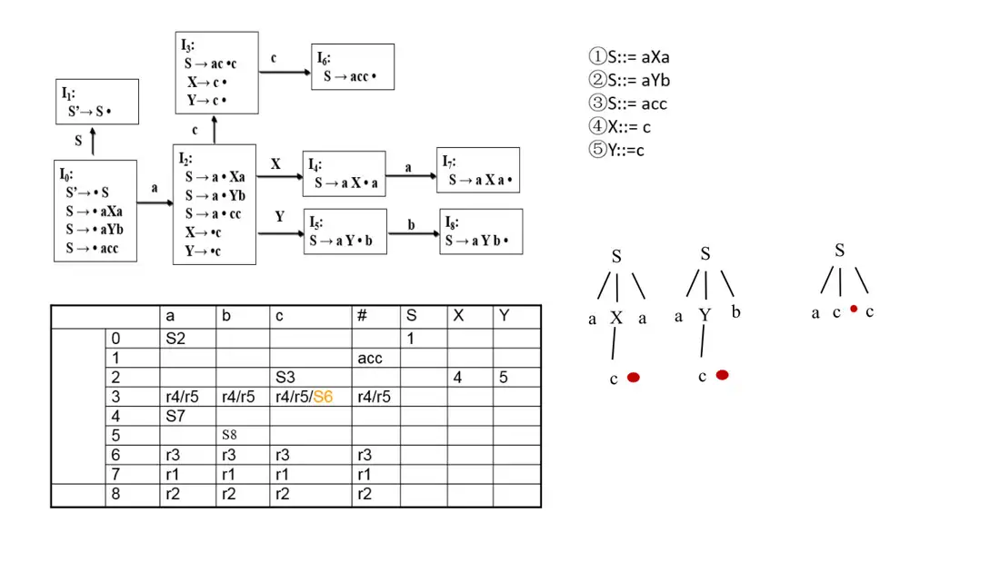

原文：

<table><tr><td colspan="2"></td><td>a</td><td>b</td><td>c</td><td>#</td><td>S</td><td>X</td><td>Y</td></tr><tr><td rowspan="8"></td><td>0</td><td>S2</td><td></td><td></td><td></td><td>1</td><td></td><td></td></tr><tr><td>1</td><td></td><td></td><td></td><td>acc</td><td></td><td></td><td></td></tr><tr><td>2</td><td></td><td></td><td>S3</td><td></td><td></td><td>4</td><td>5</td></tr><tr><td>3</td><td>r4/r5</td><td>r4/r5</td><td>r4/r5/S6</td><td>r4/r5</td><td></td><td></td><td></td></tr><tr><td>4</td><td>S7</td><td></td><td></td><td></td><td></td><td></td><td></td></tr><tr><td>5</td><td></td><td>S8</td><td></td><td></td><td></td><td></td><td></td></tr><tr><td>6</td><td>r3</td><td>r3</td><td>r3</td><td>r3</td><td></td><td></td><td></td></tr><tr><td>7</td><td>r1</td><td>r1</td><td>r1</td><td>r1</td><td></td><td></td><td></td></tr><tr><td></td><td>8</td><td>r2</td><td>r2</td><td>r2</td><td>r2</td><td></td><td></td><td></td></tr></table>

$$
\begin{array}{l} \text {①S:: = aXa} \\ \text {②S:: = aYb} \\ \text {③S:: = acc} \\ \text {④X:: = c} \\ \text {⑤Y:: = c} \end{array}
$$

$$
\begin{array}{c c c} \text {S} & \text {S} \\ / | \backslash \\ a X a & a Y b \\ | & | \\ c \bullet & c \bullet \end{array} \qquad \begin{array}{c c c} \text {S} & \text {S} \\ / | \backslash \\ a c \bullet c \\ | & | \\ c \bullet & c \bullet \end{array}
$$

### 4. SLR(1)分析表构造

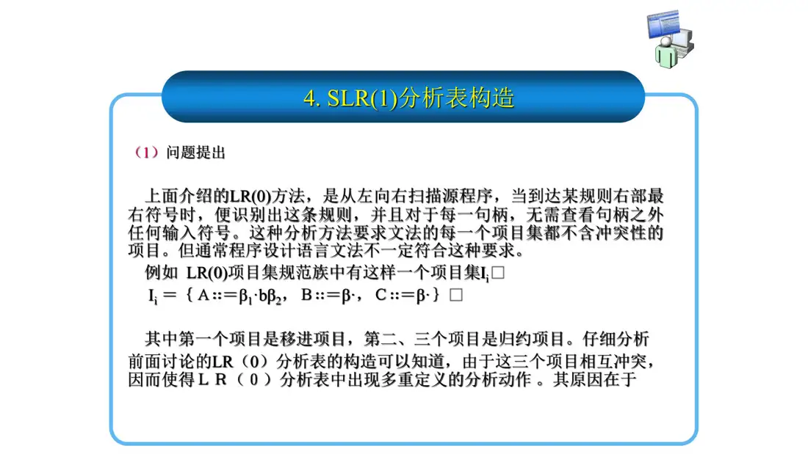

原文：

4. SLR(1)分析表构造

（1）问题提出

上面介绍的LR(0)方法，是从左向右扫描源程序，当到达某规则右部最右符号时，便识别出这条规则，并且对于每一句柄，无需查看句柄之外任何输入符号。这种分析方法要求文法的每一个项目集都不含冲突性的项目。但通常程序设计语言文法不一定符合这种要求。

例如 LR(0)项目集规范族中有这样一个项目集I

$$
\mathrm{I} _ {\mathrm{i}} = \{\mathrm{A}: := \beta_ {1} \cdot \mathrm{b} \beta_ {2}, \quad \mathrm{B}: := \beta \cdot , \quad \mathrm{C}: := \beta \cdot \} \square
$$

其中第一个项目是移进项目，第二、三个项目是归约项目。仔细分析前面讨论的LR（0）分析表的构造可以知道，由于这三个项目相互冲突，因而使得LR（0）分析表中出现多重定义的分析动作。其原因在于

### 第 5 页

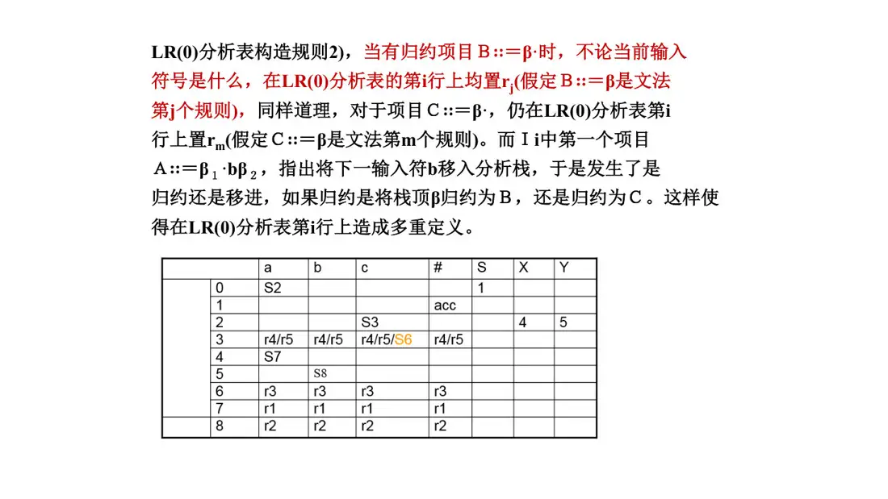

原文：

LR(0)分析表构造规则2)，当有归约项目B∷＝β·时，不论当前输入符号是什么，在LR(0)分析表的第i行上均置 ${ \bf r _ { j } } ($ (假定B∷＝β是文法第j个规则)，同样道理，对于项目 ${ \bf C } : : = \mathbf { \beta }$ ·，仍在LR(0)分析表第i行上置 ${ \bf r _ { m } } ($ (假定 ${ \bf C } : : = \mathbf { \beta }$ 是文法第m个规则)。而Ii中第一个项目$\mathbf { A } { : : = } { \boldsymbol { \mathsf { \mathbf { \beta } } } } _ { 1 } \cdot \mathbf { b } { \boldsymbol { \mathsf { \mathbf { \beta } } } } _ { 2 }$ ，指出将下一输入符b移入分析栈，于是发生了是归约还是移进，如果归约是将栈顶β归约为B，还是归约为C。这样使得在LR(0)分析表第i行上造成多重定义。

<table><tr><td colspan="2"></td><td>a</td><td>b</td><td>c</td><td>#</td><td>S</td><td>X</td><td>Y</td></tr><tr><td rowspan="8"></td><td>0</td><td>S2</td><td></td><td></td><td></td><td>1</td><td></td><td></td></tr><tr><td>1</td><td></td><td></td><td></td><td>acc</td><td></td><td></td><td></td></tr><tr><td>2</td><td></td><td></td><td>S3</td><td></td><td></td><td>4</td><td>5</td></tr><tr><td>3</td><td>r4/r5</td><td>r4/r5</td><td>r4/r5/S6</td><td>r4/r5</td><td></td><td></td><td></td></tr><tr><td>4</td><td>S7</td><td></td><td></td><td></td><td></td><td></td><td></td></tr><tr><td>5</td><td></td><td>S8</td><td></td><td></td><td></td><td></td><td></td></tr><tr><td>6</td><td>r3</td><td>r3</td><td>r3</td><td>r3</td><td></td><td></td><td></td></tr><tr><td>7</td><td>r1</td><td>r1</td><td>r1</td><td>r1</td><td></td><td></td><td></td></tr><tr><td></td><td>8</td><td>r2</td><td>r2</td><td>r2</td><td>r2</td><td></td><td></td><td></td></tr></table>

### SLR(1)分析表构造

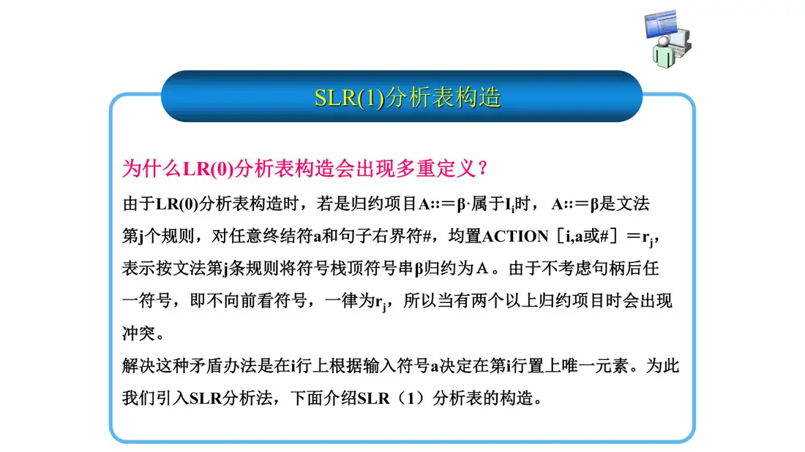

原文：

SLR(1)分析表构造

为什么LR(0)分析表构造会出现多重定义？

由于LR(0)分析表构造时，若是归约项目 $\mathbf { A } { \boldsymbol { : } } { \mathbf { : } } = \mathbf { \beta } { \boldsymbol { : } }$ ·属于I时， $\mathbf { A } { \boldsymbol { : : } } = \mathbf { \beta }$ 是文法第j个规则，对任意终结符a和句子右界符#，均置ACTION $\mathbf { [ i , a . }$ 或#］ $= \mathbf { r _ { j } } ,$ 表示按文法第j条规则将符号栈顶符号串β归约为A。由于不考虑句柄后任一符号，即不向前看符号，一律为r，所以当有两个以上归约项目时会出现 $\mathbf { r _ { j } } ,$ 冲突。

解决这种矛盾办法是在i行上根据输入符号a决定在第i行置上唯一元素。为此我们引入SLR分析法，下面介绍SLR（1）分析表的构造。

### 1）解决冲突项目

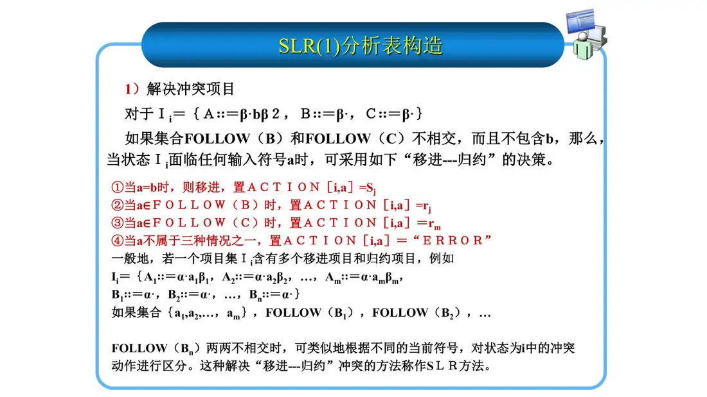

原文：

1）解决冲突项目

对于 ${ \mathrm {  ~ I ~ } } _ { \mathrm {  ~ i ~ } } = \{ { \mathrm {  ~ A } } { : } { : = } { \mathrm {  ~ \beta ~ } } { \mathrm {  ~ b ~ } } { \mathrm {  ~ 2 ~ } } , ~ { \mathrm {  ~ B } } { : } { = } { \mathrm {  ~ \beta ~ } } { \mathrm {  ~ \cdot ~ } } { \mathrm {  ~ \scriptstyle ~ C ~ } } { : : = } { \mathrm {  ~ \beta ~ } } \cdot \mathrm {  ~ \xi ~ }$

如果集合FOLLOW（B）和FOLLOW（C）不相交，而且不包含b，那么，当状态I面临任何输入符号a时，可采用如下“移进---归约”的决策。

FOLLOW $( \mathbf { B _ { n } } )$ 两两不相交时，可类似地根据不同的当前符号，对状态为i中的冲突动作进行区分。这种解决“移进---归约”冲突的方法称作SLR方法。

SLR(1)分析表构造

### 2）SLR（1）分析表构造

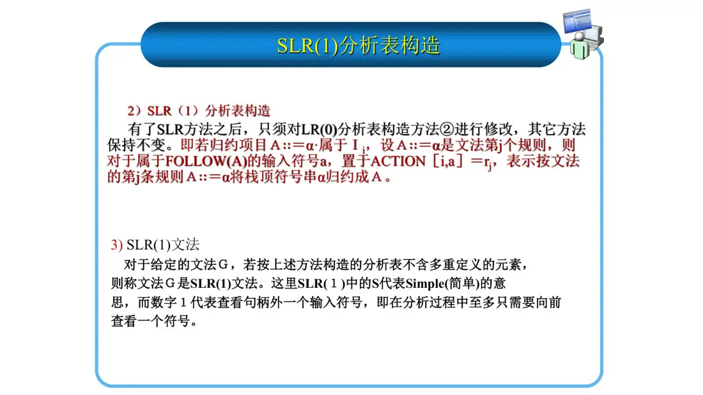

原文：

2）SLR（1）分析表构造

有了SLR方法之后，只须对LR(0)分析表构造方法②进行修改，其它方法保持不变。即若归约项目A∷＝α·属于I，设A∷＝α是文法第j个规则，则对于属于FOLLOW(A)的输入符号a，置于ACTION［i,a］＝r，表示按文法的第j条规则A∷＝α将栈顶符号串α归约成A。

3) SLR(1)文法

对于给定的文法G，若按上述方法构造的分析表不含多重定义的元素，则称文法G是SLR(1)文法。这里SLR(1)中的S代表Simple(简单)的意思，而数字1代表查看句柄外一个输入符号，即在分析过程中至多只需要向前查看一个符号。

SLR(1)分析表构造

### ①S::= aXa

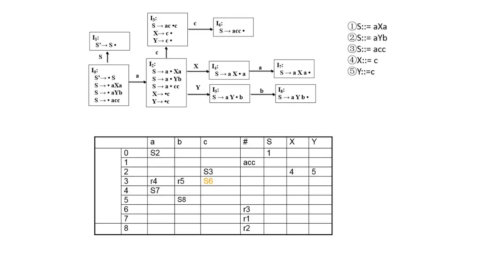

原文：

<table><tr><td colspan="2"></td><td>a</td><td>b</td><td>c</td><td>#</td><td>S</td><td>X</td><td>Y</td></tr><tr><td rowspan="8"></td><td>0</td><td>S2</td><td></td><td></td><td></td><td>1</td><td></td><td></td></tr><tr><td>1</td><td></td><td></td><td></td><td>acc</td><td></td><td></td><td></td></tr><tr><td>2</td><td></td><td></td><td>S3</td><td></td><td></td><td>4</td><td>5</td></tr><tr><td>3</td><td>r4</td><td>r5</td><td>S6</td><td></td><td></td><td></td><td></td></tr><tr><td>4</td><td>S7</td><td></td><td></td><td></td><td></td><td></td><td></td></tr><tr><td>5</td><td></td><td>S8</td><td></td><td></td><td></td><td></td><td></td></tr><tr><td>6</td><td></td><td></td><td></td><td>r3</td><td></td><td></td><td></td></tr><tr><td>7</td><td></td><td></td><td></td><td>r1</td><td></td><td></td><td></td></tr><tr><td></td><td>8</td><td></td><td></td><td></td><td>r2</td><td></td><td></td><td></td></tr></table>

①S::= aXa

$$
② S: := a Y b
$$

③S::= acc

④ $| \mathsf { X } ; : = \mathsf { c }$

⑤ $\forall \div : = \mathtt { C }$

### SLR(1)分析表构造

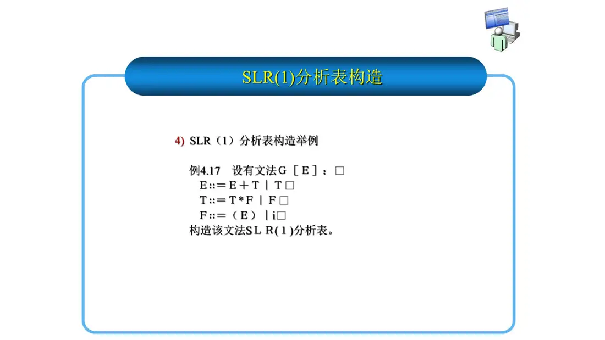

原文：

SLR(1)分析表构造

4) SLR（1）分析表构造举例

### ①将文法G拓广为G′，同时对每一规则进行编号

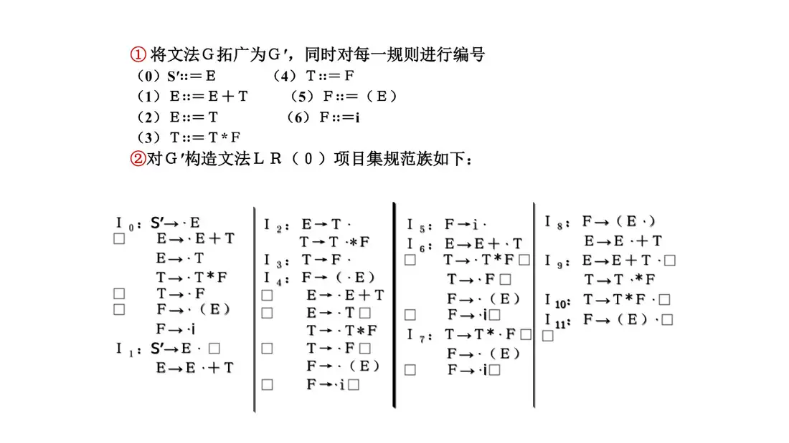

原文：

①将文法G拓广为G′，同时对每一规则进行编号

（0） $\mathbf { S } ^ { \prime } { : : } = \mathbf { E }$ （4） ${ \mathrm { T } } : : = { \mathrm { F } }$

（1） $\mathbf { E } : : = \mathbf { E } + \mathbf { T }$

（5）F∷＝（E）

（2） $\mathbf { E } : : = \mathrm { T }$

（6） $\mathbf { F } : : = \mathbf { i }$

（3） ${ \mathrm { T } } : : = { \mathrm { T } } \times { \mathrm { F } }$

②对G′构造文法LR（0）项目集规范族如下：

$$
\begin{array}{l l} \mathrm{I} _ {0}: \mathbf {S ^ {\prime}} \rightarrow \cdot \mathbf {E} & \left| \begin{array}{l l} \mathrm{I} _ {2}: \mathbf {E} \rightarrow \mathrm{T} \cdot \\ & \mathrm{T} \rightarrow \mathrm{T} \cdot * \mathrm{F} \\ \mathrm{E} \rightarrow \cdot \mathrm{T} \\ \mathrm{T} \rightarrow \cdot \mathrm{T} * \mathrm{F} \\ \square & \mathrm{T} \rightarrow \cdot \mathrm{F} \\ \square & \mathrm{F} \rightarrow \cdot (\mathrm{E}) \\ & \mathrm{F} \rightarrow \cdot \mathrm{i} \\ \end{array} \right| \\ \mathrm{I} _ {1}: \mathbf {S ^ {\prime}} \rightarrow \mathrm{E} \cdot \square & \left| \begin{array}{l l} \square & \mathrm{E} \rightarrow \cdot \mathrm{E} + \mathrm{T} \\ \square & \mathrm{E} \rightarrow \cdot \mathrm{T} \square \\ & \mathrm{T} \rightarrow \cdot \mathrm{T} * \mathrm{F} \\ \square & \mathrm{T} \rightarrow \cdot \mathrm{F} \square \\ & \mathrm{F} \rightarrow \cdot (\mathrm{E}) \\ \square & \mathrm{F} \rightarrow \cdot \mathrm{i} \square \\ & \end{array} \right| \\ & I _ {5}: F \rightarrow i. \\ & I _ {6}: E \rightarrow E +. T \\ & I _ {7}: T \rightarrow . T * F \\ & T \rightarrow . F (E) \\ & I _ {8}: F \rightarrow (E). \\ & I _ {9}: E \rightarrow E + T. \\ & T \rightarrow T. * F \\ & I _ {1 0}: T \rightarrow T * F. \\ & I _ {1 1}: F \rightarrow (E). \\ & I _ {1 2}: F (E). \\ & I _ {1 3}: F (E). \\ & I _ {1 4}: F (E). \\ & I _ {1 5}: F (E). \\ & I _ {1 6}: F (E). \\ & I _ {1 7}: F (E). \\ & I _ {1 8}: F (E). \\ & I _ {1 9}: F (E). \\ & I _ {2 0}: F (E). \\ & I _ {2 1}: F (E). \\ & I _ {2 2}: F (E). \\ & I _ {2 3}: F (E). \\ & I _ {2 4}: F (E). \\ & I _ {2 5}: F (E). \\ & I _ {2 6}: F (E). \\ & I _ {2 7}: F (E). \\ & I _ {2 8}: F (E). \\ & I _ {2 9}: F (E). \\ & I _ {3 0}: F (E). \\ & I _ {3 1}: F (E). \\ & I _ {3 2}: F (E). \\ & I _ {3 3}: F (E). \\ & I _ {3 4}: F (E). \\ & I _ {3 5}: F (E). \\ & I _ {3 6}: F (E). \\ & I _ {3 7}: F (E). \\ & I _ {3 8}: F (E). \\ & I _ {3 9}: F (E). \\ & I _ {4 0}: F (E). \\ & I _ {4 1}: F (E). \\ & I _ {4 2}: F (E). \\ & I _ {4 3}: F (E). \\ & I _ {4 4}: F (E). \\ & I _ {4 5}: F (E). \\ & I _ {4 6}: F (E). \\ & I _ {4 7}: F (E). \\ & I _ {4 8}: F (E). \\ & I _ {4 9}: F (E). \\ & I _ {5 0}: F (E). \\ & I _ {5 1}: F (E). \\ & I _ {5 2}: F (E). \\ & I _ {5 3}: F (E). \\ & I _ {5 4}: F (E). \\ & I _ {5 5}: F (E). \\ & I _ {5 6}: F (E). \\ & I _ {5 7}: F (E). \\ & I _ {5 8}: F (E). \\ & I _ {5 9}: F (E). \\ & I _ {6 0}: F (E). \\ & I _ {6 1}: F (E). \\ & I _ {6 2}: F (E). \\ & I _ {6 3}: F (E). \\ & I _ {6 4}: F (E). \\ & I _ {6 5}: F (E). \\ & I _ {6 6}: F (E). \\ & I _ {6 7}: F (E). \\ & I _ {6 8}: F (E). \\ & I _ {6 9}: F (E). \\ & I _ {7 0}: F (E). \\ & I _ {7 1}: F (E). \\ & I _ {7 2}: F (E). \\ & I _ {7 3}: F (E). \\ & I _ {7 4}: F (E). \\ & I _ {7 5}: F (E). \\ & I _ {7 6}: F (E). \\ & I _ {7 7}: F (E). \\ & I _ {7 8}: F (E). \\ & I _ {7 9}: F (E). \\ & I _ {8 0}: F (E). \\ & I _ {8 1}: F (E). \\ & I _ {8 2}: F (E). \\ & I _ {8 3}: F (E). \\ & I _ {8 4}: F (E). \\ & I _ {8 5}: F (E). \\ & I _ {8 6}: F (E). \\ & I _ {8 7}: F (E). \\ & I _ {8 8}: F (E). \\ & I _ {8 9}: F (E). \\ & I _ {9 0}: F (E). \\ & I _ {9 1}: F (E). \\ & I _ {9 2}: F (E). \\ & I _ {9 3}: F (E). \\ & I _ {9 4}: F (E). \\ & I _ {9 5}: F (E). \\ & I _ {9 6}: F (E). \\ & I _ {9 7}: F (E). \\ & I _ {9 8}: F (E). \\ & I _ {9 9}: F (E). \\ & I _ {1 0}: F (E) . \\ & I _ {1 1}: F (E) . \\ & I _ {1 2}: F (E) . \\ & I _ {1 3}: F (E) . \\ & I _ {1 4}: F (E) . \\ & I _ {1 5}: F (E) . \\ & I _ {1 6}: F (E) . \\ & I _ {1 7}: F (E) . \\ & I _ {1 8}: F (E) . \\ & I _ {1 9}: F (E) . \\ & I _ {2 0}: F (E) . \\ & I _ {2 1}: F (E) . \\ & I _ {2 2}: F (E) . \\ & I _ {2 3}: F (E) . \\ & I _ {2 4}: F (E) . \\ & I _ {2 5}: F (E) . \\ & I _ {2 6}: F (E) . \\ & I _ {2 7}: F (E) . \\ & I _ {2 8}: F (E) . \\ & I _ {2 9}: F (E) . \\ & I _ {3 0}: F (E) . \\ & I _ {3 1}: F (E) . \\ & I _ {3 2}: F (E) . \\ & I _ {3 3}: F (E) . \\ & I _ {3 4}: F (E) . \\ & I _ {3 5}: F (E) . \\ & I _ {3 6}: F (E) . \\ & I _ {3 7}: F (E) . \\ & I _ {3 8}: F (E) . \\ & I _ {3 9}: F (E) . \\ & I _ {4 0}: F (E) . \\ & I _ {4 1}: F (E) . \\ & I _ {4 2}: F (E) . \\ & I _ {4 3}: F (E) . \\ & I _ {4 4}: F (E) . \\ & I _ {4 5}: F (E) . \\ & I _ {4 6}: F (E) . \\ & I _ {4 7}: F (E) . \\ & I _ {4 8}: F (E) . \\ & I _ {4 9}: F (E) . \\ & I _ {5 0}: F (E) . \\ & I _ {\textit {\scriptsize f o r e s t a m a x}} = - i, j, k, l, m, n, o, p, q, r, s, t, u, v, w, x, y, z, w, x, y, z, w, x, y, z, w, x, y, z, w, x, y, z, w, x, y, z, w, x, y, z, w, x, y, z, w, x, y, z, w, x, y, z, w, x, y, z, w, x, y, z, w, x, y, z, w, y, z, w, x, y, z, w, x, y, z, w, x, y, z, w, x, y, z, w, x, y, z, w, x, y, z, w, x, y, z, w, x, y, z, w, x, y, z, w, x, y, z, w, x, y, z, w, x, y,z , x , y , z , w , x , y , z , w , x , y , z , w , x , y , z , w , x , y , z , w , x , y , z , w , x , y , z , w , x , y , z , w , x , y , z , w , x , y , z , w , x , y , z , w , x , y , z , w , x , y , z , w , x ,y , z ,w ,x ,y ,z ,w ,x ,y ,z ,w ,x ,y ,z ,w ,x ,y ,z ,w ,x ,y ,z ,w ,x ,y ,z ,w ,x ,y ,z ,w ,x ,y ,z ,w ,x ,y ,z ,w ,x ,y ,z ,w ,x ,y ,z ,w ,x ,y ,z ,w ,x ,y ,z ,w ,y ,z ,w ,x ,y ,z ,w ,x ,y ,z ,w ,x ,y ,z ,w ,x ,y ,z ,w ,x ,y ,z ,w ,x ,y ,z ,w ,x ,y ,z ,w ,x ,y ,z ,w ,x ,y ,z ,w ,x ,y ,z ,w ,x ,y ,z ,w ,x ,y ,v,w,x,w,x,w,x,w,x,w,x,w,x,w,x,w,x,w,x,w,x,w,x,w,x,w,x,w,x,w,x,w,x,w,x,w,x,w,x,w,x,w,x,w,x,w,x,w,x,w,x,w,x,w,x,w,x,w,x,w,x,w,x,w,x,w,x,w,x,w,x,w,x,w,x,w,x,w,x,w,x,w,x,w,x,w,x,w,x,w,x,w,x,w,x,w,x,w,x,w,x,w,v,w,v,w,v,w,v,w,v,w,v,w,v,w,v,w,v,w,v,w,v,w,v,w,v,w,v,w,v,w,v,w,v,w,v,w,v,w,v,w,v,w,v,w,v,w,v,w,v,w,v,w,v,w,v,w,v,w,v,w,v,w,v,w,v,w,v,w,v,w,v,w,v,w,v,w,v,w,v,w,v,w,v,w,v,w,v,w,v,w,v,w,v,w,v,w,v,w,v,w,
$$

### ③ 取这些项目集作为各状态，并根据转换函数GO画出识别文法G的有穷自动机，

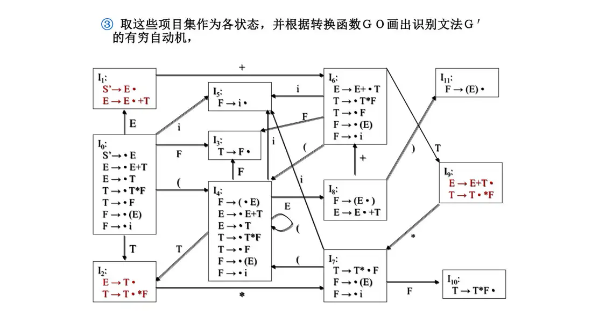

原文：

③ 取这些项目集作为各状态，并根据转换函数GO画出识别文法G的有穷自动机，

### ④ 用SLR方法解决“移进---归约”冲突。

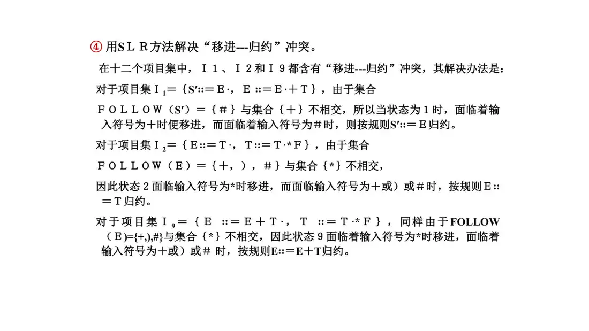

原文：

④ 用SLR方法解决“移进---归约”冲突。

在十二个项目集中，I1、I2和I9都含有“移进---归约”冲突，其解决办法是：

对于项目集 ${ \mathrm { ~ I ~ } } _ { 1 } = \{ { \mathrm { S } } ^ { \prime } { : } { : = } { \mathrm { E } } \cdot { \mathrm { , ~ } } \ { \mathrm { E } } : : = { \mathrm { E } } \cdot { + } { \mathrm { T } } \ \}$ ，由于集合

FOLLOW（S′）＝｛＃｝与集合｛＋｝不相交，所以当状态为1时，面临着输入符号为＋时便移进，而面临着输入符号为＃时，则按规则 $\mathbf { S } ^ { \prime } { : : = } \mathbf { E }$ 归约。

对于项目集 $\mathrm { ~ I ~ } _ { 2 } { = } \ \{ \ \mathrm { E } { : } { : = } \mathrm { T } \cdot , \ \mathrm { ~ T } { : } { : = } \mathrm { = T } \cdot \mathrm { * } \ \mathrm { F } \ \}$ ｝，由于集合

$\mathrm { ~ F ~ O ~ L ~ L ~ O ~ W ~ } \left( \mathrm { ~ E ~ } \right) = \left\{ + , \ \mathrm { ~ } \right) , \ \# \}$ 与集合｛\*｝不相交，

因此状态2面临输入符号为\*时移进，而面临输入符号为＋或）或＃时，按规则E∷＝T归约。

对于项目集 ${ \mathrm { ~ I ~ } } _ { 9 } = \{ { \mathrm { ~ E ~ } } : = { \mathrm { ~ E ~ } } + { \mathrm { ~ T ~ } } \cdot { \mathrm { ~ , ~ } } { \mathrm { ~ T ~ } } : = { \mathrm { ~ T ~ } } \cdot { \mathrm { ~ * ~ F ~ } } \}$ ｝，同样由于FOLLOW$( \textrm { E } ) { = } \{ + , ) , \# \}$ 与集合｛\*｝不相交，因此状态9面临着输入符号为\*时移进，面临着输入符号为＋或）或＃ 时，按规则 $\mathbf { E } { : } = \mathbf { E } { + } \mathbf { T }$ 归约。

### ⑤ 根据SLR(1）分析表构造方法构造SLR(1）分析表.

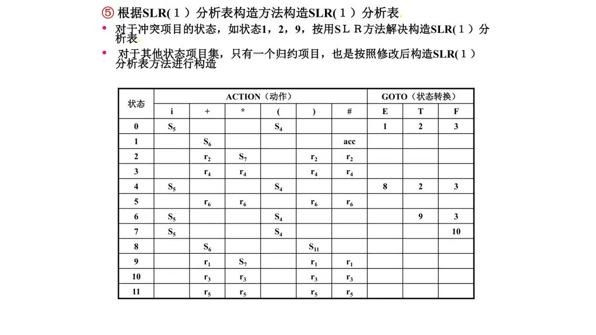

原文：

⑤ 根据SLR(1）分析表构造方法构造SLR(1）分析表.

对于冲突项目的状态，如状态1，2，9，按用SLR方法解决构造SLR(1）分析表.

对于其他状态项目集，只有一个归约项目，也是按照修改后构造SLR(1）分析表方法进行构造

<table><tr><td rowspan="2">状态</td><td colspan="6">ACTION(动作)</td><td colspan="3">GOTO(状态转换)</td></tr><tr><td>i</td><td>+</td><td>*</td><td>(</td><td>)</td><td>#</td><td>E</td><td>T</td><td>F</td></tr><tr><td>0</td><td> $S_5$ </td><td></td><td></td><td> $S_4$ </td><td></td><td></td><td>1</td><td>2</td><td>3</td></tr><tr><td>1</td><td></td><td> $S_6$ </td><td></td><td></td><td></td><td>acc</td><td></td><td></td><td></td></tr><tr><td>2</td><td></td><td> $r_2$ </td><td> $S_7$ </td><td></td><td> $r_2$ </td><td> $r_2$ </td><td></td><td></td><td></td></tr><tr><td>3</td><td></td><td> $r_4$ </td><td> $r_4$ </td><td></td><td> $r_4$ </td><td> $r_4$ </td><td></td><td></td><td></td></tr><tr><td>4</td><td> $S_5$ </td><td></td><td></td><td> $S_4$ </td><td></td><td></td><td>8</td><td>2</td><td>3</td></tr><tr><td>5</td><td></td><td> $r_6$ </td><td> $r_6$ </td><td></td><td> $r_6$ </td><td> $r_6$ </td><td></td><td></td><td></td></tr><tr><td>6</td><td> $S_5$ </td><td></td><td></td><td> $S_4$ </td><td></td><td></td><td></td><td>9</td><td>3</td></tr><tr><td>7</td><td> $S_5$ </td><td></td><td></td><td> $S_4$ </td><td></td><td></td><td></td><td></td><td>10</td></tr><tr><td>8</td><td></td><td> $S_6$ </td><td></td><td></td><td> $S_{11}$ </td><td></td><td></td><td></td><td></td></tr><tr><td>9</td><td></td><td> $r_1$ </td><td> $S_7$ </td><td></td><td> $r_1$ </td><td> $r_1$ </td><td></td><td></td><td></td></tr><tr><td>10</td><td></td><td> $r_3$ </td><td> $r_3$ </td><td></td><td> $r_3$ </td><td> $r_3$ </td><td></td><td></td><td></td></tr><tr><td>11</td><td></td><td> $r_5$ </td><td> $r_5$ </td><td></td><td> $r_5$ </td><td> $r_5$ </td><td></td><td></td><td></td></tr></table>

### • 已知文法G[S]：

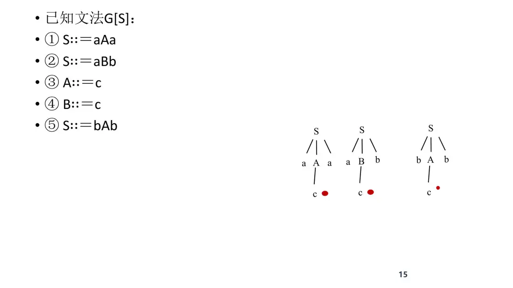

原文：

• 已知文法G[S]：

$\textcircled{1} \mathsf { S } { : : = } \mathsf { a } \mathsf { A } \mathsf { a }$

• ② $\mathsf { S } { : : = } \mathsf { a B b }$

• ③ $\mathsf { A } \colon : = \mathsf { C }$

• ④ $\mathtt { B } \because = { \mathtt { C } }$

• ⑤ ${ \mathsf { S } } { : } { : } = { \mathsf { b } } { \mathsf { A } } { \mathsf { b } }$

$$
\begin{array}{c c c} \text {S} & \text {S} \\ / | \backslash \\ a A a & a B b \\ \mid & \mid \\ c \bullet & c \bullet \end{array} \quad \begin{array}{c c c} \text {S} & \text {S} \\ / | \backslash \\ b A b \\ \mid & \\ c \bullet & \end{array}
$$

15

### • 已知文法G[S]：

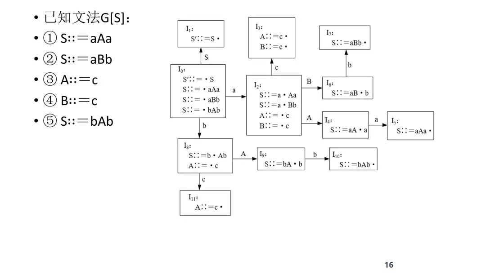

原文：

• 已知文法G[S]：

$\textcircled{1} \mathsf { S } { : : = } \mathsf { a } \mathsf { A } \mathsf { a }$

• ② $\mathsf { S } { : : = } \mathsf { a B b }$

• ③ $\mathsf { A } \colon : = \mathsf { C }$

• ④ $\mathtt { B } \because = { \mathtt { C } }$

• ⑤ ${ \mathsf { S } } { : } { : } = { \mathsf { b } } { \mathsf { A } } { \mathsf { b } }$

16

### 第 17 页

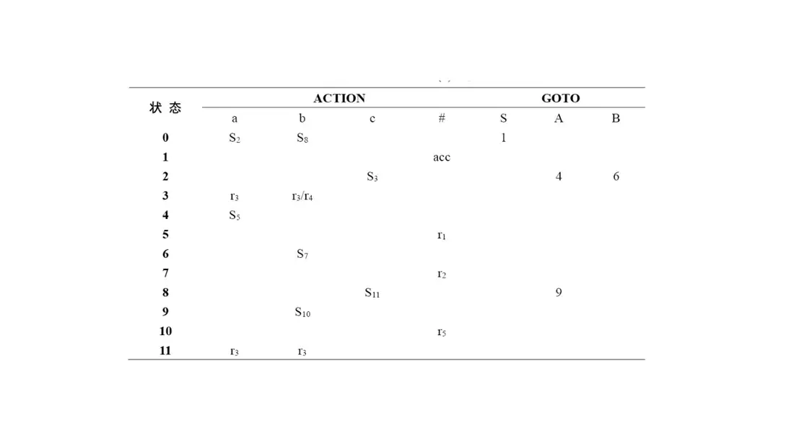

原文：

<table><tr><td rowspan="2">状态</td><td colspan="4">ACTION</td><td colspan="3">GOTO</td></tr><tr><td>a</td><td>b</td><td>c</td><td>#</td><td>S</td><td>A</td><td>B</td></tr><tr><td>0</td><td> $S_{2}$ </td><td> $S_{8}$ </td><td></td><td></td><td>1</td><td></td><td></td></tr><tr><td>1</td><td></td><td></td><td></td><td>acc</td><td></td><td></td><td></td></tr><tr><td>2</td><td></td><td></td><td> $S_{3}$ </td><td></td><td></td><td>4</td><td>6</td></tr><tr><td>3</td><td> $r_{3}$ </td><td> $r_{3}/r_{4}$ </td><td></td><td></td><td></td><td></td><td></td></tr><tr><td>4</td><td> $S_{5}$ </td><td></td><td></td><td></td><td></td><td></td><td></td></tr><tr><td>5</td><td></td><td></td><td></td><td> $r_{1}$ </td><td></td><td></td><td></td></tr><tr><td>6</td><td></td><td> $S_{7}$ </td><td></td><td></td><td></td><td></td><td></td></tr><tr><td>7</td><td></td><td></td><td></td><td> $r_{2}$ </td><td></td><td></td><td></td></tr><tr><td>8</td><td></td><td></td><td> $S_{11}$ </td><td></td><td></td><td>9</td><td></td></tr><tr><td>9</td><td></td><td> $S_{10}$ </td><td></td><td></td><td></td><td></td><td></td></tr><tr><td>10</td><td></td><td></td><td></td><td> $r_{5}$ </td><td></td><td></td><td></td></tr><tr><td>11</td><td> $r_{3}$ </td><td> $r_{3}$ </td><td></td><td></td><td></td><td></td><td></td></tr></table>

### 5. LR（1）分析表的构造

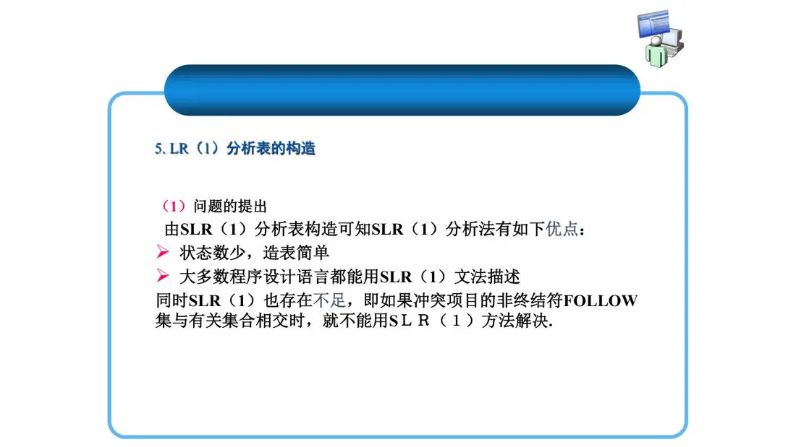

原文：

5. LR（1）分析表的构造

（1）问题的提出

由SLR（1）分析表构造可知SLR（1）分析法有如下优点：

➢ 状态数少，造表简单

➢ 大多数程序设计语言都能用SLR（1）文法描述

同时SLR（1）也存在不足，即如果冲突项目的非终结符FOLLOW集与有关集合相交时，就不能用SLR（1）方法解决.

### 5. LR（1）分析表的构造

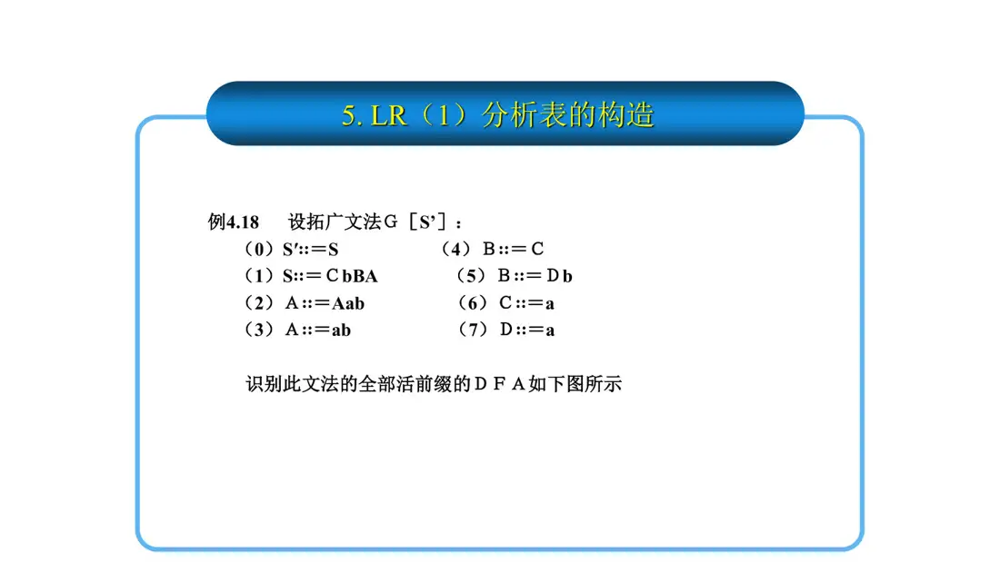

原文：

5. LR（1）分析表的构造

例4.18 设拓广文法 $\textbf { G } \left[ \mathbf { S } ^ { \boldsymbol { \mathbf { \rho } } } \right]$

（0） $\mathbf { S } ^ { \prime } { : : } = \mathbf { S }$

（4） $\mathbf { B } : : = \mathbf { C }$

（1） $\mathbf { S } { : } = \mathbf { C } \mathbf { b } \mathbf { B } \mathbf { A }$

（5） $\mathbf { B } : : = \mathbf { D } \mathbf { \Phi } \mathbf { b }$

（2） $\mathbf { A } { : : } = \mathbf { A } \mathbf { a } \mathbf { b }$

（6） $\mathbf { C } : : = \mathbf { a }$

（3） $\mathbf { A } : : = \mathbf { a b }$

（7） $\mathbf { D } : : = \mathbf { a }$

识别此文法的全部活前缀的DFA如下图所示

### 识别文法G[S’]全部活前缀的DFA

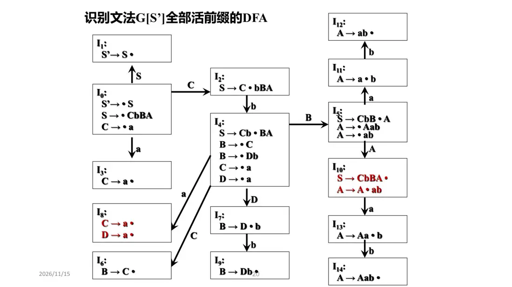

原文：

识别文法G[S’]全部活前缀的DFA

2026/11/15

### $$

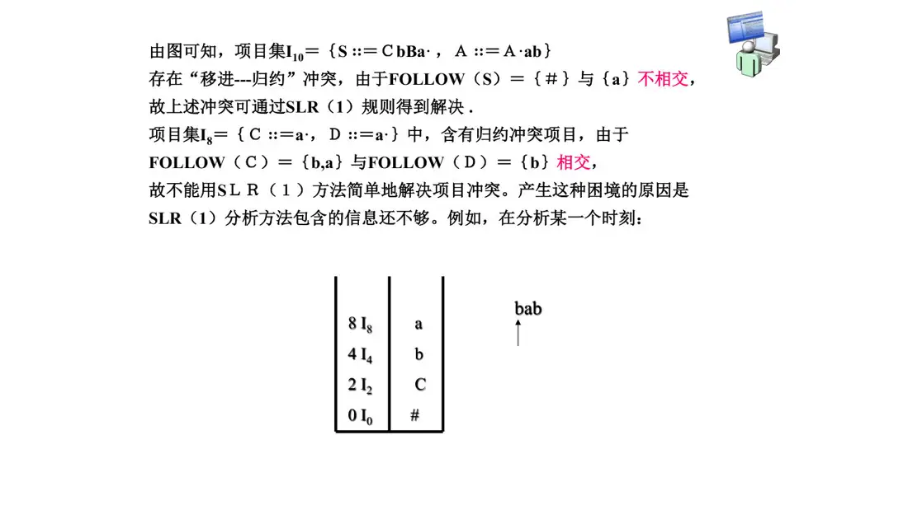

原文：

由图可知，项目集 $\mathbf { I _ { 1 0 } } { = } \ \{ \mathbf { S } : : = \mathbf { C _ { \ b B a } } { \cdot } \ , \ \mathbf { A } : : = \mathbf { A } \cdot \mathbf { a _ { b } } \}$

存在“移进---归约”冲突，由于 $\mathbf { F O L L O W } \left( \mathbf { S } \right) = \left\{ \# \right\}$ 与｛a｝不相交，故上述冲突可通过SLR（1）规则得到解决 .

项目集 $\mathrm { I _ { 8 } = \left\{ C \ { \ z = a \cdot , } { D \ : = a \cdot } \right\} }$ 中，含有归约冲突项目，由于$\mathbf { F O L L O W } \left( \mathbf { C } \right) = \left\{ \mathbf { b } , \mathbf { a } \right\}$ 与 $\mathbf { F O L L O W } \left( \mathbf { D } \right) = \left\{ \mathbf { b } \right\}$ 相交，

故不能用SLR（1）方法简单地解决项目冲突。产生这种困境的原因是SLR（1）分析方法包含的信息还不够。例如，在分析某一个时刻：

$$
\left[ \begin{array}{c c} 8   I _ {8} & a \\ 4   I _ {4} & b \\ 2   I _ {2} & C \\ 0   I _ {0} & \# \end{array} \right] \qquad \qquad \qquad \qquad \qquad \qquad \qquad \qquad \qquad \qquad \qquad \qquad \qquad \qquad \qquad \qquad \qquad \qquad \qquad \qquad \qquad \qquad \qquad \qquad \qquad \qquad \qquad \qquad \qquad \qquad \qquad \qquad \qquad \qquad
$$

### 5. LR（1）分析表的构造

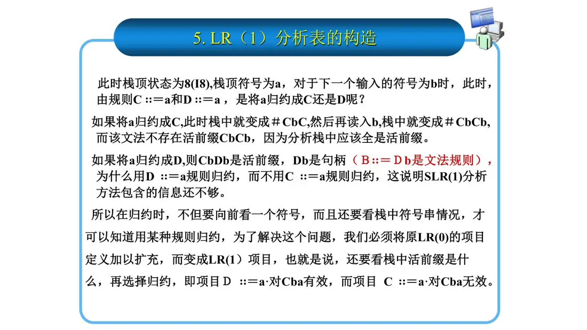

原文：

此时桟顶状态为8(I8),桟顶符号为a，对于下一个输入的符号为b时，此时，由规则 $\mathbf { C } : : = \mathbf { a }$ 和 $\mathbf { D } : : = \mathbf { a }$ ，是将a归约成C还是D呢？

如果将a归约成C,此时桟中就变成＃ $\mathbf { C b C } ,$ 然后再读 $\lambda , \mathbf { b } ,$ 桟中就变成＃ $\mathbf { C b C b }$ 而该文法不存在活前缀 $\mathbf { C b C b }$ ，因为分析桟中应该全是活前缀。

如果将a归约成D,则CbDb是活前缀，Db是句柄（ $\mathbf { B } : : = \mathbf { D } \ \mathbf { b }$ 是文法规则），为什么用 $\mathbf { D } : : = \mathbf { a }$ 规则归约，而不用 $\mathbf { C } \mathbf { \Psi } : : = \mathbf { a }$ 规则归约，这说明 $\mathbf { S L R } ( \mathbf { 1 } )$ 分析方法包含的信息还不够。

所以在归约时，不但要向前看一个符号，而且还要看桟中符号串情况，才可以知道用某种规则归约，为了解决这个问题，我们必须将原LR(0)的项目定义加以扩充，而变成LR(1）项目，也就是说，还要看桟中活前缀是什么，再选择归约，即项目 $\mathrm { ~ D ~ } : : = \mathbf { a } ^ { \mathrm { ~ } }$ ·对 $\mathbf { C b a }$ 有效，而项目 $\mathbf { C } \mathbf { \partial } : : = \mathbf { a } ^ { \mathrm { { . } } }$ ·对 $\mathbf { C b a }$ 无效。

5. LR（1）分析表的构造

### （2）LR（1）项目

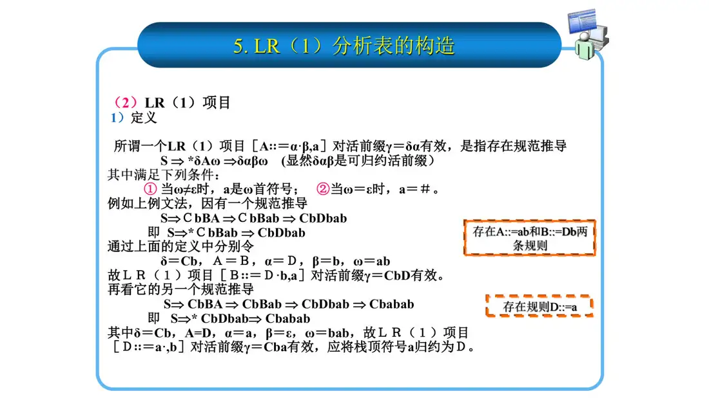

原文：

（2）LR（1）项目

1）定义

所谓一个LR（1）项目 $\left[ \mathbf { A } { \mathbf { : : } } = \mathbf { a } { \cdot } \mathbf { \{ } \mathbf { , } \mathbf { a }  \right]$ 对活前缀 $\gamma = \delta \mathbf { { a } }$ 有效，是指存在规范推导$\mathbf { S } \Rightarrow \mathbf { \hat { \sigma } } ^ { * } \mathbf { \delta } \mathbf { \delta A } \mathbf { \sigma } \Rightarrow \mathbf { \delta } \mathbf { \delta } \mathbf { a } \mathbf { \beta } \mathbf { \infty }$ (显然δαβ是可归约活前缀）

其中满足下列条件：

① 当ω≠ε时，a是ω首符号； ②当 ${ \bf o } = { \bf g } \mathbb { H } , { \bf a } = \# .$

例如上例文法，因有一个规范推导

$$
\mathrm{S} \Rightarrow \mathrm{CbBA} \Rightarrow \mathrm{CbBab} \Rightarrow \mathrm{CbDbab}
$$

即 $\mathbf { S } { \Rightarrow } ^ { \mathbf { * } } \mathbf { C } \mathbf { \Delta b } \mathbf { B } \mathbf { a } \mathbf { b } \Rightarrow \mathbf { C } \mathbf { b } \mathbf { D } \mathbf { b } \mathbf { a } \mathbf { b }$

通过上面的定义中分别令存在A::=ab和B::=Db两条规则

$$
\delta = \mathrm{Cb}, \quad \mathrm{A} = \mathrm{B}, \quad \alpha = \mathrm{D}, \quad \beta = \mathrm{b}, \quad \omega = \mathrm{ab}
$$

故LR（1）项目 $[ \mathbf { B } : : = \mathbf { D } \cdot \mathbf { b } , \mathbf { a } ]$ 对活前缀 $\scriptstyle \gamma = \mathbf { C b } \mathbf { D } .$ 有效。

再看它的另一个规范推导

$$
\mathrm{S} \Rightarrow \mathrm{CbBA} \Rightarrow \mathrm{CbBab} \Rightarrow \mathrm{CbDbab} \Rightarrow \mathrm{Cbabab}
$$

存在规则D::=a

即 $\mathbf { S } { \Rightarrow } ^ { \mathbf { * } } \mathbf { C } \mathbf { b } \mathbf { D } \mathbf { b } \mathbf { a } \mathbf { b } { \Rightarrow } \mathbf { C } \mathbf { b } { \mathbf { a } } \mathbf { b } { \mathbf { a } } \mathbf { b }$

其中 $\scriptstyle \delta = \mathbf { C b } , \mathbf { A } = \mathbf { D } , \mathbf { a } = \mathbf { a } , \mathbf { \beta } = \varepsilon , \mathbf { o } = \mathbf { b a b }$ ，故LR（1）项目$[ \mathbf { \delta D } : : = \mathbf { a } \cdot \mathbf { , b } ]$ 对活前缀 $\scriptstyle \gamma = \mathbf { C } \mathbf { b } \mathbf { a }$ 有效，应将栈顶符号a归约为D。

5. LR（1）分析表的构造

### LR（1）分析表的构造

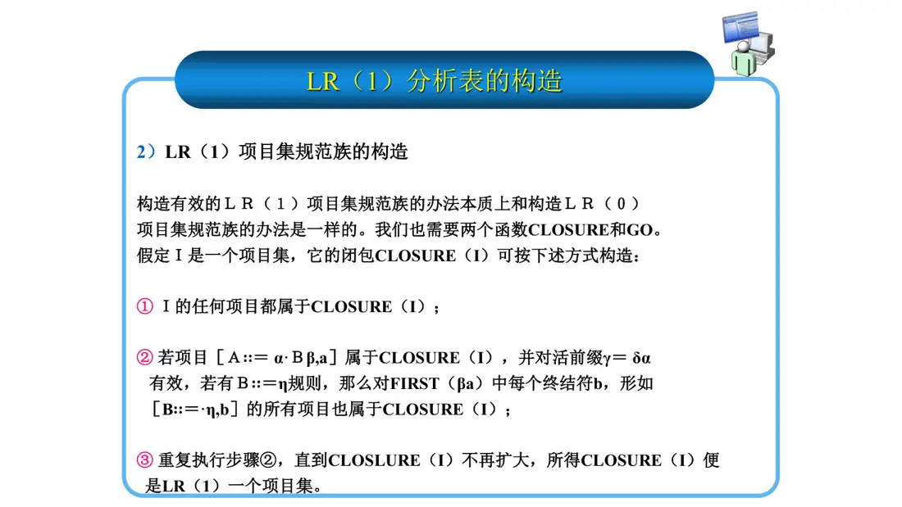

原文：

LR（1）分析表的构造

2）LR（1）项目集规范族的构造

构造有效的LR（1）项目集规范族的办法本质上和构造LR（0）项目集规范族的办法是一样的。我们也需要两个函数CLOSURE和GO。假定I是一个项目集，它的闭包CLOSURE（I）可按下述方式构造：

① I的任何项目都属于CLOSURE（I）；

② 若项目 $[ \mathbf { A } { \boldsymbol { \mathbf { a } } } = \mathbf { a } { \boldsymbol { \cdot } } \mathbf { B } \mathbf { \beta } , \mathbf { a } ]$ 属于CLOSURE（I），并对活前缀 $\dot { \gamma } = \delta \mathbf { \mathfrak { a } }$ 有效，若有 $\mathbf { B } : : = \eta \mathrm { { i } }$ 规则，那么对FIRST（βa）中每个终结符b，形如$[ \mathbf { B } { : } { : } = { \cdot } \mathbf { \eta } \mathbf { \eta } ]$ 的所有项目也属于CLOSURE（I）；

③ 重复执行步骤②，直到CLOSLURE（I）不再扩大，所得CLOSURE（I）便是LR（1）一个项目集。

### LR（1）分析表的构造

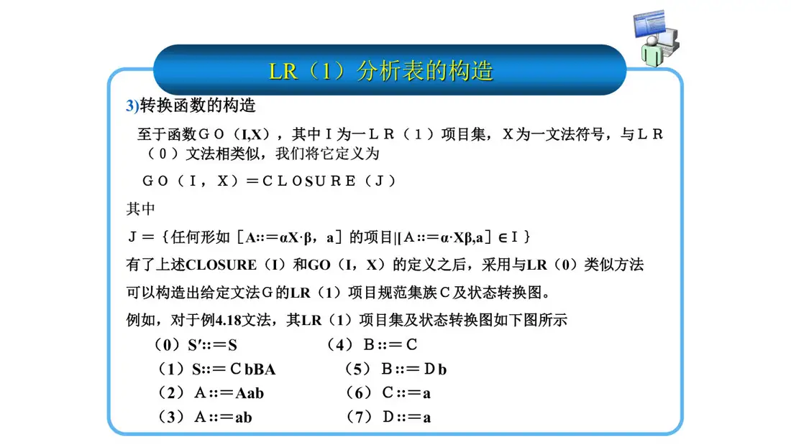

原文：

LR（1）分析表的构造

3)转换函数的构造

至于函数 $\mathrm { ~ \bf ~ G ~ O ~ } \left( { \bf I } , { \bf X } \right)$ ，其中I为一LR（1）项目集，X为一文法符号，与LR（0）文法相类似，我们将它定义为$\mathrm { ~ G ~ O ~ } \left( \mathrm { ~ I ~ , ~ } \mathrm { ~ X ~ } \right) = \mathrm { ~ C ~ L ~ O ~ S ~ U ~ R ~ E ~ } \left( \mathrm { ~ J ~ } \right)$ 其中J＝｛任何形如 $\mathbf { \partial } [ \mathbf { A } { : } { : } = \mathbf { q } \mathbf { X } { \cdot } \mathbf { \beta } ]$ ，a］的项目 $\lvert [ \mathrm { A } \langle : = \mathbf { a } \cdot \mathrm { X } \boldsymbol { \beta } , \mathbf { a } ] \ \in \mathrm { I } \ \}$ 有了上述CLOSURE（I）和GO（I，X）的定义之后，采用与LR（0）类似方法可以构造出给定文法G的LR（1）项目规范集族C及状态转换图。例如，对于例4.18文法，其LR（1）项目集及状态转换图如下图所示（0） $\mathbf { S } ^ { \prime } { : : } = \mathbf { S }$ （4） $\mathbf { B } : : = \mathbf { C }$ （1） $\mathbf { S } { : } = \mathbf { C } \mathbf { b } \mathbf { B } \mathbf { A }$ （5） $\mathbf { B } : : = \mathbf { D } \mathbf { b }$ （2） $\mathbf { A } : : = \mathbf { A } \mathbf { a } \mathbf { b }$ （6） $\mathbf { C } : : = \mathbf { a }$ （3） $\mathbf { A } : : = \mathbf { a b }$ （7） $\mathbf { D } : : = \mathbf { a }$

### 2026/11/15

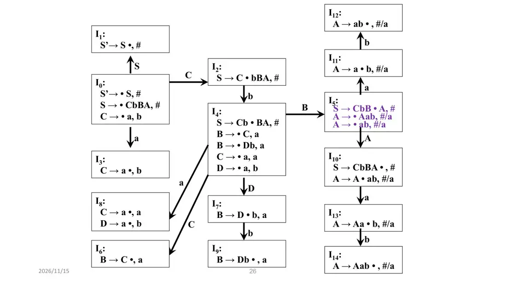

原文：

2026/11/15

### （3）LR（1）分析表的构造

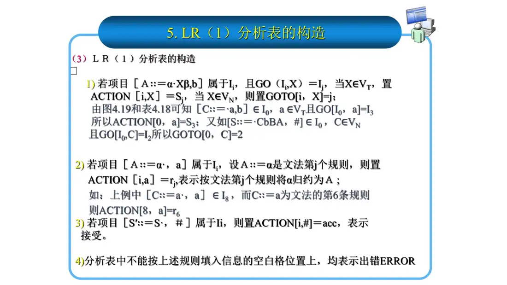

原文：

（3）LR（1）分析表的构造

1) 若项目 $[ \mathbb { A } \{ : : = a \cdot \mathbb { X } \beta , \mathbf { b } \} ]$ 属于 $\mathbf { l } _ { \mathbf { j } } ,$ 且 $\mathbf { G O } \ ( \mathbf { I _ { i } } , \mathbf { X } ) \ = \mathbf { I _ { i } } ,$ ，当 $\mathbf { X } { \in } \mathbf { V } _ { \mathrm { T } } ,$ 置ACTION $[ \mathbf { i } , \mathbf { X } ] = \mathbf { S _ { i } }$ ，当 $\mathbf { \nabla } \mathbf { X } \in \mathbf { V } _ { \mathrm { N } } ,$ 则置GOTO[i， $\mathbf { X } ] { = } \mathbf { j } ;$ 由图4.19和表4.18可知 $[ \mathbb { C } : : = \cdot { \mathrm { a } } , { \mathrm { b } } ] \in \mathrm { I } _ { 0 } , \ \mathrm { \ a } \in \mathrm { V } _ { \mathrm { T } } \mathrm { E G O } [ \mathrm { I } _ { 0 } , \ \mathrm { \ a } ] = \mathrm { I } _ { 3 }$ 所以 $\mathrm { \sf A C T I O N } [ 0 , \mathrm {  ~ a } ] = \mathrm { S } _ { 3 } \mathrm { \large , }$ 又如 $[ \mathsf { S } ; : = \cdot { \mathsf { C b B A } }$ ，#] $\in \mathrm { I } _ { 0 }$ $\mathbf { C } \in \mathbf { V } _ { \mathrm { N } }$ 且 $\mathrm { G O } [ \mathrm { I } _ { 0 } , \mathrm { C } ] { = } \mathrm { I } _ { 2 }$ 所以GOTO[0， $\mathrm { C l } { = } 2$

2) 若项目 $[ \mathbf { A } { \boldsymbol { : : } } = \mathbf { a } \cdot , \ \mathbf { a } ]$ 属于 $\mathbf { I _ { j } } ,$ ，设 $\mathbf { A } : : = \mathbf { a }$ 是文法第j个规则，则置$\mathbf { A C T I O N \ [ i , a ] \ = r _ { j } } ,$ 表示按文法第j个规则将 $\mathbf { \dot { a } }$ 归约为A ;如：上例中 $[ { \mathrm { C } } { \mathrm { : } } { \mathrm { = } } { \mathrm { a } } { \mathrm { \cdot } } , { \mathrm { a } } ] { \mathrm { ~ } } \in { \mathrm { I } } _ { 8 }$ ，而 $\mathbb { C } \mathfrak { a } = \mathfrak { a }$ 为文法的第6条规则则 $\mathtt { A C T I O N [ 8 , ~ \mathtt { a } ] = r _ { 6 } }$

3) 若项目 $[ { \mathsf { S } } ^ { \prime } { : } { : } = { \mathsf { S } } ^ { \prime }$ ·，＃］属于Ii，则置 $\mathbf { A C T I O N [ i , \# ] } { = } \mathbf { a c c }$ ，表示接受。

4)分析表中不能按上述规则填入信息的空白格位置上，均表示出错ERROR

5. LR（1）分析表的构造

### 第 28 页

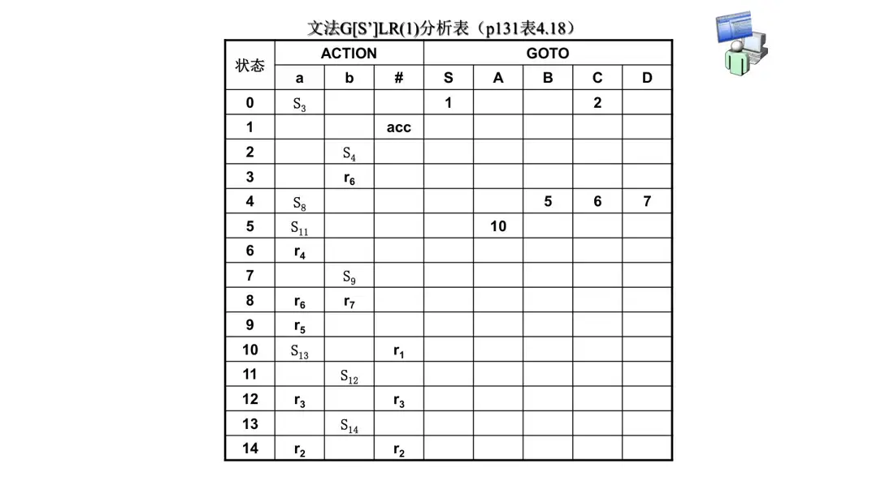

原文：

![文法G[S’]LR(1)分析表（p131表4.18）](编译原理第4章-LR分析法课件.assets/原件图1.jpg)

<table><tr><td rowspan="2">状态</td><td colspan="3">ACTION</td><td colspan="5">GOTO</td></tr><tr><td>a</td><td>b</td><td>#</td><td>S</td><td>A</td><td>B</td><td>C</td><td>D</td></tr><tr><td>0</td><td> $S_3$ </td><td></td><td></td><td>1</td><td></td><td></td><td>2</td><td></td></tr><tr><td>1</td><td></td><td></td><td>acc</td><td></td><td></td><td></td><td></td><td></td></tr><tr><td>2</td><td></td><td> $S_4$ </td><td></td><td></td><td></td><td></td><td></td><td></td></tr><tr><td>3</td><td></td><td> $r_6$ </td><td></td><td></td><td></td><td></td><td></td><td></td></tr><tr><td>4</td><td> $S_8$ </td><td></td><td></td><td></td><td></td><td>5</td><td>6</td><td>7</td></tr><tr><td>5</td><td> $S_{11}$ </td><td></td><td></td><td></td><td>10</td><td></td><td></td><td></td></tr><tr><td>6</td><td> $r_4$ </td><td></td><td></td><td></td><td></td><td></td><td></td><td></td></tr><tr><td>7</td><td></td><td> $S_9$ </td><td></td><td></td><td></td><td></td><td></td><td></td></tr><tr><td>8</td><td> $r_6$ </td><td> $r_7$ </td><td></td><td></td><td></td><td></td><td></td><td></td></tr><tr><td>9</td><td> $r_5$ </td><td></td><td></td><td></td><td></td><td></td><td></td><td></td></tr><tr><td>10</td><td> $S_{13}$ </td><td></td><td> $r_1$ </td><td></td><td></td><td></td><td></td><td></td></tr><tr><td>11</td><td></td><td> $S_{12}$ </td><td></td><td></td><td></td><td></td><td></td><td></td></tr><tr><td>12</td><td> $r_3$ </td><td></td><td> $r_3$ </td><td></td><td></td><td></td><td></td><td></td></tr><tr><td>13</td><td></td><td> $S_{14}$ </td><td></td><td></td><td></td><td></td><td></td><td></td></tr><tr><td>14</td><td> $r_2$ </td><td></td><td> $r_2$ </td><td></td><td></td><td></td><td></td><td></td></tr></table>

### 5. LR（1）分析表的构造

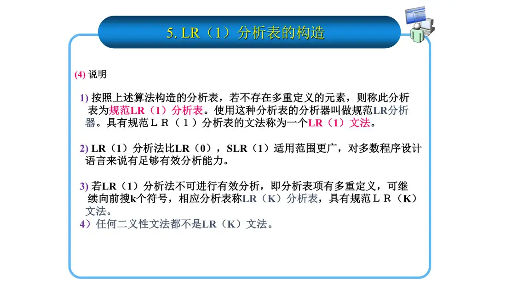

原文：

5. LR（1）分析表的构造

(4) 说明

1) 按照上述算法构造的分析表，若不存在多重定义的元素，则称此分析表为规范LR（1）分析表。使用这种分析表的分析器叫做规范LR分析器。具有规范LR（1）分析表的文法称为一个LR（1）文法。

2) LR（1）分析法比LR（0），SLR（1）适用范围更广，对多数程序设计语言来说有足够有效分析能力。

3) 若LR（1）分析法不可进行有效分析，即分析表项有多重定义，可继续向前搜k个符号，相应分析表称LR（K）分析表，具有规范LR（K）文法。

4）任何二义性文法都不是LR（K）文法。

### LALR分析表的构造

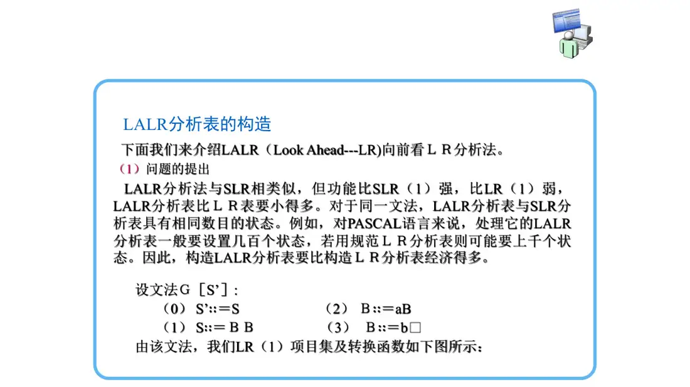

原文：

LALR分析表的构造

下面我们来介绍LALR（Look Ahead---LR)向前看LR分析法。

（1）问题的提出

LALR分析法与SLR相类似，但功能比SLR（1）强，比LR（1）弱，LALR分析表比LR表要小得多。对于同一文法，LALR分析表与SLR分析表具有相同数目的状态。例如，对PASCAL语言来说，处理它的LALR分析表一般要设置几百个状态，若用规范LR分析表则可能要上千个状态。因此，构造LALR分析表要比构造LR分析表经济得多。

设文法G［S’］:

（0） $\mathbf { S } ^ { \prime } { : : = } \mathbf { S }$

（1） $\mathbf { S } { : : } = \mathbf { B } \ \mathbf { B }$ （2） $\mathbf { B } : : = \mathbf { a B }$ （3） B∷＝b

由该文法，我们LR（1）项目集及转换函数如下图所示：

### 第 31 页

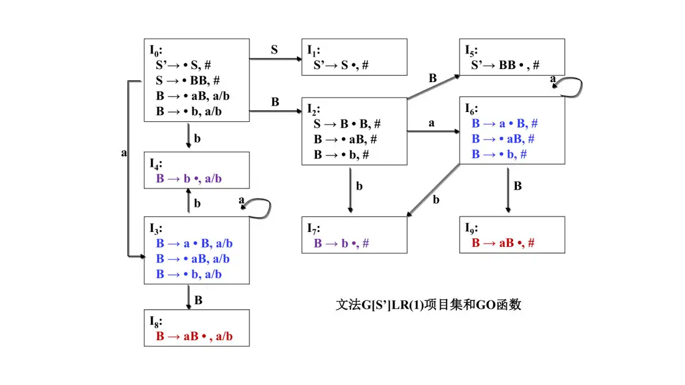

原文：

![文法G[S’]LR(1)项目集和GO函数](编译原理第4章-LR分析法课件.assets/原件图2.jpg)

### 文法G[S’]LR(1)分析表

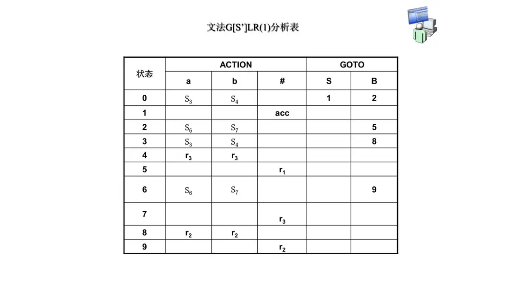

原文：

<table><tr><td rowspan="2">状态</td><td colspan="3">ACTION</td><td colspan="2">GOTO</td></tr><tr><td>a</td><td>b</td><td>#</td><td>S</td><td>B</td></tr><tr><td>0</td><td> $S_3$ </td><td> $S_4$ </td><td></td><td>1</td><td>2</td></tr><tr><td>1</td><td></td><td></td><td>acc</td><td></td><td></td></tr><tr><td>2</td><td> $S_6$ </td><td> $S_7$ </td><td></td><td></td><td>5</td></tr><tr><td>3</td><td> $S_3$ </td><td> $S_4$ </td><td></td><td></td><td>8</td></tr><tr><td>4</td><td> $r_3$ </td><td> $r_3$ </td><td></td><td></td><td></td></tr><tr><td>5</td><td></td><td></td><td> $r_1$ </td><td></td><td></td></tr><tr><td>6</td><td> $S_6$ </td><td> $S_7$ </td><td></td><td></td><td>9</td></tr><tr><td>7</td><td></td><td></td><td> $r_3$ </td><td></td><td></td></tr><tr><td>8</td><td> $r_2$ </td><td> $r_2$ </td><td></td><td></td><td></td></tr><tr><td>9</td><td></td><td></td><td> $r_2$ </td><td></td><td></td></tr></table>

文法G[S’]LR(1)分析表

### 6. LALR分析表的构造

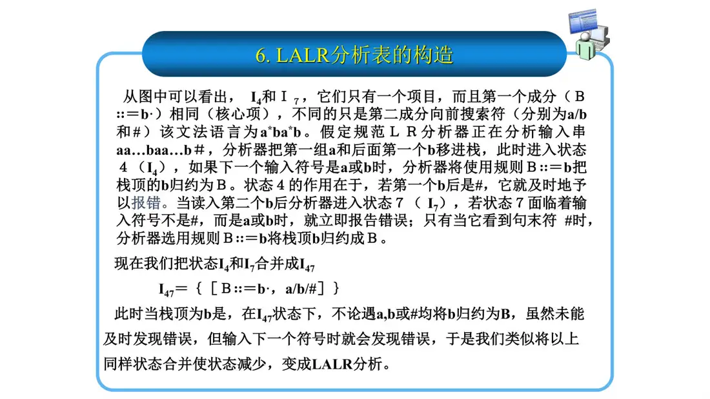

原文：

6. LALR分析表的构造

从图中可以看出， $\mathbf { I } _ { 4 }$ 和 ${ \mathrm { ~ I ~ } } _ { 7 } ,$ 它们只有一个项目，而且第一个成分（B$\mathbf { \sigma } _ { : : = \mathbf { b } } . )$ 相同（核心项），不同的只是第二成分向前搜索符（分别为a/b和#）该文法语言为a\*ba\*b。假定规范LR分析器正在分析输入串aa…baa…b＃，分析器把第一组a和后面第一个b移进栈，此时进入状态$4 ( \mathbf { I } _ { 4 } )$ ，如果下一个输入符号是a或b时，分析器将使用规则 $\mathbf { B } : : = \mathbf { b }$ 把栈顶的b归约为B。状态4的作用在于，若第一个b后是#，它就及时地予以报错。当读入第二个b后分析器进入状态 $7 \ \textup { ( } \mathbf { I } _ { 7 } )$ ，若状态7面临着输入符号不是#，而是a或b时，就立即报告错误；只有当它看到句末符 #时，分析器选用规则 $\mathbf { B } : : = \mathbf { b }$ 将栈顶b归约成B。

现在我们把状态 $\mathbf { I _ { 4 } } \Re \mathbf { I _ { 7 } }$ 合并成 $\mathbf { I } _ { 4 7 }$

$$
\mathbf {I} _ {4 7} = \{\left[ \mathrm{B}: := \mathbf {b} \cdot , \mathbf {a} / \mathbf {b} / \# \right] \}
$$

此时当栈顶为b是，在 $\mathbf { I } _ { 4 7 }$ 状态下，不论遇 $^ { \mathbf { a } , \mathbf { b } }$ 或#均将b归约为B，虽然未能及时发现错误，但输入下一个符号时就会发现错误，于是我们类似将以上同样状态合并使状态减少，变成LALR分析。

### （2）同心集的概念

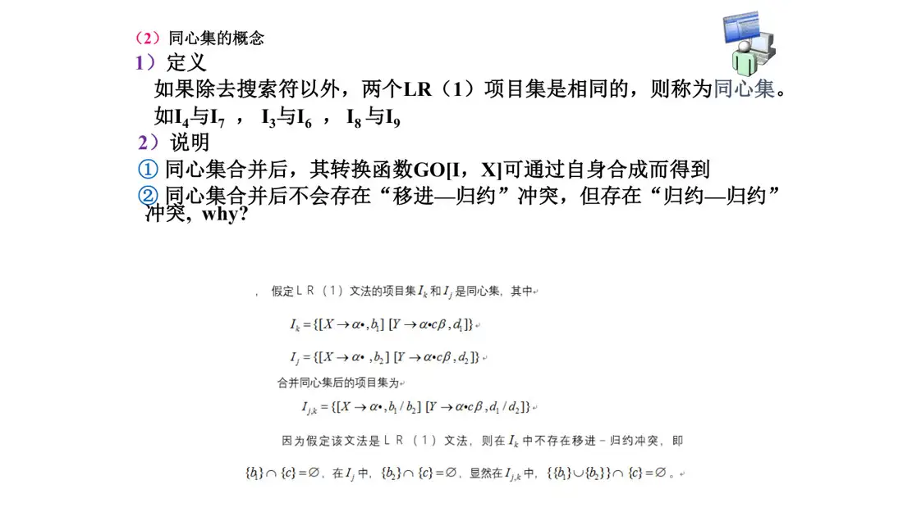

原文：

（2）同心集的概念

1）定义

如果除去搜索符以外，两个LR（1）项目集是相同的，则称为同心集。如 $\mathbf { I } _ { 4 }$ 与 $\mathbf { I } _ { 7 }$ ， $\mathbf { I } _ { 3 }$ 与 ${ \mathbf { I } } _ { 6 } \ , \ { \mathbf { I } } _ { 8 }$ 与 $\mathbf { I _ { 9 } }$

2）说明

① 同心集合并后，其转换函数GO[I， $\mathbf { X } ]$ 可通过自身合成而得到

② 同心集合并后不会存在“移进—归约”冲突，但存在“归约—归约”冲突, why?

，假定LR（1）文法的项目集 $I _ { k }$ 和 $I _ { j }$ 是同心集，其中

$$
I _ {k} = \left\{\left[ X \rightarrow \alpha \bullet , b _ {1} \right]\left[ Y \rightarrow \alpha \bullet c \beta , d _ {1} \right]\right\}
$$

$$
I _ {j} = \left\{\left[ X \rightarrow \alpha^ {\bullet}, b _ {2} \right]\left[ Y \rightarrow \alpha^ {\bullet} c \beta , d _ {2} \right]\right\} +
$$

合并同心集后的项目集为

$$
I _ {j, k} = \left\{\left[ X \rightarrow \alpha \bullet , b _ {1} / b _ {2} \right]\left[ Y \rightarrow \alpha \bullet c \beta , d _ {1} / d _ {2} \right]\right\}
$$

因为假定该文法是LR（1）文法，则在 $I _ { k }$ 中不存在移进－归约冲突，即

$\{ b \} \cap \{ c \} = \emptyset$ ，在 $I _ { j }$ 中， $\{ b _ { 2 } \} \cap \{ c \} = \emptyset$ ，显然在 $I _ { j , k }$ 中， $\{ \{ b _ { 1 } \} \cup \{ b _ { 2 } \} \} \cap \{ c \} = \emptyset$

### 归约-归约冲突示例

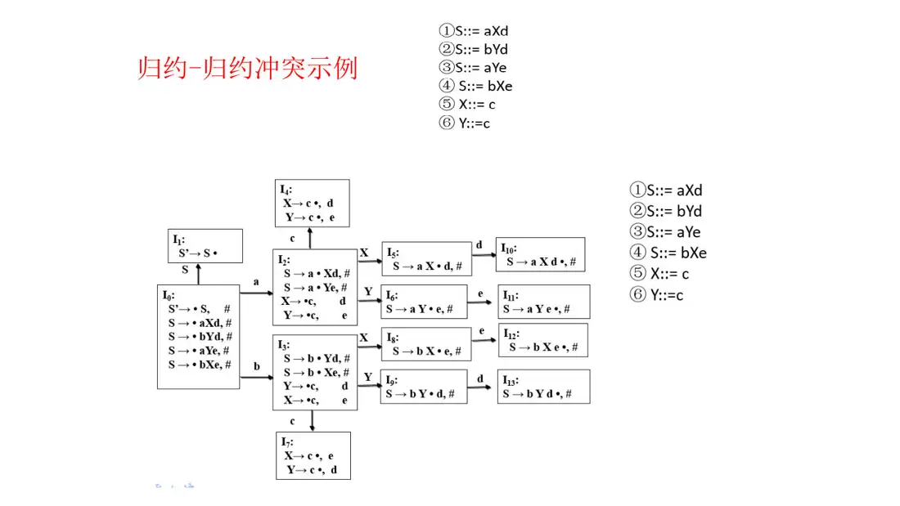

原文：

归约-归约冲突示例

$$
① S: := a X d
$$

$$
② S: := b Y d
$$

$$
③ S: := a Y e
$$

④ $\mathsf { S } { : : = } \mathsf { b } \mathsf { X } \mathsf { e }$

$$
⑤ X: := c
$$

6 $\mathsf { Y } ; : : = \mathsf { c }$

$$
① S: := a X d
$$

$$
② S: := b Y d
$$

$$
③ S: := a Y e
$$

$$
④ S: := b X e
$$

⑤ $\mathsf { X } { : : = } { \mathsf { c } }$

6 $\mathtt { Y } : : = { \mathtt { C } }$

### (3) LALR分析表构造算法

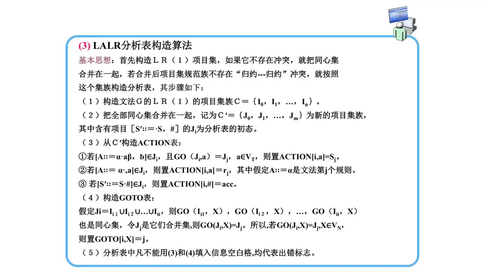

原文：

(3) LALR分析表构造算法

基本思想：首先构造LR（1）项目集，如果它不存在冲突，就把同心集合并在一起，若合并后项目集规范族不存在“归约---归约”冲突，就按照这个集族构造分析表，其步骤如下：

（1）构造文法G的LR（1）的项目集族 $\mathrm { { C } = \left\{ I _ { 0 } , \ I _ { 1 } , \ . . . , \ I _ { n } \right\} }$ o

（2）把全部同心集合并在一起，记为 $\mathsf C \prime = \{ \mathsf J _ { 0 } , \mathsf J _ { 1 } , \mathsf \Delta \to \mathsf J _ { m } \}$ ｝为新的项目集族，其中含有项目 $[ \mathbf { S ^ { \prime } } \mathbf { : : } = \mathbf { \cdot } \mathbf { S } ,$ #］的J为分析表的初态。

（3）从C′构造ACTION表：

①若 $[ \mathbf { A } { \boldsymbol { : : } } = \mathbf { a } { \boldsymbol { \cdot } } \mathbf { a } \mathbf { \beta } , \mathbf { b } ] { \in } \mathbf { J } _ { \mathrm { i } } ,$ 且 $\mathbf { G O } \ \left( \mathbf { J _ { i } } , \mathbf { a } \right) \ = \mathbf { J _ { j } } , \ \mathbf { a } \in \mathbf { V _ { T } } ,$ 则置 $\mathbf { A C T I O N } [ \mathbf { i } , \mathbf { a } ] { = } \mathbf { S _ { j } } { \circ }$

②若 $[ \mathbf { A } { : : } = \mathbf { a } { \cdot , } \mathbf { a } ] \in \mathbf { J } _ { \mathrm { i } } ,$ 则置 $\mathbf { A C T I O N } [ \mathbf { i } , \mathbf { a } ] = \mathbf { r _ { j } } ,$ 其中假定 $\mathbf { A } { : } { : } = \mathbf { a } { \mathrm { . } }$ 是文法第j个规则。

③ 若 $\begin{array} { r } { [ \mathbf { S } ^ { \prime } { : : = } \mathbf { S } ^ { \prime } \# ] \in \mathbf { J } _ { \mathrm { i } } , } \end{array}$ 则置 $\mathbf { A C T I O N [ i , \# ] } { = } \mathbf { a c c }$ 。

（4）构造GOTO表：

假定 $\mathbf { J i } { = } \mathbf { I _ { i \thinspace 1 } } \cup \mathbf { I _ { i \thinspace 2 } } \cup \ldots \cup \mathbf { I _ { i t } } ,$ 则 $\bf G O _ { \alpha } ( \bf I _ { i 1 } , \psi \Delta X )$ $\mathbf { G O } \ ( \mathbf { I _ { i 2 } } , \ \mathbf { X } ) \ , \ \dots , \ \mathbf { G O } \ ( \mathbf { I _ { i t } } , \ \mathbf { X } )$ 也是同心集，令Jj是它们合并集,则 $\bf G O ( J _ { i } , X ) { = } J _ { j } { \circ }$ 所以,若 $\mathbf { \mathrm { G O } } ( \mathbf { J _ { i } } , \mathbf { X } ) { = } \mathbf { J _ { j } } , \mathbf { X } { \in } \mathbf { V } _ { \mathbf { N } } ,$ 则置 $\mathbf { G O T O [ i , X ] = j }$

（5）分析表中凡不能用(3)和(4)填入信息空白格,均代表出错标志。

### $$

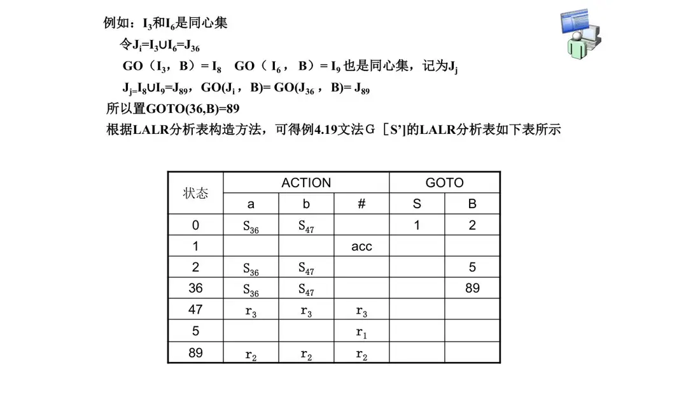

原文：

例如： $\mathbf { I } _ { 3 } \Re \mathbb { I } \mathbf { I } _ { 6 }$ 是同心集

令 $\mathrm { \bf J _ { i } } { = } \mathrm { \bf I } _ { 3 } \cup \mathrm { \bf I } _ { 6 } { = } \mathrm { \bf J } _ { 3 6 }$

$\begin{array} { r } { \mathbf { G O } \ \left( \mathbf { I } _ { 3 } , \ \mathbf { B } \right) = \mathbf { I } _ { 8 } \quad \mathbf { G O } \ \left( \begin{array} { l l } { \mathbf { I } _ { 6 } , } & { \mathbf { B } } \end{array} \right) = \mathbf { I _ { 9 } } } \end{array}$ 也是同心集，记为 $\mathbf { J _ { j } }$

$$
\mathrm{J} _ {\mathrm{j}} = \mathrm{I} _ {8} \cup \mathrm{I} _ {9} = \mathrm{J} _ {8 9}, \quad \mathrm{GO} (\mathrm{J} _ {\mathrm{i}}, \quad \mathrm{B}) = \mathrm{GO} (\mathrm{J} _ {3 6}, \quad \mathrm{B}) = \mathrm{J} _ {8 9}
$$

所以置GOTO(36,B)=89

根据LALR分析表构造方法，可得例4.19文法G［S’]的LALR分析表如下表所示

<table><tr><td rowspan="2">状态</td><td colspan="3">ACTION</td><td colspan="2">GOTO</td></tr><tr><td>a</td><td>b</td><td>#</td><td>S</td><td>B</td></tr><tr><td>0</td><td> $S_{36}$ </td><td> $S_{47}$ </td><td></td><td>1</td><td>2</td></tr><tr><td>1</td><td></td><td></td><td>acc</td><td></td><td></td></tr><tr><td>2</td><td> $S_{36}$ </td><td> $S_{47}$ </td><td></td><td></td><td>5</td></tr><tr><td>36</td><td> $S_{36}$ </td><td> $S_{47}$ </td><td></td><td></td><td>89</td></tr><tr><td>47</td><td> $r_3$ </td><td> $r_3$ </td><td> $r_3$ </td><td></td><td></td></tr><tr><td>5</td><td></td><td></td><td> $r_1$ </td><td></td><td></td></tr><tr><td>89</td><td> $r_2$ </td><td> $r_2$ </td><td> $r_2$ </td><td></td><td></td></tr><tr><td>0</td><td> $S_3$ </td><td> $S_4$ </td><td></td><td>1</td><td>2</td></tr><tr><td>1</td><td></td><td></td><td>acc</td><td></td><td></td></tr><tr><td>2</td><td> $S_6$ </td><td> $S_7$ </td><td></td><td></td><td>5</td></tr><tr><td>3</td><td> $S_3$ </td><td> $S_4$ </td><td></td><td></td><td>8</td></tr><tr><td>4</td><td> $r_3$ </td><td> $r_3$ </td><td></td><td></td><td></td></tr><tr><td>5</td><td></td><td></td><td> $r_1$ </td><td></td><td></td></tr><tr><td>6</td><td> $S_6$ </td><td> $S_7$ </td><td></td><td></td><td>9</td></tr><tr><td>7</td><td></td><td></td><td> $r_3$ </td><td></td><td></td></tr><tr><td>8</td><td> $r_2$ </td><td> $r_2$ </td><td></td><td></td><td></td></tr><tr><td>9</td><td></td><td></td><td> $r_2$ </td><td></td><td></td></tr></table>

### 则称它为LALR分析表，利用LALRLALR分析表的文法称为LALR（1）

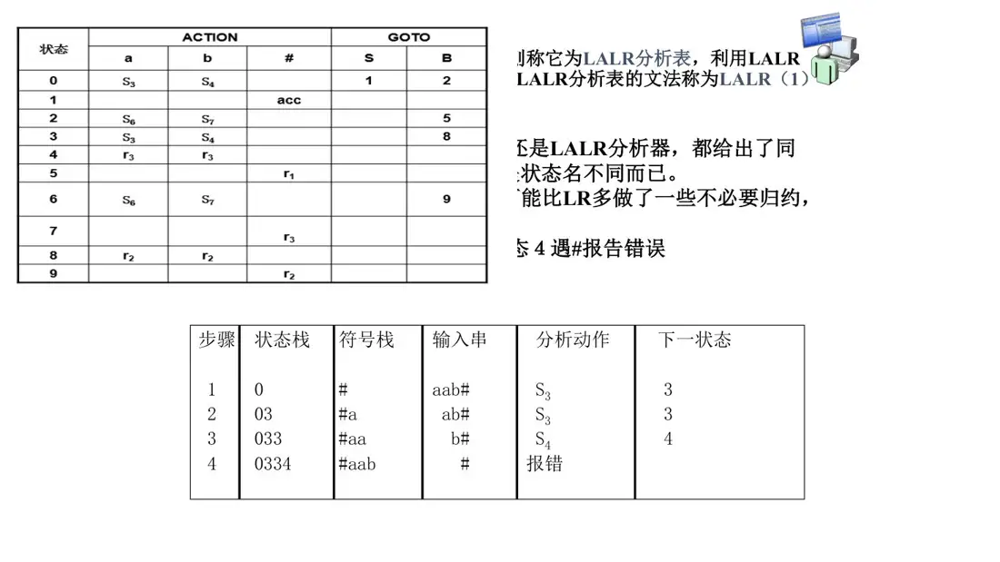

原文：

则称它为LALR分析表，利用LALRLALR分析表的文法称为LALR（1）

还是LALR分析器，都给出了同状态名不同而已。能比LR多做了一些不必要归约，

态4遇#报告错误

<table><tr><td>步骤</td><td>状态栈</td><td>符号栈</td><td>输入串</td><td>分析动作</td><td>下一状态</td></tr><tr><td>1</td><td>0</td><td>#</td><td>aab#</td><td> $S_3$ </td><td>3</td></tr><tr><td>2</td><td>03</td><td>#a</td><td>ab#</td><td> $S_3$ </td><td>3</td></tr><tr><td>3</td><td>033</td><td>#a</td><td>b#</td><td> $S_4$ </td><td>4</td></tr><tr><td>4</td><td>0334</td><td>#a</td><td>#</td><td>报错</td><td></td></tr></table>

### 第 39 页

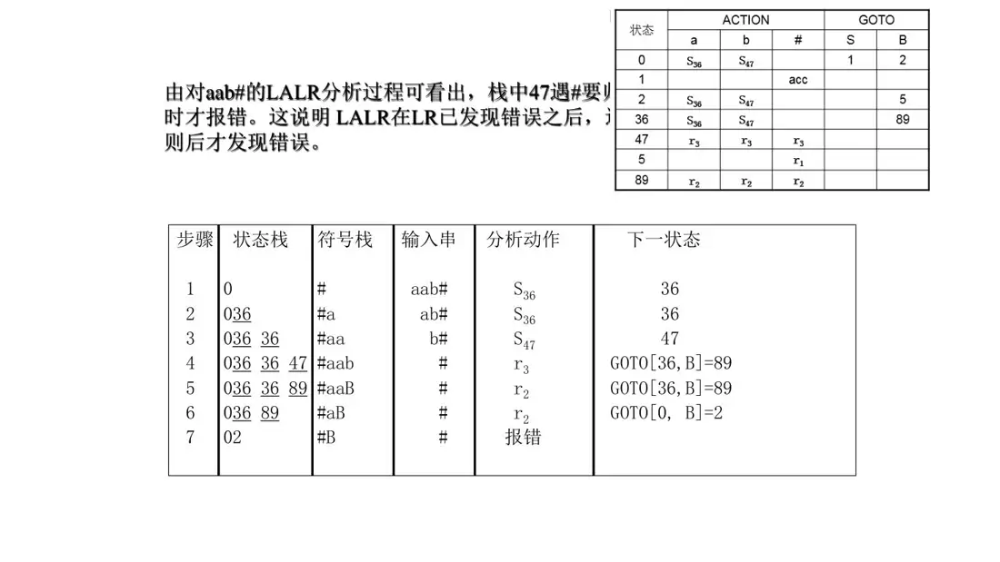

原文：

由对aab#的LALR分析过程可看出，栈中47遇#要时才报错。这说明 LALR在LR已发现错误之后，则后才发现错误。

<table><tr><td rowspan="2">状态</td><td colspan="3">ACTION</td><td colspan="2">GOTO</td></tr><tr><td>a</td><td>b</td><td>#</td><td>S</td><td>B</td></tr><tr><td>0</td><td> $S_{36}$ </td><td> $S_{47}$ </td><td></td><td>1</td><td>2</td></tr><tr><td>1</td><td></td><td></td><td>acc</td><td></td><td></td></tr><tr><td>2</td><td> $S_{36}$ </td><td> $S_{47}$ </td><td></td><td></td><td>5</td></tr><tr><td>36</td><td> $S_{36}$ </td><td> $S_{47}$ </td><td></td><td></td><td>89</td></tr><tr><td>47</td><td> $r_3$ </td><td> $r_3$ </td><td> $r_3$ </td><td></td><td></td></tr><tr><td>5</td><td></td><td></td><td> $r_1$ </td><td></td><td></td></tr><tr><td>89</td><td> $r_2$ </td><td> $r_2$ </td><td> $r_2$ </td><td></td><td></td></tr></table>

<table><tr><td>步骤</td><td>状态栈</td><td>符号栈</td><td>输入串</td><td>分析动作</td><td>下一状态</td></tr><tr><td>1</td><td>0</td><td>#</td><td>aab#</td><td> $S_{36}$ </td><td>36</td></tr><tr><td>2</td><td>036</td><td>#a</td><td>ab#</td><td> $S_{36}$ </td><td>36</td></tr><tr><td>3</td><td>036 36</td><td>#aa</td><td>b#</td><td> $S_{47}$ </td><td>47</td></tr><tr><td>4</td><td>036 36 47</td><td>#aab</td><td>#</td><td> $r_3$ </td><td>GOTO[36, B]=89</td></tr><tr><td>5</td><td>036 36 89</td><td>#aAB</td><td>#</td><td> $r_2$ </td><td>GOTO[36, B]=89</td></tr><tr><td>6</td><td>036 89</td><td>#aB</td><td>#</td><td> $r_2$ </td><td>GOTO[0, B]=2</td></tr><tr><td>7</td><td>02</td><td>#B</td><td>#</td><td>报错</td><td></td></tr></table>

### 究竟如何判断某文法是LR（0），SLR（1），LALR（1），还是LR（1）呢？

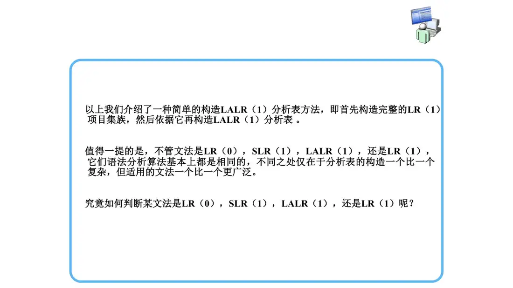

原文：

以上我们介绍了一种简单的构造LALR（1）分析表方法，即首先构造完整的LR（1）项目集族，然后依据它再构造LALR（1）分析表 。

值得一提的是，不管文法是LR（0），SLR（1），LALR（1），还是LR（1），它们语法分析算法基本上都是相同的，不同之处仅在于分析表的构造一个比一个复杂，但适用的文法一个比一个更广泛。

究竟如何判断某文法是LR（0），SLR（1），LALR（1），还是LR（1）呢？

### 第 41 页

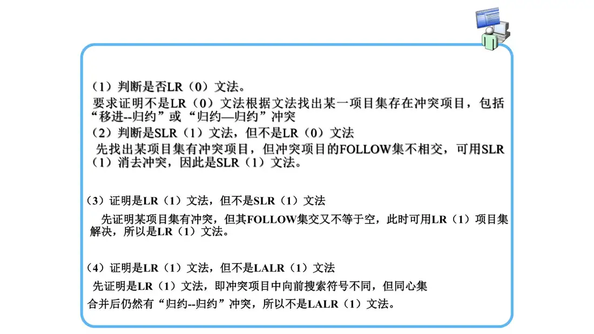

原文：

（1）判断是否LR（0）文法。要求证明不是LR（0）文法根据文法找出某一项目集存在冲突项目，包括“移进--归约”或 “归约—归约”冲突（2）判断是SLR（1）文法，但不是LR（0）文法先找出某项目集有冲突项目，但冲突项目的FOLLOW集不相交，可用SLR（1）消去冲突，因此是SLR（1）文法。

（3）证明是LR（1）文法，但不是SLR（1）文法先证明某项目集有冲突，但其FOLLOW集交又不等于空，此时可用LR（1）项目集解决，所以是LR（1）文法。

（4）证明是LR（1）文法，但不是LALR（1）文法先证明是LR（1）文法，即冲突项目中向前搜索符号不同，但同心集合并后仍然有“归约--归约”冲突，所以不是LALR（1）文法。

### 几点结论：

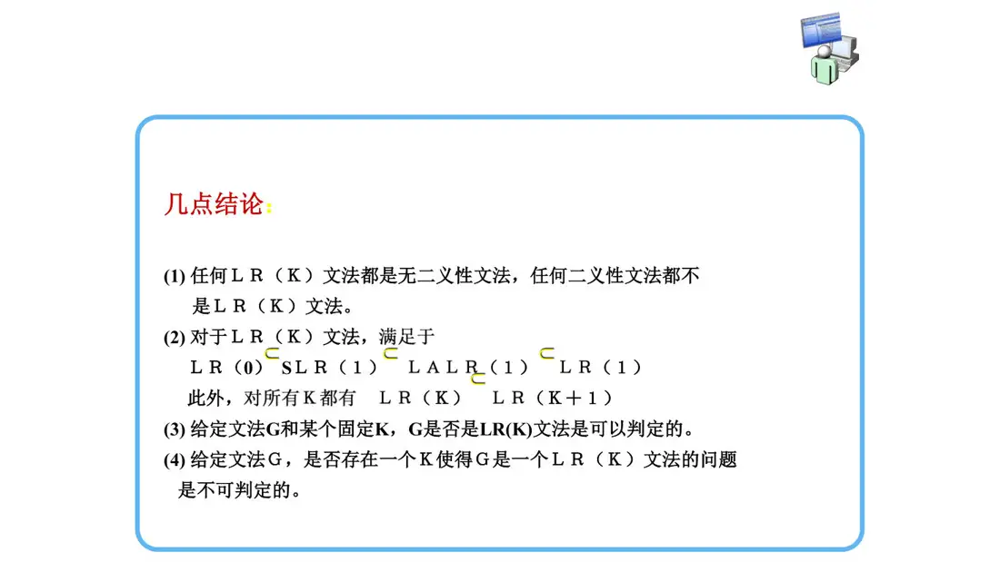

原文：

几点结论：

(1)任何LR（K）文法都是无二义性文法，任何二义性文法都不是LR（K）文法。

(2)对于LR（K）文法，满足于LR（0） SLR（1） LALR（1） LR（1）此外，对所有K都有LR（K） LR（K+1）

(3) 给定文法G和某个固定K，G是否是LR(K)文法是可以判定的。

(4) 给定文法G，是否存在一个K使得G是一个LR（K）文法的问题是不可判定的。

### 二义性文法的应用

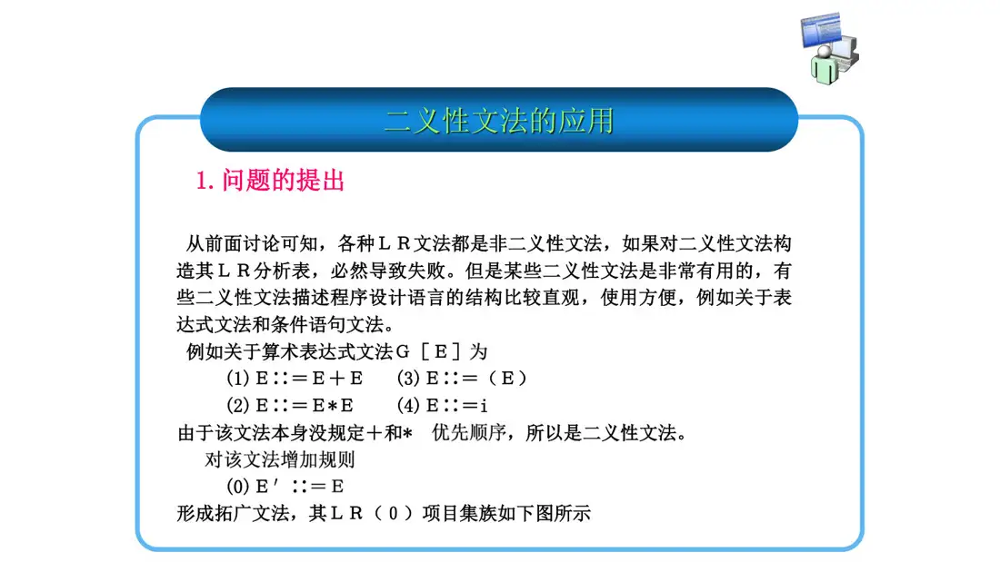

原文：

二义性文法的应用

1.问题的提出

从前面讨论可知，各种LR文法都是非二义性文法，如果对二义性文法构造其LR分析表，必然导致失败。但是某些二义性文法是非常有用的，有些二义性文法描述程序设计语言的结构比较直观，使用方便，例如关于表达式文法和条件语句文法。

例如关于算术表达式文法G［E］为

(1) $\operatorname { E } : : = \operatorname { E } + \operatorname { E }$ (3) $\boldsymbol { \mathrm { E } } : : = \mathrm { ~ ( ~ E ~ ) ~ }$

(2) $\begin{array} { r } { \mathrm { E } : : = \mathrm { E } * \mathrm { E } } \end{array}$ (4) $\mathbf { E } : : = \mathbf { i }$

由于该文法本身没规定＋和\*优先顺序，所以是二义性文法。

对该文法增加规则

(0) $\mathrm { ~ E ~ } ^ { \prime } : : : = \mathrm { E }$

形成拓广文法，其LR（0）项目集族如下图所示

### 二义文法的LR(0)项目集

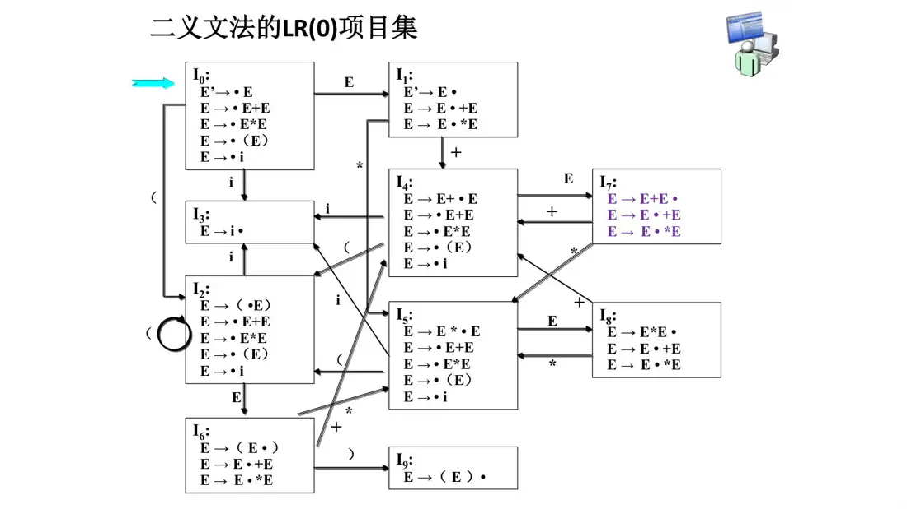

原文：

二义文法的LR(0)项目集

### 1.问题的提出

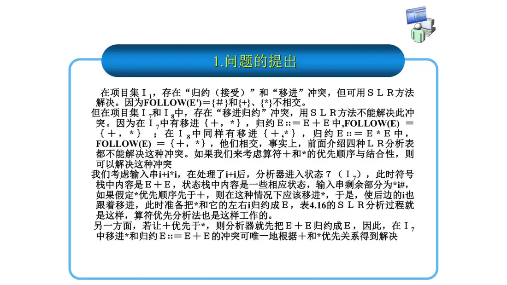

原文：

1.问题的提出

在项目集 $\mathrm { ~ I ~ } _ { 1 } ,$ 存在“归约（接受）”和“移进”冲突，但可用SLR方法解决。因为 $\mathbf { F O L L O W } ( \mathbf { E ^ { \prime } } ) = \left\{ \begin{array} { r l } \end{array} \right.$ {＃}和{+}、{\*}不相交。

但在项目集I 和 ${ \mathrm { ~ I ~ } } _ { 8 }$ 中，存在“移进归约”冲突，用SLR方法不能解决此冲突。因为在I 中有移进 $\{ + , \ast \}$ ，归约 $\operatorname { E } : : = \operatorname { E } + \operatorname { E }$ 中, $\mathbf { \sigma } _ { \mathbf { \lambda } } \mathbf { \mathcal { F } } \mathbf { \sigma } _ { \mathbf { \lambda } } \mathbf { \delta } _ { \mathbf { \lambda } } \mathbf { \delta } _ { \mathbf { \lambda } } \mathbf { \delta } _ { \mathbf { \lambda } } \mathbf { \delta } _ { \mathbf { \lambda } } = \mathbf { \delta } _ { \mathbf { \lambda } }$ $\{ \ : + \ : , \ : \ : * \}$ ；在 ${ \mathrm { ~ I ~ } } _ { 8 }$ 中同样有移进 $\{ + , ^ { \ast } \}$ ， 归 约 $\boldsymbol { \mathrm { ~ E ~ } } : : = \boldsymbol { \mathrm { ~ E ~ } } ^ { * }$ E中，$\mathbf { F O L L O W ( E ) } = \{ + , \ * \}$ ，他们相交，事实上，前面介绍四种LR分析表都不能解决这种冲突。如果我们来考虑算符＋和\*的优先顺序与结合性，则可以解决这种冲突

我们考虑输入串i+i\*i，在处理了i+i后，分析器进入状态 $\textbf { 7 } \ : ( \textbf { I } _ { 7 } )$ ，此时符号栈中内容是E＋E，状态栈中内容是一些相应状态，输入串剩余部分为\*i#，如果假定\*优先顺序先于＋，则在这种情况下应该移进\*，于是，使后边的i也跟着移进，此时准备把\*和它的左右i归约成E，表4.16的SLR分析过程就是这样，算符优先分析法也是这样工作的。

另一方面，若让＋优先于\*，则分析器就先把E＋E归约成E，因此，在I中移进\*和归约 $\mathbb { E } : : = \mathbb { E } + \mathbb { E }$ 的冲突可唯一地根据＋和\*优先关系得到解决

### 2.二义性文法分析表的构造

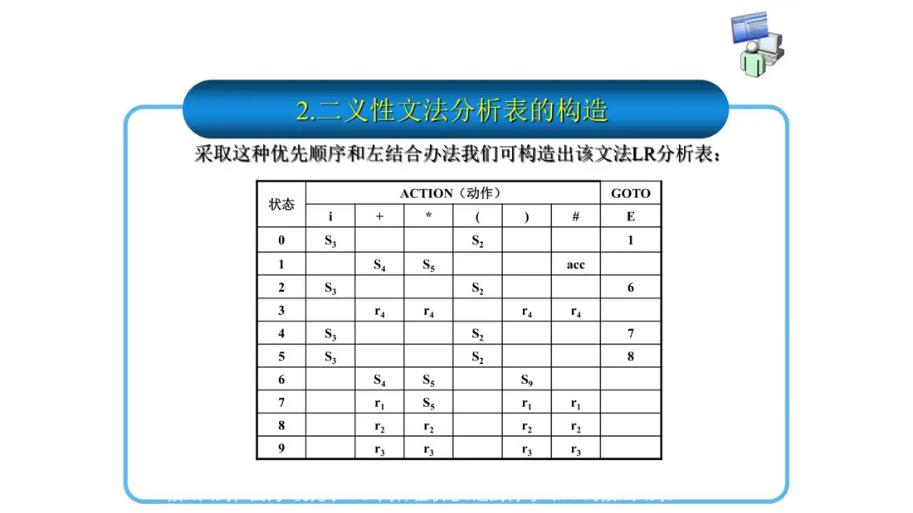

原文：

2.二义性文法分析表的构造

采取这种优先顺序和左结合办法我们可构造出该文法LR分析表：

<table><tr><td rowspan="2">状态</td><td colspan="6">ACTION(动作)</td><td>GOTO</td></tr><tr><td>i</td><td>+</td><td>*</td><td>(</td><td>)</td><td>#</td><td>E</td></tr><tr><td>0</td><td> $S_3$ </td><td></td><td></td><td> $S_2$ </td><td></td><td></td><td>1</td></tr><tr><td>1</td><td></td><td> $S_4$ </td><td> $S_5$ </td><td></td><td></td><td>acc</td><td></td></tr><tr><td>2</td><td> $S_3$ </td><td></td><td></td><td> $S_2$ </td><td></td><td></td><td>6</td></tr><tr><td>3</td><td></td><td> $r_4$ </td><td> $r_4$ </td><td></td><td> $r_4$ </td><td> $r_4$ </td><td></td></tr><tr><td>4</td><td> $S_3$ </td><td></td><td></td><td> $S_2$ </td><td></td><td></td><td>7</td></tr><tr><td>5</td><td> $S_3$ </td><td></td><td></td><td> $S_2$ </td><td></td><td></td><td>8</td></tr><tr><td>6</td><td></td><td> $S_4$ </td><td> $S_5$ </td><td></td><td> $S_9$ </td><td></td><td></td></tr><tr><td>7</td><td></td><td> $r_1$ </td><td> $S_5$ </td><td></td><td> $r_1$ </td><td> $r_1$ </td><td></td></tr><tr><td>8</td><td></td><td> $r_2$ </td><td> $r_2$ </td><td></td><td> $r_2$ </td><td> $r_2$ </td><td></td></tr><tr><td>9</td><td></td><td> $r_3$ </td><td> $r_3$ </td><td></td><td> $r_3$ </td><td> $r_3$ </td><td></td></tr></table>

### 2.二义性文法分析表的构造

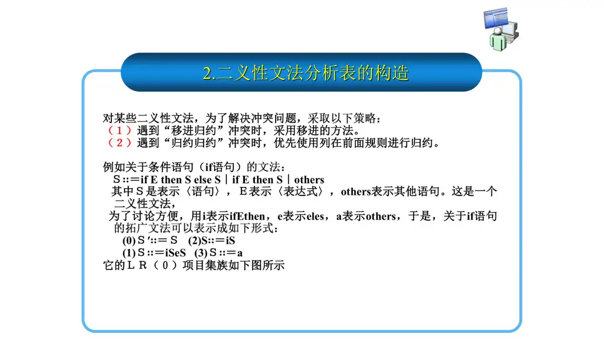

原文：

2.二义性文法分析表的构造

对某些二义性文法，为了解决冲突问题，采取以下策略：

（1）遇到“移进归约”冲突时，采用移进的方法。

（2）遇到“归约归约”冲突时，优先使用列在前面规则进行归约。

例如关于条件语句（if语句）的文法：

其中S是表示〈语句〉，E表示〈表达式〉，others表示其他语句。这是一个二义性文法，

为了讨论方便，用i表示ifEthen，e表示eles，a表示others，于是，关于if语句的拓广文法可以表示成如下形式：

$$
(0) \mathrm{S} ^ {\prime}: := \mathrm{S} \quad (2) \mathrm{S}: := \mathrm{iS}
$$

它的LR（0）项目集族如下图所示

### 第 48 页

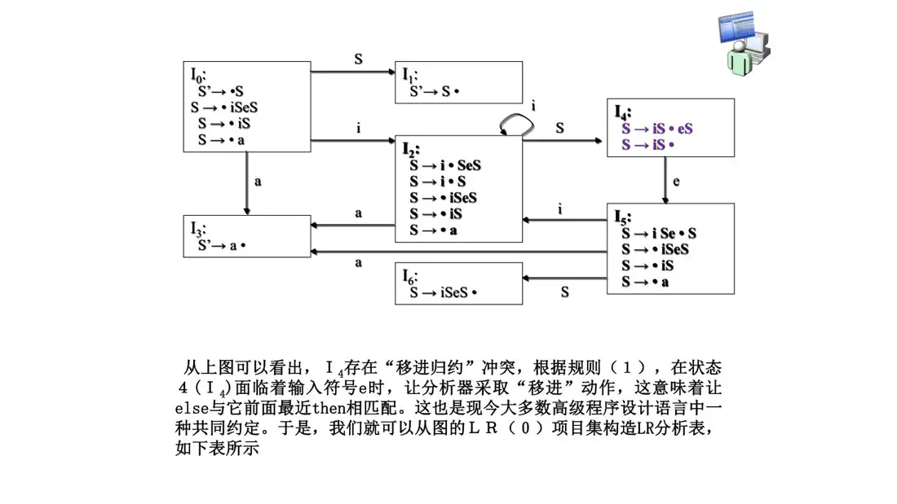

原文：

从上图可以看出， ${ \mathrm { ~ I ~ } } _ { 4 }$ 存在“移进归约”冲突，根据规则（1），在状态$4 \mathrm { ~ ( ~ I ~ } _ { 4 } )$ 面临着输入符号e时，让分析器采取“移进”动作，这意味着让$\mathsf { e l s e }$ 与它前面最近then相匹配。这也是现今大多数高级程序设计语言中一种共同约定。于是，我们就可以从图的LR（0）项目集构造LR分析表，如下表所示

### 二义if…then…else文法LR(0)项目表

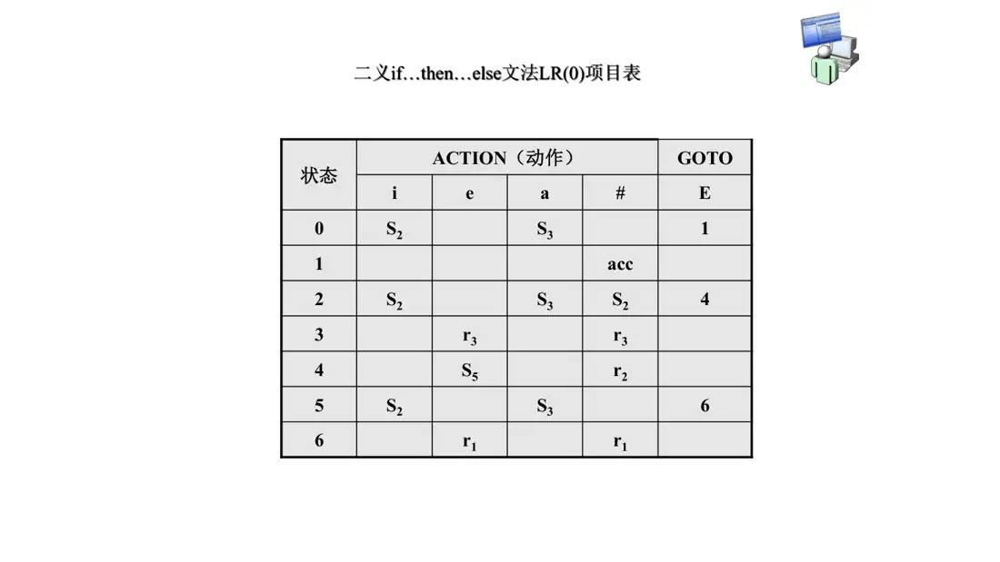

原文：

<table><tr><td rowspan="2">状态</td><td colspan="4">ACTION(动作)</td><td>GOTO</td></tr><tr><td>i</td><td>e</td><td>a</td><td>#</td><td>E</td></tr><tr><td>0</td><td> $S_2$ </td><td></td><td> $S_3$ </td><td></td><td>1</td></tr><tr><td>1</td><td></td><td></td><td></td><td>acc</td><td></td></tr><tr><td>2</td><td> $S_2$ </td><td></td><td> $S_3$ </td><td> $S_2$ </td><td>4</td></tr><tr><td>3</td><td></td><td> $r_3$ </td><td></td><td> $r_3$ </td><td></td></tr><tr><td>4</td><td></td><td> $S_5$ </td><td></td><td> $r_2$ </td><td></td></tr><tr><td>5</td><td> $S_2$ </td><td></td><td> $S_3$ </td><td></td><td>6</td></tr><tr><td>6</td><td></td><td> $r_1$ </td><td></td><td> $r_1$ </td><td></td></tr></table>

二义if…then…else文法LR(0)项目表

### 第 50 页

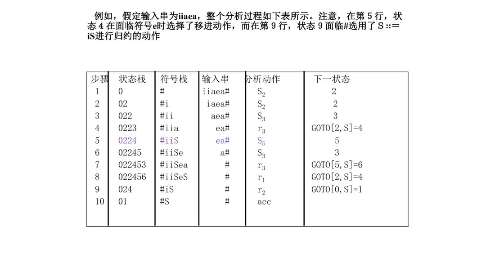

原文：

例如，假定输入串为iiaea，整个分析过程如下表所示。注意，在第5行，状态4在面临符号e时选择了移进动作，而在第9行，状态9面临#选用了S∷＝iS进行归约的动作

<table><tr><td>步骤</td><td>状态栈</td><td>符号栈</td><td>输入串</td><td>分析动作</td><td>下一状态</td></tr><tr><td>1</td><td>0</td><td>#</td><td>iiaea#</td><td> $S_{2}$ </td><td>2</td></tr><tr><td>2</td><td>02</td><td>#i</td><td>iaea#</td><td> $S_{2}$ </td><td>2</td></tr><tr><td>3</td><td>022</td><td>#ii</td><td>aea#</td><td> $S_{3}$ </td><td>3</td></tr><tr><td>4</td><td>0223</td><td>#iia</td><td>ea#</td><td> $r_{3}$ </td><td>GOTO[2, S]=4</td></tr><tr><td>5</td><td>0224</td><td>#iIS</td><td>ea#</td><td> $S_{5}$ </td><td>5</td></tr><tr><td>6</td><td>02245</td><td>#iiSe</td><td>a#</td><td> $S_{3}$ </td><td>3</td></tr><tr><td>7</td><td>022453</td><td>#iISea</td><td>#</td><td> $r_{3}$ </td><td>GOTO[5, S]=6</td></tr><tr><td>8</td><td>022456</td><td>#iISes</td><td>#</td><td> $r_{1}$ </td><td>GOTO[2, S]=4</td></tr><tr><td>9</td><td>024</td><td>#iS</td><td>#</td><td> $r_{2}$ </td><td>GOTO[0, S]=1</td></tr><tr><td>10</td><td>01</td><td>#S</td><td>#</td><td>acc</td><td></td></tr></table>

### 语法分析程序的自动生成

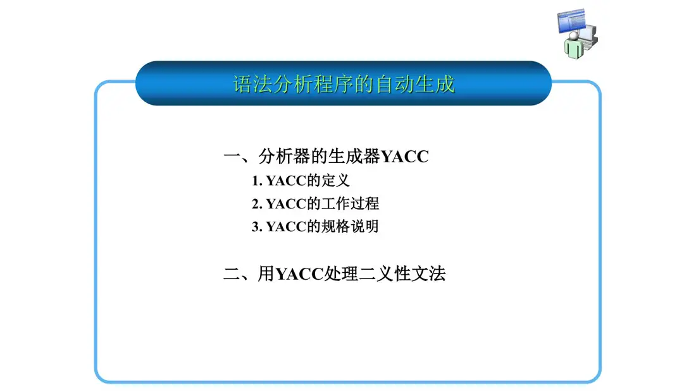

原文：

语法分析程序的自动生成

一、分析器的生成器YACC
1. YACC的定义
2. YACC的工作过程
3. YACC的规格说明
二、用YACC处理二义性文法

### 语法分析程序的自动生成

原文：

语法分析程序的自动生成

随着许多新语言的出现及计算机技术的发展，人们对开发编译程序的软件工具的需求大大增长。以LR文法和分析方法为基础，从上个世纪70年代开始出现自动生成语法分析程序的工具。YACC（Yet Another Compiler-Compiler）就是其中最杰出代表。该系统是美国贝尔实验室的软件产品，为UNIX操作系统下的一个软件开发工具。它是由S·C·Johnson设计的。目前已经移植到多种操作系统上，并已成功开发了许多编译系统，深受软件工作者所喜爱。

### 分析器的生成器YACC

原文：

分析器的生成器YACC

1.YACC的定义

YACC是一个程序(软件工具），它接受LALR文法类，用户提供关于语法分析器的规格说明，基于LALR语法分析的原理，自动构造一个语法分析器；并且能根据规格说明中给出的语义动作建立规定的翻译。

### YACC的工作过程

原文：

YACC的工作过程

(1)首先需要准备一个包含编译器性能规格的YACC说明文件，例如translate.y表示。

(2)在UNIX环境下用命令yacc translate.y，使用LALR方法可把文件translate.y翻译成C程序。我们用y.tab.c表示，程序y.tab.c包含用C语言写的LALR分析器和用户准备的C语言程序。

(3)为了使LALR分析表少占空间，使用了合并技术压缩分析表规模，用命令ccy.tab.c-ly对y.tab进行编译，其中ly表示使用LR分析程序的库，编译结果得到目标程序a.out。它完成YACC程序指定的翻译。

(4)如果需要其它过程，它们可以和y.tab.c一起编译或装入，就和使用任何C程序一样。

### YACC的工作过程如下图所示

原文：

YACC的工作过程如下图所示

### YACC的规格说明

原文：

YACC的规格说明

YACC的语言程序也称YACC规格说明，和第三章介绍的LEX规格说明类似。它是由说明部分、翻译规则和辅助过程三部分组成，各部分之间用双百分号分隔，如下图所示。

说明部分

％％

翻译规则

％％

辅助过程

### E∷＝E＋T｜T

原文：

为了说明怎样准备YACC的源程序，我们构造一个简单台式计算器，它读一个算术表达式，计算它，并打印它的值。设算术表达式文法如下:

E∷＝E＋T｜T

F∷＝（E）｜digit

其中digit表示0～9的数字。根据这一文法写出YACC的规格说明如

下：

（1）％｛

（ 2） #include〈ctype.h

（3）％｝

（4）token DIGIT

（5）％％

在规格说明里，第（1）～（4）行是YACC规格说明的说明部分，其中包括可供选择的两部分。用％｛和％｝括起来的部分是C语言程序的正规说明，可以说明翻译规则和辅助过程里使用的变量和函数的类型。这里用第（2）行所示的蕴含控制行代替全部说明，具体说明在文件ctype.h里。第（4）行的说明指出DIGIT是token类型的词汇，供后面两部分引用。

### 第一个产生式的左部非终结符看成是文法的开始符号。

原文：

第一个产生式的左部非终结符看成是文法的开始符号。

第（6）～（16）行是翻译规则，每条规则由文法产生式和相关的语义动作组成。形如左部∷＝右部1｜右部2｜…｜右部n｜的规则，在YACC规格说明里写成 左部：右部1{语义动作1} |右部2｛语义动作2｝｜右部n｛语义动作n｝；在YACC产生式里，用单引号括起来的单个字符’c’看成是终结符号c，没括起来并且也没被说明成token类型的字母数字串看成是非终结符号。产生式的左部非终结符之后是一个冒号，可选的右部可以用竖线分隔。在产生式的末尾，即其所有右部和语义动作之后，用分号表示结束。

YACC的语义动作是C语言的语句序列。在语义动作里，符号\$\$表示和左部非终结符相关的属性值，\$1表示和产生式右部第一个文法符号（终结符或非终结符）相关的属性值，\$3表示和产生式右部第三个文法符号相关的语义动作。这样，可以在每个\$ i的值都求出之后再求\$\$的值。在上面的规格说明里，第（8）～（10）行表示左部为E的产生式E ∷＝E＋T｜T第（8）行末尾的语义动作｛\$\$＝\$1＋\$3;｝表示产生式右部非终结符 expr的属性值加上非终结符term的属性值，结果作为左部非终结符expr的属性值，从而规定出按照这一产生式进行求值的语义动作。第（9）行省略了求值的语义动作；本来这一行的末尾应该设置｛\$\$=\$1；｝但考虑这样原封不动进行复制的语义动作没有意义，所以省略。第（6）行的产生式表示，关于台式计算器的输入是一个算术表达式，其后用一个换行符表示输入结束；与该产生式相关的语义动作 ｛printf(“%d＼n”,\$1）;｝打印关于非终结符expr属性值，即表达式的结果值。

### （18）yylex () {

原文：

（18）yylex () {

（19）int c;

（20）c = getchar ()

（21）if（isdigit (c)）{

（22）yylval = c — ’0’；

（23）return DIGIT

（24）}

（25）return c;

（26）}

第（18）～（26）行是辅助过程，每个辅助过程都是C语言的函数，并且，其中必须包含名为yylex的词法分析器。每次调用函数yylex（）时，得到一个词汇，该词汇包括两部分,一部分作为函数的返回结果，是token类型的值；另一部分是该词汇的属性，通过YACC定义的全程变量yylval传递给语法分析器。本例中的词法分析器非常简单，它只能从单个的字符中区分出数字。第（20）行的getchar()是C的一个库函数，该函数读标准输入的一个字符作为返回值。第（21）行的isdigit(c)也是C的库函数，该函数判定参数c的值，如果是数字，则返回1，表示逻辑真，否则返回0，表示逻辑假。第（22）行yylval=c — ’0’把数字字符c转换成数值，赋给全程变量yylval，作为数值词汇DIGIT的属性。第（23）行在识别出数的情况下，函数yylex返回词汇DIGIT；第（25）行，除了数之外的任何字符，函数yylex都返回该字符本身

### 用YACC处理二义性文法

原文：

用YACC处理二义性文法

下面扩充上面关于台式计算器的规格说明，使之具有应用价值。第一，允许输入几个表达式，每个表达式占一行，并且允许出现空行。第二，表达式中的数由不止一个的数字组成，并且其中可以包含一个小数点，前面可以带负号。第三，增加减法和除法运算。这样，表达式的文法可以写成下列形式：

$$
\mathrm{E}: := \mathrm{E} + \mathrm{E} | \mathrm{E} - \mathrm{E} | \mathrm{E} \quad \mathrm{E} | \mathrm{E} / \mathrm{E} | (\mathrm{E}) | - \mathrm{E} | \text {unmber}
$$

可以看出所示是二义性文法。按这一文法写出的YACC规格说明如下由于YACC规格说明中的文法具有二义性，YACC建立LALR分析表时将产生冲突的动作。在这种情况下，YACC将报告所产生的冲突动作的个数。如果在调用YACC命令时使用选择项“－v”，YACC将生成一个名为y.output的辅助文件，其中包含LR项目集的核心、冲突的动作和说明如何解决冲突的LALR分析表。

### 第 61 页

### 第 62 页

### $$

原文：

YACC处理冲突遵循如下两条缺省的规则：第一，当产生“归约归约”冲突时，按照规格说明中产生式的排列顺序，选择排在前边的产生式进行归约。第二，当产生“移进归约”冲突时，选择执行移进动作。除缺省规则之外,

YACC还提供了处理“移进归约”冲突的机制。在规格说明的说明部分里，可以规定终结符号的优先顺序和结合性。例如，第（7）行规定＋、－运算符具有相同的优先顺序和左结合性。类似地，用“％right”可以规定其后终结符的右结合性。而％nonassoc说明所引出符号的不可结合性,例如，说明

$$
\% \text {nonassoc} ^ {\prime} <   ^ {\prime}
$$

指出二元运算符’<’不可结合（即该运算符两个出现根本不能组合）。在同一结合中所出现的符号具有相同的优先级，例如第（7）行’＋和’－’具有相同优先级，第（8）行’\*’和’/’具有相同优先级。说明中出现的次序决定优先级高低。先说明者优先级低，后说明者优先级高，例如’ ’和’／’优先级高于’＋’和’－’。例如第（9）行说明

％right UMINUS

### 用YACC处理二义性文法

原文：

用YACC处理二义性文法

使得一元减UMINUS优先级高于前面五个终结符，在某些情况下，规则右部的最左的终结符难以说明适当优先级（如一元减运算符）。此时，可用该规则附加说明方式来强制它的优先级，其格式如下：

%prec〈终结符

用这种说明描述的规则，其右部最左终结符与上述说明中终结符具有相同的优先级和结合性。例如，第（20）行指定UMINUS具有优先级最高，即强制表达式是一元减运算符与UNINUS具有相同的优先级和结合性。应用这些机制，对二义性文法，用户可以提供附加信息。于是在发生冲突情况下，YACC可以参考终结符号的优先顺序和结合性处理冲突。

### 希望和大家携手完成本课程的学习！

原文：

希望和大家携手完成本课程的学习！

更希望和各位成为可以交流的朋友！

预祝大家顺利通过本课程并取得好成绩！

谢谢！

南志命生大摩 南志都生大学

计算机学院软件学院网络空间安全学院School of Computer Science
