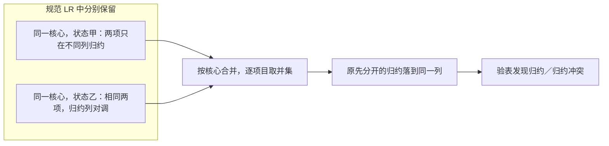

# 《编译原理》第4章 LR分析法（课件）

读完本节，应能从一个冲突格解释问题到底出在什么层次：归约条件太宽、两个状态合并时丢了上下文，还是文法本来就允许多棵树。原课件见页首，以下用独立推导与例子对照其 65 页内容。

## SLR：把“不管下一个符号是什么”收紧到 FOLLOW（原件第 1–17 页）

[LR 分析](../../../topics/编译原理/LR分析法概述.md)读输入从左往右，按最右推导的逆序归约。它先移进终结符积累一个活前缀，再把确认的句柄换成产生式左部。在 ACTION 表里，移进边需要一个与当前输入相同的终结符；归约不消费当前输入，而是按右部长度出栈，随后从露出的栈顶经 GOTO 进入左部对应的状态。拓广规则完成时，只在结束标记 `#` 上接受，不对它做普通归约。

[LR(0)](../../../topics/编译原理/LR0分析表构造.md) 对普通完成项在所有输入列安排归约。如果同一格还允许移进，就是移进／归约冲突；若有两种不同归约，就是归约／归约冲突。[SLR(1)](../../../topics/编译原理/SLR1分析表构造.md) 保留同一套 LR(0) 状态，只把 $A\to\alpha$ 的归约放在 $\mathrm{FOLLOW}(A)$ 所含的列。于是一个有两种归约和一种移进的状态仍可能没冲突：只要两类归约的列不重叠，移进符号也不在里面。==先找状态，再逐列比较动作==，不能仅凭一个状态有两条完成项就宣布 SLR 失败。

原件开头的双分支练习有 9 个状态；走过共同的前缀后，两个完成项分别只在各自的后继上归约，尚可读入的另一个符号只移进，所以 SLR 表无冲突。第 10–14 页用带优先层级的表达式文法构造 12 态 SLR 表：乘号可以继续当前项时，不能抢先把该项归约到外层表达式；这看的是归约候选左部的后继集合。第 13 页把“拓广项接受、普通项遇加号移进”并列为冲突候选，实际接受只填 `#`，所以这一对本身不构成冲突；独立构表时，真正的 LR(0) 冲突格是两处乘号列。第 15–17 页的变式则表明，若两项的全局 FOLLOW 确实重叠，SLR 不能靠分列解决。

## 规范 LR(1)：把向前看放进项目，而不是附在整个非终结符上（第 18–29 页）

已知“某个左部后面可能出现 $a$”，与“这个状态的这个完成项目后面可能出现 $a$”，差别在哪里？前者对整套文法取并，后者只保留当前活前缀能到达的上下文。原件例 4.18 有两个右部同为单个终结符的规则；局部读取的符号相同，但在当前上层位置，一种归约后能接下来的终结符不等于它的所有全局后继。SLR 多填的归约也就会在表中伪造冲突。

对项目 $[A\to\alpha\cdot B\beta,a]$，为 $B$ 的每条规则加上初始圆点项目，其向前看从 $\mathrm{FIRST}(\beta a)$ 得到。也就是说，$B$ 后面先接 $\beta$ 能产生的第一个符号；只有 $\beta$ 可空时，才继承外层的 $a$。闭包应更新到稳定；沿文法符号推进圆点时保留该项目的向前看，再对目标求闭包。终结符的边填 ACTION 移进，非终结符边填 GOTO。普通完成项 $[A\to\alpha\cdot,a]$ 只在它自己的 $a$ 列归约，拓广完成项在 `#` 接受，其余空格报错。参见 [LR(1) 分析表构造](../../../topics/编译原理/LR1分析表构造.md)。

> [!TIP]
> 看到 $[A\to\alpha\cdot B\beta,a]$，问的是“将来归约成 $B$ 后，紧跟着会看到什么？”，不是“现在先移进什么？”。前者由 $\mathrm{FIRST}(\beta a)$ 给出；后者由圆点后的实际转移决定。

### 独立算例：顶层的冒号不等于括号里的冒号

设计一种操作记号：整句由一个地址表达式组成，或由冒号分隔两个；地址表达式可以是单个 `i`、带前缀 `@`，或嵌在方括号中。冒号只允许出现在句子的最外层：

```text
S → T : V | V
T → @ V | [ V ] | i
V → T
```

由 `S → T : V` 得知冒号属于 `FOLLOW(T)`；又因 `T → @ V` 的 `V` 在末尾，所以冒号也进入 `FOLLOW(V)`。加上右括号和结束标记，`FOLLOW(V) = {:, ], #}`。于是 SLR 在从初态读出 `T` 的状态上遇到冒号时，一边从 `S → T · : V` 要求移进，一边从 `V → T ·` 要求归约。

规范 LR(1) 保留这条完成项的来源：在该状态，`V → T ·` 是从“整句只含一个 `V`”的分支来的，所以它只有 `#` 这一向前看，不能在冒号列归约。方括号里的 `V` 则可有右括号向前看，不会因此允许冒号。独立构表得到 SLR 的 13 个状态和 1 格冲突，规范 LR(1) 的 27 个状态无冲突。按核心合并后的 LALR 仍有 13 个状态，也无冲突。两张无冲突的表都接受 `i:@i`、`[@i]`，但会拒绝 `[i:i]` 与缺少右侧值的 `i:`。

## 合并同心状态，能省空间也能丢区分力（第 30–42 页）

若只删掉向前看，两份 LR(1) 项目集的核心完全一致，就可把同一核心的每个项目的向前看分别取并，得到 [LALR(1)](../../../topics/编译原理/LALR分析表构造.md) 状态。对应文法符号的边指向目标核心所在的合并状态，之后必须重新验表。==不要把整个状态的不同项目的向前看混成一个集合==。

| 表 | 用来决定完成项归约的依据 | 状态如何分组 |
|---|---|---|
| LR(0) | 所有终结符列及 `#` | LR(0) 项目集 |
| SLR(1) | 左部非终结符的全局 FOLLOW | 同 LR(0) |
| 规范 LR(1) | 项目自己的向前看 | 同一核心可能分成多个状态 |
| LALR(1) | 同心组内对应项目的向前看之并 | 每个核心只留一个状态 |



合并前若规范 LR(1) 表无冲突，合并不会新引入移进／归约冲突：移进由圆点后的终结符决定，具有同一核心的状态原来就都有这条移进。如果合并后某列同时可以移进和归约，提供该归约的原状态本来也能移进，这和原表无冲突矛盾。两条归约却可以分别来自不同状态，碰到一起成为新冲突。原件第 35 页这个例子，规范表 14 个状态无冲突，合并为 13 态后出现两格归约／归约冲突。

第 30–39 页另一个例子从 10 态合并到 7 态而不引入冲突。对该例中提前结束的非法输入，两张表都在同一个输入位置判错；LALR 在判错前多做归约，不代表它多吃了字符。比较文法类别时，用一个冲突格可以否定某种构造，却不能仅凭修好一个格证明整张表无冲突。通常按同一文法的构造能力看，LR(0)、SLR(1)、LALR(1)、规范 LR(1) 依次扩大。固定 $k$ 时可对 LR($k$) 做判定；“任取一个文法，是否存在某个 $k$ 使它是 LR($k$)”是另一个一般不可判定的问题。

## 二义性规则与 YACC：决策约定不是文法定理（第 43–65 页）

同一个算术串可能搭出多棵 [语法树](../../../topics/编译原理/语法树与二义性.md)。原件展示了两种为语言选定行为的约定：乘法优先于加法；嵌套条件中 else 与最近尚未配对的 if 配对。后者在相关状态见到 else 就移进，而不是先把内层不带 else 的规则归约掉。这是在冲突时选定解释，不是宣称含二义性的原文法突然有了无冲突的规范 LR 表。

一个与原例不同的算式 `8-3*2` 可以看出选动作的意义：当已读部分可归约成减法、下一个符号是乘号，若要乘法先做，就选移进乘号，最后计算 $8-(3\times2)=2$；抢先归约则得到 $(8-3)\times2=10$。若串是 `8-3-2`，两个减号同优先级，按左结合应先归约左边的减法，结果为 3 而非 7。对同优先级的不可结合运算，应拒绝链式使用，而不是随意选一棵树。

[YACC](../../../topics/编译原理/YACC自动生成.md) 把这些决定写进生成语法分析器的规格。声明、产生式及语义动作、辅助过程是三个部分，由 `%%` 分隔。词法过程 `yylex` 提供 token 编号，带值的 token 另经 `yylval` 传值。规则动作中的 `$1`、`$3` 等是右部元素的值，`$$` 是这次归约产生的左部值。原件的计算器先用整数和有层级的规则说明这一接口，再讨论多行、小数和负号；将打印或构树动作挂在归约处，和选用哪张表是两个不同层次的问题。生成后的 C 源文件还需同辅助代码编译、链接；可检查生成器的详细报告定位具体冲突状态。

> [!CAUTION]
> 传统 YACC 默认移进可解决未指定的移进／归约冲突，归约／归约通常选靠前的规则。这是工具的冲突处理约定，不是验证文法正确的手段。运算符的优先级声明按先低后高排列；与预读符号优先级相同时，左结合选归约、右结合选移进、不可结合报错。普通规则默认取右部**最右的终结符**的优先级；第 64 页后半段写成“最左”不一致。用 `%prec` 指定的是整条规则的优先级，例如把一元负号与共享同一字符的二元减法分开，不是更改词法符号本身。
