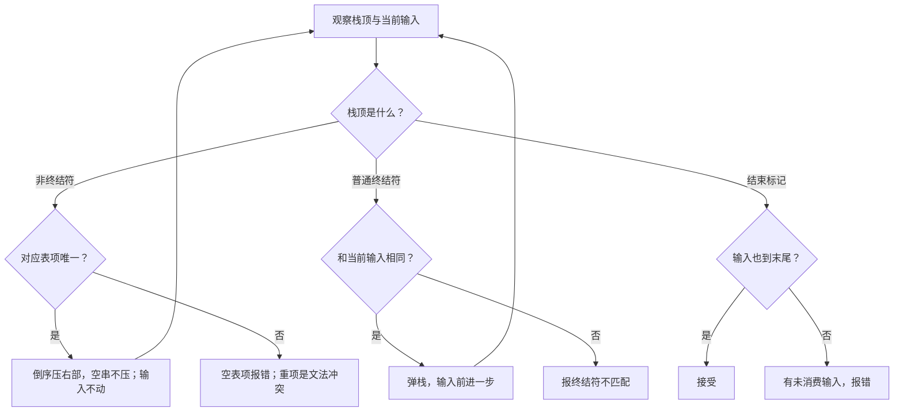

# 《编译原理》第4章 语法分析 §4.2.3 LL(1)分析法（课件）

读这节课时，可以把问题压缩成一句话：栈顶有一个待展开的非终结符，在不试错、不回退的条件下，凭什么只看下一个输入符号就知道该展开成什么？若候选产生式不会在同一输入上争抢，就能预先把决定写进表。以下导读对应原课件各段；算例和图独立编写，原件见页首来源。

## 分析器到底向前看了什么（原件第 1–72 页）

[LL(1)](../../../topics/编译原理/LL1分析法.md) 的两个 L 分别指从左向右读输入、构造最左推导；数字 1 是每次选产生式时只观察当前一个输入符号，并不意味着一步总要读走一个符号。分析栈存放尚待匹配的内容。把最左侧待处理的符号放在栈顶，就能用同一个总控程序处理不同文法：换文法时换的是分析表，不是这套控制规则。

初始时将结束标记 `#` 和开始符号依次入栈，在待分析串末尾也放 `#`。设当前预读符号为 $a$：

- 栈顶是非终结符 $X$：查 $M[X,a]$。若恰有一条 $X\to\alpha$，弹出 $X$ 并把右部倒序压栈，使最左符号先处理。若右部为 $\varepsilon$，不压任何符号。此步不移动输入指针。
- 栈顶是终结符：只有它等于 $a$ 才能弹栈并推进输入，否则报告不匹配。
- 栈顶和当前输入都为 `#`：接受。栈顶已是 `#` 而输入还剩普通符号时，要报错。反过来，输入先到 `#` 而栈顶仍为非终结符，可以继续查 `#` 列展开，剩余符号全部可空才可能接受。空表项报错；表有重项则从构表阶段就不能把它当确定的 LL(1) 分析器。

原件第 5–67 页以一串含加、乘的表达式逐步演示这些栈动作。注意它先处理表达式中的一项；看到加号，结束当前项的乘法尾部，但不消耗这个加号；然后才由表达式的加法尾部展开并匹配它。后一项内部看到乘号时仍留在项的层级，因而下一因子与已经识别的因子归在一起，而不是先做外层加法。第 68–72 页把这套过程抽象成总控规则；手写实现可用 [递归下降](../../../topics/编译原理/递归下降分析法.md) 表达同一个决策。



## 从可空性算到分析表（第 73–109 页）

刻意区分“候选右部自己产生的首字符”和“候选消失后露出的字符”。前者是 $\mathrm{FIRST}(\alpha)$ 中的终结符；只有整段 $\alpha$ 都可空，才可能不产生字符，这个可能性记成 $\varepsilon\in\mathrm{FIRST}(\alpha)$。计算串的 FIRST 时从左看到右：收集当前符号可能产生的非空首符号，当前符号可空才继续；全部可空才把 $\varepsilon$ 算进整段。各产生式提供的结果不断并入，直到没有集合再增大，而不是只扫一遍。

$\mathrm{FOLLOW}(A)$ 记录在从开始符号得到的某个句型中，可能紧跟非终结符 $A$ 的终结符，句末情况用 `#` 表示。不把 $\varepsilon$ 加入 FOLLOW，它不是输入可预读的字符。给开始符号加入 `#`，再对 $X\to\beta A\gamma$ 反复应用两条规则：

1. 将 $\mathrm{FIRST}(\gamma)$ 中的非空首符号加入 $\mathrm{FOLLOW}(A)$。
2. 若 $\gamma$ 可空（包括其本来就是空串），将 $\mathrm{FOLLOW}(X)$ 也传给 $A$。不是必须在右部最后一位才能继承，关键是==后面的整个串能否消失==。

| 填写 $A\to\alpha$ 时遇到的情况 | 要填写的列 | 理由 |
|---|---|---|
| $a$ 是 $\mathrm{FIRST}(\alpha)$ 中的终结符 | $M[A,a]$ | 当前 $a$ 可以由右部自己匹配 |
| $\varepsilon\in\mathrm{FIRST}(\alpha)$ | $a\in\mathrm{FOLLOW}(A)$ 对应的 $M[A,a]$ | 右部可以消失；预读符号由后续成分处理 |
| 某格始终没被填写 | 保留为错误 | 该预读符号下没有可选推导 |
| 同一格被两条不同产生式填写 | 保留冲突证据 | 覆盖原格虽让表看似整齐，却把文法的选择丢掉了 |

> [!TIP]
> 做题看到 $A\to BC$，不要条件反射地将 $\mathrm{FIRST}(B)$ 全部搬给 $A$。从 $B$ 拿非空首符号；可空时再从 $C$ 拿；最后单独问这条右部本身是否可空。填可空分支的表项时去看左部 FOLLOW，不要建一列 $\varepsilon$。

## 独立算例：方括号列表与可选后缀

希望正文可以是空方括号，也可以是用逗号隔开的标识符，右括号之后还可以有一个感叹号。下面的 `id` 是单个词法符号：

```text
S → [ A ] B
A → id T | ε
T → , id T | ε
B → ! | ε
```

`A`、`T` 都紧挨着右括号，直接或经右部末尾继承得到 `]`；而 `B` 只在开始产生式末尾，所以它得到 `#`，不是 `]`。由此可一次给出 FIRST、FOLLOW 和有效表项：

| 行 | FIRST | FOLLOW | 表中非空列及动作 |
|---|---|---|---|
| `S` | `[` | `#` | `[`：展开整个结构 |
| `A` | `id`、$\varepsilon$ | `]` | `id`：开始列表；`]`：空列表 |
| `T` | `,`、$\varepsilon$ | `]` | `,`：继续列表；`]`：结束列表 |
| `B` | `!`、$\varepsilon$ | `#` | `!`：匹配后缀；`#`：没有后缀 |

对 `[ id , id ] !`，开始展开并匹配左括号后，栈为 `# B ] A`（栈顶在右）。`A` 看到 `id`，展开成 `id T`；匹配掉首个 `id` 后，栈为 `# B ] T`。此时 `T` 看到逗号选非空分支，依次匹配逗号和第二个 `id`，回到同一栈形但预读已是 `]`。`T` 选空，右括号由下一层栈顶真正匹配。再由 `B` 匹配感叹号，最后两侧都是 `#`。

> [!CAUTION]
> 空产生式不吞输入。`[]` 可接受：看到 `]` 时跳过 `A`，随后还要真正匹配 `]`。`[id,]` 则不可接受：看到逗号已经承诺再匹配一个 `id`，不能见到右括号就回头改选空分支。`[id]!!` 也不可接受：消费第一个感叹号后，栈已到结束标记而输入未结束。

## 什么冲突不是靠多算一遍能消掉（第 110–116 页）

可空和非空分支也会争同一列，并非只有两个非空分支首字符相同才会冲突。原件的悬挂 else 例子先把共同部分拆开，但可选尾部仍有“接 else”和“立即结束”两条路：嵌套时，结束内层尾部会把外层的 else 留在输入上，于是 else 进入了内层尾部的 FOLLOW。同一格一条路接收 else，另一条路把它留给外层；那是文法表达的问题，不是分析表填得不够细。[消除左递归、提取左因子](../../../topics/编译原理/自顶向下问题与解决.md)有各自用处，但改写后仍须重算 FIRST、FOLLOW、验表。若扩展左递归时迟迟回到原非终结符、输入从未推进，就不是确定的无回溯选法。

将某个非终结符的各候选产生式对应的可预测列列在一行，逐对检查是否相交：两个右部可能同以一个终结符开头，是 FIRST/FIRST 冲突；一条候选可空、另一条能以其左部 FOLLOW 中的符号开头，是 FIRST/FOLLOW 冲突；两个可空候选也不能为同一有效后继给出确定选择。==消掉共同的字面前缀不等于证明文法满足 LL(1)==。

**补充：末页构表练习的自检。** 第一题按原始开始符号及非终结符 A、B、C、D、E 的顺序，非空格数分别为 5、7、3、7、2，且没有重项；容易漏算的是可空的中间符号使继承传播跨过后缀，直到各集合稳定。第二题按 S、A、B、C 的顺序是 1、3、3、2 格；B 的 FOLLOW 同时含 `c` 和 `d`，因为后面的 C 可先产生 `c`，也能消失让外层的 `d` 接上。两题都应先保留所有候选格，再用无重项来核对结论，而不是凭文法外观直接判断。
