# 《编译原理》第4章 语法分析 §4.2.3 LL(1)分析法（课件）

原件的每一页，下面附识别出的文字。

### 编译原理

原文：

编译原理

第四章

南京郵電大學 Nanjing University of Posts and Telecommunications aand

### 第四章 语法分析

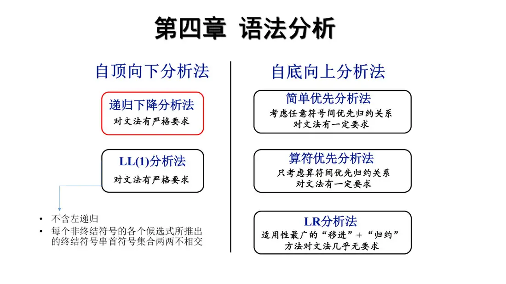

原文：

第四章 语法分析

自顶向下分析法

递归下降分析法对文法有严格要求

LL(1)分析法对文法有严格要求

自底向上分析法

简单优先分析法

考虑任意符号间优先归约关系对文法有一定要求

只考虑算符间优先归约关系对文法有一定要求

• 不含左递归

• 每个非终结符号的各个候选式所推出的终结符号串首符号集合两两不相交

LR分析法

适用性最广的“移进”+ “归约”方法对文法几乎无要求

### §4.2.3LL(1)分析法

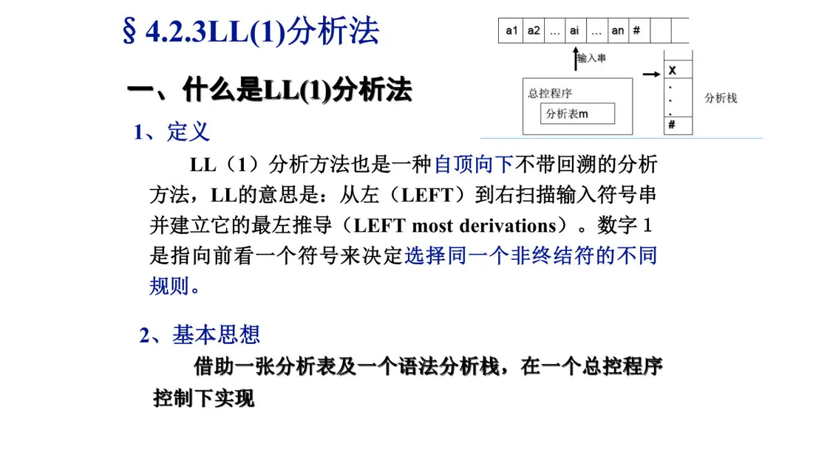

原文：

§4.2.3LL(1)分析法

一、什么是LL(1)分析法

1、定义

LL（1）分析方法也是一种自顶向下不带回溯的分析方法，LL的意思是：从左（LEFT）到右扫描输入符号串并建立它的最左推导（LEFT most derivations）。数字1是指向前看一个符号来决定选择同一个非终结符的不同规则。

2、基本思想

借助一张分析表及一个语法分析栈，在一个总控程序控制下实现

### §4.2.3LL(1)分析法

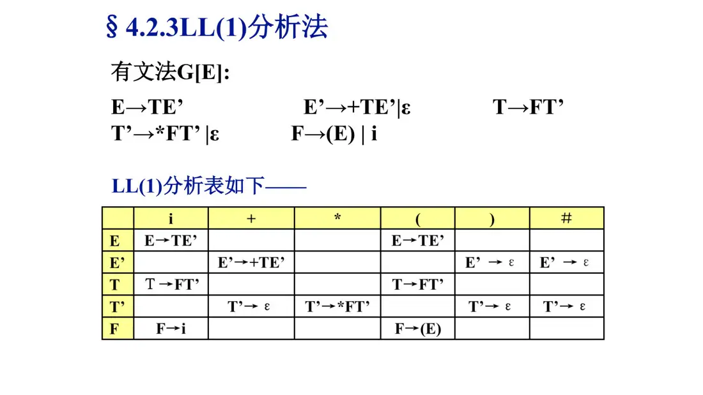

原文：

§4.2.3LL(1)分析法

有文法G[E]:

E→TE’

F→(E) | i

LL(1)分析表如下——

<table><tr><td></td><td>i</td><td>+</td><td>*</td><td>(</td><td>)</td><td>#</td></tr><tr><td>E</td><td> $E \rightarrow TE'$ </td><td></td><td></td><td> $E \rightarrow TE'$ </td><td></td><td></td></tr><tr><td> $E'$ </td><td></td><td> $E' \rightarrow +TE'$ </td><td></td><td></td><td> $E' \rightarrow \varepsilon$ </td><td> $E' \rightarrow \varepsilon$ </td></tr><tr><td>T</td><td> $T \rightarrow FT'$ </td><td></td><td></td><td> $T \rightarrow FT'$ </td><td></td><td></td></tr><tr><td> $T'$ </td><td></td><td> $T' \rightarrow \varepsilon$ </td><td> $T' \rightarrow *FT'$ </td><td></td><td> $T' \rightarrow \varepsilon$ </td><td> $T' \rightarrow \varepsilon$ </td></tr><tr><td>F</td><td> $F \rightarrow i$ </td><td></td><td></td><td> $F \rightarrow (E)$ </td><td></td><td></td></tr></table>

### 分析栈余留串栈

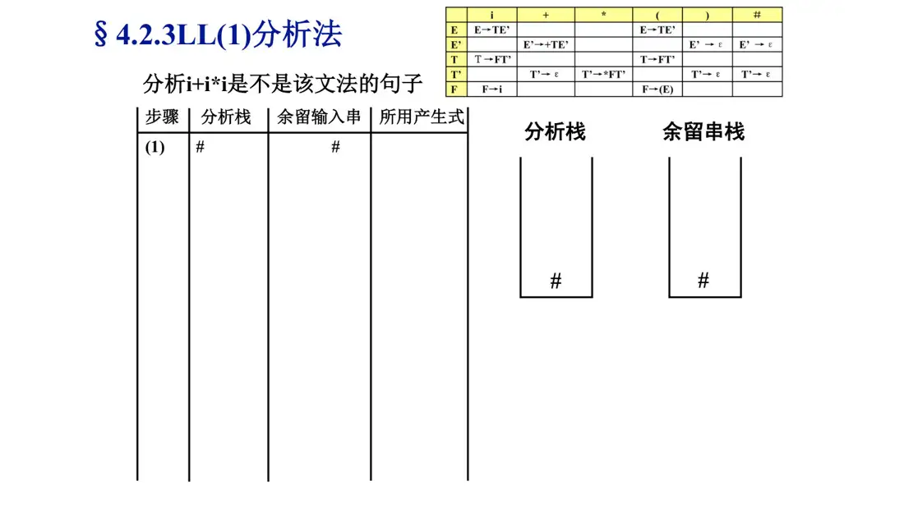

原文：

<table><tr><td>分析栈</td><td>余留串栈</td></tr><tr><td></td><td></td></tr></table>

§4.2.3LL(1)分析法

分析 $\mathbf { i } + \mathbf { i } \ast \mathbf { i }$ 是不是该文法的句子

<table><tr><td>步骤</td><td>分析栈</td><td>余留输入串</td><td>所用产生式</td></tr><tr><td>(1)</td><td>#</td><td>#</td><td></td></tr></table>

<table><tr><td></td><td>i</td><td>+</td><td>*</td><td>(</td><td>)</td><td>#</td></tr><tr><td>E</td><td> $E \rightarrow TE'$ </td><td></td><td></td><td> $E \rightarrow TE'$ </td><td></td><td></td></tr><tr><td>E&#x27;</td><td></td><td> $E' \rightarrow +TE'$ </td><td></td><td></td><td> $E' \rightarrow \varepsilon$ </td><td> $E' \rightarrow \varepsilon$ </td></tr><tr><td>T</td><td> $T \rightarrow FT'$ </td><td></td><td></td><td> $T \rightarrow FT'$ </td><td></td><td></td></tr><tr><td>T&#x27;</td><td></td><td> $T' \rightarrow \varepsilon$ </td><td> $T' \rightarrow *FT'$ </td><td></td><td> $T' \rightarrow \varepsilon$ </td><td> $T' \rightarrow \varepsilon$ </td></tr><tr><td>F</td><td> $F \rightarrow i$ </td><td></td><td></td><td> $F \rightarrow (E)$ </td><td></td><td></td></tr></table>

### §4.2.3LL(1)分析法

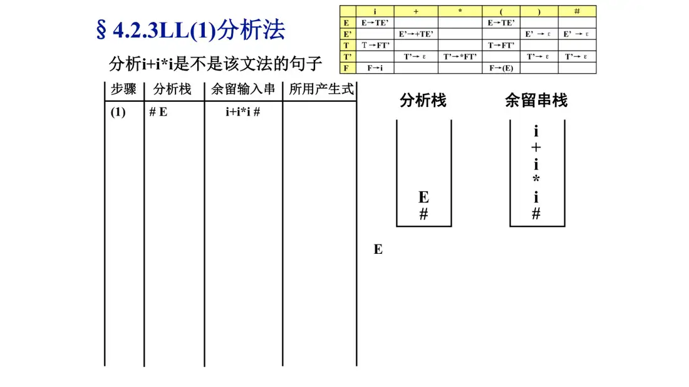

原文：

§4.2.3LL(1)分析法

分析i+i\*i是不是该文法的句子

<table><tr><td>步骤</td><td>分析栈</td><td>余留输入串</td><td>所用产生式</td></tr><tr><td>(1)</td><td># E</td><td>i+i*i #</td><td></td></tr></table>

<table><tr><td></td><td>i</td><td>+</td><td>*</td><td>(</td><td>)</td><td>#</td></tr><tr><td>E</td><td> $E \rightarrow TE'$ </td><td></td><td></td><td> $E \rightarrow TE'$ </td><td></td><td></td></tr><tr><td>E&#x27;</td><td></td><td> $E' \rightarrow +TE'$ </td><td></td><td></td><td> $E' \rightarrow \varepsilon$ </td><td> $E' \rightarrow \varepsilon$ </td></tr><tr><td>T</td><td> $T \rightarrow FT'$ </td><td></td><td></td><td> $T \rightarrow FT'$ </td><td></td><td></td></tr><tr><td>T&#x27;</td><td></td><td> $T' \rightarrow \varepsilon$ </td><td> $T' \rightarrow *FT'$ </td><td></td><td> $T' \rightarrow \varepsilon$ </td><td> $T' \rightarrow \varepsilon$ </td></tr><tr><td>F</td><td> $F \rightarrow i$ </td><td></td><td></td><td> $F \rightarrow (E)$ </td><td></td><td></td></tr></table>

### §4.2.3LL(1)分析法

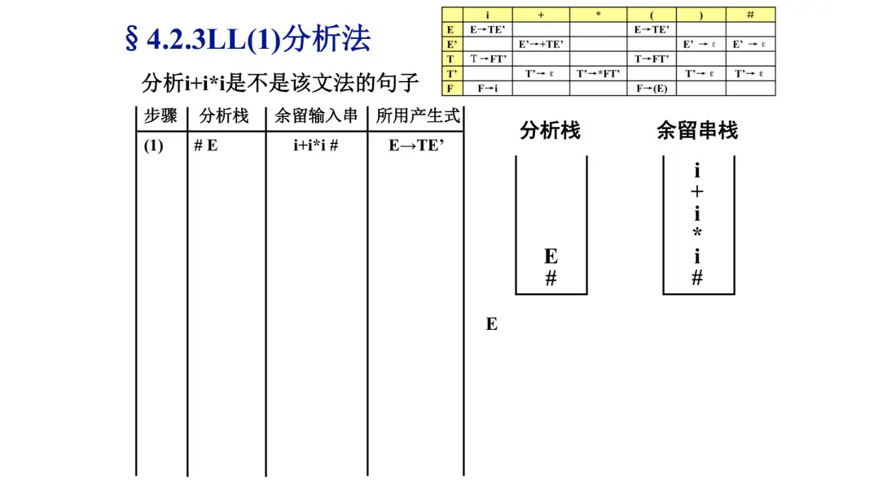

原文：

§4.2.3LL(1)分析法

分析 $\mathbf { i } + \mathbf { i } \ast \mathbf { i }$ 是不是该文法的句子

<table><tr><td>步骤</td><td>分析栈</td><td>余留输入串</td><td>所用产生式</td></tr><tr><td>(1)</td><td># E</td><td>i+i*i #</td><td>E→TE&#x27;</td></tr></table>

<table><tr><td></td><td>i</td><td>+</td><td>*</td><td>(</td><td>)</td><td>#</td></tr><tr><td>E</td><td> $E \rightarrow TE'$ </td><td></td><td></td><td> $E \rightarrow TE'$ </td><td></td><td></td></tr><tr><td>E&#x27;</td><td></td><td> $E' \rightarrow +TE'$ </td><td></td><td></td><td> $E' \rightarrow \varepsilon$ </td><td> $E' \rightarrow \varepsilon$ </td></tr><tr><td>T</td><td> $T \rightarrow FT'$ </td><td></td><td></td><td> $T \rightarrow FT'$ </td><td></td><td></td></tr><tr><td>T&#x27;</td><td></td><td> $T' \rightarrow \varepsilon$ </td><td> $T' \rightarrow *FT'$ </td><td></td><td> $T' \rightarrow \varepsilon$ </td><td> $T' \rightarrow \varepsilon$ </td></tr><tr><td>F</td><td> $F \rightarrow i$ </td><td></td><td></td><td> $F \rightarrow (E)$ </td><td></td><td></td></tr></table>

### §4.2.3LL(1)分析法

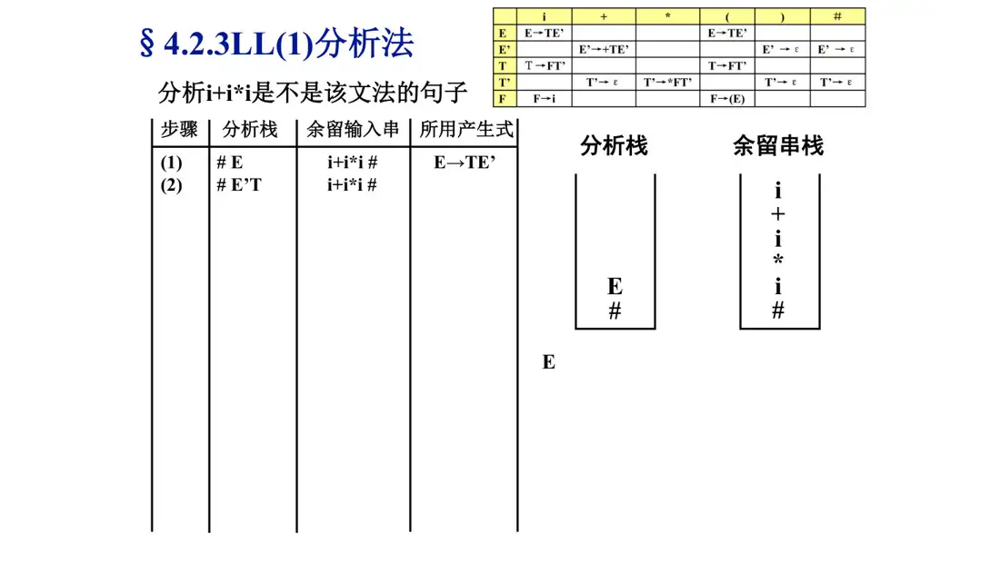

原文：

§4.2.3LL(1)分析法

分析i+i\*i是不是该文法的句子

<table><tr><td>步骤</td><td>分析栈</td><td>余留输入串</td><td>所用产生式</td></tr><tr><td>(1)</td><td># E</td><td>i+i*i #</td><td>E→TE&#x27;</td></tr><tr><td>(2)</td><td># E&#x27;T</td><td>i+i*i #</td><td></td></tr></table>

<table><tr><td></td><td>i</td><td>+</td><td>*</td><td>(</td><td>)</td><td>#</td></tr><tr><td>E</td><td> $E \rightarrow TE'$ </td><td></td><td></td><td> $E \rightarrow TE'$ </td><td></td><td></td></tr><tr><td>E&#x27;</td><td></td><td> $E' \rightarrow +TE'$ </td><td></td><td></td><td> $E' \rightarrow \varepsilon$ </td><td> $E' \rightarrow \varepsilon$ </td></tr><tr><td>T</td><td> $T \rightarrow FT'$ </td><td></td><td></td><td> $T \rightarrow FT'$ </td><td></td><td></td></tr><tr><td>T&#x27;</td><td></td><td> $T' \rightarrow \varepsilon$ </td><td> $T' \rightarrow *FT'$ </td><td></td><td> $T' \rightarrow \varepsilon$ </td><td> $T' \rightarrow \varepsilon$ </td></tr><tr><td>F</td><td> $F \rightarrow i$ </td><td></td><td></td><td> $F \rightarrow (E)$ </td><td></td><td></td></tr></table>

### §4.2.3LL(1)分析法

原文：

§4.2.3LL(1)分析法

分析i+i\*i是不是该文法的句子

<table><tr><td>步骤</td><td>分析栈</td><td>余留输入串</td><td>所用产生式</td></tr><tr><td>(1)</td><td># E</td><td>i+i*i #</td><td>E→TE&#x27;</td></tr><tr><td>(2)</td><td># E&#x27;T</td><td>i+i*i #</td><td></td></tr></table>

<table><tr><td></td><td>i</td><td>+</td><td>*</td><td>(</td><td>)</td><td>#</td></tr><tr><td>E</td><td> $E \rightarrow TE'$ </td><td></td><td></td><td> $E \rightarrow TE'$ </td><td></td><td></td></tr><tr><td>E&#x27;</td><td></td><td> $E' \rightarrow +TE'$ </td><td></td><td></td><td> $E' \rightarrow \varepsilon$ </td><td> $E' \rightarrow \varepsilon$ </td></tr><tr><td>T</td><td> $T \rightarrow FT'$ </td><td></td><td></td><td> $T \rightarrow FT'$ </td><td></td><td></td></tr><tr><td>T&#x27;</td><td></td><td> $T' \rightarrow \varepsilon$ </td><td> $T' \rightarrow *FT'$ </td><td></td><td> $T' \rightarrow \varepsilon$ </td><td> $T' \rightarrow \varepsilon$ </td></tr><tr><td>F</td><td> $F \rightarrow i$ </td><td></td><td></td><td> $F \rightarrow (E)$ </td><td></td><td></td></tr></table>

### §4.2.3LL(1)分析法

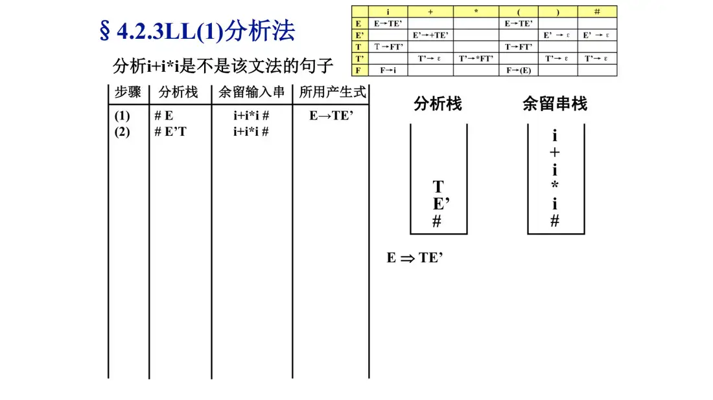

原文：

§4.2.3LL(1)分析法

分析 $\mathbf { i } + \mathbf { i } \ast \mathbf { i }$ 是不是该文法的句子

<table><tr><td></td><td>i</td><td>+</td><td>*</td><td>(</td><td>)</td><td>#</td></tr><tr><td>E</td><td> $E \rightarrow TE'$ </td><td></td><td></td><td> $E \rightarrow TE'$ </td><td></td><td></td></tr><tr><td>E&#x27;</td><td></td><td> $E' \rightarrow +TE'$ </td><td></td><td></td><td> $E' \rightarrow \varepsilon$ </td><td> $E' \rightarrow \varepsilon$ </td></tr><tr><td>T</td><td> $T \rightarrow FT'$ </td><td></td><td></td><td> $T \rightarrow FT'$ </td><td></td><td></td></tr><tr><td>T&#x27;</td><td></td><td> $T' \rightarrow \varepsilon$ </td><td> $T' \rightarrow *FT'$ </td><td></td><td> $T' \rightarrow \varepsilon$ </td><td> $T' \rightarrow \varepsilon$ </td></tr><tr><td>F</td><td> $F \rightarrow i$ </td><td></td><td></td><td> $F \rightarrow (E)$ </td><td></td><td></td></tr></table>

<table><tr><td>步骤</td><td>分析栈</td><td>余留输入串</td><td>所用产生式</td></tr><tr><td>(1)(2)</td><td>#E#E&#x27;T</td><td>i+i*i #i+i*i #</td><td>E→TE&#x27;</td></tr></table>

### §4.2.3LL(1)分析法

原文：

§4.2.3LL(1)分析法

分析 $\mathbf { i } + \mathbf { i } \ast \mathbf { i }$ 是不是该文法的句子

<table><tr><td></td><td>i</td><td>+</td><td>*</td><td>(</td><td>)</td><td>#</td></tr><tr><td>E</td><td> $E \rightarrow TE'$ </td><td></td><td></td><td> $E \rightarrow TE'$ </td><td></td><td></td></tr><tr><td>E&#x27;</td><td></td><td> $E' \rightarrow +TE'$ </td><td></td><td></td><td> $E' \rightarrow \varepsilon$ </td><td> $E' \rightarrow \varepsilon$ </td></tr><tr><td>T</td><td> $T \rightarrow FT'$ </td><td></td><td></td><td> $T \rightarrow FT'$ </td><td></td><td></td></tr><tr><td>T&#x27;</td><td></td><td> $T' \rightarrow \varepsilon$ </td><td> $T' \rightarrow *FT'$ </td><td></td><td> $T' \rightarrow \varepsilon$ </td><td> $T' \rightarrow \varepsilon$ </td></tr><tr><td>F</td><td> $F \rightarrow i$ </td><td></td><td></td><td> $F \rightarrow (E)$ </td><td></td><td></td></tr></table>

<table><tr><td>步骤</td><td>分析栈</td><td>余留输入串</td><td>所用产生式</td></tr><tr><td>(1)(2)</td><td>#E#E&#x27;T</td><td>i+i*i #i+i*i #</td><td>E→TE&#x27;T→FT&#x27;</td></tr></table>

### §4.2.3LL(1)分析法

原文：

§4.2.3LL(1)分析法

分析i+i\*i是不是该文法的句子

<table><tr><td></td><td>i</td><td>+</td><td>*</td><td>(</td><td>)</td><td>#</td></tr><tr><td>E</td><td> $E \rightarrow TE'$ </td><td></td><td></td><td> $E \rightarrow TE'$ </td><td></td><td></td></tr><tr><td>E&#x27;</td><td></td><td> $E' \rightarrow +TE'$ </td><td></td><td></td><td> $E' \rightarrow \varepsilon$ </td><td> $E' \rightarrow \varepsilon$ </td></tr><tr><td>T</td><td> $T \rightarrow FT'$ </td><td></td><td></td><td> $T \rightarrow FT'$ </td><td></td><td></td></tr><tr><td>T&#x27;</td><td></td><td> $T' \rightarrow \varepsilon$ </td><td> $T' \rightarrow *FT'$ </td><td></td><td> $T' \rightarrow \varepsilon$ </td><td> $T' \rightarrow \varepsilon$ </td></tr><tr><td>F</td><td> $F \rightarrow i$ </td><td></td><td></td><td> $F \rightarrow (E)$ </td><td></td><td></td></tr></table>

<table><tr><td>步骤</td><td>分析栈</td><td>余留输入串</td><td>所用产生式</td></tr><tr><td>(1)</td><td>#E</td><td>i+i*i #</td><td>E→TE'</td></tr><tr><td>(2)</td><td>#E'T</td><td>i+i*i #</td><td>T→FT'</td></tr><tr><td>(3)</td><td>#E'T'F</td><td>i+i*i #</td><td></td></tr><tr><td></td><td></td><td></td><td>分析栈</td></tr><tr><td></td><td></td><td></td><td></td></tr><tr><td></td><td></td><td></td><td>E ⇒ TE'</td></tr><tr><td></td><td></td><td></td><td></td></tr><tr><td></td><td></td><td></td><td>E ⇒ TE'</td></tr><tr><td></td><td></td><td></td><td>余留串栈</td></tr></table>

### §4.2.3LL(1)分析法

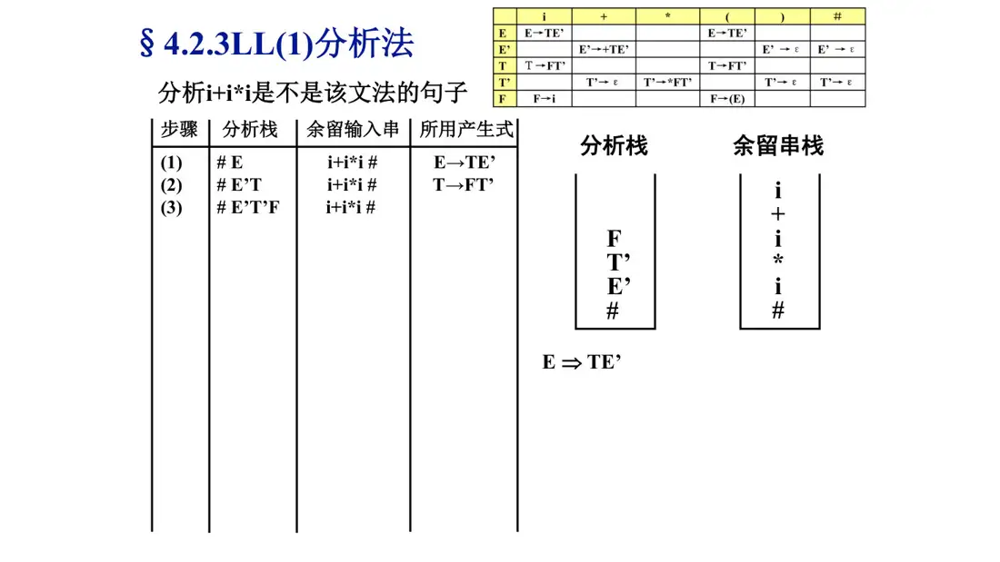

原文：

§4.2.3LL(1)分析法

分析i+i\*i是不是该文法的句子

<table><tr><td></td><td>i</td><td>+</td><td>*</td><td>(</td><td>)</td><td>#</td></tr><tr><td>E</td><td> $E \rightarrow TE'$ </td><td></td><td></td><td> $E \rightarrow TE'$ </td><td></td><td></td></tr><tr><td>E&#x27;</td><td></td><td> $E' \rightarrow +TE'$ </td><td></td><td></td><td> $E' \rightarrow \varepsilon$ </td><td> $E' \rightarrow \varepsilon$ </td></tr><tr><td>T</td><td> $T \rightarrow FT'$ </td><td></td><td></td><td> $T \rightarrow FT'$ </td><td></td><td></td></tr><tr><td>T&#x27;</td><td></td><td> $T' \rightarrow \varepsilon$ </td><td> $T' \rightarrow *FT'$ </td><td></td><td> $T' \rightarrow \varepsilon$ </td><td> $T' \rightarrow \varepsilon$ </td></tr><tr><td>F</td><td> $F \rightarrow i$ </td><td></td><td></td><td> $F \rightarrow (E)$ </td><td></td><td></td></tr></table>

### §4.2.3LL(1)分析法

原文：

§4.2.3LL(1)分析法

分析 $\mathbf { i } + \mathbf { i } \ast \mathbf { i }$ 是不是该文法的句子

<table><tr><td></td><td>i</td><td>+</td><td>*</td><td>(</td><td>)</td><td>#</td></tr><tr><td>E</td><td> $E \rightarrow TE'$ </td><td></td><td></td><td> $E \rightarrow TE'$ </td><td></td><td></td></tr><tr><td>E&#x27;</td><td></td><td> $E' \rightarrow +TE'$ </td><td></td><td></td><td> $E' \rightarrow \varepsilon$ </td><td> $E' \rightarrow \varepsilon$ </td></tr><tr><td>T</td><td> $T \rightarrow FT'$ </td><td></td><td></td><td> $T \rightarrow FT'$ </td><td></td><td></td></tr><tr><td>T&#x27;</td><td></td><td> $T' \rightarrow \varepsilon$ </td><td> $T' \rightarrow *FT'$ </td><td></td><td> $T' \rightarrow \varepsilon$ </td><td> $T' \rightarrow \varepsilon$ </td></tr><tr><td>F</td><td> $F \rightarrow i$ </td><td></td><td></td><td> $F \rightarrow (E)$ </td><td></td><td></td></tr></table>

<table><tr><td>步骤</td><td>分析栈</td><td>余留输入串</td><td>所用产生式</td></tr><tr><td>(1)</td><td>#E</td><td>i+i*i #</td><td>E→TE&#x27;</td></tr><tr><td>(2)</td><td>#E&#x27;T</td><td>i+i*i #</td><td>T→FT&#x27;</td></tr><tr><td>(3)</td><td>#E&#x27;T&#x27;F</td><td>i+i*i #</td><td></td></tr><tr><td></td><td></td><td></td><td>分析栈 余留串栈</td></tr><tr><td></td><td></td><td></td><td> </td></tr><tr><td></td><td></td><td></td><td>E ⇒ TE&#x27; ⇒ FT&#x27;E&#x27;</td></tr></table>

### §4.2.3LL(1)分析法

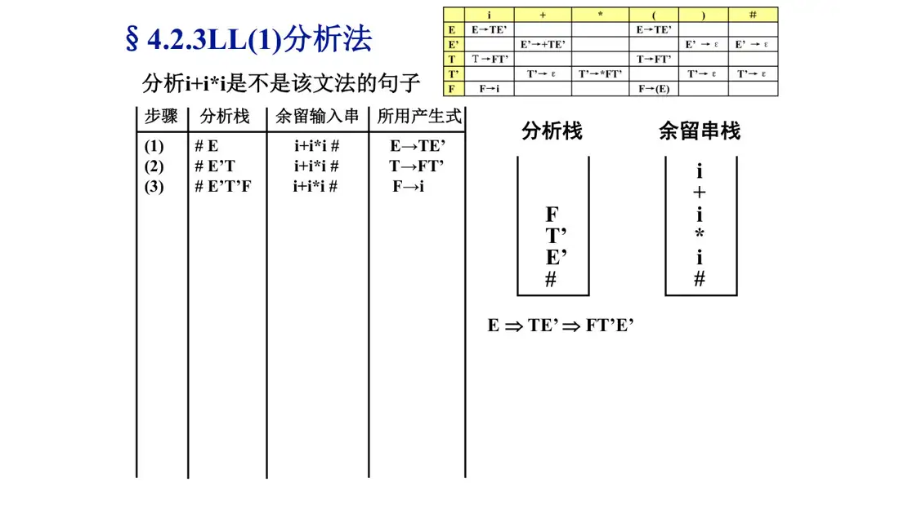

原文：

§4.2.3LL(1)分析法

分析 $\mathbf { i } + \mathbf { i } \ast \mathbf { i }$ 是不是该文法的句子

<table><tr><td></td><td>i</td><td>+</td><td>*</td><td>(</td><td>)</td><td>#</td></tr><tr><td>E</td><td> $E \rightarrow TE'$ </td><td></td><td></td><td> $E \rightarrow TE'$ </td><td></td><td></td></tr><tr><td>E&#x27;</td><td></td><td> $E' \rightarrow +TE'$ </td><td></td><td></td><td> $E' \rightarrow \varepsilon$ </td><td> $E' \rightarrow \varepsilon$ </td></tr><tr><td>T</td><td> $T \rightarrow FT'$ </td><td></td><td></td><td> $T \rightarrow FT'$ </td><td></td><td></td></tr><tr><td>T&#x27;</td><td></td><td> $T' \rightarrow \varepsilon$ </td><td> $T' \rightarrow *FT'$ </td><td></td><td> $T' \rightarrow \varepsilon$ </td><td> $T' \rightarrow \varepsilon$ </td></tr><tr><td>F</td><td> $F \rightarrow i$ </td><td></td><td></td><td> $F \rightarrow (E)$ </td><td></td><td></td></tr></table>

<table><tr><td>步骤</td><td>分析栈</td><td>余留输入串</td><td>所用产生式</td></tr><tr><td>(1)</td><td>#E</td><td>i+i*i #</td><td>E→TE&#x27;</td></tr><tr><td>(2)</td><td>#E&#x27;T</td><td>i+i*i #</td><td>T→FT&#x27;</td></tr><tr><td>(3)</td><td>#E&#x27;T&#x27;F</td><td>i+i*i #</td><td>F→i</td></tr><tr><td></td><td></td><td></td><td></td></tr><tr><td></td><td></td><td></td><td></td></tr><tr><td></td><td></td><td></td><td></td></tr><tr><td></td><td></td><td></td><td></td></tr><tr><td></td><td></td><td></td><td></td></tr><tr><td></td><td></td><td></td><td></td></tr><tr><td></td><td></td><td></td><td></td></tr><tr><td></td><td></td><td></td><td></td></tr><tr><td></td><td></td><td></td><td></td></tr><tr><td></td><td></td><td></td><td></td></tr><tr><td></td><td></td><td></td><td></td></tr><tr><td></td><td></td><td></td><td></td></tr><tr><td></td><td></td><td></td><td></td></tr><tr><td></td><td></td><td></td><td></td></tr><tr><td></td><td></td><td></td><td></td></tr><tr><td></td><td></td><td></td><td></td></tr><tr><td></td><td></td><td></td><td></td></tr><tr><td colspan="4"></td></tr></table>

### §4.2.3LL(1)分析法

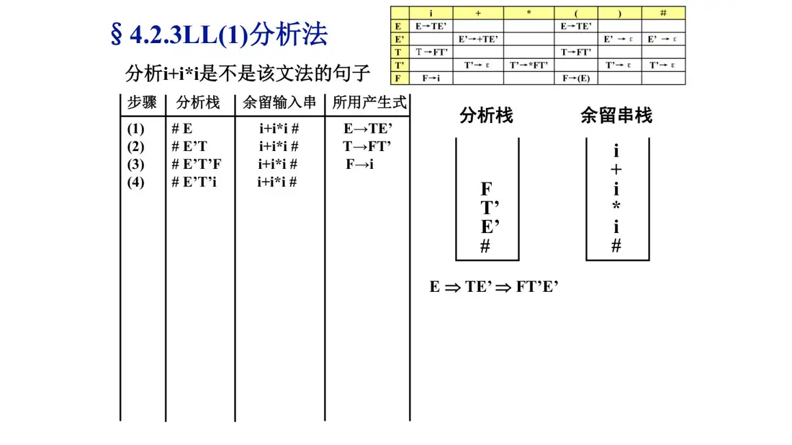

原文：

§4.2.3LL(1)分析法

分析 $\mathbf { i } + \mathbf { i } \ast \mathbf { i }$ 是不是该文法的句子

<table><tr><td></td><td>i</td><td>+</td><td>*</td><td>(</td><td>)</td><td>#</td></tr><tr><td>E</td><td> $E \rightarrow TE'$ </td><td></td><td></td><td> $E \rightarrow TE'$ </td><td></td><td></td></tr><tr><td>E&#x27;</td><td></td><td> $E' \rightarrow +TE'$ </td><td></td><td></td><td> $E' \rightarrow \varepsilon$ </td><td> $E' \rightarrow \varepsilon$ </td></tr><tr><td>T</td><td> $T \rightarrow FT'$ </td><td></td><td></td><td> $T \rightarrow FT'$ </td><td></td><td></td></tr><tr><td>T&#x27;</td><td></td><td> $T' \rightarrow \varepsilon$ </td><td> $T' \rightarrow *FT'$ </td><td></td><td> $T' \rightarrow \varepsilon$ </td><td> $T' \rightarrow \varepsilon$ </td></tr><tr><td>F</td><td> $F \rightarrow i$ </td><td></td><td></td><td> $F \rightarrow (E)$ </td><td></td><td></td></tr></table>

<table><tr><td>步骤</td><td>分析栈</td><td>余留输入串</td><td>所用产生式</td></tr><tr><td>(1)</td><td>#E</td><td>i+i*i #</td><td>E→TE&#x27;</td></tr><tr><td>(2)</td><td>#E&#x27;T</td><td>i+i*i #</td><td>T→FT&#x27;</td></tr><tr><td>(3)</td><td>#E&#x27;T&#x27;F</td><td>i+i*i #</td><td>F→i</td></tr><tr><td>(4)</td><td>#E&#x27;T&#x27;i</td><td>i+i*i #</td><td></td></tr><tr><td></td><td></td><td></td><td>分析栈 余留串栈</td></tr><tr><td></td><td></td><td></td><td> </td></tr><tr><td></td><td></td><td></td><td>E ⇒ TE&#x27; ⇒ FT&#x27;E&#x27;</td></tr></table>

### §4.2.3LL(1)分析法

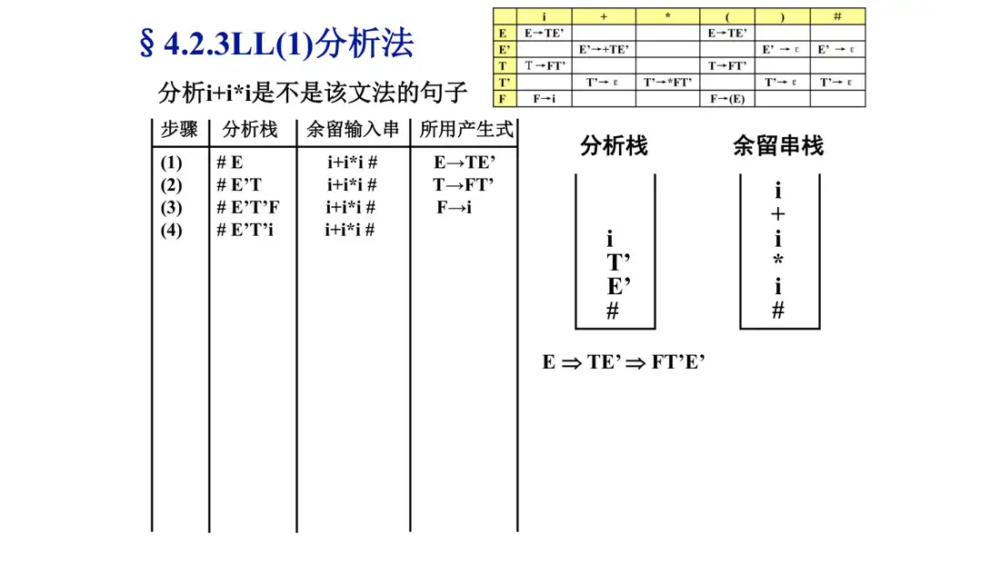

原文：

§4.2.3LL(1)分析法

分析 $\mathbf { i } + \mathbf { i } \ast \mathbf { i }$ 是不是该文法的句子

<table><tr><td></td><td>i</td><td>+</td><td>*</td><td>(</td><td>)</td><td>#</td></tr><tr><td>E</td><td> $E \rightarrow TE'$ </td><td></td><td></td><td> $E \rightarrow TE'$ </td><td></td><td></td></tr><tr><td>E&#x27;</td><td></td><td> $E' \rightarrow +TE'$ </td><td></td><td></td><td> $E' \rightarrow \varepsilon$ </td><td> $E' \rightarrow \varepsilon$ </td></tr><tr><td>T</td><td> $T \rightarrow FT'$ </td><td></td><td></td><td> $T \rightarrow FT'$ </td><td></td><td></td></tr><tr><td>T&#x27;</td><td></td><td> $T' \rightarrow \varepsilon$ </td><td> $T' \rightarrow *FT'$ </td><td></td><td> $T' \rightarrow \varepsilon$ </td><td> $T' \rightarrow \varepsilon$ </td></tr><tr><td>F</td><td> $F \rightarrow i$ </td><td></td><td></td><td> $F \rightarrow (E)$ </td><td></td><td></td></tr></table>

<table><tr><td>步骤</td><td>分析栈</td><td>余留输入串</td><td>所用产生式</td></tr><tr><td>(1)</td><td>#E</td><td>i+i*i #</td><td>E→TE&#x27;</td></tr><tr><td>(2)</td><td>#E&#x27;T</td><td>i+i*i #</td><td>T→FT&#x27;</td></tr><tr><td>(3)</td><td>#E&#x27;T&#x27;F</td><td>i+i*i #</td><td>F→i</td></tr><tr><td>(4)</td><td>#E&#x27;T&#x27;i</td><td>i+i*i #</td><td></td></tr><tr><td></td><td></td><td></td><td>分析栈 余留串栈</td></tr><tr><td></td><td></td><td></td><td> </td></tr><tr><td></td><td></td><td></td><td>E ⇒ TE&#x27; ⇒ FT&#x27;E&#x27;</td></tr></table>

### §4.2.3LL(1)分析法

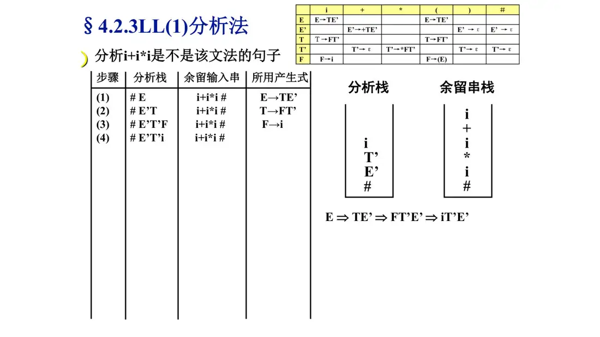

原文：

§4.2.3LL(1)分析法

分析i+i\*i是不是该文法的句子）

<table><tr><td></td><td>i</td><td>+</td><td>*</td><td>(</td><td>)</td><td>#</td></tr><tr><td>E</td><td> $E \rightarrow TE'$ </td><td></td><td></td><td> $E \rightarrow TE'$ </td><td></td><td></td></tr><tr><td>E&#x27;</td><td></td><td> $E' \rightarrow +TE'$ </td><td></td><td></td><td> $E' \rightarrow \varepsilon$ </td><td> $E' \rightarrow \varepsilon$ </td></tr><tr><td>T</td><td> $T \rightarrow FT'$ </td><td></td><td></td><td> $T \rightarrow FT'$ </td><td></td><td></td></tr><tr><td>T&#x27;</td><td></td><td> $T' \rightarrow \varepsilon$ </td><td> $T' \rightarrow *FT'$ </td><td></td><td> $T' \rightarrow \varepsilon$ </td><td> $T' \rightarrow \varepsilon$ </td></tr><tr><td>F</td><td> $F \rightarrow i$ </td><td></td><td></td><td> $F \rightarrow (E)$ </td><td></td><td></td></tr></table>

<table><tr><td>步骤</td><td>分析栈</td><td>余留输入串</td><td>所用产生式</td></tr><tr><td>(1)</td><td>#E</td><td>i+i*i #</td><td>E→TE&#x27;</td></tr><tr><td>(2)</td><td>#E&#x27;T</td><td>i+i*i #</td><td>T→FT&#x27;</td></tr><tr><td>(3)</td><td>#E&#x27;T&#x27;F</td><td>i+i*i #</td><td>F→i</td></tr><tr><td>(4)</td><td>#E&#x27;T&#x27;i</td><td>i+i*i #</td><td></td></tr></table>

### §4.2.3LL(1)分析法

原文：

§4.2.3LL(1)分析法

分析 $\mathbf { i } + \mathbf { i } \ast \mathbf { i }$ 是不是该文法的句子

<table><tr><td></td><td>i</td><td>+</td><td>*</td><td>(</td><td>)</td><td>#</td></tr><tr><td>E</td><td> $E \rightarrow TE'$ </td><td></td><td></td><td> $E \rightarrow TE'$ </td><td></td><td></td></tr><tr><td>E&#x27;</td><td></td><td> $E' \rightarrow +TE'$ </td><td></td><td></td><td> $E' \rightarrow \varepsilon$ </td><td> $E' \rightarrow \varepsilon$ </td></tr><tr><td>T</td><td> $T \rightarrow FT'$ </td><td></td><td></td><td> $T \rightarrow FT'$ </td><td></td><td></td></tr><tr><td>T&#x27;</td><td></td><td> $T' \rightarrow \varepsilon$ </td><td> $T' \rightarrow *FT'$ </td><td></td><td> $T' \rightarrow \varepsilon$ </td><td> $T' \rightarrow \varepsilon$ </td></tr><tr><td>F</td><td> $F \rightarrow i$ </td><td></td><td></td><td> $F \rightarrow (E)$ </td><td></td><td></td></tr></table>

<table><tr><td>步骤</td><td>分析栈</td><td>余留输入串</td><td>所用产生式</td></tr><tr><td>(1)</td><td>#E</td><td>i+i*i #</td><td>E→TE&#x27;</td></tr><tr><td>(2)</td><td>#E&#x27;T</td><td>i+i*i #</td><td>T→FT&#x27;</td></tr><tr><td>(3)</td><td>#E&#x27;T&#x27;F</td><td>i+i*i #</td><td>F→i</td></tr><tr><td>(4)</td><td>#E&#x27;T&#x27;i</td><td>i+i*i #</td><td></td></tr><tr><td>(5)</td><td>#E&#x27;T&#x27;</td><td>+i*i #</td><td></td></tr></table>

### §4.2.3LL(1)分析法

原文：

§4.2.3LL(1)分析法

分析 $\mathbf { i } + \mathbf { i } \ast \mathbf { i }$ 是不是该文法的句子

<table><tr><td></td><td>i</td><td>+</td><td>*</td><td>(</td><td>)</td><td>#</td></tr><tr><td>E</td><td> $E \rightarrow TE'$ </td><td></td><td></td><td> $E \rightarrow TE'$ </td><td></td><td></td></tr><tr><td>E&#x27;</td><td></td><td> $E' \rightarrow +TE'$ </td><td></td><td></td><td> $E' \rightarrow \varepsilon$ </td><td> $E' \rightarrow \varepsilon$ </td></tr><tr><td>T</td><td> $T \rightarrow FT'$ </td><td></td><td></td><td> $T \rightarrow FT'$ </td><td></td><td></td></tr><tr><td>T&#x27;</td><td></td><td> $T' \rightarrow \varepsilon$ </td><td> $T' \rightarrow *FT'$ </td><td></td><td> $T' \rightarrow \varepsilon$ </td><td> $T' \rightarrow \varepsilon$ </td></tr><tr><td>F</td><td> $F \rightarrow i$ </td><td></td><td></td><td> $F \rightarrow (E)$ </td><td></td><td></td></tr></table>

<table><tr><td>步骤</td><td>分析栈</td><td>余留输入串</td><td>所用产生式</td></tr><tr><td>(1)</td><td>#E</td><td>i+i*i #</td><td>E→TE&#x27;</td></tr><tr><td>(2)</td><td>#E&#x27;T</td><td>i+i*i #</td><td>T→FT&#x27;</td></tr><tr><td>(3)</td><td>#E&#x27;T&#x27;F</td><td>i+i*i #</td><td>F→i</td></tr><tr><td>(4)</td><td>#E&#x27;T&#x27;i</td><td>i+i*i #</td><td></td></tr><tr><td>(5)</td><td>#E&#x27;T&#x27;</td><td>+i*i #</td><td></td></tr><tr><td></td><td></td><td></td><td>分析栈 余留串栈  E⇒TE&#x27;⇒FT&#x27;E&#x27;⇒iT&#x27;E&#x27;</td></tr></table>

### §4.2.3LL(1)分析法

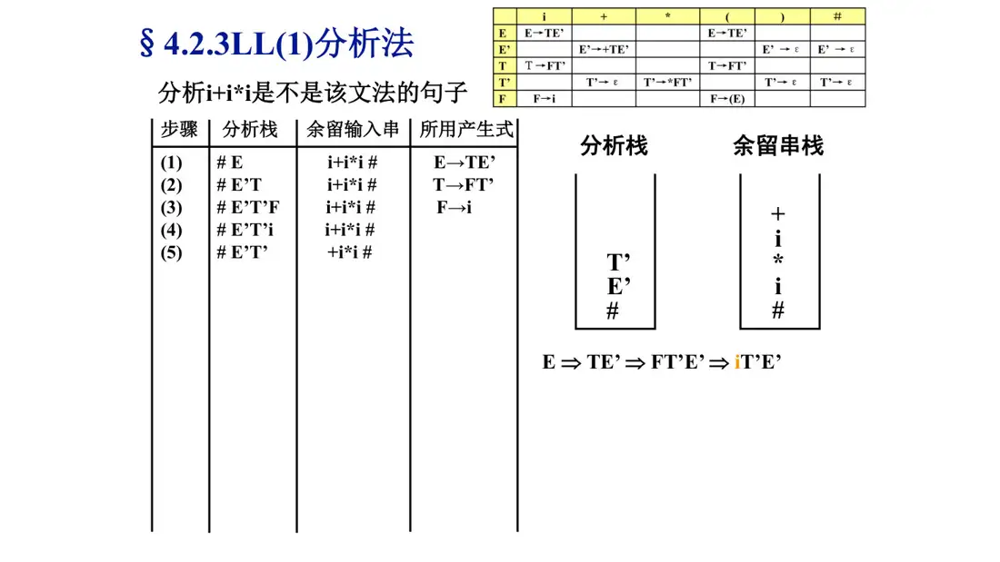

原文：

§4.2.3LL(1)分析法

分析 $\mathbf { i } + \mathbf { i } \ast \mathbf { i }$ 是不是该文法的句子

<table><tr><td></td><td>i</td><td>+</td><td>*</td><td>(</td><td>)</td><td>#</td></tr><tr><td>E</td><td> $E \rightarrow TE'$ </td><td></td><td></td><td> $E \rightarrow TE'$ </td><td></td><td></td></tr><tr><td>E&#x27;</td><td></td><td> $E' \rightarrow +TE'$ </td><td></td><td></td><td> $E' \rightarrow \varepsilon$ </td><td> $E' \rightarrow \varepsilon$ </td></tr><tr><td>T</td><td> $T \rightarrow FT'$ </td><td></td><td></td><td> $T \rightarrow FT'$ </td><td></td><td></td></tr><tr><td>T&#x27;</td><td></td><td> $T' \rightarrow \varepsilon$ </td><td> $T' \rightarrow *FT'$ </td><td></td><td> $T' \rightarrow \varepsilon$ </td><td> $T' \rightarrow \varepsilon$ </td></tr><tr><td>F</td><td> $F \rightarrow i$ </td><td></td><td></td><td> $F \rightarrow (E)$ </td><td></td><td></td></tr></table>

<table><tr><td>步骤</td><td>分析栈</td><td>余留输入串</td><td>所用产生式</td></tr><tr><td>(1)</td><td>#E</td><td>i+i*i #</td><td> $\mathrm{E} \rightarrow \mathrm{TE}'$ </td></tr><tr><td>(2)</td><td>#E&#x27;T</td><td>i+i*i #</td><td> $\mathrm{T} \rightarrow \mathrm{FT}'$ </td></tr><tr><td>(3)</td><td>#E&#x27;T&#x27;F</td><td>i+i*i #</td><td> $\mathrm{F} \rightarrow \mathrm{i}$ </td></tr><tr><td>(4)</td><td>#E&#x27;T&#x27;i</td><td>i+i*i #</td><td></td></tr><tr><td>(5)</td><td>#E&#x27;T&#x27;</td><td>+i*i #</td><td></td></tr><tr><td></td><td></td><td></td><td>分析栈 余留串栈</td></tr><tr><td></td><td></td><td></td><td></td></tr><tr><td></td><td></td><td></td><td> $\mathrm{E} \Rightarrow \mathrm{TE}' \Rightarrow \mathrm{FT'E'} \Rightarrow \mathrm{iT'E'}$ </td></tr></table>

### §4.2.3LL(1)分析法

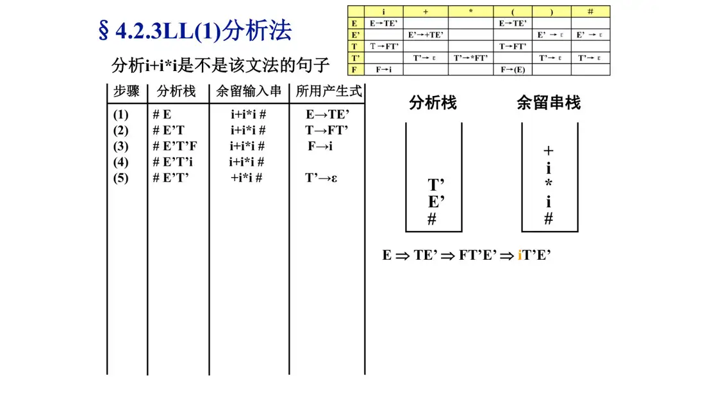

原文：

§4.2.3LL(1)分析法

分析 $\mathbf { i } + \mathbf { i } \ast \mathbf { i }$ 是不是该文法的句子

<table><tr><td></td><td>i</td><td>+</td><td>*</td><td>(</td><td>)</td><td>#</td></tr><tr><td>E</td><td> $E \rightarrow TE'$ </td><td></td><td></td><td> $E \rightarrow TE'$ </td><td></td><td></td></tr><tr><td>E&#x27;</td><td></td><td> $E' \rightarrow +TE'$ </td><td></td><td></td><td> $E' \rightarrow \varepsilon$ </td><td> $E' \rightarrow \varepsilon$ </td></tr><tr><td>T</td><td> $T \rightarrow FT'$ </td><td></td><td></td><td> $T \rightarrow FT'$ </td><td></td><td></td></tr><tr><td>T&#x27;</td><td></td><td> $T' \rightarrow \varepsilon$ </td><td> $T' \rightarrow *FT'$ </td><td></td><td> $T' \rightarrow \varepsilon$ </td><td> $T' \rightarrow \varepsilon$ </td></tr><tr><td>F</td><td> $F \rightarrow i$ </td><td></td><td></td><td> $F \rightarrow (E)$ </td><td></td><td></td></tr></table>

<table><tr><td>步骤</td><td>分析栈</td><td>余留输入串</td><td>所用产生式</td></tr><tr><td>(1)</td><td>#E</td><td>i+i*i #</td><td>E→TE&#x27;</td></tr><tr><td>(2)</td><td>#E&#x27;T</td><td>i+i*i #</td><td>T→FT&#x27;</td></tr><tr><td>(3)</td><td>#E&#x27;T&#x27;F</td><td>i+i*i #</td><td>F→i</td></tr><tr><td>(4)</td><td>#E&#x27;T&#x27;i</td><td>i+i*i #</td><td></td></tr><tr><td>(5)</td><td>#E&#x27;T&#x27;</td><td>+i*i #</td><td>T&#x27;→ε</td></tr></table>

### §4.2.3LL(1)分析法

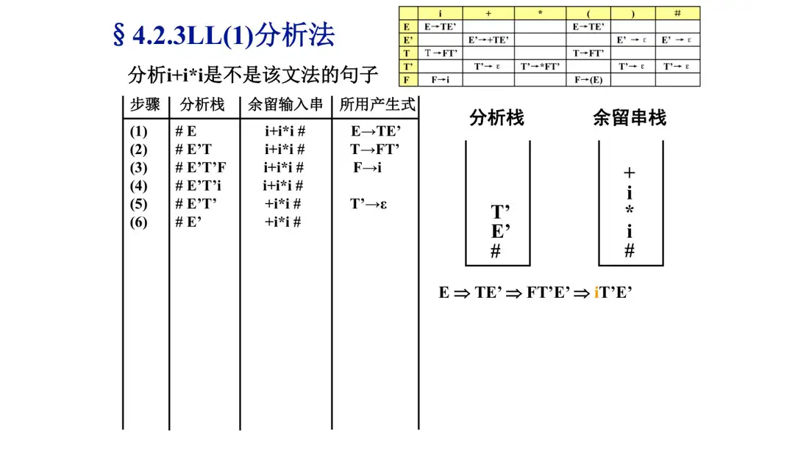

原文：

§4.2.3LL(1)分析法

分析 $\mathbf { i } + \mathbf { i } \ast \mathbf { i }$ 是不是该文法的句子

<table><tr><td></td><td>i</td><td>+</td><td>*</td><td>(</td><td>)</td><td>#</td></tr><tr><td>E</td><td> $E \rightarrow TE'$ </td><td></td><td></td><td> $E \rightarrow TE'$ </td><td></td><td></td></tr><tr><td>E&#x27;</td><td></td><td> $E' \rightarrow +TE'$ </td><td></td><td></td><td> $E' \rightarrow \varepsilon$ </td><td> $E' \rightarrow \varepsilon$ </td></tr><tr><td>T</td><td> $T \rightarrow FT'$ </td><td></td><td></td><td> $T \rightarrow FT'$ </td><td></td><td></td></tr><tr><td>T&#x27;</td><td></td><td> $T' \rightarrow \varepsilon$ </td><td> $T' \rightarrow *FT'$ </td><td></td><td> $T' \rightarrow \varepsilon$ </td><td> $T' \rightarrow \varepsilon$ </td></tr><tr><td>F</td><td> $F \rightarrow i$ </td><td></td><td></td><td> $F \rightarrow (E)$ </td><td></td><td></td></tr></table>

<table><tr><td>步骤</td><td>分析栈</td><td>余留输入串</td><td>所用产生式</td><td>分析栈</td><td>余留串栈</td></tr><tr><td>(1)</td><td>#E</td><td>i+i*i #</td><td>E→TE&#x27;</td><td></td><td></td></tr><tr><td>(2)</td><td>#E&#x27;T</td><td>i+i*i #</td><td>T→FT&#x27;</td><td></td><td></td></tr><tr><td>(3)</td><td>#E&#x27;T&#x27;F</td><td>i+i*i #</td><td>F→i</td><td></td><td></td></tr><tr><td>(4)</td><td>#E&#x27;T&#x27;i</td><td>i+i*i #</td><td></td><td></td><td></td></tr><tr><td>(5)</td><td>#E&#x27;T&#x27;</td><td>+i*i #</td><td>T&#x27;→ε</td><td></td><td></td></tr><tr><td>(6)</td><td>#E&#x27;</td><td>+i*i #</td><td></td><td></td><td></td></tr><tr><td></td><td></td><td></td><td></td><td colspan="2">E⇒TE&#x27;⇒FT&#x27;E&#x27;⇒iT&#x27;E&#x27;</td></tr></table>

### §4.2.3LL(1)分析法

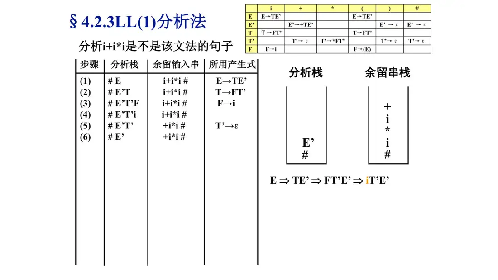

原文：

§4.2.3LL(1)分析法

分析 $\mathbf { i } + \mathbf { i } \ast \mathbf { i }$ 是不是该文法的句子

<table><tr><td></td><td>i</td><td>+</td><td>*</td><td>(</td><td>)</td><td>#</td></tr><tr><td>E</td><td> $E \rightarrow TE'$ </td><td></td><td></td><td> $E \rightarrow TE'$ </td><td></td><td></td></tr><tr><td>E&#x27;</td><td></td><td> $E' \rightarrow +TE'$ </td><td></td><td></td><td> $E' \rightarrow \varepsilon$ </td><td> $E' \rightarrow \varepsilon$ </td></tr><tr><td>T</td><td> $T \rightarrow FT'$ </td><td></td><td></td><td> $T \rightarrow FT'$ </td><td></td><td></td></tr><tr><td>T&#x27;</td><td></td><td> $T' \rightarrow \varepsilon$ </td><td> $T' \rightarrow *FT'$ </td><td></td><td> $T' \rightarrow \varepsilon$ </td><td> $T' \rightarrow \varepsilon$ </td></tr><tr><td>F</td><td> $F \rightarrow i$ </td><td></td><td></td><td> $F \rightarrow (E)$ </td><td></td><td></td></tr></table>

<table><tr><td>步骤</td><td>分析栈</td><td>余留输入串</td><td>所用产生式</td><td>分析栈</td><td>余留串栈</td></tr><tr><td>(1)</td><td>#E</td><td>i+i*i #</td><td>E→TE&#x27;</td><td></td><td></td></tr><tr><td>(2)</td><td>#E&#x27;T</td><td>i+i*i #</td><td>T→FT&#x27;</td><td></td><td></td></tr><tr><td>(3)</td><td>#E&#x27;T&#x27;F</td><td>i+i*i #</td><td>F→i</td><td></td><td></td></tr><tr><td>(4)</td><td>#E&#x27;T&#x27;i</td><td>i+i*i #</td><td></td><td></td><td></td></tr><tr><td>(5)</td><td>#E&#x27;T&#x27;</td><td>+i*i #</td><td>T&#x27;→ε</td><td></td><td></td></tr><tr><td>(6)</td><td>#E&#x27;</td><td>+i*i #</td><td></td><td></td><td></td></tr><tr><td></td><td></td><td></td><td></td><td colspan="2">E⇒TE&#x27;⇒FT&#x27;E&#x27;⇒iT&#x27;E&#x27;</td></tr></table>

### §4.2.3LL(1)分析法

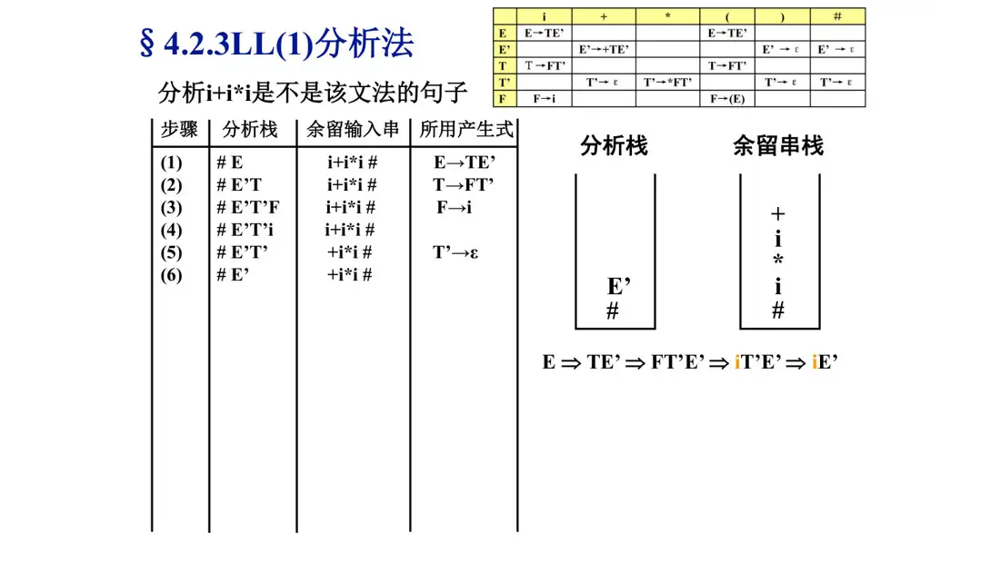

原文：

§4.2.3LL(1)分析法

分析 $\mathbf { i } + \mathbf { i } \ast \mathbf { i }$ 是不是该文法的句子

<table><tr><td></td><td>i</td><td>+</td><td>*</td><td>(</td><td>)</td><td>#</td></tr><tr><td>E</td><td> $E \rightarrow TE'$ </td><td></td><td></td><td> $E \rightarrow TE'$ </td><td></td><td></td></tr><tr><td>E&#x27;</td><td></td><td> $E' \rightarrow +TE'$ </td><td></td><td></td><td> $E' \rightarrow \varepsilon$ </td><td> $E' \rightarrow \varepsilon$ </td></tr><tr><td>T</td><td> $T \rightarrow FT'$ </td><td></td><td></td><td> $T \rightarrow FT'$ </td><td></td><td></td></tr><tr><td>T&#x27;</td><td></td><td> $T' \rightarrow \varepsilon$ </td><td> $T' \rightarrow *FT'$ </td><td></td><td> $T' \rightarrow \varepsilon$ </td><td> $T' \rightarrow \varepsilon$ </td></tr><tr><td>F</td><td> $F \rightarrow i$ </td><td></td><td></td><td> $F \rightarrow (E)$ </td><td></td><td></td></tr></table>

<table><tr><td>步骤</td><td>分析栈</td><td>余留输入串</td><td>所用产生式</td><td>分析栈</td><td>余留串栈</td></tr><tr><td>(1)</td><td>#E</td><td>i+i*i #</td><td>E→TE&#x27;</td><td></td><td></td></tr><tr><td>(2)</td><td>#E&#x27;T</td><td>i+i*i #</td><td>T→FT&#x27;</td><td></td><td></td></tr><tr><td>(3)</td><td>#E&#x27;T&#x27;F</td><td>i+i*i #</td><td>F→i</td><td></td><td></td></tr><tr><td>(4)</td><td>#E&#x27;T&#x27;i</td><td>i+i*i #</td><td></td><td></td><td></td></tr><tr><td>(5)</td><td>#E&#x27;T&#x27;</td><td>+i*i #</td><td>T&#x27;→ε</td><td></td><td></td></tr><tr><td>(6)</td><td>#E&#x27;</td><td>+i*i #</td><td></td><td></td><td></td></tr><tr><td></td><td></td><td></td><td></td><td colspan="2">E⇒TE&#x27;⇒FT&#x27;E&#x27;⇒iT&#x27;E&#x27;⇒iE&#x27;</td></tr></table>

### §4.2.3LL(1)分析法

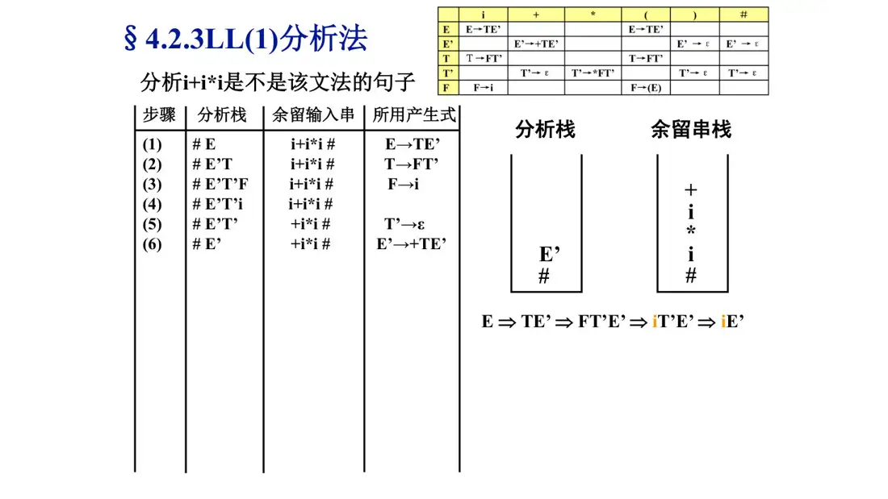

原文：

§4.2.3LL(1)分析法

分析 $\mathbf { i } + \mathbf { i } \ast \mathbf { i }$ 是不是该文法的句子

<table><tr><td></td><td>i</td><td>+</td><td>*</td><td>(</td><td>)</td><td>#</td></tr><tr><td>E</td><td> $E \rightarrow TE'$ </td><td></td><td></td><td> $E \rightarrow TE'$ </td><td></td><td></td></tr><tr><td>E&#x27;</td><td></td><td> $E' \rightarrow +TE'$ </td><td></td><td></td><td> $E' \rightarrow \varepsilon$ </td><td> $E' \rightarrow \varepsilon$ </td></tr><tr><td>T</td><td> $T \rightarrow FT'$ </td><td></td><td></td><td> $T \rightarrow FT'$ </td><td></td><td></td></tr><tr><td>T&#x27;</td><td></td><td> $T' \rightarrow \varepsilon$ </td><td> $T' \rightarrow *FT'$ </td><td></td><td> $T' \rightarrow \varepsilon$ </td><td> $T' \rightarrow \varepsilon$ </td></tr><tr><td>F</td><td> $F \rightarrow i$ </td><td></td><td></td><td> $F \rightarrow (E)$ </td><td></td><td></td></tr></table>

<table><tr><td>步骤</td><td>分析栈</td><td>余留输入串</td><td>所用产生式</td><td>分析栈</td><td>余留串栈</td></tr><tr><td>(1)</td><td>#E</td><td>i+i*i #</td><td> $E \rightarrow TE'$ </td><td></td><td></td></tr><tr><td>(2)</td><td>#E&#x27;T</td><td>i+i*i #</td><td> $T \rightarrow FT'$ </td><td></td><td></td></tr><tr><td>(3)</td><td>#E&#x27;T&#x27;F</td><td>i+i*i #</td><td> $F \rightarrow i$ </td><td></td><td></td></tr><tr><td>(4)</td><td>#E&#x27;T&#x27;i</td><td>i+i*i #</td><td></td><td></td><td></td></tr><tr><td>(5)</td><td>#E&#x27;T&#x27;</td><td>+i*i #</td><td> $T' \rightarrow \varepsilon$ </td><td></td><td></td></tr><tr><td>(6)</td><td>#E&#x27;</td><td>+i*i #</td><td> $E' \rightarrow +TE'$ </td><td></td><td></td></tr><tr><td></td><td></td><td></td><td></td><td>____</td><td>____</td></tr><tr><td></td><td></td><td></td><td></td><td colspan="2"> $E \Rightarrow TE' \Rightarrow FT'E' \Rightarrow iT'E' \Rightarrow iE'$ </td></tr></table>

### §4.2.3LL(1)分析法

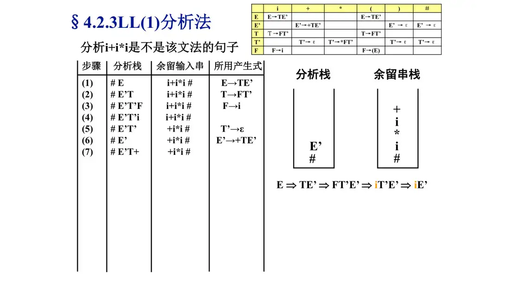

原文：

§4.2.3LL(1)分析法

分析 $\mathbf { i } + \mathbf { i } \ast \mathbf { i }$ 是不是该文法的句子

<table><tr><td></td><td>i</td><td>+</td><td>*</td><td>(</td><td>)</td><td>#</td></tr><tr><td>E</td><td> $E \rightarrow TE'$ </td><td></td><td></td><td> $E \rightarrow TE'$ </td><td></td><td></td></tr><tr><td>E&#x27;</td><td></td><td> $E' \rightarrow +TE'$ </td><td></td><td></td><td> $E' \rightarrow \varepsilon$ </td><td> $E' \rightarrow \varepsilon$ </td></tr><tr><td>T</td><td> $T \rightarrow FT'$ </td><td></td><td></td><td> $T \rightarrow FT'$ </td><td></td><td></td></tr><tr><td>T&#x27;</td><td></td><td> $T' \rightarrow \varepsilon$ </td><td> $T' \rightarrow *FT'$ </td><td></td><td> $T' \rightarrow \varepsilon$ </td><td> $T' \rightarrow \varepsilon$ </td></tr><tr><td>F</td><td> $F \rightarrow i$ </td><td></td><td></td><td> $F \rightarrow (E)$ </td><td></td><td></td></tr></table>

<table><tr><td>步骤</td><td>分析栈</td><td>余留输入串</td><td>所用产生式</td><td>分析栈</td><td>余留串栈</td></tr><tr><td>(1)</td><td>#E</td><td>i+i*i #</td><td> $E \rightarrow TE'$ </td><td></td><td></td></tr><tr><td>(2)</td><td>#E&#x27;T</td><td>i+i*i #</td><td> $T \rightarrow FT'$ </td><td></td><td></td></tr><tr><td>(3)</td><td>#E&#x27;T&#x27;F</td><td>i+i*i #</td><td> $F \rightarrow i$ </td><td></td><td></td></tr><tr><td>(4)</td><td>#E&#x27;T&#x27;i</td><td>i+i*i #</td><td></td><td></td><td></td></tr><tr><td>(5)</td><td>#E&#x27;T&#x27;</td><td>+i*i #</td><td> $T' \rightarrow \varepsilon$ </td><td></td><td></td></tr><tr><td>(6)</td><td>#E&#x27;</td><td>+i*i #</td><td> $E' \rightarrow +TE'$ </td><td></td><td></td></tr><tr><td>(7)</td><td>#E&#x27;T+</td><td>+i*i #</td><td></td><td></td><td></td></tr><tr><td></td><td></td><td></td><td></td><td>____</td><td>____</td></tr><tr><td></td><td></td><td></td><td></td><td colspan="2"> $E \Rightarrow TE' \Rightarrow FT'E' \Rightarrow iT'E' \Rightarrow iE'$ </td></tr></table>

### §4.2.3LL(1)分析法

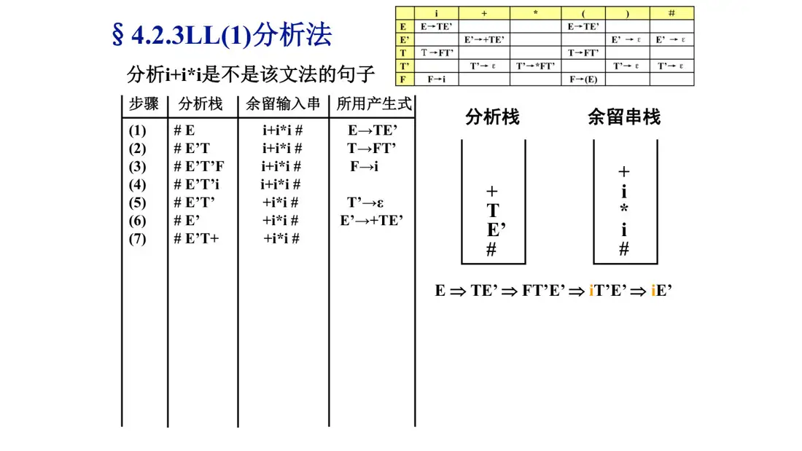

原文：

§4.2.3LL(1)分析法

分析 $\mathbf { i } + \mathbf { i } \ast \mathbf { i }$ 是不是该文法的句子

<table><tr><td></td><td>i</td><td>+</td><td>*</td><td>(</td><td>)</td><td>#</td></tr><tr><td>E</td><td> $E \rightarrow TE'$ </td><td></td><td></td><td> $E \rightarrow TE'$ </td><td></td><td></td></tr><tr><td>E&#x27;</td><td></td><td> $E' \rightarrow +TE'$ </td><td></td><td></td><td> $E' \rightarrow \varepsilon$ </td><td> $E' \rightarrow \varepsilon$ </td></tr><tr><td>T</td><td> $T \rightarrow FT'$ </td><td></td><td></td><td> $T \rightarrow FT'$ </td><td></td><td></td></tr><tr><td>T&#x27;</td><td></td><td> $T' \rightarrow \varepsilon$ </td><td> $T' \rightarrow *FT'$ </td><td></td><td> $T' \rightarrow \varepsilon$ </td><td> $T' \rightarrow \varepsilon$ </td></tr><tr><td>F</td><td> $F \rightarrow i$ </td><td></td><td></td><td> $F \rightarrow (E)$ </td><td></td><td></td></tr></table>

<table><tr><td>步骤</td><td>分析栈</td><td>余留输入串</td><td>所用产生式</td></tr><tr><td>(1)</td><td>#E</td><td>i+i*i #</td><td>E→TE&#x27;</td></tr><tr><td>(2)</td><td>#E&#x27;T</td><td>i+i*i #</td><td>T→FT&#x27;</td></tr><tr><td>(3)</td><td>#E&#x27;T&#x27;F</td><td>i+i*i #</td><td>F→i</td></tr><tr><td>(4)</td><td>#E&#x27;T&#x27;i</td><td>i+i*i #</td><td></td></tr><tr><td>(5)</td><td>#E&#x27;T&#x27;</td><td>+i*i #</td><td>T&#x27;→ε</td></tr><tr><td>(6)</td><td>#E&#x27;</td><td>+i*i #</td><td>E&#x27;→+TE&#x27;</td></tr><tr><td>(7)</td><td>#E&#x27;T+</td><td>+i*i #</td><td></td></tr></table>

### §4.2.3LL(1)分析法

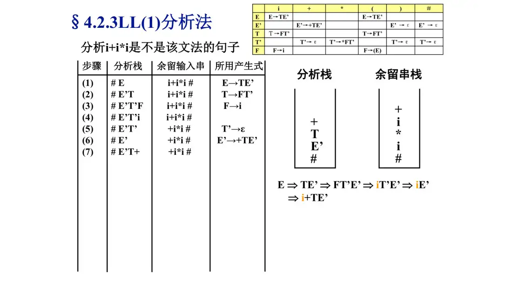

原文：

§4.2.3LL(1)分析法

分析 $\mathbf { i } + \mathbf { i } \ast \mathbf { i }$ 是不是该文法的句子

<table><tr><td></td><td>i</td><td>+</td><td>*</td><td>(</td><td>)</td><td>#</td></tr><tr><td>E</td><td> $E \rightarrow TE'$ </td><td></td><td></td><td> $E \rightarrow TE'$ </td><td></td><td></td></tr><tr><td>E&#x27;</td><td></td><td> $E' \rightarrow +TE'$ </td><td></td><td></td><td> $E' \rightarrow \varepsilon$ </td><td> $E' \rightarrow \varepsilon$ </td></tr><tr><td>T</td><td> $T \rightarrow FT'$ </td><td></td><td></td><td> $T \rightarrow FT'$ </td><td></td><td></td></tr><tr><td>T&#x27;</td><td></td><td> $T' \rightarrow \varepsilon$ </td><td> $T' \rightarrow *FT'$ </td><td></td><td> $T' \rightarrow \varepsilon$ </td><td> $T' \rightarrow \varepsilon$ </td></tr><tr><td>F</td><td> $F \rightarrow i$ </td><td></td><td></td><td> $F \rightarrow (E)$ </td><td></td><td></td></tr></table>

<table><tr><td>步骤</td><td>分析栈</td><td>余留输入串</td><td>所用产生式</td></tr><tr><td>(1)</td><td>#E</td><td>i+i*i #</td><td> $E \rightarrow TE'$ </td></tr><tr><td>(2)</td><td>#E&#x27;T</td><td>i+i*i #</td><td> $T \rightarrow FT'$ </td></tr><tr><td>(3)</td><td>#E&#x27;T&#x27;F</td><td>i+i*i #</td><td> $F \rightarrow i$ </td></tr><tr><td>(4)</td><td>#E&#x27;T&#x27;i</td><td>i+i*i #</td><td></td></tr><tr><td>(5)</td><td>#E&#x27;T&#x27;</td><td>+i*i #</td><td> $T' \rightarrow \varepsilon$ </td></tr><tr><td>(6)</td><td>#E&#x27;</td><td>+i*i #</td><td> $E' \rightarrow +TE'$ </td></tr><tr><td>(7)</td><td>#E&#x27;T+</td><td>+i*i #</td><td></td></tr></table>

### §4.2.3LL(1)分析法

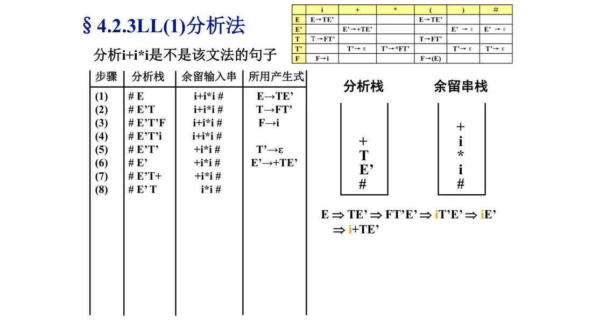

原文：

§4.2.3LL(1)分析法

分析 $\mathbf { i } + \mathbf { i } \ast \mathbf { i }$ 是不是该文法的句子

<table><tr><td></td><td>i</td><td>+</td><td>*</td><td>(</td><td>)</td><td>#</td></tr><tr><td>E</td><td> $E \rightarrow TE'$ </td><td></td><td></td><td> $E \rightarrow TE'$ </td><td></td><td></td></tr><tr><td>E&#x27;</td><td></td><td> $E' \rightarrow +TE'$ </td><td></td><td></td><td> $E' \rightarrow \varepsilon$ </td><td> $E' \rightarrow \varepsilon$ </td></tr><tr><td>T</td><td> $T \rightarrow FT'$ </td><td></td><td></td><td> $T \rightarrow FT'$ </td><td></td><td></td></tr><tr><td>T&#x27;</td><td></td><td> $T' \rightarrow \varepsilon$ </td><td> $T' \rightarrow *FT'$ </td><td></td><td> $T' \rightarrow \varepsilon$ </td><td> $T' \rightarrow \varepsilon$ </td></tr><tr><td>F</td><td> $F \rightarrow i$ </td><td></td><td></td><td> $F \rightarrow (E)$ </td><td></td><td></td></tr></table>

<table><tr><td>步骤</td><td>分析栈</td><td>余留输入串</td><td>所用产生式</td></tr><tr><td>(1)</td><td>#E</td><td>i+i*i #</td><td> $E \rightarrow TE'$ </td></tr><tr><td>(2)</td><td>#E&#x27;T</td><td>i+i*i #</td><td> $T \rightarrow FT'$ </td></tr><tr><td>(3)</td><td>#E&#x27;T&#x27;F</td><td>i+i*i #</td><td> $F \rightarrow i$ </td></tr><tr><td>(4)</td><td>#E&#x27;T&#x27;i</td><td>i+i*i #</td><td></td></tr><tr><td>(5)</td><td>#E&#x27;T&#x27;</td><td>+i*i #</td><td> $T' \rightarrow \varepsilon$ </td></tr><tr><td>(6)</td><td>#E&#x27;</td><td>+i*i #</td><td> $E' \rightarrow +TE'$ </td></tr><tr><td>(7)</td><td>#E&#x27;T+</td><td>+i*i #</td><td></td></tr><tr><td>(8)</td><td>#E&#x27;T</td><td>i*i #</td><td></td></tr></table>

### §4.2.3LL(1)分析法

原文：

§4.2.3LL(1)分析法

分析 $\mathbf { i } + \mathbf { i } \ast \mathbf { i }$ 是不是该文法的句子

<table><tr><td></td><td>i</td><td>+</td><td>*</td><td>(</td><td>)</td><td>#</td></tr><tr><td>E</td><td> $E \rightarrow TE'$ </td><td></td><td></td><td> $E \rightarrow TE'$ </td><td></td><td></td></tr><tr><td>E&#x27;</td><td></td><td> $E' \rightarrow +TE'$ </td><td></td><td></td><td> $E' \rightarrow \varepsilon$ </td><td> $E' \rightarrow \varepsilon$ </td></tr><tr><td>T</td><td> $T \rightarrow FT'$ </td><td></td><td></td><td> $T \rightarrow FT'$ </td><td></td><td></td></tr><tr><td>T&#x27;</td><td></td><td> $T' \rightarrow \varepsilon$ </td><td> $T' \rightarrow *FT'$ </td><td></td><td> $T' \rightarrow \varepsilon$ </td><td> $T' \rightarrow \varepsilon$ </td></tr><tr><td>F</td><td> $F \rightarrow i$ </td><td></td><td></td><td> $F \rightarrow (E)$ </td><td></td><td></td></tr></table>

<table><tr><td>步骤</td><td>分析栈</td><td>余留输入串</td><td>所用产生式</td></tr><tr><td>(1)</td><td>#E</td><td>i+i*i #</td><td>E→TE&#x27;</td></tr><tr><td>(2)</td><td>#E&#x27;T</td><td>i+i*i #</td><td>T→FT&#x27;</td></tr><tr><td>(3)</td><td>#E&#x27;T&#x27;F</td><td>i+i*i #</td><td>F→i</td></tr><tr><td>(4)</td><td>#E&#x27;T&#x27;i</td><td>i+i*i #</td><td></td></tr><tr><td>(5)</td><td>#E&#x27;T&#x27;</td><td>+i*i #</td><td>T&#x27;→ε</td></tr><tr><td>(6)</td><td>#E&#x27;</td><td>+i*i #</td><td>E&#x27;→+TE&#x27;</td></tr><tr><td>(7)</td><td>#E&#x27;T+</td><td>+i*i #</td><td></td></tr><tr><td>(8)</td><td>#E&#x27;T</td><td>i*i #</td><td></td></tr></table>

### §4.2.3LL(1)分析法

原文：

§4.2.3LL(1)分析法

分析 $\mathbf { i } + \mathbf { i } \ast \mathbf { i }$ 是不是该文法的句子

<table><tr><td></td><td>i</td><td>+</td><td>*</td><td>(</td><td>)</td><td>#</td></tr><tr><td>E</td><td> $E \rightarrow TE'$ </td><td></td><td></td><td> $E \rightarrow TE'$ </td><td></td><td></td></tr><tr><td>E&#x27;</td><td></td><td> $E' \rightarrow +TE'$ </td><td></td><td></td><td> $E' \rightarrow \varepsilon$ </td><td> $E' \rightarrow \varepsilon$ </td></tr><tr><td>T</td><td> $T \rightarrow FT'$ </td><td></td><td></td><td> $T \rightarrow FT'$ </td><td></td><td></td></tr><tr><td>T&#x27;</td><td></td><td> $T' \rightarrow \varepsilon$ </td><td> $T' \rightarrow *FT'$ </td><td></td><td> $T' \rightarrow \varepsilon$ </td><td> $T' \rightarrow \varepsilon$ </td></tr><tr><td>F</td><td> $F \rightarrow i$ </td><td></td><td></td><td> $F \rightarrow (E)$ </td><td></td><td></td></tr></table>

<table><tr><td>步骤</td><td>分析栈</td><td>余留输入串</td><td>所用产生式</td></tr><tr><td>(1)</td><td>#E</td><td>i+i*i #</td><td>E→TE&#x27;</td></tr><tr><td>(2)</td><td>#E&#x27;T</td><td>i+i*i #</td><td>T→FT&#x27;</td></tr><tr><td>(3)</td><td>#E&#x27;T&#x27;F</td><td>i+i*i #</td><td>F→i</td></tr><tr><td>(4)</td><td>#E&#x27;T&#x27;i</td><td>i+i*i #</td><td></td></tr><tr><td>(5)</td><td>#E&#x27;T&#x27;</td><td>+i*i #</td><td>T&#x27;→ε</td></tr><tr><td>(6)</td><td>#E&#x27;</td><td>+i*i #</td><td>E&#x27;→+TE&#x27;</td></tr><tr><td>(7)</td><td>#E&#x27;T+</td><td>+i*i #</td><td></td></tr><tr><td>(8)</td><td>#E&#x27;T</td><td>i*i #</td><td></td></tr></table>

### §4.2.3LL(1)分析法

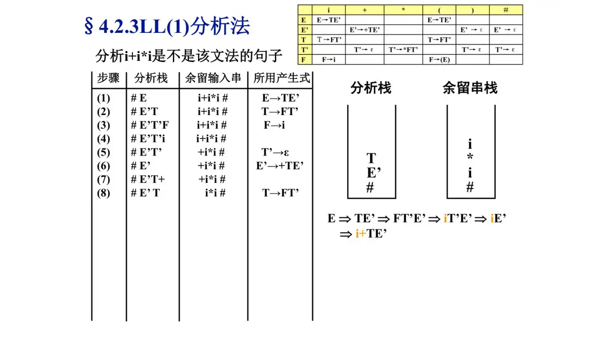

原文：

§4.2.3LL(1)分析法

分析 $\mathbf { i } + \mathbf { i } \ast \mathbf { i }$ 是不是该文法的句子

<table><tr><td></td><td>i</td><td>+</td><td>*</td><td>(</td><td>)</td><td>#</td></tr><tr><td>E</td><td> $E \rightarrow TE'$ </td><td></td><td></td><td> $E \rightarrow TE'$ </td><td></td><td></td></tr><tr><td>E&#x27;</td><td></td><td> $E' \rightarrow +TE'$ </td><td></td><td></td><td> $E' \rightarrow \varepsilon$ </td><td> $E' \rightarrow \varepsilon$ </td></tr><tr><td>T</td><td> $T \rightarrow FT'$ </td><td></td><td></td><td> $T \rightarrow FT'$ </td><td></td><td></td></tr><tr><td>T&#x27;</td><td></td><td> $T' \rightarrow \varepsilon$ </td><td> $T' \rightarrow *FT'$ </td><td></td><td> $T' \rightarrow \varepsilon$ </td><td> $T' \rightarrow \varepsilon$ </td></tr><tr><td>F</td><td> $F \rightarrow i$ </td><td></td><td></td><td> $F \rightarrow (E)$ </td><td></td><td></td></tr></table>

<table><tr><td>步骤</td><td>分析栈</td><td>余留输入串</td><td>所用产生式</td><td>分析栈</td><td>余留串栈</td></tr><tr><td>(1)</td><td>#E</td><td>i+i*i #</td><td>E→TE&#x27;</td><td rowspan="8"></td><td rowspan="8"></td></tr><tr><td>(2)</td><td>#E&#x27;T</td><td>i+i*i #</td><td>T→FT&#x27;</td></tr><tr><td>(3)</td><td>#E&#x27;T&#x27;F</td><td>i+i*i #</td><td>F→i</td></tr><tr><td>(4)</td><td>#E&#x27;T&#x27;i</td><td>i+i*i #</td><td></td></tr><tr><td>(5)</td><td>#E&#x27;T&#x27;</td><td>+i*i #</td><td>T&#x27;→ε</td></tr><tr><td>(6)</td><td>#E&#x27;</td><td>+i*i #</td><td>E&#x27;→+TE&#x27;</td></tr><tr><td>(7)</td><td>#E&#x27;T+</td><td>+i*i #</td><td></td></tr><tr><td>(8)</td><td>#E&#x27;T</td><td>i*i #</td><td>T→FT&#x27;</td></tr><tr><td></td><td></td><td></td><td></td><td colspan="2">E⇒TE&#x27;⇒FT&#x27;E&#x27;⇒iT&#x27;E&#x27;⇒iE&#x27;⇒i+TE&#x27;</td></tr></table>

### §4.2.3LL(1)分析法

原文：

§4.2.3LL(1)分析法

分析 $\mathbf { i } + \mathbf { i } \ast \mathbf { i }$ 是不是该文法的句子

<table><tr><td></td><td>i</td><td>+</td><td>*</td><td>(</td><td>)</td><td>#</td></tr><tr><td>E</td><td> $E \rightarrow TE'$ </td><td></td><td></td><td> $E \rightarrow TE'$ </td><td></td><td></td></tr><tr><td>E&#x27;</td><td></td><td> $E' \rightarrow +TE'$ </td><td></td><td></td><td> $E' \rightarrow \varepsilon$ </td><td> $E' \rightarrow \varepsilon$ </td></tr><tr><td>T</td><td> $T \rightarrow FT'$ </td><td></td><td></td><td> $T \rightarrow FT'$ </td><td></td><td></td></tr><tr><td>T&#x27;</td><td></td><td> $T' \rightarrow \varepsilon$ </td><td> $T' \rightarrow *FT'$ </td><td></td><td> $T' \rightarrow \varepsilon$ </td><td> $T' \rightarrow \varepsilon$ </td></tr><tr><td>F</td><td> $F \rightarrow i$ </td><td></td><td></td><td> $F \rightarrow (E)$ </td><td></td><td></td></tr></table>

<table><tr><td>步骤</td><td>分析栈</td><td>余留输入串</td><td>所用产生式</td></tr><tr><td>(1)</td><td>#E</td><td>i+i*i #</td><td>E→TE&#x27;</td></tr><tr><td>(2)</td><td>#E&#x27;T</td><td>i+i*i #</td><td>T→FT&#x27;</td></tr><tr><td>(3)</td><td>#E&#x27;T&#x27;F</td><td>i+i*i #</td><td>F→i</td></tr><tr><td>(4)</td><td>#E&#x27;T&#x27;i</td><td>i+i*i #</td><td></td></tr><tr><td>(5)</td><td>#E&#x27;T&#x27;</td><td>+i*i #</td><td>T&#x27;→ε</td></tr><tr><td>(6)</td><td>#E&#x27;</td><td>+i*i #</td><td>E&#x27;→+TE&#x27;</td></tr><tr><td>(7)</td><td>#E&#x27;T+</td><td>+i*i #</td><td></td></tr><tr><td>(8)</td><td>#E&#x27;T</td><td>i*i #</td><td>T→FT&#x27;</td></tr><tr><td>(9)</td><td>#E&#x27;T&#x27;F</td><td>i*i #</td><td></td></tr></table>

### §4.2.3LL(1)分析法

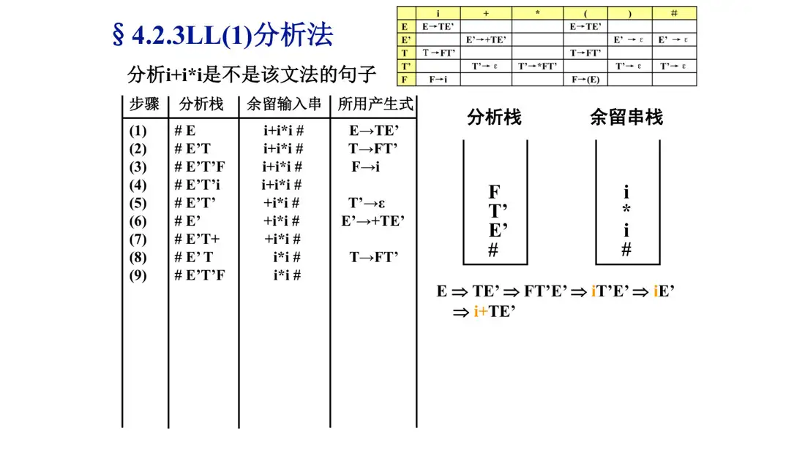

原文：

§4.2.3LL(1)分析法

分析 $\mathbf { i } + \mathbf { i } \ast \mathbf { i }$ 是不是该文法的句子

<table><tr><td></td><td>i</td><td>+</td><td>*</td><td>(</td><td>)</td><td>#</td></tr><tr><td>E</td><td> $E \rightarrow TE'$ </td><td></td><td></td><td> $E \rightarrow TE'$ </td><td></td><td></td></tr><tr><td>E&#x27;</td><td></td><td> $E' \rightarrow +TE'$ </td><td></td><td></td><td> $E' \rightarrow \varepsilon$ </td><td> $E' \rightarrow \varepsilon$ </td></tr><tr><td>T</td><td> $T \rightarrow FT'$ </td><td></td><td></td><td> $T \rightarrow FT'$ </td><td></td><td></td></tr><tr><td>T&#x27;</td><td></td><td> $T' \rightarrow \varepsilon$ </td><td> $T' \rightarrow *FT'$ </td><td></td><td> $T' \rightarrow \varepsilon$ </td><td> $T' \rightarrow \varepsilon$ </td></tr><tr><td>F</td><td> $F \rightarrow i$ </td><td></td><td></td><td> $F \rightarrow (E)$ </td><td></td><td></td></tr></table>

<table><tr><td>步骤</td><td>分析栈</td><td>余留输入串</td><td>所用产生式</td></tr><tr><td>(1)</td><td>#E</td><td>i+i*i #</td><td>E→TE&#x27;</td></tr><tr><td>(2)</td><td>#E&#x27;T</td><td>i+i*i #</td><td>T→FT&#x27;</td></tr><tr><td>(3)</td><td>#E&#x27;T&#x27;F</td><td>i+i*i #</td><td>F→i</td></tr><tr><td>(4)</td><td>#E&#x27;T&#x27;i</td><td>i+i*i #</td><td></td></tr><tr><td>(5)</td><td>#E&#x27;T&#x27;</td><td>+i*i #</td><td>T&#x27;→ε</td></tr><tr><td>(6)</td><td>#E&#x27;</td><td>+i*i #</td><td>E&#x27;→+TE&#x27;</td></tr><tr><td>(7)</td><td>#E&#x27;T+</td><td>+i*i #</td><td></td></tr><tr><td>(8)</td><td>#E&#x27;T</td><td>i*i #</td><td>T→FT&#x27;</td></tr><tr><td>(9)</td><td>#E&#x27;T&#x27;F</td><td>i*i #</td><td></td></tr></table>

### §4.2.3LL(1)分析法

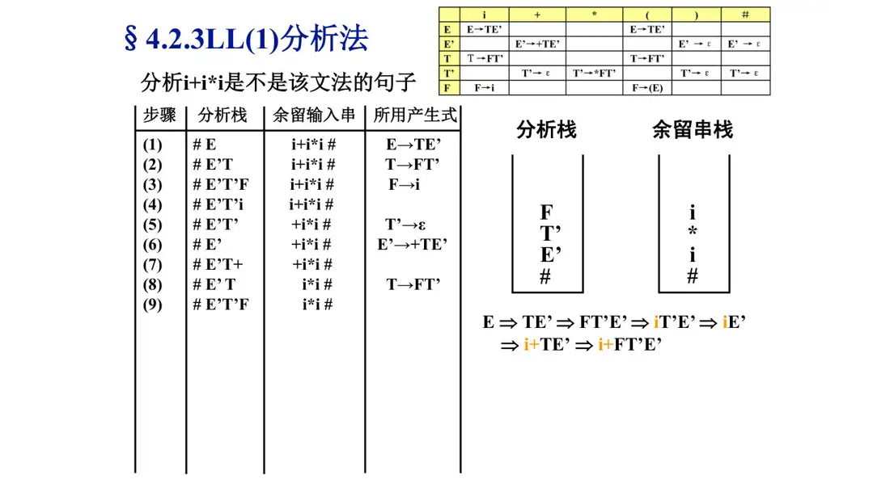

原文：

§4.2.3LL(1)分析法

分析 $\mathbf { i } + \mathbf { i } \ast \mathbf { i }$ 是不是该文法的句子

<table><tr><td></td><td>i</td><td>+</td><td>*</td><td>(</td><td>)</td><td>#</td></tr><tr><td>E</td><td> $E \rightarrow TE'$ </td><td></td><td></td><td> $E \rightarrow TE'$ </td><td></td><td></td></tr><tr><td>E&#x27;</td><td></td><td> $E' \rightarrow +TE'$ </td><td></td><td></td><td> $E' \rightarrow \varepsilon$ </td><td> $E' \rightarrow \varepsilon$ </td></tr><tr><td>T</td><td> $T \rightarrow FT'$ </td><td></td><td></td><td> $T \rightarrow FT'$ </td><td></td><td></td></tr><tr><td>T&#x27;</td><td></td><td> $T' \rightarrow \varepsilon$ </td><td> $T' \rightarrow *FT'$ </td><td></td><td> $T' \rightarrow \varepsilon$ </td><td> $T' \rightarrow \varepsilon$ </td></tr><tr><td>F</td><td> $F \rightarrow i$ </td><td></td><td></td><td> $F \rightarrow (E)$ </td><td></td><td></td></tr></table>

<table><tr><td>步骤</td><td>分析栈</td><td>余留输入串</td><td>所用产生式</td></tr><tr><td>(1)</td><td>#E</td><td>i+i*i #</td><td>E→TE&#x27;</td></tr><tr><td>(2)</td><td>#E&#x27;T</td><td>i+i*i #</td><td>T→FT&#x27;</td></tr><tr><td>(3)</td><td>#E&#x27;T&#x27;F</td><td>i+i*i #</td><td>F→i</td></tr><tr><td>(4)</td><td>#E&#x27;T&#x27;i</td><td>i+i*i #</td><td></td></tr><tr><td>(5)</td><td>#E&#x27;T&#x27;</td><td>+i*i #</td><td>T&#x27;→ε</td></tr><tr><td>(6)</td><td>#E&#x27;</td><td>+i*i #</td><td>E&#x27;→+TE&#x27;</td></tr><tr><td>(7)</td><td>#E&#x27;T+</td><td>+i*i #</td><td></td></tr><tr><td>(8)</td><td>#E&#x27;T</td><td>i*i #</td><td>T→FT&#x27;</td></tr><tr><td>(9)</td><td>#E&#x27;T&#x27;F</td><td>i*i #</td><td></td></tr></table>

### §4.2.3LL(1)分析法

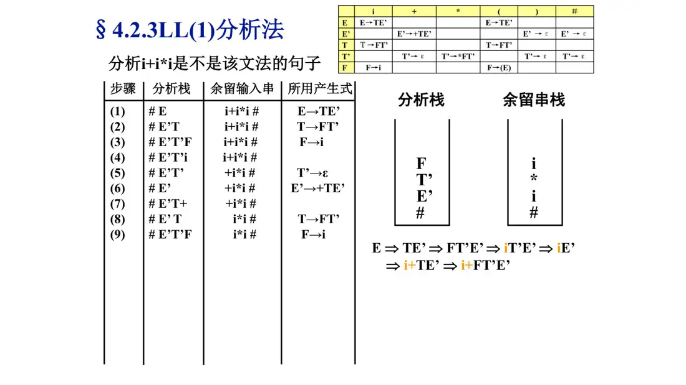

原文：

§4.2.3LL(1)分析法

分析 $\mathbf { i } + \mathbf { i } \ast \mathbf { i }$ 是不是该文法的句子

<table><tr><td></td><td>i</td><td>+</td><td>*</td><td>(</td><td>)</td><td>#</td></tr><tr><td>E</td><td> $E \rightarrow TE'$ </td><td></td><td></td><td> $E \rightarrow TE'$ </td><td></td><td></td></tr><tr><td>E&#x27;</td><td></td><td> $E' \rightarrow +TE'$ </td><td></td><td></td><td> $E' \rightarrow \varepsilon$ </td><td> $E' \rightarrow \varepsilon$ </td></tr><tr><td>T</td><td> $T \rightarrow FT'$ </td><td></td><td></td><td> $T \rightarrow FT'$ </td><td></td><td></td></tr><tr><td>T&#x27;</td><td></td><td> $T' \rightarrow \varepsilon$ </td><td> $T' \rightarrow *FT'$ </td><td></td><td> $T' \rightarrow \varepsilon$ </td><td> $T' \rightarrow \varepsilon$ </td></tr><tr><td>F</td><td> $F \rightarrow i$ </td><td></td><td></td><td> $F \rightarrow (E)$ </td><td></td><td></td></tr></table>

<table><tr><td>步骤</td><td>分析栈</td><td>余留输入串</td><td>所用产生式</td></tr><tr><td>(1)</td><td>#E</td><td>i+i*i #</td><td>E→TE&#x27;</td></tr><tr><td>(2)</td><td>#E&#x27;T</td><td>i+i*i #</td><td>T→FT&#x27;</td></tr><tr><td>(3)</td><td>#E&#x27;T&#x27;F</td><td>i+i*i #</td><td>F→i</td></tr><tr><td>(4)</td><td>#E&#x27;T&#x27;i</td><td>i+i*i #</td><td></td></tr><tr><td>(5)</td><td>#E&#x27;T&#x27;</td><td>+i*i #</td><td>T&#x27;→ε</td></tr><tr><td>(6)</td><td>#E&#x27;</td><td>+i*i #</td><td>E&#x27;→+TE&#x27;</td></tr><tr><td>(7)</td><td>#E&#x27;T+</td><td>+i*i #</td><td></td></tr><tr><td>(8)</td><td>#E&#x27;T</td><td>i*i #</td><td>T→FT&#x27;</td></tr><tr><td>(9)</td><td>#E&#x27;T&#x27;F</td><td>i*i #</td><td>F→i</td></tr></table>

### §4.2.3LL(1)分析法

原文：

§4.2.3LL(1)分析法

分析 $\mathbf { i } + \mathbf { i } \ast \mathbf { i }$ 是不是该文法的句子

<table><tr><td></td><td>i</td><td>+</td><td>*</td><td>(</td><td>)</td><td>#</td></tr><tr><td>E</td><td> $E \rightarrow TE'$ </td><td></td><td></td><td> $E \rightarrow TE'$ </td><td></td><td></td></tr><tr><td>E&#x27;</td><td></td><td> $E' \rightarrow +TE'$ </td><td></td><td></td><td> $E' \rightarrow \varepsilon$ </td><td> $E' \rightarrow \varepsilon$ </td></tr><tr><td>T</td><td> $T \rightarrow FT'$ </td><td></td><td></td><td> $T \rightarrow FT'$ </td><td></td><td></td></tr><tr><td>T&#x27;</td><td></td><td> $T' \rightarrow \varepsilon$ </td><td> $T' \rightarrow *FT'$ </td><td></td><td> $T' \rightarrow \varepsilon$ </td><td> $T' \rightarrow \varepsilon$ </td></tr><tr><td>F</td><td> $F \rightarrow i$ </td><td></td><td></td><td> $F \rightarrow (E)$ </td><td></td><td></td></tr></table>

<table><tr><td>步骤</td><td>分析栈</td><td>余留输入串</td><td>所用产生式</td></tr><tr><td>(1)</td><td>#E</td><td>i+i*i #</td><td>E→TE&#x27;</td></tr><tr><td>(2)</td><td>#E&#x27;T</td><td>i+i*i #</td><td>T→FT&#x27;</td></tr><tr><td>(3)</td><td>#E&#x27;T&#x27;F</td><td>i+i*i #</td><td>F→i</td></tr><tr><td>(4)</td><td>#E&#x27;T&#x27;i</td><td>i+i*i #</td><td></td></tr><tr><td>(5)</td><td>#E&#x27;T&#x27;</td><td>+i*i #</td><td>T&#x27;→ε</td></tr><tr><td>(6)</td><td>#E&#x27;</td><td>+i*i #</td><td>E&#x27;→+TE&#x27;</td></tr><tr><td>(7)</td><td>#E&#x27;T+</td><td>+i*i #</td><td></td></tr><tr><td>(8)</td><td>#E&#x27;T</td><td>i*i #</td><td>T→FT&#x27;</td></tr><tr><td>(9)</td><td>#E&#x27;T&#x27;F</td><td>i*i #</td><td>F→i</td></tr><tr><td>(10)</td><td>#E&#x27;T&#x27;i</td><td>i*i #</td><td></td></tr></table>

### §4.2.3LL(1)分析法

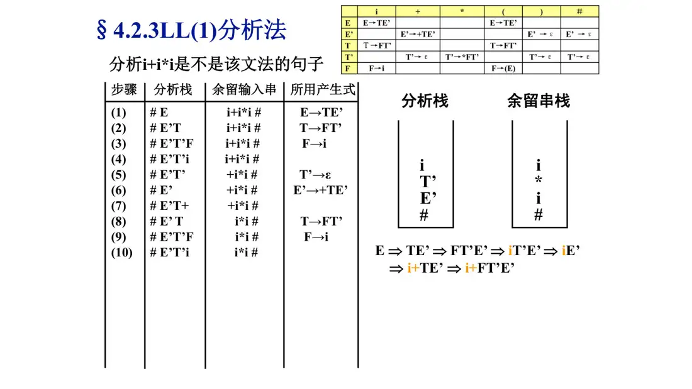

原文：

§4.2.3LL(1)分析法

分析 $\mathbf { i } + \mathbf { i } \ast \mathbf { i }$ 是不是该文法的句子

<table><tr><td></td><td>i</td><td>+</td><td>*</td><td>(</td><td>)</td><td>#</td></tr><tr><td>E</td><td> $E \rightarrow TE'$ </td><td></td><td></td><td> $E \rightarrow TE'$ </td><td></td><td></td></tr><tr><td>E&#x27;</td><td></td><td> $E' \rightarrow +TE'$ </td><td></td><td></td><td> $E' \rightarrow \varepsilon$ </td><td> $E' \rightarrow \varepsilon$ </td></tr><tr><td>T</td><td> $T \rightarrow FT'$ </td><td></td><td></td><td> $T \rightarrow FT'$ </td><td></td><td></td></tr><tr><td>T&#x27;</td><td></td><td> $T' \rightarrow \varepsilon$ </td><td> $T' \rightarrow *FT'$ </td><td></td><td> $T' \rightarrow \varepsilon$ </td><td> $T' \rightarrow \varepsilon$ </td></tr><tr><td>F</td><td> $F \rightarrow i$ </td><td></td><td></td><td> $F \rightarrow (E)$ </td><td></td><td></td></tr></table>

<table><tr><td>步骤</td><td>分析栈</td><td>余留输入串</td><td>所用产生式</td></tr><tr><td>(1)</td><td>#E</td><td>i+i*i #</td><td>E→TE&#x27;</td></tr><tr><td>(2)</td><td>#E&#x27;T</td><td>i+i*i #</td><td>T→FT&#x27;</td></tr><tr><td>(3)</td><td>#E&#x27;T&#x27;F</td><td>i+i*i #</td><td>F→i</td></tr><tr><td>(4)</td><td>#E&#x27;T&#x27;i</td><td>i+i*i #</td><td></td></tr><tr><td>(5)</td><td>#E&#x27;T&#x27;</td><td>+i*i #</td><td>T&#x27;→ε</td></tr><tr><td>(6)</td><td>#E&#x27;</td><td>+i*i #</td><td>E&#x27;→+TE&#x27;</td></tr><tr><td>(7)</td><td>#E&#x27;T+</td><td>+i*i #</td><td></td></tr><tr><td>(8)</td><td>#E&#x27;T</td><td>i*i #</td><td>T→FT&#x27;</td></tr><tr><td>(9)</td><td>#E&#x27;T&#x27;F</td><td>i*i #</td><td>F→i</td></tr><tr><td>(10)</td><td>#E&#x27;T&#x27;i</td><td>i*i #</td><td></td></tr></table>

### §4.2.3LL(1)分析法

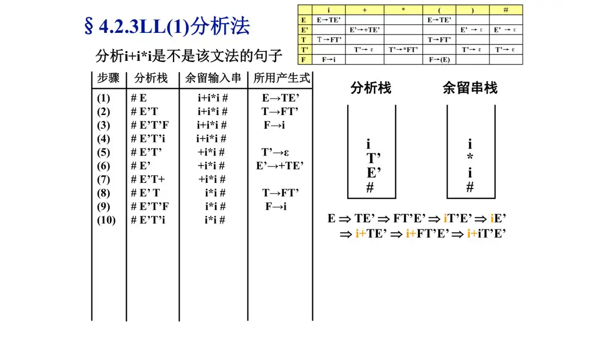

原文：

§4.2.3LL(1)分析法

分析 $\mathbf { i } + \mathbf { i } \ast \mathbf { i }$ 是不是该文法的句子

<table><tr><td></td><td>i</td><td>+</td><td>*</td><td>(</td><td>)</td><td>#</td></tr><tr><td>E</td><td> $E \rightarrow TE'$ </td><td></td><td></td><td> $E \rightarrow TE'$ </td><td></td><td></td></tr><tr><td>E&#x27;</td><td></td><td> $E' \rightarrow +TE'$ </td><td></td><td></td><td> $E' \rightarrow \varepsilon$ </td><td> $E' \rightarrow \varepsilon$ </td></tr><tr><td>T</td><td> $T \rightarrow FT'$ </td><td></td><td></td><td> $T \rightarrow FT'$ </td><td></td><td></td></tr><tr><td>T&#x27;</td><td></td><td> $T' \rightarrow \varepsilon$ </td><td> $T' \rightarrow *FT'$ </td><td></td><td> $T' \rightarrow \varepsilon$ </td><td> $T' \rightarrow \varepsilon$ </td></tr><tr><td>F</td><td> $F \rightarrow i$ </td><td></td><td></td><td> $F \rightarrow (E)$ </td><td></td><td></td></tr></table>

<table><tr><td>步骤</td><td>分析栈</td><td>余留输入串</td><td>所用产生式</td></tr><tr><td>(1)</td><td>#E</td><td>i+i*i #</td><td>E→TE&#x27;</td></tr><tr><td>(2)</td><td>#E&#x27;T</td><td>i+i*i #</td><td>T→FT&#x27;</td></tr><tr><td>(3)</td><td>#E&#x27;T&#x27;F</td><td>i+i*i #</td><td>F→i</td></tr><tr><td>(4)</td><td>#E&#x27;T&#x27;i</td><td>i+i*i #</td><td></td></tr><tr><td>(5)</td><td>#E&#x27;T&#x27;</td><td>+i*i #</td><td>T&#x27;→ε</td></tr><tr><td>(6)</td><td>#E&#x27;</td><td>+i*i #</td><td>E&#x27;→+TE&#x27;</td></tr><tr><td>(7)</td><td>#E&#x27;T+</td><td>+i*i #</td><td></td></tr><tr><td>(8)</td><td>#E&#x27;T</td><td>i*i #</td><td>T→FT&#x27;</td></tr><tr><td>(9)</td><td>#E&#x27;T&#x27;F</td><td>i*i #</td><td>F→i</td></tr><tr><td>(10)</td><td>#E&#x27;T&#x27;i</td><td>i*i #</td><td></td></tr></table>

### §4.2.3LL(1)分析法

原文：

§4.2.3LL(1)分析法

分析 $\mathbf { i } + \mathbf { i } \ast \mathbf { i }$ 是不是该文法的句子

<table><tr><td></td><td>i</td><td>+</td><td>*</td><td>(</td><td>)</td><td>#</td></tr><tr><td>E</td><td> $E \rightarrow TE'$ </td><td></td><td></td><td> $E \rightarrow TE'$ </td><td></td><td></td></tr><tr><td>E&#x27;</td><td></td><td> $E' \rightarrow +TE'$ </td><td></td><td></td><td> $E' \rightarrow \varepsilon$ </td><td> $E' \rightarrow \varepsilon$ </td></tr><tr><td>T</td><td> $T \rightarrow FT'$ </td><td></td><td></td><td> $T \rightarrow FT'$ </td><td></td><td></td></tr><tr><td>T&#x27;</td><td></td><td> $T' \rightarrow \varepsilon$ </td><td> $T' \rightarrow *FT'$ </td><td></td><td> $T' \rightarrow \varepsilon$ </td><td> $T' \rightarrow \varepsilon$ </td></tr><tr><td>F</td><td> $F \rightarrow i$ </td><td></td><td></td><td> $F \rightarrow (E)$ </td><td></td><td></td></tr></table>

<table><tr><td>步骤</td><td>分析栈</td><td>余留输入串</td><td>所用产生式</td></tr><tr><td>(1)</td><td>#E</td><td>i+i*i #</td><td>E→TE&#x27;</td></tr><tr><td>(2)</td><td>#E&#x27;T</td><td>i+i*i #</td><td>T→FT&#x27;</td></tr><tr><td>(3)</td><td>#E&#x27;T&#x27;F</td><td>i+i*i #</td><td>F→i</td></tr><tr><td>(4)</td><td>#E&#x27;T&#x27;i</td><td>i+i*i #</td><td></td></tr><tr><td>(5)</td><td>#E&#x27;T&#x27;</td><td>+i*i #</td><td>T&#x27;→ε</td></tr><tr><td>(6)</td><td>#E&#x27;</td><td>+i*i #</td><td>E&#x27;→+TE&#x27;</td></tr><tr><td>(7)</td><td>#E&#x27;T+</td><td>+i*i #</td><td></td></tr><tr><td>(8)</td><td>#E&#x27;T</td><td>i*i #</td><td>T→FT&#x27;</td></tr><tr><td>(9)</td><td>#E&#x27;T&#x27;F</td><td>i*i #</td><td>F→i</td></tr><tr><td>(10)</td><td>#E&#x27;T&#x27;i</td><td>i*i #</td><td></td></tr><tr><td>(11)</td><td>#E&#x27;T&#x27;</td><td>*i #</td><td></td></tr></table>

### §4.2.3LL(1)分析法

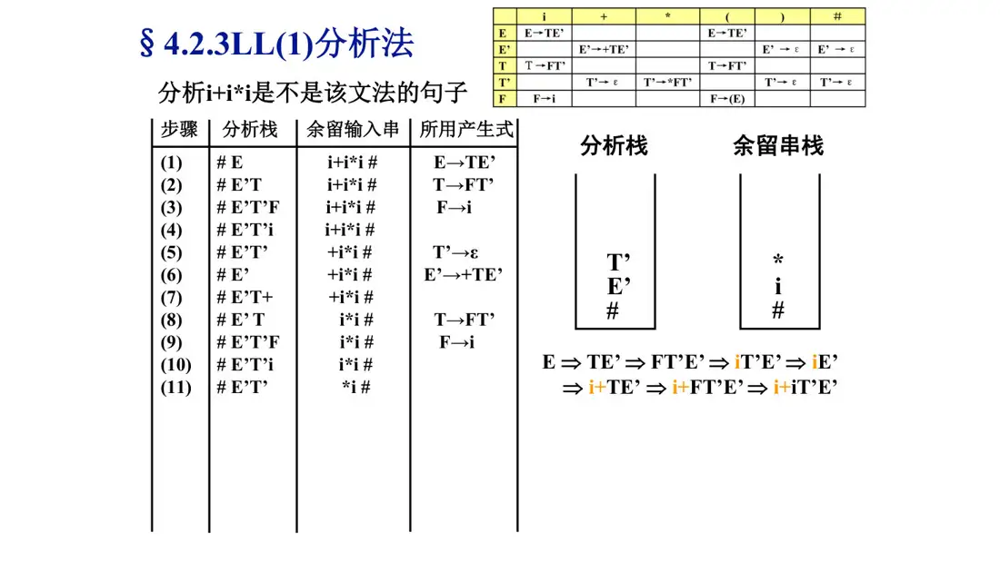

原文：

§4.2.3LL(1)分析法

分析 $\mathbf { i } + \mathbf { i } \ast \mathbf { i }$ 是不是该文法的句子

<table><tr><td></td><td>i</td><td>+</td><td>*</td><td>(</td><td>)</td><td>#</td></tr><tr><td>E</td><td> $E \rightarrow TE'$ </td><td></td><td></td><td> $E \rightarrow TE'$ </td><td></td><td></td></tr><tr><td>E&#x27;</td><td></td><td> $E' \rightarrow +TE'$ </td><td></td><td></td><td> $E' \rightarrow \varepsilon$ </td><td> $E' \rightarrow \varepsilon$ </td></tr><tr><td>T</td><td> $T \rightarrow FT'$ </td><td></td><td></td><td> $T \rightarrow FT'$ </td><td></td><td></td></tr><tr><td>T&#x27;</td><td></td><td> $T' \rightarrow \varepsilon$ </td><td> $T' \rightarrow *FT'$ </td><td></td><td> $T' \rightarrow \varepsilon$ </td><td> $T' \rightarrow \varepsilon$ </td></tr><tr><td>F</td><td> $F \rightarrow i$ </td><td></td><td></td><td> $F \rightarrow (E)$ </td><td></td><td></td></tr></table>

<table><tr><td>步骤</td><td>分析栈</td><td>余留输入串</td><td>所用产生式</td><td>分析栈</td><td>余留串栈</td></tr><tr><td>(1)</td><td># E</td><td>i+i*i #</td><td>E→TE&#x27;</td><td></td><td></td></tr><tr><td>(2)</td><td># E&#x27;T</td><td>i+i*i #</td><td>T→FT&#x27;</td><td></td><td></td></tr><tr><td>(3)</td><td># E&#x27;T&#x27;F</td><td>i+i*i #</td><td>F→i</td><td></td><td></td></tr><tr><td>(4)</td><td># E&#x27;T&#x27;i</td><td>i+i*i #</td><td></td><td></td><td></td></tr><tr><td>(5)</td><td># E&#x27;T&#x27;</td><td>+i*i #</td><td>T&#x27;→ε</td><td></td><td></td></tr><tr><td>(6)</td><td># E&#x27;</td><td>+i*i #</td><td>E&#x27;→+TE&#x27;</td><td></td><td></td></tr><tr><td>(7)</td><td># E&#x27;T+</td><td>+i*i #</td><td></td><td></td><td></td></tr><tr><td>(8)</td><td># E&#x27;T</td><td>i*i #</td><td>T→FT&#x27;</td><td></td><td></td></tr><tr><td>(9)</td><td># E&#x27;T&#x27;F</td><td>i*i #</td><td>F→i</td><td></td><td></td></tr><tr><td>(10)</td><td># E&#x27;T&#x27;i</td><td>i*i #</td><td></td><td>E⇒TE&#x27;⇒FT&#x27;E&#x27;⇒iT&#x27;E&#x27;⇒iE&#x27;⇒i+TE&#x27;⇒i+FT&#x27;E&#x27;⇒i+iT&#x27;E&#x27;</td><td></td></tr><tr><td>(11)</td><td># E&#x27;T&#x27;</td><td>*i #</td><td></td><td></td><td></td></tr></table>

### §4.2.3LL(1)分析法

原文：

§4.2.3LL(1)分析法

分析 $\mathbf { i } + \mathbf { i } \ast \mathbf { i }$ 是不是该文法的句子

<table><tr><td></td><td>i</td><td>+</td><td>*</td><td>(</td><td>)</td><td>#</td></tr><tr><td>E</td><td> $E \rightarrow TE'$ </td><td></td><td></td><td> $E \rightarrow TE'$ </td><td></td><td></td></tr><tr><td>E&#x27;</td><td></td><td> $E' \rightarrow +TE'$ </td><td></td><td></td><td> $E' \rightarrow \varepsilon$ </td><td> $E' \rightarrow \varepsilon$ </td></tr><tr><td>T</td><td> $T \rightarrow FT'$ </td><td></td><td></td><td> $T \rightarrow FT'$ </td><td></td><td></td></tr><tr><td>T&#x27;</td><td></td><td> $T' \rightarrow \varepsilon$ </td><td> $T' \rightarrow *FT'$ </td><td></td><td> $T' \rightarrow \varepsilon$ </td><td> $T' \rightarrow \varepsilon$ </td></tr><tr><td>F</td><td> $F \rightarrow i$ </td><td></td><td></td><td> $F \rightarrow (E)$ </td><td></td><td></td></tr></table>

<table><tr><td>步骤</td><td>分析栈</td><td>余留输入串</td><td>所用产生式</td><td>分析栈</td><td>余留串栈</td></tr><tr><td>(1)</td><td># E</td><td>i+i*i #</td><td>E→TE&#x27;</td><td></td><td></td></tr><tr><td>(2)</td><td># E&#x27;T</td><td>i+i*i #</td><td>T→FT&#x27;</td><td></td><td></td></tr><tr><td>(3)</td><td># E&#x27;T&#x27;F</td><td>i+i*i #</td><td>F→i</td><td></td><td></td></tr><tr><td>(4)</td><td># E&#x27;T&#x27;i</td><td>i+i*i #</td><td></td><td></td><td></td></tr><tr><td>(5)</td><td># E&#x27;T&#x27;</td><td>+i*i #</td><td>T&#x27;→ε</td><td></td><td></td></tr><tr><td>(6)</td><td># E&#x27;</td><td>+i*i #</td><td>E&#x27;→+TE&#x27;</td><td></td><td></td></tr><tr><td>(7)</td><td># E&#x27;T+</td><td>+i*i #</td><td></td><td></td><td></td></tr><tr><td>(8)</td><td># E&#x27;T</td><td>i*i #</td><td>T→FT&#x27;</td><td></td><td></td></tr><tr><td>(9)</td><td># E&#x27;T&#x27;F</td><td>i*i #</td><td>F→i</td><td></td><td></td></tr><tr><td>(10)</td><td># E&#x27;T&#x27;i</td><td>i*i #</td><td></td><td>E⇒TE&#x27;⇒FT&#x27;E&#x27;⇒iT&#x27;E&#x27;⇒iE&#x27;⇒i+TE&#x27;⇒i+FT&#x27;E&#x27;⇒i+t&#x27;E&#x27;</td><td></td></tr><tr><td>(11)</td><td># E&#x27;T&#x27;</td><td>*i #</td><td></td><td></td><td></td></tr></table>

### §4.2.3LL(1)分析法

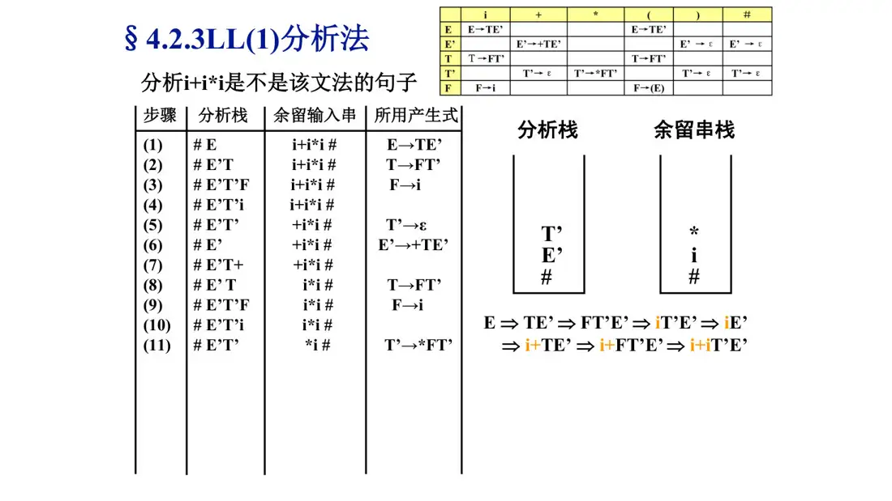

原文：

§4.2.3LL(1)分析法

分析 $\mathbf { i } + \mathbf { i } \ast \mathbf { i }$ 是不是该文法的句子

<table><tr><td></td><td>i</td><td>+</td><td>*</td><td>(</td><td>)</td><td>#</td></tr><tr><td>E</td><td> $E \rightarrow TE'$ </td><td></td><td></td><td> $E \rightarrow TE'$ </td><td></td><td></td></tr><tr><td>E&#x27;</td><td></td><td> $E' \rightarrow +TE'$ </td><td></td><td></td><td> $E' \rightarrow \varepsilon$ </td><td> $E' \rightarrow \varepsilon$ </td></tr><tr><td>T</td><td> $T \rightarrow FT'$ </td><td></td><td></td><td> $T \rightarrow FT'$ </td><td></td><td></td></tr><tr><td>T&#x27;</td><td></td><td> $T' \rightarrow \varepsilon$ </td><td> $T' \rightarrow *FT'$ </td><td></td><td> $T' \rightarrow \varepsilon$ </td><td> $T' \rightarrow \varepsilon$ </td></tr><tr><td>F</td><td> $F \rightarrow i$ </td><td></td><td></td><td> $F \rightarrow (E)$ </td><td></td><td></td></tr></table>

<table><tr><td>步骤</td><td>分析栈</td><td>余留输入串</td><td>所用产生式</td><td>分析栈</td><td>余留串栈</td></tr><tr><td>(1)</td><td>#E</td><td>i+i*i #</td><td>E→TE&#x27;</td><td></td><td></td></tr><tr><td>(2)</td><td>#E&#x27;T</td><td>i+i*i #</td><td>T→FT&#x27;</td><td></td><td></td></tr><tr><td>(3)</td><td>#E&#x27;T&#x27;F</td><td>i+i*i #</td><td>F→i</td><td></td><td></td></tr><tr><td>(4)</td><td>#E&#x27;T&#x27;i</td><td>i+i*i #</td><td></td><td></td><td></td></tr><tr><td>(5)</td><td>#E&#x27;T&#x27;</td><td>+i*i #</td><td>T&#x27;→ε</td><td></td><td></td></tr><tr><td>(6)</td><td>#E&#x27;</td><td>+i*i #</td><td>E&#x27;→+TE&#x27;</td><td></td><td></td></tr><tr><td>(7)</td><td>#E&#x27;T+</td><td>+i*i #</td><td></td><td></td><td></td></tr><tr><td>(8)</td><td>#E&#x27;T</td><td>i*i #</td><td>T→FT&#x27;</td><td></td><td></td></tr><tr><td>(9)</td><td>#E&#x27;T&#x27;F</td><td>i*i #</td><td>F→i</td><td></td><td></td></tr><tr><td>(10)</td><td>#E&#x27;T&#x27;i</td><td>i*i #</td><td></td><td>E⇒TE&#x27;⇒FT&#x27;E&#x27;⇒iT&#x27;E&#x27;⇒iE&#x27;</td><td></td></tr><tr><td>(11)</td><td>#E&#x27;T&#x27;</td><td>*i #</td><td>T&#x27;→*FT&#x27;</td><td>⇒i+TE&#x27;⇒i+FT&#x27;E&#x27;⇒i+iT&#x27;E&#x27;</td><td></td></tr></table>

### §4.2.3LL(1)分析法

原文：

§4.2.3LL(1)分析法

分析 $\mathbf { i } + \mathbf { i } \ast \mathbf { i }$ 是不是该文法的句子

<table><tr><td></td><td>i</td><td>+</td><td>*</td><td>(</td><td>)</td><td>#</td></tr><tr><td>E</td><td> $E \rightarrow TE'$ </td><td></td><td></td><td> $E \rightarrow TE'$ </td><td></td><td></td></tr><tr><td>E&#x27;</td><td></td><td> $E' \rightarrow +TE'$ </td><td></td><td></td><td> $E' \rightarrow \varepsilon$ </td><td> $E' \rightarrow \varepsilon$ </td></tr><tr><td>T</td><td> $T \rightarrow FT'$ </td><td></td><td></td><td> $T \rightarrow FT'$ </td><td></td><td></td></tr><tr><td>T&#x27;</td><td></td><td> $T' \rightarrow \varepsilon$ </td><td> $T' \rightarrow *FT'$ </td><td></td><td> $T' \rightarrow \varepsilon$ </td><td> $T' \rightarrow \varepsilon$ </td></tr><tr><td>F</td><td> $F \rightarrow i$ </td><td></td><td></td><td> $F \rightarrow (E)$ </td><td></td><td></td></tr></table>

<table><tr><td>步骤</td><td>分析栈</td><td>余留输入串</td><td>所用产生式</td><td>分析栈</td><td>余留串栈</td></tr><tr><td>(1)</td><td># E</td><td>i+i*i #</td><td>E→TE&#x27;</td><td></td><td></td></tr><tr><td>(2)</td><td># E&#x27;T</td><td>i+i*i #</td><td>T→FT&#x27;</td><td></td><td></td></tr><tr><td>(3)</td><td># E&#x27;T&#x27;F</td><td>i+i*i #</td><td>F→i</td><td></td><td></td></tr><tr><td>(4)</td><td># E&#x27;T&#x27;i</td><td>i+i*i #</td><td></td><td></td><td></td></tr><tr><td>(5)</td><td># E&#x27;T&#x27;</td><td>+i*i #</td><td>T&#x27;→ε</td><td></td><td></td></tr><tr><td>(6)</td><td># E&#x27;</td><td>+i*i #</td><td>E&#x27;→+TE&#x27;</td><td></td><td></td></tr><tr><td>(7)</td><td># E&#x27;T+</td><td>+i*i #</td><td></td><td></td><td></td></tr><tr><td>(8)</td><td># E&#x27;T</td><td>i*i #</td><td>T→FT&#x27;</td><td></td><td></td></tr><tr><td>(9)</td><td># E&#x27;T&#x27;F</td><td>i*i #</td><td>F→i</td><td></td><td></td></tr><tr><td>(10)</td><td># E&#x27;T&#x27;i</td><td>i*i #</td><td></td><td>E⇒TE&#x27;⇒FT&#x27;E&#x27;⇒iT&#x27;E&#x27;⇒iE&#x27;</td><td></td></tr><tr><td>(11)</td><td># E&#x27;T&#x27;</td><td>*i #</td><td>T&#x27;→*FT&#x27;</td><td>⇒i+TE&#x27;⇒i+FT&#x27;E&#x27;⇒i+iT&#x27;E&#x27;</td><td></td></tr><tr><td>(12)</td><td># E&#x27;T&#x27;F*</td><td>*i #</td><td></td><td></td><td></td></tr></table>

### §4.2.3LL(1)分析法

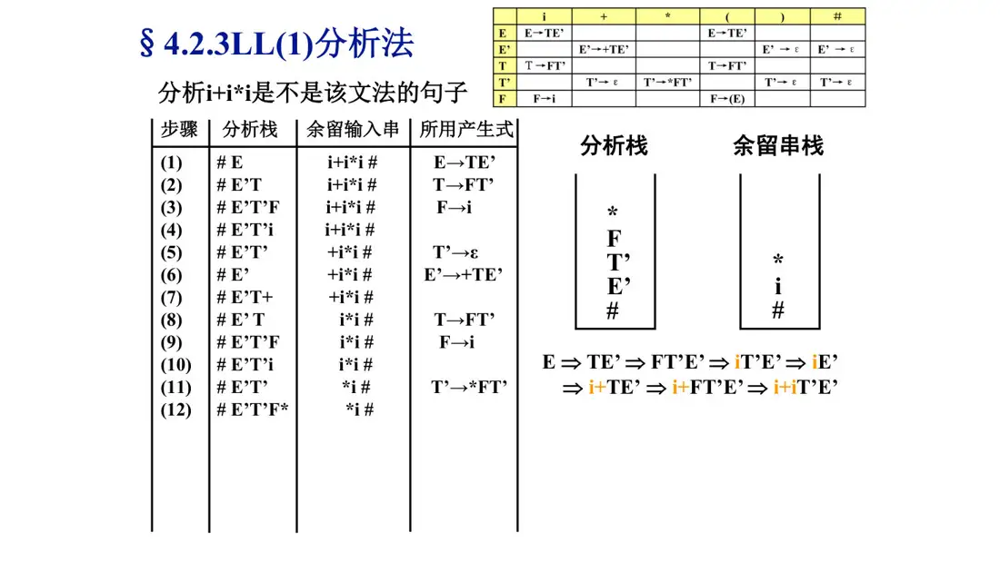

原文：

§4.2.3LL(1)分析法

分析 $\mathbf { i } + \mathbf { i } \ast \mathbf { i }$ 是不是该文法的句子

<table><tr><td></td><td>i</td><td>+</td><td>*</td><td>(</td><td>)</td><td>#</td></tr><tr><td>E</td><td> $E \rightarrow TE'$ </td><td></td><td></td><td> $E \rightarrow TE'$ </td><td></td><td></td></tr><tr><td>E&#x27;</td><td></td><td> $E' \rightarrow +TE'$ </td><td></td><td></td><td> $E' \rightarrow \varepsilon$ </td><td> $E' \rightarrow \varepsilon$ </td></tr><tr><td>T</td><td> $T \rightarrow FT'$ </td><td></td><td></td><td> $T \rightarrow FT'$ </td><td></td><td></td></tr><tr><td>T&#x27;</td><td></td><td> $T' \rightarrow \varepsilon$ </td><td> $T' \rightarrow *FT'$ </td><td></td><td> $T' \rightarrow \varepsilon$ </td><td> $T' \rightarrow \varepsilon$ </td></tr><tr><td>F</td><td> $F \rightarrow i$ </td><td></td><td></td><td> $F \rightarrow (E)$ </td><td></td><td></td></tr></table>

<table><tr><td>步骤</td><td>分析栈</td><td>余留输入串</td><td>所用产生式</td><td>分析栈</td><td>余留串栈</td></tr><tr><td>(1)</td><td>#E</td><td>i+i*i #</td><td>E→TE&#x27;</td><td rowspan="9"></td><td rowspan="9"></td></tr><tr><td>(2)</td><td>#E&#x27;T</td><td>i+i*i #</td><td>T→FT&#x27;</td></tr><tr><td>(3)</td><td>#E&#x27;T&#x27;F</td><td>i+i*i #</td><td>F→i</td></tr><tr><td>(4)</td><td>#E&#x27;T&#x27;i</td><td>i+i*i #</td><td></td></tr><tr><td>(5)</td><td>#E&#x27;T&#x27;</td><td>+i*i #</td><td>T&#x27;→ε</td></tr><tr><td>(6)</td><td>#E&#x27;</td><td>+i*i #</td><td>E&#x27;→+TE&#x27;</td></tr><tr><td>(7)</td><td>#E&#x27;T+</td><td>+i*i #</td><td></td></tr><tr><td>(8)</td><td>#E&#x27;T</td><td>i*i #</td><td>T→FT&#x27;</td></tr><tr><td>(9)</td><td>#E&#x27;T&#x27;F</td><td>i*i #</td><td>F→i</td></tr><tr><td>(10)</td><td>#E&#x27;T&#x27;i</td><td>i*i #</td><td></td><td rowspan="3" colspan="2">E⇒TE&#x27;⇒FT&#x27;E&#x27;⇒iT&#x27;E&#x27;⇒iE&#x27;⇒i+TE&#x27;⇒i+FT&#x27;E&#x27;⇒i+iT&#x27;E&#x27;</td></tr><tr><td>(11)</td><td>#E&#x27;T&#x27;</td><td>*i #</td><td>T&#x27;→*FT&#x27;</td></tr><tr><td>(12)</td><td>#E&#x27;T&#x27;F*</td><td>*i #</td><td></td></tr></table>

### §4.2.3LL(1)分析法

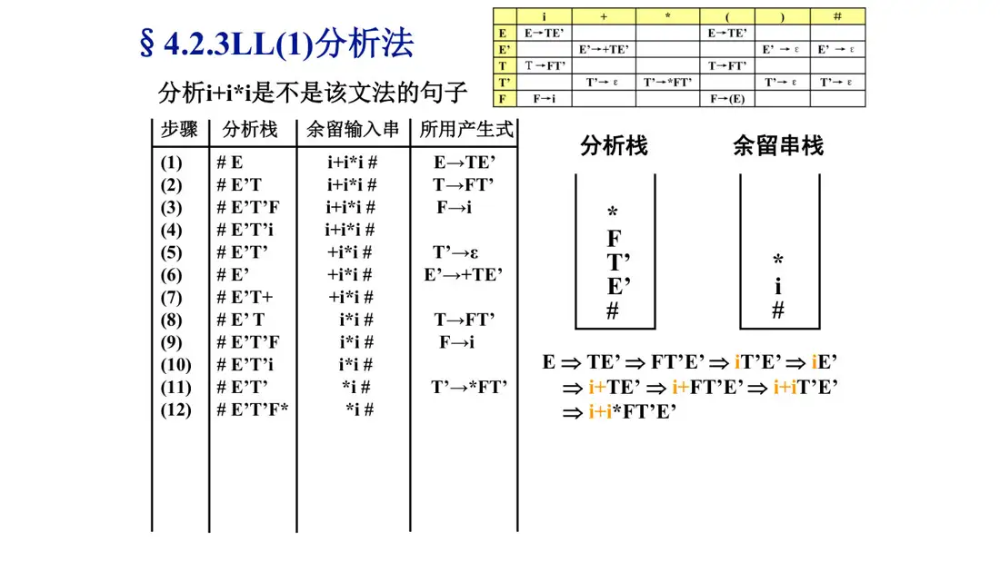

原文：

§4.2.3LL(1)分析法

分析 $\mathbf { i } + \mathbf { i } \ast \mathbf { i }$ 是不是该文法的句子

<table><tr><td></td><td>i</td><td>+</td><td>*</td><td>(</td><td>)</td><td>#</td></tr><tr><td>E</td><td> $E \rightarrow TE'$ </td><td></td><td></td><td> $E \rightarrow TE'$ </td><td></td><td></td></tr><tr><td>E&#x27;</td><td></td><td> $E' \rightarrow +TE'$ </td><td></td><td></td><td> $E' \rightarrow \varepsilon$ </td><td> $E' \rightarrow \varepsilon$ </td></tr><tr><td>T</td><td> $T \rightarrow FT'$ </td><td></td><td></td><td> $T \rightarrow FT'$ </td><td></td><td></td></tr><tr><td>T&#x27;</td><td></td><td> $T' \rightarrow \varepsilon$ </td><td> $T' \rightarrow *FT'$ </td><td></td><td> $T' \rightarrow \varepsilon$ </td><td> $T' \rightarrow \varepsilon$ </td></tr><tr><td>F</td><td> $F \rightarrow i$ </td><td></td><td></td><td> $F \rightarrow (E)$ </td><td></td><td></td></tr></table>

<table><tr><td>步骤</td><td>分析栈</td><td>余留输入串</td><td>所用产生式</td><td>分析栈</td><td>余留串栈</td></tr><tr><td>(1)</td><td>#E</td><td>i+i*i #</td><td>E→TE&#x27;</td><td rowspan="9"></td><td rowspan="9"></td></tr><tr><td>(2)</td><td>#E&#x27;T</td><td>i+i*i #</td><td>T→FT&#x27;</td></tr><tr><td>(3)</td><td>#E&#x27;T&#x27;F</td><td>i+i*i #</td><td>F→i</td></tr><tr><td>(4)</td><td>#E&#x27;T&#x27;i</td><td>i+i*i #</td><td></td></tr><tr><td>(5)</td><td>#E&#x27;T&#x27;</td><td>+i*i #</td><td>T&#x27;→ε</td></tr><tr><td>(6)</td><td>#E&#x27;</td><td>+i*i #</td><td>E&#x27;→+TE&#x27;</td></tr><tr><td>(7)</td><td>#E&#x27;T+</td><td>+i*i #</td><td></td></tr><tr><td>(8)</td><td>#E&#x27;T</td><td>i*i #</td><td>T→FT&#x27;</td></tr><tr><td>(9)</td><td>#E&#x27;T&#x27;F</td><td>i*i #</td><td>F→i</td></tr><tr><td>(10)</td><td>#E&#x27;T&#x27;i</td><td>i*i #</td><td></td><td rowspan="3" colspan="2">E⇒TE&#x27;⇒FT&#x27;E&#x27;⇒iT&#x27;E&#x27;⇒iE&#x27;⇒i+TE&#x27;⇒i+FT&#x27;E&#x27;⇒i+iT&#x27;E&#x27;⇒i+i*FT&#x27;E&#x27;</td></tr><tr><td>(11)</td><td>#E&#x27;T&#x27;</td><td>*i #</td><td>T&#x27;→*FT&#x27;</td></tr><tr><td>(12)</td><td>#E&#x27;T&#x27;F*</td><td>*i #</td><td></td></tr></table>

### §4.2.3LL(1)分析法

原文：

§4.2.3LL(1)分析法

分析 $\mathbf { i } + \mathbf { i } \ast \mathbf { i }$ 是不是该文法的句子

<table><tr><td></td><td>i</td><td>+</td><td>*</td><td>(</td><td>)</td><td>#</td></tr><tr><td>E</td><td> $E \rightarrow TE'$ </td><td></td><td></td><td> $E \rightarrow TE'$ </td><td></td><td></td></tr><tr><td>E&#x27;</td><td></td><td> $E' \rightarrow +TE'$ </td><td></td><td></td><td> $E' \rightarrow \varepsilon$ </td><td> $E' \rightarrow \varepsilon$ </td></tr><tr><td>T</td><td> $T \rightarrow FT'$ </td><td></td><td></td><td> $T \rightarrow FT'$ </td><td></td><td></td></tr><tr><td>T&#x27;</td><td></td><td> $T' \rightarrow \varepsilon$ </td><td> $T' \rightarrow *FT'$ </td><td></td><td> $T' \rightarrow \varepsilon$ </td><td> $T' \rightarrow \varepsilon$ </td></tr><tr><td>F</td><td> $F \rightarrow i$ </td><td></td><td></td><td> $F \rightarrow (E)$ </td><td></td><td></td></tr></table>

<table><tr><td>步骤</td><td>分析栈</td><td>余留输入串</td><td>所用产生式</td><td>分析栈</td><td>余留串栈</td></tr><tr><td>(1)</td><td>#E</td><td>i+i*i #</td><td>E→TE&#x27;</td><td rowspan="9"></td><td rowspan="9"></td></tr><tr><td>(2)</td><td>#E&#x27;T</td><td>i+i*i #</td><td>T→FT&#x27;</td></tr><tr><td>(3)</td><td>#E&#x27;T&#x27;F</td><td>i+i*i #</td><td>F→i</td></tr><tr><td>(4)</td><td>#E&#x27;T&#x27;i</td><td>i+i*i #</td><td></td></tr><tr><td>(5)</td><td>#E&#x27;T&#x27;</td><td>+i*i #</td><td>T&#x27;→ε</td></tr><tr><td>(6)</td><td>#E&#x27;</td><td>+i*i #</td><td>E&#x27;→+TE&#x27;</td></tr><tr><td>(7)</td><td>#E&#x27;T+</td><td>+i*i #</td><td></td></tr><tr><td>(8)</td><td>#E&#x27;T</td><td>i*i #</td><td>T→FT&#x27;</td></tr><tr><td>(9)</td><td>#E&#x27;T&#x27;F</td><td>i*i #</td><td>F→i</td></tr><tr><td>(10)</td><td>#E&#x27;T&#x27;i</td><td>i*i #</td><td></td><td rowspan="4" colspan="2">E⇒TE&#x27;⇒FT&#x27;E&#x27;⇒iT&#x27;E&#x27;⇒iE&#x27;⇒i+TE&#x27;⇒i+FT&#x27;E&#x27;⇒i+iT&#x27;E&#x27;⇒i+i*FT&#x27;E&#x27;</td></tr><tr><td>(11)</td><td>#E&#x27;T&#x27;</td><td>*i #</td><td>T&#x27;→*FT&#x27;</td></tr><tr><td>(12)</td><td>#E&#x27;T&#x27;F*</td><td>*i #</td><td></td></tr><tr><td>(13)</td><td>#E&#x27;T&#x27;F</td><td>i #</td><td></td></tr></table>

### §4.2.3LL(1)分析法

原文：

§4.2.3LL(1)分析法

分析 $\mathbf { i } + \mathbf { i } \ast \mathbf { i }$ 是不是该文法的句子

<table><tr><td></td><td>i</td><td>+</td><td>*</td><td>(</td><td>)</td><td>#</td></tr><tr><td>E</td><td> $E \rightarrow TE'$ </td><td></td><td></td><td> $E \rightarrow TE'$ </td><td></td><td></td></tr><tr><td>E&#x27;</td><td></td><td> $E' \rightarrow +TE'$ </td><td></td><td></td><td> $E' \rightarrow \varepsilon$ </td><td> $E' \rightarrow \varepsilon$ </td></tr><tr><td>T</td><td> $T \rightarrow FT'$ </td><td></td><td></td><td> $T \rightarrow FT'$ </td><td></td><td></td></tr><tr><td>T&#x27;</td><td></td><td> $T' \rightarrow \varepsilon$ </td><td> $T' \rightarrow *FT'$ </td><td></td><td> $T' \rightarrow \varepsilon$ </td><td> $T' \rightarrow \varepsilon$ </td></tr><tr><td>F</td><td> $F \rightarrow i$ </td><td></td><td></td><td> $F \rightarrow (E)$ </td><td></td><td></td></tr></table>

<table><tr><td>步骤</td><td>分析栈</td><td>余留输入串</td><td>所用产生式</td><td>分析栈</td><td>余留串栈</td></tr><tr><td>(1)</td><td># E</td><td>i+i*i #</td><td>E→TE&#x27;</td><td></td><td></td></tr><tr><td>(2)</td><td># E&#x27;T</td><td>i+i*i #</td><td>T→FT&#x27;</td><td></td><td></td></tr><tr><td>(3)</td><td># E&#x27;T&#x27;F</td><td>i+i*i #</td><td>F→i</td><td></td><td></td></tr><tr><td>(4)</td><td># E&#x27;T&#x27;i</td><td>i+i*i #</td><td></td><td></td><td></td></tr><tr><td>(5)</td><td># E&#x27;T&#x27;</td><td>+i*i #</td><td>T&#x27;→ε</td><td></td><td></td></tr><tr><td>(6)</td><td># E&#x27;</td><td>+i*i #</td><td>E&#x27;→+TE&#x27;</td><td></td><td></td></tr><tr><td>(7)</td><td># E&#x27;T+</td><td>+i*i #</td><td></td><td></td><td></td></tr><tr><td>(8)</td><td># E&#x27;T</td><td>i*i #</td><td>T→FT&#x27;</td><td></td><td></td></tr><tr><td>(9)</td><td># E&#x27;T&#x27;F</td><td>i*i #</td><td>F→i</td><td></td><td></td></tr><tr><td>(10)</td><td># E&#x27;T&#x27;i</td><td>i*i #</td><td></td><td>E⇒TE&#x27;⇒FT&#x27;E&#x27;⇒iT&#x27;E&#x27;⇒iE&#x27;</td><td></td></tr><tr><td>(11)</td><td># E&#x27;T&#x27;</td><td>*i #</td><td>T&#x27;→*FT&#x27;</td><td>⇒i+TE&#x27;⇒i+FT&#x27;E&#x27;⇒i+iT&#x27;E&#x27;</td><td></td></tr><tr><td>(12)</td><td># E&#x27;T&#x27;F*</td><td>*i #</td><td></td><td>⇒i+i*FT&#x27;E&#x27;</td><td></td></tr><tr><td>(13)</td><td># E&#x27;T&#x27;F</td><td>i #</td><td></td><td></td><td></td></tr></table>

### §4.2.3LL(1)分析法

原文：

§4.2.3LL(1)分析法

分析 $\mathbf { i } + \mathbf { i } \ast \mathbf { i }$ 是不是该文法的句子

<table><tr><td></td><td>i</td><td>+</td><td>*</td><td>(</td><td>)</td><td>#</td></tr><tr><td>E</td><td> $E \rightarrow TE'$ </td><td></td><td></td><td> $E \rightarrow TE'$ </td><td></td><td></td></tr><tr><td>E&#x27;</td><td></td><td> $E' \rightarrow +TE'$ </td><td></td><td></td><td> $E' \rightarrow \varepsilon$ </td><td> $E' \rightarrow \varepsilon$ </td></tr><tr><td>T</td><td> $T \rightarrow FT'$ </td><td></td><td></td><td> $T \rightarrow FT'$ </td><td></td><td></td></tr><tr><td>T&#x27;</td><td></td><td> $T' \rightarrow \varepsilon$ </td><td> $T' \rightarrow *FT'$ </td><td></td><td> $T' \rightarrow \varepsilon$ </td><td> $T' \rightarrow \varepsilon$ </td></tr><tr><td>F</td><td> $F \rightarrow i$ </td><td></td><td></td><td> $F \rightarrow (E)$ </td><td></td><td></td></tr></table>

<table><tr><td>步骤</td><td>分析栈</td><td>余留输入串</td><td>所用产生式</td><td>分析栈</td><td>余留串栈</td></tr><tr><td>(1)</td><td># E</td><td>i+i*i #</td><td>E→TE&#x27;</td><td></td><td></td></tr><tr><td>(2)</td><td># E&#x27;T</td><td>i+i*i #</td><td>T→FT&#x27;</td><td></td><td></td></tr><tr><td>(3)</td><td># E&#x27;T&#x27;F</td><td>i+i*i #</td><td>F→i</td><td></td><td></td></tr><tr><td>(4)</td><td># E&#x27;T&#x27;i</td><td>i+i*i #</td><td></td><td></td><td></td></tr><tr><td>(5)</td><td># E&#x27;T&#x27;</td><td>+i*i #</td><td>T&#x27;→ε</td><td></td><td></td></tr><tr><td>(6)</td><td># E&#x27;</td><td>+i*i #</td><td>E&#x27;→+TE&#x27;</td><td></td><td></td></tr><tr><td>(7)</td><td># E&#x27;T+</td><td>+i*i #</td><td></td><td></td><td></td></tr><tr><td>(8)</td><td># E&#x27;T</td><td>i*i #</td><td>T→FT&#x27;</td><td></td><td></td></tr><tr><td>(9)</td><td># E&#x27;T&#x27;F</td><td>i*i #</td><td>F→i</td><td></td><td></td></tr><tr><td>(10)</td><td># E&#x27;T&#x27;i</td><td>i*i #</td><td></td><td>E⇒TE&#x27;⇒FT&#x27;E&#x27;⇒iT&#x27;E&#x27;⇒iE&#x27;</td><td></td></tr><tr><td>(11)</td><td># E&#x27;T&#x27;</td><td>*i #</td><td>T&#x27;→*FT&#x27;</td><td>⇒i+TE&#x27;⇒i+FT&#x27;E&#x27;⇒i+iT&#x27;E&#x27;</td><td></td></tr><tr><td>(12)</td><td># E&#x27;T&#x27;F*</td><td>*i #</td><td></td><td>⇒i+i*FT&#x27;E&#x27;</td><td></td></tr><tr><td>(13)</td><td># E&#x27;T&#x27;F</td><td>i #</td><td></td><td></td><td></td></tr></table>

### §4.2.3LL(1)分析法

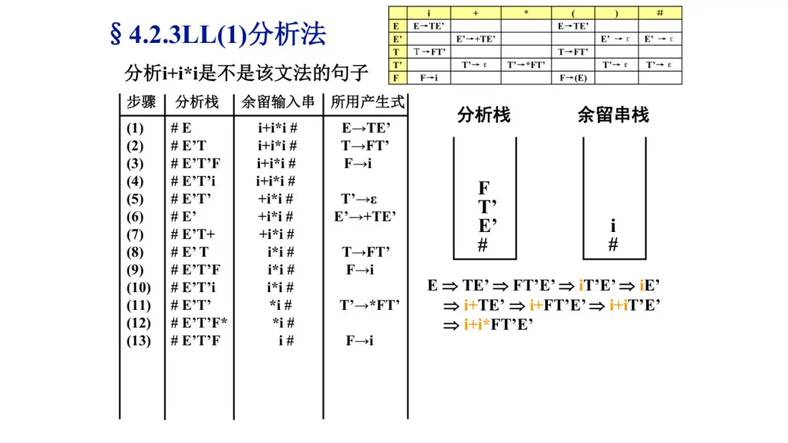

原文：

§4.2.3LL(1)分析法

分析 $\mathbf { i } + \mathbf { i } \ast \mathbf { i }$ 是不是该文法的句子

<table><tr><td></td><td>i</td><td>+</td><td>*</td><td>(</td><td>)</td><td>#</td></tr><tr><td>E</td><td> $E \rightarrow TE'$ </td><td></td><td></td><td> $E \rightarrow TE'$ </td><td></td><td></td></tr><tr><td>E&#x27;</td><td></td><td> $E' \rightarrow +TE'$ </td><td></td><td></td><td> $E' \rightarrow \varepsilon$ </td><td> $E' \rightarrow \varepsilon$ </td></tr><tr><td>T</td><td> $T \rightarrow FT'$ </td><td></td><td></td><td> $T \rightarrow FT'$ </td><td></td><td></td></tr><tr><td>T&#x27;</td><td></td><td> $T' \rightarrow \varepsilon$ </td><td> $T' \rightarrow *FT'$ </td><td></td><td> $T' \rightarrow \varepsilon$ </td><td> $T' \rightarrow \varepsilon$ </td></tr><tr><td>F</td><td> $F \rightarrow i$ </td><td></td><td></td><td> $F \rightarrow (E)$ </td><td></td><td></td></tr></table>

<table><tr><td>步骤</td><td>分析栈</td><td>余留输入串</td><td>所用产生式</td><td>分析栈</td><td>余留串栈</td></tr><tr><td>(1)</td><td># E</td><td>i+i*i #</td><td>E→TE&#x27;</td><td></td><td></td></tr><tr><td>(2)</td><td># E&#x27;T</td><td>i+i*i #</td><td>T→FT&#x27;</td><td></td><td></td></tr><tr><td>(3)</td><td># E&#x27;T&#x27;F</td><td>i+i*i #</td><td>F→i</td><td></td><td></td></tr><tr><td>(4)</td><td># E&#x27;T&#x27;i</td><td>i+i*i #</td><td></td><td></td><td></td></tr><tr><td>(5)</td><td># E&#x27;T&#x27;</td><td>+i*i #</td><td>T&#x27;→ε</td><td></td><td></td></tr><tr><td>(6)</td><td># E&#x27;</td><td>+i*i #</td><td>E&#x27;→+TE&#x27;</td><td></td><td></td></tr><tr><td>(7)</td><td># E&#x27;T+</td><td>+i*i #</td><td></td><td></td><td></td></tr><tr><td>(8)</td><td># E&#x27;T</td><td>i*i #</td><td>T→FT&#x27;</td><td></td><td></td></tr><tr><td>(9)</td><td># E&#x27;T&#x27;F</td><td>i*i #</td><td>F→i</td><td></td><td></td></tr><tr><td>(10)</td><td># E&#x27;T&#x27;i</td><td>i*i #</td><td></td><td>E⇒TE&#x27;⇒FT&#x27;E&#x27;⇒iT&#x27;E&#x27;⇒iE&#x27;</td><td></td></tr><tr><td>(11)</td><td># E&#x27;T&#x27;</td><td>*i #</td><td>T&#x27;→*FT&#x27;</td><td>⇒i+TE&#x27;⇒i+FT&#x27;E&#x27;⇒i+iT&#x27;E&#x27;</td><td></td></tr><tr><td>(12)</td><td># E&#x27;T&#x27;F*</td><td>*i #</td><td></td><td>⇒i+i*FT&#x27;E&#x27;</td><td></td></tr><tr><td>(13)</td><td># E&#x27;T&#x27;F</td><td>i #</td><td>F→i</td><td></td><td></td></tr></table>

### §4.2.3LL(1)分析法

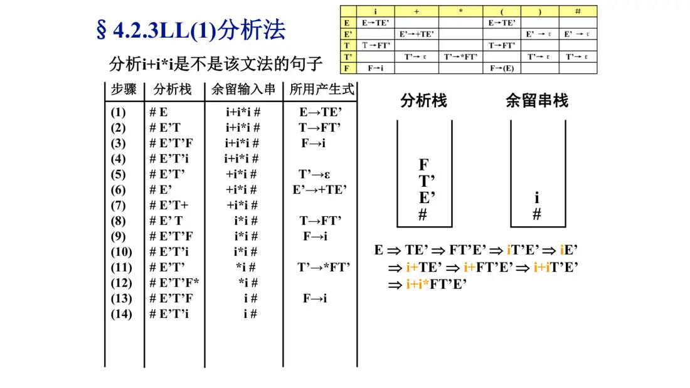

原文：

§4.2.3LL(1)分析法

分析 $\mathbf { i } + \mathbf { i } \ast \mathbf { i }$ 是不是该文法的句子

<table><tr><td></td><td>i</td><td>+</td><td>*</td><td>(</td><td>)</td><td>#</td></tr><tr><td>E</td><td> $E \rightarrow TE'$ </td><td></td><td></td><td> $E \rightarrow TE'$ </td><td></td><td></td></tr><tr><td>E&#x27;</td><td></td><td> $E' \rightarrow +TE'$ </td><td></td><td></td><td> $E' \rightarrow \varepsilon$ </td><td> $E' \rightarrow \varepsilon$ </td></tr><tr><td>T</td><td> $T \rightarrow FT'$ </td><td></td><td></td><td> $T \rightarrow FT'$ </td><td></td><td></td></tr><tr><td>T&#x27;</td><td></td><td> $T' \rightarrow \varepsilon$ </td><td> $T' \rightarrow *FT'$ </td><td></td><td> $T' \rightarrow \varepsilon$ </td><td> $T' \rightarrow \varepsilon$ </td></tr><tr><td>F</td><td> $F \rightarrow i$ </td><td></td><td></td><td> $F \rightarrow (E)$ </td><td></td><td></td></tr></table>

<table><tr><td>步骤</td><td>分析栈</td><td>余留输入串</td><td>所用产生式</td><td>分析栈</td><td>余留串栈</td></tr><tr><td>(1)</td><td># E</td><td>i+i*i #</td><td>E→TE&#x27;</td><td></td><td></td></tr><tr><td>(2)</td><td># E&#x27;T</td><td>i+i*i #</td><td>T→FT&#x27;</td><td></td><td></td></tr><tr><td>(3)</td><td># E&#x27;T&#x27;F</td><td>i+i*i #</td><td>F→i</td><td></td><td></td></tr><tr><td>(4)</td><td># E&#x27;T&#x27;i</td><td>i+i*i #</td><td></td><td></td><td></td></tr><tr><td>(5)</td><td># E&#x27;T&#x27;</td><td>+i*i #</td><td>T&#x27;→ε</td><td></td><td></td></tr><tr><td>(6)</td><td># E&#x27;</td><td>+i*i #</td><td>E&#x27;→+TE&#x27;</td><td></td><td></td></tr><tr><td>(7)</td><td># E&#x27;T+</td><td>+i*i #</td><td></td><td></td><td></td></tr><tr><td>(8)</td><td># E&#x27;T</td><td>i*i #</td><td>T→FT&#x27;</td><td></td><td></td></tr><tr><td>(9)</td><td># E&#x27;T&#x27;F</td><td>i*i #</td><td>F→i</td><td></td><td></td></tr><tr><td>(10)</td><td># E&#x27;T&#x27;i</td><td>i*i #</td><td></td><td>E⇒TE&#x27;⇒FT&#x27;E&#x27;⇒iT&#x27;E&#x27;⇒iE&#x27;</td><td></td></tr><tr><td>(11)</td><td># E&#x27;T&#x27;</td><td>*i #</td><td>T&#x27;→*FT&#x27;</td><td>⇒i+TE&#x27;⇒i+FT&#x27;E&#x27;⇒i+iT&#x27;E&#x27;</td><td></td></tr><tr><td>(12)</td><td># E&#x27;T&#x27;F*</td><td>*i #</td><td></td><td>⇒i+i*FT&#x27;E&#x27;</td><td></td></tr><tr><td>(13)</td><td># E&#x27;T&#x27;F</td><td>i #</td><td>F→i</td><td></td><td></td></tr><tr><td>(14)</td><td># E&#x27;T&#x27;i</td><td>i #</td><td></td><td></td><td></td></tr></table>

### §4.2.3LL(1)分析法

原文：

§4.2.3LL(1)分析法

分析 $\mathbf { i } + \mathbf { i } \ast \mathbf { i }$ 是不是该文法的句子

<table><tr><td></td><td>i</td><td>+</td><td>*</td><td>(</td><td>)</td><td>#</td></tr><tr><td>E</td><td> $E \rightarrow TE'$ </td><td></td><td></td><td> $E \rightarrow TE'$ </td><td></td><td></td></tr><tr><td>E&#x27;</td><td></td><td> $E' \rightarrow +TE'$ </td><td></td><td></td><td> $E' \rightarrow \varepsilon$ </td><td> $E' \rightarrow \varepsilon$ </td></tr><tr><td>T</td><td> $T \rightarrow FT'$ </td><td></td><td></td><td> $T \rightarrow FT'$ </td><td></td><td></td></tr><tr><td>T&#x27;</td><td></td><td> $T' \rightarrow \varepsilon$ </td><td> $T' \rightarrow *FT'$ </td><td></td><td> $T' \rightarrow \varepsilon$ </td><td> $T' \rightarrow \varepsilon$ </td></tr><tr><td>F</td><td> $F \rightarrow i$ </td><td></td><td></td><td> $F \rightarrow (E)$ </td><td></td><td></td></tr></table>

<table><tr><td>步骤</td><td>分析栈</td><td>余留输入串</td><td>所用产生式</td><td>分析栈</td><td>余留串栈</td></tr><tr><td>(1)</td><td># E</td><td>i+i*i #</td><td>E→TE&#x27;</td><td></td><td></td></tr><tr><td>(2)</td><td># E&#x27;T</td><td>i+i*i #</td><td>T→FT&#x27;</td><td></td><td></td></tr><tr><td>(3)</td><td># E&#x27;T&#x27;F</td><td>i+i*i #</td><td>F→i</td><td></td><td></td></tr><tr><td>(4)</td><td># E&#x27;T&#x27;i</td><td>i+i*i #</td><td></td><td></td><td></td></tr><tr><td>(5)</td><td># E&#x27;T&#x27;</td><td>+i*i #</td><td>T&#x27;→ε</td><td></td><td></td></tr><tr><td>(6)</td><td># E&#x27;</td><td>+i*i #</td><td>E&#x27;→+TE&#x27;</td><td></td><td></td></tr><tr><td>(7)</td><td># E&#x27;T+</td><td>+i*i #</td><td></td><td></td><td></td></tr><tr><td>(8)</td><td># E&#x27;T</td><td>i*i #</td><td>T→FT&#x27;</td><td></td><td></td></tr><tr><td>(9)</td><td># E&#x27;T&#x27;F</td><td>i*i #</td><td>F→i</td><td></td><td></td></tr><tr><td>(10)</td><td># E&#x27;T&#x27;i</td><td>i*i #</td><td></td><td>E⇒TE&#x27;⇒FT&#x27;E&#x27;⇒iT&#x27;E&#x27;⇒iE&#x27;</td><td></td></tr><tr><td>(11)</td><td># E&#x27;T&#x27;</td><td>*i #</td><td>T&#x27;→*FT&#x27;</td><td>⇒i+TE&#x27;⇒i+FT&#x27;E&#x27;⇒i+iT&#x27;E&#x27;</td><td></td></tr><tr><td>(12)</td><td># E&#x27;T&#x27;F*</td><td>*i #</td><td></td><td>⇒i+i*FT&#x27;E&#x27;</td><td></td></tr><tr><td>(13)</td><td># E&#x27;T&#x27;F</td><td>i #</td><td>F→i</td><td></td><td></td></tr><tr><td>(14)</td><td># E&#x27;T&#x27;i</td><td>i #</td><td></td><td></td><td></td></tr></table>

### §4.2.3LL(1)分析法

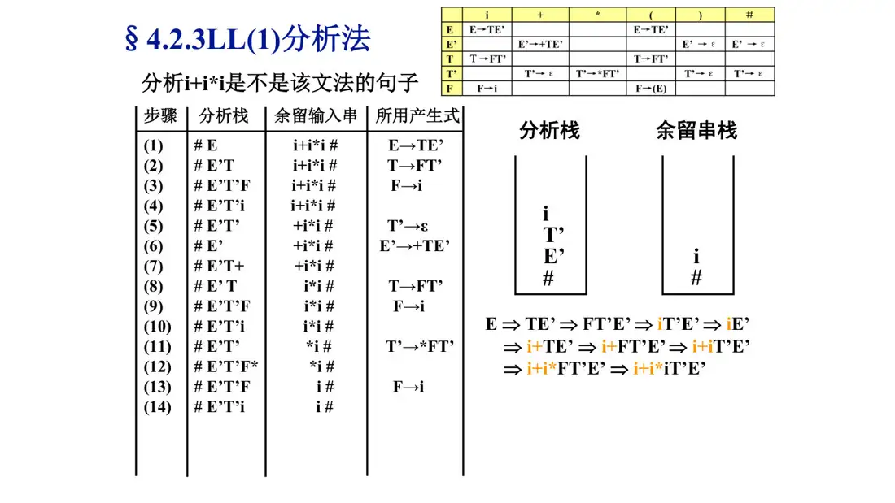

原文：

§4.2.3LL(1)分析法

分析 $\mathbf { i } + \mathbf { i } \ast \mathbf { i }$ 是不是该文法的句子

<table><tr><td></td><td>i</td><td>+</td><td>*</td><td>(</td><td>)</td><td>#</td></tr><tr><td>E</td><td> $E \rightarrow TE'$ </td><td></td><td></td><td> $E \rightarrow TE'$ </td><td></td><td></td></tr><tr><td>E&#x27;</td><td></td><td> $E' \rightarrow +TE'$ </td><td></td><td></td><td> $E' \rightarrow \varepsilon$ </td><td> $E' \rightarrow \varepsilon$ </td></tr><tr><td>T</td><td> $T \rightarrow FT'$ </td><td></td><td></td><td> $T \rightarrow FT'$ </td><td></td><td></td></tr><tr><td>T&#x27;</td><td></td><td> $T' \rightarrow \varepsilon$ </td><td> $T' \rightarrow *FT'$ </td><td></td><td> $T' \rightarrow \varepsilon$ </td><td> $T' \rightarrow \varepsilon$ </td></tr><tr><td>F</td><td> $F \rightarrow i$ </td><td></td><td></td><td> $F \rightarrow (E)$ </td><td></td><td></td></tr></table>

<table><tr><td>步骤</td><td>分析栈</td><td>余留输入串</td><td>所用产生式</td><td>分析栈</td><td>余留串栈</td></tr><tr><td>(1)</td><td># E</td><td>i+i*i #</td><td>E→TE&#x27;</td><td></td><td></td></tr><tr><td>(2)</td><td># E&#x27;T</td><td>i+i*i #</td><td>T→FT&#x27;</td><td></td><td></td></tr><tr><td>(3)</td><td># E&#x27;T&#x27;F</td><td>i+i*i #</td><td>F→i</td><td></td><td></td></tr><tr><td>(4)</td><td># E&#x27;T&#x27;i</td><td>i+i*i #</td><td></td><td></td><td></td></tr><tr><td>(5)</td><td># E&#x27;T&#x27;</td><td>+i*i #</td><td>T&#x27;→ε</td><td></td><td></td></tr><tr><td>(6)</td><td># E&#x27;</td><td>+i*i #</td><td>E&#x27;→+TE&#x27;</td><td></td><td></td></tr><tr><td>(7)</td><td># E&#x27;T+</td><td>+i*i #</td><td></td><td></td><td></td></tr><tr><td>(8)</td><td># E&#x27;T</td><td>i*i #</td><td>T→FT&#x27;</td><td></td><td></td></tr><tr><td>(9)</td><td># E&#x27;T&#x27;F</td><td>i*i #</td><td>F→i</td><td></td><td></td></tr><tr><td>(10)</td><td># E&#x27;T&#x27;i</td><td>i*i #</td><td></td><td>E⇒TE&#x27;⇒FT&#x27;E&#x27;⇒iT&#x27;E&#x27;⇒iE&#x27;</td><td></td></tr><tr><td>(11)</td><td># E&#x27;T&#x27;</td><td>*i #</td><td>T&#x27;→*FT&#x27;</td><td>⇒i+TE&#x27;⇒i+FT&#x27;E&#x27;⇒i+iT&#x27;E&#x27;</td><td></td></tr><tr><td>(12)</td><td># E&#x27;T&#x27;F*</td><td>*i #</td><td></td><td>⇒i+i*FT&#x27;E&#x27;⇒i+i*iT&#x27;E&#x27;</td><td></td></tr><tr><td>(13)</td><td># E&#x27;T&#x27;F</td><td>i #</td><td>F→i</td><td></td><td></td></tr><tr><td>(14)</td><td># E&#x27;T&#x27;i</td><td>i #</td><td></td><td></td><td></td></tr></table>

### §4.2.3LL(1)分析法

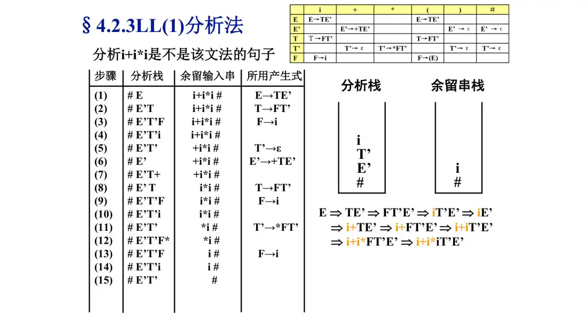

原文：

§4.2.3LL(1)分析法

分析 $\mathbf { i } + \mathbf { i } \ast \mathbf { i }$ 是不是该文法的句子

<table><tr><td></td><td>i</td><td>+</td><td>*</td><td>(</td><td>)</td><td>#</td></tr><tr><td>E</td><td> $E \rightarrow TE'$ </td><td></td><td></td><td> $E \rightarrow TE'$ </td><td></td><td></td></tr><tr><td>E&#x27;</td><td></td><td> $E' \rightarrow +TE'$ </td><td></td><td></td><td> $E' \rightarrow \varepsilon$ </td><td> $E' \rightarrow \varepsilon$ </td></tr><tr><td>T</td><td> $T \rightarrow FT'$ </td><td></td><td></td><td> $T \rightarrow FT'$ </td><td></td><td></td></tr><tr><td>T&#x27;</td><td></td><td> $T' \rightarrow \varepsilon$ </td><td> $T' \rightarrow *FT'$ </td><td></td><td> $T' \rightarrow \varepsilon$ </td><td> $T' \rightarrow \varepsilon$ </td></tr><tr><td>F</td><td> $F \rightarrow i$ </td><td></td><td></td><td> $F \rightarrow (E)$ </td><td></td><td></td></tr></table>

<table><tr><td>步骤</td><td>分析栈</td><td>余留输入串</td><td>所用产生式</td><td>分析栈</td><td>余留串栈</td></tr><tr><td>(1)</td><td># E</td><td>i+i*i #</td><td>E→TE&#x27;</td><td></td><td></td></tr><tr><td>(2)</td><td># E&#x27;T</td><td>i+i*i #</td><td>T→FT&#x27;</td><td></td><td></td></tr><tr><td>(3)</td><td># E&#x27;T&#x27;F</td><td>i+i*i #</td><td>F→i</td><td></td><td></td></tr><tr><td>(4)</td><td># E&#x27;T&#x27;i</td><td>i+i*i #</td><td></td><td></td><td></td></tr><tr><td>(5)</td><td># E&#x27;T&#x27;</td><td>+i*i #</td><td>T&#x27;→ε</td><td></td><td></td></tr><tr><td>(6)</td><td># E&#x27;</td><td>+i*i #</td><td>E&#x27;→+TE&#x27;</td><td></td><td></td></tr><tr><td>(7)</td><td># E&#x27;T+</td><td>+i*i #</td><td></td><td></td><td></td></tr><tr><td>(8)</td><td># E&#x27;T</td><td>i*i #</td><td>T→FT&#x27;</td><td></td><td></td></tr><tr><td>(9)</td><td># E&#x27;T&#x27;F</td><td>i*i #</td><td>F→i</td><td></td><td></td></tr><tr><td>(10)</td><td># E&#x27;T&#x27;i</td><td>i*i #</td><td></td><td>E⇒TE&#x27;⇒FT&#x27;E&#x27;⇒iT&#x27;E&#x27;⇒iE&#x27;</td><td></td></tr><tr><td>(11)</td><td># E&#x27;T&#x27;</td><td>*i #</td><td>T&#x27;→*FT&#x27;</td><td>⇒i+TE&#x27;⇒i+FT&#x27;E&#x27;⇒i+iT&#x27;E&#x27;</td><td></td></tr><tr><td>(12)</td><td># E&#x27;T&#x27;F*</td><td>*i #</td><td></td><td>⇒i+i*FT&#x27;E&#x27;⇒i+i*iT&#x27;E&#x27;</td><td></td></tr><tr><td>(13)</td><td># E&#x27;T&#x27;F</td><td>i #</td><td>F→i</td><td></td><td></td></tr><tr><td>(14)</td><td># E&#x27;T&#x27;i</td><td>i #</td><td></td><td></td><td></td></tr><tr><td>(15)</td><td># E&#x27;T&#x27;</td><td>#</td><td></td><td></td><td></td></tr></table>

### §4.2.3LL(1)分析法

原文：

§4.2.3LL(1)分析法

分析 $\mathbf { i } + \mathbf { i } \ast \mathbf { i }$ 是不是该文法的句子

<table><tr><td></td><td>i</td><td>+</td><td>*</td><td>(</td><td>)</td><td>#</td></tr><tr><td>E</td><td> $E \rightarrow TE'$ </td><td></td><td></td><td> $E \rightarrow TE'$ </td><td></td><td></td></tr><tr><td>E&#x27;</td><td></td><td> $E' \rightarrow +TE'$ </td><td></td><td></td><td> $E' \rightarrow \varepsilon$ </td><td> $E' \rightarrow \varepsilon$ </td></tr><tr><td>T</td><td> $T \rightarrow FT'$ </td><td></td><td></td><td> $T \rightarrow FT'$ </td><td></td><td></td></tr><tr><td>T&#x27;</td><td></td><td> $T' \rightarrow \varepsilon$ </td><td> $T' \rightarrow *FT'$ </td><td></td><td> $T' \rightarrow \varepsilon$ </td><td> $T' \rightarrow \varepsilon$ </td></tr><tr><td>F</td><td> $F \rightarrow i$ </td><td></td><td></td><td> $F \rightarrow (E)$ </td><td></td><td></td></tr></table>

<table><tr><td>步骤</td><td>分析栈</td><td>余留输入串</td><td>所用产生式</td><td>分析栈</td><td>余留串栈</td></tr><tr><td>(1)</td><td># E</td><td>i+i*i #</td><td>E→TE&#x27;</td><td></td><td></td></tr><tr><td>(2)</td><td># E&#x27;T</td><td>i+i*i #</td><td>T→FT&#x27;</td><td></td><td></td></tr><tr><td>(3)</td><td># E&#x27;T&#x27;F</td><td>i+i*i #</td><td>F→i</td><td></td><td></td></tr><tr><td>(4)</td><td># E&#x27;T&#x27;i</td><td>i+i*i #</td><td></td><td></td><td></td></tr><tr><td>(5)</td><td># E&#x27;T&#x27;</td><td>+i*i #</td><td>T&#x27;→ε</td><td></td><td></td></tr><tr><td>(6)</td><td># E&#x27;</td><td>+i*i #</td><td>E&#x27;→+TE&#x27;</td><td></td><td></td></tr><tr><td>(7)</td><td># E&#x27;T+</td><td>+i*i #</td><td></td><td></td><td></td></tr><tr><td>(8)</td><td># E&#x27;T</td><td>i*i #</td><td>T→FT&#x27;</td><td></td><td></td></tr><tr><td>(9)</td><td># E&#x27;T&#x27;F</td><td>i*i #</td><td>F→i</td><td></td><td></td></tr><tr><td>(10)</td><td># E&#x27;T&#x27;i</td><td>i*i #</td><td></td><td>E⇒TE&#x27;⇒FT&#x27;E&#x27;⇒iT&#x27;E&#x27;⇒iE&#x27;</td><td></td></tr><tr><td>(11)</td><td># E&#x27;T&#x27;</td><td>*i #</td><td>T&#x27;→*FT&#x27;</td><td>⇒i+TE&#x27;⇒i+FT&#x27;E&#x27;⇒i+iT&#x27;E&#x27;</td><td></td></tr><tr><td>(12)</td><td># E&#x27;T&#x27;F*</td><td>*i #</td><td></td><td>⇒i+i*FT&#x27;E&#x27;⇒i+i*iT&#x27;E&#x27;</td><td></td></tr><tr><td>(13)</td><td># E&#x27;T&#x27;F</td><td>i #</td><td>F→i</td><td></td><td></td></tr><tr><td>(14)</td><td># E&#x27;T&#x27;i</td><td>i #</td><td></td><td></td><td></td></tr><tr><td>(15)</td><td># E&#x27;T&#x27;</td><td>#</td><td></td><td></td><td></td></tr></table>

### §4.2.3LL(1)分析法

原文：

§4.2.3LL(1)分析法

分析 $\mathbf { i } + \mathbf { i } \ast \mathbf { i }$ 是不是该文法的句子

<table><tr><td></td><td>i</td><td>+</td><td>*</td><td>(</td><td>)</td><td>#</td></tr><tr><td>E</td><td> $E \rightarrow TE'$ </td><td></td><td></td><td> $E \rightarrow TE'$ </td><td></td><td></td></tr><tr><td>E&#x27;</td><td></td><td> $E' \rightarrow +TE'$ </td><td></td><td></td><td> $E' \rightarrow \varepsilon$ </td><td> $E' \rightarrow \varepsilon$ </td></tr><tr><td>T</td><td> $T \rightarrow FT'$ </td><td></td><td></td><td> $T \rightarrow FT'$ </td><td></td><td></td></tr><tr><td>T&#x27;</td><td></td><td> $T' \rightarrow \varepsilon$ </td><td> $T' \rightarrow *FT'$ </td><td></td><td> $T' \rightarrow \varepsilon$ </td><td> $T' \rightarrow \varepsilon$ </td></tr><tr><td>F</td><td> $F \rightarrow i$ </td><td></td><td></td><td> $F \rightarrow (E)$ </td><td></td><td></td></tr></table>

<table><tr><td>步骤</td><td>分析栈</td><td>余留输入串</td><td>所用产生式</td><td>分析栈</td><td>余留串栈</td></tr><tr><td>(1)</td><td># E</td><td>i+i*i #</td><td>E→TE&#x27;</td><td></td><td></td></tr><tr><td>(2)</td><td># E&#x27;T</td><td>i+i*i #</td><td>T→FT&#x27;</td><td></td><td></td></tr><tr><td>(3)</td><td># E&#x27;T&#x27;F</td><td>i+i*i #</td><td>F→i</td><td></td><td></td></tr><tr><td>(4)</td><td># E&#x27;T&#x27;i</td><td>i+i*i #</td><td></td><td></td><td></td></tr><tr><td>(5)</td><td># E&#x27;T&#x27;</td><td>+i*i #</td><td>T&#x27;→ε</td><td></td><td></td></tr><tr><td>(6)</td><td># E&#x27;</td><td>+i*i #</td><td>E&#x27;→+TE&#x27;</td><td></td><td></td></tr><tr><td>(7)</td><td># E&#x27;T+</td><td>+i*i #</td><td></td><td></td><td></td></tr><tr><td>(8)</td><td># E&#x27;T</td><td>i*i #</td><td>T→FT&#x27;</td><td></td><td></td></tr><tr><td>(9)</td><td># E&#x27;T&#x27;F</td><td>i*i #</td><td>F→i</td><td></td><td></td></tr><tr><td>(10)</td><td># E&#x27;T&#x27;i</td><td>i*i #</td><td></td><td>E⇒TE&#x27;⇒FT&#x27;E&#x27;⇒iT&#x27;E&#x27;⇒iE&#x27;</td><td></td></tr><tr><td>(11)</td><td># E&#x27;T&#x27;</td><td>*i #</td><td>T&#x27;→*FT&#x27;</td><td>⇒i+TE&#x27;⇒i+FT&#x27;E&#x27;⇒i+iT&#x27;E&#x27;</td><td></td></tr><tr><td>(12)</td><td># E&#x27;T&#x27;F*</td><td>*i #</td><td></td><td>⇒i+i*FT&#x27;E&#x27;⇒i+i*iT&#x27;E&#x27;</td><td></td></tr><tr><td>(13)</td><td># E&#x27;T&#x27;F</td><td>i #</td><td>F→i</td><td></td><td></td></tr><tr><td>(14)</td><td># E&#x27;T&#x27;i</td><td>i #</td><td></td><td></td><td></td></tr><tr><td>(15)</td><td># E&#x27;T&#x27;</td><td>#</td><td></td><td></td><td></td></tr></table>

### §4.2.3LL(1)分析法

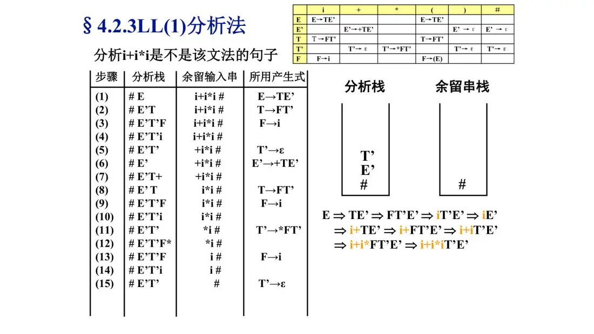

原文：

§4.2.3LL(1)分析法

分析 $\mathbf { i } + \mathbf { i } \ast \mathbf { i }$ 是不是该文法的句子

<table><tr><td></td><td>i</td><td>+</td><td>*</td><td>(</td><td>)</td><td>#</td></tr><tr><td>E</td><td> $E \rightarrow TE'$ </td><td></td><td></td><td> $E \rightarrow TE'$ </td><td></td><td></td></tr><tr><td>E&#x27;</td><td></td><td> $E' \rightarrow +TE'$ </td><td></td><td></td><td> $E' \rightarrow \varepsilon$ </td><td> $E' \rightarrow \varepsilon$ </td></tr><tr><td>T</td><td> $T \rightarrow FT'$ </td><td></td><td></td><td> $T \rightarrow FT'$ </td><td></td><td></td></tr><tr><td>T&#x27;</td><td></td><td> $T' \rightarrow \varepsilon$ </td><td> $T' \rightarrow *FT'$ </td><td></td><td> $T' \rightarrow \varepsilon$ </td><td> $T' \rightarrow \varepsilon$ </td></tr><tr><td>F</td><td> $F \rightarrow i$ </td><td></td><td></td><td> $F \rightarrow (E)$ </td><td></td><td></td></tr></table>

<table><tr><td>步骤</td><td>分析栈</td><td>余留输入串</td><td>所用产生式</td><td>分析栈</td><td>余留串栈</td></tr><tr><td>(1)</td><td># E</td><td>i+i*i #</td><td>E→TE&#x27;</td><td></td><td></td></tr><tr><td>(2)</td><td># E&#x27;T</td><td>i+i*i #</td><td>T→FT&#x27;</td><td></td><td></td></tr><tr><td>(3)</td><td># E&#x27;T&#x27;F</td><td>i+i*i #</td><td>F→i</td><td></td><td></td></tr><tr><td>(4)</td><td># E&#x27;T&#x27;i</td><td>i+i*i #</td><td></td><td></td><td></td></tr><tr><td>(5)</td><td># E&#x27;T&#x27;</td><td>+i*i #</td><td>T&#x27;→ε</td><td></td><td></td></tr><tr><td>(6)</td><td># E&#x27;</td><td>+i*i #</td><td>E&#x27;→+TE&#x27;</td><td></td><td></td></tr><tr><td>(7)</td><td># E&#x27;T+</td><td>+i*i #</td><td></td><td></td><td></td></tr><tr><td>(8)</td><td># E&#x27;T</td><td>i*i #</td><td>T→FT&#x27;</td><td></td><td></td></tr><tr><td>(9)</td><td># E&#x27;T&#x27;F</td><td>i*i #</td><td>F→i</td><td></td><td></td></tr><tr><td>(10)</td><td># E&#x27;T&#x27;i</td><td>i*i #</td><td></td><td>E⇒TE&#x27;⇒FT&#x27;E&#x27;⇒iT&#x27;E&#x27;⇒iE&#x27;</td><td></td></tr><tr><td>(11)</td><td># E&#x27;T&#x27;</td><td>*i #</td><td>T&#x27;→*FT&#x27;</td><td>⇒i+TE&#x27;⇒i+FT&#x27;E&#x27;⇒i+iT&#x27;E&#x27;</td><td></td></tr><tr><td>(12)</td><td># E&#x27;T&#x27;F*</td><td>*i #</td><td></td><td>⇒i+i*FT&#x27;E&#x27;⇒i+i*iT&#x27;E&#x27;</td><td></td></tr><tr><td>(13)</td><td># E&#x27;T&#x27;F</td><td>i #</td><td>F→i</td><td></td><td></td></tr><tr><td>(14)</td><td># E&#x27;T&#x27;i</td><td>i #</td><td></td><td></td><td></td></tr><tr><td>(15)</td><td># E&#x27;T&#x27;</td><td>#</td><td>T&#x27;→ε</td><td></td><td></td></tr></table>

### §4.2.3LL(1)分析法

原文：

§4.2.3LL(1)分析法

分析 $\mathbf { i } + \mathbf { i } \ast \mathbf { i }$ 是不是该文法的句子

<table><tr><td></td><td>i</td><td>+</td><td>*</td><td>(</td><td>)</td><td>#</td></tr><tr><td>E</td><td> $E \rightarrow TE'$ </td><td></td><td></td><td> $E \rightarrow TE'$ </td><td></td><td></td></tr><tr><td>E&#x27;</td><td></td><td> $E' \rightarrow +TE'$ </td><td></td><td></td><td> $E' \rightarrow \varepsilon$ </td><td> $E' \rightarrow \varepsilon$ </td></tr><tr><td>T</td><td> $T \rightarrow FT'$ </td><td></td><td></td><td> $T \rightarrow FT'$ </td><td></td><td></td></tr><tr><td>T&#x27;</td><td></td><td> $T' \rightarrow \varepsilon$ </td><td> $T' \rightarrow *FT'$ </td><td></td><td> $T' \rightarrow \varepsilon$ </td><td> $T' \rightarrow \varepsilon$ </td></tr><tr><td>F</td><td> $F \rightarrow i$ </td><td></td><td></td><td> $F \rightarrow (E)$ </td><td></td><td></td></tr></table>

<table><tr><td>步骤</td><td>分析栈</td><td>余留输入串</td><td>所用产生式</td><td>分析栈</td><td>余留串栈</td></tr><tr><td>(1)</td><td># E</td><td>i+i*i #</td><td>E→TE&#x27;</td><td></td><td></td></tr><tr><td>(2)</td><td># E&#x27;T</td><td>i+i*i #</td><td>T→FT&#x27;</td><td></td><td></td></tr><tr><td>(3)</td><td># E&#x27;T&#x27;F</td><td>i+i*i #</td><td>F→i</td><td></td><td></td></tr><tr><td>(4)</td><td># E&#x27;T&#x27;i</td><td>i+i*i #</td><td></td><td></td><td></td></tr><tr><td>(5)</td><td># E&#x27;T&#x27;</td><td>+i*i #</td><td>T&#x27;→ε</td><td></td><td></td></tr><tr><td>(6)</td><td># E&#x27;</td><td>+i*i #</td><td>E&#x27;→+TE&#x27;</td><td></td><td></td></tr><tr><td>(7)</td><td># E&#x27;T+</td><td>+i*i #</td><td></td><td></td><td></td></tr><tr><td>(8)</td><td># E&#x27;T</td><td>i*i #</td><td>T→FT&#x27;</td><td></td><td></td></tr><tr><td>(9)</td><td># E&#x27;T&#x27;F</td><td>i*i #</td><td>F→i</td><td></td><td></td></tr><tr><td>(10)</td><td># E&#x27;T&#x27;i</td><td>i*i #</td><td></td><td>E⇒TE&#x27;⇒FT&#x27;E&#x27;⇒iT&#x27;E&#x27;⇒iE&#x27;</td><td></td></tr><tr><td>(11)</td><td># E&#x27;T&#x27;</td><td>*i #</td><td>T&#x27;→*FT&#x27;</td><td>⇒i+TE&#x27;⇒i+FT&#x27;E&#x27;⇒i+iT&#x27;E&#x27;</td><td></td></tr><tr><td>(12)</td><td># E&#x27;T&#x27;F*</td><td>*i #</td><td></td><td>⇒i+i*FT&#x27;E&#x27;⇒i+i*iT&#x27;E&#x27;</td><td></td></tr><tr><td>(13)</td><td># E&#x27;T&#x27;F</td><td>i #</td><td>F→i</td><td></td><td></td></tr><tr><td>(14)</td><td># E&#x27;T&#x27;i</td><td>i #</td><td></td><td></td><td></td></tr><tr><td>(15)</td><td># E&#x27;T&#x27;</td><td>#</td><td>T&#x27;→ε</td><td></td><td></td></tr><tr><td>(16)</td><td># E&#x27;</td><td>#</td><td></td><td></td><td></td></tr></table>

### §4.2.3LL(1)分析法

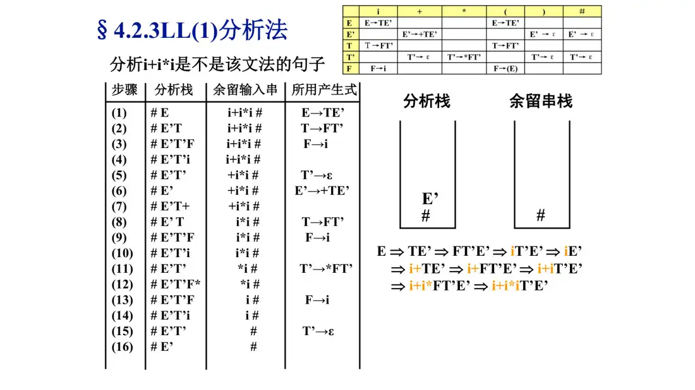

原文：

§4.2.3LL(1)分析法

分析 $\mathbf { i } + \mathbf { i } \ast \mathbf { i }$ 是不是该文法的句子

<table><tr><td></td><td>i</td><td>+</td><td>*</td><td>(</td><td>)</td><td>#</td></tr><tr><td>E</td><td> $E \rightarrow TE'$ </td><td></td><td></td><td> $E \rightarrow TE'$ </td><td></td><td></td></tr><tr><td>E&#x27;</td><td></td><td> $E' \rightarrow +TE'$ </td><td></td><td></td><td> $E' \rightarrow \varepsilon$ </td><td> $E' \rightarrow \varepsilon$ </td></tr><tr><td>T</td><td> $T \rightarrow FT'$ </td><td></td><td></td><td> $T \rightarrow FT'$ </td><td></td><td></td></tr><tr><td>T&#x27;</td><td></td><td> $T' \rightarrow \varepsilon$ </td><td> $T' \rightarrow *FT'$ </td><td></td><td> $T' \rightarrow \varepsilon$ </td><td> $T' \rightarrow \varepsilon$ </td></tr><tr><td>F</td><td> $F \rightarrow i$ </td><td></td><td></td><td> $F \rightarrow (E)$ </td><td></td><td></td></tr></table>

<table><tr><td>步骤</td><td>分析栈</td><td>余留输入串</td><td>所用产生式</td><td>分析栈</td><td>余留串栈</td></tr><tr><td>(1)</td><td># E</td><td>i+i*i #</td><td>E→TE&#x27;</td><td></td><td></td></tr><tr><td>(2)</td><td># E&#x27;T</td><td>i+i*i #</td><td>T→FT&#x27;</td><td></td><td></td></tr><tr><td>(3)</td><td># E&#x27;T&#x27;F</td><td>i+i*i #</td><td>F→i</td><td></td><td></td></tr><tr><td>(4)</td><td># E&#x27;T&#x27;i</td><td>i+i*i #</td><td></td><td></td><td></td></tr><tr><td>(5)</td><td># E&#x27;T&#x27;</td><td>+i*i #</td><td>T&#x27;→ε</td><td></td><td></td></tr><tr><td>(6)</td><td># E&#x27;</td><td>+i*i #</td><td>E&#x27;→+TE&#x27;</td><td></td><td></td></tr><tr><td>(7)</td><td># E&#x27;T+</td><td>+i*i #</td><td></td><td></td><td></td></tr><tr><td>(8)</td><td># E&#x27;T</td><td>i*i #</td><td>T→FT&#x27;</td><td></td><td></td></tr><tr><td>(9)</td><td># E&#x27;T&#x27;F</td><td>i*i #</td><td>F→i</td><td></td><td></td></tr><tr><td>(10)</td><td># E&#x27;T&#x27;i</td><td>i*i #</td><td></td><td>E⇒TE&#x27;⇒FT&#x27;E&#x27;⇒iT&#x27;E&#x27;⇒iE&#x27;</td><td></td></tr><tr><td>(11)</td><td># E&#x27;T&#x27;</td><td>*i #</td><td>T&#x27;→*FT&#x27;</td><td>⇒i+TE&#x27;⇒i+FT&#x27;E&#x27;⇒i+iT&#x27;E&#x27;</td><td></td></tr><tr><td>(12)</td><td># E&#x27;T&#x27;F*</td><td>*i #</td><td></td><td>⇒i+i*FT&#x27;E&#x27;⇒i+i*iT&#x27;E&#x27;</td><td></td></tr><tr><td>(13)</td><td># E&#x27;T&#x27;F</td><td>i #</td><td>F→i</td><td></td><td></td></tr><tr><td>(14)</td><td># E&#x27;T&#x27;i</td><td>i #</td><td></td><td></td><td></td></tr><tr><td>(15)</td><td># E&#x27;T&#x27;</td><td>#</td><td>T&#x27;→ε</td><td></td><td></td></tr><tr><td>(16)</td><td># E&#x27;</td><td>#</td><td></td><td></td><td></td></tr></table>

### §4.2.3LL(1)分析法

原文：

§4.2.3LL(1)分析法

分析 $\mathbf { i } + \mathbf { i } \ast \mathbf { i }$ 是不是该文法的句子

<table><tr><td></td><td>i</td><td>+</td><td>*</td><td>(</td><td>)</td><td>#</td></tr><tr><td>E</td><td> $E \rightarrow TE'$ </td><td></td><td></td><td> $E \rightarrow TE'$ </td><td></td><td></td></tr><tr><td>E&#x27;</td><td></td><td> $E' \rightarrow +TE'$ </td><td></td><td></td><td> $E' \rightarrow \varepsilon$ </td><td> $E' \rightarrow \varepsilon$ </td></tr><tr><td>T</td><td> $T \rightarrow FT'$ </td><td></td><td></td><td> $T \rightarrow FT'$ </td><td></td><td></td></tr><tr><td>T&#x27;</td><td></td><td> $T' \rightarrow \varepsilon$ </td><td> $T' \rightarrow *FT'$ </td><td></td><td> $T' \rightarrow \varepsilon$ </td><td> $T' \rightarrow \varepsilon$ </td></tr><tr><td>F</td><td> $F \rightarrow i$ </td><td></td><td></td><td> $F \rightarrow (E)$ </td><td></td><td></td></tr></table>

<table><tr><td>步骤</td><td>分析栈</td><td>余留输入串</td><td>所用产生式</td><td>分析栈</td><td>余留串栈</td></tr><tr><td>(1)</td><td># E</td><td>i+i*i #</td><td>E→TE&#x27;</td><td></td><td></td></tr><tr><td>(2)</td><td># E&#x27;T</td><td>i+i*i #</td><td>T→FT&#x27;</td><td></td><td></td></tr><tr><td>(3)</td><td># E&#x27;T&#x27;F</td><td>i+i*i #</td><td>F→i</td><td></td><td></td></tr><tr><td>(4)</td><td># E&#x27;T&#x27;i</td><td>i+i*i #</td><td></td><td></td><td></td></tr><tr><td>(5)</td><td># E&#x27;T&#x27;</td><td>+i*i #</td><td>T&#x27;→ε</td><td></td><td></td></tr><tr><td>(6)</td><td># E&#x27;</td><td>+i*i #</td><td>E&#x27;→+TE&#x27;</td><td></td><td></td></tr><tr><td>(7)</td><td># E&#x27;T+</td><td>+i*i #</td><td></td><td></td><td></td></tr><tr><td>(8)</td><td># E&#x27;T</td><td>i*i #</td><td>T→FT&#x27;</td><td></td><td></td></tr><tr><td>(9)</td><td># E&#x27;T&#x27;F</td><td>i*i #</td><td>F→i</td><td></td><td></td></tr><tr><td>(10)</td><td># E&#x27;T&#x27;i</td><td>i*i #</td><td></td><td>E⇒TE&#x27;⇒FT&#x27;E&#x27;⇒iT&#x27;E&#x27;⇒iE&#x27;</td><td></td></tr><tr><td>(11)</td><td># E&#x27;T&#x27;</td><td>*i #</td><td>T&#x27;→*FT&#x27;</td><td>⇒i+TE&#x27;⇒i+FT&#x27;E&#x27;⇒i+iT&#x27;E&#x27;</td><td></td></tr><tr><td>(12)</td><td># E&#x27;T&#x27;F*</td><td>*i #</td><td></td><td>⇒i+i*FT&#x27;E&#x27;⇒i+i*iT&#x27;E&#x27;</td><td></td></tr><tr><td>(13)</td><td># E&#x27;T&#x27;F</td><td>i #</td><td>F→i</td><td>⇒i+i*iE&#x27;</td><td></td></tr><tr><td>(14)</td><td># E&#x27;T&#x27;i</td><td>i #</td><td></td><td></td><td></td></tr><tr><td>(15)</td><td># E&#x27;T&#x27;</td><td>#</td><td>T&#x27;→ε</td><td></td><td></td></tr><tr><td>(16)</td><td># E&#x27;</td><td>#</td><td></td><td></td><td></td></tr></table>

### §4.2.3LL(1)分析法

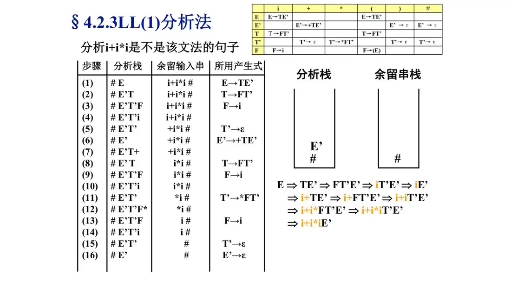

原文：

§4.2.3LL(1)分析法

分析 $\mathbf { i } + \mathbf { i } \ast \mathbf { i }$ 是不是该文法的句子

<table><tr><td></td><td>i</td><td>+</td><td>*</td><td>(</td><td>)</td><td>#</td></tr><tr><td>E</td><td> $E \rightarrow TE'$ </td><td></td><td></td><td> $E \rightarrow TE'$ </td><td></td><td></td></tr><tr><td>E&#x27;</td><td></td><td> $E' \rightarrow +TE'$ </td><td></td><td></td><td> $E' \rightarrow \varepsilon$ </td><td> $E' \rightarrow \varepsilon$ </td></tr><tr><td>T</td><td> $T \rightarrow FT'$ </td><td></td><td></td><td> $T \rightarrow FT'$ </td><td></td><td></td></tr><tr><td>T&#x27;</td><td></td><td> $T' \rightarrow \varepsilon$ </td><td> $T' \rightarrow *FT'$ </td><td></td><td> $T' \rightarrow \varepsilon$ </td><td> $T' \rightarrow \varepsilon$ </td></tr><tr><td>F</td><td> $F \rightarrow i$ </td><td></td><td></td><td> $F \rightarrow (E)$ </td><td></td><td></td></tr></table>

<table><tr><td>步骤</td><td>分析栈</td><td>余留输入串</td><td>所用产生式</td><td>分析栈</td><td>余留串栈</td></tr><tr><td>(1)</td><td># E</td><td>i+i*i #</td><td>E→TE&#x27;</td><td></td><td></td></tr><tr><td>(2)</td><td># E&#x27;T</td><td>i+i*i #</td><td>T→FT&#x27;</td><td></td><td></td></tr><tr><td>(3)</td><td># E&#x27;T&#x27;F</td><td>i+i*i #</td><td>F→i</td><td></td><td></td></tr><tr><td>(4)</td><td># E&#x27;T&#x27;i</td><td>i+i*i #</td><td></td><td></td><td></td></tr><tr><td>(5)</td><td># E&#x27;T&#x27;</td><td>+i*i #</td><td>T&#x27;→ε</td><td></td><td></td></tr><tr><td>(6)</td><td># E&#x27;</td><td>+i*i #</td><td>E&#x27;→+TE&#x27;</td><td></td><td></td></tr><tr><td>(7)</td><td># E&#x27;T+</td><td>+i*i #</td><td></td><td></td><td></td></tr><tr><td>(8)</td><td># E&#x27;T</td><td>i*i #</td><td>T→FT&#x27;</td><td></td><td></td></tr><tr><td>(9)</td><td># E&#x27;T&#x27;F</td><td>i*i #</td><td>F→i</td><td></td><td></td></tr><tr><td>(10)</td><td># E&#x27;T&#x27;i</td><td>i*i #</td><td></td><td>E⇒TE&#x27;⇒FT&#x27;E&#x27;⇒iT&#x27;E&#x27;⇒iE&#x27;</td><td></td></tr><tr><td>(11)</td><td># E&#x27;T&#x27;</td><td>*i #</td><td>T&#x27;→*FT&#x27;</td><td>⇒i+TE&#x27;⇒i+FT&#x27;E&#x27;⇒i+iT&#x27;E&#x27;</td><td></td></tr><tr><td>(12)</td><td># E&#x27;T&#x27;F*</td><td>*i #</td><td></td><td>⇒i+i*FT&#x27;E&#x27;⇒i+i*iT&#x27;E&#x27;</td><td></td></tr><tr><td>(13)</td><td># E&#x27;T&#x27;F</td><td>i #</td><td>F→i</td><td>⇒i+i*iE&#x27;</td><td></td></tr><tr><td>(14)</td><td># E&#x27;T&#x27;i</td><td>i #</td><td></td><td></td><td></td></tr><tr><td>(15)</td><td># E&#x27;T&#x27;</td><td>#</td><td>T&#x27;→ε</td><td></td><td></td></tr><tr><td>(16)</td><td># E&#x27;</td><td>#</td><td>E&#x27;→ε</td><td></td><td></td></tr></table>

### §4.2.3LL(1)分析法

原文：

§4.2.3LL(1)分析法

分析 $\mathbf { i } + \mathbf { i } \ast \mathbf { i }$ 是不是该文法的句子

<table><tr><td></td><td>i</td><td>+</td><td>*</td><td>(</td><td>)</td><td>#</td></tr><tr><td>E</td><td> $E \rightarrow TE'$ </td><td></td><td></td><td> $E \rightarrow TE'$ </td><td></td><td></td></tr><tr><td>E&#x27;</td><td></td><td> $E' \rightarrow +TE'$ </td><td></td><td></td><td> $E' \rightarrow \varepsilon$ </td><td> $E' \rightarrow \varepsilon$ </td></tr><tr><td>T</td><td> $T \rightarrow FT'$ </td><td></td><td></td><td> $T \rightarrow FT'$ </td><td></td><td></td></tr><tr><td>T&#x27;</td><td></td><td> $T' \rightarrow \varepsilon$ </td><td> $T' \rightarrow *FT'$ </td><td></td><td> $T' \rightarrow \varepsilon$ </td><td> $T' \rightarrow \varepsilon$ </td></tr><tr><td>F</td><td> $F \rightarrow i$ </td><td></td><td></td><td> $F \rightarrow (E)$ </td><td></td><td></td></tr></table>

<table><tr><td>步骤</td><td>分析栈</td><td>余留输入串</td><td>所用产生式</td><td>分析栈</td><td>余留串栈</td></tr><tr><td>(1)</td><td>#E</td><td>i+i*i #</td><td>E→TE&#x27;</td><td></td><td></td></tr><tr><td>(2)</td><td>#E&#x27;T</td><td>i+i*i #</td><td>T→FT&#x27;</td><td></td><td></td></tr><tr><td>(3)</td><td>#E&#x27;T&#x27;F</td><td>i+i*i #</td><td>F→i</td><td></td><td></td></tr><tr><td>(4)</td><td>#E&#x27;T&#x27;i</td><td>i+i*i #</td><td></td><td></td><td></td></tr><tr><td>(5)</td><td>#E&#x27;T&#x27;</td><td>+i*i #</td><td>T&#x27;→ε</td><td></td><td></td></tr><tr><td>(6)</td><td>#E&#x27;</td><td>+i*i #</td><td>E&#x27;→+TE&#x27;</td><td></td><td></td></tr><tr><td>(7)</td><td>#E&#x27;T+</td><td>+i*i #</td><td></td><td></td><td></td></tr><tr><td>(8)</td><td>#E&#x27;T</td><td>i*i #</td><td>T→FT&#x27;</td><td></td><td></td></tr><tr><td>(9)</td><td>#E&#x27;T&#x27;F</td><td>i*i #</td><td>F→i</td><td></td><td></td></tr><tr><td>(10)</td><td>#E&#x27;T&#x27;i</td><td>i*i #</td><td></td><td>E⇒TE&#x27;⇒FT&#x27;E&#x27;⇒iT&#x27;E&#x27;⇒iE&#x27;</td><td></td></tr><tr><td>(11)</td><td>#E&#x27;T&#x27;</td><td>*i #</td><td>T&#x27;→*FT&#x27;</td><td>⇒i+TE&#x27;⇒i+FT&#x27;E&#x27;⇒i+iT&#x27;E&#x27;</td><td></td></tr><tr><td>(12)</td><td>#E&#x27;T&#x27;F*</td><td>*i #</td><td></td><td>⇒i+i*FT&#x27;E&#x27;⇒i+i*iT&#x27;E&#x27;</td><td></td></tr><tr><td>(13)</td><td>#E&#x27;T&#x27;F</td><td>i #</td><td>F→i</td><td>⇒i+i*iE&#x27;</td><td></td></tr><tr><td>(14)</td><td>#E&#x27;T&#x27;i</td><td>i #</td><td></td><td></td><td></td></tr><tr><td>(15)</td><td>#E&#x27;T&#x27;</td><td>#</td><td>T&#x27;→ε</td><td></td><td></td></tr><tr><td>(16)</td><td>#E&#x27;</td><td>#</td><td>E&#x27;→ε</td><td></td><td></td></tr><tr><td>(17)</td><td>#</td><td>#</td><td></td><td></td><td></td></tr></table>

### §4.2.3LL(1)分析法

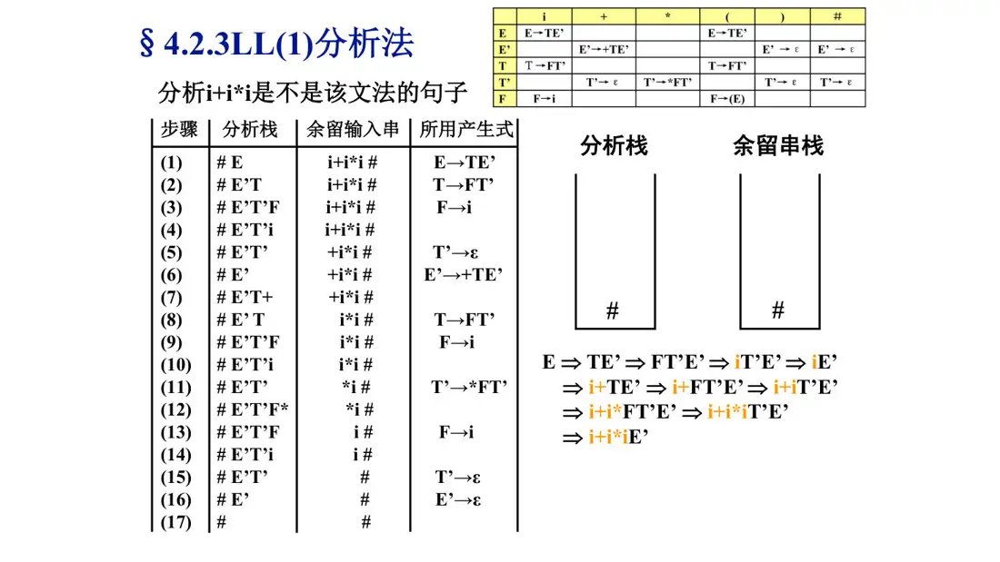

原文：

§4.2.3LL(1)分析法

分析 $\mathbf { i } + \mathbf { i } \ast \mathbf { i }$ 是不是该文法的句子

<table><tr><td></td><td>i</td><td>+</td><td>*</td><td>(</td><td>)</td><td>#</td></tr><tr><td>E</td><td> $E \rightarrow TE'$ </td><td></td><td></td><td> $E \rightarrow TE'$ </td><td></td><td></td></tr><tr><td>E&#x27;</td><td></td><td> $E' \rightarrow +TE'$ </td><td></td><td></td><td> $E' \rightarrow \varepsilon$ </td><td> $E' \rightarrow \varepsilon$ </td></tr><tr><td>T</td><td> $T \rightarrow FT'$ </td><td></td><td></td><td> $T \rightarrow FT'$ </td><td></td><td></td></tr><tr><td>T&#x27;</td><td></td><td> $T' \rightarrow \varepsilon$ </td><td> $T' \rightarrow *FT'$ </td><td></td><td> $T' \rightarrow \varepsilon$ </td><td> $T' \rightarrow \varepsilon$ </td></tr><tr><td>F</td><td> $F \rightarrow i$ </td><td></td><td></td><td> $F \rightarrow (E)$ </td><td></td><td></td></tr></table>

<table><tr><td>步骤</td><td>分析栈</td><td>余留输入串</td><td>所用产生式</td><td>分析栈</td><td>余留串栈</td></tr><tr><td>(1)</td><td>#E</td><td>i+i*i #</td><td>E→TE&#x27;</td><td></td><td></td></tr><tr><td>(2)</td><td>#E&#x27;T</td><td>i+i*i #</td><td>T→FT&#x27;</td><td></td><td></td></tr><tr><td>(3)</td><td>#E&#x27;T&#x27;F</td><td>i+i*i #</td><td>F→i</td><td></td><td></td></tr><tr><td>(4)</td><td>#E&#x27;T&#x27;i</td><td>i+i*i #</td><td></td><td></td><td></td></tr><tr><td>(5)</td><td>#E&#x27;T&#x27;</td><td>+i*i #</td><td>T&#x27;→ε</td><td></td><td></td></tr><tr><td>(6)</td><td>#E&#x27;</td><td>+i*i #</td><td>E&#x27;→+TE&#x27;</td><td></td><td></td></tr><tr><td>(7)</td><td>#E&#x27;T+</td><td>+i*i #</td><td></td><td></td><td></td></tr><tr><td>(8)</td><td>#E&#x27;T</td><td>i*i #</td><td>T→FT&#x27;</td><td></td><td></td></tr><tr><td>(9)</td><td>#E&#x27;T&#x27;F</td><td>i*i #</td><td>F→i</td><td></td><td></td></tr><tr><td>(10)</td><td>#E&#x27;T&#x27;i</td><td>i*i #</td><td></td><td>E⇒TE&#x27;⇒FT&#x27;E&#x27;⇒iT&#x27;E&#x27;⇒iE&#x27;</td><td></td></tr><tr><td>(11)</td><td>#E&#x27;T&#x27;</td><td>*i #</td><td>T&#x27;→*FT&#x27;</td><td>⇒i+TE&#x27;⇒i+FT&#x27;E&#x27;⇒i+iT&#x27;E&#x27;</td><td></td></tr><tr><td>(12)</td><td>#E&#x27;T&#x27;F*</td><td>*i #</td><td></td><td>⇒i+i*FT&#x27;E&#x27;⇒i+i*iT&#x27;E&#x27;</td><td></td></tr><tr><td>(13)</td><td>#E&#x27;T&#x27;F</td><td>i #</td><td>F→i</td><td>⇒i+i*iE&#x27;</td><td></td></tr><tr><td>(14)</td><td>#E&#x27;T&#x27;i</td><td>i #</td><td></td><td></td><td></td></tr><tr><td>(15)</td><td>#E&#x27;T&#x27;</td><td>#</td><td>T&#x27;→ε</td><td></td><td></td></tr><tr><td>(16)</td><td>#E&#x27;</td><td>#</td><td>E&#x27;→ε</td><td></td><td></td></tr><tr><td>(17)</td><td>#</td><td>#</td><td></td><td></td><td></td></tr></table>

### §4.2.3LL(1)分析法

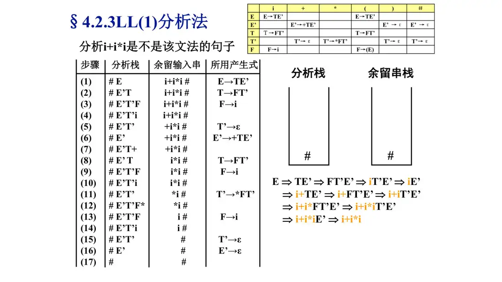

原文：

§4.2.3LL(1)分析法

分析 $\mathbf { i } + \mathbf { i } \ast \mathbf { i }$ 是不是该文法的句子

<table><tr><td></td><td>i</td><td>+</td><td>*</td><td>(</td><td>)</td><td>#</td></tr><tr><td>E</td><td> $E \rightarrow TE'$ </td><td></td><td></td><td> $E \rightarrow TE'$ </td><td></td><td></td></tr><tr><td>E&#x27;</td><td></td><td> $E' \rightarrow +TE'$ </td><td></td><td></td><td> $E' \rightarrow \varepsilon$ </td><td> $E' \rightarrow \varepsilon$ </td></tr><tr><td>T</td><td> $T \rightarrow FT'$ </td><td></td><td></td><td> $T \rightarrow FT'$ </td><td></td><td></td></tr><tr><td>T&#x27;</td><td></td><td> $T' \rightarrow \varepsilon$ </td><td> $T' \rightarrow *FT'$ </td><td></td><td> $T' \rightarrow \varepsilon$ </td><td> $T' \rightarrow \varepsilon$ </td></tr><tr><td>F</td><td> $F \rightarrow i$ </td><td></td><td></td><td> $F \rightarrow (E)$ </td><td></td><td></td></tr></table>

<table><tr><td>步骤</td><td>分析栈</td><td>余留输入串</td><td>所用产生式</td><td>分析栈</td><td>余留串栈</td></tr><tr><td>(1)</td><td># E</td><td>i+i*i #</td><td>E→TE&#x27;</td><td></td><td></td></tr><tr><td>(2)</td><td># E&#x27;T</td><td>i+i*i #</td><td>T→FT&#x27;</td><td></td><td></td></tr><tr><td>(3)</td><td># E&#x27;T&#x27;F</td><td>i+i*i #</td><td>F→i</td><td></td><td></td></tr><tr><td>(4)</td><td># E&#x27;T&#x27;i</td><td>i+i*i #</td><td></td><td></td><td></td></tr><tr><td>(5)</td><td># E&#x27;T&#x27;</td><td>+i*i #</td><td>T&#x27;→ε</td><td></td><td></td></tr><tr><td>(6)</td><td># E&#x27;</td><td>+i*i #</td><td>E&#x27;→+TE&#x27;</td><td></td><td></td></tr><tr><td>(7)</td><td># E&#x27;T+</td><td>+i*i #</td><td></td><td></td><td></td></tr><tr><td>(8)</td><td># E&#x27;T</td><td>i*i #</td><td>T→FT&#x27;</td><td></td><td></td></tr><tr><td>(9)</td><td># E&#x27;T&#x27;F</td><td>i*i #</td><td>F→i</td><td></td><td></td></tr><tr><td>(10)</td><td># E&#x27;T&#x27;i</td><td>i*i #</td><td></td><td>E ⇒ TE&#x27; ⇒ FT&#x27;E&#x27; ⇒ iT&#x27;E&#x27; ⇒ iE&#x27;</td><td></td></tr><tr><td>(11)</td><td># E&#x27;T&#x27;</td><td>*i #</td><td>T&#x27;→*FT&#x27;</td><td>⇒ i+TE&#x27; ⇒ i+FT&#x27;E&#x27; ⇒ i+iT&#x27;E&#x27;</td><td></td></tr><tr><td>(12)</td><td># E&#x27;T&#x27;F*</td><td>*i #</td><td></td><td>⇒ i+i*FT&#x27;E&#x27; ⇒ i+i*iT&#x27;E&#x27;</td><td></td></tr><tr><td>(13)</td><td># E&#x27;T&#x27;F</td><td>i #</td><td>F→i</td><td>⇒ i+i*iE&#x27; ⇒ i+i*i</td><td></td></tr><tr><td>(14)</td><td># E&#x27;T&#x27;i</td><td>i #</td><td></td><td></td><td></td></tr><tr><td>(15)</td><td># E&#x27;T&#x27;</td><td>#</td><td>T&#x27;→ε</td><td></td><td></td></tr><tr><td>(16)</td><td># E&#x27;</td><td>#</td><td>E&#x27;→ε</td><td></td><td></td></tr><tr><td>(17)</td><td>#</td><td>#</td><td></td><td></td><td></td></tr></table>

### §4.2.3LL(1)分析法

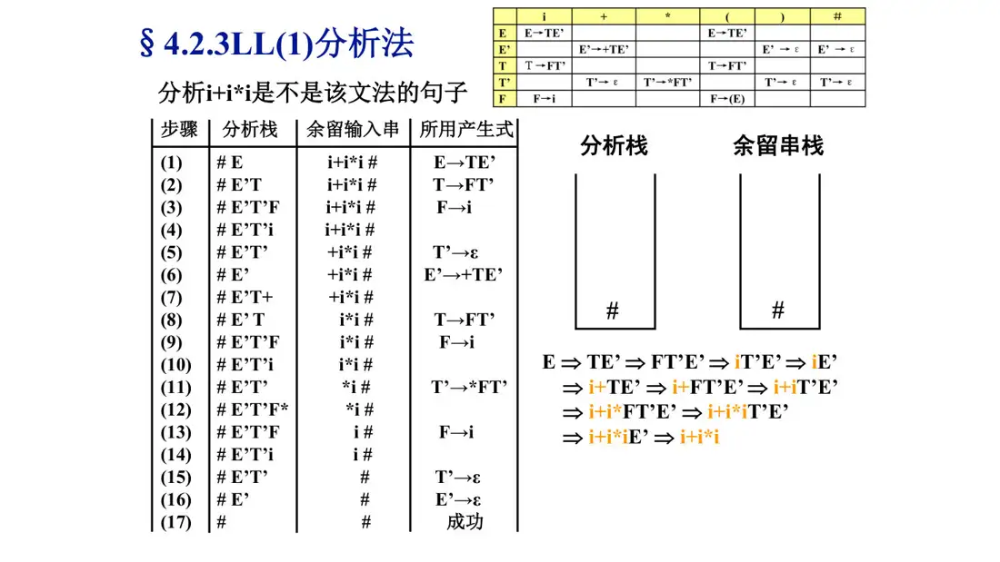

原文：

§4.2.3LL(1)分析法

分析 $\mathbf { i } + \mathbf { i } \ast \mathbf { i }$ 是不是该文法的句子

<table><tr><td></td><td>i</td><td>+</td><td>*</td><td>(</td><td>)</td><td>#</td></tr><tr><td>E</td><td> $E \rightarrow TE'$ </td><td></td><td></td><td> $E \rightarrow TE'$ </td><td></td><td></td></tr><tr><td>E&#x27;</td><td></td><td> $E' \rightarrow +TE'$ </td><td></td><td></td><td> $E' \rightarrow \varepsilon$ </td><td> $E' \rightarrow \varepsilon$ </td></tr><tr><td>T</td><td> $T \rightarrow FT'$ </td><td></td><td></td><td> $T \rightarrow FT'$ </td><td></td><td></td></tr><tr><td>T&#x27;</td><td></td><td> $T' \rightarrow \varepsilon$ </td><td> $T' \rightarrow *FT'$ </td><td></td><td> $T' \rightarrow \varepsilon$ </td><td> $T' \rightarrow \varepsilon$ </td></tr><tr><td>F</td><td> $F \rightarrow i$ </td><td></td><td></td><td> $F \rightarrow (E)$ </td><td></td><td></td></tr></table>

<table><tr><td>步骤</td><td>分析栈</td><td>余留输入串</td><td>所用产生式</td><td>分析栈</td><td>余留串栈</td></tr><tr><td>(1)</td><td>#E</td><td>i+i*i #</td><td>E→TE&#x27;</td><td></td><td></td></tr><tr><td>(2)</td><td>#E&#x27;T</td><td>i+i*i #</td><td>T→FT&#x27;</td><td></td><td></td></tr><tr><td>(3)</td><td>#E&#x27;T&#x27;F</td><td>i+i*i #</td><td>F→i</td><td></td><td></td></tr><tr><td>(4)</td><td>#E&#x27;T&#x27;i</td><td>i+i*i #</td><td></td><td></td><td></td></tr><tr><td>(5)</td><td>#E&#x27;T&#x27;</td><td>+i*i #</td><td>T&#x27;→ε</td><td></td><td></td></tr><tr><td>(6)</td><td>#E&#x27;</td><td>+i*i #</td><td>E&#x27;→+TE&#x27;</td><td></td><td></td></tr><tr><td>(7)</td><td>#E&#x27;T+</td><td>+i*i #</td><td></td><td></td><td></td></tr><tr><td>(8)</td><td>#E&#x27;T</td><td>i*i #</td><td>T→FT&#x27;</td><td></td><td></td></tr><tr><td>(9)</td><td>#E&#x27;T&#x27;F</td><td>i*i #</td><td>F→i</td><td></td><td></td></tr><tr><td>(10)</td><td>#E&#x27;T&#x27;i</td><td>i*i #</td><td></td><td>E⇒TE&#x27;⇒FT&#x27;E&#x27;⇒iT&#x27;E&#x27;⇒iE&#x27;</td><td></td></tr><tr><td>(11)</td><td>#E&#x27;T&#x27;</td><td>*i #</td><td>T&#x27;→*FT&#x27;</td><td>⇒i+TE&#x27;⇒i+FT&#x27;E&#x27;⇒i+iT&#x27;E&#x27;</td><td></td></tr><tr><td>(12)</td><td>#E&#x27;T&#x27;F*</td><td>*i #</td><td></td><td>⇒i+i*FT&#x27;E&#x27;⇒i+i*iT&#x27;E&#x27;</td><td></td></tr><tr><td>(13)</td><td>#E&#x27;T&#x27;F</td><td>i #</td><td>F→i</td><td>⇒i+i*iE&#x27;⇒i+i*i</td><td></td></tr><tr><td>(14)</td><td>#E&#x27;T&#x27;i</td><td>i #</td><td></td><td></td><td></td></tr><tr><td>(15)</td><td>#E&#x27;T&#x27;</td><td>#</td><td>T&#x27;→ε</td><td></td><td></td></tr><tr><td>(16)</td><td>#E&#x27;</td><td>#</td><td>E&#x27;→ε</td><td></td><td></td></tr><tr><td>(17)</td><td>#</td><td>#</td><td>成功</td><td></td><td></td></tr></table>

### §4.2.3LL(1)分析法

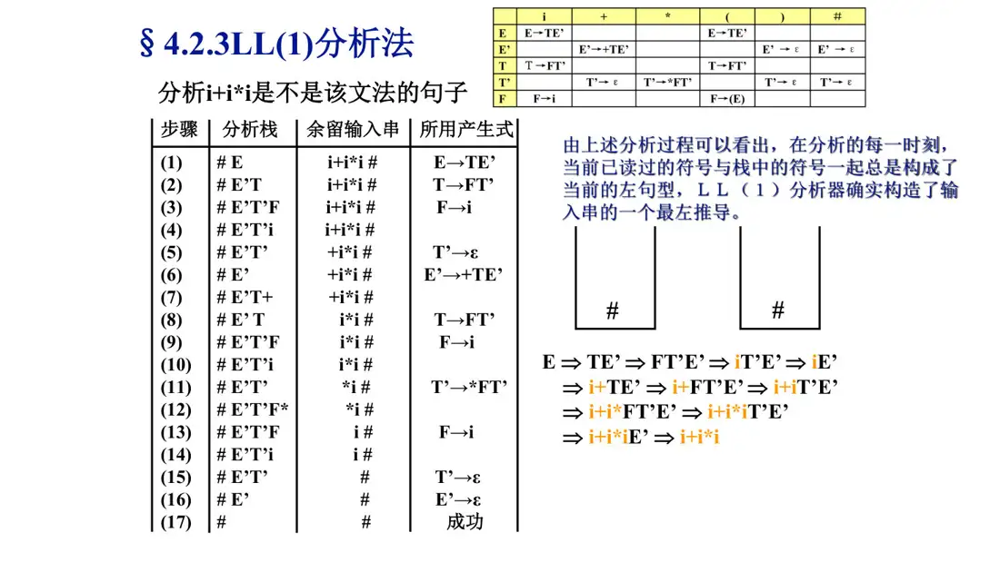

原文：

§4.2.3LL(1)分析法

分析 $\mathbf { i } + \mathbf { i } \ast \mathbf { i }$ 是不是该文法的句子

<table><tr><td>步骤</td><td>分析栈</td><td>余留输入串</td><td>所用产生式</td></tr><tr><td>(1)</td><td># E</td><td>i+i*i #</td><td>E→TE&#x27;</td></tr><tr><td>(2)</td><td># E&#x27;T</td><td>i+i*i #</td><td>T→FT&#x27;</td></tr><tr><td>(3)</td><td># E&#x27;T&#x27;F</td><td>i+i*i #</td><td>F→i</td></tr><tr><td>(4)</td><td># E&#x27;T&#x27;i</td><td>i+i*i #</td><td></td></tr><tr><td>(5)</td><td># E&#x27;T&#x27;</td><td>+i*i #</td><td>T&#x27;→ε</td></tr><tr><td>(6)</td><td># E&#x27;</td><td>+i*i #</td><td>E&#x27;→+TE&#x27;</td></tr><tr><td>(7)</td><td># E&#x27;T+</td><td>+i*i #</td><td></td></tr><tr><td>(8)</td><td># E&#x27;T</td><td>i*i #</td><td>T→FT&#x27;</td></tr><tr><td>(9)</td><td># E&#x27;T&#x27;F</td><td>i*i #</td><td>F→i</td></tr><tr><td>(10)</td><td># E&#x27;T&#x27;i</td><td>i*i #</td><td></td></tr><tr><td>(11)</td><td># E&#x27;T&#x27;</td><td>*i #</td><td>T&#x27;→*FT&#x27;</td></tr><tr><td>(12)</td><td># E&#x27;T&#x27;F*</td><td>*i #</td><td></td></tr><tr><td>(13)</td><td># E&#x27;T&#x27;F</td><td>i #</td><td>F→i</td></tr><tr><td>(14)</td><td># E&#x27;T&#x27;i</td><td>i #</td><td></td></tr><tr><td>(15)</td><td># E&#x27;T&#x27;</td><td>#</td><td>T&#x27;→ε</td></tr><tr><td>(16)</td><td># E&#x27;</td><td>#</td><td>E&#x27;→ε</td></tr><tr><td>(17)</td><td>#</td><td>#</td><td>成功</td></tr></table>

<table><tr><td></td><td>i</td><td>+</td><td>*</td><td>(</td><td>)</td><td>#</td></tr><tr><td>E</td><td> $E \rightarrow TE'$ </td><td></td><td></td><td> $E \rightarrow TE'$ </td><td></td><td></td></tr><tr><td>E&#x27;</td><td></td><td> $E' \rightarrow +TE'$ </td><td></td><td></td><td> $E' \rightarrow \varepsilon$ </td><td> $E' \rightarrow \varepsilon$ </td></tr><tr><td>T</td><td> $T \rightarrow FT'$ </td><td></td><td></td><td> $T \rightarrow FT'$ </td><td></td><td></td></tr><tr><td>T&#x27;</td><td></td><td> $T' \rightarrow \varepsilon$ </td><td> $T' \rightarrow *FT'$ </td><td></td><td> $T' \rightarrow \varepsilon$ </td><td> $T' \rightarrow \varepsilon$ </td></tr><tr><td>F</td><td> $F \rightarrow i$ </td><td></td><td></td><td> $F \rightarrow (E)$ </td><td></td><td></td></tr></table>

分析栈 余留串栈由上述分析过程可以看出，在分析的每一时刻，当前已读过的符号与栈中的符号一起总是构成了当前的左句型，LL（1）分析器确实构造了输入串的一个最左推导。

$$
\begin{array}{r l} & {\mathbf {E} \Rightarrow \mathbf {T E ^ {\prime}} \Rightarrow \mathbf {F T ^ {\prime} E ^ {\prime}} \Rightarrow \mathbf {i T ^ {\prime} E ^ {\prime}} \Rightarrow \mathbf {i E ^ {\prime}}} \\ & {\quad \Rightarrow \mathbf {i + T E ^ {\prime}} \Rightarrow \mathbf {i + F T ^ {\prime} E ^ {\prime}} \Rightarrow \mathbf {i + i T ^ {\prime} E ^ {\prime}}} \\ & {\quad \Rightarrow \mathbf {i + i ^ {*} F T ^ {\prime} E ^ {\prime}} \Rightarrow \mathbf {i + i ^ {*} i T ^ {\prime} E ^ {\prime}}} \\ & {\quad \Rightarrow \mathbf {i + i ^ {*} i E ^ {\prime}} \Rightarrow \mathbf {i + i ^ {*} i}} \end{array}
$$

### §4.2.3LL(1)分析法二、LL(1)分析过程总结

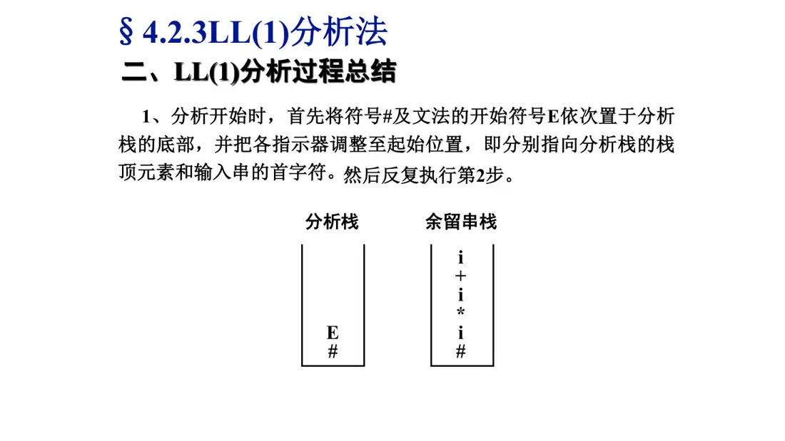

原文：

§4.2.3LL(1)分析法二、LL(1)分析过程总结

1、分析开始时，首先将符号#及文法的开始符号E依次置于分析栈的底部，并把各指示器调整至起始位置，即分别指向分析栈的栈顶元素和输入串的首字符。然后反复执行第2步。

### §4.2.3LL(1)分析法二、LL(1)分析过程总结

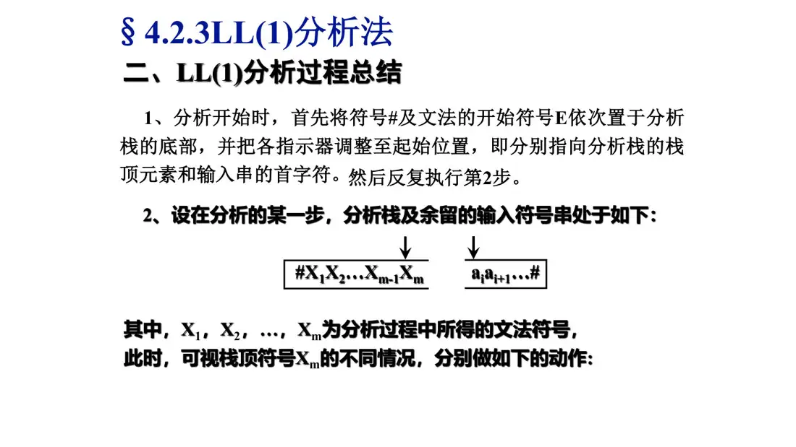

原文：

§4.2.3LL(1)分析法二、LL(1)分析过程总结

1、分析开始时，首先将符号#及文法的开始符号E依次置于分析栈的底部，并把各指示器调整至起始位置，即分别指向分析栈的栈顶元素和输入串的首字符。然后反复执行第2步。

2、设在分析的某一步，分析栈及余留的输入符号串处于如下：

$$
\boxed {\# X _ {1} X _ {2}... X _ {m - 1} X _ {m}} \quad \boxed {a _ {i} a _ {i + 1}... \#}
$$

其中， $\mathbf { X } _ { 1 } , \ \mathbf { X } _ { 2 } , \ \dots , \ \mathbf { X _ { m } }$ 为分析过程中所得的文法符号，此时，可视栈顶符号 $\mathbf { \delta X _ { m } }$ 的不同情况，分别做如下的动作:

### §4.2.3LL(1)分析法

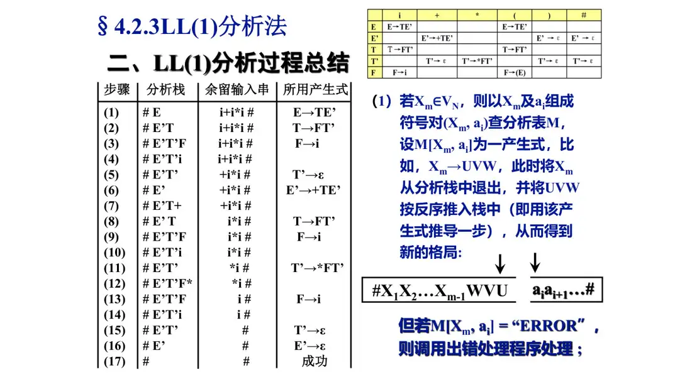

原文：

§4.2.3LL(1)分析法

二、LL(1)分析过程总结

<table><tr><td>步骤</td><td>分析栈</td><td>余留输入串</td><td>所用产生式</td></tr><tr><td>(1)</td><td># E</td><td>i+i*i #</td><td>E→TE&#x27;</td></tr><tr><td>(2)</td><td># E&#x27;T</td><td>i+i*i #</td><td>T→FT&#x27;</td></tr><tr><td>(3)</td><td># E&#x27;T&#x27;F</td><td>i+i*i #</td><td>F→i</td></tr><tr><td>(4)</td><td># E&#x27;T&#x27;i</td><td>i+i*i #</td><td></td></tr><tr><td>(5)</td><td># E&#x27;T&#x27;</td><td>+i*i #</td><td>T&#x27;→ε</td></tr><tr><td>(6)</td><td># E&#x27;</td><td>+i*i #</td><td>E&#x27;→+TE&#x27;</td></tr><tr><td>(7)</td><td># E&#x27;T+</td><td>+i*i #</td><td></td></tr><tr><td>(8)</td><td># E&#x27;T</td><td>i*i #</td><td>T→FT&#x27;</td></tr><tr><td>(9)</td><td># E&#x27;T&#x27;F</td><td>i*i #</td><td>F→i</td></tr><tr><td>(10)</td><td># E&#x27;T&#x27;i</td><td>i*i #</td><td></td></tr><tr><td>(11)</td><td># E&#x27;T&#x27;</td><td>*i #</td><td>T&#x27;→*FT&#x27;</td></tr><tr><td>(12)</td><td># E&#x27;T&#x27;F*</td><td>*i #</td><td></td></tr><tr><td>(13)</td><td># E&#x27;T&#x27;F</td><td>i #</td><td>F→i</td></tr><tr><td>(14)</td><td># E&#x27;T&#x27;i</td><td>i #</td><td></td></tr><tr><td>(15)</td><td># E&#x27;T&#x27;</td><td>#</td><td>T&#x27;→ε</td></tr><tr><td>(16)</td><td># E&#x27;</td><td>#</td><td>E&#x27;→ε</td></tr><tr><td>(17)</td><td>#</td><td>#</td><td>成功</td></tr></table>

<table><tr><td></td><td>i</td><td>+</td><td>*</td><td>(</td><td>)</td><td>#</td></tr><tr><td>E</td><td> $E \rightarrow TE'$ </td><td></td><td></td><td> $E \rightarrow TE'$ </td><td></td><td></td></tr><tr><td> $E'$ </td><td></td><td> $E' \rightarrow +TE'$ </td><td></td><td></td><td> $E' \rightarrow \varepsilon$ </td><td> $E' \rightarrow \varepsilon$ </td></tr><tr><td>T</td><td> $T \rightarrow FT'$ </td><td></td><td></td><td> $T \rightarrow FT'$ </td><td></td><td></td></tr><tr><td> $T'$ </td><td></td><td> $T' \rightarrow \varepsilon$ </td><td> $T' \rightarrow *FT'$ </td><td></td><td> $T' \rightarrow \varepsilon$ </td><td> $T' \rightarrow \varepsilon$ </td></tr><tr><td>F</td><td> $F \rightarrow i$ </td><td></td><td></td><td> $F \rightarrow (E)$ </td><td></td><td></td></tr></table>

（1）若 $\mathbf { X _ { m } } { \in } \mathbf { V _ { N } }$ ，则以 $\mathbf { X _ { m } }$ 及 ${ \bf \delta a } _ { \mathrm { 1 } }$ 组成符号对 $( \mathbf { X _ { m } } , \mathbf { a _ { i } } )$ )查分析表M，设M $[ \mathbf { X _ { m } } , \mathbf { a _ { i } } ]$ 为一产生式，比如， $\mathbf { X _ { m } { \longrightarrow } U V W }$ ，此时将 $\mathbf { X _ { m } }$ 从分析栈中退出，并将UVW按反序推入栈中（即用该产生式推导一步），从而得到新的格局:

但若 $\mathbf { M } [ \mathbf { X } _ { \mathrm { m } } , \mathbf { a } _ { \mathrm { i } } ] = { } ^ { 6 6 } \mathbf { E } \mathbf { R } \mathbf { R } \mathbf { O } \mathbf { R } ^ { m }$ 则调用出错处理程序处理 ;

### §4.2.3LL(1)分析法

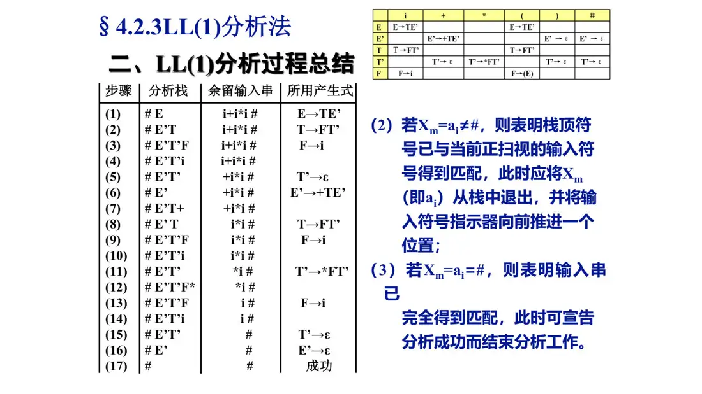

原文：

§4.2.3LL(1)分析法

二、LL(1)分析过程总结

<table><tr><td>步骤</td><td>分析栈</td><td>余留输入串</td><td>所用产生式</td></tr><tr><td>(1)</td><td># E</td><td>i+i*i #</td><td>E→TE&#x27;</td></tr><tr><td>(2)</td><td># E&#x27;T</td><td>i+i*i #</td><td>T→FT&#x27;</td></tr><tr><td>(3)</td><td># E&#x27;T&#x27;F</td><td>i+i*i #</td><td>F→i</td></tr><tr><td>(4)</td><td># E&#x27;T&#x27;i</td><td>i+i*i #</td><td></td></tr><tr><td>(5)</td><td># E&#x27;T&#x27;</td><td>+i*i #</td><td>T&#x27;→ε</td></tr><tr><td>(6)</td><td># E&#x27;</td><td>+i*i #</td><td>E&#x27;→+TE&#x27;</td></tr><tr><td>(7)</td><td># E&#x27;T+</td><td>+i*i #</td><td></td></tr><tr><td>(8)</td><td># E&#x27;T</td><td>i*i #</td><td>T→FT&#x27;</td></tr><tr><td>(9)</td><td># E&#x27;T&#x27;F</td><td>i*i #</td><td>F→i</td></tr><tr><td>(10)</td><td># E&#x27;T&#x27;i</td><td>i*i #</td><td></td></tr><tr><td>(11)</td><td># E&#x27;T&#x27;</td><td>*i #</td><td>T&#x27;→*FT&#x27;</td></tr><tr><td>(12)</td><td># E&#x27;T&#x27;F*</td><td>*i #</td><td></td></tr><tr><td>(13)</td><td># E&#x27;T&#x27;F</td><td>i #</td><td>F→i</td></tr><tr><td>(14)</td><td># E&#x27;T&#x27;i</td><td>i #</td><td></td></tr><tr><td>(15)</td><td># E&#x27;T&#x27;</td><td>#</td><td>T&#x27;→ε</td></tr><tr><td>(16)</td><td># E&#x27;</td><td>#</td><td>E&#x27;→ε</td></tr><tr><td>(17)</td><td>#</td><td>#</td><td>成功</td></tr></table>

<table><tr><td></td><td>i</td><td>+</td><td>*</td><td>(</td><td>)</td><td>#</td></tr><tr><td>E</td><td> $E \rightarrow TE'$ </td><td></td><td></td><td> $E \rightarrow TE'$ </td><td></td><td></td></tr><tr><td> $E'$ </td><td></td><td> $E' \rightarrow +TE'$ </td><td></td><td></td><td> $E' \rightarrow \varepsilon$ </td><td> $E' \rightarrow \varepsilon$ </td></tr><tr><td>T</td><td> $T \rightarrow FT'$ </td><td></td><td></td><td> $T \rightarrow FT'$ </td><td></td><td></td></tr><tr><td> $T'$ </td><td></td><td> $T' \rightarrow \varepsilon$ </td><td> $T' \rightarrow *FT'$ </td><td></td><td> $T' \rightarrow \varepsilon$ </td><td> $T' \rightarrow \varepsilon$ </td></tr><tr><td>F</td><td> $F \rightarrow i$ </td><td></td><td></td><td> $F \rightarrow (E)$ </td><td></td><td></td></tr></table>

（2）若 ${ \bf X _ { m } = a _ { i } }$ ≠#，则表明栈顶符号已与当前正扫视的输入符号得到匹配，此时应将 $\mathbf { X _ { m } }$ （即a）从栈中退出，并将输入符号指示器向前推进一个位置；

（3）若 ${ \bf X _ { m } } = \bf a _ { i } = \#$ ，则表明输入串已完全得到匹配，此时可宣告分析成功而结束分析工作。

### §4.2.3LL(1)分析法二、LL(1)分析过程总结

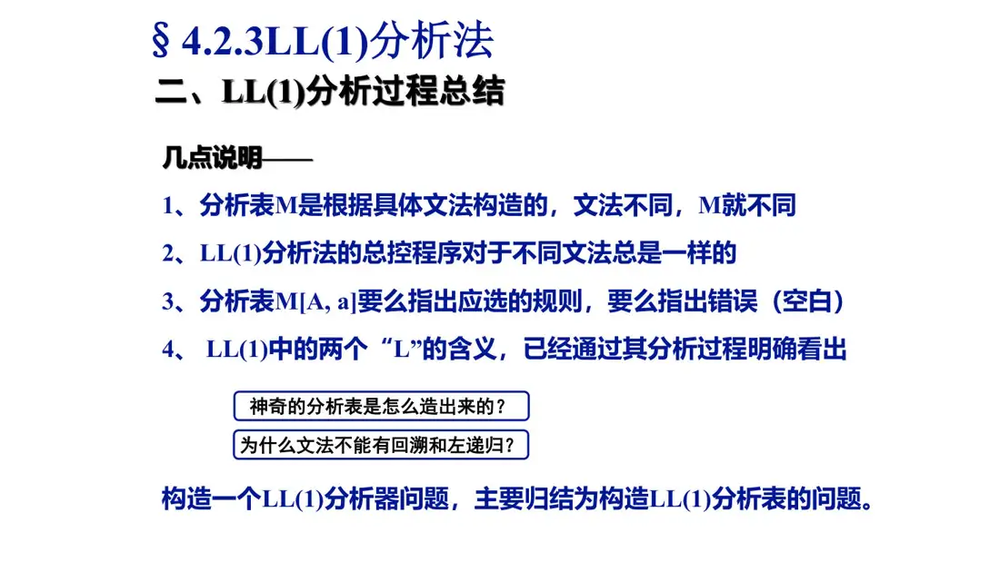

原文：

§4.2.3LL(1)分析法二、LL(1)分析过程总结

几点说明—

1、分析表M是根据具体文法构造的，文法不同，M就不同

2、LL(1)分析法的总控程序对于不同文法总是一样的

3、分析表M[A, a]要么指出应选的规则，要么指出错误（空白）

4、LL(1)中的两个“L”的含义，已经通过其分析过程明确看出

神奇的分析表是怎么造出来的？

为什么文法不能有回溯和左递归？

构造一个LL(1)分析器问题，主要归结为构造LL(1)分析表的问题。

### §4.2.3LL(1)分析法

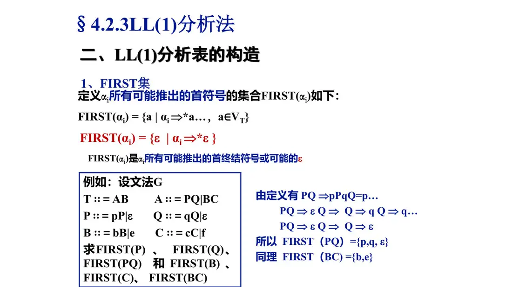

原文：

§4.2.3LL(1)分析法

二、LL(1)分析表的构造

1、FIRST集

定义 $\alpha _ { \mathrm { i } }$ 所有可能推出的首符号的集合 $\mathbf { F I R S T } ( \alpha _ { \mathrm { i } } )$ 如下：

FIRST(α ) = {a | α \*a…，a∈V }

FIRST(αi) = {ε |αi⇒\*ε }

$\mathrm { F I R S T } ( \alpha _ { \mathrm { i } } ) \frac { \Xi } { \alpha \mathrm { \Lambda } } \alpha _ { \mathrm { i } }$ 所有可能推出的首终结符号或可能的

由定义有 $\mathbf { P Q } \Rightarrow \mathbf { p P q Q } = \mathbf { p } .$

$$
\mathrm{PQ} \Rightarrow \varepsilon \mathrm{Q} \Rightarrow \mathrm{Q} \Rightarrow \mathrm{qQ} \Rightarrow \mathrm{q} \dots
$$

$$
\mathrm{PQ} \Rightarrow \varepsilon \mathrm{Q} \Rightarrow \mathrm{Q} \Rightarrow \varepsilon
$$

$$
\text { FIRST } (\mathrm{PQ}) = \{\mathrm{p}, \mathrm{q}, \varepsilon \}
$$

### §4.2.3LL(1)分析法

原文：

§4.2.3LL(1)分析法

二、LL(1)分析表的构造

不难总结出，构造FIRST集的方法步骤如下—

对任一符号X $( \mathbf { X } 6 \mathbf { V } _ { \mathrm { N } } \cup \mathbf { V } _ { \mathrm { T } } )$ ，构造FIRST(X)时，只要连续使用下列规则，直至每个FIRST集不再扩大为止。

（1）若 ${ \mathrm { X } } { \in } \mathrm { V } _ { \mathrm { T } } .$ ，则F $\mathrm { { } ^ { 7 } I R S T ( X ) = \{ X \} }$ o

（2）若 ${ \sf X } \in { \sf V } _ { \mathrm { N } }$ ，且有形如 $\mathsf { X } : : : = \mathsf { a d }$ 规则 $( \mathrm { a } \in \mathrm { V } _ { \mathrm { T } } )$ ，或 $\ x { : : = } \varepsilon$ 的规则，把a或（和）ε加入FIRST(X)中。

（3）若 ${ \mathrm { X } } { : : = } { \mathrm { Y } } _ { 1 } { \mathrm { Y } } _ { 2 } { \mathrm { . . . } } { \mathrm { Y } } _ { \mathsf { K } }$ ，且若 $\mathrm { Y } _ { 1 } \in \mathrm { V } _ { \mathrm { N } }$

● 将 $\mathrm { F I R S T } ( \mathrm { Y } _ { 1 } )$ 中一切非ε符号加进FIRST(X)中，

● 若进一步发现 $\mathrm { Y } _ { 1 } { \Rightarrow } ^ { * } \varepsilon$ ，则将F $\mathrm { \Delta } ^ { \mathrm { \prime } } \mathrm { I R S T } ( \mathrm { Y } _ { 2 } )$ 中一切非ε符号加进FIRST(X)中，否则计算过程结束

●若进一步发现 $\mathrm { Y } _ { 2 } { \Rightarrow } ^ { * } \varepsilon$ ，则继续将 $\mathrm { F I R S T } ( \mathrm { Y } _ { 3 } )$ 中一切非ε符号加进FIRST(X)中，否则计算过程结束

● 如此继续下去，若发现 $\mathrm { Y } _ { \mathrm { k - l } } \Rightarrow { ^ { * } \mathrm { \varepsilon } }$ ，则把 $\mathrm { F I R S T ( Y _ { k } ) }$ 中所有符号加进FIRST(X)中

### §4.2.3LL(1)分析法

原文：

§4.2.3LL(1)分析法

三、LL(1)分析表的构造

1、FIRST集合（首符号集合）

有文法G[E]:$\mathbf { E } { \longrightarrow } \mathbf { T } \mathbf { E } ^ { \pmb { \lessgtr } }$ $\mathbf { E } { \bf \ ' } \longrightarrow + \mathbf { T } \mathbf { E } { \bf \ ' } | { \bf \{ \varepsilon \Xi \phi } $ $\mathbf { T } { \longrightarrow } \mathbf { F } \mathbf { T } ^ { 9 }$ $\mathbf { T } ^ { 9 } \longrightarrow \mathbf { ^ { * } F T ^ { 9 } } | \pmb { \varepsilon }$ F→(E) | i求所有非终结符和产生式右侧串的FIRST集

1）求FIRST(E)（1）求FIRST(E)，就是求FIRST(TE’)（2）于是先求FIRST(T)。求FIRST(T)，就是求FIRST(FT’)（3）于是先求FIRST(F)，发现 $\mathrm { F I R S T } ( \mathrm { F } ) { = } \{ ( \mathrm { , ~ i } \}$ o于是， $\mathrm { F I R S T } ( \mathrm { F T ^ { \circ } } ) { = } \{ ( , \mathrm { i } \}$ ，即 $\mathrm { F I R S T ( T ) } { = } \{ ( { \bf \nabla } , { \bf i } \}$ 也即 $\operatorname { F I R S T } ( \mathbf { T E } ^ { 3 } ) { = } \{ ( , \mathbf { i } \}$ ，也即 $\mathrm { F I R S T } ( \mathrm { E } ) { = } \{ ( \mathrm { , ~ i } \}$

### §4.2.3LL(1)分析法

原文：

§4.2.3LL(1)分析法

三、LL(1)分析表的构造

1、FIRST集合有文法G[E]:$\mathbf { E } { \longrightarrow } \mathbf { T } \mathbf { E } ^ { \pmb { \lessgtr } }$ $\mathbf { E } { \bf \ ' } \longrightarrow + \mathbf { T } \mathbf { E } { \bf \ ' } | { \bf \{ \varepsilon \Xi \phi } $ $\mathbf { T } { \longrightarrow } \mathbf { F } \mathbf { T } ^ { 9 }$ $\mathbf { T } ^ { 9 } \longrightarrow \mathbf { ^ { * } F T ^ { 9 } } | \pmb { \varepsilon }$ F→(E) | i求所有非终结符和产生式右侧串的FIRST集

2）求FIRST(E’)

（1）求FIRST(E’)，就是求 $\mathbf { F I R S T } ( + \mathbf { T E } ^ { \mathfrak { g } } )$ 和FIRST(ε)

（2）显然， $\mathrm { F I R S T } ( + \mathrm { T E } ^ { 9 } ) { = } \{ + \}$ ，而 $\scriptstyle \mathbf { F I R S T } ( \mathbf { \mathfrak { E } } ) = \mathbf { \mathfrak { E } }$

（3）于是， $\operatorname { F I R S T } ( \mathbf { E } ^ { 3 } ) { = } \{ + , \pmb { \varepsilon } \}$

### §4.2.3LL(1)分析法

原文：

§4.2.3LL(1)分析法

三、LL(1)分析表的构造

1、FIRST集合有文法G[E]:$\mathbf { E } { \longrightarrow } \mathbf { T } \mathbf { E } ^ { \pmb { \lessgtr } }$ $\mathbf { E } { \bf \ ' } \longrightarrow + \mathbf { T } \mathbf { E } { \bf \ ' } | { \bf \{ \varepsilon \Xi \phi } $ $\mathbf { T } { \longrightarrow } \mathbf { F } \mathbf { T } ^ { 9 }$ $\mathbf { T } ^ { 9 } \longrightarrow \mathbf { ^ { * } F T ^ { 9 } } | \pmb { \varepsilon }$ F→(E) | i求所有非终结符和产生式右侧串的FIRST集

3）求FIRST(T)（1）求FIRST(T)，就是求FIRST(FT’)（2）求FIRST(FT’)，就要先求FIRST(F)（3）显然， $\mathrm { F I R S T } ( \mathrm { F } ) { = } \{ ( \mathrm { , ~ i } \}$ ，于是， $\mathrm { F I R S T } ( \mathrm { F T ^ { \circ } } ) { = } \{ ( , \mathrm { i } \}$ （4）即， $\mathrm { F I R S T ( T ) } { = } \{ \mathrm { ( , i ) }$

### §4.2.3LL(1)分析法

原文：

§4.2.3LL(1)分析法

三、LL(1)分析表的构造

1、FIRST集合有文法G[E]:$\mathbf { E } { \longrightarrow } \mathbf { T } \mathbf { E } ^ { \pmb { \lessgtr } }$ $\mathbf { E } { \bf \ ' } \longrightarrow + \mathbf { T } \mathbf { E } { \bf \ ' } | { \bf \{ \varepsilon \Xi \phi } $ $\mathbf { T } { \longrightarrow } \mathbf { F } \mathbf { T } ^ { 9 }$ $\mathbf { T } ^ { 9 } \longrightarrow \mathbf { ^ { * } F T ^ { 9 } } | \pmb { \varepsilon }$ F→(E) | i求所有非终结符和产生式右侧串的FIRST集

4）求FIRST(T’)（1）求FIRST(T’)，就是求 $\mathrm { F I R S T ( ^ { \ast } F T ^ { \dag } ) }$ 和FIRST(ε)（2）显然， $\mathrm { F I R S T } ( ^ { \ast } \mathrm { F T } ^ { \dag } ) { = } \{ ^ { \ast } \}$ ，而 $\mathbf { F I R S T } ( \mathfrak { L } ) { = } \mathfrak { L }$ （3）于是， $\operatorname { F I R S T } ( \mathbf { T } ^ { 3 } ) { = } \{ ^ { * } , \mathfrak { c } \}$

### §4.2.3LL(1)分析法

原文：

§4.2.3LL(1)分析法

三、LL(1)分析表的构造

1、FIRST集合有文法G[E]:$\mathbf { E } { \longrightarrow } \mathbf { T } \mathbf { E } ^ { \pmb { \lessgtr } }$ $\mathbf { E } { \bf \ ' } \longrightarrow + \mathbf { T } \mathbf { E } { \bf \ ' } | { \bf \{ \varepsilon \Xi \phi } $ $\mathbf { T } { \longrightarrow } \mathbf { F } \mathbf { T } ^ { 9 }$ $\mathbf { T } ^ { 9 } \longrightarrow \mathbf { ^ { * } F T ^ { 9 } } | \pmb { \varepsilon }$ F→(E) | i求所有非终结符和产生式右侧串的FIRST集

5）求FIRST(F)前面已多次求过， $\mathrm { F I R S T } ( \mathrm { F } ) { = } \{ ( \mathrm { , ~ i } \}$

### §4.2.3LL(1)分析法

原文：

§4.2.3LL(1)分析法

三、LL(1)分析表的构造

### §4.2.3LL(1)分析法

原文：

§4.2.3LL(1)分析法

三、LL(1)分析表的构造

2、FOLLOW集合（后继符号集合）

假定E是文法G的开始符号，对于文法G的任何非终结符A，我们定义——

$$
\operatorname{FOLLOW} (\mathrm{A}) = \{\mathrm{a} \mid \mathrm{E} \Rightarrow^ {*} \dots \mathrm{Aa} \dots , \mathrm{a} \in \mathrm{V} _ {\mathrm{T}} \}
$$

特别是，若E\*…A，则规定#∈FOLLOW(A)

FOLLOW(A)是指在任何句型中，紧跟在A后面的终结符或#

### §4.2.3LL(1)分析法

原文：

§4.2.3LL(1)分析法

三、LL(1)分析表的构造

2、FOLLOW集合（后继符号集合）

对文法中每个非终结符B，为了构造FOLLOW(B)，可反复应用如下规则，直到每个FOLLOW集不再扩大为止—

1、对于文法的开始符号E，令# $\boldsymbol { \mathsf { t } } \mathbf { \in } \mathbf { \mathbf { F O L L O W } } ( \mathbf { E } )$ 。

2、若文法中有形如 $\mathbf { A } { : : = } { \mathbf { a } } \mathbf { B } \mathbf { \beta }$ 的规则，且 $\beta \neq \varepsilon$ ，则将FIRST(β)中一切非ε符号加进FOLLOW(B)中。

3、若文法中有形如 $\mathbf { A } : : : = { \mathbf { a } } \mathbf { B }$ 或 $\mathbf { A } { : : = } { \mathbf { a } } \mathbf { B } \mathbf { \beta }$ 的规则，且 $\mathbf { \beta } \mathbf { \Rightarrow } ^ { * } \mathbf { \pmb { \varepsilon } }$ ，则 FOLLOW(A)中全部符号均属于FOLLOW(B)

### §4.2.3LL(1)分析法

原文：

§4.2.3LL(1)分析法

三、LL(1)分析表的构造

2、FOLLOW集合（后继符号集合）

2、若文法中有形如 $\mathbf { A } { : : = } { \mathbf { a } } \mathbf { B } \mathbf { \beta }$ 的规则，且 $\beta \neq \varepsilon$ ，则将FIRST(β)中一切非ε符号加进FOLLOW(B)中。

FIRST —— FIRST(β)

$$
\operatorname{FIRST} (\boldsymbol {\beta}) = \{\mathbf {b} \mid \boldsymbol {\beta} \Rightarrow^ {*} \mathbf {b} \dots , \quad \mathbf {b} \in \mathrm{V} _ {\mathrm{T}} \}
$$

$$
\mathbf {E} \Rightarrow^ {*} \dots \alpha \mathrm{B} \beta \dots \Rightarrow^ {*} \dots \alpha \mathrm{B} \mathbf {b} \dots
$$

### §4.2.3LL(1)分析法三、LL(1)分析表的构造

原文：

§4.2.3LL(1)分析法三、LL(1)分析表的构造

为什么不是FOLLOW(B)={ε}？

2、FOLLOW集合（后继符号集合）

3、若文法中有形如 $\mathbf { A } : : : = { \mathbf { a } } \mathbf { B }$ 或 $\mathbf { A } { : : = } { \mathbf { a } } \mathbf { B } \mathbf { \beta }$ 的规则，且 $\mathbf { \beta } \mathbf { \Rightarrow } ^ { * } \mathbf { \pmb { \varepsilon } }$ ，则1 $\mathbf { F O L L O W } ( \mathbf { A } )$ 中全部终结符均属于FOLLOW(B)

重温 $F O L L O W _ { \mathrm { { i } } }$ ——

$$
\operatorname{FOLLOW} (\mathrm{A}) = \{\mathrm{a} \mid \mathrm{E} \Rightarrow^ {*} \dots \mathrm{Aa} \dots , \mathrm{a} \in \mathrm{V} _ {\mathrm{T}} \}
$$

$$
\mathbf {E} \Rightarrow \dots \Rightarrow \dots \Rightarrow \dots \mathrm{Aa} \dots \Rightarrow \dots \alpha \mathrm{Ba} \dots
$$

所有有可能跟在A后面的终结符，都有可能跟在B的后面

$$
\mathbf {E} \Rightarrow \dots \Rightarrow \dots \Rightarrow \dots \mathrm{Aa} \dots \Rightarrow \dots \alpha \mathrm{B} \beta \mathrm{a} \dots
$$

### §4.2.3LL(1)分析法

原文：

§4.2.3LL(1)分析法

三、LL(1)分析表的构造

2、FOLLOW集合（后继符号集合）

有文法G[E]:E→TE’ $\mathbf { E } { \bf \ ' } \longrightarrow + \mathbf { T } \mathbf { E } { \bf \ ' } | { \bf \{ \varepsilon \Xi \phi } $ $\mathbf { T } ^ { 9 } \longrightarrow \mathbf { ^ { * } F T ^ { 9 } } | \pmb { \varepsilon }$ F→(E) | i求所有非终结符的FOLLOW集

$$
\mathbf {T} \rightarrow \mathbf {F T ^ {\prime}}
$$

原则——找产生式右边含有该非终结符的串！

1）求FOLLOW(E)

（1）由于E是文法的开始符号，所以#∈FOLLOW(E)

（2）又因为有F→(E)存在，所以 $\mathbf { \lambda ) \in F O L L O W ( E ) }$ $\mathbf { E } { \Rightarrow } { \underset { \cdots } { \underbrace { \longrightarrow } } } { \underset { \cdots } { \underbrace { \longrightarrow } } } \mathbf { F } { \underset { \cdots } { \underbrace { \longrightarrow } } } { \implies } { \underset { \cdots } { \underbrace { \longrightarrow } } } ( \mathbf { E } ) .$ 所以， $\scriptstyle \mathbf { F O L L O W } ( \mathbf { E } ) = \{ \# , \mathbf { \alpha } ) \}$

### §4.2.3LL(1)分析法

原文：

§4.2.3LL(1)分析法

三、LL(1)分析表的构造

2、FOLLOW集合（后继符号集合）

有文法G[E]:$\mathbf { E } { \longrightarrow } \mathbf { T } \mathbf { E } ^ { \pmb { \lessgtr } }$ $\mathbf { E } { \bf \ ' } \longrightarrow + \mathbf { T } \mathbf { E } { \bf \ ' } | { \bf \{ \varepsilon \Xi \phi } $ $\mathbf { T } ^ { 9 } \longrightarrow \mathbf { ^ { * } F T ^ { 9 } } | \pmb { \varepsilon }$ F→(E) | i求所有非终结符的FOLLOW集

$$
\mathbf {T} \rightarrow \mathbf {F T ^ {\prime}}
$$

原则——找产生式右边含有该非终结符的串！

2）求FOLLOW(E’)

（1） 由于有 $\mathbf { E } { \longrightarrow } \mathbf { T } \mathbf { E } ^ { \pmb { \gamma } }$ ，所以， $\mathbf { F O L L O W ( E ) } \subseteq \mathbf { F O L L O W ( E ^ { \prime } ) }$ 注意：这意味着，在求FOLLOW(E’)前，要先把FOLLOW(E)求出来

（2）又由于 $\mathbf { \partial } \cdot \mathbf { E } ^ { \mathcal { I } } \longrightarrow + \mathbf { T } \mathbf { E } ^ { \mathcal { I } }$ ，所以， $\mathbf { F O L L O W } ( \mathbf { E } ^ { * } ) \subseteq \mathbf { F O L L O W } ( \mathbf { E } ^ { * } )$ 注意：这话等于没说。所以可以忽略所以， $\scriptstyle \mathbf { F O L L O W } ( \mathbf { E } ) = \{ \# , \mathbf { \alpha } ) \}$

### §4.2.3LL(1)分析法

原文：

§4.2.3LL(1)分析法

三、LL(1)分析表的构造 $\scriptstyle \mathbf { F O L L O W ( T ) = \{ + , \# , ) \} }$

2、FOLLOW集合（后继符号集合）

有文法G[E]:$\mathbf { E } { \longrightarrow } \mathbf { T } \mathbf { E } ^ { \pmb { \lessgtr } }$ $\mathbf { E } { \bf \ ' } \longrightarrow + \mathbf { T } \mathbf { E } { \bf \ ' } | { \bf \{ \varepsilon \Xi \phi } $ $\mathbf { T } ^ { 9 } \longrightarrow \mathbf { ^ { * } F T ^ { 9 } } | \pmb { \varepsilon }$ F→(E) | i求所有非终结符的FOLLOW集

$$
\mathbf {T} \rightarrow \mathbf {F T ^ {\prime}}
$$

原则——找产生式右边含有该非终结符的串！

3）求FOLLOW(T)

（1）由于有 $\mathbf { E } { \longrightarrow } \mathbf { T } \mathbf { E } ^ { \pmb { \gamma } }$ ，所以， $\mathbf { F I R S T ( E ^ { \prime } ) } – \{ \mathfrak { E } \} \subseteq \mathbf { F O L L O W ( T ) }$

（2）由于E’可以推出ε，当其真的取ε时， $\mathbf { E } { \longrightarrow } \mathbf { T } \mathbf { E } ^ { \pmb { \lessgtr } }$ 其实就是 $\mathbf { E } { \longrightarrow } \mathbf { T }$ 这种情况下， $\mathbf { F O L L O W ( E ) } \subseteq \mathbf { F O L L O W ( T ) }$

（3）由于有 $\mathbf { E } { \stackrel { \bullet } { \to } } + \mathbf { T } \mathbf { E } { \stackrel { \bullet } { \to } }$ ，所以， $\mathbf { F I R S T ( E ^ { \prime } ) } { \boldsymbol { \cdot } } \{ \mathbf { z }  \subseteq \mathbf { F O L L O W ( T ) }$

（4）由于E’可以推出ε，当其真的取ε时， ${ \bf { E } } ^ { 3 } {  } { + } { \bf { T } } { \bf { E } } ^ { 3 }$ 其实就是 $\mathbf { E } { \stackrel { \bullet } { \to } } + \mathbf { T }$ 这种情况下， $\mathbf { F O L L O W } ( \mathbf { E } ^ { \prime } ) \subseteq \mathbf { F O L L O W } ( \mathbf { T } )$

### §4.2.3LL(1)分析法

原文：

§4.2.3LL(1)分析法

三、LL(1)分析表的构造 $\scriptstyle \mathbf { F O L L O W ( T ) = } \{ + , \# , ) \}$

2、FOLLOW集合（后继符号集合）

有文法G[E]:

$$
\mathbf {E} \rightarrow \mathbf {T E ^ {\prime}}
$$

$$
\mathbf {T} ^ {\prime} \rightarrow^ {*} \mathbf {F T} ^ {\prime} | \varepsilon
$$

$$
\mathbf {E} ^ {\prime} \rightarrow + \mathbf {T E} ^ {\prime} | \boldsymbol {\varepsilon}
$$

求所有非终结符的FOLLOW集

$$
\mathbf {T} \rightarrow \mathbf {F T ^ {\prime}}
$$

原则——找产生式右边含有该非终结符的串！

3）求FOLLOW(T)

（1）由于有 $\mathbf { E } { \longrightarrow } \mathbf { T } \mathbf { E } ^ { \pmb { \gamma } }$ ，所以， $\mathbf { F I R S T ( E ^ { \prime } ) } – \{ \mathfrak { E } \} \subseteq \mathbf { F O L L O W ( T ) }$

（2）由于E’可以推出ε，当其真的取ε时， $\mathbf { E } { \longrightarrow } \mathbf { T } \mathbf { E } ^ { \pmb { \lessgtr } }$ 其实就是E→T这种情况下， $\mathbf { F O L L O W ( E ) } \subseteq \mathbf { F O L L O W ( T ) }$

（3）由于有 $\mathbf { E } ^ { \prime } {  } \mathbf { T } \mathbf { E } ^ { \prime }$ ，所以， $\mathbf { F I R S T ( E ^ { \prime } ) } { \boldsymbol { \cdot } } \{ \mathbf { z }  \subseteq \mathbf { F O L L O W ( T ) }$

（4）由于E’可以推出ε，当其真的取ε时， $\mathbf { E } { \bf \ ' } {  } \mathbf { T } \mathbf { E } { \bf \ ' }$ 其实就是 $\mathbf { E } ^ { \pm } { \longrightarrow } \mathbf { T }$ 这种情况下， $\mathbf { F O L L O W } ( \mathbf { E } ^ { \prime } ) \subseteq \mathbf { F O L L O W } ( \mathbf { T } )$

### §4.2.3LL(1)分析法

原文：

§4.2.3LL(1)分析法

三、LL(1)分析表的构造

2、FOLLOW集合（后继符号集合）

有文法G[E]:E→TE’ $\mathbf { E } { \bf \ ' } \longrightarrow + \mathbf { T } \mathbf { E } { \bf \ ' } | { \bf \{ \varepsilon \Xi \phi } $ $\mathbf { T } ^ { 9 } \longrightarrow \mathbf { ^ { * } F T ^ { 9 } } | \pmb { \varepsilon }$ F→(E) | i求所有非终结符的FOLLOW集

$$
\mathbf {T} \rightarrow \mathbf {F T ^ {\prime}}
$$

原则——找产生式右边含有该非终结符的串！

4）求FOLLOW(T’)

（1）由于有 $\mathbf { T } { \longrightarrow } \mathbf { F T } ^ { 9 } ;$ ，所以， $\mathbf { F O L L O W ( T ) } \subseteq \mathbf { F O L L O W ( T ^ { \circ } ) }$

（2）由于有 $\mathbf { T } ^ { \bullet } \mathbf { H } \mathbf { T } ^ { \bullet }$ ，所以， $\mathbf { F O L L O W } ( \mathbf { T } ^ { * } ) \subseteq \mathbf { F O L L O W } ( \mathbf { T } ^ { * } )$

所以， $\operatorname { F O L L O W } ( \mathbf { T } ^ { * } ) { = } \{ + , \# , ) \}$

### §4.2.3LL(1)分析法

原文：

§4.2.3LL(1)分析法

三、LL(1)分析表的构造 $\operatorname { F O L L O W } ( \operatorname { F } ) = \lbrace \ast , + , \# , ) \rbrace$

2、FOLLOW集合（后继符号集合）

有文法G[E]:$\mathbf { E } { \longrightarrow } \mathbf { T } \mathbf { E } ^ { \pmb { \lessgtr } }$ $\mathbf { E } { \bf \ ' } \longrightarrow + \mathbf { T } \mathbf { E } { \bf \ ' } | { \bf \{ \varepsilon \Xi \phi } $ $\mathbf { T } ^ { 9 } \longrightarrow \mathbf { ^ { * } F T ^ { 9 } } | \pmb { \varepsilon }$ F→(E) | i求所有非终结符的FOLLOW集

$$
\mathbf {T} \rightarrow \mathbf {F T ^ {\prime}}
$$

原则——找产生式右边含有该非终结符的串！

5）求FOLLOW(F)

（1）由于有 $\mathbf { T } { \longrightarrow } \mathbf { F } \mathbf { T } ^ { \pmb { \lessgtr } }$ ，所以， $\mathbf { F I R S T ( T ^ { \prime } ) } { \boldsymbol { \cdot } } \{ \mathbf { \mathfrak { x } }  \mathbf { \mathfrak { x } } \subseteq \mathbf { F O L L O W ( F ) }$

（2）由于T’可以推出ε，当其真的取ε时， $\mathbf { T } { \longrightarrow } \mathbf { F } \mathbf { T } ^ { \pmb { \lessgtr } }$ 其实就是 $\mathbf { T } { \longrightarrow } \mathbf { F }$ 这种情况下， $\mathbf { F O L L O W ( T ) } \subseteq \mathbf { F O L L O W ( F ) }$

（3）由于有T’→\*FT’，所以， $\mathbf { F I R S T ( T ^ { 5 } ) } { \cdot } \{ \mathfrak { s } \} \subseteq \mathbf { F O L L O W ( F ) }$

（4）由于T’可以推出ε，当其真的取ε时， $\mathrm { \bf T } ^ { \bullet } \mathrm { \bf \to } ^ { \ast } \mathrm { \bf F T } ^ { \bullet }$ 其实就是T’→\*F这种情况下， $\mathbf { F O L L O W ( T ^ { * } ) } \subseteq \mathbf { F O L L O W ( F ) }$

### §4.2.3LL(1)分析法

原文：

§4.2.3LL(1)分析法

三、LL(1)分析表的构造 $\operatorname { F O L L O W } ( \operatorname { F } ) = \{ * , + , \# , ) \}$

2、FOLLOW集合（后继符号集合）

有文法G[E]:$\mathbf { E } { \longrightarrow } \mathbf { T } \mathbf { E } ^ { \pmb { \lessgtr } }$ $\mathbf { E } { \bf \ ' } \longrightarrow + \mathbf { T } \mathbf { E } { \bf \ ' } | { \bf \{ \varepsilon \Xi \phi } $ $\mathbf { T } ^ { 9 } \longrightarrow \mathbf { ^ { * } F T ^ { 9 } } | \pmb { \varepsilon }$ F→(E) | i求所有非终结符的FOLLOW集

$$
\mathbf {T} \rightarrow \mathbf {F T ^ {\prime}}
$$

原则——找产生式右边含有该非终结符的串！

5）求FOLLOW(F)

（1）由于有 $\mathbf { T } { \longrightarrow } \mathbf { F } \mathbf { T } ^ { \pmb { \lessgtr } }$ ，所以， $\mathbf { F I R S T ( T ^ { \prime } ) } { \boldsymbol { \cdot } } \{ \mathbf { \mathfrak { x } }  \mathbf { \mathfrak { x } } \subseteq \mathbf { F O L L O W ( F ) }$

（2）由于T’可以推出ε，当其真的取ε时， $\mathbf { T } { \longrightarrow } \mathbf { F } \mathbf { T } ^ { \pmb { \lessgtr } }$ 其实就是 $\mathbf { T } { \longrightarrow } \mathbf { F }$ 这种情况下， $\mathbf { F O L L O W ( T ) } \subseteq \mathbf { F O L L O W ( F ) }$

（3）由于有T’→\*FT’，所以， $\mathbf { F I R S T ( T ^ { 5 } ) } { \cdot } \{ \mathfrak { s } \} \subseteq \mathbf { F O L L O W ( F ) }$

（4）由于T’可以推出ε，当其真的取ε时， $\mathrm { \bf T } ^ { \bullet } \mathrm { \bf \to } ^ { \ast } \mathrm { \bf F T } ^ { \bullet }$ 其实就是T’→\*F这种情况下， $\mathbf { F O L L O W ( T ^ { * } ) } \subseteq \mathbf { F O L L O W ( F ) }$

### §4.2.3LL(1)分析法

原文：

§4.2.3LL(1)分析法

三、LL(1)分析表的构造

2、FOLLOW集合（后继符号集合）

### 第 93 页

### 下列文法，求每个非终结符的FIRST和FOLLOW集：

原文：

下列文法，求每个非终结符的FIRST和FOLLOW集：

$$
\mathrm{A} \because = \mathrm{BCc} \mid \mathrm{gDB}
$$

$$
\mathrm{B} \because = \varepsilon | \mathrm{bCDE}
$$

$$
\mathrm{C}: := \mathrm{DaB} \mid \mathrm{ca}
$$

$$
\mathrm{D} \because = \varepsilon | \mathrm{dD}
$$

$$
\mathrm{E} \mathrel {\mathop :} := \mathrm{gAf} \mid \mathrm{c}
$$

94

### §4.2.3LL(1)分析法

原文：

§4.2.3LL(1)分析法

三、LL(1)分析表的构造

3、由FIRST集合和FOLLOW集合构造LL(1)分析表 E→TE’ E’→+TE’|ε T→FT’ T’→\*FT’ |ε F→(E) | i

<table><tr><td></td><td>i</td><td>+</td><td>*</td><td>(</td><td>)</td><td>#</td></tr><tr><td>E</td><td> $E \rightarrow TE'$ </td><td></td><td></td><td> $E \rightarrow TE'$ </td><td></td><td></td></tr><tr><td> $E'$ </td><td></td><td> $E' \rightarrow +TE'$ </td><td></td><td></td><td> $E' \rightarrow \varepsilon$ </td><td> $E' \rightarrow \varepsilon$ </td></tr><tr><td>T</td><td> $T \rightarrow FT'$ </td><td></td><td></td><td> $T \rightarrow FT'$ </td><td></td><td></td></tr><tr><td> $T'$ </td><td></td><td> $T' \rightarrow \varepsilon$ </td><td> $T' \rightarrow *FT'$ </td><td></td><td> $T' \rightarrow \varepsilon$ </td><td> $T' \rightarrow \varepsilon$ </td></tr><tr><td>F</td><td> $F \rightarrow i$ </td><td></td><td></td><td> $F \rightarrow (E)$ </td><td></td><td></td></tr></table>

### §4.2.3LL(1)分析法

原文：

§4.2.3LL(1)分析法

三、LL(1)分析表的构造

3、由FIRST集合和FOLLOW集合构造LL(1)分析表

$$
\mathbf {E} ^ {\prime} \rightarrow + \mathbf {T E} ^ {\prime} | \boldsymbol {\varepsilon}
$$

$$
\mathbf {T} ^ {\prime} \rightarrow^ {*} \mathbf {F T} ^ {\prime} | \boldsymbol {\varepsilon}
$$

F→(E) | i

<table><tr><td>FIRST(TE&#x27;)={{, i}</td><td>FIRST(+TE&#x27;)={+}</td><td>FIRST(ε)={ε}</td><td>FIRST(FT&#x27;)={{, i}}</td></tr><tr><td>FIRST(*FT&#x27;)={*}</td><td>FIRST((E))={{}</td><td>FIRST(i)={i}</td><td></td></tr></table>

<table><tr><td></td><td>i</td><td>+</td><td>*</td><td>(</td><td>)</td><td>#</td></tr><tr><td>E</td><td></td><td></td><td></td><td></td><td></td><td></td></tr><tr><td>E&#x27;</td><td></td><td></td><td></td><td></td><td></td><td></td></tr><tr><td>T</td><td></td><td></td><td></td><td></td><td></td><td></td></tr><tr><td>T&#x27;</td><td></td><td></td><td></td><td></td><td></td><td></td></tr><tr><td>F</td><td></td><td></td><td></td><td></td><td></td><td></td></tr></table>

### §4.2.3LL(1)分析法

原文：

§4.2.3LL(1)分析法

三、LL(1)分析表的构造

3、由FIRST集合和FOLLOW集合构造LL(1)分析表

T→FT’

$$
\mathbf {T} ^ {\prime} \rightarrow^ {*} \mathbf {F T} ^ {\prime} | \boldsymbol {\varepsilon}
$$

F→(E) | i

<table><tr><td>FIRST(TE&#x27;)={{, i}</td><td>FIRST(+TE&#x27;)={{+}}</td><td>FIRST(ε={{ε}}</td><td>FIRST(FT&#x27;)={{, i}}</td></tr><tr><td>FIRST(*FT&#x27;)={{*}}</td><td>FIRST((E))={{}}</td><td>FIRST(i={{i}}}</td><td></td></tr></table>

<table><tr><td></td><td>i</td><td>+</td><td>*</td><td>(</td><td>)</td><td>#</td></tr><tr><td>E</td><td> $E \rightarrow TE'$ </td><td></td><td></td><td> $E \rightarrow TE'$ </td><td></td><td></td></tr><tr><td> $E'$ </td><td></td><td></td><td></td><td></td><td></td><td></td></tr><tr><td>T</td><td></td><td></td><td></td><td></td><td></td><td></td></tr><tr><td> $T'$ </td><td></td><td></td><td></td><td></td><td></td><td></td></tr><tr><td>F</td><td></td><td></td><td></td><td></td><td></td><td></td></tr></table>

### §4.2.3LL(1)分析法

原文：

§4.2.3LL(1)分析法

三、LL(1)分析表的构造

3、由FIRST集合和FOLLOW集合构造LL(1)分析表

E’→+TE’|ε

T→FT’

F→(E) | i

<table><tr><td>FIRST(TE&#x27;)={{, i}</td><td>FIRST(+TE&#x27;)={{+}}</td><td>FIRST(ε)={{ε}}</td><td>FIRST(FT&#x27;)={{, i}}</td></tr><tr><td>FIRST(*FT&#x27;)={{*}}</td><td>FIRST((E))={{}}</td><td>FIRST(i)={{i}}</td><td></td></tr></table>

<table><tr><td></td><td>i</td><td>+</td><td>*</td><td>(</td><td>)</td><td>#</td></tr><tr><td>E</td><td> $E \rightarrow TE'$ </td><td></td><td></td><td> $E \rightarrow TE'$ </td><td></td><td></td></tr><tr><td> $E'$ </td><td></td><td> $E' \rightarrow +TE'$ </td><td></td><td></td><td></td><td></td></tr><tr><td>T</td><td></td><td></td><td></td><td></td><td></td><td></td></tr><tr><td> $T'$ </td><td></td><td></td><td></td><td></td><td></td><td></td></tr><tr><td>F</td><td></td><td></td><td></td><td></td><td></td><td></td></tr></table>

### §4.2.3LL(1)分析法

原文：

§4.2.3LL(1)分析法

三、LL(1)分析表的构造

3、由FIRST集合和FOLLOW集合构造LL(1)分析表

E’→+TE’|ε

T→FT’

F→(E) | i

<table><tr><td>FIRST(TE&#x27;)={{, i}</td><td>FIRST(+TE&#x27;)={{+}}</td><td>FIRST(ε)={{ε}}</td><td>FIRST(FT&#x27;)={{, i}}</td></tr><tr><td>FIRST(*FT&#x27;)={{*}}</td><td>FIRST((E))={{}}</td><td>FIRST(i)={{i}}</td><td></td></tr></table>

<table><tr><td></td><td>i</td><td>+</td><td>*</td><td>(</td><td>)</td><td>#</td></tr><tr><td>E</td><td> $E \rightarrow TE'$ </td><td></td><td></td><td> $E \rightarrow TE'$ </td><td></td><td></td></tr><tr><td> $E'$ </td><td></td><td> $E' \rightarrow +TE'$ </td><td></td><td></td><td></td><td></td></tr><tr><td>T</td><td> $T \rightarrow FT'$ </td><td></td><td></td><td> $T \rightarrow FT'$ </td><td></td><td></td></tr><tr><td> $T'$ </td><td></td><td></td><td></td><td></td><td></td><td></td></tr><tr><td>F</td><td></td><td></td><td></td><td></td><td></td><td></td></tr></table>

### §4.2.3LL(1)分析法

原文：

§4.2.3LL(1)分析法

三、LL(1)分析表的构造

3、由FIRST集合和FOLLOW集合构造LL(1)分析表

E’→+TE’|ε

T→FT’

T’→\*FT’ |ε

F→(E) | i

<table><tr><td>FIRST(TE&#x27;)={{, i}</td><td>FIRST(+TE&#x27;)={{+}}</td><td>FIRST(ε={{ε}}</td><td>FIRST(FT&#x27;)={{, i}}</td></tr><tr><td>FIRST(*FT&#x27;)={{*}}</td><td>FIRST((E))={{}}</td><td>FIRST(i={{i}}}</td><td></td></tr></table>

<table><tr><td></td><td>i</td><td>+</td><td>*</td><td>(</td><td>)</td><td>#</td></tr><tr><td>E</td><td> $E \rightarrow TE'$ </td><td></td><td></td><td> $E \rightarrow TE'$ </td><td></td><td></td></tr><tr><td> $E'$ </td><td></td><td> $E' \rightarrow +TE'$ </td><td></td><td></td><td></td><td></td></tr><tr><td>T</td><td> $T \rightarrow FT'$ </td><td></td><td></td><td> $T \rightarrow FT'$ </td><td></td><td></td></tr><tr><td> $T'$ </td><td></td><td></td><td> $T' \rightarrow *FT'$ </td><td></td><td></td><td></td></tr><tr><td>F</td><td></td><td></td><td></td><td></td><td></td><td></td></tr></table>

### §4.2.3LL(1)分析法

原文：

§4.2.3LL(1)分析法

三、LL(1)分析表的构造

3、由FIRST集合和FOLLOW集合构造LL(1)分析表

E’→+TE’|ε

T→FT’

F→(E) | i

<table><tr><td>FIRST(TE&#x27;)={{, i}</td><td>FIRST(+TE&#x27;)={{+}}</td><td>FIRST(ε={{ε}}</td><td>FIRST(FT&#x27;)={{, i}}</td></tr><tr><td>FIRST(*FT&#x27;)={{*}}</td><td>FIRST((E))={{}}</td><td>FIRST(i={{i}}}</td><td></td></tr></table>

<table><tr><td></td><td>i</td><td>+</td><td>*</td><td>(</td><td>)</td><td>#</td></tr><tr><td>E</td><td> $E \rightarrow TE'$ </td><td></td><td></td><td> $E \rightarrow TE'$ </td><td></td><td></td></tr><tr><td> $E'$ </td><td></td><td> $E' \rightarrow +TE'$ </td><td></td><td></td><td></td><td></td></tr><tr><td>T</td><td> $T \rightarrow FT'$ </td><td></td><td></td><td> $T \rightarrow FT'$ </td><td></td><td></td></tr><tr><td> $T'$ </td><td></td><td></td><td> $T' \rightarrow *FT'$ </td><td></td><td></td><td></td></tr><tr><td>F</td><td></td><td></td><td></td><td> $F \rightarrow (E)$ </td><td></td><td></td></tr></table>

### §4.2.3LL(1)分析法

原文：

§4.2.3LL(1)分析法

三、LL(1)分析表的构造

3、由FIRST集合和FOLLOW集合构造LL(1)分析表

E’→+TE’|ε

T→FT’

F→(E) | i

<table><tr><td>FIRST(TE&#x27;)={{, i}</td><td>FIRST(+TE&#x27;)={{+}}</td><td>FIRST(ε={{ε}}</td><td>FIRST(FT&#x27;)={{, i}}</td></tr><tr><td>FIRST(*FT&#x27;)={{*}}</td><td>FIRST((E))={{}}</td><td>FIRST(i={{i}}}</td><td></td></tr></table>

<table><tr><td></td><td>i</td><td>+</td><td>*</td><td>(</td><td>)</td><td>#</td></tr><tr><td>E</td><td> $E \rightarrow TE'$ </td><td></td><td></td><td> $E \rightarrow TE'$ </td><td></td><td></td></tr><tr><td> $E'$ </td><td></td><td> $E' \rightarrow +TE'$ </td><td></td><td></td><td></td><td></td></tr><tr><td>T</td><td> $T \rightarrow FT'$ </td><td></td><td></td><td> $T \rightarrow FT'$ </td><td></td><td></td></tr><tr><td> $T'$ </td><td></td><td></td><td> $T' \rightarrow *FT'$ </td><td></td><td></td><td></td></tr><tr><td>F</td><td> $F \rightarrow i$ </td><td></td><td></td><td> $F \rightarrow (E)$ </td><td></td><td></td></tr></table>

### §4.2.3LL(1)分析法

原文：

§4.2.3LL(1)分析法

三、LL(1)分析表的构造

3、由FIRST集合和FOLLOW集合构造LL(1)分析表

E→TE’

$$
\mathbf {E} ^ {\prime} \rightarrow + \mathbf {T E} ^ {\prime} | \boldsymbol {\varepsilon}
$$

T→FT’

$$
\mathbf {T} ^ {\prime} \rightarrow^ {*} \mathbf {F T} ^ {\prime} | \boldsymbol {\varepsilon}
$$

F→(E) | i

<table><tr><td></td><td>i</td><td>+</td><td>*</td><td>(</td><td>)</td><td>#</td></tr><tr><td>E</td><td> $E \rightarrow TE'$ </td><td></td><td></td><td> $E \rightarrow TE'$ </td><td></td><td></td></tr><tr><td> $E'$ </td><td></td><td> $E' \rightarrow +TE'$ </td><td></td><td></td><td></td><td></td></tr><tr><td>T</td><td> $T \rightarrow FT'$ </td><td></td><td></td><td> $T \rightarrow FT'$ </td><td></td><td></td></tr><tr><td> $T'$ </td><td></td><td></td><td> $T' \rightarrow *FT'$ </td><td></td><td></td><td></td></tr><tr><td>F</td><td> $F \rightarrow i$ </td><td></td><td></td><td> $F \rightarrow (E)$ </td><td></td><td></td></tr></table>

<table><tr><td>步骤</td><td>分析栈</td><td>余留输入串</td><td>所用产生式</td></tr><tr><td>(1)</td><td># E</td><td>i+i*i #</td><td>E→TE&#x27;</td></tr><tr><td>(2)</td><td># E&#x27;T</td><td>i+i*i #</td><td>T→FT&#x27;</td></tr><tr><td>(3)</td><td># E&#x27;T&#x27;F</td><td>i+i*i #</td><td>F→i</td></tr><tr><td>(4)</td><td># E&#x27;T&#x27;i</td><td>i+i*i #</td><td></td></tr><tr><td>(5)</td><td># E&#x27;T&#x27;</td><td>+i*i #</td><td>T&#x27;→ε</td></tr><tr><td>(6)</td><td># E&#x27;</td><td>+i*i #</td><td>E&#x27;→+TE&#x27;</td></tr><tr><td>(7)</td><td># E&#x27;T+</td><td>+i*i #</td><td></td></tr><tr><td>(8)</td><td># E&#x27;T</td><td>i*i #</td><td>T→FT&#x27;</td></tr><tr><td>(9)</td><td># E&#x27;T&#x27;F</td><td>i*i #</td><td>F→i</td></tr><tr><td>(10)</td><td># E&#x27;T&#x27;i</td><td>i*i #</td><td></td></tr><tr><td>(11)</td><td># E&#x27;T&#x27;</td><td>*i #</td><td>T&#x27;→*FT&#x27;</td></tr><tr><td>(12)</td><td># E&#x27;T&#x27;F*</td><td>*i #</td><td></td></tr><tr><td>(13)</td><td># E&#x27;T&#x27;F</td><td>i #</td><td>F→i</td></tr><tr><td>(14)</td><td># E&#x27;T&#x27;i</td><td>i #</td><td></td></tr><tr><td>(15)</td><td># E&#x27;T&#x27;</td><td>#</td><td>T&#x27;→ε</td></tr><tr><td>(16)</td><td># E&#x27;</td><td>#</td><td>E&#x27;→ε</td></tr><tr><td>(17)</td><td>#</td><td>#</td><td>成功</td></tr></table>

### §4.2.3LL(1)分析法

原文：

§4.2.3LL(1)分析法

三、LL(1)分析表的构造

3、由FIRST集合和FOLLOW集合构造LL(1)分析表

E’→+TE’|ε

T→FT’

F→(E) | i

<table><tr><td></td><td>i</td><td>+</td><td>*</td><td>(</td><td>)</td><td>#</td></tr><tr><td>E</td><td> $E \rightarrow TE'$ </td><td></td><td></td><td> $E \rightarrow TE'$ </td><td></td><td></td></tr><tr><td> $E'$ </td><td></td><td> $E' \rightarrow +TE'$ </td><td></td><td></td><td></td><td></td></tr><tr><td>T</td><td> $T \rightarrow FT'$ </td><td></td><td></td><td> $T \rightarrow FT'$ </td><td></td><td></td></tr><tr><td> $T'$ </td><td></td><td></td><td> $T' \rightarrow *FT'$ </td><td></td><td></td><td></td></tr><tr><td>F</td><td> $F \rightarrow i$ </td><td></td><td></td><td> $F \rightarrow (E)$ </td><td></td><td></td></tr></table>

### §4.2.3LL(1)分析法

原文：

§4.2.3LL(1)分析法

三、LL(1)分析表的构造

3、由FIRST集合和FOLLOW集合构造LL(1)分析表

E’→+TE’|ε

T→FT’

F→(E) | i

<table><tr><td></td><td>i</td><td>+</td><td>*</td><td>(</td><td>)</td><td>#</td></tr><tr><td>E</td><td> $E \rightarrow TE'$ </td><td></td><td></td><td> $E \rightarrow TE'$ </td><td></td><td></td></tr><tr><td> $E'$ </td><td></td><td> $E' \rightarrow +TE'$ </td><td></td><td></td><td> $E' \rightarrow \varepsilon$ </td><td> $E' \rightarrow \varepsilon$ </td></tr><tr><td>T</td><td> $T \rightarrow FT'$ </td><td></td><td></td><td> $T \rightarrow FT'$ </td><td></td><td></td></tr><tr><td> $T'$ </td><td></td><td></td><td> $T' \rightarrow *FT'$ </td><td></td><td></td><td></td></tr><tr><td>F</td><td> $F \rightarrow i$ </td><td></td><td></td><td> $F \rightarrow (E)$ </td><td></td><td></td></tr></table>

### §4.2.3LL(1)分析法

原文：

§4.2.3LL(1)分析法

三、LL(1)分析表的构造

3、由FIRST集合和FOLLOW集合构造LL(1)分析表

E’→+TE’|ε

T→FT’

F→(E) | i

<table><tr><td></td><td>i</td><td>+</td><td>*</td><td>(</td><td>)</td><td>#</td></tr><tr><td>E</td><td> $E \rightarrow TE'$ </td><td></td><td></td><td> $E \rightarrow TE'$ </td><td></td><td></td></tr><tr><td> $E'$ </td><td></td><td> $E' \rightarrow +TE'$ </td><td></td><td></td><td> $E' \rightarrow \varepsilon$ </td><td> $E' \rightarrow \varepsilon$ </td></tr><tr><td>T</td><td> $T \rightarrow FT'$ </td><td></td><td></td><td> $T \rightarrow FT'$ </td><td></td><td></td></tr><tr><td> $T'$ </td><td></td><td> $T' \rightarrow \varepsilon$ </td><td> $T' \rightarrow *FT'$ </td><td></td><td> $T' \rightarrow \varepsilon$ </td><td> $T' \rightarrow \varepsilon$ </td></tr><tr><td>F</td><td> $F \rightarrow i$ </td><td></td><td></td><td> $F \rightarrow (E)$ </td><td></td><td></td></tr></table>

### §4.2.3LL(1)分析法

原文：

§4.2.3LL(1)分析法

三、LL(1)分析表的构造

3、由FIRST集合和FOLLOW集合构造LL(1)分析表

E→TE’

$$
\mathbf {E} ^ {\prime} \rightarrow + \mathbf {T E} ^ {\prime} | \boldsymbol {\varepsilon}
$$

T→FT’

$$
\mathbf {T} ^ {\prime} \rightarrow^ {*} \mathbf {F T} ^ {\prime} | \boldsymbol {\varepsilon}
$$

F→(E) | i

<table><tr><td></td><td>i</td><td>+</td><td>*</td><td>(</td><td>)</td><td>#</td></tr><tr><td>E</td><td> $\mathbf{E} \rightarrow \mathbf{TE}'$ </td><td></td><td></td><td> $\mathbf{E} \rightarrow \mathbf{TE}'$ </td><td></td><td></td></tr><tr><td> $\mathbf{E}'$ </td><td></td><td> $\mathbf{E}' \rightarrow +\mathbf{TE}'$ </td><td></td><td></td><td> $\mathbf{E}' \rightarrow \varepsilon$ </td><td> $\mathbf{E}' \rightarrow \varepsilon$ </td></tr><tr><td>T</td><td> $T \rightarrow FT'$ </td><td></td><td></td><td> $T \rightarrow FT'$ </td><td></td><td></td></tr><tr><td> $T'$ </td><td></td><td> $T' \rightarrow \varepsilon$ </td><td> $T' \rightarrow *FT'$ </td><td></td><td> $T' \rightarrow \varepsilon$ </td><td> $T' \rightarrow \varepsilon$ </td></tr><tr><td>F</td><td> $F \rightarrow i$ </td><td></td><td></td><td> $F \rightarrow (E)$ </td><td></td><td></td></tr></table>

<table><tr><td>步骤</td><td>分析栈</td><td>余留输入串</td><td>所用产生式</td></tr><tr><td>(1)</td><td># E</td><td>i+i*i #</td><td>E→TE&#x27;</td></tr><tr><td>(2)</td><td># E&#x27;T</td><td>i+i*i #</td><td>T→FT&#x27;</td></tr><tr><td>(3)</td><td># E&#x27;T&#x27;F</td><td>i+i*i #</td><td>F→i</td></tr><tr><td>(4)</td><td># E&#x27;T&#x27;i</td><td>i+i*i #</td><td></td></tr><tr><td>(5)</td><td># E&#x27;T&#x27;</td><td>+i*i #</td><td>T&#x27;→ε</td></tr><tr><td>(6)</td><td># E&#x27;</td><td>+i*i #</td><td>E&#x27;→+TE&#x27;</td></tr><tr><td>(7)</td><td># E&#x27;T+</td><td>+i*i #</td><td></td></tr><tr><td>(8)</td><td># E&#x27;T</td><td>i*i #</td><td>T→FT&#x27;</td></tr><tr><td>(9)</td><td># E&#x27;T&#x27;F</td><td>i*i #</td><td>F→i</td></tr><tr><td>(10)</td><td># E&#x27;T&#x27;i</td><td>i*i #</td><td></td></tr><tr><td>(11)</td><td># E&#x27;T&#x27;</td><td>*i #</td><td>T&#x27;→*FT&#x27;</td></tr><tr><td>(12)</td><td># E&#x27;T&#x27;F*</td><td>*i #</td><td></td></tr><tr><td>(13)</td><td># E&#x27;T&#x27;F</td><td>i #</td><td>F→i</td></tr><tr><td>(14)</td><td># E&#x27;T&#x27;i</td><td>i #</td><td></td></tr><tr><td>(15)</td><td># E&#x27;T&#x27;</td><td>#</td><td>T&#x27;→ε</td></tr><tr><td>(16)</td><td># E&#x27;</td><td>#</td><td>E&#x27;→ε</td></tr><tr><td>(17)</td><td>#</td><td>#</td><td>成功</td></tr></table>

### §4.2.3LL(1)分析法

原文：

§4.2.3LL(1)分析法

三、LL(1)分析表的构造

3、由FIRST集合和FOLLOW集合构造LL(1)分析表 E→TE’ E’→+TE’|ε T→FT’ T’→\*FT’ |ε F→(E) | i

<table><tr><td></td><td>i</td><td>+</td><td>*</td><td>(</td><td>)</td><td>#</td></tr><tr><td>E</td><td> $E \rightarrow TE'$ </td><td></td><td></td><td> $E \rightarrow TE'$ </td><td></td><td></td></tr><tr><td> $E'$ </td><td></td><td> $E' \rightarrow +TE'$ </td><td></td><td></td><td> $E' \rightarrow \varepsilon$ </td><td> $E' \rightarrow \varepsilon$ </td></tr><tr><td>T</td><td> $T \rightarrow FT'$ </td><td></td><td></td><td> $T \rightarrow FT'$ </td><td></td><td></td></tr><tr><td> $T'$ </td><td></td><td> $T' \rightarrow \varepsilon$ </td><td> $T' \rightarrow *FT'$ </td><td></td><td> $T' \rightarrow \varepsilon$ </td><td> $T' \rightarrow \varepsilon$ </td></tr><tr><td>F</td><td> $F \rightarrow i$ </td><td></td><td></td><td> $F \rightarrow (E)$ </td><td></td><td></td></tr></table>

### §4.2.3LL(1)分析法三、LL(1)分析表的构造

原文：

§4.2.3LL(1)分析法三、LL(1)分析表的构造

构造分析表M算法总结如下

求出FIRST集和FOLLOW集后，根据前面构造文法G的LL（1）分析表的过程，我们就可以得出构造分析表M算法，对于G中每一个规则 $\mathbf { A } : : = \mathbf { a } ,$ ，可按如下算法确定表中各元素：

①对FIRST（α）中每一终结符a，置M $[ { \bf A } , { \bf a } ] = { \bf \Sigma } ^ { \ast } { \bf A }  { \bf a } ^ { \ast }$

②若ε∈FIRST（α），则对属于FOLLOW（A）中的每一符号b (b为终结符或＃)，置 $\mathrm { ~ \bf ~ M ~ } [ \mathrm { ~ \bf ~ A ~ } , \mathrm { ~ \bf ~ b ~ } ] = { } ^ { 4 \epsilon } \mathrm { \bf ~ A } \longrightarrow a ^ { , , }$

③把M中所有不能按规则①、②定义的元素均置为出错。

109

### §4.2.3LL(1)分析法

原文：

§4.2.3LL(1)分析法

三、LL(1)分析表的构造

4、LL(1)分析表的冲突问题（多重定义入口）

一个文法G，如果它的分析表M不含多重定义入口，则称该文法是LL(1)文法。所谓“多重定义入口”是指分析表中某M[A，a]有两个或两个以上产生式。

$$
\mathrm{S}: := \mathrm{iCtSS} ^ {\prime} \mid \mathrm{a} \quad \mathrm{S} ^ {\prime}: := \mathrm{eS} \mid \varepsilon \quad \mathrm{C}: := \mathrm{b}
$$

$$
\operatorname{FOLLOW} \left(\mathrm{S} ^ {\prime}\right) = \{\#, \mathrm{e} \}
$$

<table><tr><td></td><td>a</td><td>b</td><td>e</td><td>i</td><td>t</td><td>#</td></tr><tr><td>S</td><td>S::=a</td><td></td><td></td><td>S::=iCtSS&#x27;</td><td></td><td></td></tr><tr><td>S&#x27;</td><td></td><td></td><td>S&#x27;:::=eSS&#x27;:::=ε</td><td></td><td></td><td>S&#x27;:::=ε</td></tr><tr><td>C</td><td></td><td>C::=b</td><td></td><td></td><td></td><td></td></tr></table>

$$
\operatorname{FOLLOW} (\mathrm{S}) = \{\#, \mathrm{e} \}
$$

$$
\mathbf {F I R S T} (\mathbf {S ^ {\prime}}) = \{\textbf {e}, \varepsilon \}
$$

### §4.2.3LL(1)分析法

原文：

§4.2.3LL(1)分析法

三、LL(1)分析表的构造

为什么文法不能有回溯？

3、由FIRST集合和FOLLOW集合构造LL(1)分析表 E→TE’ E’→+TE’|ε T→FT’ T’→\*FT’ |ε F→(E) | i | (i\*i)

<table><tr><td></td><td>i</td><td>+</td><td>*</td><td>(</td><td>)</td><td>#</td></tr><tr><td>E</td><td> $E \rightarrow TE'$ </td><td></td><td></td><td> $E \rightarrow TE'$ </td><td></td><td></td></tr><tr><td> $E'$ </td><td></td><td> $E' \rightarrow +TE'$ </td><td></td><td></td><td> $E' \rightarrow \varepsilon$ </td><td> $E' \rightarrow \varepsilon$ </td></tr><tr><td>T</td><td> $T \rightarrow FT'$ </td><td></td><td></td><td> $T \rightarrow FT'$ </td><td></td><td></td></tr><tr><td> $T'$ </td><td></td><td> $T' \rightarrow \varepsilon$ </td><td> $T' \rightarrow *FT'$ </td><td></td><td> $T' \rightarrow \varepsilon$ </td><td> $T' \rightarrow \varepsilon$ </td></tr><tr><td>F</td><td> $F \rightarrow i$ </td><td></td><td></td><td> $F \rightarrow (E)$ </td><td></td><td></td></tr></table>

### §4.2.3LL(1)分析法

原文：

§4.2.3LL(1)分析法

三、LL(1)分析表的构造

为什么文法不能有回溯？

3、由FIRST集合和FOLLOW集合构造LL(1)分析表 E→TE’ E’→+TE’|ε T→FT’ T’→\*FT’ |ε F→(E) | i | (i\*i)

<table><tr><td></td><td>i</td><td>+</td><td>*</td><td>(</td><td>)</td><td>#</td></tr><tr><td>E</td><td> $E \rightarrow TE'$ </td><td></td><td></td><td> $E \rightarrow TE'$ </td><td></td><td></td></tr><tr><td> $E'$ </td><td></td><td> $E' \rightarrow +TE'$ </td><td></td><td></td><td> $E' \rightarrow \varepsilon$ </td><td> $E' \rightarrow \varepsilon$ </td></tr><tr><td>T</td><td> $T \rightarrow FT'$ </td><td></td><td></td><td> $T \rightarrow FT'$ </td><td></td><td></td></tr><tr><td> $T'$ </td><td></td><td> $T' \rightarrow \varepsilon$ </td><td> $T' \rightarrow *FT'$ </td><td></td><td> $T' \rightarrow \varepsilon$ </td><td> $T' \rightarrow \varepsilon$ </td></tr><tr><td>F</td><td> $F \rightarrow i$ </td><td></td><td></td><td> $F \rightarrow (E)$  $F \rightarrow (i*i)$ </td><td></td><td></td></tr></table>

### §4.2.3LL(1)分析法

原文：

§4.2.3LL(1)分析法

三、LL(1)分析表的构造

为什么文法不能有左递归？

3、由FIRST集合和FOLLOW集合构造LL(1)分析表

E→TE’

E’→+TE’|ε

T→FT’ | T\*i

T’→\*FT’ |ε

F→(E) | i

FIRST(T\*i) ={ (, i }

<table><tr><td></td><td>i</td><td>+</td><td>*</td><td>(</td><td>)</td><td>#</td></tr><tr><td>E</td><td> $E \rightarrow TE'$ </td><td></td><td></td><td> $E \rightarrow TE'$ </td><td></td><td></td></tr><tr><td> $E'$ </td><td></td><td> $E' \rightarrow +TE'$ </td><td></td><td></td><td> $E' \rightarrow \varepsilon$ </td><td> $E' \rightarrow \varepsilon$ </td></tr><tr><td>T</td><td> $T \rightarrow FT'$ </td><td></td><td></td><td> $T \rightarrow FT'$ </td><td></td><td></td></tr><tr><td> $T'$ </td><td></td><td> $T' \rightarrow \varepsilon$ </td><td> $T' \rightarrow *FT'$ </td><td></td><td> $T' \rightarrow \varepsilon$ </td><td> $T' \rightarrow \varepsilon$ </td></tr><tr><td>F</td><td> $F \rightarrow i$ </td><td></td><td></td><td> $F \rightarrow (E)$ </td><td></td><td></td></tr></table>

### §4.2.3LL(1)分析法

原文：

§4.2.3LL(1)分析法

三、LL(1)分析表的构造

为什么文法不能有左递归？

3、由FIRST集合和FOLLOW集合构造LL(1)分析表

E→TE’

E’→+TE’|ε

T→FT’ | T\*i

T’→\*FT’ |ε

F→(E) | i

FIRST(T\*i) ={ (, i }

<table><tr><td></td><td>i</td><td>+</td><td>*</td><td>(</td><td>)</td><td>#</td></tr><tr><td>E</td><td> $E \rightarrow TE'$ </td><td></td><td></td><td> $E \rightarrow TE'$ </td><td></td><td></td></tr><tr><td> $E'$ </td><td></td><td> $E' \rightarrow +TE'$ </td><td></td><td></td><td> $E' \rightarrow \varepsilon$ </td><td> $E' \rightarrow \varepsilon$ </td></tr><tr><td>T</td><td> $T \rightarrow FT'$  $T \rightarrow T*i$ </td><td></td><td></td><td> $T \rightarrow FT'$  $T \rightarrow T*i$ </td><td></td><td></td></tr><tr><td> $T'$ </td><td></td><td> $T' \rightarrow \varepsilon$ </td><td> $T' \rightarrow *FT'$ </td><td></td><td> $T' \rightarrow \varepsilon$ </td><td> $T' \rightarrow \varepsilon$ </td></tr><tr><td>F</td><td> $F \rightarrow i$ </td><td></td><td></td><td> $F \rightarrow (E)$ </td><td></td><td></td></tr></table>

### §4.2.3LL(1)分析法四、LL(1)文法判断条件

原文：

§4.2.3LL(1)分析法四、LL(1)文法判断条件

LL（1）文法有一些明显的性质，它不是二义的，也不含左递归。

还可以证明G是LL（1）的，当且仅当G的任何两个规则 $\mathbf { A } : : = { \mathfrak { a } } \mid \mathbf { \beta }$ 满足下面条件：

1) FIRST(α) ∩ FIRST(β)＝，也就是α和β推导不出以某个同一终结符a为首的符号串。

2) α和β中最多只有一个可能推出空串。

3) 如果 $\beta \Rightarrow \mathbf { \nabla } ^ { * } \mathbf { \ E }$ ，那么α推出任何串不会以FOLLOW(A)中的终结符开始，即若 $\mathbf { \{ } \beta \Rightarrow ^ { \ast } \varepsilon$ 则FIRST(α) ∩FOLLOW(A) ＝

求出FIRST集和FOLLOW集后，根据前面构造文法G的LL

（1）分析表的过程，我们就可以得出构造分析表M算法，对于G中每一个规则 $\mathbf { A } : : : = \mathbf { a } :$ ，可按如下算法确定表中各元素：

①对FIR S T（α）中每一终结符a，置M $[ { \bf A } , { \bf a } ] = { \bf \Sigma } ^ { \epsilon } { \bf A } \mathrm { \longrightarrow } { \bf a } ^ { \mathrm { \tiny , * } }$

②若 $\mathbf { \dot { z } } \in \mathrm { ~ F ~ } \mathrm { ~ I ~ } \mathrm { ~ R ~ S ~ T ~ } \left( \mathbf { \Phi } \mathbf { a } \right)$ ，则对属于FOLLOW（A）中的每一符号b(b为终结符或#)，置M $[ \mathbf { A } , \mathbf { b } ] = { } ^ { \epsilon } \mathbf { A } { \longrightarrow } \mathbf { a } ^ { 3 \prime }$

③把M中所有不能按规则①、②定义的元素均置为出错。

### 构造下面文法的LL(1)分析表

原文：

构造下面文法的LL(1)分析表

（1） $\mathbf { A } { \boldsymbol { : } } : = \mathbf { B } \mathbf { C } \mathbf { c } \mid \mathbf { g } \mathbf { D } \mathbf { B }$ $\mathbf { B } \colon : = \mathfrak { e } \mid \mathbf { b C D E }$ $\mathbf { C } \mathbf { : : = } \mathbf { D a B \mid c a }$ D $\therefore = \varepsilon \mid \mathrm { d D }$ $\mathbf { E } { \boldsymbol { : } } : = \mathbf { g } \mathbf { A } \mathbf { f } \mid \mathbf { c }$

$$
\begin{array}{l} \text {(2)} \\ \mathrm{S}: := \mathrm{aAd} \\ \mathrm{A}: := \mathrm{BC} \\ \mathrm{B}: := \mathrm{b} | \varepsilon \\ \mathrm{C}: := \mathrm{c} | \varepsilon \end{array}
$$

116
