# 《编译原理》第4章 语法分析（4）简单优先分析法（课件）

原件的每一页，下面附识别出的文字。

### 编译原理

原文：

编译原理

第四章

南京郵電大學 Nanjing University of Posts and Telecommunications aand

### 第四章 语法分析

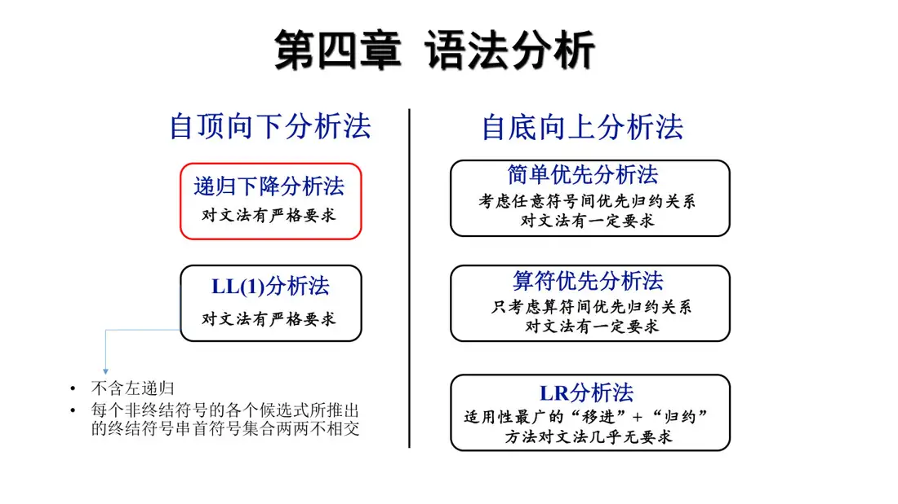

原文：

第四章 语法分析

自顶向下分析法

递归下降分析法对文法有严格要求

LL(1)分析法对文法有严格要求

自底向上分析法

简单优先分析法

考虑任意符号间优先归约关系对文法有一定要求

只考虑算符间优先归约关系对文法有一定要求

• 不含左递归

• 每个非终结符号的各个候选式所推出的终结符号串首符号集合两两不相交

LR分析法

适用性最广的“移进”+ “归约”方法对文法几乎无要求

### §4.3.1 简单优先分析法

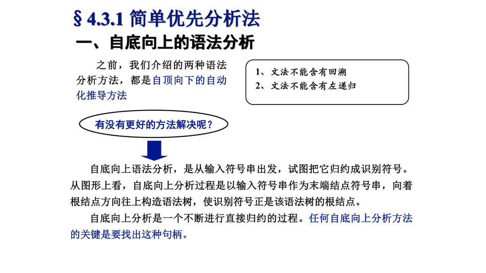

原文：

§4.3.1 简单优先分析法

一、自底向上的语法分析

之前，我们介绍的两种语法分析方法，都是自顶向下的自动化推导方法

1、文法不能含有回溯

2、文法不能含有左递归

有没有更好的方法解决呢？

自底向上语法分析，是从输入符号串出发，试图把它归约成识别符号。从图形上看，自底向上分析过程是以输入符号串作为末端结点符号串，向着根结点方向往上构造语法树，使识别符号正是该语法树的根结点。

自底向上分析是一个不断进行直接归约的过程。任何自底向上分析方法的关键是要找出这种句柄。

### §4.3.1 简单优先分析法

原文：

§4.3.1 简单优先分析法

二、文法优先关系的概念

在简单优先分析法中，为了找到可归约的句柄，需要在文法中确定相邻符号对之间可能存在的优先关系。对文法的字母表中任一对符号 $\mathbf { S _ { 1 } }$ 和 $\mathbf { S } _ { 2 }$ ，假定有一句型… $\bf . S _ { 1 } S _ { 2 } . . .$ ，则 $\mathbf { S _ { 1 } }$ 和 $\mathbb { S } _ { 2 }$ 间必然存在以下三种“优先关系”之一

情况1： $\mathbf { S _ { 1 } }$ 是句柄一部分（恰好是尾），但 $\mathbf { S } _ { 2 }$ 不是。也就是说，在从左到右归约的过程中（按照句柄归约）， $\mathbf { S _ { 1 } }$ 将优先于 $\mathbf { S } _ { 2 }$ 被归约。用 $\mathbf { S _ { 1 } } { \cdot } { > } \mathbf { S } _ { 2 }$ 表示。

### §4.3.1 简单优先分析法

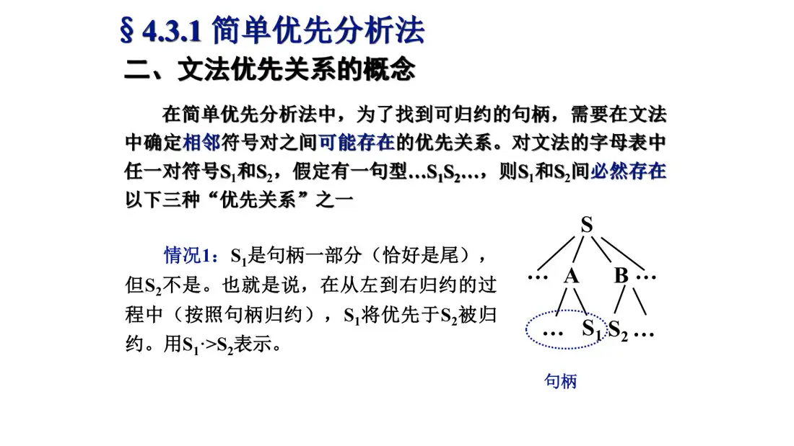

原文：

§4.3.1 简单优先分析法

二、文法优先关系的概念

在简单优先分析法中，为了找到可归约的句柄，需要在文法中确定相邻符号对之间可能存在的优先关系。对文法的字母表中任一对符号 $\mathbf { S _ { 1 } }$ 和 $\mathbf { S } _ { 2 }$ ，假定有一句型… $\bf . S _ { 1 } S _ { 2 } . . .$ ，则 $\mathbf { S _ { 1 } }$ 和 $\mathbb { S } _ { 2 }$ 间必然存在以下三种“优先关系”之一

情况1： $\mathbf { S _ { 1 } }$ 是句柄一部分（恰好是尾），但 $\mathbf { S } _ { 2 }$ 不是。也就是说，在从左到右归约的过程中（按照句柄归约）， $\mathbf { S _ { 1 } }$ 将优先于 $\mathbf { S } _ { 2 }$ 被归约。用 $\mathbf { S } _ { 1 } { \cdot } > \mathbf { S } _ { 2 }$ 表示。

### §4.3.1 简单优先分析法

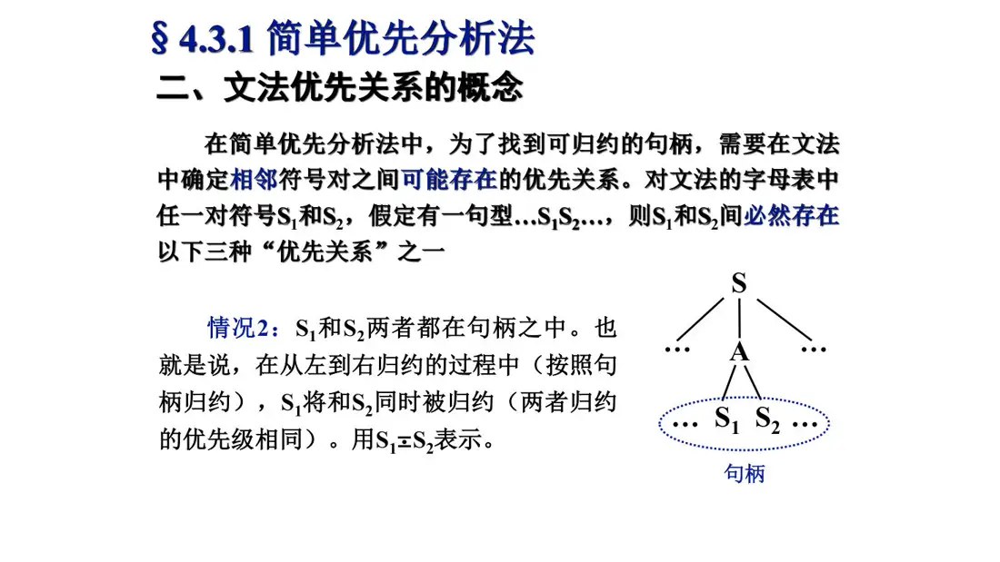

原文：

§4.3.1 简单优先分析法

二、文法优先关系的概念

在简单优先分析法中，为了找到可归约的句柄，需要在文法中确定相邻符号对之间可能存在的优先关系。对文法的字母表中任一对符号 $\mathbf { S _ { 1 } }$ 和 $\mathbf { S } _ { 2 }$ ，假定有一句型… $\bf . S _ { 1 } S _ { 2 } . . .$ ，则 $\mathbf { S _ { 1 } }$ 和 $\mathbb { S } _ { 2 }$ 间必然存在以下三种“优先关系”之一

情况2： $\mathbf { S _ { 1 } }$ 和 $\mathbf { S } _ { 2 }$ 两者都在句柄之中。也就是说，在从左到右归约的过程中（按照句柄归约）， $\mathbf { S _ { 1 } }$ 将和 $\mathbf { S } _ { 2 }$ 同时被归约（两者归约的优先级相同）。用 $\mathbf { S _ { 1 } } \mathbf { \bar { \varepsilon } } \mathbf { S } _ { 2 }$ 表示。

### §4.3.1 简单优先分析法

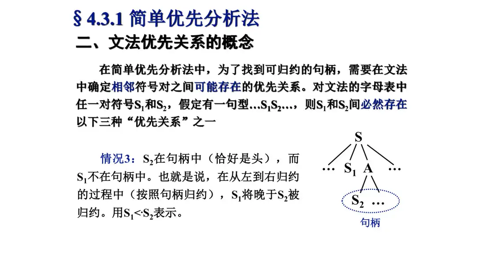

原文：

§4.3.1 简单优先分析法

二、文法优先关系的概念

在简单优先分析法中，为了找到可归约的句柄，需要在文法中确定相邻符号对之间可能存在的优先关系。对文法的字母表中任一对符号 $\mathbf { S _ { 1 } }$ 和 $\mathbf { S } _ { 2 }$ ，假定有一句型… $\bf . S _ { 1 } S _ { 2 } . . .$ ，则 $\mathbf { S _ { 1 } }$ 和 $\mathbb { S } _ { 2 }$ 间必然存在以下三种“优先关系”之一

情况3： $\mathbf { S } _ { 2 }$ 在句柄中（恰好是头），而$\mathbf { S _ { 1 } }$ 不在句柄中。也就是说，在从左到右归约的过程中（按照句柄归约）， $\mathbf { S _ { 1 } }$ 将晚于 $\mathbf { S } _ { 2 }$ 被归约。用 $\mathbf { S _ { 1 } } { < } { \cdot } \mathbf { S _ { 2 } }$ 表示。

### §4.3.1 简单优先分析法

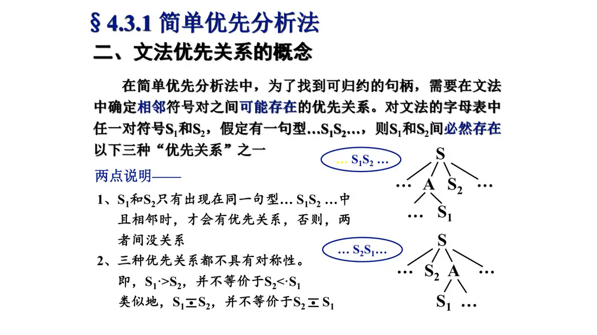

原文：

§4.3.1 简单优先分析法

二、文法优先关系的概念

在简单优先分析法中，为了找到可归约的句柄，需要在文法中确定相邻符号对之间可能存在的优先关系。对文法的字母表中任一对符号 $\mathbf { S _ { 1 } }$ 和 $| \mathbf { S } _ { 2 } ;$ ，假定有一句型… $\bf . S _ { 1 } S _ { 2 } . . .$ ，则 $\mathbf { S _ { 1 } }$ 和 $\mathbf { S } _ { 2 }$ 间必然存在

以下三种“优先关系”之一两点说明—

1、 $\mathbf { S _ { 1 } }$ 和 $\mathbf { \boldsymbol { S } } _ { 2 } \mathbf { \boldsymbol { \mathsf { R } } }$ 有出现在同一句型… $\mathbf { S _ { 1 } S _ { 2 } }$ …中且相邻时，才会有优先关系，否则，两者间没关系

2、三种优先关系都不具有对称性。即， $\mathbf { S } _ { 1 } { \cdot } > \mathbf { S } _ { 2 } ,$ ，并不等价于 $\mathbf { S } _ { 2 } { < \cdot } \mathbf { S } _ { 1 }$ 类似地， $\mathbf { S } _ { 1 } \overline { { \underline { { \mathbf { \Pi } } } } } \mathbf { S } _ { 2 } ,$ ，并不等价于 $\mathbf { S } _ { 2 } \underline { { \mathbf { \pi } } } \mathbf { S } _ { 1 }$

### §4.3.1 简单优先分析法

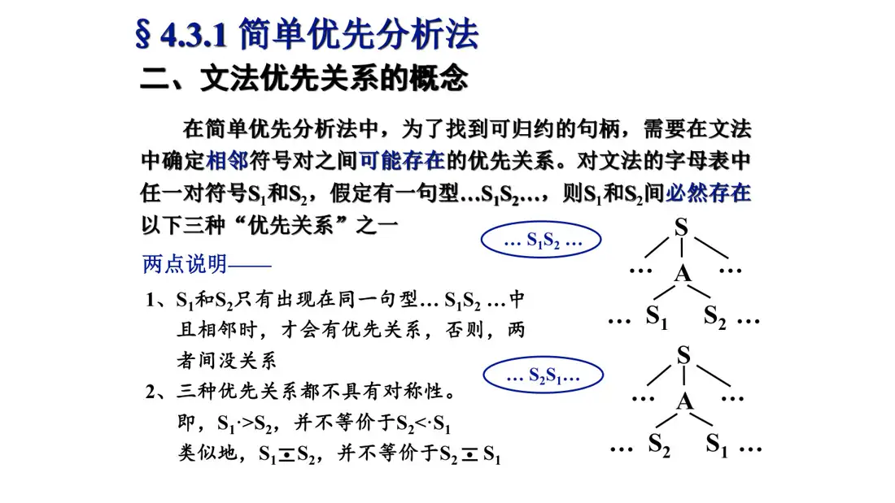

原文：

§4.3.1 简单优先分析法

二、文法优先关系的概念

在简单优先分析法中，为了找到可归约的句柄，需要在文法中确定相邻符号对之间可能存在的优先关系。对文法的字母表中任一对符号 $\mathbf { S _ { 1 } }$ 和 $| \mathbf { S } _ { 2 } ;$ ，假定有一句型… $\bf . S _ { 1 } S _ { 2 } . . .$ ，则 $\mathbf { S _ { 1 } }$ 和 $\mathbf { S } _ { 2 }$ 间必然存在

以下三种“优先关系”之一两点说明—

1、 $\mathbf { S _ { 1 } }$ 和 ${ \bf \ddot { S } } _ { 2 } .$ 只有出现在同一句型… $\mathbf { S _ { 1 } S _ { 2 } }$ …中且相邻时，才会有优先关系，否则，两者间没关系

2、三种优先关系都不具有对称性。即， $\mathbf { S } _ { 1 } { \cdot } > \mathbf { S } _ { 2 } ,$ ，并不等价于 $\mathbf { S } _ { 2 } { < } { \cdot } \mathbf { S } _ { 1 }$ 类似地， $\mathbf { S } _ { 1 } \overline { { \underline { { \mathbf { \Pi } } } } } \mathbf { S } _ { 2 } ,$ ，并不等价于 $\mathbf { S } _ { 2 } \underline { { \mathbf { \Pi } } } \mathbf { S } _ { 1 }$

### §4.3.1 简单优先分析法

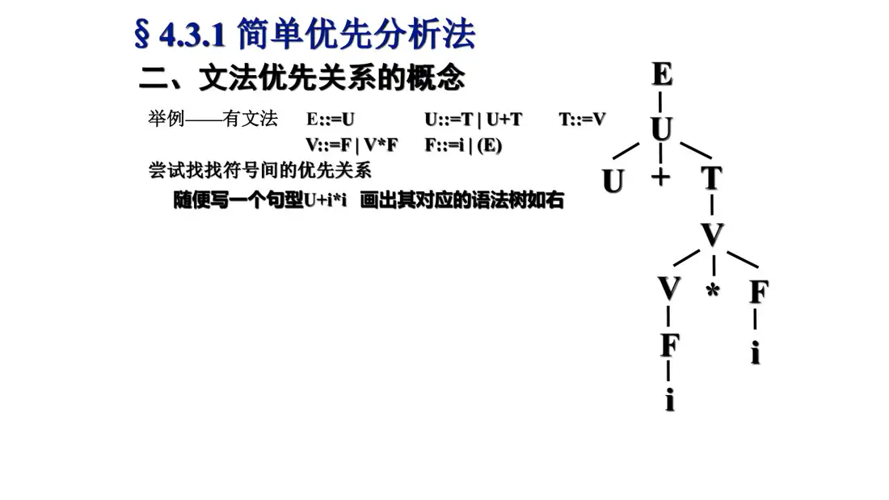

原文：

§4.3.1 简单优先分析法

二、文法优先关系的概念

举例——有文法

$$
\mathbf {E}: := \mathbf {U}
$$

$$
\mathbf {U}: := \mathbf {T} \mid \mathbf {U} + \mathbf {T}
$$

$$
\mathbf {V}: := \mathbf {F} \mid \mathbf {V} ^ {*} \mathbf {F} \quad \mathbf {F}: := \mathbf {i} \mid (\mathbf {E})
$$

尝试找找符号间的优先关系

随便写一个句型U+i\*i 画出其对应的语法树如右

### §4.3.1 简单优先分析法

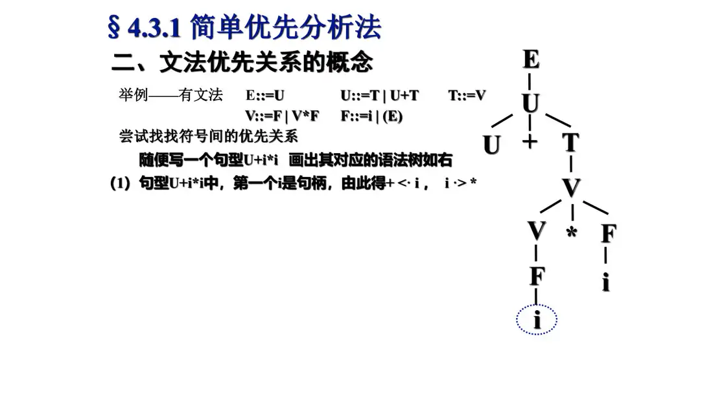

原文：

§4.3.1 简单优先分析法

二、文法优先关系的概念

举例——有文法

$$
\mathbf {E}: := \mathbf {U}
$$

$$
\mathbf {U}: := \mathbf {T} \mid \mathbf {U} + \mathbf {T}
$$

$$
\mathbf {V}: := \mathbf {F} \mid \mathbf {V} ^ {*} \mathbf {F} \quad \mathbf {F}: := \mathbf {i} \mid (\mathbf {E})
$$

$$
\mathbf {T}: := \mathbf {V}
$$

尝试找找符号间的优先关系

随便写一个句型U+i\*i 画出其对应的语法树如右

（1）句型U+i\*i中，第一个i是句柄，由此得+ <·i ， $\mathbf { i } \cdot > \ast$

### §4.3.1 简单优先分析法

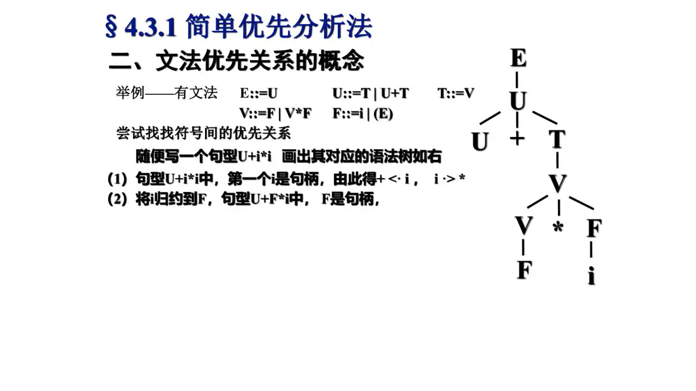

原文：

§4.3.1 简单优先分析法

二、文法优先关系的概念

举例——有文法

$$
\mathbf {E}: := \mathbf {U}
$$

$$
\mathbf {U}: := \mathbf {T} \mid \mathbf {U} + \mathbf {T}
$$

$$
\mathbf {T}: := \mathbf {V}
$$

$$
\mathbf {V}: := \mathbf {F} \mid \mathbf {V} ^ {*} \mathbf {F} \quad \mathbf {F}: := \mathbf {i} \mid (\mathbf {E})
$$

尝试找找符号间的优先关系

随便写一个句型U+i\*i 画出其对应的语法树如右

（1）句型U+i\*i中，第一个i是句柄，由此得+ <·i ， i ·> \*

（2）将i归约到F，句型U+F\*i中， F是句柄，

### §4.3.1 简单优先分析法

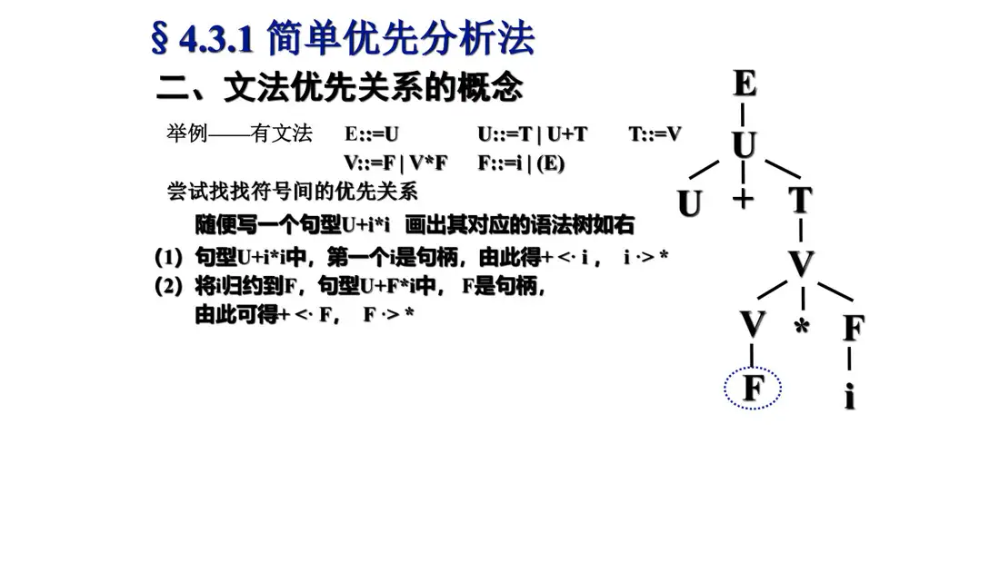

原文：

§4.3.1 简单优先分析法

二、文法优先关系的概念

举例——有文法

$$
\mathbf {E}: := \mathbf {U}
$$

$$
\mathbf {U}: := \mathbf {T} \mid \mathbf {U} + \mathbf {T}
$$

$$
\mathbf {V}: := \mathbf {F} \mid \mathbf {V} ^ {*} \mathbf {F} \quad \mathbf {F}: := \mathbf {i} \mid (\mathbf {E})
$$

尝试找找符号间的优先关系

随便写一个句型U+i\*i 画出其对应的语法树如右

（1）句型U+i\*i中，第一个i是句柄，由此得+ <·i ， i ·> \*

（2）将i归约到F，句型U+F\*i中， F是句柄，由此可得+ <·F， $\mathbf { F } \cdot \mathbf { > } ^ { * }$

### §4.3.1 简单优先分析法

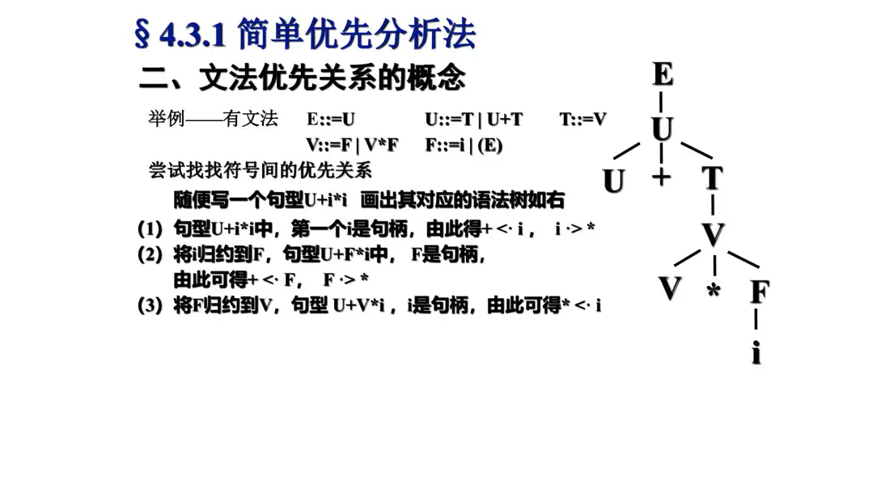

原文：

§4.3.1 简单优先分析法

二、文法优先关系的概念

举例——有文法

$$
\mathbf {E}: := \mathbf {U}
$$

U::=T | U+T

$$
\mathbf {T}: := \mathbf {V}
$$

$$
\mathbf {V}: := \mathbf {F} \mid \mathbf {V} ^ {*} \mathbf {F} \quad \mathbf {F}: := \mathbf {i} \mid (\mathbf {E})
$$

尝试找找符号间的优先关系

随便写一个句型U+i\*i 画出其对应的语法树如右

（1）句型U+i\*i中，第一个i是句柄，由此得+ <·i ， i ·> \*

（2）将i归约到F，句型U+F\*i中， F是句柄，由此可得+ <·F， F ·> \*

（3）将F归约到V，句型 U+V\*i ，i是句柄，由此可得\* <·i

### §4.3.1 简单优先分析法

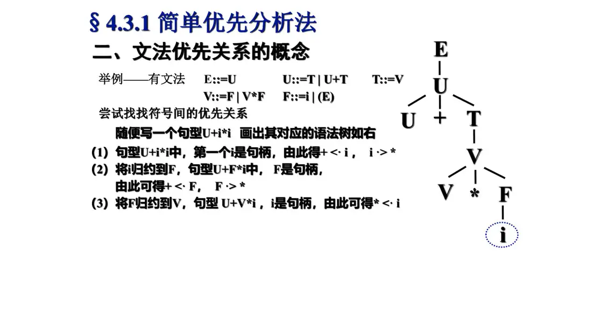

原文：

§4.3.1 简单优先分析法

二、文法优先关系的概念

举例——有文法

$$
\mathbf {E}: := \mathbf {U}
$$

$$
\mathbf {U}: := \mathbf {T} \mid \mathbf {U} + \mathbf {T}
$$

$$
\mathbf {T}: := \mathbf {V}
$$

$$
\mathbf {V}: := \mathbf {F} \mid \mathbf {V} ^ {*} \mathbf {F}
$$

F::=i | (E)

尝试找找符号间的优先关系

随便写一个句型U+i\*i 画出其对应的语法树如右

（1）句型U+i\*i中，第一个i是句柄，由此得+ <·i ， i ·> \*

（2）将i归约到F，句型U+F\*i中， F是句柄，由此可得+ <·F， F ·> \*

（3）将F归约到V，句型 U+V\*i ，i是句柄，由此可得\* <·i

### §4.3.1 简单优先分析法

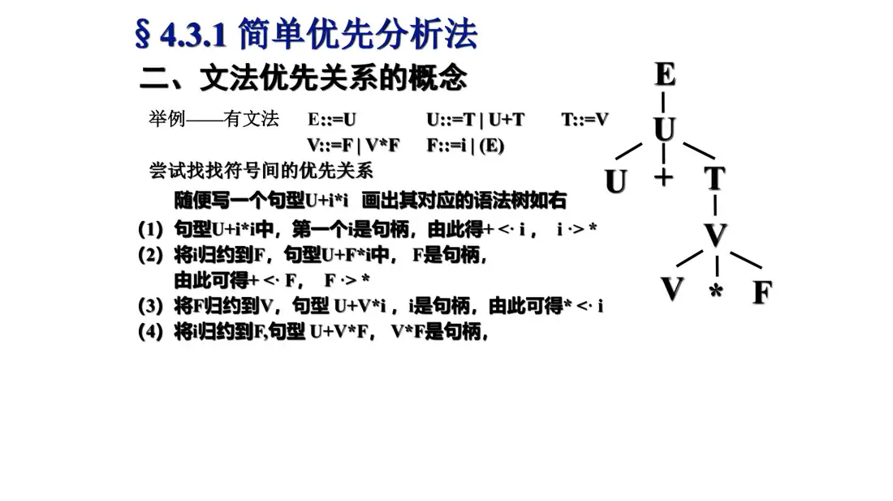

原文：

§4.3.1 简单优先分析法

二、文法优先关系的概念

举例——有文法

$$
\mathbf {E}: := \mathbf {U}
$$

U::=T | U+T

$$
\mathbf {V}: := \mathbf {F} \mid \mathbf {V} ^ {*} \mathbf {F}
$$

$$
\mathbf {F}: := \mathbf {i} \mid (\mathbf {E})
$$

T::=V

尝试找找符号间的优先关系

随便写一个句型U+i\*i 画出其对应的语法树如右

（1）句型U+i\*i中，第一个i是句柄，由此得+ <·i ， i ·> \*

（2）将i归约到F，句型U+F\*i中， F是句柄，由此可得+ <·F， F ·> \*

（3）将F归约到V，句型 U+V\*i ，i是句柄，由此可得\* <·i

（4）将i归约到F,句型 U+V\*F， V\*F是句柄，

### §4.3.1 简单优先分析法

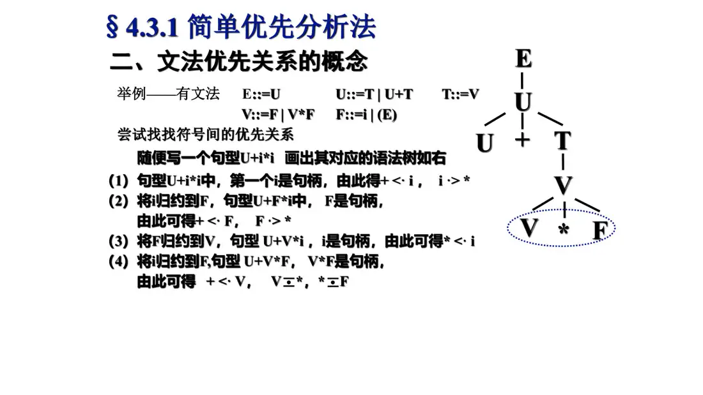

原文：

§4.3.1 简单优先分析法

二、文法优先关系的概念

举例——有文法

$$
\mathbf {E}: := \mathbf {U}
$$

$$
\mathbf {U}: := \mathbf {T} \mid \mathbf {U} + \mathbf {T}
$$

$$
\mathbf {V}: := \mathbf {F} \mid \mathbf {V} ^ {*} \mathbf {F}
$$

F::=i | (E)

T::=V

尝试找找符号间的优先关系

随便写一个句型U+i\*i 画出其对应的语法树如右

（1）句型U+i\*i中，第一个i是句柄，由此得+ <·i ， i ·> \*

（2）将i归约到F，句型U+F\*i中， F是句柄，由此可得+ <·F， $\mathbf { F } \cdot \mathbf { > } ^ { * }$

（3）将F归约到V，句型 U+V\*i ，i是句柄，由此可得\* <·i

（4）将i归约到F,句型 U+V\*F， V\*F是句柄，由此可得 + <·V， $\mathbf { V } \equiv ^ { \ast }$ ，\* F

### §4.3.1 简单优先分析法

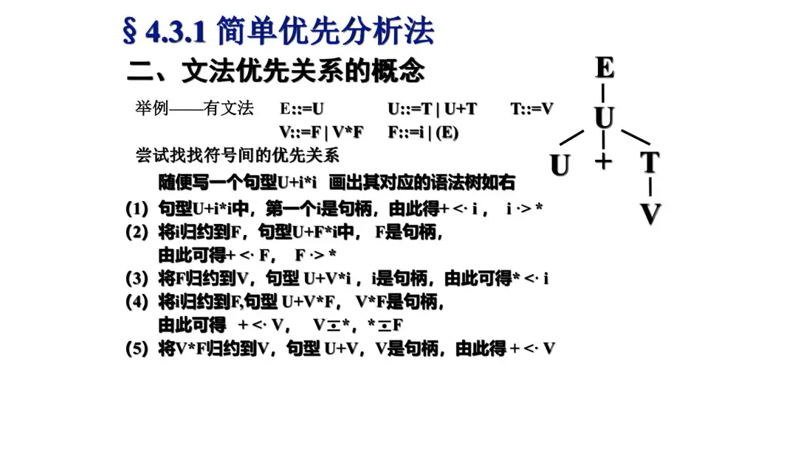

原文：

§4.3.1 简单优先分析法

二、文法优先关系的概念

举例——有文法

$$
\mathbf {E}: := \mathbf {U}
$$

U::=T | U+T

$$
\mathbf {V}: := \mathbf {F} \mid \mathbf {V} ^ {*} \mathbf {F} \quad \mathbf {F}: := \mathbf {i} \mid (\mathbf {E})
$$

尝试找找符号间的优先关系

随便写一个句型U+i\*i 画出其对应的语法树如右

（1）句型U+i\*i中，第一个i是句柄，由此得+ <·i ， i ·> \*

（2）将i归约到F，句型U+F\*i中， F是句柄，由此可得+ <·F， F ·> \*

（3）将F归约到V，句型 U+V\*i ，i是句柄，由此可得\* <·i

（4）将i归约到F,句型 U+V\*F， V\*F是句柄，由此可得 + <·V， V \*，\* F

（5）将V\*F归约到V，句型 U+V，V是句柄，由此得 + <·V

### §4.3.1 简单优先分析法

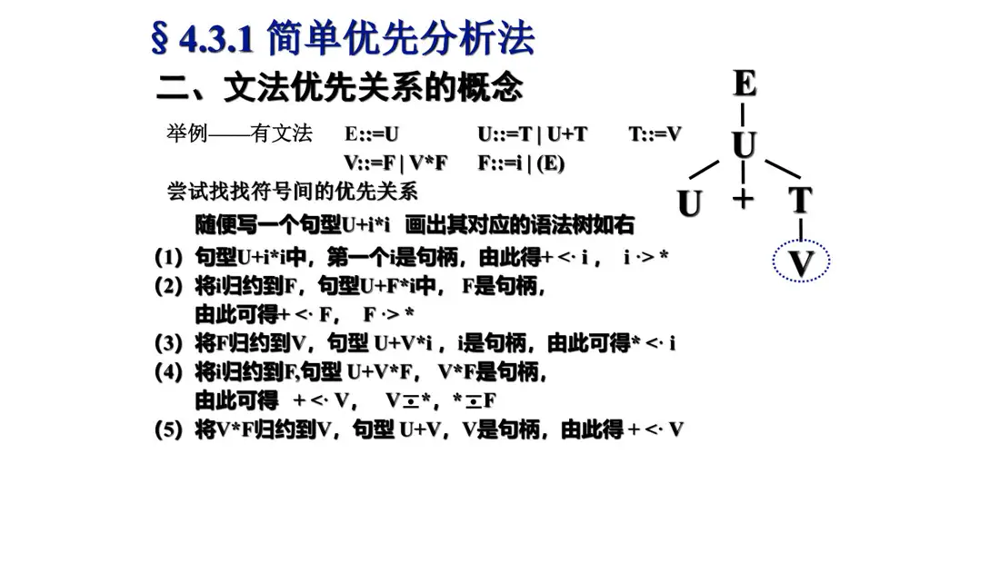

原文：

§4.3.1 简单优先分析法

二、文法优先关系的概念

举例——有文法

$$
\mathbf {E}: := \mathbf {U}
$$

$$
\mathbf {U}: := \mathbf {T} \mid \mathbf {U} + \mathbf {T}
$$

$$
\mathbf {V}: := \mathbf {F} \mid \mathbf {V} ^ {*} \mathbf {F} \quad \mathbf {F}: := \mathbf {i} \mid (\mathbf {E})
$$

尝试找找符号间的优先关系

随便写一个句型U+i\*i 画出其对应的语法树如右

（1）句型U+i\*i中，第一个i是句柄，由此得+ <·i ， i ·> \*

（2）将i归约到F，句型U+F\*i中， F是句柄，由此可得+ <·F， F ·> \*

（3）将F归约到V，句型 U+V\*i ，i是句柄，由此可得\* <·i

（4）将i归约到F,句型 U+V\*F， V\*F是句柄，由此可得 + <·V， V \*，\* F

（5）将V\*F归约到V，句型 U+V，V是句柄，由此得 + <·V

### §4.3.1 简单优先分析法

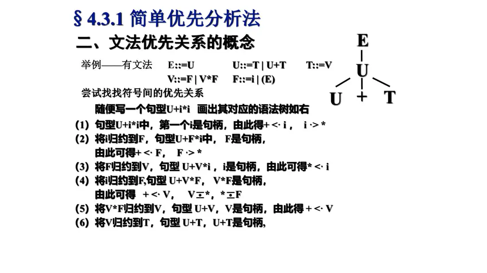

原文：

§4.3.1 简单优先分析法

二、文法优先关系的概念

举例——有文法

$$
\mathbf {E}: := \mathbf {U}
$$

U::=T | U+T

$$
\mathbf {V}: := \mathbf {F} \mid \mathbf {V} ^ {*} \mathbf {F} \quad \mathbf {F}: := \mathbf {i} \mid (\mathbf {E})
$$

尝试找找符号间的优先关系

随便写一个句型U+i\*i 画出其对应的语法树如右

（1）句型U+i\*i中，第一个i是句柄，由此得+ <·i ， i ·> \*

（2）将i归约到F，句型U+F\*i中， F是句柄，

由此可得+ <·F， F ·> \*

（3）将F归约到V，句型 U+V\*i ，i是句柄，由此可得\* <·i

（4）将i归约到F,句型 U+V\*F， V\*F是句柄，由此可得 $+ < \cdot \mathbf { V } , \quad \mathbf { V } \equiv ^ { * } , \ { ^ * \equiv } \mathbf { F }$

（5）将V\*F归约到V，句型 U+V，V是句柄，由此得 + <·V

（6）将V归约到T，句型 U+T，U+T是句柄,

### §4.3.1 简单优先分析法

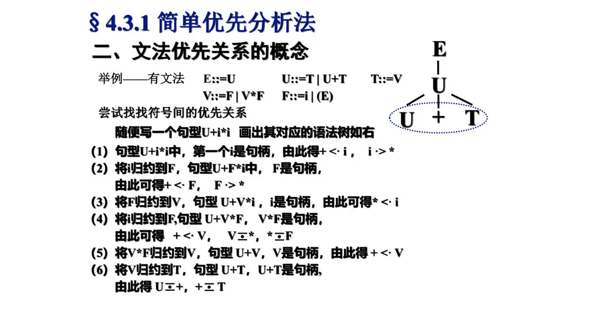

原文：

§4.3.1 简单优先分析法

二、文法优先关系的概念

举例——有文法

$$
\mathbf {E}: := \mathbf {U}
$$

$$
\mathbf {V}: := \mathbf {F} \mid \mathbf {V} ^ {*} \mathbf {F}
$$

$$
\mathbf {U}: := \mathbf {T} \mid \mathbf {U} + \mathbf {T}
$$

F::=i | (E)

尝试找找符号间的优先关系

随便写一个句型U+i\*i 画出其对应的语法树如右

（1）句型U+i\*i中，第一个i是句柄，由此得+ <·i ， i ·> \*

（2）将i归约到F，句型U+F\*i中， F是句柄，由此可得+ <·F， $\mathbf { F } \cdot \mathbf { > } ^ { * }$

（3）将F归约到V，句型 U+V\*i ，i是句柄，由此可得\* <·i

（4）将i归约到F,句型 U+V\*F， V\*F是句柄，由此可得 $+ < \cdot \mathbf { V } , \quad \mathbf { V } \equiv ^ { * } , \ { ^ * \equiv } \mathbf { F }$

（5）将V\*F归约到V，句型 U+V，V是句柄，由此得 + <·V

（6）将V归约到T，句型 U+T，U+T是句柄,由此得 $\mathbf { U } \equiv + , \mathbf { \Pi } + \ I \equiv \mathbf { T }$

### §4.3.1 简单优先分析法

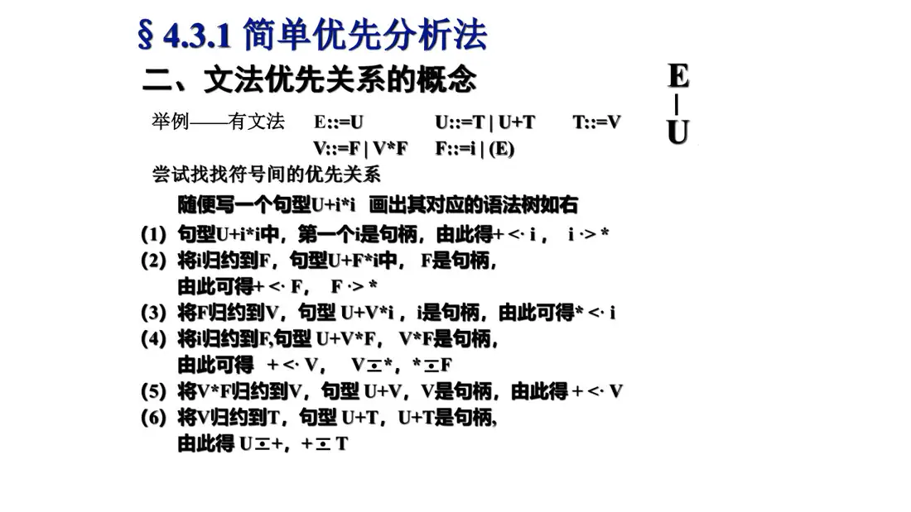

原文：

§4.3.1 简单优先分析法

二、文法优先关系的概念

举例——有文法

$$
\mathbf {E}: := \mathbf {U}
$$

$$
\mathbf {U}: := \mathbf {T} \mid \mathbf {U} + \mathbf {T}
$$

$$
\mathbf {T}: := \mathbf {V}
$$

$$
\mathbf {V}: := \mathbf {F} \mid \mathbf {V} ^ {*} \mathbf {F} \quad \mathbf {F}: := \mathbf {i} \mid (\mathbf {E})
$$

尝试找找符号间的优先关系

随便写一个句型U+i\*i 画出其对应的语法树如右

（1）句型U+i\*i中，第一个i是句柄，由此得+ <·i ， i ·> \*

（2）将i归约到F，句型U+F\*i中， F是句柄，由此可得+ <·F， F ·> \*

（3）将F归约到V，句型 U+V\*i ，i是句柄，由此可得\* <·i

（4）将i归约到F,句型 U+V\*F， V\*F是句柄，由此可得 $+ < \cdot \mathbf { V } , \quad \mathbf { V } \equiv ^ { * } , \ { ^ * \equiv } \mathbf { F }$

（5）将V\*F归约到V，句型 U+V，V是句柄，由此得 + <·V

（6）将V归约到T，句型 U+T，U+T是句柄,由此得 $\mathbf { U } \equiv + , \mathbf { \Pi } + \ I \equiv \mathbf { T }$

### §4.3.1 简单优先分析法

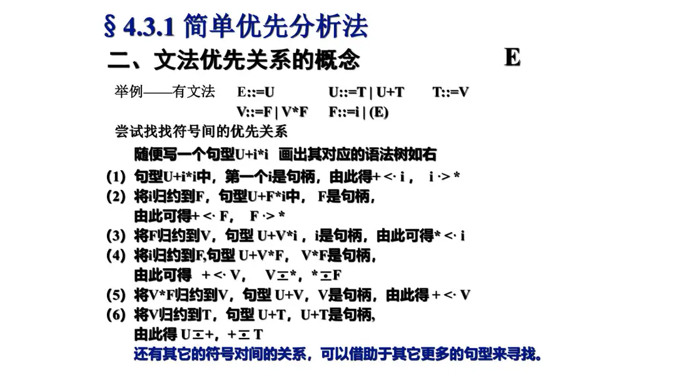

原文：

§4.3.1 简单优先分析法

二、文法优先关系的概念

E

举例——有文法 $\mathbf { E } { : : = } \mathbf { U }$ $\mathbf { U } { : : = } \mathbf { T } \mid \mathbf { U } { + } \mathbf { T }$ T::=VV::=F | V\*F F::=i | (E)

尝试找找符号间的优先关系

随便写一个句型U+i\*i 画出其对应的语法树如右

（1）句型U+i\*i中，第一个i是句柄，由此得+ <·i ， i ·> \*

（2）将i归约到F，句型U+F\*i中， F是句柄，由此可得+ <·F， F ·> \*

（3）将F归约到V，句型 U+V\*i ，i是句柄，由此可得\* <·i

（4）将i归约到F,句型 U+V\*F， V\*F是句柄，由此可得 $+ < \cdot \mathbf { V } , \quad \mathbf { V } \equiv ^ { * } , \ { ^ * \equiv } \mathbf { F }$

（5）将V\*F归约到V，句型 U+V，V是句柄，由此得 + <·V

（6）将V归约到T，句型U+T，U+T是句柄,由此得 $\mathbf { U } \equiv + , \mathbf { \Pi } + \ I \equiv \mathbf { T }$ 还有其它的符号对间的关系，可以借助于其它更多的句型来寻找。

### §4.3.1 简单优先分析法二、文法优先关系的概念

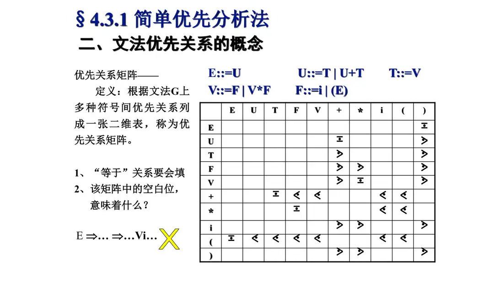

原文：

§4.3.1 简单优先分析法二、文法优先关系的概念

优先关系矩阵—

定义：根据文法G上多种符号间优先关系列成一张二维表，称为优先关系矩阵。

1、“等于”关系要会填

2、该矩阵中的空白位，意味着什么？

$$
\mathrm{E} \Rightarrow \dots \Rightarrow \dots \mathrm{Vi} \dots \times
$$

E::=U

U::=T | U+T

T::=V

V::=F | V\*F

F::=i | (E)

<table><tr><td>(</td><td>|·|</td><td>∧</td><td>∧</td><td>∧</td><td>∧</td><td></td><td></td><td>∧</td><td></td><td>∧</td></tr><tr><td>(</td><td></td><td></td><td></td><td></td><td></td><td>∨</td><td>∨</td><td></td><td>∨</td><td></td></tr><tr><td>-</td><td></td><td></td><td></td><td></td><td></td><td>∨</td><td>∨</td><td></td><td>∨</td><td></td></tr><tr><td>*</td><td></td><td></td><td></td><td>∧</td><td>|·|</td><td></td><td></td><td>∧</td><td></td><td>∧</td></tr><tr><td>+</td><td></td><td>|·|</td><td>∧</td><td>∧</td><td>∧</td><td></td><td></td><td>∧</td><td></td><td>∧</td></tr><tr><td>∨</td><td></td><td></td><td></td><td></td><td></td><td>∨</td><td></td><td></td><td>∨</td><td></td></tr><tr><td>F</td><td></td><td></td><td></td><td></td><td></td><td>∨</td><td>|·|</td><td></td><td>∨</td><td></td></tr><tr><td>T</td><td></td><td></td><td></td><td></td><td></td><td>|·|</td><td></td><td></td><td>∨</td><td></td></tr><tr><td>U</td><td></td><td></td><td></td><td></td><td></td><td></td><td></td><td></td><td>∨</td><td></td></tr><tr><td>E</td><td></td><td></td><td></td><td></td><td></td><td></td><td></td><td></td><td>|·|</td><td></td></tr><tr><td></td><td>E</td><td>U</td><td>T</td><td>F</td><td>∨</td><td>+</td><td>*</td><td>i</td><td>(</td><td>)</td></tr></table>

### §4.3.1 简单优先分析法

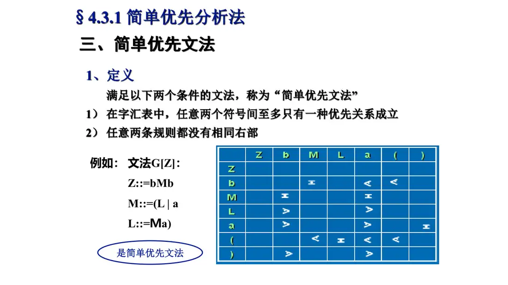

原文：

§4.3.1 简单优先分析法

三、简单优先文法

1、定义

满足以下两个条件的文法，称为“简单优先文法”

1） 在字汇表中，任意两个符号间至多只有一种优先关系成立

2） 任意两条规则都没有相同右部

例如： 文法 $\mathbf { \dot { G } } [ \mathbf { Z } ]$

$$
\mathbf {Z}: := \mathbf {b M b}
$$

$$
\mathbf {M}: := (\mathbf {L} \mid \mathbf {a}
$$

$$
\mathrm{L}: := \mathrm{Ma})
$$

是简单优先文法

<table><tr><td></td><td>Z</td><td>b</td><td>M</td><td>L</td><td>a</td><td>(</td><td>)</td></tr><tr><td>Z</td><td></td><td></td><td></td><td></td><td></td><td></td><td></td></tr><tr><td>b</td><td></td><td></td><td>I</td><td></td><td>&lt;</td><td>&lt;</td><td></td></tr><tr><td>M</td><td></td><td>I</td><td></td><td></td><td>I</td><td></td><td></td></tr><tr><td>L</td><td></td><td>&gt;</td><td></td><td></td><td>&gt;</td><td></td><td></td></tr><tr><td>a</td><td></td><td>&gt;</td><td></td><td></td><td>&gt;</td><td></td><td>I</td></tr><tr><td>(</td><td></td><td></td><td>&lt;</td><td>I</td><td>&lt;</td><td>&lt;</td><td></td></tr><tr><td>)</td><td></td><td>&gt;</td><td></td><td></td><td>&gt;</td><td></td><td></td></tr></table>

### §4.3.1 简单优先分析法

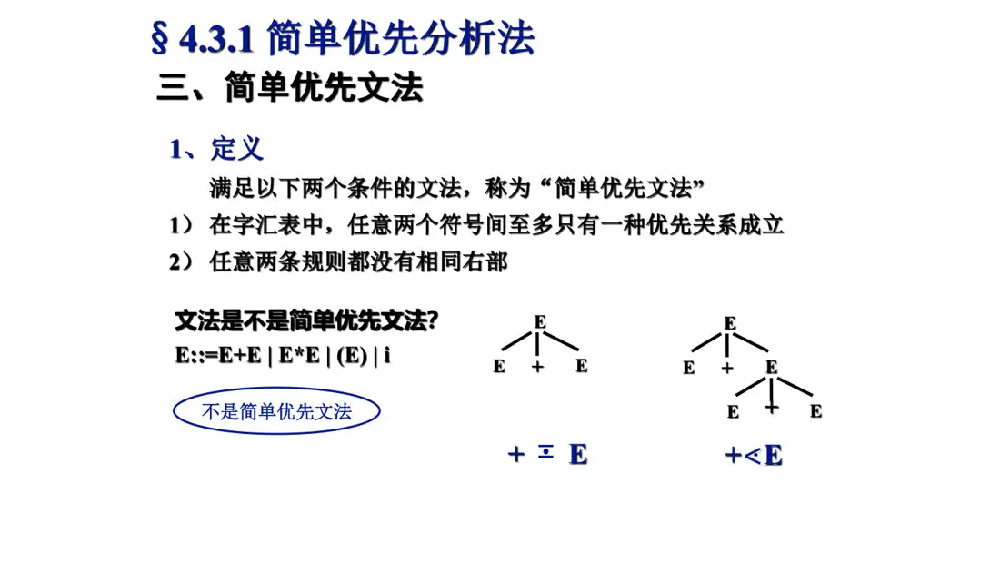

原文：

§4.3.1 简单优先分析法

三、简单优先文法

1、定义

满足以下两个条件的文法，称为“简单优先文法”

1） 在字汇表中，任意两个符号间至多只有一种优先关系成立

2） 任意两条规则都没有相同右部

文法是不是简单优先文法？

$$
\mathbf {E}: := \mathbf {E} + \mathbf {E} | \mathbf {E} ^ {*} \mathbf {E} | (\mathbf {E}) | \mathbf {i}
$$

不是简单优先文法

$$
+ \equiv \mathbf {E}
$$

$$
+ \llcorner E
$$

### §4.3.1 简单优先分析法

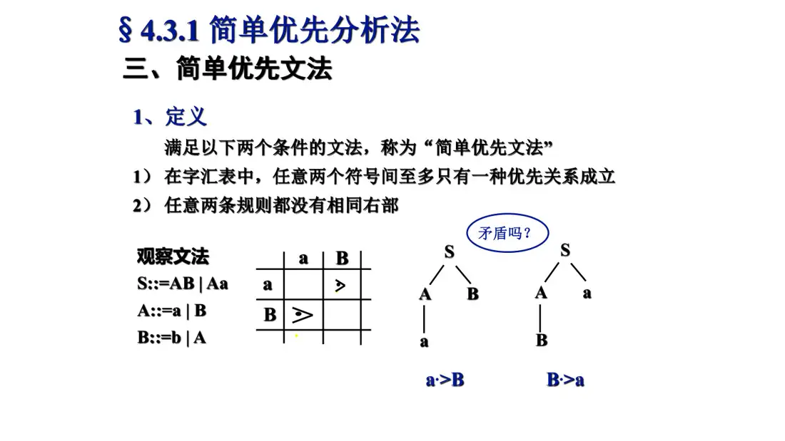

原文：

§4.3.1 简单优先分析法

三、简单优先文法

1、定义

满足以下两个条件的文法，称为“简单优先文法”

1） 在字汇表中，任意两个符号间至多只有一种优先关系成立

2） 任意两条规则都没有相同右部

观察文法

$$
\mathbf {S}: := \mathbf {A B} \mid \mathbf {A a}
$$

$$
\mathbf {A}: := \mathbf {a} \mid \mathbf {B}
$$

矛盾吗？

<table><tr><td></td><td>a</td><td>B</td></tr><tr><td>a</td><td></td><td>&gt;</td></tr><tr><td>B</td><td>&gt;</td><td></td></tr><tr><td></td><td>.</td><td></td></tr></table>

$$
\mathbf {B}: := \mathbf {b} \mid \mathbf {A}
$$

a.>B

B.>a

### §4.3.1 简单优先分析法

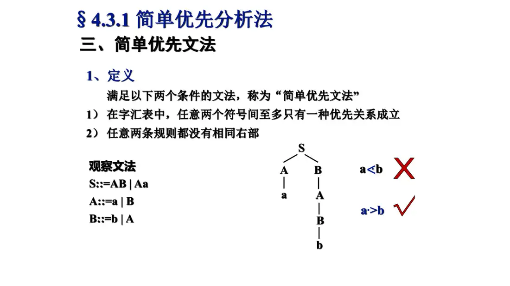

原文：

§4.3.1 简单优先分析法

三、简单优先文法

1、定义

满足以下两个条件的文法，称为“简单优先文法”

1） 在字汇表中，任意两个符号间至多只有一种优先关系成立

2） 任意两条规则都没有相同右部

观察文法

$$
\mathbf {S}: := \mathbf {A B} \mid \mathbf {A a}
$$

$$
\mathbf {A}: := \mathbf {a} \mid \mathbf {B}
$$

$$
\mathbf {B}: := \mathbf {b} \mid \mathbf {A}
$$

$$
\begin{array}{c c} \text {S} & \\ \text {A} & \text {B} \\ | & | \\ \text {a} & \text {A} \\ & | \\ & \text {B} \\ & | \\ & \text {b} \end{array} \qquad \begin{array}{c c} \text {a <   b} & \times \\ & \\ \text {a > b} & \checkmark \end{array}
$$

### §4.3.1 简单优先分析法

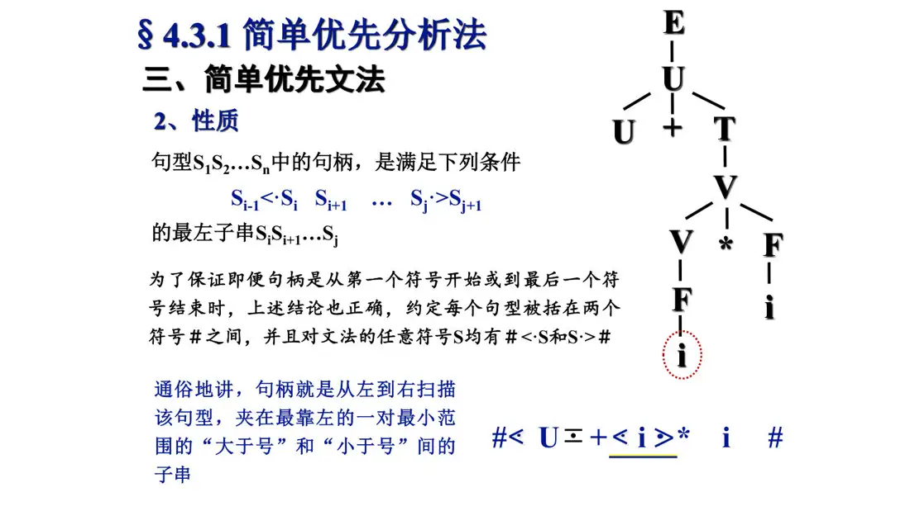

原文：

§4.3.1 简单优先分析法

三、简单优先文法

2、性质

句型 $\mathbf { S _ { 1 } S _ { 2 } . . . } . \mathbf { S _ { n } }$ 中的句柄，是满足下列条件

$$
\mathbf {S} _ {\mathrm{i-1}} <   \cdot \mathbf {S} _ {\mathrm{i}} \quad \mathbf {S} _ {\mathrm{i+1}} \quad \dots \quad \mathbf {S} _ {\mathrm{j}} \cdot > \mathbf {S} _ {\mathrm{j+1}}
$$

的最左子串 $\mathbf { S _ { i } S _ { i + 1 } . . . S _ { j } }$

为了保证即便句柄是从第一个符号开始或到最后一个符号结束时，上述结论也正确，约定每个句型被括在两个符号＃之间，并且对文法的任意符号S均有＃<·S和S·>＃

通俗地讲，句柄就是从左到右扫描该句型，夹在最靠左的一对最小范围的“大于号”和“小于号”间的子串

\# U + i \* i #

### §4.3.1 简单优先分析法

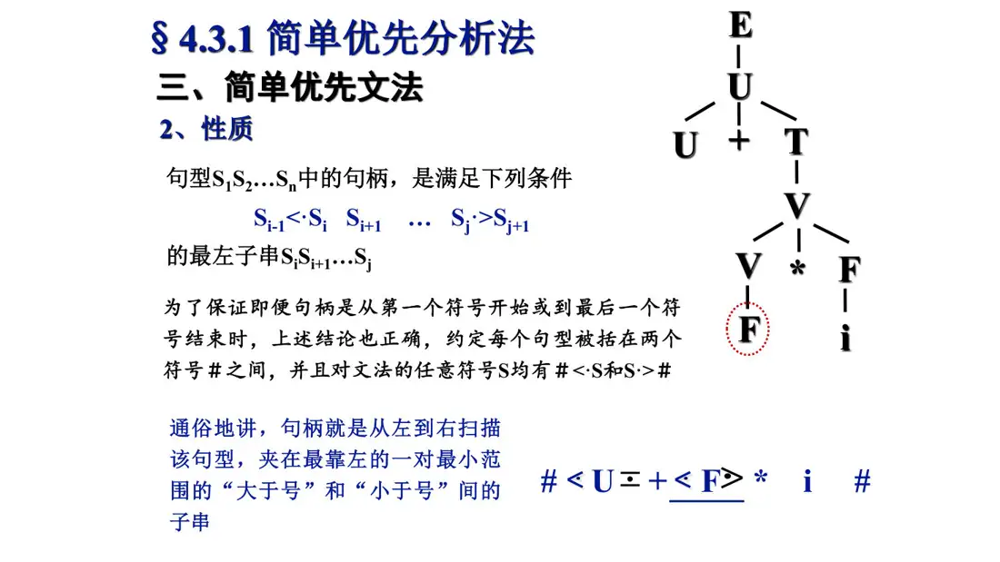

原文：

§4.3.1 简单优先分析法

三、简单优先文法

2、性质

句型 $\mathbf { S _ { 1 } S _ { 2 } . . . } . \mathbf { S _ { n } }$ 中的句柄，是满足下列条件

$$
\mathbf {S} _ {\mathrm{i-1}} <   \cdot \mathbf {S} _ {\mathrm{i}} \quad \mathbf {S} _ {\mathrm{i+1}} \quad \dots \quad \mathbf {S} _ {\mathrm{j}} \cdot > \mathbf {S} _ {\mathrm{j+1}}
$$

的最左子串 $\mathbf { S _ { i } S _ { i + 1 } . . . S _ { j } }$

为了保证即便句柄是从第一个符号开始或到最后一个符号结束时，上述结论也正确，约定每个句型被括在两个符号＃之间，并且对文法的任意符号S均有＃<·S和S·>＃

通俗地讲，句柄就是从左到右扫描该句型，夹在最靠左的一对最小范围的“大于号”和“小于号”间的子串

\# U + F \* i #

### §4.3.1 简单优先分析法

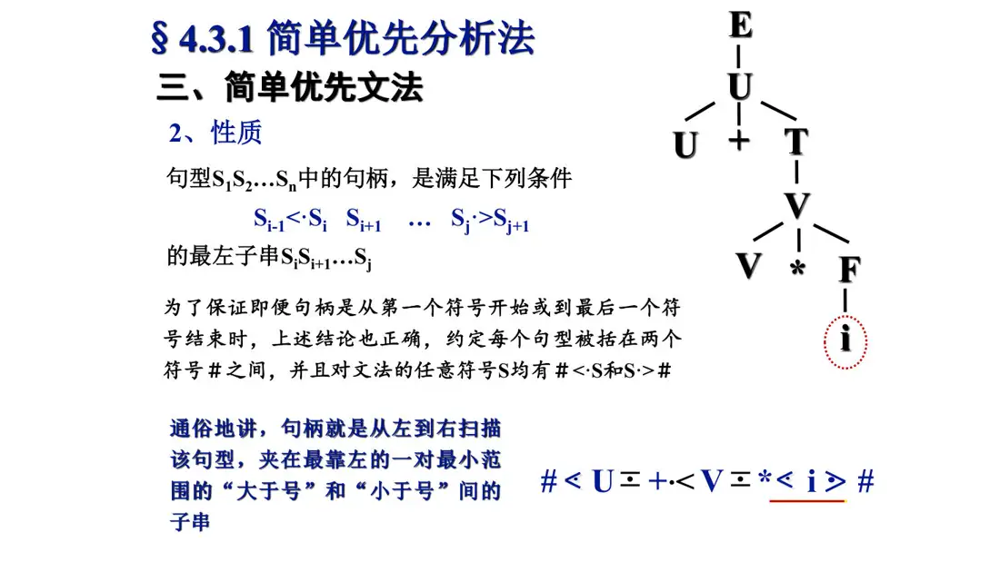

原文：

§4.3.1 简单优先分析法

三、简单优先文法

2、性质

句型 $\mathbf { S _ { 1 } S _ { 2 } . . . } . \mathbf { S _ { n } }$ 中的句柄，是满足下列条件

$$
\mathbf {S} _ {\mathrm{i-1}} <   \cdot \mathbf {S} _ {\mathrm{i}} \quad \mathbf {S} _ {\mathrm{i+1}} \quad \dots \quad \mathbf {S} _ {\mathrm{j}} \cdot > \mathbf {S} _ {\mathrm{j+1}}
$$

的最左子串 $\mathbf { S _ { i } S _ { i + 1 } . . . S _ { j } }$

为了保证即便句柄是从第一个符号开始或到最后一个符号结束时，上述结论也正确，约定每个句型被括在两个符号＃之间，并且对文法的任意符号S均有＃<·S和S·>＃

通俗地讲，句柄就是从左到右扫描该句型，夹在最靠左的一对最小范围的“大于号”和“小于号”间的子串

$$
\# <   \mathbf {U} \supseteq +. <   \mathbf {V} \supseteq * <   \mathbf {i} > \#
$$

### §4.3.1 简单优先分析法

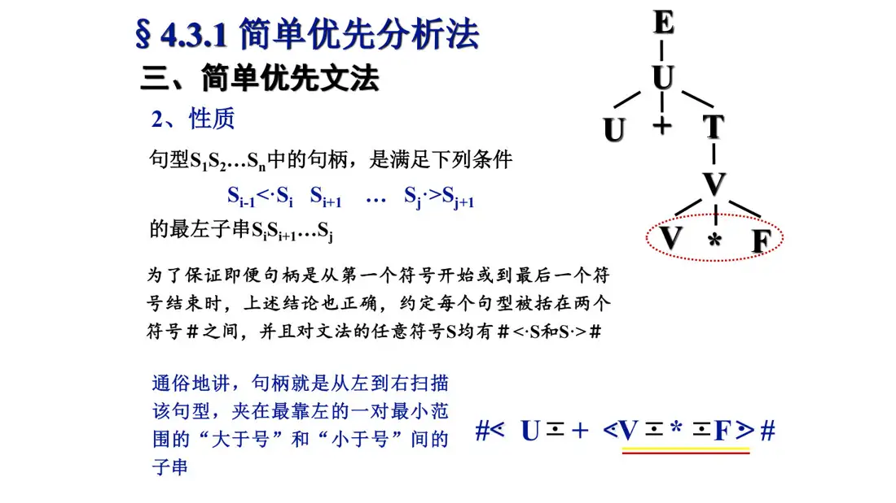

原文：

§4.3.1 简单优先分析法

三、简单优先文法

2、性质

句型 $\mathbf { S _ { 1 } S _ { 2 } . . . } . \mathbf { S _ { n } }$ 中的句柄，是满足下列条件

$$
\mathbf {S} _ {\mathrm{i-1}} <   \cdot \mathbf {S} _ {\mathrm{i}} \quad \mathbf {S} _ {\mathrm{i+1}} \quad \dots \quad \mathbf {S} _ {\mathrm{j}} \cdot > \mathbf {S} _ {\mathrm{j+1}}
$$

的最左子串 $\mathbf { S _ { i } S _ { i + 1 } . . . S _ { j } }$

为了保证即便句柄是从第一个符号开始或到最后一个符号结束时，上述结论也正确，约定每个句型被括在两个符号＃之间，并且对文法的任意符号S均有＃<·S和S·>＃

通俗地讲，句柄就是从左到右扫描该句型，夹在最靠左的一对最小范围的“大于号”和“小于号”间的子串

$$
\# <   \mathbf {U} \equiv + <   \mathbf {V} \equiv * \equiv \mathbf {F} > \#
$$

### §4.3.1 简单优先分析法

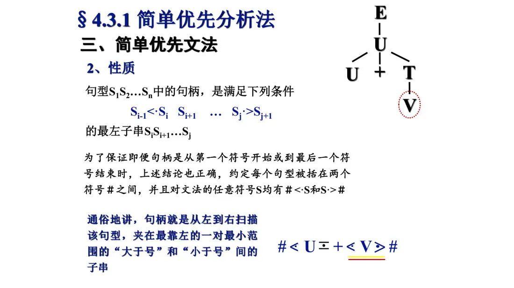

原文：

§4.3.1 简单优先分析法

三、简单优先文法

2、性质

句型 $\mathbf { S _ { 1 } S _ { 2 } . . . } . \mathbf { S _ { n } }$ 中的句柄，是满足下列条件

$$
\mathbf {S} _ {\mathrm{i-1}} <   \cdot \mathbf {S} _ {\mathrm{i}} \quad \mathbf {S} _ {\mathrm{i+1}} \quad \dots \quad \mathbf {S} _ {\mathrm{j}} \cdot > \mathbf {S} _ {\mathrm{j+1}}
$$

的最左子串 $\mathbf { S _ { i } S _ { i + 1 } . . . S _ { j } }$

为了保证即便句柄是从第一个符号开始或到最后一个符号结束时，上述结论也正确，约定每个句型被括在两个符号＃之间，并且对文法的任意符号S均有＃<·S和S·>＃

通俗地讲，句柄就是从左到右扫描该句型，夹在最靠左的一对最小范围的“大于号”和“小于号”间的子串

$$
\# <   \mathbf {U} \overline {{\cdot}} + <   \mathbf {V} > \#
$$

### §4.3.1 简单优先分析法

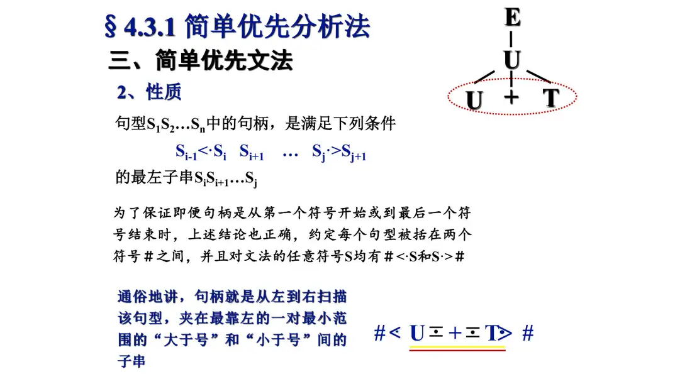

原文：

§4.3.1 简单优先分析法

三、简单优先文法

2、性质

句型 $\mathbf { S _ { 1 } S _ { 2 } . . . } . \mathbf { S _ { n } }$ 中的句柄，是满足下列条件

$$
\mathbf {S} _ {\mathrm{i-1}} <   \cdot \mathbf {S} _ {\mathrm{i}} \quad \mathbf {S} _ {\mathrm{i+1}} \quad \dots \quad \mathbf {S} _ {\mathrm{j}} \cdot > \mathbf {S} _ {\mathrm{j+1}}
$$

的最左子串 $\mathbf { S _ { i } S _ { i + 1 } . . . S _ { j } }$

为了保证即便句柄是从第一个符号开始或到最后一个符号结束时，上述结论也正确，约定每个句型被括在两个符号＃之间，并且对文法的任意符号S均有＃<·S和S·>＃

通俗地讲，句柄就是从左到右扫描该句型，夹在最靠左的一对最小范围的“大于号”和“小于号”间的子串

$$
\# <   \underline {{\mathrm{U} \equiv + \equiv \mathrm{T} >}} \#
$$

### §4.3.1 简单优先分析法三、简单优先文法

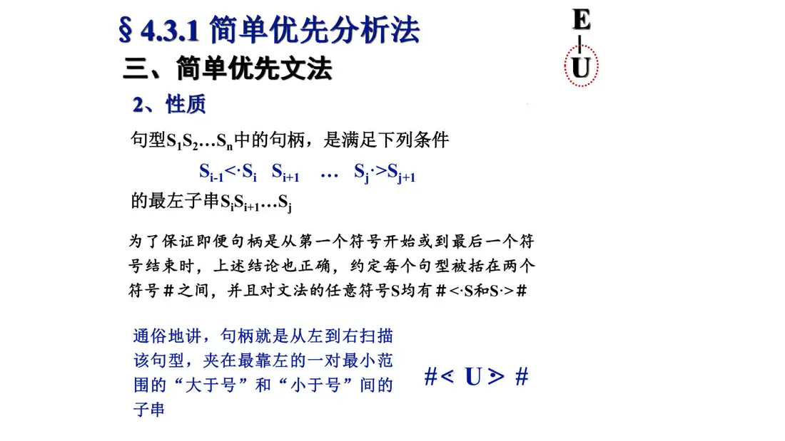

原文：

§4.3.1 简单优先分析法三、简单优先文法

2、性质

句型 $\mathbf { S _ { 1 } S _ { 2 } . . . } . \mathbf { S _ { n } }$ 中的句柄，是满足下列条件

$$
\mathbf {S} _ {\mathrm{i-1}} <   \cdot \mathbf {S} _ {\mathrm{i}} \quad \mathbf {S} _ {\mathrm{i+1}} \quad \dots \quad \mathbf {S} _ {\mathrm{j}} \cdot > \mathbf {S} _ {\mathrm{j+1}}
$$

的最左子串 $\mathbf { S _ { i } S _ { i + 1 } . . . S _ { j } }$

为了保证即便句柄是从第一个符号开始或到最后一个符号结束时，上述结论也正确，约定每个句型被括在两个符号＃之间，并且对文法的任意符号S均有＃<·S和S·>＃

通俗地讲，句柄就是从左到右扫描该句型，夹在最靠左的一对最小范围的“大于号”和“小于号”间的 # U #子串

### §4.3.1 简单优先分析法

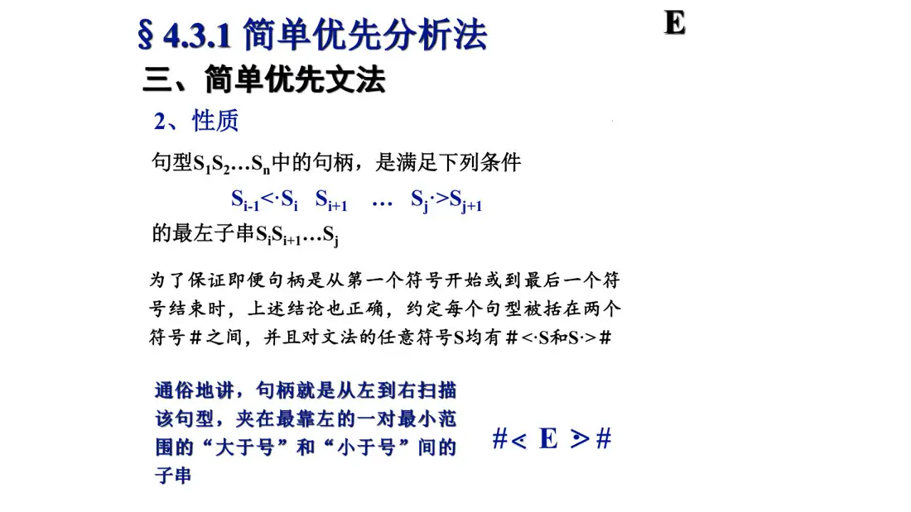

原文：

§4.3.1 简单优先分析法

三、简单优先文法

2、性质

句型 $\mathbf { S _ { 1 } S _ { 2 } . . . } . \mathbf { S _ { n } }$ 中的句柄，是满足下列条件

$$
\mathbf {S} _ {\mathrm{i-1}} <   \cdot \mathbf {S} _ {\mathrm{i}} \quad \mathbf {S} _ {\mathrm{i+1}} \quad \dots \quad \mathbf {S} _ {\mathrm{j}} \cdot > \mathbf {S} _ {\mathrm{j+1}}
$$

的最左子串 $\mathbf { S _ { i } S _ { i + 1 } . . . S _ { j } }$

为了保证即便句柄是从第一个符号开始或到最后一个符号结束时，上述结论也正确，约定每个句型被括在两个符号＃之间，并且对文法的任意符号S均有＃<·S和S·>＃

通俗地讲，句柄就是从左到右扫描该句型，夹在最靠左的一对最小范围的“大于号”和“小于号”间的 # E #子串

### §4.3.1 简单优先分析法

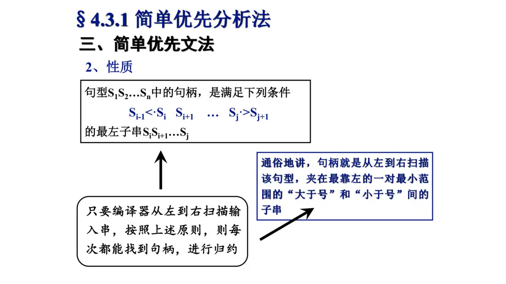

原文：

§4.3.1 简单优先分析法

三、简单优先文法

2、性质

句型 $\mathbf { S _ { 1 } S _ { 2 } . . . } . \mathbf { S _ { n } }$ 中的句柄，是满足下列条件

$$
\mathbf {S} _ {\mathrm{i-1}} <   \cdot \mathbf {S} _ {\mathrm{i}} \quad \mathbf {S} _ {\mathrm{i+1}} \quad \dots \quad \mathbf {S} _ {\mathrm{j}} \cdot > \mathbf {S} _ {\mathrm{j+1}}
$$

的最左子串 $\mathbf { S _ { i } S _ { i + 1 } . . . S _ { j } }$

通俗地讲，句柄就是从左到右扫描该句型，夹在最靠左的一对最小范围的“大于号”和“小于号”间的子串

只要编译器从左到右扫描输 入串，按照上述原则，则每 次都能找到句柄，进行归约

### §4.3.1 简单优先分析法

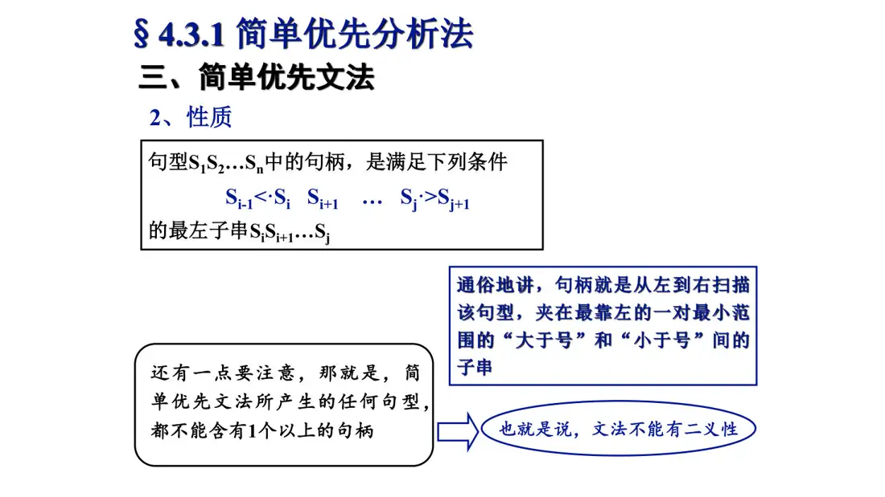

原文：

§4.3.1 简单优先分析法

三、简单优先文法

2、性质

句型 $\mathbf { S _ { 1 } S _ { 2 } . . . } . \mathbf { S _ { n } }$ 中的句柄，是满足下列条件

$$
\mathbf {S} _ {\mathrm{i-1}} <   \cdot \mathbf {S} _ {\mathrm{i}} \quad \mathbf {S} _ {\mathrm{i+1}} \quad \dots \quad \mathbf {S} _ {\mathrm{j}} \cdot > \mathbf {S} _ {\mathrm{j+1}}
$$

的最左子串 $\mathbf { S _ { i } S _ { i + 1 } . . . S _ { j } }$

还有一点要注意，那就是，简单优先文法所产生的任何句型，都不能含有1个以上的句柄

通俗地讲，句柄就是从左到右扫描该句型，夹在最靠左的一对最小范围的“大于号”和“小于号”间的子串

也就是说，文法不能有二义性

### §4.3.1 简单优先分析法

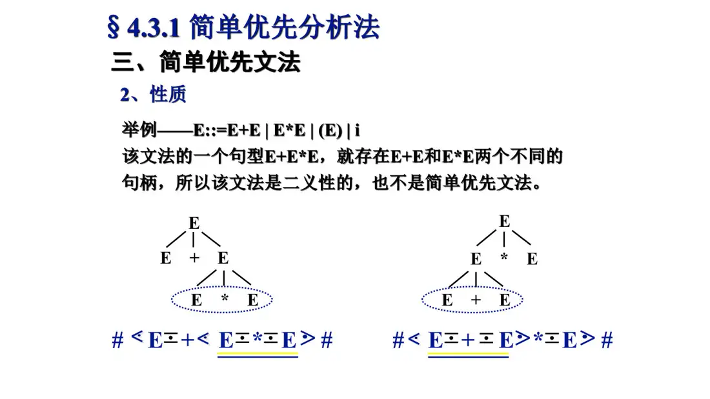

原文：

§4.3.1 简单优先分析法

三、简单优先文法

2、性质

举例—— $\mathbf { \cdot E } { : : = } \mathbf { E } { + } \mathbf { E } \mid \mathbf { E } ^ { * } \mathbf { E }$ | (E) | i

该文法的一个句型 $\mathbf { E } { + } \mathbf { E } ^ { * } \mathbf { E }$ ，就存在E+E和E\*E两个不同的句柄，所以该文法是二义性的，也不是简单优先文法。

$$
\# <   \mathbf {E} \supseteq + <   \underline {{\mathbf {E} \supseteq * \supseteq \mathbf {E}}} > \#
$$

$$
\# <   \underline {{\mathbf {E} \equiv + \equiv \mathbf {E} > * \equiv \mathbf {E} >}} \#
$$

### §4.3.1 简单优先分析法四、简单优先分析过程

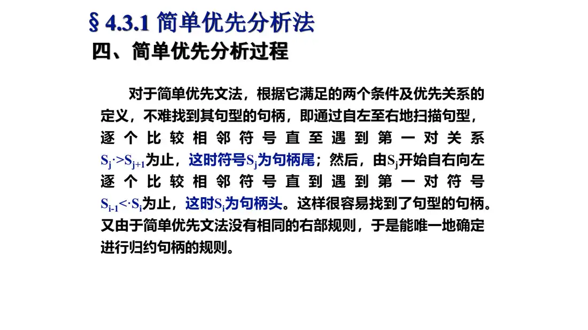

原文：

§4.3.1 简单优先分析法四、简单优先分析过程

对于简单优先文法，根据它满足的两个条件及优先关系的定义，不难找到其句型的句柄，即通过自左至右地扫描句型，逐 个 比 较 相 邻 符 号 直 至 遇 到 第 一 对 关 系$\mathbf { S _ { j } } { \cdot } { > } \mathbf { S _ { j + 1 } }$ 为止，这时符号 $\mathbf { \sigma } \cdot \mathbf { S _ { j } }$ 为句柄尾；然后，由 $\mathbf { S _ { j } }$ 开始自右向左逐 个 比 较 相 邻 符 号 直 到 遇 到 第 一 对 符 号$\mathbf { S _ { i - 1 } } { < } \mathbf { \cdot } \mathbf { S _ { i } }$ 为止，这时 $\bf { S _ { i } }$ 为句柄头。这样很容易找到了句型的句柄。又由于简单优先文法没有相同的右部规则，于是能唯一地确定进行归约句柄的规则。

### §4.3.1 简单优先分析法四、简单优先分析过程

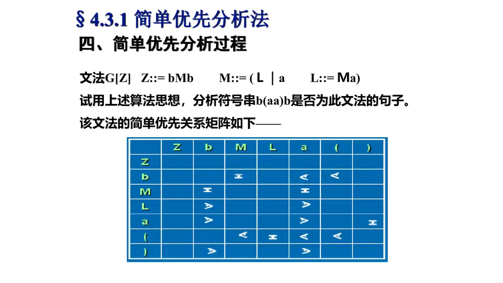

原文：

§4.3.1 简单优先分析法四、简单优先分析过程

文法G[Z] $\mathbf { Z } { : } { : } = { \mathbf { b } } \mathbf { M } { \mathbf { b } }$ M::= (L｜a L::= Ma)

试用上述算法思想，分析符号串b(aa)b是否为此文法的句子。

该文法的简单优先关系矩阵如下—

<table><tr><td></td><td>Z</td><td>b</td><td>M</td><td>L</td><td>a</td><td>(</td><td>)</td></tr><tr><td>Z</td><td></td><td></td><td></td><td></td><td></td><td></td><td></td></tr><tr><td>b</td><td></td><td></td><td>I</td><td></td><td>&lt;</td><td>&lt;</td><td></td></tr><tr><td>M</td><td></td><td>I</td><td></td><td></td><td>I</td><td></td><td></td></tr><tr><td>L</td><td></td><td>&gt;</td><td></td><td></td><td>&gt;</td><td></td><td></td></tr><tr><td>a</td><td></td><td>&gt;</td><td></td><td></td><td>&gt;</td><td></td><td>I</td></tr><tr><td>(</td><td></td><td></td><td>&lt;</td><td>I</td><td>&lt;</td><td>&lt;</td><td></td></tr><tr><td>)</td><td></td><td>&gt;</td><td></td><td></td><td>&gt;</td><td></td><td></td></tr></table>

### §4.3.1 简单优先分析法四、简单优先分析过程

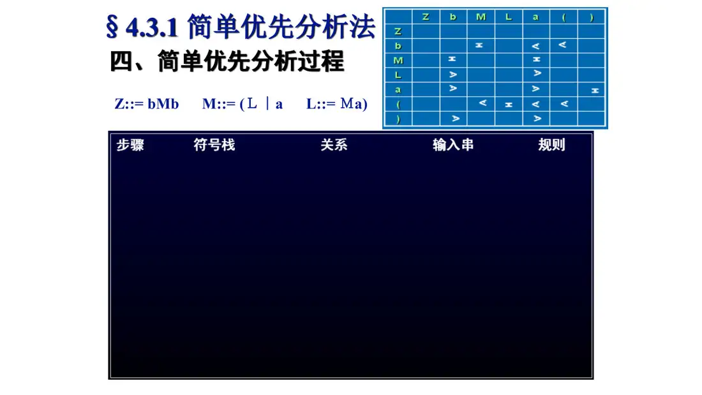

原文：

§4.3.1 简单优先分析法四、简单优先分析过程

<table><tr><td></td><td>Z</td><td>b</td><td>M</td><td>L</td><td>a</td><td>(</td><td>)</td></tr><tr><td>Z</td><td></td><td></td><td></td><td></td><td></td><td></td><td></td></tr><tr><td>b</td><td></td><td></td><td> $\overline{\mathbf{I}}$ </td><td></td><td>&lt;</td><td>&lt;</td><td></td></tr><tr><td>M</td><td></td><td> $\overline{\mathbf{I}}$ </td><td></td><td></td><td> $\overline{\mathbf{I}}$ </td><td></td><td></td></tr><tr><td>L</td><td></td><td>&gt;</td><td></td><td></td><td>&gt;</td><td></td><td></td></tr><tr><td>a</td><td></td><td>&gt;</td><td></td><td></td><td>&gt;</td><td></td><td> $\overline{\mathbf{I}}$ </td></tr><tr><td>(</td><td></td><td></td><td>&lt;</td><td> $\overline{\mathbf{I}}$ </td><td>&lt;</td><td>&lt;</td><td></td></tr><tr><td>)</td><td></td><td>&gt;</td><td></td><td></td><td>&gt;</td><td></td><td></td></tr></table>

<table><tr><td>步骤</td><td>符号栈</td><td>关系</td><td>输入串</td><td>规则</td></tr></table>

### §4.3.1 简单优先分析法四、简单优先分析过程

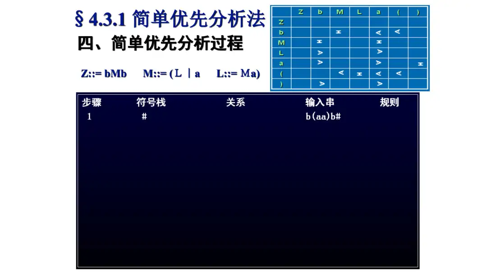

原文：

§4.3.1 简单优先分析法四、简单优先分析过程

<table><tr><td></td><td>Z</td><td>b</td><td>M</td><td>L</td><td>a</td><td>(</td><td>)</td></tr><tr><td>Z</td><td></td><td></td><td></td><td></td><td></td><td></td><td></td></tr><tr><td>b</td><td></td><td></td><td> $\overline{\mathbf{I}}$ </td><td></td><td>&lt;</td><td>&lt;</td><td></td></tr><tr><td>M</td><td></td><td> $\overline{\mathbf{I}}$ </td><td></td><td></td><td> $\overline{\mathbf{I}}$ </td><td></td><td></td></tr><tr><td>L</td><td></td><td>&gt;</td><td></td><td></td><td>&gt;</td><td></td><td></td></tr><tr><td>a</td><td></td><td>&gt;</td><td></td><td></td><td>&gt;</td><td></td><td> $\overline{\mathbf{I}}$ </td></tr><tr><td>(</td><td></td><td></td><td>&lt;</td><td> $\overline{\mathbf{I}}$ </td><td>&lt;</td><td>&lt;</td><td></td></tr><tr><td>)</td><td></td><td>&gt;</td><td></td><td></td><td>&gt;</td><td></td><td></td></tr></table>

<table><tr><td>步骤</td><td>符号栈</td><td>关系</td><td>输入串</td><td>规则</td></tr><tr><td>1</td><td>#</td><td></td><td>b(aa)b#</td><td></td></tr></table>

### §4.3.1 简单优先分析法四、简单优先分析过程

原文：

§4.3.1 简单优先分析法四、简单优先分析过程

<table><tr><td></td><td>Z</td><td>b</td><td>M</td><td>L</td><td>a</td><td>(</td><td>)</td></tr><tr><td>Z</td><td></td><td></td><td></td><td></td><td></td><td></td><td></td></tr><tr><td>b</td><td></td><td></td><td> $\overline{I}$ </td><td></td><td>&lt;</td><td>&lt;</td><td></td></tr><tr><td>M</td><td></td><td> $\overline{I}$ </td><td></td><td></td><td> $\overline{I}$ </td><td></td><td></td></tr><tr><td>L</td><td></td><td>&gt;</td><td></td><td></td><td>&gt;</td><td></td><td></td></tr><tr><td>a</td><td></td><td>&gt;</td><td></td><td></td><td>&gt;</td><td></td><td> $\overline{I}$ </td></tr><tr><td>(</td><td></td><td></td><td>&lt;</td><td> $\overline{I}$ </td><td>&lt;</td><td>&lt;</td><td></td></tr><tr><td>)</td><td></td><td>&gt;</td><td></td><td></td><td>&gt;</td><td></td><td></td></tr></table>

<table><tr><td>步骤</td><td>符号栈</td><td>关系</td><td>输入串</td><td>规则</td></tr><tr><td>1</td><td>#</td><td>&lt;</td><td>b(aa)b#</td><td></td></tr><tr><td>2</td><td>#b</td><td></td><td>(aa)b#</td><td></td></tr></table>

### §4.3.1 简单优先分析法四、简单优先分析过程

原文：

§4.3.1 简单优先分析法四、简单优先分析过程

$$
\mathbf {Z}: := \mathbf {b M b}
$$

$$
\mathbf {M}: := (\mathrm{L} \mid \mathbf {a}
$$

$$
\mathrm{L}: := \mathrm{Ma})
$$

<table><tr><td></td><td>Z</td><td>b</td><td>M</td><td>L</td><td>a</td><td>(</td><td>)</td></tr><tr><td>Z</td><td></td><td></td><td></td><td></td><td></td><td></td><td></td></tr><tr><td>b</td><td></td><td></td><td> $\overline{I}$ </td><td></td><td>&lt;</td><td>&lt;</td><td></td></tr><tr><td>M</td><td></td><td> $\overline{I}$ </td><td></td><td></td><td> $\overline{I}$ </td><td></td><td></td></tr><tr><td>L</td><td></td><td>&gt;</td><td></td><td></td><td>&gt;</td><td></td><td></td></tr><tr><td>a</td><td></td><td>&gt;</td><td></td><td></td><td>&gt;</td><td></td><td> $\overline{I}$ </td></tr><tr><td>(</td><td></td><td></td><td>&lt;</td><td> $\overline{I}$ </td><td>&lt;</td><td>&lt;</td><td></td></tr><tr><td>)</td><td></td><td>&gt;</td><td></td><td></td><td>&gt;</td><td></td><td></td></tr></table>

<table><tr><td>步骤</td><td>符号栈</td><td>关系</td><td>输入串</td><td>规则</td></tr><tr><td>1</td><td>#</td><td>&lt;</td><td>b(aa)b#</td><td></td></tr><tr><td>2</td><td>#b</td><td>&lt;</td><td>(aa)b#</td><td></td></tr><tr><td>3</td><td>#b(</td><td></td><td>aa)b#</td><td></td></tr></table>

### §4.3.1 简单优先分析法四、简单优先分析过程

原文：

§4.3.1 简单优先分析法四、简单优先分析过程

$$
\mathbf {Z}: := \mathbf {b M b}
$$

$$
\mathbf {M}: := (\mathrm{L} \mid \mathbf {a}
$$

$$
\mathrm{L}: := \mathrm{Ma})
$$

<table><tr><td></td><td>Z</td><td>b</td><td>M</td><td>L</td><td>a</td><td>(</td><td>)</td></tr><tr><td>Z</td><td></td><td></td><td></td><td></td><td></td><td></td><td></td></tr><tr><td>b</td><td></td><td></td><td> $\overline{\mathbf{I}}$ </td><td></td><td>&lt;</td><td>&lt;</td><td></td></tr><tr><td>M</td><td></td><td> $\overline{\mathbf{I}}$ </td><td></td><td></td><td> $\overline{\mathbf{I}}$ </td><td></td><td></td></tr><tr><td>L</td><td></td><td>&gt;</td><td></td><td></td><td>&gt;</td><td></td><td></td></tr><tr><td>a</td><td></td><td>&gt;</td><td></td><td></td><td>&gt;</td><td></td><td> $\overline{\mathbf{I}}$ </td></tr><tr><td>(</td><td></td><td></td><td>&lt;</td><td> $\overline{\mathbf{I}}$ </td><td>&lt;</td><td>&lt;</td><td></td></tr><tr><td>)</td><td></td><td>&gt;</td><td></td><td></td><td>&gt;</td><td></td><td></td></tr></table>

### §4.3.1 简单优先分析法四、简单优先分析过程

原文：

§4.3.1 简单优先分析法四、简单优先分析过程

$$
\mathbf {Z}: := \mathbf {b M b}
$$

$$
\mathbf {M}: := (\mathrm{L} \mid \mathbf {a}
$$

$$
\mathrm{L}: := \mathrm{Ma})
$$

<table><tr><td></td><td>Z</td><td>b</td><td>M</td><td>L</td><td>a</td><td>(</td><td>)</td></tr><tr><td>Z</td><td></td><td></td><td></td><td></td><td></td><td></td><td></td></tr><tr><td>b</td><td></td><td></td><td> $\overline{I}$ </td><td></td><td>&lt;</td><td>&lt;</td><td></td></tr><tr><td>M</td><td></td><td> $\overline{I}$ </td><td></td><td></td><td> $\overline{I}$ </td><td></td><td></td></tr><tr><td>L</td><td></td><td>&gt;</td><td></td><td></td><td>&gt;</td><td></td><td></td></tr><tr><td>a</td><td></td><td>&gt;</td><td></td><td></td><td>&gt;</td><td></td><td> $\overline{I}$ </td></tr><tr><td>(</td><td></td><td></td><td>&lt;</td><td> $\overline{I}$ </td><td>&lt;</td><td>&lt;</td><td></td></tr><tr><td>)</td><td></td><td>&gt;</td><td></td><td></td><td>&gt;</td><td></td><td></td></tr></table>

<table><tr><td>步骤</td><td>符号栈</td><td>关系</td><td>输入串</td><td>规则</td></tr><tr><td>1</td><td>#</td><td>&lt;</td><td>b(aa)b#</td><td></td></tr><tr><td>2</td><td>#b</td><td>&lt;</td><td>(aa)b#</td><td></td></tr><tr><td>3</td><td>#b(</td><td>&lt;</td><td>aa)b#</td><td></td></tr><tr><td>4</td><td>#b(a</td><td>&gt;</td><td>a)b#</td><td></td></tr><tr><td>5</td><td>#b(M</td><td></td><td>a)b#</td><td>M::=a</td></tr></table>

### §4.3.1 简单优先分析法四、简单优先分析过程

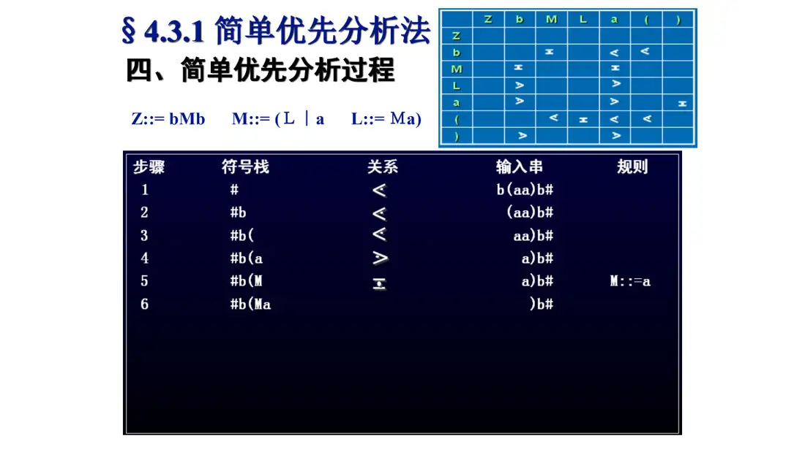

原文：

§4.3.1 简单优先分析法四、简单优先分析过程

$$
\mathbf {Z}: := \mathbf {b M b}
$$

$$
\mathbf {M}: := (\mathrm{L} \mid \mathbf {a}
$$

$$
\mathrm{L}: := \mathrm{Ma})
$$

<table><tr><td></td><td>Z</td><td>b</td><td>M</td><td>L</td><td>a</td><td>(</td><td>)</td></tr><tr><td>Z</td><td></td><td></td><td></td><td></td><td></td><td></td><td></td></tr><tr><td>b</td><td></td><td></td><td> $\overline{I}$ </td><td></td><td>&lt;</td><td>&lt;</td><td></td></tr><tr><td>M</td><td></td><td> $\overline{I}$ </td><td></td><td></td><td> $\overline{I}$ </td><td></td><td></td></tr><tr><td>L</td><td></td><td>&gt;</td><td></td><td></td><td>&gt;</td><td></td><td></td></tr><tr><td>a</td><td></td><td>&gt;</td><td></td><td></td><td>&gt;</td><td></td><td> $\overline{I}$ </td></tr><tr><td>(</td><td></td><td></td><td>&lt;</td><td> $\overline{I}$ </td><td>&lt;</td><td>&lt;</td><td></td></tr><tr><td>)</td><td></td><td>&gt;</td><td></td><td></td><td>&gt;</td><td></td><td></td></tr></table>

<table><tr><td>步骤</td><td>符号栈</td><td>关系</td><td>输入串</td><td>规则</td></tr><tr><td>1</td><td>#</td><td>&lt;</td><td>b(aa)b#</td><td></td></tr><tr><td>2</td><td>#b</td><td>&lt;</td><td>(aa)b#</td><td></td></tr><tr><td>3</td><td>#b(</td><td>&lt;</td><td>aa)b#</td><td></td></tr><tr><td>4</td><td>#b(a</td><td>&gt;</td><td>a)b#</td><td></td></tr><tr><td>5</td><td>#b(M</td><td>=</td><td>a)b#</td><td>M::=a</td></tr><tr><td>6</td><td>#b(Ma</td><td></td><td>)b#</td><td></td></tr></table>

### §4.3.1 简单优先分析法四、简单优先分析过程

原文：

§4.3.1 简单优先分析法四、简单优先分析过程

$$
\mathbf {Z : : = b M b}
$$

$$
\mathbf {M}: := (\mathrm{L} \mid \mathbf {a}
$$

$$
\mathrm{L}: := \mathrm{Ma})
$$

<table><tr><td></td><td>Z</td><td>b</td><td>M</td><td>L</td><td>a</td><td>(</td><td>)</td></tr><tr><td>Z</td><td></td><td></td><td></td><td></td><td></td><td></td><td></td></tr><tr><td>b</td><td></td><td></td><td> $\overline{\mathbf{I}}$ </td><td></td><td>&lt;</td><td>&lt;</td><td></td></tr><tr><td>M</td><td></td><td> $\overline{\mathbf{I}}$ </td><td></td><td></td><td> $\overline{\mathbf{I}}$ </td><td></td><td></td></tr><tr><td>L</td><td></td><td>&gt;</td><td></td><td></td><td>&gt;</td><td></td><td></td></tr><tr><td>a</td><td></td><td>&gt;</td><td></td><td></td><td>&gt;</td><td></td><td> $\overline{\mathbf{I}}$ </td></tr><tr><td>(</td><td></td><td></td><td>&lt;</td><td> $\overline{\mathbf{I}}$ </td><td>&lt;</td><td>&lt;</td><td></td></tr><tr><td>)</td><td></td><td>&gt;</td><td></td><td></td><td>&gt;</td><td></td><td></td></tr></table>

<table><tr><td>步骤</td><td>符号栈</td><td>关系</td><td>输入串</td><td>规则</td></tr><tr><td>1</td><td>#</td><td>&lt;</td><td>b(aa)b#</td><td></td></tr><tr><td>2</td><td>#b</td><td>&lt;</td><td>(aa)b#</td><td></td></tr><tr><td>3</td><td>#b(</td><td>&lt;</td><td>aa)b#</td><td></td></tr><tr><td>4</td><td>#b(a</td><td>&gt;</td><td>a)b#</td><td></td></tr><tr><td>5</td><td>#b(M</td><td>-</td><td>a)b#</td><td>M::=a</td></tr><tr><td>6</td><td>#b(Ma</td><td>-</td><td>)b#</td><td></td></tr><tr><td>7</td><td>#b(Ma)</td><td></td><td>b#</td><td></td></tr></table>

### §4.3.1 简单优先分析法四、简单优先分析过程

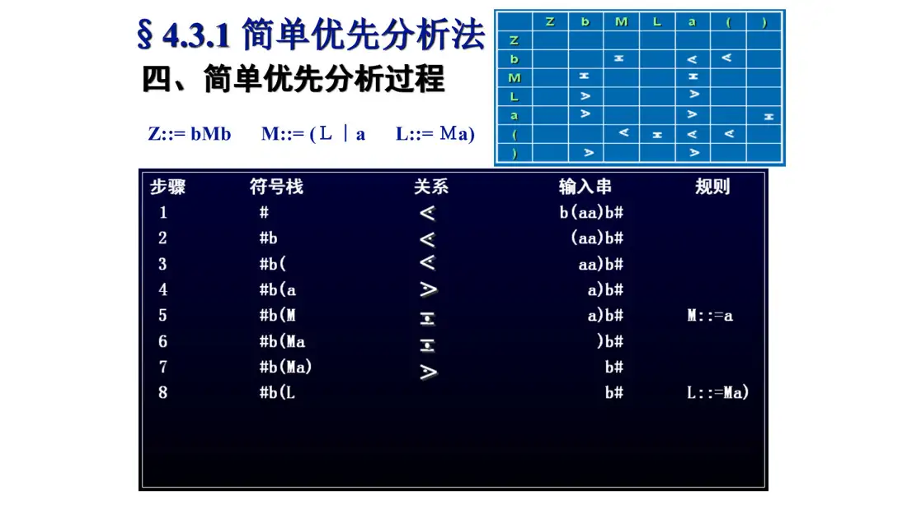

原文：

§4.3.1 简单优先分析法四、简单优先分析过程

$$
\mathbf {Z}: := \mathbf {b M b}
$$

$$
\mathbf {M}: := (\mathrm{L} \mid \mathbf {a}
$$

$$
\mathrm{L}: := \mathrm{Ma})
$$

<table><tr><td></td><td>Z</td><td>b</td><td>M</td><td>L</td><td>a</td><td>(</td><td>)</td></tr><tr><td>Z</td><td></td><td></td><td></td><td></td><td></td><td></td><td></td></tr><tr><td>b</td><td></td><td></td><td> $\overline{\mathbf{I}}$ </td><td></td><td>&lt;</td><td>&lt;</td><td></td></tr><tr><td>M</td><td></td><td> $\overline{\mathbf{I}}$ </td><td></td><td></td><td> $\overline{\mathbf{I}}$ </td><td></td><td></td></tr><tr><td>L</td><td></td><td>&gt;</td><td></td><td></td><td>&gt;</td><td></td><td></td></tr><tr><td>a</td><td></td><td>&gt;</td><td></td><td></td><td>&gt;</td><td></td><td> $\overline{\mathbf{I}}$ </td></tr><tr><td>(</td><td></td><td></td><td>&lt;</td><td> $\overline{\mathbf{I}}$ </td><td>&lt;</td><td>&lt;</td><td></td></tr><tr><td>)</td><td></td><td>&gt;</td><td></td><td></td><td>&gt;</td><td></td><td></td></tr></table>

<table><tr><td>步骤</td><td>符号栈</td><td>关系</td><td>输入串</td><td>规则</td></tr><tr><td>1</td><td>#</td><td>&lt;</td><td>b(aa)b#</td><td></td></tr><tr><td>2</td><td>#b</td><td>&lt;</td><td>(aa)b#</td><td></td></tr><tr><td>3</td><td>#b(</td><td>&lt;</td><td>aa)b#</td><td></td></tr><tr><td>4</td><td>#b(a</td><td>&gt;</td><td>a)b#</td><td></td></tr><tr><td>5</td><td>#b(M</td><td>-</td><td>a)b#</td><td>M::=a</td></tr><tr><td>6</td><td>#b(Ma</td><td>-</td><td>)b#</td><td></td></tr><tr><td>7</td><td>#b(Ma)</td><td>&gt;</td><td>b#</td><td></td></tr><tr><td>8</td><td>#b(L</td><td></td><td>b#</td><td>L::=Ma)</td></tr></table>

### §4.3.1 简单优先分析法四、简单优先分析过程

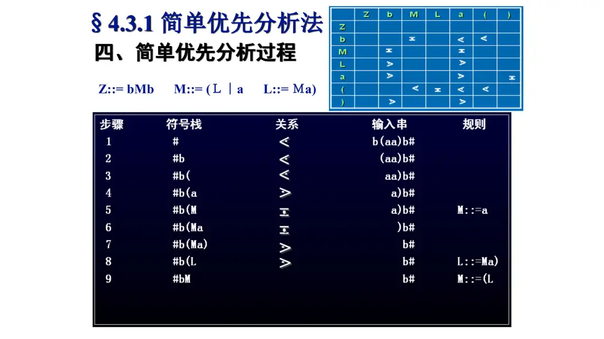

原文：

§4.3.1 简单优先分析法四、简单优先分析过程

$$
\mathbf {Z}: := \mathbf {b M b}
$$

$$
\mathbf {M}: := (\mathrm{L} \mid \mathbf {a}
$$

$$
\mathrm{L}: := \mathrm{Ma})
$$

<table><tr><td></td><td>Z</td><td>b</td><td>M</td><td>L</td><td>a</td><td>(</td><td>)</td></tr><tr><td>Z</td><td></td><td></td><td></td><td></td><td></td><td></td><td></td></tr><tr><td>b</td><td></td><td></td><td> $\overline{\mathbf{I}}$ </td><td></td><td>&lt;</td><td>&lt;</td><td></td></tr><tr><td>M</td><td></td><td> $\overline{\mathbf{I}}$ </td><td></td><td></td><td> $\overline{\mathbf{I}}$ </td><td></td><td></td></tr><tr><td>L</td><td></td><td>&gt;</td><td></td><td></td><td>&gt;</td><td></td><td></td></tr><tr><td>a</td><td></td><td>&gt;</td><td></td><td></td><td>&gt;</td><td></td><td> $\overline{\mathbf{I}}$ </td></tr><tr><td>(</td><td></td><td></td><td>&lt;</td><td> $\overline{\mathbf{I}}$ </td><td>&lt;</td><td>&lt;</td><td></td></tr><tr><td>)</td><td></td><td>&gt;</td><td></td><td></td><td>&gt;</td><td></td><td></td></tr></table>

<table><tr><td>步骤</td><td>符号栈</td><td>关系</td><td>输入串</td><td>规则</td></tr><tr><td>1</td><td>#</td><td>&lt;</td><td>b(aa)b#</td><td></td></tr><tr><td>2</td><td>#b</td><td>&lt;</td><td>(aa)b#</td><td></td></tr><tr><td>3</td><td>#b(</td><td>&lt;</td><td>aa)b#</td><td></td></tr><tr><td>4</td><td>#b(a</td><td>&gt;</td><td>a)b#</td><td></td></tr><tr><td>5</td><td>#b(M</td><td>-</td><td>a)b#</td><td>M::=a</td></tr><tr><td>6</td><td>#b(Ma</td><td>-</td><td>)b#</td><td></td></tr><tr><td>7</td><td>#b(Ma)</td><td>&gt;</td><td>b#</td><td></td></tr><tr><td>8</td><td>#b(L</td><td>&gt;</td><td>b#</td><td>L::=Ma)</td></tr><tr><td>9</td><td>#bM</td><td></td><td>b#</td><td>M::=(L</td></tr></table>

### §4.3.1 简单优先分析法四、简单优先分析过程

原文：

§4.3.1 简单优先分析法四、简单优先分析过程

$$
\mathbf {Z}: := \mathbf {b M b}
$$

$$
\mathbf {M}: := (\mathrm{L} \mid \mathbf {a}
$$

$$
\mathrm{L}: := \mathrm{Ma})
$$

<table><tr><td>步骤</td><td>符号栈</td><td>关系</td><td>输入串</td><td>规则</td></tr><tr><td>1</td><td>#</td><td>&lt;</td><td>b(aa)b#</td><td></td></tr><tr><td>2</td><td>#b</td><td>&lt;</td><td>(aa)b#</td><td></td></tr><tr><td>3</td><td>#b(</td><td>&lt;</td><td>aa)b#</td><td></td></tr><tr><td>4</td><td>#b(a</td><td>&gt;</td><td>a)b#</td><td></td></tr><tr><td>5</td><td>#b(M</td><td>-</td><td>a)b#</td><td>M::=a</td></tr><tr><td>6</td><td>#b(Ma</td><td>-</td><td>)b#</td><td></td></tr><tr><td>7</td><td>#b(Ma)</td><td>&gt;</td><td>b#</td><td></td></tr><tr><td>8</td><td>#b(L</td><td>&gt;</td><td>b#</td><td>L::=Ma)</td></tr><tr><td>9</td><td>#bM</td><td>-</td><td>b#</td><td>M::=(L</td></tr><tr><td>10</td><td>#bMb</td><td></td><td>#</td><td></td></tr></table>

### §4.3.1 简单优先分析法四、简单优先分析过程

原文：

§4.3.1 简单优先分析法四、简单优先分析过程

$$
\mathbf {Z}: := \mathbf {b M b}
$$

$$
\mathbf {M}: := (\mathrm{L} \mid \mathbf {a}
$$

$$
\mathrm{L}: := \mathrm{Ma})
$$

<table><tr><td></td><td>Z</td><td>b</td><td>M</td><td>L</td><td>a</td><td>(</td><td>)</td></tr><tr><td>Z</td><td></td><td></td><td></td><td></td><td></td><td></td><td></td></tr><tr><td>b</td><td></td><td></td><td> $\overline{\mathbf{I}}$ </td><td></td><td>&lt;</td><td>&lt;</td><td></td></tr><tr><td>M</td><td></td><td> $\overline{\mathbf{I}}$ </td><td></td><td></td><td> $\overline{\mathbf{I}}$ </td><td></td><td></td></tr><tr><td>L</td><td></td><td>&gt;</td><td></td><td></td><td>&gt;</td><td></td><td></td></tr><tr><td>a</td><td></td><td>&gt;</td><td></td><td></td><td>&gt;</td><td></td><td> $\overline{\mathbf{I}}$ </td></tr><tr><td>(</td><td></td><td></td><td>&lt;</td><td> $\overline{\mathbf{I}}$ </td><td>&lt;</td><td>&lt;</td><td></td></tr><tr><td>)</td><td></td><td>&gt;</td><td></td><td></td><td>&gt;</td><td></td><td></td></tr></table>

<table><tr><td>步骤</td><td>符号栈</td><td>关系</td><td>输入串</td><td>规则</td></tr><tr><td>1</td><td>#</td><td>&lt;</td><td>b(aa)b#</td><td></td></tr><tr><td>2</td><td>#b</td><td>&lt;</td><td>(aa)b#</td><td></td></tr><tr><td>3</td><td>#b(</td><td>&lt;</td><td>aa)b#</td><td></td></tr><tr><td>4</td><td>#b(a</td><td>&gt;</td><td>a)b#</td><td></td></tr><tr><td>5</td><td>#b(M</td><td>-</td><td>a)b#</td><td>M::=a</td></tr><tr><td>6</td><td>#b(Ma</td><td>-</td><td>)b#</td><td></td></tr><tr><td>7</td><td>#b(Ma)</td><td>&gt;</td><td>b#</td><td></td></tr><tr><td>8</td><td>#b(L</td><td>&gt;</td><td>b#</td><td>L::=Ma)</td></tr><tr><td>9</td><td>#bM</td><td>-</td><td>b#</td><td>M::=(L</td></tr><tr><td>10</td><td>#bMb</td><td>&gt;</td><td>#</td><td></td></tr><tr><td>11</td><td>#Z</td><td></td><td>#</td><td>Z::=bMb</td></tr></table>

### §4.3.1 简单优先分析法四、简单优先分析过程

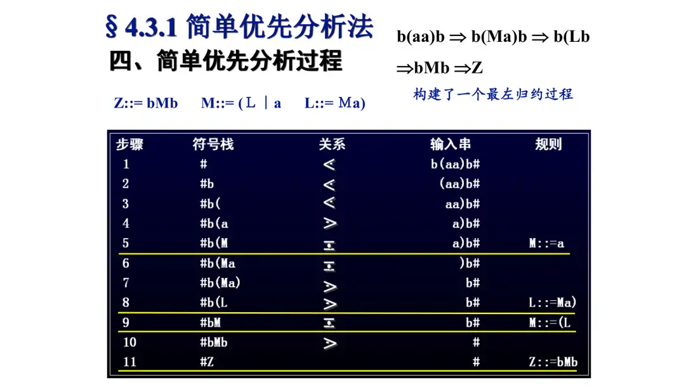

原文：

§4.3.1 简单优先分析法四、简单优先分析过程

$$
\begin{array}{l} \mathbf {b (a a) b} \Rightarrow \mathbf {b (M a) b} \Rightarrow \mathbf {b (L b} \\ \Rightarrow \mathbf {b M b} \Rightarrow \mathbf {Z} \end{array}
$$

$$
\mathbf {Z : : = b M b}
$$

$$
\mathrm{L}: := \mathrm{Ma})
$$

构建了一个最左归约过程

<table><tr><td>步骤</td><td>符号栈</td><td>关系</td><td>输入串</td><td>规则</td></tr><tr><td>1</td><td>#</td><td>&lt;</td><td>b(aa)b#</td><td></td></tr><tr><td>2</td><td>#b</td><td>&lt;</td><td>(aa)b#</td><td></td></tr><tr><td>3</td><td>#b(</td><td>&lt;</td><td>aa)b#</td><td></td></tr><tr><td>4</td><td>#b(a</td><td>&gt;</td><td>a)b#</td><td></td></tr><tr><td>5</td><td>#b(M</td><td>=</td><td>a)b#</td><td>M::=a</td></tr><tr><td>6</td><td>#b(Ma</td><td>=</td><td>)b#</td><td></td></tr><tr><td>7</td><td>#b(Ma)</td><td>&gt;</td><td>b#</td><td></td></tr><tr><td>8</td><td>#b(L</td><td>&gt;</td><td>b#</td><td>L::=Ma)</td></tr><tr><td>9</td><td>#bM</td><td>=</td><td>b#</td><td>M::=(L</td></tr><tr><td>10</td><td>#bMb</td><td>&gt;</td><td>#</td><td></td></tr><tr><td>11</td><td>#Z</td><td></td><td>#</td><td>Z::=bMb</td></tr></table>

### §4.3.1 简单优先分析法四、简单优先分析过程

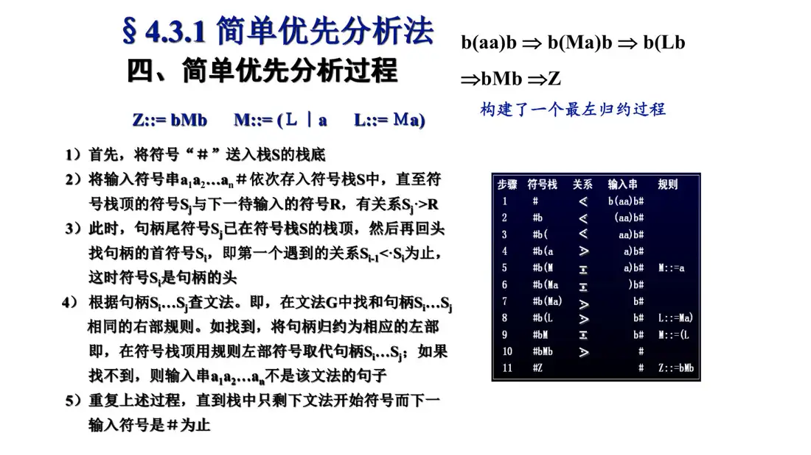

原文：

§4.3.1 简单优先分析法四、简单优先分析过程

$$
\mathbf {Z}: := \mathbf {b M b} \quad \mathbf {M}: := (\mathbf {L} \mid \mathbf {a} \quad \mathbf {L}: := \mathbf {M a})
$$

1）首先，将符号“＃”送入栈S的栈底

2）将输入符号串 $\mathbf { a _ { 1 } a _ { 2 } . . . . } \mathbf { a _ { n } }$ ＃依次存入符号栈S中，直至符号栈顶的符号 $\mathbf { \cdot s _ { j } }$ 与下一待输入的符号R，有关系 $\mathbf { S _ { j } } { \cdot } { \mathrm { > R } }$

3）此时，句柄尾符号 $\mathbf { s _ { j } }$ 已在符号栈S的栈顶，然后再回头找句柄的首符号 $\mathbf { S _ { i } } ,$ ，即第一个遇到的关系 $\bf { S _ { i - 1 } } < \cdot \bf { S _ { i } }$ 为止，这时符号 $\mathbf { S _ { i } }$ 是句柄的头

4） 根据句柄 $\mathbf { S _ { i } . . . S _ { j } }$ 查文法。即，在文法G中找和句柄 $\mathbf { S _ { i } . . . S _ { j } }$ 相同的右部规则。如找到，将句柄归约为相应的左部即，在符号栈顶用规则左部符号取代句柄 $\bf { S _ { i } . . . . S _ { j } } \{$ 如果找不到，则输入串 $\mathbf { a _ { 1 } a _ { 2 } . . . a _ { n } }$ 不是该文法的句子

5）重复上述过程，直到栈中只剩下文法开始符号而下一输入符号是＃为止

$$
\begin{array}{l} \mathbf {b (a a) b} \Rightarrow \mathbf {b (M a) b} \Rightarrow \mathbf {b (L b} \\ \Rightarrow \mathbf {b M b} \Rightarrow \mathbf {Z} \end{array}
$$

构建了一个最左归约过程

<table><tr><td>步骤</td><td>符号栈</td><td>关系</td><td>输入串</td><td>规则</td></tr><tr><td>1</td><td>#</td><td>&lt;</td><td>b(aa)b#</td><td></td></tr><tr><td>2</td><td>#b</td><td>&lt;</td><td>(aa)b#</td><td></td></tr><tr><td>3</td><td>#b(</td><td>&lt;</td><td>aa)b#</td><td></td></tr><tr><td>4</td><td>#b(a</td><td>&gt;</td><td>a)b#</td><td></td></tr><tr><td>5</td><td>#b(M</td><td>-</td><td>a)b#</td><td>M::=a</td></tr><tr><td>6</td><td>#b(Ma</td><td>-</td><td>)b#</td><td></td></tr><tr><td>7</td><td>#b(Ma)</td><td>&gt;</td><td>b#</td><td></td></tr><tr><td>8</td><td>#b(L</td><td>&gt;</td><td>b#</td><td>L::=Ma)</td></tr><tr><td>9</td><td>#bM</td><td>-</td><td>b#</td><td>M::=(L</td></tr><tr><td>10</td><td>#bMb</td><td>&gt;</td><td>#</td><td></td></tr><tr><td>11</td><td>#Z</td><td></td><td>#</td><td>Z::=bMb</td></tr></table>
