# 《编译原理》第4章 语法分析（自编参考教材）

原件经识别和整理；“参考解答”是我们补的。

---
title: 《编译原理》第4章 语法分析（自编参考教材）
kind: 课件
course: 编译原理
source: <原件地址或来源路径>
---

# 《编译原理》第4章 语法分析（自编参考教材）

上一章讨论了词法分析的任务和方法，是用正规式（它等价于正规文法）描述程序语言的单词符号结构，构造识别单词符号的有穷自动机，而描述程序语言的语法结构，则是基于上下文无关文法进行描述。文法是设计编译程序尤其是语法分析程序的依据。本章我们将讨论如何识别上下文无关文生成的语言。

## 4.1 语法分析概述

在编译程序对某个源程序完成了词法分析工作以后，就进入了语法分析阶段。由词法分析程序所产生的单词符号流，作为语法分析程序的输入串，按文法规则分析检查是否构成了合法的句子，即程序。语法分析是编译过程的核心部分。语法分析的一项重要任务是检查程序中的语法错误，在分析过程中，如果发现输入的单词符号不能构成语言的句子，则说明有语法错误。在这种情况下，语法分析要确定错误的性质和出错位置，向程序员提示，并在可能时做一些错误的修复工作或善后处理，以便程序能继续编译下去，进一步检查后面的语法错误。

在第二章中我们已经介绍过，通过语法分析可以建立起相应的语法树，按照构成语法树的顺序，语法分析方法可分为两大类，即自顶向下和自底向上分析方法。它们都要判断一输入串是否为一个合法的句子。

对于自顶向下语法分析而言，核心问题在于能否找到从文法开始符号开始的推导序列，使得推导出的句子恰为源程序输入串；或者说，能否从根结点出发，向下生长出一棵语法分析树，其叶结点组成的句子恰为输入串。对于用高级语言书写的源程序而言，自顶向下语法分析方法就是从文法开始符号如“程序”开始逐步推导出与输入源程序符号串相同的符号串。

对于自底向上语法分析而言，核心问题在于能否从输入串出发找到一个归约序列，且该序列能最终归约为文法开始符号；或者说，能否从叶结点出发，向上归约出文法开始符号为根结点的语法分析树，且每步归约，都以待处理的字符串是否已形成句柄为标准。对于用高级语言书写的源程序而言，自底向上语法分析方法就是从源程序的符号串出发，逐步归约到文法的开始符号，如“程序”。

语法分析的不同方法适合于不同形式的上下文无关文法，这些方法包括递归下降分析法、LL（1）文法、简单优先文法、算符优先文法和各种 LR 文法等分析方法。常用的自顶向下语法分析方法有递归下降分析法和 LL（1）分析法，而简单优先文法、算符优先分析法和LR系列分析法是典型的自底向上语法分析法，本章将重点介绍 LL（1）分析方法和 LR系列分析方法。

## 4.2 自顶向下的语法分析

所谓自顶向下语法分析是基于推导的方法，从文法的开始符号出发，采用最左或者最右推导，试图一步一步地推出输入符号串 $\alpha$ 。换句话说，就是以文法的开始符号 S 作为语法树的根部，试图自上而下地为输入符号串构造一棵语法树。若语法树的叶结点从左向右的排列恰好就是输入串$\alpha$，则表示该输入串 $\alpha$是文法的句子，而这棵语法树就是句子 $\alpha$ 的语法结构。如果构造不出这样的一棵语法树，则输入串 $\alpha$ 就不是这个文法的句子。这种分析过程本质上是一种试探的过程，是反复使用不同的产生式谋求匹配输入串的过程。

在某些文法的自顶向下的分析过程中，可能会遇到“回溯”和“左递归”的问题，为了能有效地运用自顶向下的语法分析方法，应使文法不含左递归及避免回溯。

### 4.2.1 消除文法的回溯和左递归

#### 1. 回溯问题解决方案

在进行自顶向下语法分析时，当文法规则中具有同一左部而右部有不同规则候选式时，在分析时按候选式规则的次序一个个试探，若能分析下去则成，否则再退回到出错点更换另一候选式规则重新试探。这种方法称之为回溯分析方法。其实质就是使用不同候选式规则反复试探。

**例 4.1** 文法 $G[S]$：
$$
\begin{aligned}
S &::= cAd \\
A &::= ab \mid a
\end{aligned}
$$

要判断 "cad" 是否为该文法的句子，可以分别用 $A ::= ab$ 和 $A ::= a$ 代入产生式规则 $S ::= cAd$ 中试探。第一次选择ab 候选式，则试探失败，需要退回到出错点重新选择另一候选式a进行试探。

一般地，设U为文法G的任意非终结符号，若U有如下规则:

$$
U ::= \alpha_ {1} \mid \alpha_ {2} \mid \dots , \alpha_ {\mathrm{i}}, \dots \mid \alpha_ {\mathrm{n}}, \quad \alpha_ {\mathrm{i}} \in V ^ {+}
$$

若定义：候选式 $\alpha_i$ 可能推出的所有终结符号串的首符号集合 $\operatorname{FIRST} (\alpha_i)$ 为 $\operatorname{FIRST}(\alpha_i) = \{ a \mid \alpha_i \Rightarrow^* a\dots, a \in V_T \}$ ，显然 $\operatorname{FIRST}(\alpha_i) \subseteq V_T$ 。

为了避免回溯，我们对文法要求是：

$$
\operatorname{FIRST} (\alpha_i) \cap \operatorname{FIRST} (\alpha_j) = \varnothing \quad (i \neq j)
$$

即对文法中的任意一个非终结符号，其规则右部有多个候选式时，由各个候选式所推出的终结符号串首符号集合要两两不相交。这样，就可能根据此时读进的符号是属于哪个候选式的 $\operatorname{FIRST}(\alpha_i)$ ，来唯一地确定该选用哪个候选式来匹配输入串。我们将这种匹配方法称之为路标法。

例如：当前输入符号为 $b (b \in V_T)$ ，如果 $b \in \operatorname{FIRST}(\alpha_i)$ ，则可以选择第 i 个候选式去匹配输入串。

当文法不满足上述路标法条件，即右部各候选式规则首符号相同时（例如例4.1所示文法中的 $A ::= ab \mid a$ ），我们可以采用提取左因子法对文法进行改写。

一般地说，如果有规则

$$
U ::= a\beta_{1} | a\beta_{2} | \dots | a\beta_{n} | \gamma
$$

则可以将这些规则写成

$$
U ::= aU' \mid \gamma
$$

$$
U' ::= \beta_{1} | \beta_{2} | \dots | \beta_{n}
$$

其中a称为左公因子，经过反复提取公因子即可将每个非终结符的所有候选式的首符号集合变得两两不相交。

**例 4.2** 对文法 $G[S]: S ::= cAd, A ::= ab \mid a$ 进行改写，消除回溯得到新的文法：

$$
\text {提取左公因子，得到新的 } G[S]: S ::= cAd, \quad A ::= aB, \quad B ::= b \mid \varepsilon
$$

#### 2. 左递归问题解决方案

在自顶向下语法分析过程中，假定现在要用非终结符号 U 去匹配输入串，而在文法中关于U的规则是 $U ::= U\dots$

它是一条直接左递归规则，这种左递归文法将使上述自顶向下的语法分析过程陷入无限循环，即：当试图用 U去匹配输入串时会发现，在没有吃进任何输入符号的情况下，又得重新要求U去匹配，如此循环下去而无终止。

若文法具有间接左递归，即有 $U \Rightarrow^+ U\dots$ ，那么，也会发生上述问题。

对于文法规则中的直接左递归，消除是比较容易的，一种方法被称为“重复表示法”，该方法用扩充的BNF表示法改写语法规则。

假定一个文法中有关于非终结符的规则为：

$$
A ::= A\alpha \mid \beta
$$

其中$\alpha$非空，$\beta$ 不以A开头，则等价地改写为：

$$
A ::= \beta \{\alpha \}
$$

**例 4.3** 下述直接左递归规则：

$$
E ::= E + T \mid T
$$

可改写为：

$$
E ::= T \{+ T \}
$$

还可用另一种被称为“改写法”的方法来改写形如文法规则 $A ::= A\alpha \mid \beta$ 的直接左递归。

对A引入一个新的非终结符A′，将 $A ::= A\alpha \mid \beta$ 等价写成：

$$
A ::= \beta A'
$$

$$
A' ::= \alpha A' \mid \varepsilon
$$

由于 $\beta$ 不以 A 开头，$\alpha$ 不以 A′开头，因此改写后两条规则不是直接左递归规则。同样可以证明这种形式和原来的形式是等价的。

就一般而言，关于A的规则具有下面形式：

# 语法分析（自编参考教材）第 2 部分

$$
\mathrm{A} \because = \mathrm{A} \alpha_ {1} | \mathrm{A} \alpha_ {2} | \dots | \mathrm{A} \alpha_ {\mathrm{n}} | \beta_ {1} | \beta_ {2} | \dots | \beta_ {\mathrm{n}}
$$

这时可改写成如下形式：

$$
\mathrm{A} \because = \mathrm{A} (\alpha_ {1} | \alpha_ {2} | \dots | \alpha_ {\mathrm{n}}) | \beta_ {1} | \beta_ {2} | \dots | \beta_ {\mathrm{n}}
$$

由“改写法”消除直接左递归方法，得：

例 4.4 $\mathrm{A} ::= \mathrm{Ac} \mid \mathrm{Aad} \mid \mathrm{bd} \mid \mathrm{e}$ 等价于 $\mathrm{A} ::= \mathrm{A}(\mathrm{c} \mid \mathrm{ad}) \mid \mathrm{bd} \mid \mathrm{e}$，所以可以改写成：

上述两种方法可消除任意直接左递归，但不能消除两步或多步推导形成的左递归。

例如，有文法 G[S]

该文法无直接左递归，但有间接左递归，例如有：

消除间接左递归的基本思路是：先将间接左递归变成直接左递归，然后消除直接左递归。

（1）

（2）

先将（1）代入（2）中，得：

（3）

由此将（3）改写为：

加入文法开始符号的产生式得消除左递归后的等价文法为：

消除文法递归的一般算法要求：文法不含形如 A⇒＋A 的推导，也不存在 A $::= \varepsilon$ 这样的规则。具体算法思想如下：

（1）将文法 G 的所有非终结符整理成某种顺序 $\mathrm{U}_1, \mathrm{U}_2, \ldots, \mathrm{U}_{\mathrm{n}}$。

（2）从 $\mathrm{U}_1$ 开始消除 $\mathrm{U}_1$ 规则的直接左递归。

（3）假设规则形如 $\mathrm{U}_1 ::= \mathrm{x}_1 \mid \mathrm{x}_2 \mid \mathrm{x}_3 \mid \ldots \mid \mathrm{x}_{\mathrm{k}}$，$\mathrm{U}_2 ::= \mathrm{U}_1(\mathrm{y}_1 \mid \mathrm{y}_2 \mid \mathrm{y}_3 \mid \ldots \mid \mathrm{y}_{\mathrm{t}})$，则用左部为 $\mathrm{U}_1$ 的所有规则的右部 $\mathrm{x}_1 \mid \mathrm{x}_2 \mid \mathrm{x}_3 \mid \ldots \mid \mathrm{x}_{\mathrm{k}}$ 替换左部为 $\mathrm{U}_2$ 规则的右部中的 U1，形如 $\mathrm{U}_1(\mathrm{y}_1 \mid \mathrm{y}_2 \mid \mathrm{y}_3 \mid \ldots \mid \mathrm{y}_{\mathrm{t}})$，结果变成 $\mathrm{U}_2 ::= (\mathrm{x}_1 \mid \mathrm{x}_2 \mid \mathrm{x}_3 \mid \ldots \mid \mathrm{x}_{\mathrm{k}})(\mathrm{y}_1 \mid \mathrm{y}_2 \mid \mathrm{y}_3 \mid \ldots \mid \mathrm{y}_{\mathrm{k}}) \mid \mathrm{y}_{\mathrm{t}}$，并消除 $\mathrm{U}_2$ 规则的直接左递归。

（4）用类似的方法把 $\mathrm{U}_1, \mathrm{U}_2$ 的右部替换左部为 $\mathrm{U}_3$、右部以 $\mathrm{U}_1, \mathrm{U}_2$ 开始的规则后，消除 $\mathrm{U}_3$ 规则中的直接左递归。

（5）重复上一步，直到最后把左部为 $\mathrm{U}_1, \mathrm{U}_2, \ldots \mathrm{U}_{\mathrm{n}-1}$ 的右部带入 $\mathrm{U}_{\mathrm{n}}$ 规则中，并消除 $\mathrm{U}_{\mathrm{n}}$ 中的直接左递归。

（6）消除多余规则。

至于为什么这套算法中不允许有 A→ε 的规则存在，大家可以看这样一个例子：文法 $\mathrm{G}[\mathrm{A}]: \mathrm{A} \to \mathrm{Bb} \mid \varepsilon$（1），$\mathrm{B} \to \mathrm{AAb} \mid \alpha$（2），将（1）代入（2）中将得到 $\mathrm{B} \to \mathrm{BbAb} \mid \mathrm{Ab} \mid \mathrm{a}$，仍然存在间接左递归规则 $\mathrm{B} \to \mathrm{Ab}$。

当然，我们也不允许有 A⇒＋A 的推导存在，例如文法 $\mathrm{G}[\mathrm{A}]: \mathrm{A} \to \mathrm{B} \mid \mathrm{a}$，$\mathrm{B} \to \mathrm{C} \mid \mathrm{b}$，$\mathrm{C} \to \mathrm{A} \mid \mathrm{c}$ 也不能适用于这套消除左递归的算法。

## 4.2.2 LL（1）分析方法

LL（1）分析方法是一种自顶向下不带回溯的语法分析方法，LL 的意思分别是：从左（Left）到右扫描输入符号串并建立它的最左推导（Left most derivations）。数字 1 是指向前看一个符号来决定选择同一个非终结符号的不同规则。如果向前查看 K 个符号（K>1）才能确定应选规则时，这种语法分析方法就称 LL（K）分析法。LL（1）分析器借助于一张分析表及一个语法分析栈，在一个总控程序控制下实现。

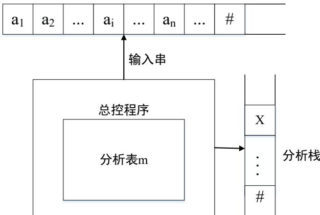

### 1. 总控程序的逻辑结构和工作过程

我们通常把按 LL（1）方法执行语法分析任务的程序称为 LL（1）分析程序或 LL（1）分析器，它由一个总控程序、一张分析表和一个分析栈组成，如图 4.1 所示。其中“输入串”就是待分析的符号串（源程序），它以右界符 # 作为结尾。分析表 M 可用一个矩阵（或二维数组）来表示。它概括了相应文法的全部信息。分析表的每一行与文法的一个非终结符 A 相关联，而每一列则与文法的一个终结符号或 # 相关联。分析表元素 M[A，a]（$\mathrm{a} \in \mathrm{V}_{\mathrm{T}} \cup \{\#\}$）或者指示了当前推导所应使用的产生式，或者指出了输入串中含有语法错误（参看表 4.1）。分析器对每个输入串的分析在总控程序控制下进行。总控程序的分析步骤如下：

（1）分析开始时，首先将符号 # 及文法的开始符号 S 依次置于分析栈的底部，并把各指示器调整至起始位置，即分别指向分析栈的栈顶元素和输入串的首字符。然后反复执行第（2）步；

（2）设在分析的某一步，分析栈及余留的输入符号串处于如下格局：

$$
\# \mathrm{X}_1 \mathrm{X}_2 \dots \mathrm{X}_{\mathrm{m}-1} \mathrm{X}_{\mathrm{m}} \quad \mathrm{a}_{\mathrm{i}} \mathrm{a}_{\mathrm{i}+1} \dots \#
$$

其中，$\mathrm{X}_1, \mathrm{X}_2, \dots, \mathrm{X}_{\mathrm{m}}$ 为分析过程中所得的文法符号。此时，可视栈顶符号 $\mathrm{X}_{\mathrm{m}}$ 的不同情况，分别做如下的动作：

① 若 $\mathrm{X}_{\mathrm{m}} \in \mathrm{V}_{\mathrm{N}}$，则以 $\mathrm{X}_{\mathrm{m}}$ 及 $\mathrm{a}_{\mathrm{i}}$ 组成的符号对 $(\mathrm{X}_{\mathrm{m}}, \mathrm{a}_{\mathrm{i}})$ 查分析表 M，设 $\mathrm{M}[\mathrm{X}_{\mathrm{m}}, \mathrm{a}_{\mathrm{i}}]$ 为一产生式，譬如说 $\mathrm{X}_{\mathrm{m}} \to \mathrm{UVW}$，此时将 $\mathrm{X}_{\mathrm{m}}$ 从分析栈中退出，并将 UVW 按反序推入栈中（即用该产生式推导一步），从而得到新的格局：

$$
\# \mathrm{X}_1 \mathrm{X}_2 \dots \mathrm{X}_{\mathrm{m}-1} \mathrm{WVU} \quad \mathrm{a}_{\mathrm{i}} \mathrm{a}_{\mathrm{i}+1} \dots \#
$$

但若 $\mathrm{M}[\mathrm{X}_{\mathrm{m}}, \mathrm{a}_{\mathrm{i}}] = \text{ERROR}$，则调用出错处理程序进行处理；

② 若 $\mathrm{X}_{\mathrm{m}} = \mathrm{a}_{\mathrm{i}} \neq \#$，则表明栈顶符号已与当前正扫视的输入符号得到匹配，此时应将 $\mathrm{X}_{\mathrm{m}}$（即 $\mathrm{a}_{\mathrm{i}}$）从栈中退出，并将输入符号指示器向前推进一个位置；

③ 若 $\mathrm{X}_{\mathrm{m}} = \mathrm{a}_{\mathrm{i}} = \#$，则表明输入串已完全得到匹配，此时即可宣告分析成功而结束分析工作。

例 4.6 利用 LL（1）分析方法分析 i+i\*i 是否是文法 G[E] 所定义的句子：

E→TE′　E′→+TE′ | ε　E→FT′　T′→\*FT′ | ε　F→（E） | i

### （1）建立文法 LL（1）的分析表

相应的分析表如表 4.1 所示（其构造方法，在后面叙述）。

表 4.1 文法 G[E] 的分析表

| | i | + | * | ( ) | # |
|---|---|---|---|---|---|
| E | $E \rightarrow TE'$ | | | $E \rightarrow TE'$ | |
| $E'$ | | $E' \rightarrow +TE'$ | | | $E' \rightarrow \varepsilon$ |
| T | $T \rightarrow FT'$ | | | $T \rightarrow FT'$ | |
| $T'$ | | $T' \rightarrow \varepsilon$ | $T \rightarrow *FT'$ | | $T' \rightarrow \varepsilon$ |
| F | $F \rightarrow i$ | | | $F \rightarrow (E)$ | |

其分析过程如表 4.2 所示。

## 表 4.2 符号串 $i+i*i$ 的分析过程

| 步骤 | 分析栈 | 余留输入串 | 所用产生式 |
| --- | --- | --- | --- |
| (1) | #E | i+i*i# | E→TE′ |
| (2) | #E′T | i+i*i# | T→FT′ |
| (3) | #E′T′F | i+i*i# | F→i |
| (4) | #E′T′i | i+i*i# | |
| (5) | #E′T′ | +i*i# | T′→ε |
| (6) | #E′ | +i*i# | E→+TE′ |
| (7) | #E′T+ | +i*i# | |
| (8) | #E′T | i*i# | T→FT′ |
| (9) | #E′T′F | i*i# | F→i |
| (10) | #E′T′i | i*i# | |
| (11) | #E′T′ | *i# | T′→*FT′ |
| (12) | #E′T′F* | *i# | |
| (13) | #E′T′F | i# | F→i |
| (14) | #E′T′i | i# | |
| (15) | #E′T′ | # | T′→ε |
| (16) | #E′ | # | E′→ε |
| (17) | # | # | 成功 |

由上述分析过程可以看出，在分析的每一时刻，当前已读过的符号与栈中的符号一起总是构成了当前的左句型，LL（1）分析器确实构造了输入串的一个最左推导。

## 2. LL（1）分析表的构造

对于一个 LL（1）分析器，除了分析表因文法而异外，分析栈和总控程序都是相同的，由于总控程序十分简单，非常容易实现，因此，构造一个 LL（1）分析器问题，就主要归结为构造 LL（1）分析表的问题。

为了构造分析表，我们引进与文法有关的集合 FIRST 集和 FOLLOW 集的概念。

假定 α 是文法 G 的任一符号串，或者说 $\alpha \in (V_T \cup V_N)^*$，我们定义

$$
\operatorname{FIRST}(\alpha) = \{ b \mid \alpha \Rightarrow^* b\dots,\ b \in V_T \}
$$

特别是，若 $\alpha \Rightarrow^* \varepsilon$，则规定 $\varepsilon \in \operatorname{FIRST}(\alpha)$。

即 FIRST(α) 是 α 的所有可能推导的开始终结符号或可能的 ε。

### 例 4.7

设文法 G[T]：

对于一个简单的文法我们用手工可以求得其 FIRST 集，对于复杂的文法我们通常使用下述自动化算法求解。

对于文法中的每一个文法符号串 $X \in (V_N \cup V_T)^*$，构造 FIRST(X) 时，只要连续使用下列规则，直至每个 FIRST 集不再扩大为止。

① 若 $X \in V_T$，则 $\operatorname{FIRST}(X) = \{X\}$。

② 若 $X \in V_N$，且有形如 $X ::= b\alpha$ 的规则（$b \in V_T$）或（和）$X ::= \varepsilon$ 的规则，把 b 或（和）ε 加入 FIRST(X) 中。

③ 设文法 G 中有形如 $X ::= Y_1 Y_2 \cdots Y_k$ 的规则，若 $Y_1 \in V_N$，则将 FIRST($Y_1$) 中一切非 ε 符号加进 FIRST(X) 中，对于一切 $2 \le i \le k$，若 $Y_1 \Rightarrow^* \varepsilon$，则把 $Y_2$ 的首符号集（除 ε 外）也加进 FIRST(X) 中，如此继续下去，直到 $Y_{k-1} \Rightarrow^* \varepsilon$，则把 $Y_k$ 中首符号集（除 ε 外）也加入 FIRST(X) 中。

④ 若 $Y_1 Y_2 \cdots Y_k$ 每个非终结符号都可能推导出空符号串，即 $Y_1 Y_2 \cdots Y_k \Rightarrow^* \varepsilon$，则把 ε 也加进 FIRST(X) 中。

现在，可以对文法 G 的任何符号串 $\alpha = X_1 X_2 \cdots X_n$，按如下步骤构造 FIRST(α)。

首先置 $\operatorname{FIRST}(\alpha) = \varnothing$，然后将 FIRST($X_1$) 中一切非 ε 的符号加进 FIRST(α)，若 $\varepsilon \in \operatorname{FIRST}(X_1)$，再将 FIRST($X_2$) 的一切非 ε 加进 FIRST(α) 中，如此等等。最后，若对于 $1 \le i \le n$，$\varepsilon \in \operatorname{FIRST}(X_i)$，则再将 ε 加进 FIRST(α) 中。

### 例 4.8

文法 G[E]，求每个产生式右部的 FIRST 集。

我们先来构造该文法中每一个终结符号和非终结符号的 FIRST 集，在此基础上我们再来构造每个产生式右部的 FIRST 集合。

根据规则①，容易得到 $\operatorname{FIRST}(+) = \{+\}$，$\operatorname{FIRST}(*) = \{*\}$，$\operatorname{FIRST}(() = \{(\}$，$\operatorname{FIRST}()) = \{)\}$，$\operatorname{FIRST}(i) = \{i\}$；

根据规则③，由于有产生式 $E ::= TE'$ 和 $T ::= FT'$，且 T 和 F 均不能推导出 ε，可得

$$
\operatorname{FIRST}(*FT') = \{*\} \quad \operatorname{FIRST}(i) = \{i\}
$$

$$
\operatorname{FIRST}((E)) = \{(\}
$$

这些求解结果将用于 LL（1）分析表的构造。

接下来，我们给出 FOLLOW 集的定义和构造方法。

假定 S 是文法 G 的开始符号，对于 G 中的任何非终结符 A，我们定义

$$
\operatorname{FOLLOW}(A) = \{ c \mid S \Rightarrow^* \dots Ac \dots,\ c \in V_T \}
$$

特别的，若 $S \Rightarrow^* \dots A$，则规定 $\# \in \operatorname{FOLLOW}(A)$。

即：FOLLOW(A) 是所有句型中紧接 A 之后出现的终结符或 #。

构造 FIRST 集的方法是正向思维的过程，可以直接用定义求解，而构造后继符号集合 FOLLOW 的方法是一个逆向思维的过程，因此，可应用下面算法进行计算。

对文法中每个非终结符 B，为了构造 FOLLOW(B)，可反复应用如下规则，直到每个 FOLLOW 集不再扩大为止。

① 对于文法的开始符号 S，令 $\# \in \operatorname{FOLLOW}(S)$。

（因为 $S \Rightarrow^* S$，由定义 $\# \in \operatorname{FOLLOW}(S)$）

② 若文法中有形如 $A ::= \alpha B \beta$ 的规则，且 $\beta \ne \varepsilon$，则将 FIRST(β) 中一切非 ε 符号加进 FOLLOW(B) 中。

③ 若文法中有形如 $A ::= \alpha B$ 或 $A ::= \alpha B \beta$ 的规则，且 $\beta \Rightarrow^* \varepsilon$，则 FOLLOW(A) 中全部符号均属于 FOLLOW(B)，其中 α 可以为 ε。

上述的②和③中所述的规则也可以合并描述如下：

若文法中有形如 $A ::= \alpha B \beta$ 的规则，且 $\beta \ne \varepsilon$，则将 FIRST(β) 中一切非 ε 符号加进 FOLLOW(B) 中；若 $\beta = \varepsilon$ 或者 $\beta \Rightarrow^* \varepsilon$，则 FOLLOW(A) 中全部符号均属于 FOLLOW(B)；其中 α 可以为 ε。

在具体求解时应关注非终结符号在哪条规则的右部出现。

### 例 4.9

对例 4.8 文法 G[E] 再构造每一个非终结符号的 FOLLOW 集：

根据规则①，

$\# \in \operatorname{FOLLOW}(E)$，故 $\operatorname{FOLLOW}(E) = \{ \# \}$

根据规则②，

$) \in \operatorname{FOLLOW}(E)$，故 $\operatorname{FOLLOW}(E) = \{ ), \# \}$

$\operatorname{FIRST}(T') - \{\varepsilon\} \subseteq \operatorname{FOLLOW}(F)$，故 $\operatorname{FOLLOW}(F) = \{* \}$

$\operatorname{FIRST}(E') - \{\varepsilon\} \subseteq \operatorname{FOLLOW}(T)$，故 $\operatorname{FOLLOW}(T) = \{+ \}$

根据规则③，

$\operatorname{FOLLOW}(E) \subseteq \operatorname{FOLLOW}(E')$，故 $\operatorname{FOLLOW}(E') = \{ ), \# \}$

$\operatorname{FOLLOW}(E) \subseteq \operatorname{FOLLOW}(T)$，故 $\operatorname{FOLLOW}(T) = \{ +, ), \# \}$

$\operatorname{FOLLOW}(T) \subseteq \operatorname{FOLLOW}(T')$，故 $\operatorname{FOLLOW}(T') = \{ +, ), \# \}$

# LL(1) 分析表构造与性质

本节内容源自《编译原理》第 4 章语法分析部分，主要介绍在求出 FIRST 集和 FOLLOW 集后，如何构造 LL(1) 分析表，以及 LL(1) 文法的判定条件。

## 一、LL(1) 分析表的构造算法

求出 FIRST 集和 FOLLOW 集后，就可以构造文法 $G$ 的 LL(1) 分析表。对于 $G$ 中每一个规则 $A::=\alpha$，可按如下算法确定表中各元素：

1. 对 $\mathrm{FIRST}(\alpha)$ 中每一终结符 $a$，置 $M[A, a] = \text{"} A \to \alpha \text{"}$。
2. 若 $\varepsilon \in \mathrm{FIRST}(\alpha)$，则对属于 $\mathrm{FOLLOW}(A)$ 中的每一符号 $b$（$b$ 为终结符或 $\#$），置 $M[A, b] = \text{"} A \to \alpha \text{"}$。
3. 把 $M$ 中所有不能按规则①、②定义的元素均置为出错。

### 示例：例 4.8 文法 G[E] 的分析表构造

按上述规则为例 4.8 文法 $G[E]$ 所构造的 LL(1) 分析表如表 4.1 所示。

**计算结果回顾：**
$$
\begin{aligned}
\text{FOLLOW(E)} &= \text{FOLLOW(E')} = \{ ), \# \} \\
\text{FOLLOW(T)} &= \text{FOLLOW(T')} = \{ +, ), \# \} \\
\text{FOLLOW(F)} &= \{ +, *, ), \# \}
\end{aligned}
$$
*(注：原文片段显示 $\mathrm { F O L L O W ( T ) } \subseteq \mathrm { F O L L O W ( F ) }$，故 $\mathrm { F O L L O W ( F ) = \{ + , * , ) , \# \} }$)*

**具体构造过程说明：**

- **非终结符 E 的规则**：$E ::= TE'$
  - 已求得 $\mathrm{FIRST}(TE') = \{ (, i \}$。
  - 根据规则①，置 $M[E, (] = \text{"} E ::= TE' \text{"}$ 以及 $M[E, i] = \text{"} E ::= TE' \text{"}$。

- **非终结符 E' 的规则**：$E' ::= +TE' \mid \varepsilon$
  - 非终结符号 $E'$ 有两个候选式。
  - 对于 $+TE'$：$\mathrm{FIRST}(+TE') = \{ + \}$。根据规则①，置 $M[E', +] = \text{"} E' ::= +TE' \text{"}$。
  - 对于 $\varepsilon$：由于 $\mathrm{FIRST}(\varepsilon) = \{ \varepsilon \}$，规则①不适用。但此时 $\varepsilon \in \mathrm{FIRST}(\varepsilon)$，所以要采用规则②。
  - 已求得 $\mathrm{FOLLOW}(E') = \{ ), \# \}$。
  - 因此，置 $M[E', )] = \text{"} E' ::= \varepsilon \text{"}$ 和 $M[E', \#] = \text{"} E' ::= \varepsilon \text{"}$。

> **[!NOTE]**
> 在此需要强调的是，在某些例子中，可能某条候选的产生式既适用于规则①又适用于规则②。

**冲突示例分析：**

考虑文法 $G[A]$：
$$
\begin{aligned}
A &\to X \\
X &\to aY \mid bAc \mid \varepsilon \\
Y &\to cY \mid c
\end{aligned}
$$

- 求得 $\mathrm{FIRST}(X) = \{ a, b, c \}$，$\mathrm{FOLLOW}(A) = \{ c, \# \}$。
- 对于候选式 $A \to X$：
  - 根据规则①，置 $M[A, a] = \text{"} A \to X \text{"}$ 以及 $M[A, b] = \text{"} A \to X \text{"}$。
  - 但此时 $\varepsilon \in \mathrm{FIRST}(X)$，因而根据规则②，对于 $\mathrm{FOLLOW}(A)$ 中的 $c$ 和 $\#$，需要置 $M[A, c] = \text{"} A \to X \text{"}$ 以及 $M[A, \#] = \text{"} A \to X \text{"}$。
- **结论**：该分析表存在多重定义入口（例如 $M[A, c]$ 被重复赋值），说明该文法不是 LL(1) 文法。

### 分析表的简化存储

为了节省分析表的空间和提高分析效率，可以将 LL(1) 分析表进一步简化：
- 不需要将整个规则 $A ::= \alpha$ 记入 $M[A, a]$ 中，只需将规则右部 $\alpha$ 存于分析表的元素中。
- 假设 $\alpha = X_1 X_2 \dots X_n$，则记入表中的 $\alpha$ 可将它们倒序 $X_n X_{n-1} \dots X_2 X_1$ 存放，这样使总控程序工作方便。
- 与此同时，若 $X_1$ 为终结符，则它与输入符号 $a$ 匹配时，因 $X_1$ 无需入栈，而输入指针移向下一个输入字符，这样就减少了分析步骤。

## 二、LL(1) 文法的性质

一个文法 $G$，若它的分析表不含多重定义入口，则它是一个 LL(1) 文法。可以证明，一个 LL(1) 文法所定义的语言，恰好是它分析表 $M$ 所识别全部句子。

LL(1) 文法有一些明显的性质：
1. 它不是二义的。
2. 它不含左递归。
3. 若文法 $G$ 是 LL(1) 文法，当且仅当文法 $G$ 中同一非终结符号的任何两个规则 $A ::= \alpha \mid \beta$ 满足如下条件：
   - $\mathrm{FIRST}(\alpha) \cap \mathrm{FIRST}(\beta) = \emptyset$
   - 若 $\varepsilon \in \mathrm{FIRST}(\beta)$，则 $\mathrm{FIRST}(\alpha) \cap \mathrm{FOLLOW}(A) = \emptyset$

## 4.2 判别 LL(1) 文法的条件

① $\mathrm{FIRST}(\alpha) \cap \mathrm{FIRST}(\beta) = \varnothing$，也就是 $\alpha$ 和 $\beta$ 推导不出以某同一终结符 $a$ 为首的符号串。

② $\alpha$ 和 $\beta$ 中最多只有一个可能推出空串。

③ 如果 $\beta \Rightarrow^{*} \varepsilon$，那么 $\alpha$ 推出任何串不会以 $\mathrm{FOLLOW}(A)$ 中的终结符开始，反之亦然。

根据 LL(1) 的工作原理可以说明如上的三点条件。我们假设对于 $A ::= \alpha \mid \beta$，有 $\mathrm{FIRST}(\alpha) \cap \mathrm{FIRST}(\beta) = \{a\}$ 不为空，这也就意味着在构造的 LL(1) 分析表中，置 $M[A, a] = "A ::= \alpha"$ 还是 $"A ::= \beta"$ 是无法确定的，违背了"自顶向下语法分析在推导的每一步期望能唯一指定某条产生式规则继续往下推导"的初衷。此外，我们还要求 $A ::= \alpha \mid \beta$ 中，$\alpha$ 和 $\beta$ 中最多只有一个可能推出空串，如若不然，若 $\varepsilon \in \mathrm{FIRST}(\alpha)$ 同时有若 $\varepsilon \in \mathrm{FIRST}(\beta)$，那么对属于 $\mathrm{FOLLOW}(A)$ 中的每一符号 $b$（$b$ 为终结符或 #），置 $M[A, b] = "A :: \alpha"$ 还是 $"A :: \beta"$ 是无法确定的，因此存在多重定义入口问题。关于第③个条件，我们通过例 4.10 这个例子来加以说明。

### 例 4.10

文法 $G[S]$：

$$
\begin{array}{l}
S ::= iCtSS' \mid a \\
S' ::= eS \mid \varepsilon \\
C ::= b
\end{array}
$$

根据前面文法分析表构造方法，构造出它的分析表如表 4.3 所示。对于 $S' ::= eS \mid \varepsilon$，$\mathrm{First}(eS) = \{e\}$，因此在表 4.3 中需要置 $M[S', e] = "S' ::= eS"$；由于 $\varepsilon \Rightarrow^{*} \varepsilon$ 对于 $\mathrm{FOLLOW}(S') = \mathrm{FOLLOW}(S) = \{\#, e\}$ 中的每一个符号需要置 $M[S', e] = "S' ::= \varepsilon"$ 以及 $M[S', \#] = "S' ::= \varepsilon"$，这就造成了 $M[S', e]$ 存在多重定义入口。这种情况恰好违背了上述的第③个条件，我们要求"如果 $\beta \Rightarrow^{*} \varepsilon$，那么 $\alpha$ 推出任何串不会以 $\mathrm{FOLLOW}(A)$ 中的终结符开始，即若 $\beta \Rightarrow^{*} \varepsilon$，则 $\mathrm{FIRST}(\alpha) \cap \mathrm{FOLLOW}(A) = \varnothing$"。

由表 4.3 可知，虽然该文法是 2 型文法却不是 LL(1) 文法。因为从它的分析表可以看出，$M[S', e]$ 处有两条规则，即 $M[S', e]$ 有多重定义入口，所以该文法不是 LL(1) 文法。

表 4.3 例 4.10 文法分析表

| | a | b | e | i | t | # |
|---|---|---|---|---|---|---|
| S | $S ::= a$ | | | $S ::= iCtSS'$ | | |
| $S'$ | | | $S' ::= eS$\quad $S' ::= \varepsilon$ | | | $S' ::= \varepsilon$ |
| C | | $C ::= b$ | | | | |

最后，还需要提及，在进行自顶向下语法分析时，若每一步推导不是向前看一个符号，而是需要看 $K$ 个符号才能唯一地确定所选用的规则，那么我们就把此种语法分析称之为 LL(K) 分析，把满足此种分析条件的文法称为 LL(K) 文法。例 4.11 是一个典型的 LL(K) 文法。

### 例 4.11

有文法 $G[S]$：$S ::= aSb \mid aabb$

问该文法是否是 LL(1) 文法？若不是，至少应该向前看几个字符？

该文法显然不是 LL(1) 文法，至少向前看 3 个字符（分析任一个句型 $aaaabbbb$ 就可以看出）才能确定到底是选用 $S ::= aSb$ 还是 $S ::= aabb$ 继续往下推导。

## 4.3 自底向上的语法分析

自底向上语法分析，是从输入符号串出发，试图把它归约成识别符号。从图形上看，自底向上语法分析过程是以输入符号串作为末端结点符号串，向着根结点方向往上构造语法树，使识别符号正是该语法树的根结点。自底向上语法分析是一个不断进行直接归约的过程。任何自底向上语法分析方法的关键是要找出这种句柄。

目前已有多种自底向上语法分析技术的实现方法。如简单优先分析法、算符优先分析法以及 LR(K) 系列分析法等。几种语法分析方法对相应的文法都有一定的要求。例如：简单优先分析法和算符优先分析方法要求文法的各终结符号对间至多只有一种优先关系成立等。LR 分析法是 1965 年由 Knuth 提出的一种自底向上语法分析方法，可用于一大类上下文无关文法分析，这种技术叫做 LR(K) 分析技术。LR(K) 是目前最常使用的语法分析方法，因此本节重点介绍该方法，其他方法可参考其他编译原理书目。

### 4.3.1 LR 分析器的逻辑结构和分析过程

LR(K) 分析器是这样一种分析程序，它总是从左至右扫描输入串，并按自底向上进行规范归约，在这种分析过程中，它至多只向前查看 K 个输入符号就能确定当前的动作是移进还是归约；若动作归约，它还能唯一地选中一个规则去归约当前已识别的句柄。若该输入串是给定文法的一个句子，则它总是可以把这个输入串归约到文法的开始符号，否则报错并指明它不是该文法的一个句子。

LR 分析是当前最一般的分析方法，其原因是能用上下文无关文法描述的程序设计语言结构一般可以构造 LR 分析器进行识别；其次，LR 分析法是一般性的无回溯的移进—归约分析法，并且能有效地实现；再者，LR 分析器在自左至右扫描输入串时，可以尽可能地发现语法错误。除此以外，还可用自动方式构造一个 LR(K) 分析器的核心部分——分析表。

从逻辑上而言，一个 LR 分析器包括两部分：一个总控程序和一张分析表。一般说来，所有 LR 分析器总控程序是一样的，只是分析表各不相同。不同分析表有不同构造方法，共有四种不同分析表构造方法，它们分别是 LR(0)、SLR(1)、LR(1) 及 LALR(1) 分析表构造方法。LR(0) 构造分析表功能太弱，它的分析能力最低，但它是其它构造法的基础。SLR(1) 是简单 LR 分析表构造法的简称，这是一种比较容易实现的方法，SLR(1) 分析表的功能也不太强，但比 LR(0) 稍强些。LR(1) 分析表功能最强而且也适合于很多文法，对于通常的程序设计语言来说，虽然 LR(1) 方法分析强大，但是实现它需要付出的代价也最大。LALR 称为向前看 LR 分析表构造法，这种方法构造分析表的功能介于 SLR(1) 和 LR(1) 之间，适用于大多数高级程序设计语言的结构，并且可以比较有效地实现。

LR 分析法的主要缺点是，用手工构造分析程序工作量太大，为此，人们已经设计出构造 LR 分析程序的专门工具——LR 分析程序自动生成器，比如 YACC，有了这样的生成器，只要写出上下文无关文法，就可以用它自动产生该文法的分析器，所以，这种分析方法更受人们的重视。

在逻辑上，一个 LR 分析器结构如图 4.2 所示。它是由一个输入符号串，一个下推状态栈，以及一个总控程序和分析表组成的。

实际上在分析时读入的符号是不进栈的。为使分析过程更加清晰，我们另设一个符号栈（实际上只有一个状态栈用于存放状态）。

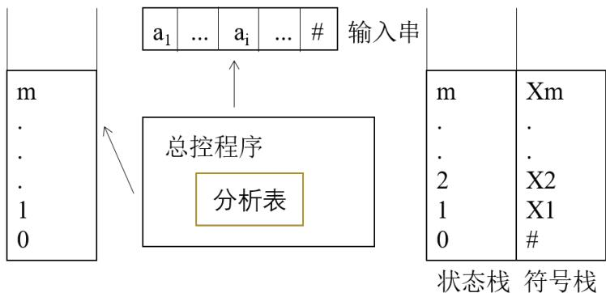

LR 分析器的核心是分析表，分析表由两个子表组成：

1）分析动作表

表 4.4 分析动作表

| | $a_1$ | $a_2$ | ... | $a_m$ |
|---|---|---|---|---|
| 0 | $\mathrm{ACTION}[0, a_1]$ | $\mathrm{ACTION}[0, a_2]$ | ... | $\mathrm{ACTION}[0, a_m]$ |
| 1 | $\mathrm{ACTION}[1, a_1]$ | $\mathrm{ACTION}[1, a_2]$ | ... | $\mathrm{ACTION}[1, a_m]$ |
| ... | ... | ... | ... | ... |
| n | $\mathrm{ACTION}[n, a_1]$ | $\mathrm{ACTION}[n, a_2]$ | ... | $\mathrm{ACTION}[n, a_m]$ |

分析动作表如表 4.4 所示，其中：$0, 1, \ldots, n$ 为分析器各状态，$a_1, a_2, \ldots, a_m$ 为文法的全部终结符号，句子界限符 $\mathrm{ACTION}[i, a_j]$ 指明：当状态 $i$ 面临输入符号 $a_j$ 时应采取的分析动作。$\mathrm{ACTION}[i, a_j]$ 有如下四个取值：

$\mathrm{ACTION}[i, a_j] = Sj$ 移进动作，当前输入符号 $a_j$ 进入符号栈，状态 $j$ 进入状态栈

# 《编译原理》第4章 语法分析（自编参考教材）

本资料为《编译原理》第4章“语法分析”部分的内容整理，主要涵盖 LR 分析器的工作原理、分析表的构造及分析过程示例。

## 一、LR 分析器的工作过程

### 1. 分析动作表与状态转换表

LR 分析器依赖于两张核心表格：**分析动作表（ACTION）**和**状态转换表（GOTO）**。

#### 分析动作表（ACTION）

`ACTION[i, aj]` 的值规定了在状态 $i$ 面对输入符号 $a_j$ 时的动作，主要包括以下四种情况：

- `ACTION[i, aj] = S_k`：移进动作，将状态 $k$ 推入状态栈。
- `ACTION[i, aj] = r_j`：归约动作，按第 $j$ 个产生式进行归约。
- `ACTION[i, aj] = acc`：接受动作，表示分析成功。
- `ACTION[i, aj] = ERROR`：出错，报告错误。

#### 状态转换表（GOTO）

表 4.5 展示了状态转换表的结构。

| | $X_1$ | $X_2$ | ... | $X_p$ |
|---|---|---|---|---|
| 0 | GOTO[0, $X_1$] | GOTO[0, $X_2$] | ... | GOTO[0, $X_p$] |
| 1 | GOTO[1, $X_1$] | GOTO[1, $X_2$] | ... | GOTO[1, $X_p$] |
| ... | ... | ... | ... | ... |
| n | GOTO[n, $X_1$] | GOTO[n, $X_2$] | ... | GOTO[n, $X_p$] |

**说明：**
- $X_1, X_2, \dots, X_p$ 是文法字汇表中全部非终结符号。
- $S_1, S_2, \dots, S_n$ 为分析器各状态。
- GOTO[$S_i, X_j$] 指明当状态 $S_i$ 面对文法非终结符号 $X_j$ 时下一状态是什么。

### 2. LR 分析器的具体工作流程

LR 分析器的工作是在总控程序控制下进行的，其过程如下：

（1）**初始化**：分析开始时，首先将初始状态 0 及句子左界限符 `#` 推入分析栈，同时和输入串构成一个三元式为：

$$
(0, \#, a_1 a_2 \dots a_n \#)
$$

其中 0 为初态，`#` 为句子左界限符，$a_1 a_2 \cdots a_n$ 是输入串，其后的 `#` 为句子右界限符。

（2）**循环分析**：设在分析的某一步，分析栈和余留输入符号串表示为：

$$
(0 \dots m, \# X_1 X_2 \dots X_m, a_i a_{i+1} \dots a_n \#)
$$

这时用当前栈顶状态 $m$ 及正扫视的输入符号 $a_i$ 组成符号对去查分析动作表，并根据分析表中元素 ACTION[$m, a_i$] 所规定的动作进行分析。分析动作表每一元素 ACTION[$m, a_i$] 所规定动作不外是下列四种可能之一：

① **移进动作**：若 $\mathrm{ACTION}[m, a_i] = S_k$，为移进动作。这表明句柄尚未在栈顶部形成，正期待着移进输入符号以形成句柄，故将当前输入符号 $a_i$ 推入符号栈中，同时将新状态 $k$ 推入状态栈中，则三元式变为：

$$
(0 \dots m k, \# X_1 X_2 \dots X_m a_i, a_{i+1} a_{i+2} \dots a_n \#)
$$

② **归约动作**：若 $\mathrm{ACTION}[S_m, a_i] = r_j$，为归约动作。其中 $r_j$ 是指文法中第 $j$ 个规则 $A ::= \beta$，$\beta$ 是规则右部长度。此时按规则 $A ::= \beta$ 执行一次归约动作，这表明栈顶部的符号串 $X_{m-r+1} X_{m-r+2} \dots X_m$ 已是当前句型（对非终结符 A）的句柄。按第 $j$ 个产生式进行归约，此时将分析栈从顶向下的 $r$ 个符号退出，使状态 $m-r$ 变成栈顶状态，再将文法符号 $A$ 推入栈中，其三元式为：

$$
(0 \dots m - r, \# X_1 X_2 \dots X_{m-r} A, a_i a_{i+1} \dots a_n \#)
$$

然后再以 $(m-r, A)$ 查状态转换表，设 $\mathrm{GOTO}[m-r, A] = k$，将此新状态推入状态栈中则三元式变为：

$$
(0 \dots m - r k, \# X_1 X_2 \dots X_{m-r} A, a_i a_{i+1} \dots a_n \#)
$$

归约动作不改变现行输入符号，输入串指示器不向前推进，它仍然指向动作前的位置。

③ **接受动作**：若 $\mathrm{ACTION}[m, a_i] = \mathrm{acc}$，为接受动作，则表明当前输入串已被成功地分析完毕，则三元式不再变化，宣布分析成功。

④ **出错处理**：若 $\mathrm{ACTION}[m, a_i] = \mathrm{ERROR}$，则三元式变化过程终止，报告错误。

（3）**结束条件**：重复上述（2），直到在分析某一步，栈顶出现“接受状态”或“出错状态”为止。

对于前者，其三元式变为 $(0 z, \# Z, \#)$，其中 $Z$ 为文法开始符号，$z$ 则为使动作 $\mathrm{ACTION}[z, \#] = \text{"accept"}$ 即接受的唯一状态。

一个 LR 分析器工作过程就是一步一步地变换三元式，直至执行“接受”或“报错”为止。

## 二、LR 分析表构造与分析示例

### 1. 文法定义与分析表合并

**例 4.12** 设已知文法 G[E]：（首先对每个文法规则要编号）

① $E ::= E + T$
② $E ::= T$
③ $T ::= T * F$
④ $T ::= F$
⑤ $F ::= (E)$
⑥ $F ::= i$

为了节省空间，我们将文法 G[E] 分析动作表（ACTION）和状态转换表（GOTO）根据状态行进行合并，合并之后分析表如下表 4.6 所示。

**表 4.6 例 4.12 文法分析表**

| 状态 | ACTION(i) | ACTION(+) | ACTION(*) | ACTION(() | ACTION()) | ACTION(#) | GOTO(E) | GOTO(T) | GOTO(F) |
|:---:|:---:|:---:|:---:|:---:|:---:|:---:|:---:|:---:|:---:|
| 0 | $S_5$ | | | $S_4$ | | | 1 | 2 | 3 |
| 1 | | $S_6$ | | | | acc | | | |
| 2 | | $r_2$ | $S_7$ | | $r_2$ | $r_2$ | | | |
| 3 | | $r_4$ | $r_4$ | | $r_4$ | $r_4$ | | | |
| 4 | $S_5$ | | | $S_4$ | | | 8 | 2 | 3 |
| 5 | | $r_6$ | $r_6$ | | $r_6$ | $r_6$ | | | |
| 6 | $S_5$ | | | $S_4$ | | | | 9 | 3 |
| 7 | $S_5$ | | | $S_4$ | | | | | 10 |
| 8 | | $S_6$ | | | $S_{11}$ | | | | |
| 9 | | $r_1$ | $S_7$ | | $r_1$ | $r_1$ | | | |
| 10 | | $r_3$ | $r_3$ | | $r_3$ | $r_3$ | | | |
| 11 | | $r_5$ | $r_5$ | | $r_5$ | $r_5$ | | | |

**表中所引用记号的意义是：**
① $S_j$：把下一个状态 $j$ 和现行输入符号 $a_i$ 分别移进状态栈和符号栈。
② $r_j$：按第 $j$ 个规则进行归约。
③ acc：接受。
④ 空白格：出错标志，报错。

GOTO 表仅对所有非终结符 A 列出 GOTO[$m, A$] 的值，表明所要到达的状态的值。

### 2. LR 文法的概念

现以输入串为 $i+i*i$ 为例，给出 LR 分析器对它进行分析的过程，具体如下表 4.7 所示。

现在我们主要关心的问题是，如何根据给定文法来构造 LR 分析表。对于一个文法，如果能够构造出一张分析表，且表中的每个条目都是唯一的（要么为空格，要么为唯一的某个动作），则把这个文法称为 **LR 文法**。并非所有上下文无关文法都是 LR 文法。但大多数高级程序设计语言一般都可用 LR 文法来描述。直观上说，对于一个 LR 文法，当分析器对输入串进行自左至右扫描时，一旦句柄出现在栈顶，就能及时对它实行归约。

LR 分析器能够用来作出移进-归约决定的一个信息源是向前看 K 个输入符号。一般而言，一个文法，如果能用一个每步顶多向前看 K 个输入符号的 LR 分析器进行分析，则这个文法称为 **LR(K)** 文法。但对大多数高级程序设计语言而言，K=0 或 1 就足够了。因此本书只考虑 K≤1 的情形。

对于一个文法，如果它的任一“移进-归约”分析器存在如下情形：尽管栈的内容和向前看的下一个输入符号都已知悉，但依旧无法确定是采用移进动作还是归约动作；或者，无法从几种可能的归约动作中确定其一，那么这个文法就不是 LR 文法。此外，一个 LR 文法肯定是无二义的，一个不加改造的二义性文法绝不会是 LR 文法。

### 3. 分析过程示例

**表 4.7 $i+i*i$ 的 LR 分析过程**

| 步骤 | 状态栈 | 符号栈 | 输入串 | 分析动作 | 下一状态 |
|:---:|:---:|:---:|:---:|:---:|:---:|
| 1 | 0 | # | i+i*i# | $S_5$ | 5 |
| 2 | 05 | #i | +i*i# | $r_6$ | GOTO[0, F]=3 |
| 3 | 03 | #F | +i*i# | $r_4$ | GOTO[0, T]=2 |
| 4 | 02 | #T | +i*i# | $r_2$ | GOTO[0, E]=1 |
| 5 | 01 | #E | i*i# | $S_6$ | 6 |
| 6 | 016 | #E+ | i*i# | $S_5$ | 5 |
| 7 | 0165 | #E+i | *i# | $r_6$ | GOTO[6, F]=3 |
| 8 | 0163 | #E+F | *i# | $r_4$ | GOTO[6, T]=9 |
| 9 | 0169 | #E+T | *i# | $S_7$ | 7 |
| 10 | 01697 | #E+T* | i# | $S_5$ | 5 |
| 11 | 016975 | #E+T*i | # | $r_6$ | GOTO[7, F]=10 |
| 12 | 0169710 | #E+T*F | # | $r_3$ | GOTO[6, T]=9 |
| 13 | 0169 | #E+T | # | $r_1$ | GOTO[0, E]=1 |
| 14 | 01 | #E | # | acc | |

# 4.3.2 LR(0)分析表的构造

本节整理自《编译原理》第4章 语法分析（自编参考教材）第 7 部分，主要讲解 LR(0) 分析表构造的基础概念、LR(0) 项目的分类以及从 NFA 到 DFA 的转换过程。

## 一、规范句型的活前缀与 LR(0) 项目

### 1. 基本概念

**字的前缀**：是指字的任意首部。如字 $abc$ 的前缀有 $\varepsilon, a, ab, abc$。

**活前缀**：规范句型（右句型）的一个前缀，如果它不含句柄后任何符号，则称它是该规范句型的一个活前缀。也就是说在活前缀右边增添一些终结符号之后，就可以成为规范句型。

例如：$S \Rightarrow +abcdef$，其中 $cd$ 是句柄，则：
- $\varepsilon, a, ab, abc, abcd$ 是该规范句型的活前缀；
- 而 $abcd$ 是包含句柄的活前缀。

在 LR 分析过程中的任何时候，符号栈里的文法符号 $X_1 X_2 \dots X_m$ 应该构成活前缀，把输入串的剩余部分匹配上之后即成为规范句型（如果整个输入串确实构成一个句子的话）。

作为规范句型的活前缀不含有句柄后的任何符号。因此，前缀与句柄的关系可能有三种情况：

1. **活前缀已包含句柄全部符号**：这表明规则 $A::=\beta$ 的右部符号串 $\beta$ 已在符号栈顶形成，因此相应的分析动作应是用此规则进行归约。该可归约的活前缀用 $A::=\beta \cdot$ 表示。（注：原文识别乱码较多，此处依据上下文修正为标准的 LR(0) 项目表示法）
2. **活前缀中只包含句柄的一部分符号**：意味着形如规则 $A::=\beta_1 \beta_2$ 的右部的左边子串 $\beta_1$ 已出现在符号栈顶，正期待着从余留输入串中看到能由右边子串 $\beta_2$ 推出的符号串依次入栈。我们用 $A::=\beta_1 \cdot \beta_2$ 表示。
3. **活前缀不包含句柄的任何符号**：这表明规则 $A::=\beta$ 的右部符号串 $\beta$ 中的符号均不在符号栈顶，正期待从余留输入串中由规则 $A::=\beta$ 的 $\beta$ 所能推出的符号串依次入栈。我们用 $A::=\cdot \beta$ 表示。

### 2. LR(0) 项目定义

我们把右部某位置上标有圆点的规则称为相应文法的一个 **LR(0) 项目**。特别地，对形如 $A::=\varepsilon$ 的规则，相应 LR(0) 项目为 $A::=\cdot$。

例如：
- $A::=\beta \cdot$ 一个 LR(0) 项目
- $A::=\beta_1 \cdot \beta_2$ 一个 LR(0) 项目
- $A::=\cdot \beta$ 一个 LR(0) 项目
- 若 $A::=\varepsilon$，则 $A::=\cdot$ 一个 LR(0) 项目

对于规则 $A::=aBC$，根据圆点的位置不同可以产生四个 LR(0) 项目：
1. $A::=\cdot aBC$：正期待着从余留输入串中由 $aBC$ 推出的符号串依次进栈。
2. $A::=a \cdot BC$：$a$ 已进栈，正期待着从余留输入串中由 $BC$ 推出的符号串依次进栈。
3. $A::=aB \cdot C$：$aB$ 推出的符号串进栈，正期待着从余留输入串中由 $C$ 推出的符号串依次进栈。
4. $A::=aBC \cdot$：$aBC$ 推出的符号串均已进栈形成当前句柄。

对于规则 $A::=\beta$，对应项目数为 $|\beta| + 1$ 个（$|\beta|$ 表示 $\beta$ 所含字符的个数）。显然，不同的 LR(0) 项目反映了分析过程中栈顶的不同情况。

Knuth 证明了一个 LR 文法的右句型的所有活前缀能够为有穷自动机所接受。我们可以把文法 $G$ 中每一个项目作为非确定有穷自动机的一个状态，通过构造 NFA，然后再将其确定化为 DFA。

### 3. 实例分析：例 4.12

设有文法 $G[E] = (\{E, A, B\}, \{a, b, c, d\}, P, E)$，其中 $P$ 由下列规则组成：
1. $E::=aA$
2. $E::=bB$
3. $A::=cA$
4. $A::=d$
5. $B::=cB$
6. $B::=d$

为了方便起见，我们在上述文法中引入一个新的开始符号 $S'$，并将 $S'::=E$ 作为第 0 个规则，从而得到所谓 $G$ 的拓广文法 $G'$，显然 $L(G)=L(G')$。将文法拓广的目的是使文法只有一个开始符作为左部规则，这样构造出来的分析器有唯一的接受项目。否则 $E::=aA$ 和 $E::=bB$ 就有两个归约项目。

对于文法 $G'$，其 LR(0) 项目共有 18 个，列举如下：
1. $S'::=\cdot E$
2. $S'::=E \cdot$
3. $E::=\cdot aA$
4. $E::=a \cdot A$
5. $E::=aA \cdot$
6. $A::=\cdot cA$
7. $A::=c \cdot A$
8. $A::=cA \cdot$
9. $A::=\cdot d$
10. $A::=d \cdot$
11. $E::=\cdot bB$
12. $E::=b \cdot B$
13. $E::=bB \cdot$
14. $B::=\cdot cB$
15. $B::=c \cdot B$
16. $B::=cB \cdot$
17. $B::=\cdot d$
18. $B::=d \cdot$

我们可根据它们不同的作用，将一个文法全部的 LR(0) 项目分为三类：

#### （1）归约项目
对于形如 $A::=\beta \cdot$ 的项目，因为它表明右部符号串 $\beta$ 已出现在符号栈顶，此时相应分析动作应按规则进行归约，称此种项目为**归约项目**。
上例中的项目 (2), (5), (8), (10), (13), (16), (18) 都是归约项目。
对于项目 (2) 显然仅用于分析过程中最后一次归约，它表明整个分析过程已成功地完成，是一个特殊的归约项目，称之为**接受项目**。

#### （2）移进项目
对于形如 $A::=\beta_1 \cdot a \beta_2$，其中 $\beta_1$ 可以是 $\varepsilon$，$a$ 是终结符，相应分析动作应将当前输入符号 $a$ 移入栈中，故称此项目为**移进项目**。
上例中项目 (3), (6), (9), (11), (14), (17) 都是移进项目。

#### （3）待约项目
对于形如 $A::=\beta_1 \cdot B \beta_2$，其中 $\beta_1$ 可以是 $\varepsilon$，$B$ 是非终结符，由于我们期待着从余留输入符号串中进行归约而得到 $B$，称此类项目为**待约项目**。
上例中的 (1), (4), (7), (12), (15) 都是待约项目。

上述文法共有 18 个 LR(0) 项目，所以可以构造一个具有 18 个状态的 NFA。并规定项目 (1) 为初始状态。

## 二、NFA 的构造方法

NFA 构造方法如下：

### 1. 状态转移弧

（1）如果状态 $i$ 和 $j$ 出自同一规则，而且状态 $j$ 的圆点只落后于状态 $i$ 的圆点一个位置，如状态 $i$ 表示如下：

$$
A::=X_1 X_2 \dots X_{i-1} \cdot X_i X_{i+1} \dots X_m
$$

而状态 $j$ 表示如下：

$$
A::=X_1 X_2 \dots X_{i-1} X_i \cdot X_{i+1} \dots X_m
$$

则从状态 $i$ 出发，画一条标记为 $X_i$ 的弧到状态 $j$。

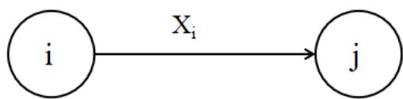

### 2. ε 弧转移

（2）如果状态 $i$ 圆点之后那个符号 $X_i$ 为非终结符，那么从状态 $i$ 画 $\varepsilon$ 弧到所有形如 $X_i::=\cdot \beta$ 的项目（状态 $j$）。

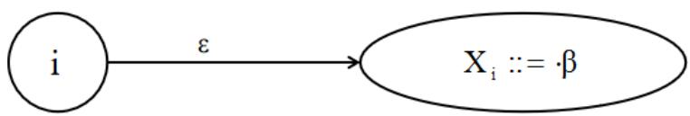

例如文法 $G'$ 状态 (1) 圆点之后那个符号是 $E$，为非终结符号，那么从状态 (1) 画 $\varepsilon$ 弧到所有形如 $E::=\cdot \beta$ 的项目（状态），即 (3) 状态 $(E::=\cdot aA)$ 和 (11) 状态 $(E::=\cdot bB)$。*(注：原文此处识别有误，根据逻辑应为对应 E 的产生式)*

### 3. 终态判定

（3）凡是属于归约项目的状态是 NFA 的终态，即识别可归约活前缀的终态。

根据上述方法很容易构造出 $\varepsilon$-NFA 状态转换图，图中状态 (1) 是唯一的初态。画双圆圈者是可归约状态，即识别可归约活前缀的终态。

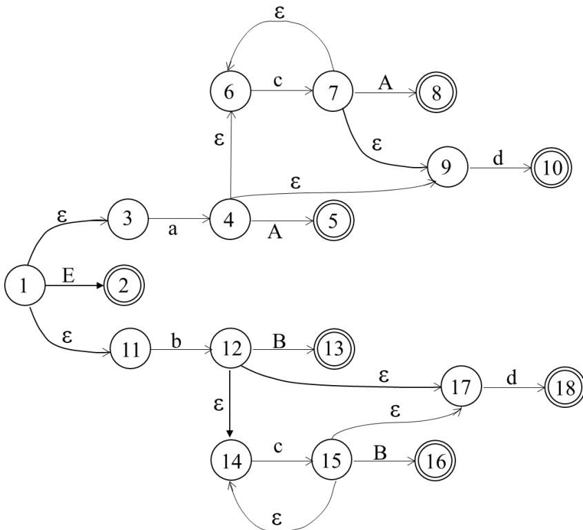

显然，NFA 可以识别文法 $G$ 的活前缀：从 NFA 的开始状态 (1) 出发，沿着弧所指示的方向前进，当到达某一双圆圈状态时，把所经历的全部弧上的标记依次连成一符号串，此字符串就是某规范句型的一个可归约活前缀，若到达其他任一状态所得符号串就是规范句型活前缀。如可归约活前缀 $bcB$，规范句型活前缀 $bc$。

## 三、NFA 确定化为 DFA

我们采用子集法，消去 $\varepsilon$，将 NFA 确定化使其变成 DFA，然后将每一个集合(状态集合)作为 DFA 一个状态，如 $I_0, I_1, I_2, \dots$，这样，就可以画出 DFA 状态转换图，其转换图的每一个状态都是以项目集合来表示，如 $I_0 = \{ S'::=\cdot E, E::=\cdot aA, E::=\cdot bB \}$，具体见图 4.6。

## 4.4.3 由文法项目直接构造识别活前缀的 DFA

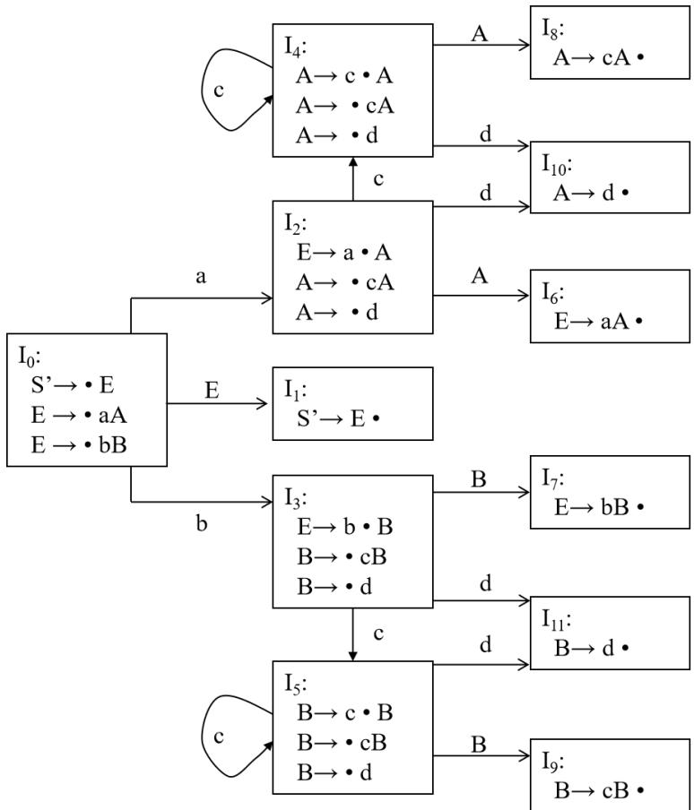

上述的过程较为复杂，尤其是子集法的采用，我们期望能够直接由文法项目构造出 DFA，然后再由 DFA 构造出分析表。下面首先考察 DFA 状态与文法项目的关系。

### （1）DFA 状态与文法项目的关系

由 DFA 状态转换图可以看出：DFA 的每一状态都是一个项目子集。其中 $\mathrm{I}_0 = \{ \mathrm{S}'::=\bullet\ \mathrm{E},\ \mathrm{E}::=\bullet\ \mathrm{aA},\ \mathrm{E}::=\bullet\ \mathrm{bB} \}$。

首先来看一下状态 $\mathrm{I}_0$ 中包含的各个项目是如何确定的：规定 $\mathrm{S}'::=\cdot\ \mathrm{E}$ 是属于 $\mathrm{I}_0$ 的一个项目，而 E 又是非终结符，E 的规则为：$\mathrm{E}::=\mathrm{aA}\mid\mathrm{bB}$，所以状态 $\mathrm{I}_0$ 还包含 $\mathrm{E}::=-\mathrm{aA}$ 和 $\mathrm{E}::=\cdot\ \mathrm{bB}$。由此即得状态 $\mathrm{I}_0$ 的项目子集为 $\{ \mathrm{S}'::=\cdot\ \mathrm{E},\ \mathrm{E}::=\bullet\ \mathrm{aA},\ \mathrm{E}::=\bullet\ \mathrm{bB} \}$。

根据上述分析，可以得到以下结论：

若 NFA 的某一状态的相应项目为 $\mathrm{A}::=\beta_1\cdot\mathrm{B}\beta_2$，且 B 是非终结符号，如果有形如 $\mathrm{B}::=\beta$ 的规则，其所有相应项目 $\mathrm{B}::=\cdot\ \beta$ 均为项目子集中的项目，如果新获得项目圆点之后的符号又为非终结符号，则又按如上所述方法派生出新的项目，如此继续下去，直到全部新派生项目的圆点之后的符号为终结符号或圆点之后无符号为止。

这时，所有派生出的新项目连同原有项目一起构成一个项目子集，作为 DFA 的一个状态（如：状态 $\mathrm{I}_0$）。实际上，我们将项目 $\mathrm{S}'::=\cdot\ \mathrm{E}$ 称为项目集 $\mathrm{I}_0$ 的基本项目，上述从项目 $\mathrm{S}'::=\cdot\ \mathrm{E}$ 出发构造项目集 $\mathrm{I}_0$ 的过程可看作是对基本项目集 $\{ \mathrm{S}'::=\cdot\ \mathrm{E} \}$ 的闭包运算，用 $\mathrm{CLOSURE}(\{ \mathrm{S}'::=\bullet\ \})$ 来表示。一般地，设 I 为一项目集，则构造 I 的闭包 CLOSURE(I) 的方法如下：

① I 中每一项目都属于 CLOSURE(I)；

② 若形如 $\mathrm{A}::=\beta_1\bullet\mathrm{B}\beta_2$ 的项目属于 CLOSURE(I)，那么，对于任何有关 B 推导出的规则 $\mathrm{B}::=\beta$，相应的项目 $\mathrm{B}::=\cdot\ \beta$ 也属于 $\mathrm{CLOSURE(I)}$；

③ 重复执行上述两步骤，直至 CLOSURE(I) 不再增大为止。

显然，$\mathrm{CLOSURE}(\{ \mathrm{S}'::=\bullet\ \mathrm{E} \}) = \{ \mathrm{S}'::=\bullet\ \mathrm{E},\ \mathrm{E}::=\bullet\ \mathrm{aA},\ \mathrm{E}::=\bullet\ \mathrm{bB} \}$，这就是图 4.6 中的初态 $\mathrm{I}_0$。

### （2）DFA 转换函数与文法项目的关系（即从一个状态到另一个状态的弧上标记）

分析 DFA 状态图：状态 $\mathrm{I}_0$ 中有项目 $\mathrm{S}'::=\cdot\ \mathrm{E}$，所以可以由状态 $\mathrm{I}_0$ 画一标记为 E 的弧指向下一状态 $\mathrm{I}_1$，$\mathrm{I}_1$ 包含项目 $\mathrm{S}'::=\mathrm{E}\cdot$，圆点向后移一位。

由此得出结论：设 X 为一个文法符号（终结符或非终结符），若 $\mathrm{I_i}$ 中有圆点位于 X 左边的项目，形如 $\mathrm{A}::=\beta_1\cdot\mathrm{X}\beta_2$（$\beta_1$ 可以是 $\varepsilon$），则可从 $\mathrm{I_i}$ 出发画一条弧，标记为 X，到下一状态；设此新状态为 $\mathrm{I_j}$，其中项目 $\mathrm{A}::=\beta_1\mathrm{X}\cdot\beta_2$ 为 J，J 显然是新状态集合 $\mathrm{I_j}$ 中的一个基本项目，因此，按照上面构造项目集 $\mathrm{I}_0$ 的方法，我们就有 $\mathrm{I_j}=\mathrm{CLOSURE(J)}$。

例如：$\mathrm{I}_0$ 中有项目 $\mathrm{S}'::=\cdot\ \mathrm{E}$（$\beta_1$ 和 $\beta_2$ 是 $\varepsilon$），从 I 出发画一条弧，标记为 E，到下一状态 $\mathrm{I}_1$，圆点向后移一位，则 $\mathrm{I}_1$ 中有基本项目 $\mathrm{J}=\{ \mathrm{S}'::=\mathrm{E}\cdot \}$。由于项目 $\mathrm{S}'::=\mathrm{E}\cdot$ 的圆点后无符号，所以 $\mathrm{I}_1=\{ \mathrm{S}'::=\mathrm{E}\cdot \}$。

同样 $\mathrm{I}_0$ 中有项目 $\mathrm{E}::=\bullet\ \mathrm{aA}$（$\beta_1$ 是 $\varepsilon$），从 $\mathrm{I}_0$ 出发画一条弧标记为 a，到下一状态 $\mathrm{I}_2$，圆点向后移一位，则 $\mathrm{I}_2$ 中有基本项目 $\mathrm{J}=\{ \mathrm{E}::=\mathrm{a}\cdot\mathrm{A} \}$。则 $\mathrm{I}_2=\mathrm{CLOSURE(J)}=\mathrm{CLOSURE}(\{ \mathrm{E}::=\mathrm{a}\bullet\mathrm{A} \})$。那么按照构造 I 的闭包 CLOSURE(I) 的方法，可求得 $\mathrm{I}_2=\{ \mathrm{E}::=\mathrm{a}\bullet\mathrm{A},\ \mathrm{A}::=\bullet\ \mathrm{cA},\ \mathrm{A}::=\bullet\ \mathrm{d} \}$。

为了指明状态 $\mathrm{I_j}$ 和状态 $\mathrm{I_i}$ 之间的这种转换关系，我们定义一个状态转换函数：

$$
\mathrm{GO}(\mathrm{I_i},\mathrm{X})=\mathrm{CLOSURE}(\mathrm{J})
$$

其中，$\mathrm{I_i}$ 为当前状态，X 为文法符号，J 是基本项目集，$\mathrm{J}=\{$ 任何形如 $\mathrm{A}::=\beta_1\mathrm{X}\cdot\beta_2$ 的项目 $|$ $\mathrm{A}::=\beta_1\cdot\mathrm{X}\beta_2$ 属于 $\mathrm{I_i}\}$。

例如：$\mathrm{I}_0$ 中有项目 $\mathrm{E}::=\bullet\ \mathrm{bB}$，$\mathrm{I}_3=\mathrm{GO}(\mathrm{I}_0,\mathrm{b})=\mathrm{CLOSURE(J)}$，$\mathrm{J}=\{ \mathrm{E}::=\mathrm{b}\cdot\mathrm{B} \}$，由于有文法规则 $\mathrm{B}::=\mathrm{cB}$ 和 $\mathrm{B}::=\mathrm{d}$，所以 $\mathrm{I}_3=\{ \mathrm{E}::=\mathrm{b}\bullet\mathrm{B},\ \mathrm{B}::=\bullet\ \mathrm{cB},\ \mathrm{B}::=\bullet\ \mathrm{d} \}$。

上面我们分析了 DFA 中状态和文法项目之间的关系、DFA 中转换函数和文法项目之间的关系，所以我们由文法构造 DFA 时，就不必先构造 NFA 然后再用子集法来构造 DFA，我们可以直接由文法来构造 DFA 了。

## 4.3 LR（0）分析表的构造

对于 LR（0）文法，我们构造出识别活前缀的DFA后，就可以根据DFA的状态转换图来构造 LR（0）分析表。下面给出构造 LR（0）分析表的算法：

假定 $C = \{ I_0, I_1, I_2, I_3, \dots, I_n \}$ ，为了方便起见，我们用整数 0，1，2，3，…，n 表示状态 $I_0, I_1, I_2, I_3, \dots, I_n$ 。

1. 若 $\text{GO}(I_i, X) = I_j$ ，对于 $I_i$ 中形如 $A ::= \beta_1 \bullet X \beta_2$ 的项目：
   - 若 $X = a \in V_T$ （终结符），则置 $\text{ACTION}[i, a] = S_j$
   - 若 $X \in V_N$ （非终结符），则置 $\text{GOTO}[i, X] = j$

   **示例：**
   - $I_0$ 中有 $E ::= \bullet a A$ ，且 $\text{GO}(I_0, a) = I_2$ ，因 $a \in V_T$ ，所以置 $\text{ACTION}[0, a] = S_2$
   - $I_2$ 中有 $E ::= a \bullet A$ ，且 $\text{GO}(I_2, A) = I_6$ ，因 $A \in V_N$ ，所以置 $\text{GOTO}[2, A] = 6$ （见表 4.6）。

2. 若归约项目 $A ::= \beta \bullet$ 属于 $I_i$ ，假设 $A ::= \beta$ 是文法第 $j$ 条规则，则对任意终结符号 $a$ 和句子右界限符 `#`，均置 $\text{ACTION}[i, a/\#] = r_j$ ，表示按文法第 $j$ 条规则将符号栈顶的符号串 $\beta$ 归约为 $A$。

   **示例：**
   - $I_6$ 中有项目 $E ::= a A \bullet$ ，其规则 $E ::= a A$ 是文法的第 1 条规则，所以置 $\text{ACTION}[6, a] = \text{ACTION}[6, b] = \text{ACTION}[6, c] = \text{ACTION}[6, d] = \text{ACTION}[6, \#] = r_1$

3. 若接受项目 $S' ::= S \bullet$ 属于 $I_i$ ，则置 $\text{ACTION}[i, \#] = \text{acc}$ ，表示接受。

   **示例：**
   - $S' ::= E \bullet$ 属于 $I_1$ ，所以置 $\text{ACTION}[1, \#] = \text{acc}$

4. 分析表中，凡不能用前 3 条规则填入信息的空白格位置，均表示出错。

构成识别一个文法的活前缀的 DFA 的项目集（状态）的全体称为这个文法的 **LR（0）项目集规范族**。上例中文法 $G[E]$ 的 LR（0）项目集规范族为 $\{ I_0, I_1, I_2, I_3, \dots, I_{11} \}$ 。

如果一个项目集中既有移进项目又有归约项目，或一个项目集中有两个以上的不同归约项目，则称这些项目是**冲突项目**。前面我们构造的项目集中还没有冲突项目。

如果一个文法的项目集规范族的每个项目集中均不存在任何冲突项目，则称该文法为 **LR（0）文法**。

**示例：** 上例文法的 LR（0）项目集规范族的每个项目集中就不存在冲突项目，所以该文法就是 LR（0）文法。

### 例 4.13

已知文法 $G[S]$ ：
$$
\begin{aligned}
S &::= a A a \\
S &::= a B b \\
A &::= c \\
B &::= c
\end{aligned}
$$

构造识别活前缀的DFA，并完成其分析表。

对文法 $G[S]$ 的规则进行排序：
1. $S ::= a A a$
2. $S ::= a B b$
3. $A ::= c$
4. $B ::= c$

构造识别活前缀的DFA如图4.7所示。

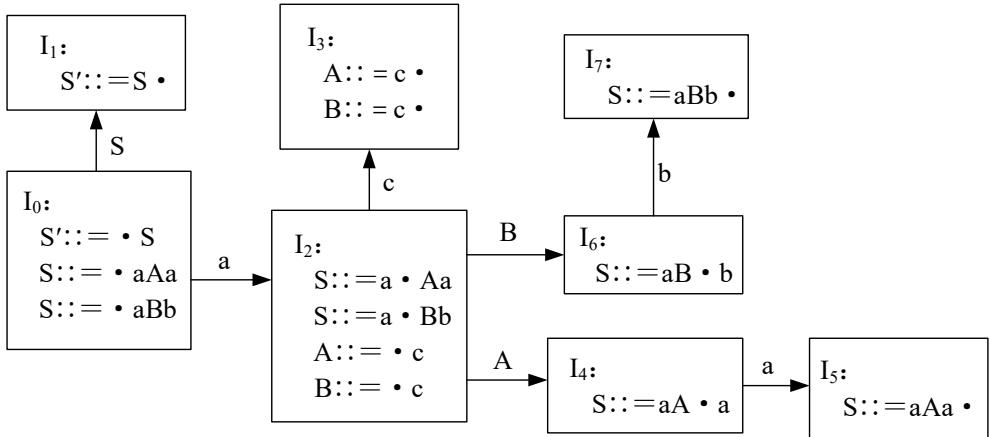

从表4.8可以看出，按照 LR（0）的方法构造出来的分析表含有多重定义入口，因此该文法不是 LR（0）文法。

**表 4.8 例 4.13 文法的 LR（0）分析表**

| 状态 | ACTION | | | | GOTO | | |
| :---: | :---: | :---: | :---: | :---: | :---: | :---: | :---: |
| | **a** | **b** | **c** | **#** | **S** | **A** | **B** |
| 0 | $S_2$ | | | | 1 | | |
| 1 | | | | acc | | | |
| 2 | | | $S_3$ | | | 4 | 6 |
| 3 | $r_3/r_4$ | $r_3/r_4$ | $r_3/r_4$ | $r_3/r_4$ | | | |
| 4 | $S_5$ | | | | | | |
| 5 | $r_1$ | $r_1$ | $r_1$ | $r_1$ | | | |
| 6 | | $S_7$ | | | | | |
| 7 | $r_2$ | $r_2$ | $r_2$ | $r_2$ | | | |

## 4.3.3 SLR（1）分析表的构造

上面介绍的 LR（0）方法，是从左向右扫描源程序，当到达某规则右部最右符号时，便识别出这条规则，并且对于每一句柄，无需查看句柄之外的任何输入符号。这种分析方法要求文法的每一个项目集都不含冲突性的项目。但通常程序设计语言文法不符合这种要求。

例如：LR（0）项目集规范族中有这样一个项目集 $I_i$ ：
$$ I_i = \{ A ::= \beta_1 \bullet \theta \beta_2, \quad B ::= \beta \bullet, \quad C ::= \beta \bullet \} $$
其中第一个项目是移进项目，第二和第三个项目是归约项目。仔细分析前面讨论的 LR（0）分析表的构造算法可以知道，由于这三个项目相互冲突，因而使得 LR（0）分析表中出现多重定义的分析动作。

其原因在于 LR（0）分析表构造规则（2）：当有归约项目 $B ::= \beta \bullet$ 时，无论当前输入符号是什么，在 LR（0）分析表的第 $i$ 行动作子表上均置 $r_j$ （假定 $B ::= \beta$ 是文法第 $j$ 条规则）；同样道理，对于项目 $C ::= \beta \bullet$ ，仍在 LR（0）分析表第 $i$ 行动作子表上均置 $r_m$ （假定 $C ::= \beta$ 是文法第 $m$ 条规则）。

而 $I_i$ 中第一个项目 $A ::= \beta_1 \bullet b \beta_2$ ，假设读入字符 $b$ ， $I_i$ 将引申一条箭弧到 $I_j$ ，这意味着将下一输入符 $b$ 移进分析符号栈，于是又发生了是归约还是移进的冲突；如果归约，到底是将栈顶 $\beta$ 归约为 $B$ ，还是归约为 $C$ 。这样使得在 LR（0）分析表第 $i$ 行上产生了多重定义。具体如表4.9 所示。

## 4.3 SLR(1) 分析

### LR(0) 分析表中的冲突示例

在 LR(0) 分析表构造过程中，若存在归约项目 $A ::= \beta \cdot$ 属于状态集 $I_i$，且 $A ::= \beta$ 是文法第 $j$ 条规则，则对任意终结符 $a$ 和句子右界限符 $\#$，均置 $\text{ACTION}[i, a/\#] = r_j$。这表示按文法第 $j$ 条规则将符号栈顶符号串 $\beta$ 归约为 $A$。由于不考虑句柄后任一符号（即不向前看符号），一律置为 $r_j$，所以当有两个以上归约项目时会出现冲突。

表 4.9 LR(0) 分析表中的冲突示例

| 状态 | ACTION | | | | GOTO | | |
| :---: | :---: | :---: | :---: | :---: | :---: | :---: | :---: |
| | a | b | ... | # | A | B | C |
| 0 | | | | | | | |
| ... | | | | | | | |
| i | $r_j/r_m$ | $S_j/r_j/r_m$ | $r_j/r_m$ | $r_j/r_m$ | | | |
| ... | | | | | | | |

解决这种冲突的办法是在第 $i$ 行上根据输入符号 $a$ 决定唯一的分析动作。为此我们引入 SLR(1) 分析法，下面介绍其分析表的构造。

首先解决冲突项目。对于项目集 $I_i = \{ A ::= a_1 \bullet a_2, B ::= \alpha \bullet, C ::= \gamma \bullet \}$，如果集合 FOLLOW(B) 和 FOLLOW(C) 不相交，而且不包含 $a_2$，那么，当 $I_i$ 表示的状态遇到任何输入符号 $a$ 时，可采取如下“移进—归约”的方法：

1.  当 $a = a_2$ 时，则执行移进动作，置 $\text{ACTION}[i, a] = S_j$；
2.  当 $a \in \text{FOLLOW}(B)$ 时，执行归约动作且置 $\text{ACTION}[i, a] = r_j$；
3.  当 $a \in \text{FOLLOW}(C)$ 时，执行归约动作且置 $\text{ACTION}[i, a] = r_m$；
4.  当 $a$ 不属于以上三种情况时，置 $\text{ACTION}[i, a] = \text{ERROR}$。

一般地，若一个项目集 $I_i$ 含有多个移进项目和归约项目，例如：
$I_i = \{ A_1 ::= a_1 \bullet a_2 \beta_1, A_2 ::= a_2 \bullet a_3 \beta_2, \dots, A_m ::= a_m \bullet a_{m+1} \beta_m, B_1 ::= \alpha_1 \bullet, B_2 ::= \alpha_2 \bullet, \dots, B_n ::= \alpha_n \bullet \}$。
如果集合 $\{a_2, a_3, \dots, a_{m+1}\}, \text{FOLLOW}(B_1), \text{FOLLOW}(B_2), \dots, \text{FOLLOW}(B_n)$ 两两不相交时，可根据不同的当前符号，对 $I_i$ 中的冲突动作进行区分。这种解决“移进—归约”冲突的方法称作 SLR 方法。

有了 SLR 方法之后，只须对 LR(0) 分析表构造规则 (2) 进行修改，其它规则保持不变。即若归约项目 $A ::= \alpha \cdot$ 属于 $I_i$，设 $A ::= \alpha$ 是文法第 $j$ 条规则，则对所有属于 FOLLOW(A) 的输入符号 $a$，置 $\text{ACTION}[i, a] = r_j$。

对于给定的文法 $G$，若按上述方法构造的分析表不含多重定义的元素，则称文法 $G$ 是 SLR(1) 文法。这里，SLR(1) 中的 S 代表 Simple（简单）的意思，而数字 1 代表查看句柄外一个输入符号，即在分析过程中至多只需要向前查看一个符号。

将例 4.13 文法的 LR(0) 分析表修改为 SLR(1) 分析表，见表 4.10 所示。

表 4.10 例 4.13 文法的 SLR(1) 分析表

| 状态 | ACTION | | | | GOTO | | |
| :---: | :---: | :---: | :---: | :---: | :---: | :---: | :---: |
| | a | b | c | # | S | A | B |
| 0 | $S_2$ | | | | 1 | | |
| 1 | | | | acc | | | |
| 2 | | | $S_3$ | | | 4 | 6 |
| 3 | $r_3$ | $r_4$ | | | | | |
| 4 | $S_5$ | | | | | | |
| 5 | | | | $r_1$ | | | |
| 6 | | $S_7$ | | | | | |
| 7 | | | | $r_2$ | | | |

由 SLR(1) 分析表的构造可知 SLR(1) 分析法有如下优点：状态数少，造表简单；大多数高级程序设计语言都能用 SLR(1) 文法描述。同时 SLR(1) 分析法也存在不足，即如果冲突项目的非终结符 FOLLOW 集与有关集合相交时，就不能用 SLR(1) 方法解决。下面再来看一个例子。

**例 4.14** 已知文法 $G[S]$：

*(注：原文此处未显示具体文法内容，直接引用了图)*

构造识别活前缀的 DFA 如图 4.8 所示和 SLR(1) 分析表如表 4.11 所示。

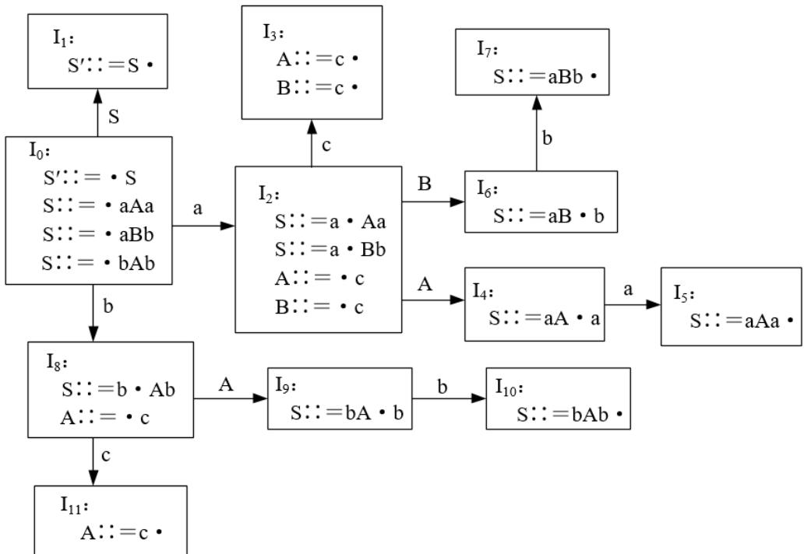

# 《编译原理》第 4 章 语法分析（自编参考教材）

本资料整理自《编译原理》第 4 章 语法分析（自编参考教材）第 28–30 页内容，主要涵盖 LR(1) 与 LALR(1) 分析表的构造方法及相关示例。

## 一、LR(1) 分析法的引入与定义

由图 4.8 和表 4.11 可知，项目集 $I_3 = \{ A::=c\cdot, B::=c\cdot \}$ 存在“归约—归约”冲突。由于 $\mathrm{FOLLOW}(A) = \{a, b\}$ 与 $\mathrm{FOLLOW}(B) = \{b\}$ 相交，故上述冲突不能通过 SLR(1) 分析法得到解决。产生这种困境的原因是 SLR(1) 分析法包含的信息还不够。所以在归约时，不但要向前看一个符号，而且还要看栈中符号串的情况，才可以知道用哪条规则归约。为了解决这个问题，我们必须将原 LR(0) 的项目定义加以扩充，变成 LR(1) 项目，也就是说，还要看符号栈中活前缀是什么，再选择相应规则进行归约。

### 4.3.4 LR(1) 分析表的构造

一个 LR(1) 项目 $[A::=\alpha\cdot\beta, a]$ 对活前缀 $\gamma = \delta a$ 有效，是指存在规范推导 $S'::=\Rightarrow^* \delta A \omega \Rightarrow \delta a \beta \omega$（显然 $\delta a \beta$ 是可归约活前缀），且满足下列条件：

1. 当 $\omega \neq \varepsilon$ 时，$a$ 是 $\omega$ 首符号；
2. 当 $\omega = \varepsilon$ 时，$a = \#$。

构造有效的 LR(1) 项目集规范族的方法本质上和构造 LR(0) 项目集规范族的方法是一样的。我们也需要两个函数 CLOSURE 和 GO。

假定 $I$ 是一个项目集，它的闭包 CLOSURE($I$) 可按下述方式构造：

1. $I$ 的任何项目都属于 CLOSURE($I$)；
2. 若项目 $[A::=\alpha\cdot B\beta, a]$ 属于 CLOSURE($I$)，并对活前缀 $\gamma = \delta a$ 有效，若有 $B::=\eta$ 规则，那么对 $\mathrm{FIRST}(\beta a)$ 中的每个终结符 $b$，形如 $[B::=\cdot\eta, b]$ 的所有项目也属于 CLOSURE($I$)；
3. 重复执行步骤 (2)，直到 CLOSURE($I$) 不再扩大，最终得到的 CLOSURE($I$) 便是 LR(1) 的一个项目集。

关于函数 GO($I, X$)，其中 $I$ 为一个 LR(1) 的项目集，$X$ 为一文法符号，与 LR(0) 分析法类似，我们将它定义为：

$$
\mathrm{GO}(I, X) = \mathrm{CLOSURE}(J)
$$

其中，$J = \{ [A::=\alpha X\cdot\beta, a] \mid [A::=\alpha\cdot X\beta, a] \in I \}$。

有了上述 CLOSURE($I$) 和 GO($I, X$) 的定义之后，采用与 LR(0) 相类似的方法可以构造出给定文法 $G$ 的 LR(1) 项目集规范族及其状态转换图。LR(1) 分析表的构造算法如下：

1. 若项目 $[A::=\alpha\cdot X\beta, b]$ 属于 $I_i$，且 $\mathrm{GO}(I_i, X) = I_j$，当 $X \in V_T$ 时，置 $\mathrm{ACTION}[i, X] = S_j$；当 $X \in V_N$ 时，则置 $\mathrm{GOTO}[i, X] = j$；
2. 若项目 $[A::=\alpha\cdot, a]$ 属于 $I_i$，设 $A::=\alpha$ 是文法第 $j$ 条规则，则置 $\mathrm{ACTION}[i, a] = r_j$，表示按文法第 $j$ 条规则将 $\alpha$ 归约为 $A$；
3. 若项目 $[S'::=S\cdot, \#]$ 属于 $I_i$，则置 $\mathrm{ACTION}[i, \#] = \text{acc}$，表示接受；
4. 分析表中不能按上述规则填入信息的空白格位置，均表示出错。

按照上述算法构造的分析表，若不存在多重定义的元素，则称此分析表为**规范 LR(1) 分析表**。使用这种分析表的分析器叫做**规范 LR 分析器**。具有规范 LR(1) 分析表的文法称为**LR(1) 文法**。

> [!NOTE]
> LR(1) 分析法比 LR(0)、SLR(1) 分析法适用范围更广，对多数高级程序设计语言而言有足够有效的分析能力。若 LR(1) 分析法不可进行有效分析，即分析表项仍有多重定义，可继续向前搜索 $K$ 个符号 ($K \geqslant 2$)，相应分析表称 LR(K) 分析表，具有 LR(K) 分析表的文法称为规范 LR(K) 文法。值得强调的是，任何二义性文法都不是 LR(K) 文法。

#### 例 4.15

对如下文法 $G$：

$$
S ::= S(S) \quad | \quad \varepsilon
$$

构造 LR(1) 项目集规范族以及 LR(1) 分析表。

引入开始符号 $S'$。则拓广文法及规则编号如下：

- (0) $S' ::= S$
- (1) $S ::= S(S)$ （编号 $r_1$）
- (2) $S ::= \varepsilon$ （编号 $r_2$）

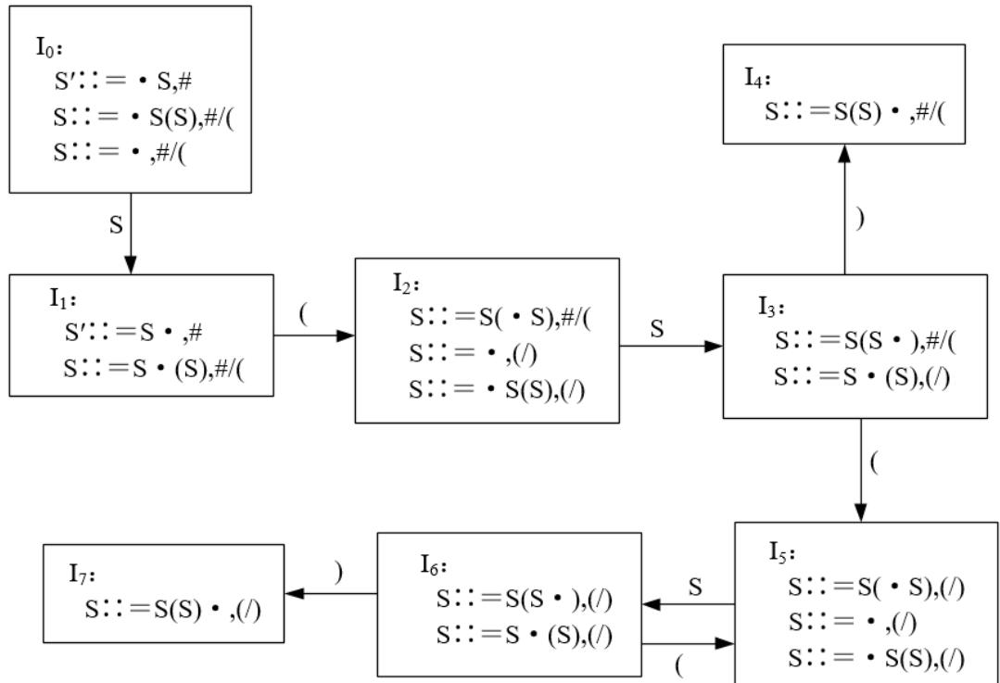

LR(1) 分析表如下表 4.12 所示：

**表 4.12 例 4.15 文法的 LR(1) 分析表**

| 状态 | ACTION | | | GOTO |
| :---: | :---: | :---: | :---: | :---: |
| | `(` | `)` | `#` | `S` |
| 0 | $r_2$ | | $r_2$ | 1 |
| 1 | $S_2$ | | acc | |
| 2 | $r_2$ | $r_2$ | | 3 |
| 3 | $S_5$ | $S_4$ | | |
| 4 | $r_1$ | | $r_1$ | |
| 5 | $r_2$ | $r_2$ | | 6 |
| 6 | $S_5$ | $S_7$ | | |
| 7 | $r_1$ | $r_1$ | | |

## 二、LALR(1) 分析表的构造

### 4.3.5 LALR(1) 分析表的构造

LALR 分析法与 SLR 分析法类似，但功能比 SLR(1) 强，比 LR(1) 弱，且 LALR 分析表比 LR 分析表要小得多。对于同一文法，LALR 分析表与 SLR 分析表具有相同数目的状态。例如，对 PASCAL 语言来说，处理它的 LALR 分析表一般要设置几百个状态，若用规范 LR 分析表则可能要上千个状态。因此，构造 LALR 分析表要比构造 LR 分析表经济得多。

#### 例 4.16

设文法 $G[S']$：

- (0) $S' ::= S$
- (1) $S ::= BB$ （编号 $r_1$）
- (2) $B ::= aB$ （编号 $r_2$）
- (3) $B ::= b$ （编号 $r_3$）

# 编译原理 第4章 语法分析（自编参考教材）

本资料为《编译原理》第4章“语法分析”部分的整理内容，来源为自编参考教材第31–33页，主要涵盖LALR(1)分析表的构造、同心集合并算法及YACC工具简介。

## 一、LALR(1)分析表的构造

### 小节：同心集的合并与LALR(1)分析器

从图4.10中可以看出，$I_4$ 和 $I_7$ 只有一个项目，而且第一个成分（核心项，$B::=b\cdot$）相同，不同的只是第二个成分（向前搜索符，分别为 a/b 和 #）。该文法所能识别的语言集合为 $\{a^*ba^*b\}$。假定规范 LR 分析器正在分析输入串 $aa\dots baa\dots b\#$，分析器把第一组 a 和第一个 b 移进栈（即 $aa\dots b$ 进栈），如图 4.10 所示，此时进入状态 $4 (I_4)$。状态 4 的作用在于：如果下一个输入符号是 a 或 b 时，分析器将使用规则 $B::=b$ 把栈顶的 b 归约为 B；如果下一个输入符号是 #，它就及时地予以报错。当读入第二个 b 后分析器将进入状态 7 ($I_7$)，若状态 7 遇到的输入符号不是 #，而是 a 或 b 时，就立即报告错误；只有当它遇到句末符 # 时，分析器才选用规则 $B::=b$ 将栈顶 b 归约成 B。

现在我们要把状态 $I_4$ 和 $I_7$ 合并成状态 $I_{47}$，$I_{47} = \{[B::=b\cdot, a/b/\#]\}$。此时当符号栈的栈顶为 b 时，在 $I_{47}$ 状态下，不论遇到 a、b 或 #，均将 b 归约为 B，虽然未能及时发现错误，但输入下一个符号时就会发现。于是我们类似地合并状态，使状态数逐步减少，最终变成 LALR（1）分析。哪些状态能够合并，涉及到同心集的概念。

如果除去搜索符以外，两个 LR（1）项目集是相同的，则称为同心集。如本例中的 $I_4$ 与 $I_7$，$I_3$ 与 $I_6$，$I_8$ 与 $I_9$。下面对同心集的特性进行简单说明：

1. 同心集合并后，其转换函数 GO[$I,X$] 可通过自身合成而得到；
2. 同心集合并后不会存在“移进—归约”冲突，但有可能存在“归约—归约”冲突，因为移进和归约不同心，所以不会出现“移进—归约”冲突。

LALR（1）分析表构造算法的基本思想：首先构造 LR（1）项目集，如果它不存在冲突，就寻找同心集合并在一起，若合并后项目集规范族不存在“归约—归约”冲突，就按照合并后项目集规范族构造分析表，其步骤如下：

1. 构造文法 G 的 LR（1）项目集规范族 $C = \{I_0, I_1, \ldots, I_n\}$；
2. 把所有同心集合并，记为 $\{J_0, J_1, \ldots, J_m\}$，成为新的项目集规范族，其中含有项目 $[S'::=\cdot S, \#]$ 的 $J_i$ 为分析表的初态；
3. 根据 $\{J_0, J_1, \ldots, J_m\}$ 构造 ACTION 表：
    - ① 若 $[A::=a\bullet a\beta, b] \in J_i$，且 $GO(J_i, a)=J_j, a \in V_T$，则置 $ACTION[i, a]=S_j$；
    - ② 若 $[A::=a\cdot, a] \in J_i$，假定 $A::=\alpha$ 是文法的第 j 条规则，则置 $ACTION[i, a]=r_j$；
    - ③ 若 $[S'::=S\bullet, \#] \in J_i$，则置 $ACTION[i, \#]=acc$。
4. 构造 GOTO 表：
    假定 $J_i = I_{i1} \cup I_{i2} \cup \ldots \cup I_{it}$，则 $GO(I_{i1}, X), GO(I_{i2}, X), \ldots, GO(I_{it}, X)$ 也是同心集，令 $J_j$ 是它们的合并集，则 $GO(J_i, X)=J_j$。所以，若 $GO(J_i, A)=J_j, A \in V_N$，则置 $GOTO[i, A]=j$；
5. 分析表中凡不能用（3）和（4）填入信息的空白格，均代表出错。

例如：$I_3$ 和 $I_6$ 是同心集，令 $J_i = I_3 \cup I_6 = J_{36}$，所以 $GO(I_3, B)=I_8$ 与 $GO(I_6, B)=I_9$ 也是同心集，记为 $J_j$。$J_j = I_8 \cup I_9 = J_{89}$。$GO(J_i, B) = GO(J_{36}, B) = J_{89}$。所以置 $GOTO(36, B)=89$。

根据 LALR（1）分析表构造方法，可得例 4.16 文法 G[S′]的 LALR（1）分析表如下表 4.14 所示。

**表 4.14 例 4.16 文法的 LALR（1）分析表**

| 状态 | ACTION a | ACTION b | ACTION # | GOTO S | GOTO B |
| :--- | :---: | :---: | :---: | :---: | :---: |
| 0 | $S_{36}$ | $S_{47}$ | | 1 | 2 |
| 1 | | | acc | | |
| 2 | $S_{36}$ | $S_{47}$ | | | 5 |
| 36 | $S_{36}$ | $S_{47}$ | | | 89 |
| 47 | $r_3$ | $r_3$ | $r_3$ | | |
| 5 | | | $r_1$ | | |
| 89 | $r_2$ | $r_2$ | $r_2$ | | |

经上述步骤构造出的分析表若不存在冲突，则称它为 LALR（1）分析表，利用 LALR（1）分析表的 LR 分析器称为 LALR 分析器，能构成 LALR 分析表的文法称为 LALR（1）文法。

当输入串正确时，不论是 LR 分析器，还是 LALR 分析器，都给出了同样的“移进—归约”的序列，差别只是状态名不同而已。但是当输入串不符合文法时，LALR 可能比 LR 多做了一些不必要的归约，延迟了发现错误的步骤，但 LALR 和 LR 均能指出输入串的出错位置。

任何 LR（K）文法都是无二义性文法，任何二义性文法都不是 LR（K）文法。对于 LR（K）文法，满足：LR（0）包含于 SLR（1）包含于 LALR（1）包含于 LR（1）。此外，对所有 K 都有 LR（K）包含于 LR（K+1）。给定文法 G 和某个固定的 K，G 是否是 LR（K）文法是可以判定的。给定文法 G，是否存在一个 K 使得 G 是一个 LR（K）文法的问题是不可判定的。

### 小节：语法分析程序的自动生成

随着许多新语言的出现及计算机技术的发展，人们对开发编译程序的软件工具的需求大大增长。以 LR 文法及其分析方法为基础，从上个世纪 70 年代开始出现了自动生成语法分析程序的工具。YACC（Yet Another Compiler-Compiler）就是其中最杰出的代表。该系统是美国贝尔实验室的软件产品，是 UNIX 操作系统下的一个软件开发工具，它是由 S·C·Johnson 设计的。目前已经移植到多种操作系统上，并已成功开发了许多编译系统，深受软件工作者的喜爱。

YACC 是一个程序（软件工具），它接受 LALR 文法类，用户提供关于语法分析器的规格说明，基于 LALR 语法分析的原理，自动构造出一个语法分析器；并且能根据规格说明中给出的语义动作完成规定的语法制导翻译。

YACC 的工作过程如下：

---
title: 《编译原理》第4章 语法分析（自编参考教材）- 第13部分
kind: 课件
course: 编译原理
source: 自编参考教材《编译原理》第4章 语法分析
---

# 《编译原理》第4章 语法分析（自编参考教材）- 第13部分

本资料整理自《编译原理》第4章 语法分析（自编参考教材）第 13 部分（第 34–40 页），主要涵盖 YACC/ANTLR 工具使用、语法设计原则、智能英语语法分析案例及本章习题。

## 4.5 应用案例

### 语法设计与工具使用基础

在讨论具体案例前，需了解编译器生成工具的基本流程及语法设计思想。

#### YACC 工作流程

YACC (Yet Another Compiler-Compiler) 是 UNIX 环境下常用的语法分析器生成器。其基本工作步骤如下：

1.  **准备说明文件**：首先需要准备一个包含编译器性能规格的 YACC 说明文件，通常用 `translate.y` 表示。
2.  **生成 C 程序**：在 UNIX 环境下执行命令 `yacc translate.y`。YACC 使用 LALR 分析法将 `translate.y` 翻译成 C 语言程序，输出为 `y.tab.c`。该文件包含用 C 语言编写的 LALR 分析器和用户准备的 C 语言程序。
3.  **编译与链接**：为了使 LALR 分析表节省空间，YACC 使用了合并技术压缩分析表规模。使用命令 `cc y.tab.c -l y` 对 `y.tab.c` 进行编译。其中 `-l y` 表示使用 LR 分析程序的库。编译结果得到目标程序 `a.out`，它完成了 YACC 程序指定的翻译任务。
4.  **扩展功能**：如果需要其他过程，它们可以和 `y.tab.c` 一起编译或装入，使用和任何 C 程序一样。

#### ANTLR 简介

ANTLR 集成了 YACC 的功能。在 ANTLR 中编写语法文件和编写软件很相似，不同之处在于这里用到的是**规则**，而软件则是函数与过程。需要记住的是，ANTLR 语法为每个规则生成一个函数。但在关注规则内部之前，需要先讨论整体语法结构以及如何形成初步的语法框架。

#### 语法设计原则

就像写软件一样，必须弄清楚需要哪些规则，`<<stuff>>` 是什么，哪些规则是开始规则（类似于 `main()`）。正确的语法设计反映了功能分解或自顶向下设计的编程方法。这意味着工作从粗到细，识别语言结构和编码语法规则。

1.  **确定开始规则**：第一个任务是找到粗略的语言结构的名称，这将成为开始规则。
    *   在英语中，可以使用 “sentence”。
    *   对于一个 XML 文件，可以使用 “document”。
    *   在一个 Java 文件中，可以使用 “compilationUnit”。
2.  **定义规则内容**：设计开始规则的内容是用来描述输入英文伪代码的整体格式的。
    *   例如：“a comma-separated-value (CSV) file is a sequence of rows terminated by newlines.”
    *   在此句中，“is a” 左边的关键词 “file” 是规则的名称，“is a” 右边的所有内容都是 `<<stuff>>`（规则的定义）。
    ```antlr
    file : <<sequence of rows that are terminated by newlines>>;
    ```
3.  **细化规则**：右边的名词通常引用 Tokens（标记）或 yet-to-be-defined 规则。这些标记是一些基本元素。正如单词在一个英语句子中是原子元素，标记在一个解析器语法中也是作为原子存在的。然而，规则的引用需要参考其他语言结构，需要分解成详细内容。
    *   例如，我们可以认为 `row` 是一个由逗号分隔的一序列的字段。这时，一个字段是一个数字或字符串。
    ```antlr
    file : <<sequence of rows that are terminated by newlines>>;
    row : <<sequence of fields separated by commas>>;
    field : <<number or string>>;
    ```

### 智能英语语法分析软件

智能英语语法分析软件是一个典型的词法分析和语法分析综合应用的软件，通过识别单词和英语句子结构，分析一条英文句子是否是合法的句子。

#### 案例分析：Tom saw a mouse.

以英语中的简单句“Tom saw a mouse.”为例：

1.  **词法分析**：
    *   句子以字符流的形式顺序输入。
    *   词法分析器通过正规表达式 `(a|b|c|…|z)(a|b|c|…|z)*` 定义每个单词的结构，再根据定义的词法规则识别单词。
    *   与“C--”语言词法分析程序不同，识别英语单词不存在自定义的标识符，每一个单词都可以在英语词汇表中查询到，即关键字。若该单词在词汇表中不存在，则程序报告单词拼写错误。
    *   英语词汇表中包含单词及其词性，词法分析器除了识别单词之外，还会完成单词的分类如 `<名词>`、`<动词>`、`<冠词>` 等。
    *   上述例句通过词法分析后识别出的单词符号如图 4.11 和图 4.12 所示。

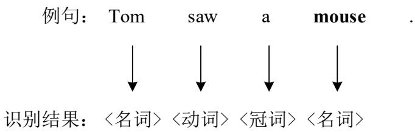

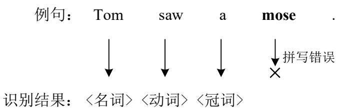

2.  **语法分析**：
    *   词法分析完成后，语法分析根据英语的语法规则从单词流中识别出各个成分，例如 `<主语>`、`<宾语>`、`<表语>` 等，并检查各种语法成分在语法结构中是否正确。
    *   为了便于理解，以英语中基础的语法结构“主语+谓语+宾语”为例来说明语法分析过程。

该结构定义的文法如下：

$$
\begin{aligned}
\langle \text{句子} \rangle &::= \langle \text{主语} \rangle \langle \text{谓语} \rangle \langle \text{宾语} \rangle \\
\langle \text{主语} \rangle &::= \langle \text{冠词} \rangle \langle \text{名词} \rangle \mid \langle \text{名词} \rangle \mid \varepsilon \\
\langle \text{谓语} \rangle &::= \langle \text{动词} \rangle \\
\langle \text{宾语} \rangle &::= \langle \text{冠词} \rangle \langle \text{名词} \rangle \mid \langle \text{名词} \rangle \mid \varepsilon
\end{aligned}
$$

我们将 $\langle \text{句子} \rangle$ 简化为 $E$，$\langle \text{主语} \rangle$ 简化为 $S$，$\langle \text{谓语} \rangle$ 简化为 $V$，$\langle \text{宾语} \rangle$ 简化为 $O$，$\langle \text{动词} \rangle$ 简化为 $v$，$\langle \text{冠词} \rangle$ 简化为 $a$，$\langle \text{名词} \rangle$ 简化为 $n$，化简后的文法 $G[E]$ 如下：

$$
\begin{array}{l}
E ::= SVO \\
S ::= an \mid n \mid \varepsilon \\
V ::= v \\
O ::= an \mid n \mid \varepsilon
\end{array}
$$

上述例句“Tom saw a mouse.”经过词法分析得到“$\langle \text{名词} \rangle \langle \text{动词} \rangle \langle \text{冠词} \rangle \langle \text{名词} \rangle$”，化简后的结果为“nvan”。程序将词法分析的结果顺序输入语法分析器中，并利用 LL（1）分析法分析句子是否符合文法 $G[E]$。

构建上述文法的分析表，相应的分析表如表 4.15 所示：

**表 4.15 文法 G[E]的 LL（1）分析表**

| | a | n | v | # |
| :--- | :--- | :--- | :--- | :--- |
| **E** | E::=SVO | E::=SVO | E::=SVO | |
| **S** | S::=an | S::=n | S::=$\varepsilon$ | |
| **V** | | | V::=v | |
| **O** | O::=an | O::=n | | O::=$\varepsilon$ |

其分析过程如表 4.16 所示：

**表 4.16 分析例句“Tom saw a mouse.”**

| 步骤 | 分析栈 | 余留输入串 | 所用产生式 |
| :--- | :--- | :--- | :--- |
| (1) | #E | nvan# | E::=SVO |
| (2) | #OVS | nvan# | S::=n |
| (3) | #OVn | nvan# | |
| (4) | #OV | van# | V::=v |
| (5) | #Ov | van# | |
| (6) | #O | an# | O::=an |
| (7) | #na | an# | |
| (8) | #n | n# | |
| (9) | # | # | 成功 |

由分析过程可以看出，例句“Tom saw a mouse.”是符合“主语+谓语+宾语”的语法结构的，所以该句子是合法的句子。上述过程是简化后的语法分析，忽略了英语中大量复杂的语法结构与句式，而智能英语语法分析软件将通过设计完整高效的文法规则实现英语句子的语法分析。

## 4.6 本章小结

本章主要针对编译过程中的语法分析方法及涉及到的相关概念（例如回溯、左递归、First 和 Follow 集合、活前缀等）进行了详细的阐述。目前，主流的语法分析方法分为两大类：

1.  **自顶向下的语法分析方法**：包括递归子程序法和 LL（1）分析法等。
2.  **自底向上的语法分析方法**：包括优先分析法和 LR 系列分析法等。

本章重点讨论了 LL（1）分析法以及 LR（0）、SLR（1）、LR（1）和 LALR（1）的工作原理和语法分析过程，并通过具体的案例进行了应用分析。

## 习题

### 习题 1

计算这个文法的每个非终结符号的 FOLLOW 集和所有规则右部的 FIRST 集。

答案：无（需自行计算）

### 习题 2

证明这个文法是 LL（1）文法。

答案：无（需自行证明）

### 习题 3

构造它的 LL（1）分析表并分析符号串 `a*b+b`。

答案：无（需自行构造并分析）

### 习题 4

对下面文法，构造每个非终结符号相应的 FIRST 集和 FOLLOW 集。

答案：无（需自行构造）

### 习题 5

给定文法：

（1）改写这个文法，消除左递归。

答案：无（需自行改写）

（2）改写后的文法是否是 LL（1）文法？若是，构造它的 LL（1）分析表。

答案：无（需自行判断并构造）

（3）写出该文法所描述的语言是什么？

答案：无（需自行描述）

### 习题 6

设已给文法 G[S]：

（1）将此文法改写为 LL（1）文法。

答案：无（需自行改写）

（2）对每一规则右部各候选式，构造 FIRST 集。

答案：无（需自行构造）

（3）对每一非终结符构造 FOLLOW 集。

答案：无（需自行构造）

（4）构造 LL（1）分析表。

答案：无（需自行构造）

### 习题 7

设有文法 G[Z]：

（1）试构造能识别此 LR（0）文法全部活前缀的 DFA。

答案：无（需自行构造）

（2）试构造 LR（0）分析表。

答案：无（需自行构造）

（3）试分析符号串 `aacbb` 是否为此文法的句子。

答案：无（需自行分析）

### 习题 8

考虑文法：

$$
S ::= AS \mid b
$$

$$
A ::= SA \mid a
$$

（1）构造该文法 LR（0）的 DFA；

答案：无（需自行构造）

（2）判定其是否是 LR（0）文法？是否是 SLR（1）文法？若是，则构造 SLR（1）分析表。

答案：无（需自行判定并构造）

（3）试分析符号串 `bab` 是否是该文法的句子。

答案：无（需自行分析）

### 习题 9

给定文法：

$$
E ::= EE + \mid EE ^ {*} \mid a
$$

（1）构造它的 LR（0）项目集规范族。

答案：无（需自行构造）

（2）它是 SLR（1）文法吗？若是，构造它的 SLR（1）分析表。

答案：无（需自行判定并构造）

（3）它是 LR（1）文法吗？若是，构造它的 LR（1）分析表。

答案：无（需自行判定并构造）

（4）它是 LALR（1）吗？若是，构造它的 LALR（1）分析表。

答案：无（需自行判定并构造）

### 习题 10

给定文法 G[Z]：

$$
Z ::= AA
$$

$$
A ::= Ab \mid b
$$

（1）试构造能识别此 LR（1）文法全部活前缀的 DFA。

答案：无（需自行构造）

（2）试构造 LR（1）分析表。

答案：无（需自行构造）

（3）请问该文法是否为 LR(1)文法？

答案：无（需自行判定）

### 习题 11

给出文法 G[E]：

$$
E ::= E + T \mid T
$$

$$
T ::= TF \mid F
$$

$$
F ::= F ^ {*} \mid (E) \mid a \mid b \mid \wedge
$$

构造该文法的 LR（1）项目集。

答案：无（需自行构造）

### 习题 12

证明文法 G[S]不是 LR（1）文法。

$$
S ::= 1S0 \mid 0S1 \mid 10 \mid 01
$$

答案：无（需自行证明）

### 习题 13

将文法 G[S]

$$
S ::= E
$$

$$
E ::= E + T \mid T
$$

$$
T ::= T ^ {*} F \mid F
$$

$$
F ::= (E) \mid x \mid y
$$

（1）构造其 SLR（1）分析表。

答案：无（需自行构造）

（2）试分析符号串 `x+y*x` 是否为此文法的句子。

答案：无（需自行分析）

### 习题 14

给出如下文法：

（1）证明二义性文法 $G_1[S]$ 不是 LR（0）文法。

答案：无（需自行证明）

（2）证明 $G_2[S]$ 是 SLR（1）文法但不是 LR（0）文法。

答案：无（需自行证明）

（3）证明 $G_3[S]$ 是 LR（1）文法但不是 SLR（1）文法。

答案：无（需自行证明）

（4）证明 $G_4[S]$ 是 LR（1）文法但不是 LALR（1）文法。

答案：无（需自行证明）
