# 《编译原理》第4章 语法分析（课件）

原件的每一页，下面附识别出的文字。

### 编译原理 Compiler Principles

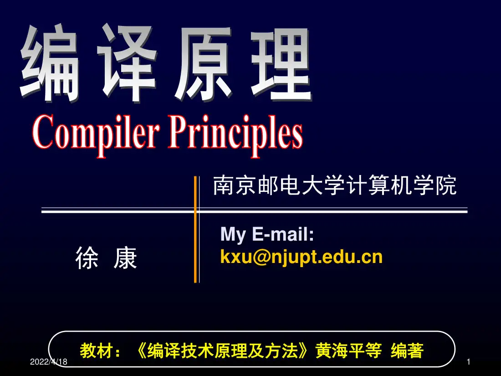

原文：

编译原理 Compiler Principles

南京邮电大学计算机学院

徐 康

My E-mail: kxu@njupt.edu.cn

教材：《编译技术原理及方法》黄海平等 编著

2022/4/18

1

### 第四章 语法分析

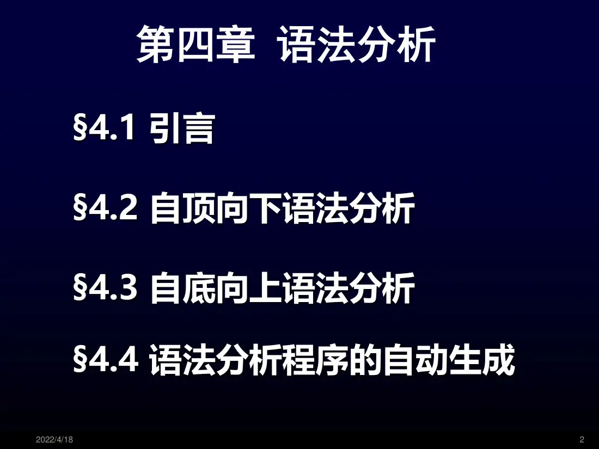

原文：

第四章 语法分析

§4.1 引言

§4.2 自顶向下语法分析

§4.3 自底向上语法分析

§4.4 语法分析程序的自动生成

2022/4/18

2

### 第四章 语法分析

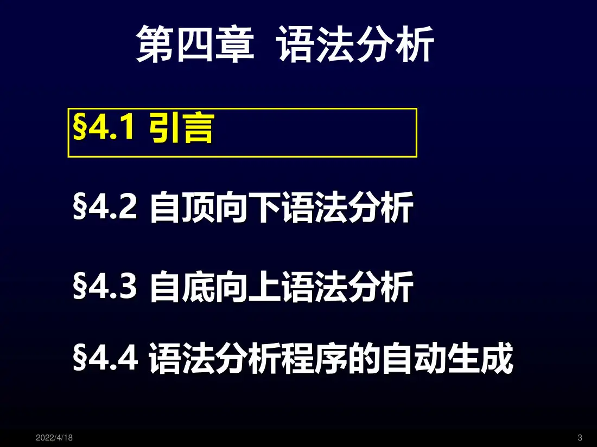

原文：

第四章 语法分析

§4.1 引言

§4.2 自顶向下语法分析

§4.3 自底向上语法分析

§4.4 语法分析程序的自动生成

2022/4/18

3

### §4.1 引言

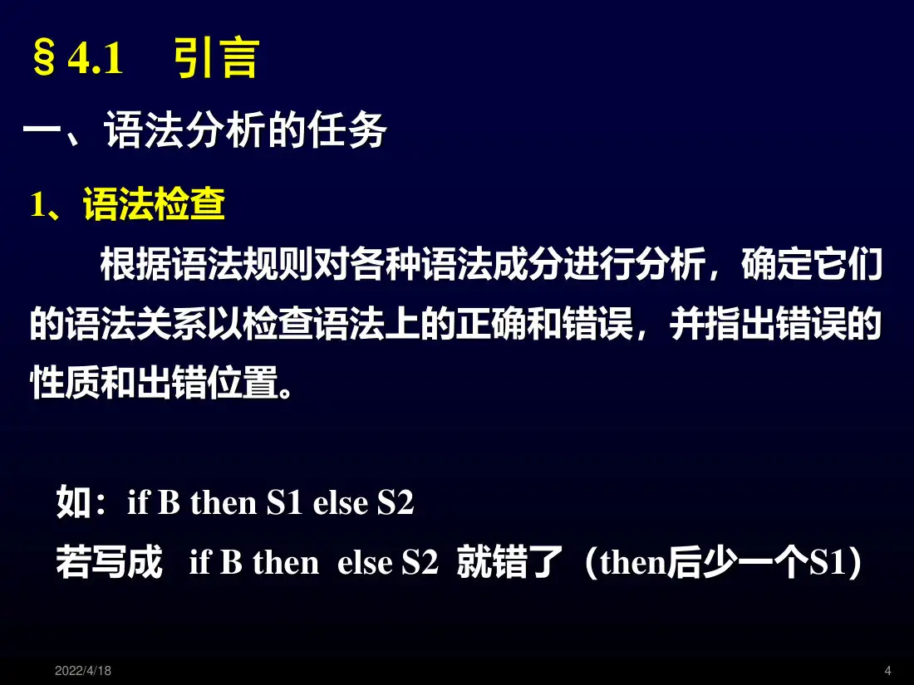

原文：

§4.1 引言

一、语法分析的任务

1、语法检查

根据语法规则对各种语法成分进行分析，确定它们的语法关系以检查语法上的正确和错误，并指出错误的性质和出错位置。

如：if B then S1 else S2

若写成 if B then else S2 就错了（then后少一个S1）

2022/4/18

4

### §4.1 引言一、语法分析的任务

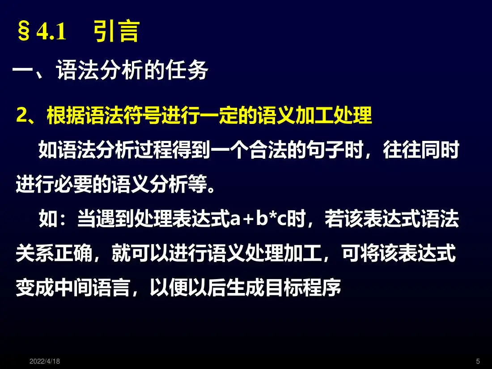

原文：

§4.1 引言一、语法分析的任务

2、根据语法符号进行一定的语义加工处理如语法分析过程得到一个合法的句子时，往往同时进行必要的语义分析等。

如：当遇到处理表达式a+b\*c时，若该表达式语法关系正确，就可以进行语义处理加工，可将该表达式变成中间语言，以便以后生成目标程序

2022/4/18

5

### §4.1 引言

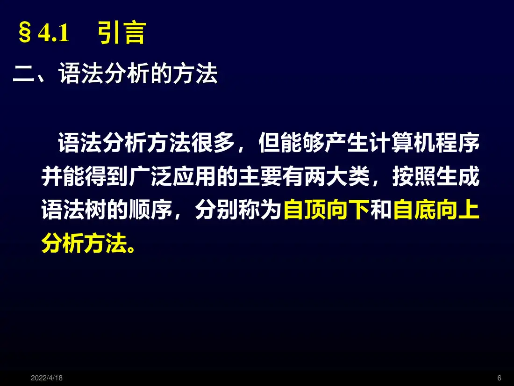

原文：

§4.1 引言

二、语法分析的方法

语法分析方法很多，但能够产生计算机程序并能得到广泛应用的主要有两大类，按照生成语法树的顺序，分别称为自顶向下和自底向上分析方法。

2022/4/18

6

### §4.1 引言

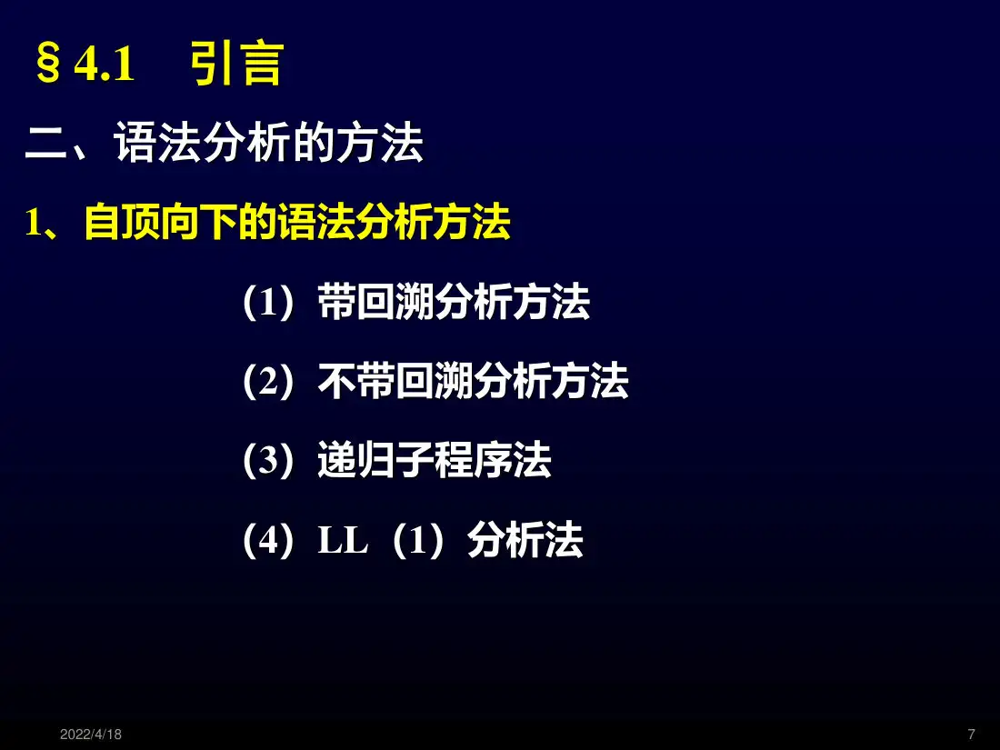

原文：

§4.1 引言

二、语法分析的方法

1、自顶向下的语法分析方法

（1）带回溯分析方法

（2）不带回溯分析方法

（3）递归子程序法

（4）LL（1）分析法

2022/4/18

7

### §4.1 引言

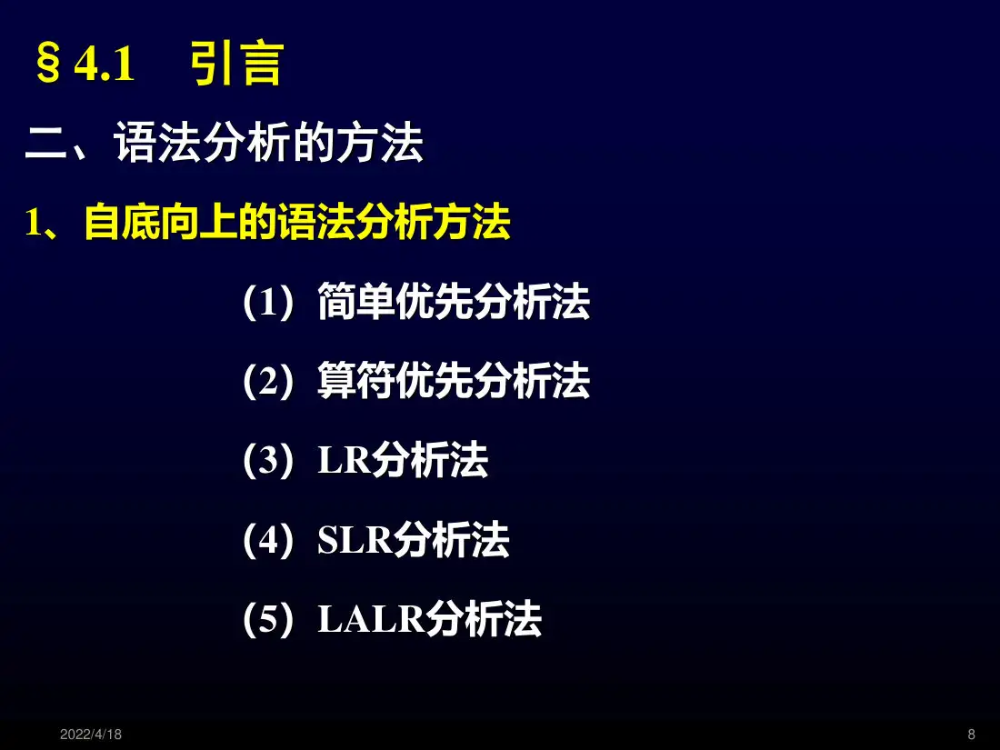

原文：

§4.1 引言

二、语法分析的方法

1、自底向上的语法分析方法

（1）简单优先分析法

（2）算符优先分析法

（3）LR分析法

（4）SLR分析法

（5）LALR分析法

2022/4/18

8

### 第四章 语法分析

原文：

第四章 语法分析

§4.1 引言

§4.2 自顶向下语法分析

§4.3 自底向上语法分析

§4.4 语法分析程序的自动生成

2022/4/18

9

### 第四章 语法分析

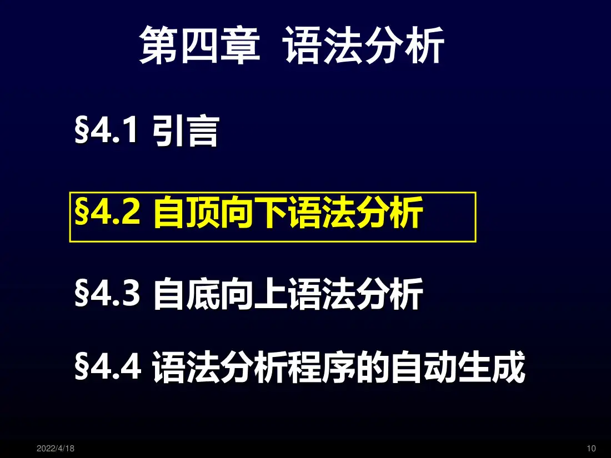

原文：

第四章 语法分析

§4.1 引言

§4.2 自顶向下语法分析

§4.3 自底向上语法分析

§4.4 语法分析程序的自动生成

2022/4/18

10

### §4.2 自顶向下语法分析一、自顶向下语法分析方法的几个问题

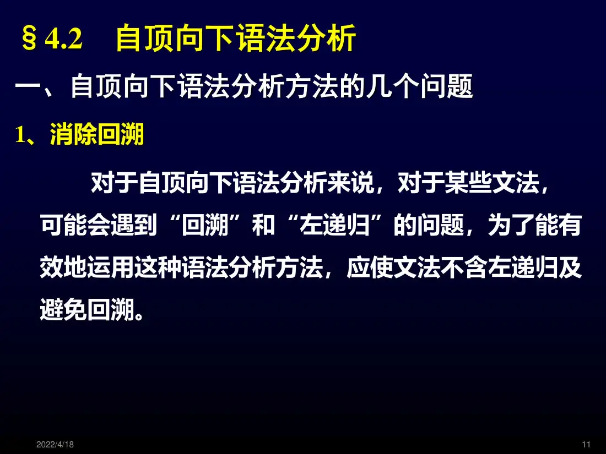

原文：

§4.2 自顶向下语法分析一、自顶向下语法分析方法的几个问题

1、消除回溯

对于自顶向下语法分析来说，对于某些文法，可能会遇到“回溯”和“左递归”的问题，为了能有效地运用这种语法分析方法，应使文法不含左递归及避免回溯。

2022/4/18

11

### §4.2 自顶向下语法分析一、自顶向下语法分析方法的几个问题

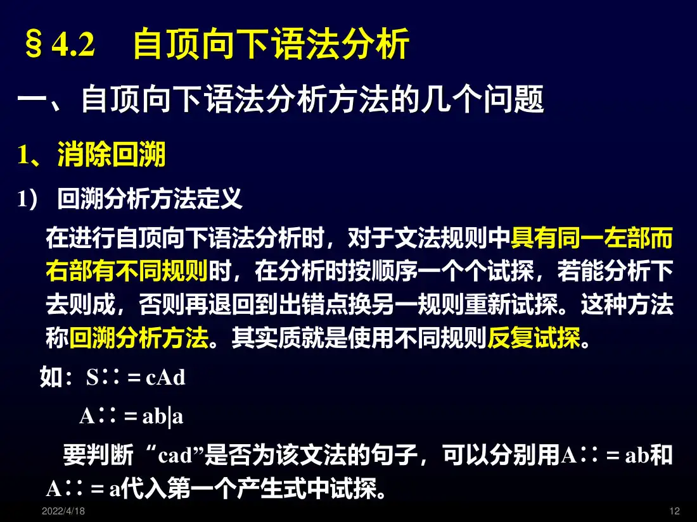

原文：

§4.2 自顶向下语法分析一、自顶向下语法分析方法的几个问题

1、消除回溯

在进行自顶向下语法分析时，对于文法规则中具有同一左部而右部有不同规则时，在分析时按顺序一个个试探，若能分析下去则成，否则再退回到出错点换另一规则重新试探。这种方法称回溯分析方法。其实质就是使用不同规则反复试探。

如： $\langle \pmb { \mathscr { P } } | \pmb { \mathscr { P } } | = \pmb { \mathscr { P } } | \pmb { \mathscr { P } } | |$

A∷＝ab|a

要判断“cad”是否为该文法的句子，可以分别用 $\mathbf { \Delta } \times \mathbf { \Delta } \mathbf { \times } = \mathbf { \Delta } \mathbf { \times } \mathbf { \Sigma } \mathbf { \Sigma } \mathbf { \Sigma } \mathbf { \Sigma } \mathbf { \Sigma } \mathbf { \Sigma }$ A∷＝a代入第一个产生式中试探。

2022/4/18

12

### §4.2 自顶向下语法分析一、自顶向下语法分析方法的几个问题

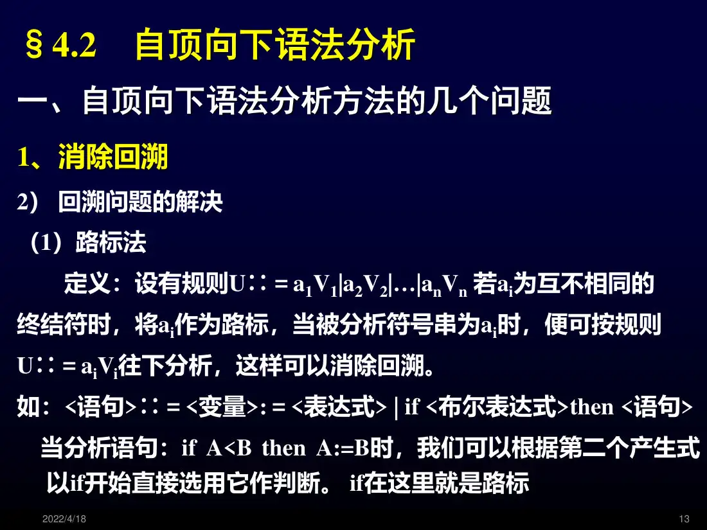

原文：

§4.2 自顶向下语法分析一、自顶向下语法分析方法的几个问题

1、消除回溯

2） 回溯问题的解决

（1） 路标法

定义：设有规则U $\Delta A C = \Delta B C D \sim \Delta C D C \sim \Delta C D$ 若a为互不相同的终结符时，将 $\boxed { 2 }$ 作为路标，当被分析符号串为a时，便可按规则$\angle B E Q = \angle B V$ 往下分析，这样可以消除回溯。

如：<语句>∷＝<变量>:＝<表达式>|if<布尔表达式>then <语句>当分析语句：if A<B then A:=B时，我们可以根据第二个产生式以if开始直接选用它作判断。if在这里就是路标

2022/4/18

13

### §4.2 自顶向下语法分析一、自顶向下语法分析方法的几个问题

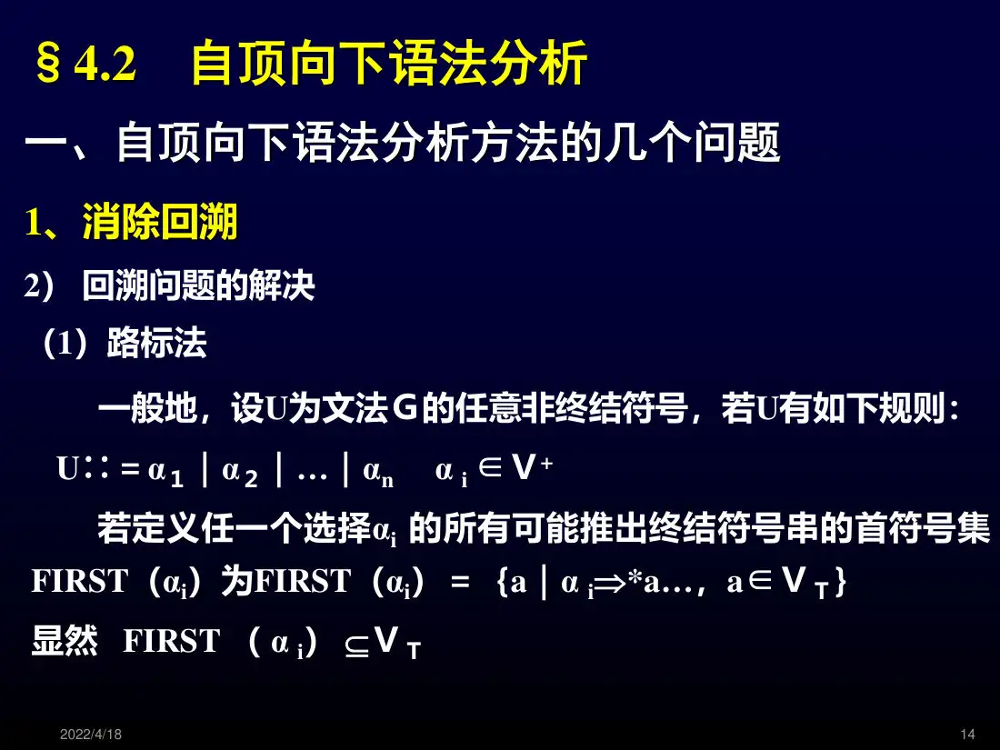

原文：

§4.2 自顶向下语法分析一、自顶向下语法分析方法的几个问题

1、消除回溯

2） 回溯问题的解决

（1） 路标法

一般地，设U为文法G的任意非终结符号，若U有如下规则：

$$
\mathbf {U} \mathrel {\mathop :} := \alpha_ {1} \mid \alpha_ {2} \mid \ldots \mid \alpha_ {\mathrm{n}} \quad \alpha_ {\mathrm{i}} \in \mathbf {V} ^ {+}
$$

若定义任一个选择 $\textcircled { 1 }$ 的所有可能推出终结符号串的首符号集FIRST $\mathbf { [ 0 , 0 ] }$ 为FIRST $( 0 ) - ( - 1 ) \times ( - 1 ) = ( - 1 ) \times ( - 1 )$ 显然 FIRST $( ( 0 , 0 ) )$ T

2022/4/18

14

### §4.2 自顶向下语法分析

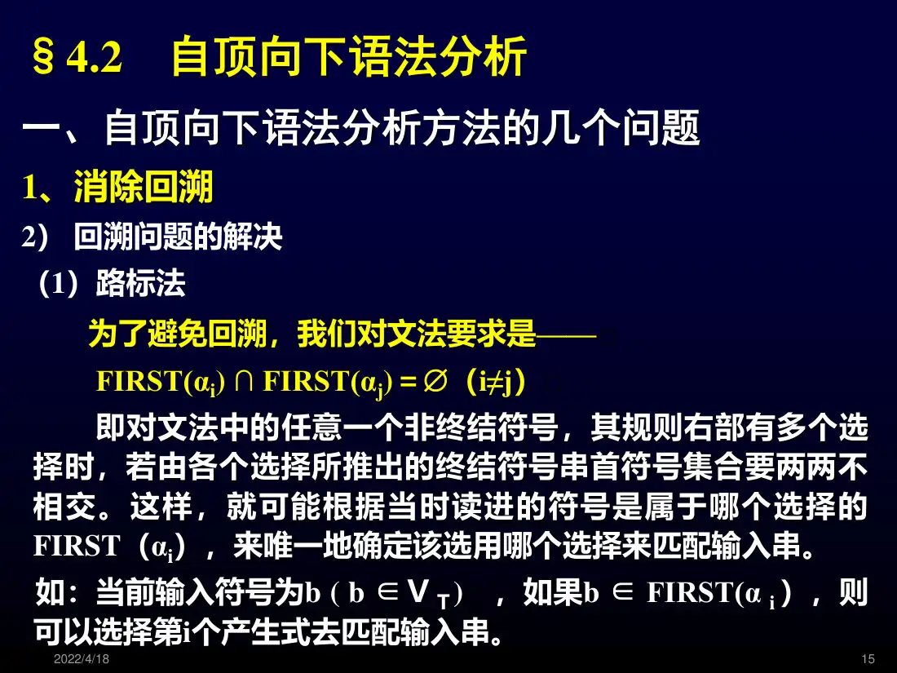

原文：

§4.2 自顶向下语法分析

一、自顶向下语法分析方法的几个问题

1、消除回溯

2） 回溯问题的解决

（1） 路标法

为了避免回溯，我们对文法要求是—

FIRST(αi) ∩ FIRST(αj)＝（i≠j）

即对文法中的任意一个非终结符号，其规则右部有多个选择时，若由各个选择所推出的终结符号串首符号集合要两两不相交。这样，就可能根据当时读进的符号是属于哪个选择的FIRST $( 0 . 9 )$ 来唯一地确定该选用哪个选择来匹配输入串。

如：当前输入符号为b $( ( 0 ) \equiv 0 , 0 )$ ，如果 $| x | = | y | | \cos y | ( 0 . 0 )$ ，则可以选择第i个产生式去匹配输入串。

2022/4/18

15

### §4.2 自顶向下语法分析一、自顶向下语法分析方法的几个问题

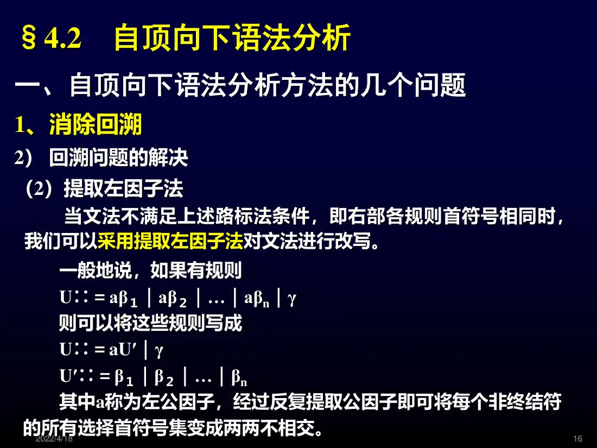

原文：

§4.2 自顶向下语法分析一、自顶向下语法分析方法的几个问题

1、消除回溯

2） 回溯问题的解决

（2）提取左因子法当文法不满足上述路标法条件，即右部各规则首符号相同时，我们可以采用提取左因子法对文法进行改写。般地说，如果有规则$\pmb { \mathrm { ( 1 ) ( 2 ) ( 2 ) } } = \pmb { \mathrm { ( 2 ) ( 2 ) } } = \pmb { \mathrm { ( 2 ) ( 2 ) } } = \pmb { \mathrm { ( 2 ) ( 2 ) } } = \pmb { \mathrm { ( 2 ) ( 2 ) } }$ 则可以将这些规则写成U∷＝aU′｜γ$1 0 0 0 0 - 1 2 0 0 0 0 0 0 0 0 0 0 0 0 0 0 0 0 0 0 0 0 0 0 0 0 0 0 0 0 0 0 0 0 0 0 0 0 0 0 0 0 0 0 0 0 0 0 0 0 0 0 0 0 0 0 0 0 0 0 0 0 0 0 0 0 0 0 0 0 0 0 0 0 0 0 0 0 0 0 0 0 0 0 0 0 0 0 0 0 0 0 0 0 0 0 0 0 0 0 0 0 0 0 0 0 0 0 0 0 0 0 0 0 0 0 0 0 0 0 0 0 0 0 0 0 0 0 0 0 0 0 0 0 0 0 0 0 0 0 0 0 0 0 0 0 0 0 0 0 0 0 0 0 0 0 0 0 0 0 0 0 0 0 0 0 0 0 0 0 0 0 0 0 0 0 0 0 0 0 0 0 0 0 0 0 0 0 0 0 0 0 0 0 0 0 0 0 0 0 0 0 0 0 0 0 0 0 0 0 0 0 0 0 0 0 0 0 0 0 0 0 0 0 0 0 0 0 0 0 0 0 0 0 0 0 0 0 0 0 0 0 0 0 0 0 0 0 0 0 0 0 0 0 0 0 0 0 0 0 0 0 0 0 0 0 0 0 0 0 0 0 0 0 0 0 0 0 0 0 0 0 0 0 0 0 0 0 0 0 0 0 0 0 0 0 0 0 0 0 0 0 0 0 0 0 0 0 0 0 0 0 0 0 0 0 0 0 0 0 0 0 0 0 0 0 0 0 0 0 0 0 0 0 0 0 0 0 0 0 0 0 0 0 0 0 0 0 0 0 0 0 0 0 0 0 0 0 0 0 0 0 0 0 0 0 0 0 0 0 0 0 0 0 0 0 0 0 0 0 0 0 0 0 0 0 0 0 0 0 0 0 0 0 0 0 0 0 0 0 0 0 0 0 0 0 0 0 0 0 0 0 0 0 0 0 0 0 0 0 0 0 0 0 0 0 0 0 0 0 0 0 0 0 0 0 0 0 0 0 0 0 0 0 0 0 0 0 0 0 0 0 0 0 0 0 0 0 0 0 0 0 0 0 0 0 0 0 0 0 0 0 0 0 0 0 0 0 0 0 0 0 0 0 0 0 0 0 0 0 0 0 0 0 0 0 0 0 0 0 0 0 0 0 0 0 0 0 0 0 0 0 0 0 0 0 0 0 0 0 0 0 0 0 0 0 0 0 0 0 0 0 0 0 0 0 0 0 0 0 0 0 0 0 0 0 0 0 0 0 0 0 0 0 0 0 0 0 0 0 0 0 0 0 0 0 0 0 0 0$ 其中a称为左公因子，经过反复提取公因子即可将每个非终结符的所有选择首符号集变成两两不相交。

16

### §4.2 自顶向下语法分析

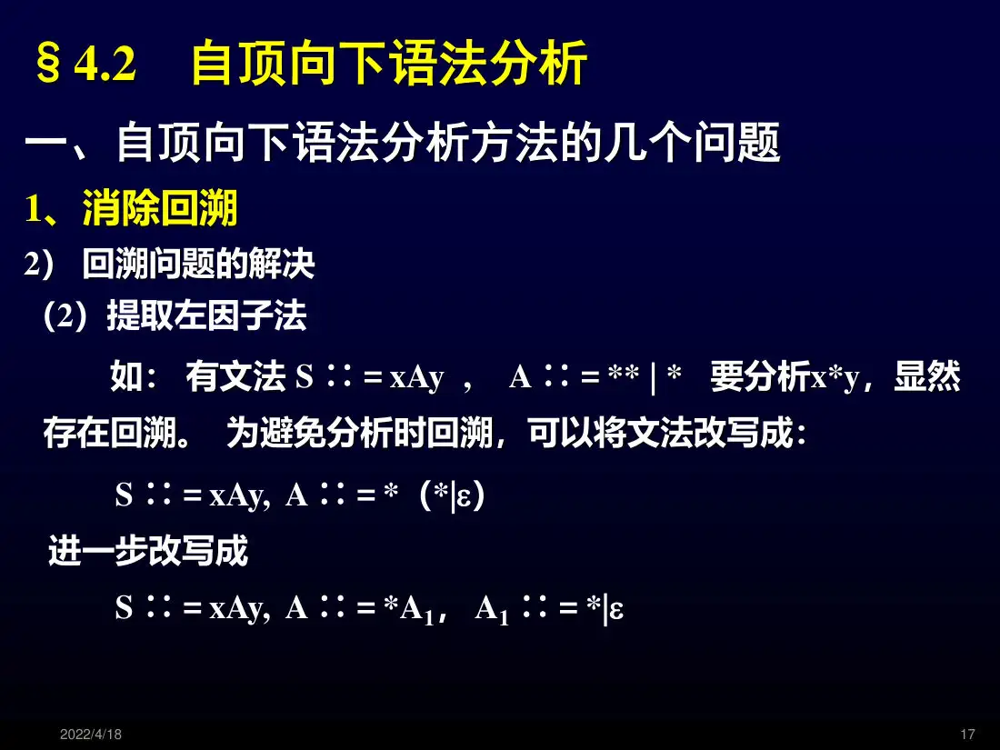

原文：

§4.2 自顶向下语法分析

一、自顶向下语法分析方法的几个问题

1、消除回溯

2） 回溯问题的解决

（2）提取左因子法

如： 有文法 $\langle \mathbf { S } _ { \mathrm { d e f } } = \langle \mathbf { \Sigma } _ { \ast } \mathbf { \Sigma } \rangle \mathbf { \Sigma } _ { \ast }$ $\Delta B E D \cong \Delta C E D$ 要分析x\*y，显然存在回溯。 为避免分析时回溯，可以将文法改写成：

$$
\mathrm{S}: := \mathrm{xAy}, \mathrm{A}: := * (* | \varepsilon)
$$

进一步改写成

$$
\mathrm{S}: := \mathrm{xAy}, \mathrm{A}: := * \mathrm{A} _ {1}, \mathrm{A} _ {1}: := * | \varepsilon
$$

2022/4/18

17

### §4.2 自顶向下语法分析

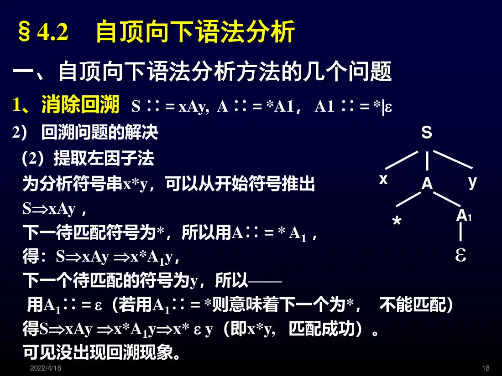

原文：

§4.2 自顶向下语法分析

一、自顶向下语法分析方法的几个问题

1、消除回溯 $\angle A = \angle A = \angle C = \angle A = \angle C = \angle A = \angle C$

2） 回溯问题的解决

（2）提取左因子法为分析符号串x\*y，可以从开始符号推出$\textcircled { \bullet } = \mathbf { \vec { \sigma } } \mathbf { \cdot } \mathbf { \vec { \sigma } }$

下一待匹配符号为\*，所以用 $\pm \infty = - \infty . 5 \pm \frac { 1 } { 2 } \pm \frac { 1 } { 3 }$ 得： $S = 2 . 4 \times 1 = 2 . 4 ( m ^ { 2 } )$

下一个待匹配的符号为y，所以用 $\mathbf { \Delta } _ { | \mathbf { a } | } \mathbf { \Delta } _ { | \mathbf { b } | } = \mathbf { \Delta } _ { | \mathbf { a } | }$ （若用 $\bf \delta _ { 4 } ^ { 4 } \times \delta _ { 5 } ^ { 6 0 }$ ＝\*则意味着下一个为\*， 不能匹配）得 $y = 2 . 4 , y = 2 . 9 , y = 3 . 9$  y（即x\*y, 匹配成功）。

可见没出现回溯现象。

2022/4/18

18

### §4.2 自顶向下语法分析

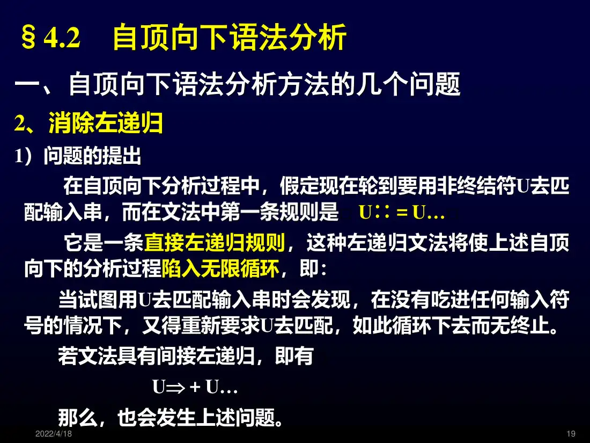

原文：

§4.2 自顶向下语法分析

一、自顶向下语法分析方法的几个问题

2、消除左递归

1）问题的提出

在自顶向下分析过程中，假定现在轮到要用非终结符U去匹配输入串，而在文法中第一条规则是 $| 0 | \frac { \mathbf { 0 } 0 } { \mathbf { 0 } 0 } | \mathbf { 0 } |$

它是一条直接左递归规则，这种左递归文法将使上述自顶向下的分析过程陷入无限循环，即：

当试图用U去匹配输入串时会发现，在没有吃进任何输入符号的情况下，又得重新要求U去匹配，如此循环下去而无终止。

若文法具有间接左递归，

U＋U…

那么，也会发生上述问题。

2022/4/18

19

### §4.2 自顶向下语法分析一、自顶向下语法分析方法的几个问题

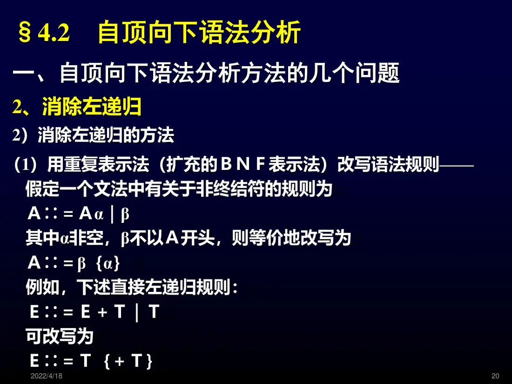

原文：

§4.2 自顶向下语法分析一、自顶向下语法分析方法的几个问题

2、消除左递归

2）消除左递归的方法

（1）用重复表示法（扩充的BNF表示法）改写语法规则—假定一个文法中有关于非终结符的规则为A∷＝Aα｜β其中α非空，β不以A开头，A∷＝β｛α｝例如，下述直接左递归规则：E : = E + T | T可改写为E∷＝T｛＋T｝2022/4/18

20

### §4.2 自顶向下语法分析一、自顶向下语法分析方法的几个问题

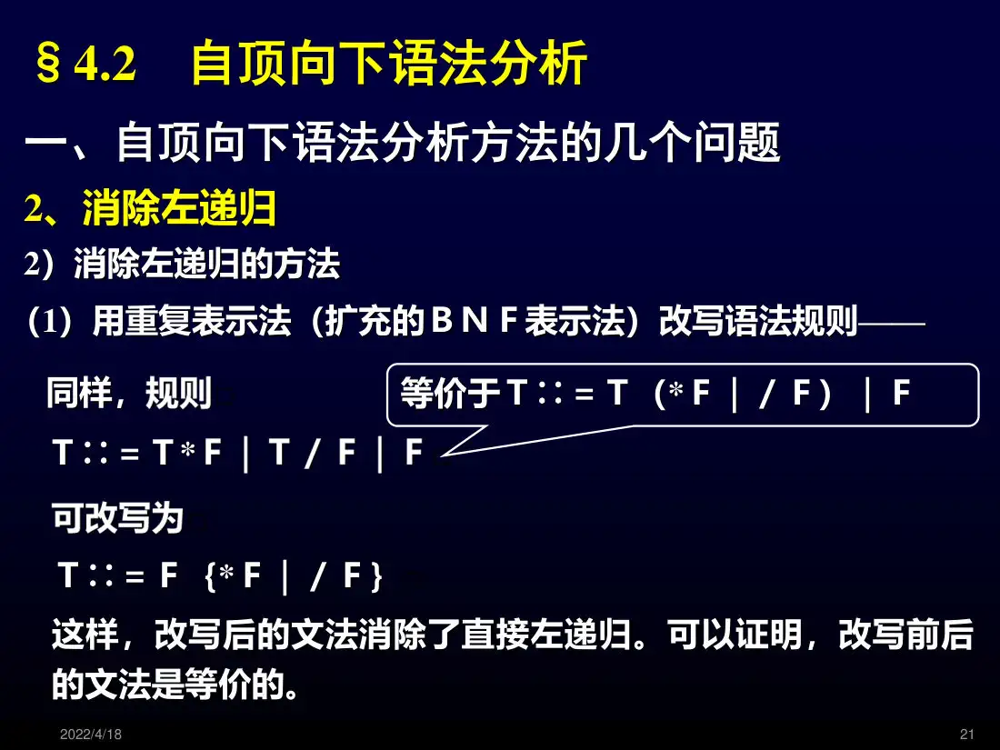

原文：

§4.2 自顶向下语法分析一、自顶向下语法分析方法的几个问题

2、消除左递归

2）消除左递归的方法

（1）用重复表示法（扩充的BNF表示法）改写语法规则——

同样，

等价于T∷＝T（\*F｜／F）｜F

T∷＝T\*

可改写为

T∷＝F｛\*F｜／F｝

这样，改写后的文法消除了直接左递归。可以证明，改写前后的文法是等价的。

2022/4/18

21

### §4.2 自顶向下语法分析一、自顶向下语法分析方法的几个问题

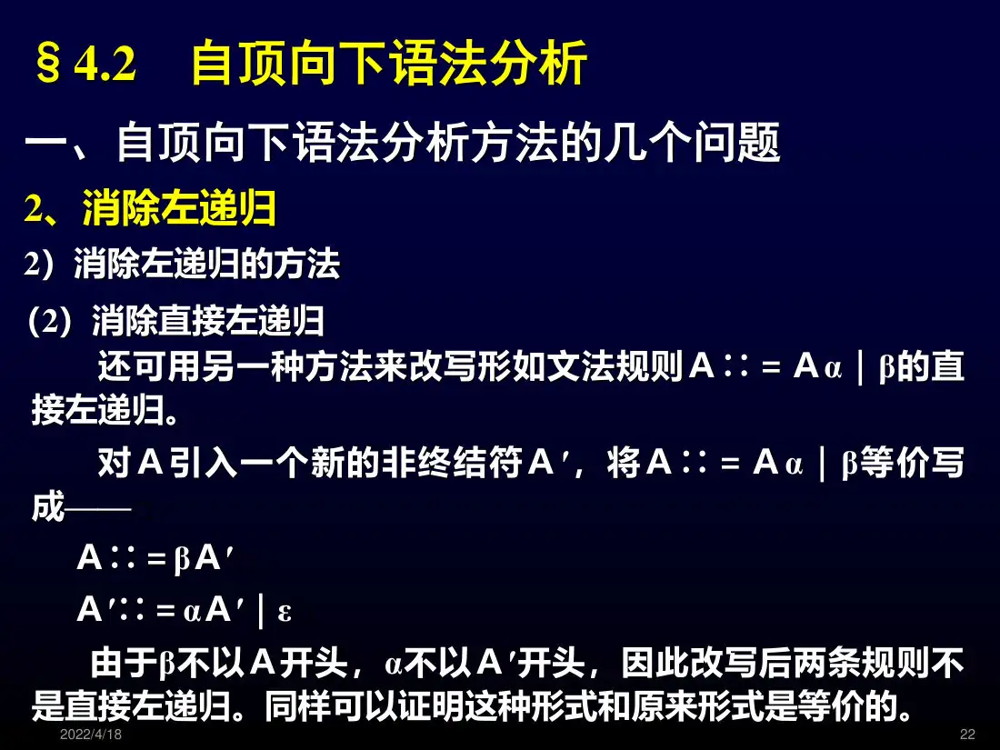

原文：

§4.2 自顶向下语法分析一、自顶向下语法分析方法的几个问题

2、消除左递归

2）消除左递归的方法

（2）消除直接左递归还可用另一种方法来改写形如文法规则 $\mathbf { \Delta } L \mathbf { a } \mathbf { n } = L \mathbf { a } \mathbf { \Delta } \mathbf { u }$ β的直接左递归。

对A引入一个新的非终结符A′，将 $L _ { \mathrm { a } } ^ { \mathrm { a } } \mathbf { m } = L _ { \mathrm { a } } ^ { \mathrm { a } } \mathbf { m }$ β等价写成—

A∷＝βA′ $\mathbf { L } \mathbf { M } \mathbf { R } \mathbf { R } \mathbf { \bar { \Psi } } = \mathbf { \bar { \Psi } } \mathbf { U } \mathbf { L } \mathbf { \bar { \Psi } }$ ε

由于β不以A开头，α不以A′开头，因此改写后两条规则不是直接左递归。同样可以证明这种形式和原来形式是等价的。

2022/4/18

22

### §4.2 自顶向下语法分析

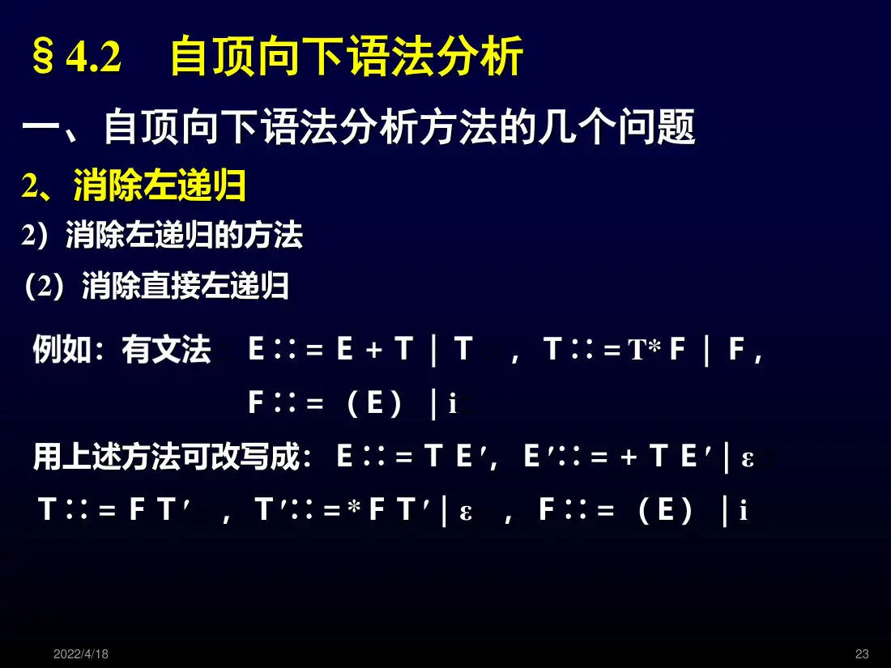

原文：

§4.2 自顶向下语法分析

一、自顶向下语法分析方法的几个问题

2、消除左递归

2）消除左递归的方法

（2）消除直接左递归

∷ ，T∷＝T\*F｜F，

F∷＝（E）｜i

用上述方法可改写成：E∷＝TE′，E′∷＝＋TE′｜ε

$\angle B P Q = \angle B Q C$ ，T′∷＝\*FT′｜ε ，F∷＝（E）｜i

2022/4/18

23

### §4.2 自顶向下语法分析

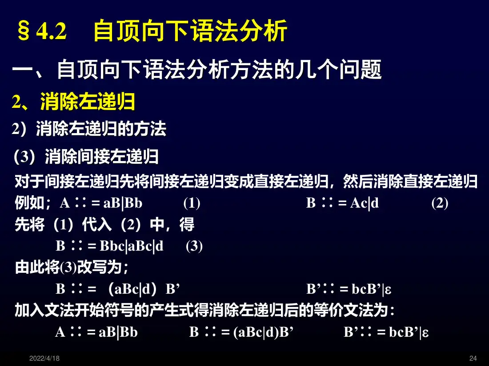

原文：

§4.2 自顶向下语法分析

一、自顶向下语法分析方法的几个问题

2、消除左递归

2）消除左递归的方法

（3）消除间接左递归

对于间接左递归先将间接左递归变成直接左递归，然后消除直接左递归

例如； $\mathbf { A } = \mathbf { B } = \mathbf { B } \cdot \mathbf { B } = \mathbf { B } \cdot \mathbf { B } \cdot \mathbf { B } = \mathbf { B }$ (1)

$$
\mathbf {B} \because = \mathrm{Ac} | \mathrm{d}
$$

先将（1）代入（2）中，得

$1 0 0 0 0 = 1 3 0 0 0 0 0 0 0 0 0$ (3)

由此将(3)改写为；

B ∷＝（aBc|d）B’

$$
\mathbf {B} ^ {\prime} \because : = \mathrm{bcB} ^ {\prime} | \varepsilon
$$

加入文法开始符号的产生式得消除左递归后的等价文法为：

A ∷＝aB|Bb

B ∷＝(aBc|d)B’

B’∷＝bcB’|

2022/4/18

24

### §4.3 自顶向下语法分析概述

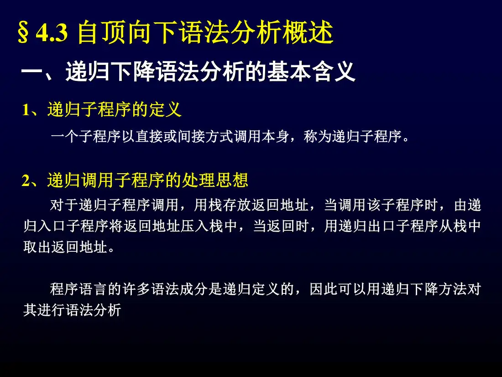

原文：

§4.3 自顶向下语法分析概述

一、递归下降语法分析的基本含义

1、递归子程序的定义

一个子程序以直接或间接方式调用本身，称为递归子程序。

2、递归调用子程序的处理思想

对于递归子程序调用，用栈存放返回地址，当调用该子程序时，由递归入口子程序将返回地址压入栈中，当返回时，用递归出口子程序从栈中取出返回地址。

程序语言的许多语法成分是递归定义的，因此可以用递归下降方法对其进行语法分析

### §4.3 自顶向下语法分析概述二、递归下降语法分析的基本过程

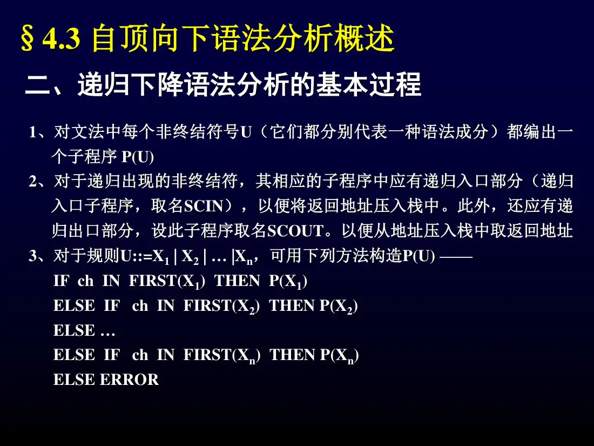

原文：

§4.3 自顶向下语法分析概述二、递归下降语法分析的基本过程

1、对文法中每个非终结符号U（它们都分别代表一种语法成分）都编出一个子程序 P(U)

2、对于递归出现的非终结符，其相应的子程序中应有递归入口部分（递归入口子程序，取名SCIN），以便将返回地址压入栈中。此外，还应有递归出口部分，设此子程序取名SCOUT。以便从地址压入栈中取返回地址

3、对于规则U::=X | X | … |X ，可用下列方法构造P(U) ——IF ch IN FIRST(X ) THEN P(X )ELSE IF ch IN FIRST(X ) THEN P(X )ELSEELSE IF ch IN FIRST(Xn) THEN P(Xn)ELSE ERROR

### §4.3 自顶向下语法分析概述二、递归下降语法分析的基本过程

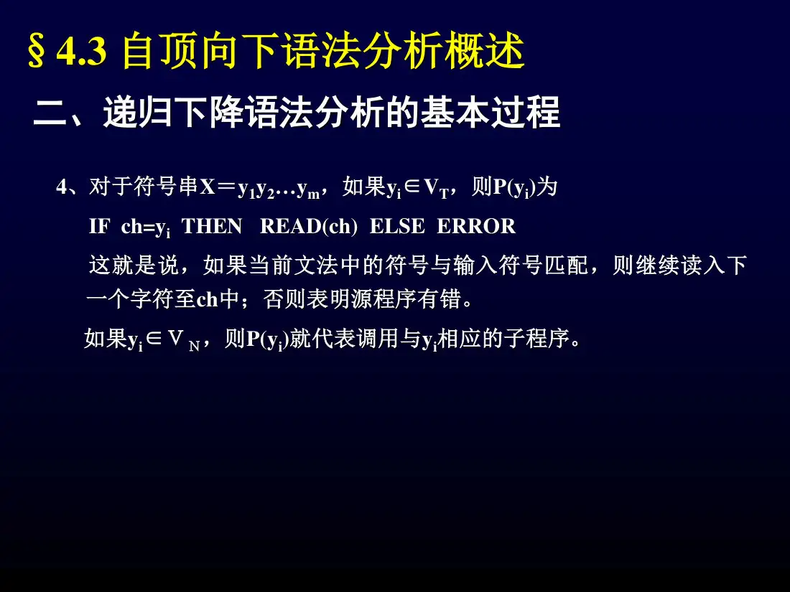

原文：

§4.3 自顶向下语法分析概述二、递归下降语法分析的基本过程

4、对于符号串 $: \angle = \angle A ^ { \prime } B ^ { \prime } / / \angle 2 \angle B ^ { \prime } / / 1 1 2$ 如果 $V _ { A } = \lambda \times \frac { 1 } { 2 }$ 则 $| \bigstar \bigstar \bigstar \bigstar$ 为IF $( 9 ) = \Delta$ THEN READ(ch) ELSE ERROR这就是说，如果当前文法中的符号与输入符号匹配，则继续读入下一个字符至ch中；否则表明源程序有错。如果 $\Delta A E = \Delta B C$ 则 $| \bigstar ( \bigstar \bigstar ) \bigstar \bigstar \bigstar$ 就代表调用与y相应的子程序。

### §4.3 自顶向下语法分析概述

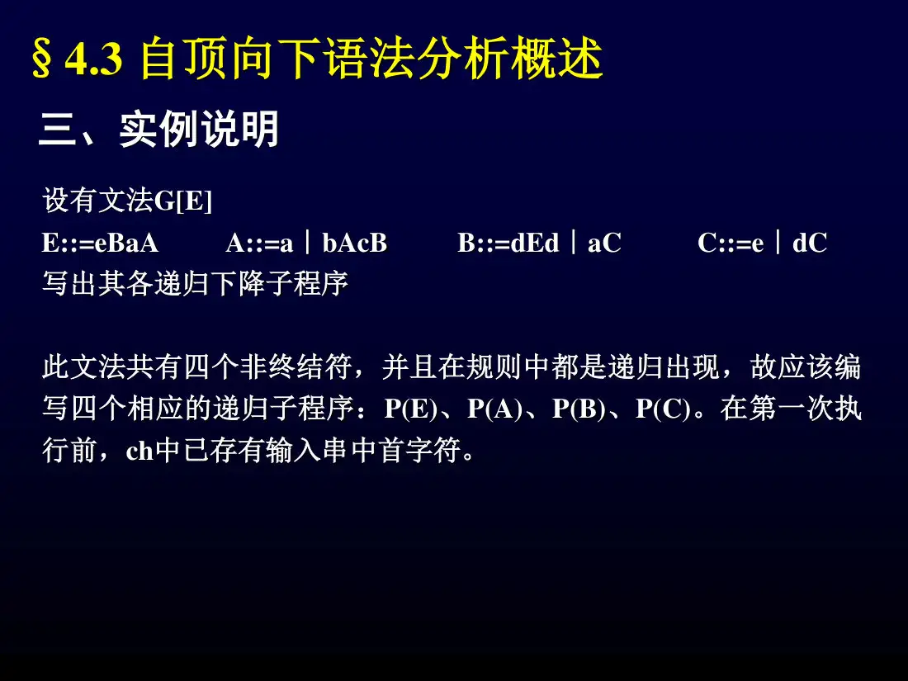

原文：

§4.3 自顶向下语法分析概述

三、实例说明

设有文法G[E]

$$
\mathrm{E}: := \mathrm{eBaA}
$$

A::=a｜bAcB

$$
\mathrm{B}:: := \mathrm{dEd} \mid \mathrm{aC}
$$

$$
\mathrm{C}:: := \mathrm{e} \mid \mathrm{dC}
$$

写出其各递归下降子程序

此文法共有四个非终结符，并且在规则中都是递归出现，故应该编写四个相应的递归子程序：P(E)、P(A)、P(B)、P(C)。在第一次执行前，ch中已存有输入串中首字符。

### §4.3 自顶向下语法分析概述

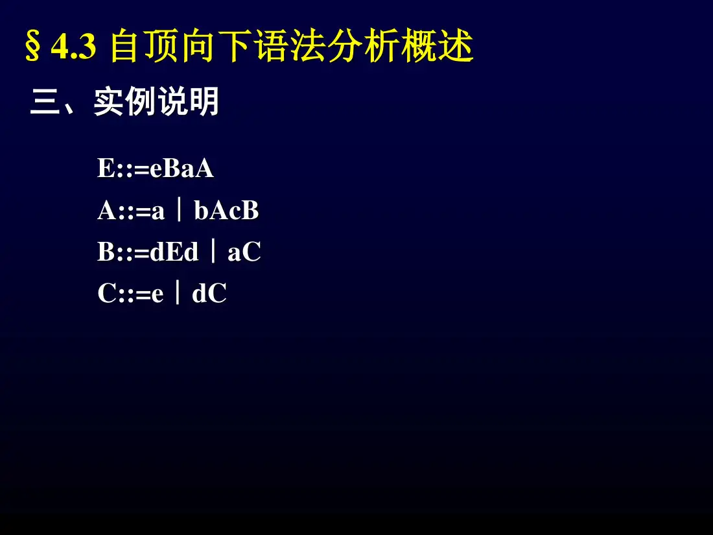

原文：

§4.3 自顶向下语法分析概述

三、实例说明

E::=eBaA

A::=a｜bAcB

B::=dEd｜aC

C::=e｜dC

### §4.3 自顶向下语法分析概述

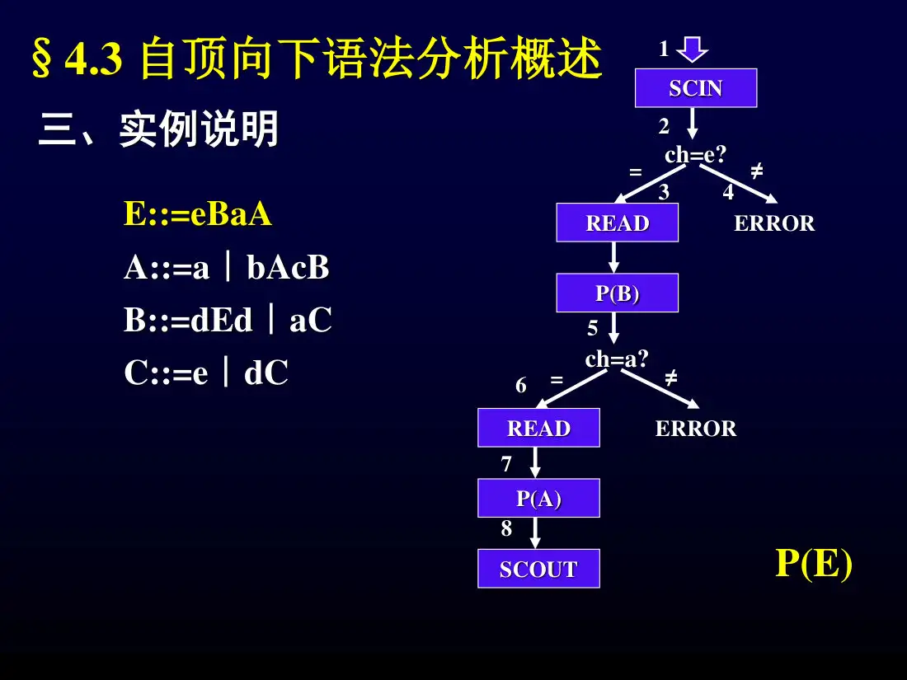

原文：

§4.3 自顶向下语法分析概述

三、实例说明

E::=eBaA

A::=a｜bAcB

B::=dEd｜aC

C::=e｜dC

P(E)

### §4.3 自顶向下语法分析概述

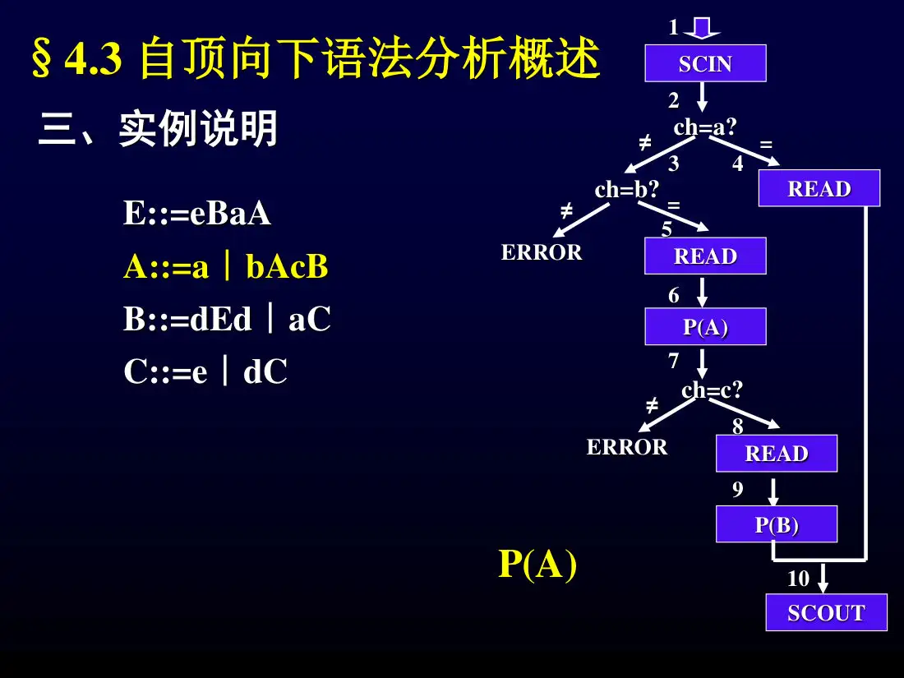

原文：

§4.3 自顶向下语法分析概述

三、实例说明

E::=eBaA

A::=a｜bAcB

B::=dEd｜aC

C::=e｜dC

P(A)

### §4.3 自顶向下语法分析概述

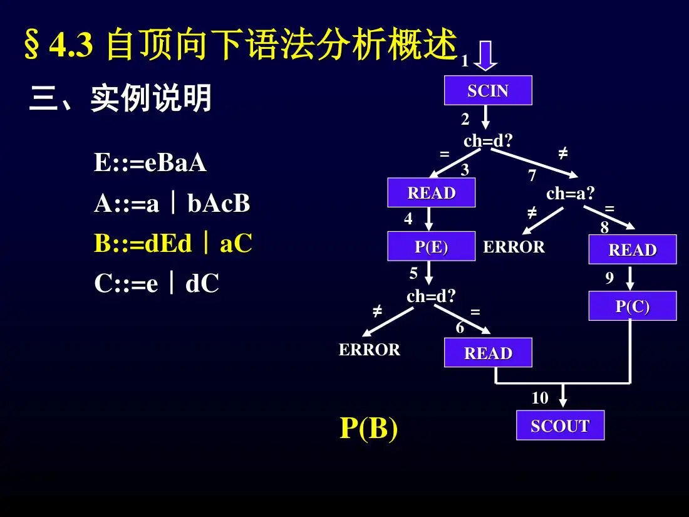

原文：

§4.3 自顶向下语法分析概述

三、实例说明

E::=eBaA

A::=a｜bAcB

B::=dEd｜aC

C::=e｜dC

P(B)

### §4.3 自顶向下语法分析概述

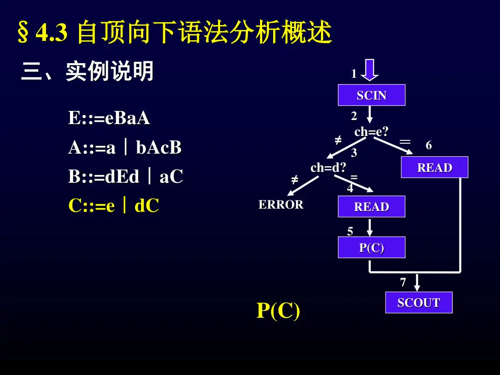

原文：

§4.3 自顶向下语法分析概述

三、实例说明

E::=eBaA

A::=a｜bAcB

B::=dEd｜aC

C::=e｜dC

### §4.3 自顶向下语法分析概述

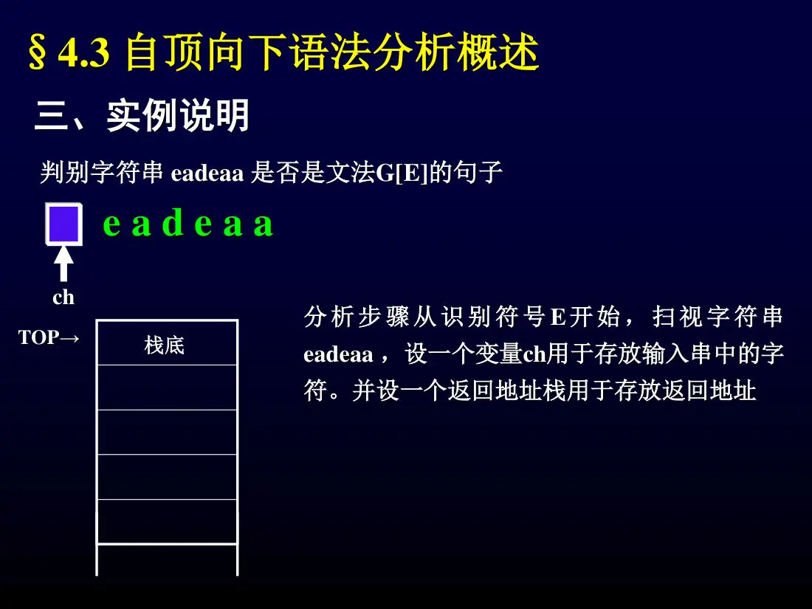

原文：

§4.3 自顶向下语法分析概述

三、实例说明

判别字符串 eadeaa 是否是文法G[E]的句子

ch TOP→

e a d e a a

栈底

分析步骤从识别符号E开始，扫视字符串eadeaa ，设一个变量ch用于存放输入串中的字符。并设一个返回地址栈用于存放返回地址

### §4.3 自顶向下语法分析概述

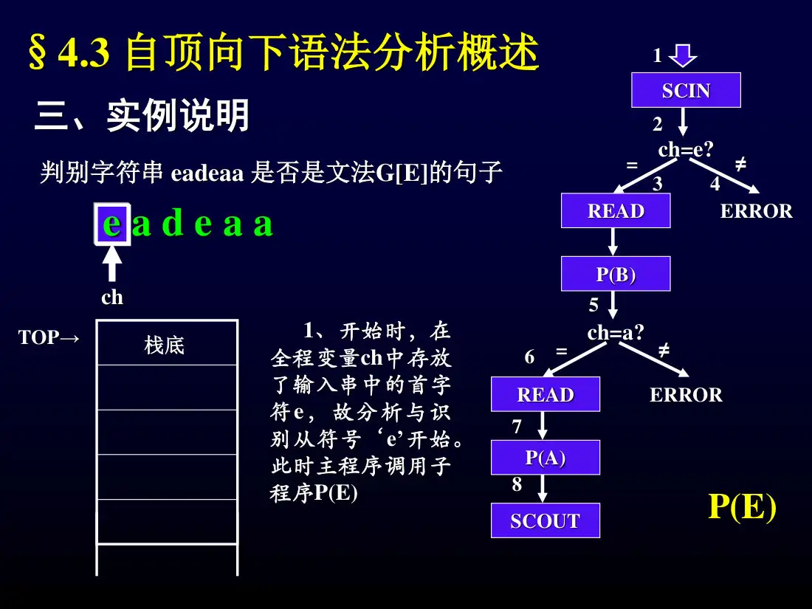

原文：

§4.3 自顶向下语法分析概述

三、实例说明

判别字符串 eadeaa 是否是文法G[E]的句子

a d e a a

TOP→

栈底

1、开始时，在全程变量ch中存放了输入串中的首字符e，故分析与识别从符号‘e’开始。此时主程序调用子程序P(E)

P(E)

### §4.3 自顶向下语法分析概述

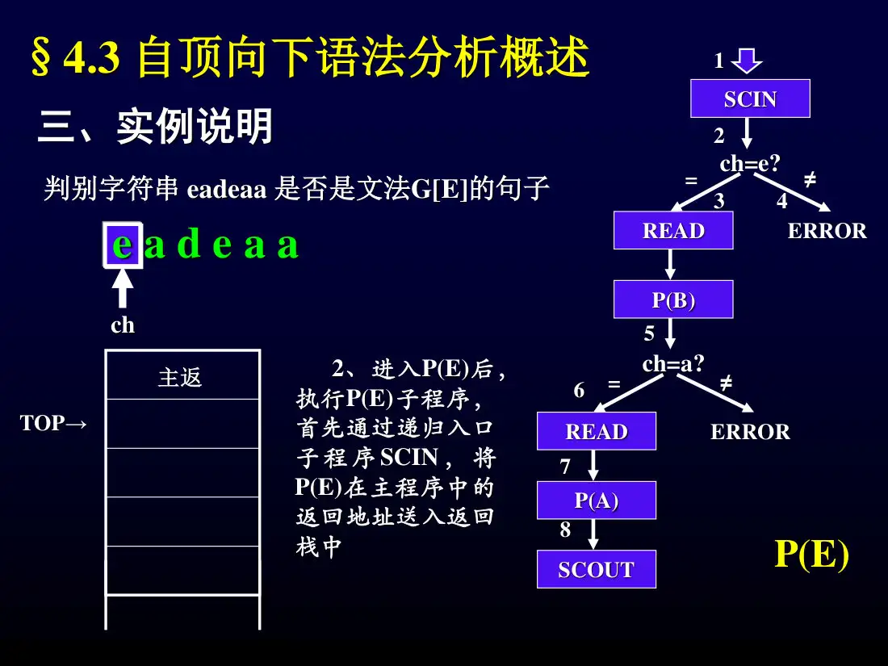

原文：

§4.3 自顶向下语法分析概述

三、实例说明

判别字符串 eadeaa 是否是文法G[E]的句子

a d e a a

主返

TOP→

2、进入P(E)后，执行P(E)子程序，首先通过递归入口子程序 SCIN， 将P(E)在主程序中的返回地址送入返回栈中

P(E)

### §4.3 自顶向下语法分析概述

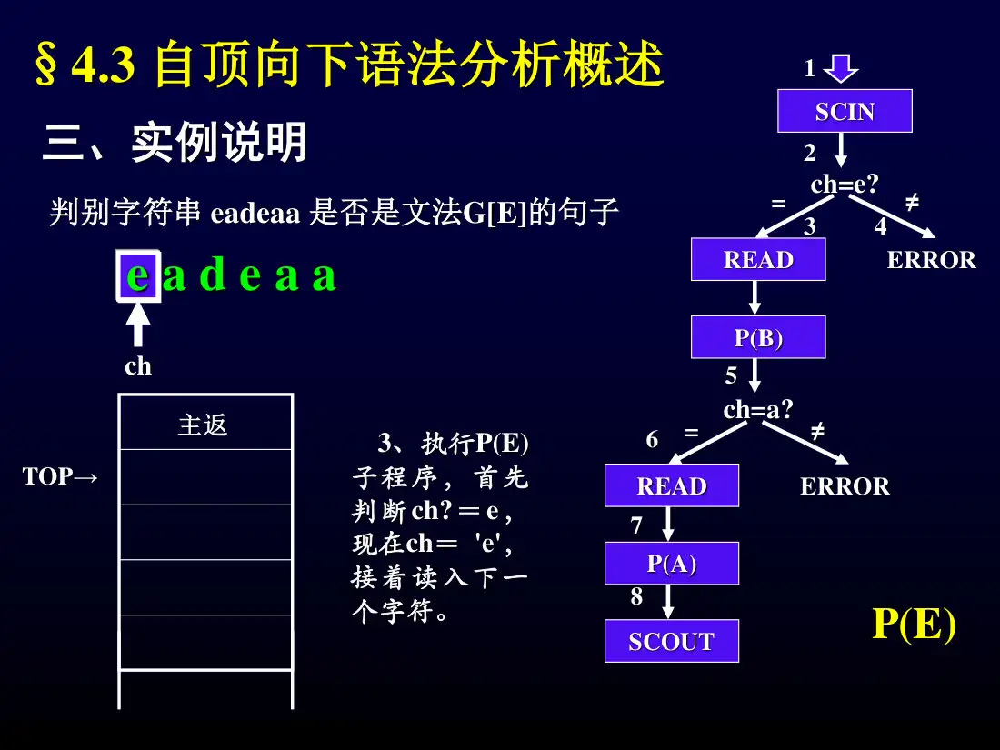

原文：

§4.3 自顶向下语法分析概述

三、实例说明

判别字符串 eadeaa 是否是文法G[E]的句子

a d e a a

主返

3、执行P(E)子程序，首先判断ch?＝e，现在ch＝ 'e'，接着读入下一个字符。

P(E)

### §4.3 自顶向下语法分析概述

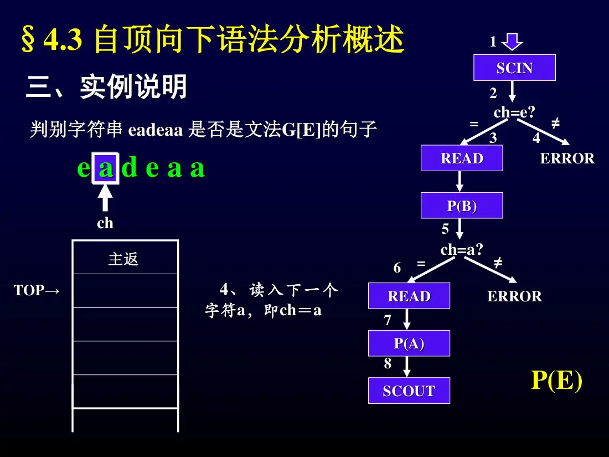

原文：

§4.3 自顶向下语法分析概述

三、实例说明

判别字符串 eadeaa 是否是文法G[E]的句子

e a d e a a

主返

4、读入下一个字符a，即ch＝a

P(E)

### §4.3 自顶向下语法分析概述

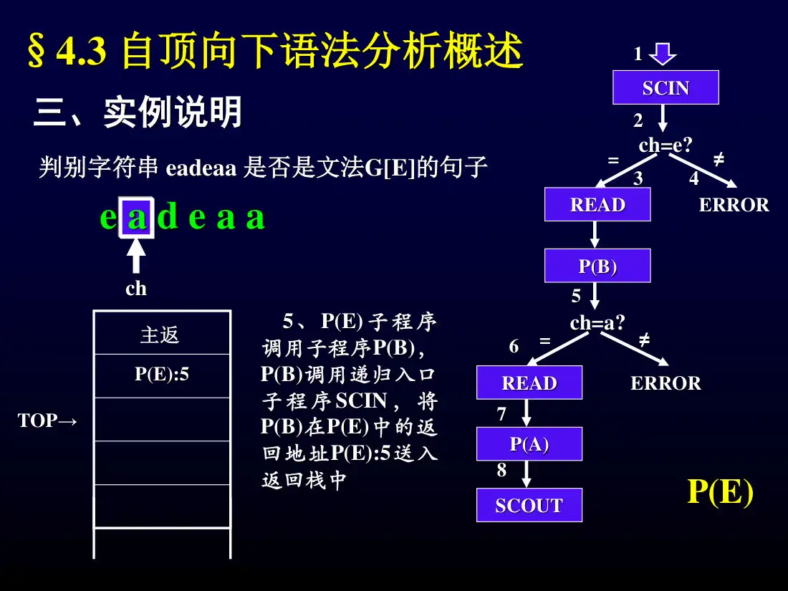

原文：

§4.3 自顶向下语法分析概述

三、实例说明

判别字符串 eadeaa 是否是文法G[E]的句子

e a d e a a ch

主返P(E):5

5、P(E)子程序调用子程序P(B)，P(B)调用递归入口子程序SCIN，将P(B)在P(E)中的返回地址P(E):5送入返回栈中

P(E)

### §4.3 自顶向下语法分析概述

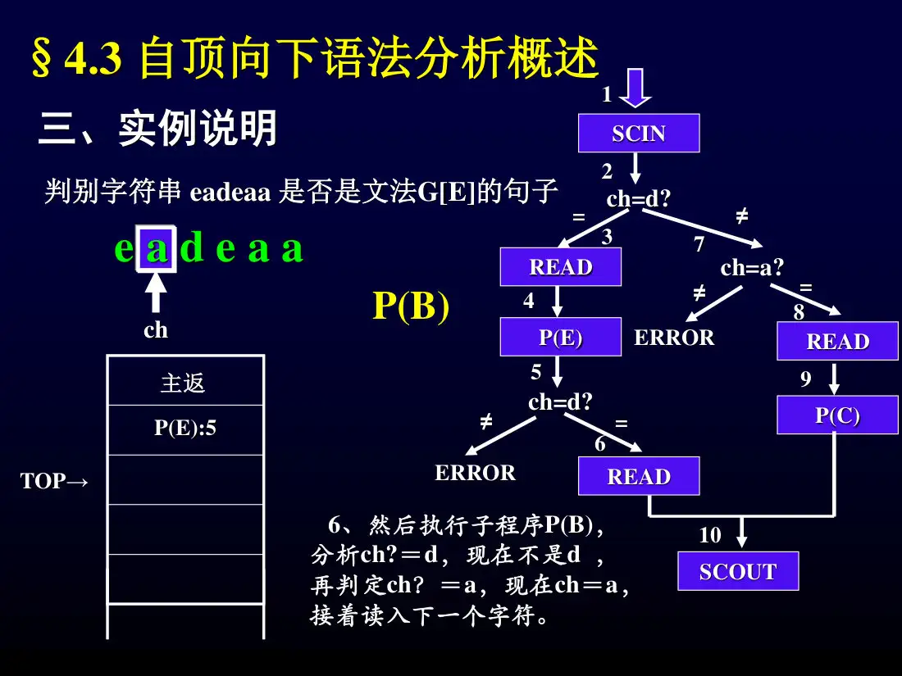

原文：

§4.3 自顶向下语法分析概述

三、实例说明

判别字符串 eadeaa 是否是文法G[E]的句子

e a d e a a

主返P(E):5

P(B)

6、然后执行子程序P(B)，分析ch?＝d，现在不是d ，再判定ch？＝a，现在ch＝a，接着读入下一个字符。

### §4.3 自顶向下语法分析概述

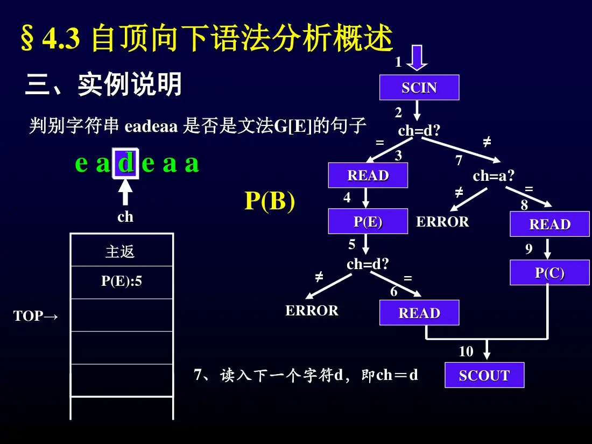

原文：

§4.3 自顶向下语法分析概述

三、实例说明

判别字符串 eadeaa 是否是文法G[E]的句子

e a d e a a ch

主返P(E):5

P(B)

7、读入下一个字符d，即ch＝d

SCOUT

### §4.3 自顶向下语法分析概述

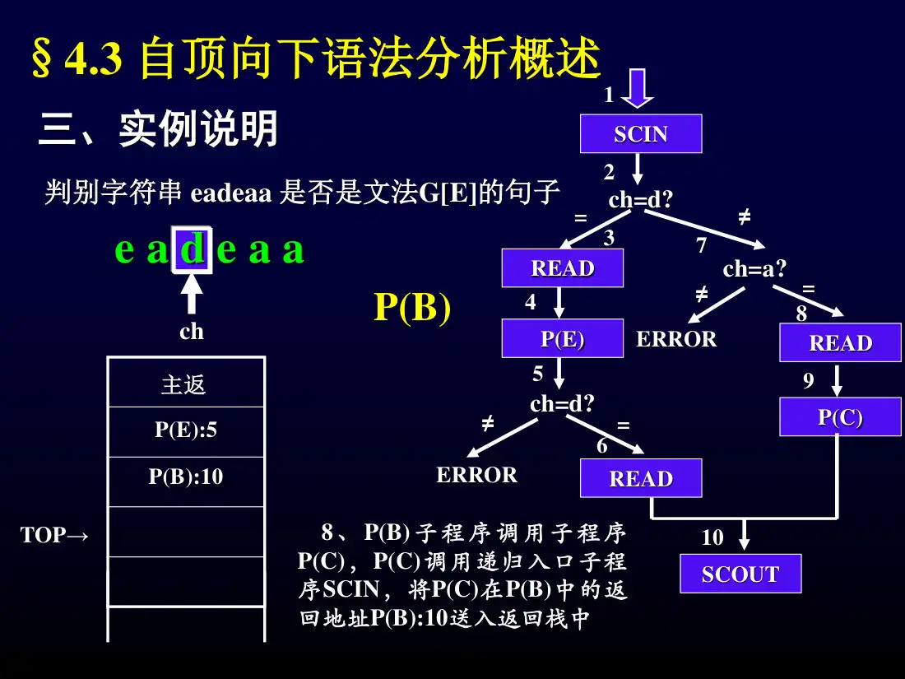

原文：

§4.3 自顶向下语法分析概述

三、实例说明

判别字符串 eadeaa 是否是文法G[E]的句子

e a d e a a ch

P(B)

8、P(B)子程序调用子程序P(C)，P(C)调用递归入口子程序SCIN，将P(C)在P(B)中的返回地址P(B):10送入返回栈中

### §4.3 自顶向下语法分析概述

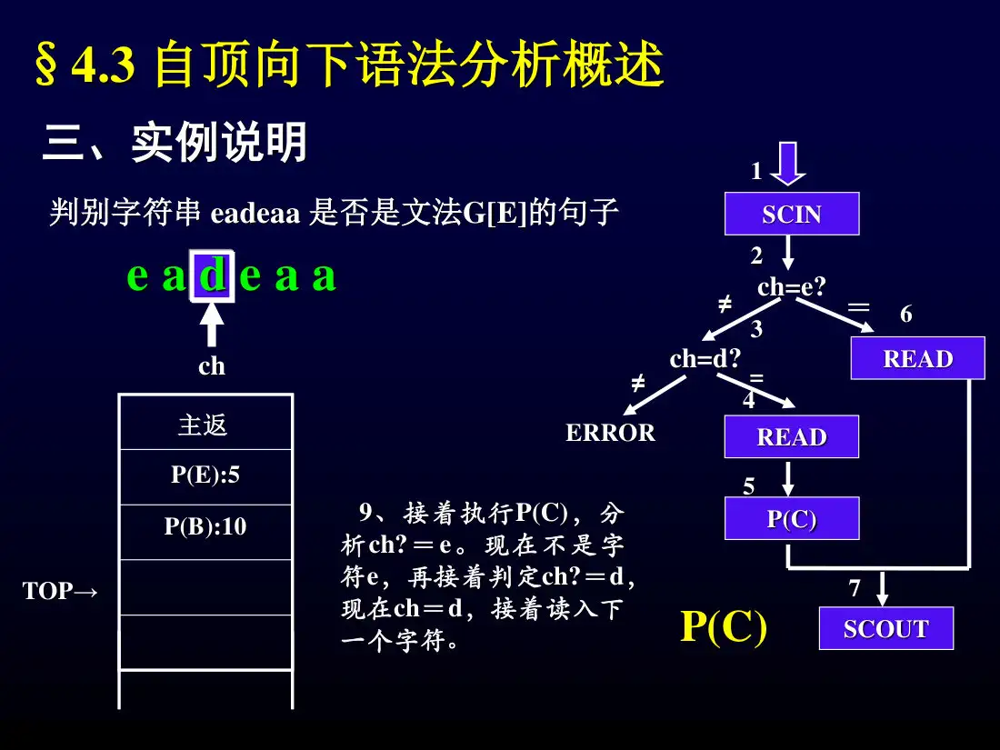

原文：

§4.3 自顶向下语法分析概述

三、实例说明

判别字符串 eadeaa 是否是文法G[E]的句子

主返P(E):5P(B):10

9、接着执行P(C)，分析ch?＝e。现在不是字符e，再接着判定ch?＝d，现在ch＝d，接着读入下一个字符。

P(C)

### §4.3 自顶向下语法分析概述

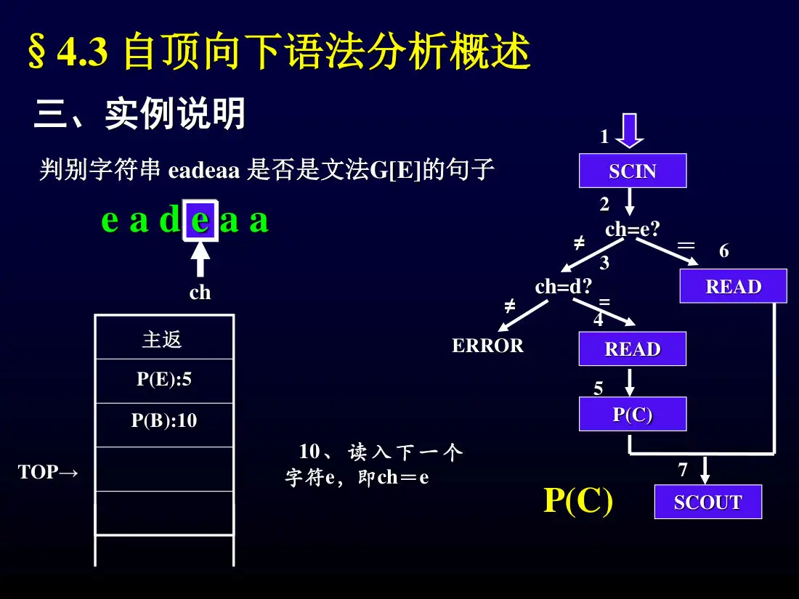

原文：

§4.3 自顶向下语法分析概述

三、实例说明

判别字符串 eadeaa 是否是文法G[E]的句子

10、读入下一个字符e，即ch＝e

### §4.3 自顶向下语法分析概述

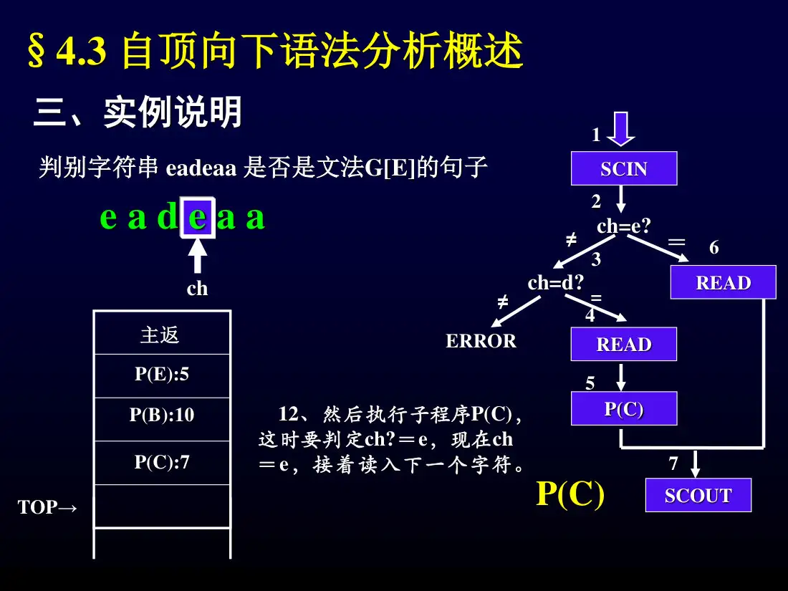

原文：

§4.3 自顶向下语法分析概述

三、实例说明

判别字符串 eadeaa 是否是文法G[E]的句子

12、然后执行子程序P(C)，这时要判定ch?＝e，现在ch＝e，接着读入下一个字符。

P(C)

### §4.3 自顶向下语法分析概述

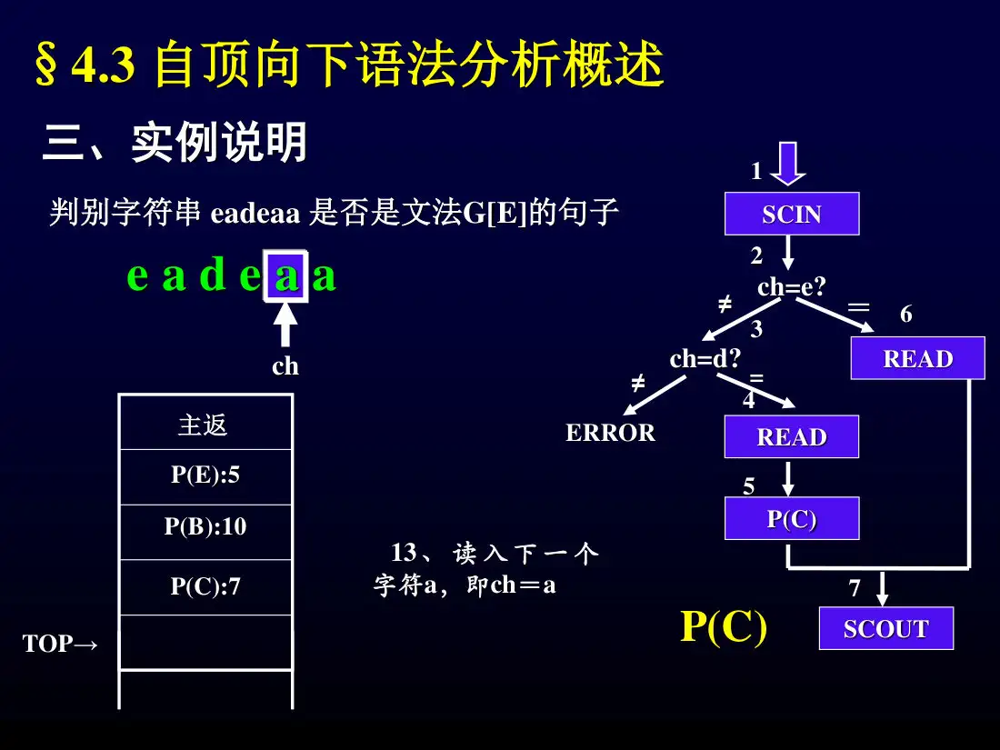

原文：

§4.3 自顶向下语法分析概述

三、实例说明

判别字符串 eadeaa 是否是文法G[E]的句子

13、读入下一个字符a，即ch＝a

### §4.3 自顶向下语法分析概述

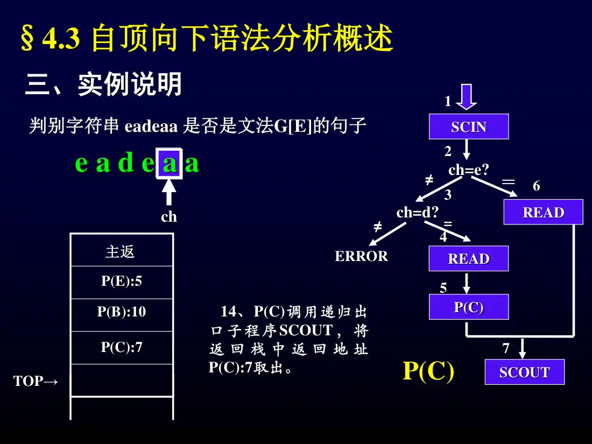

原文：

§4.3 自顶向下语法分析概述

三、实例说明

判别字符串 eadeaa 是否是文法G[E]的句子

e a d e a a

14、P(C)调用递归出口子程序SCOUT，将返 回 栈 中 返 回 地 址P(C):7取出。

P(C)

### §4.3 自顶向下语法分析概述

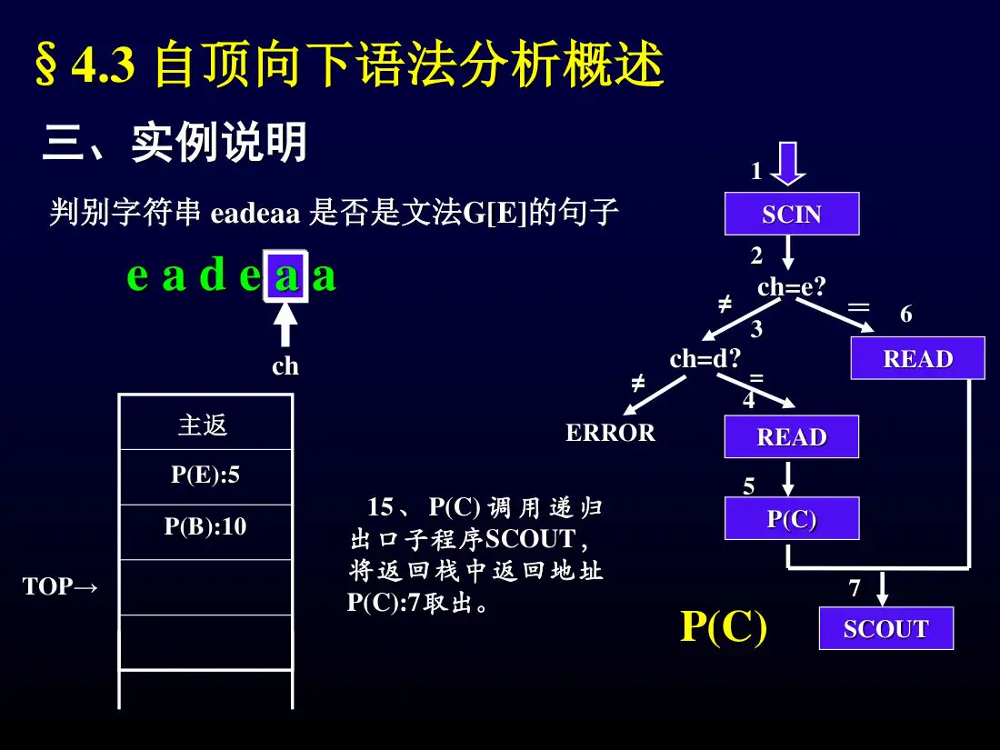

原文：

§4.3 自顶向下语法分析概述

三、实例说明

判别字符串 eadeaa 是否是文法G[E]的句子

e a d e a a

15、P(C)调用递归出口子程序SCOUT，将返回栈中返回地址P(C):7取出。

P(C)

### §4.3 自顶向下语法分析概述

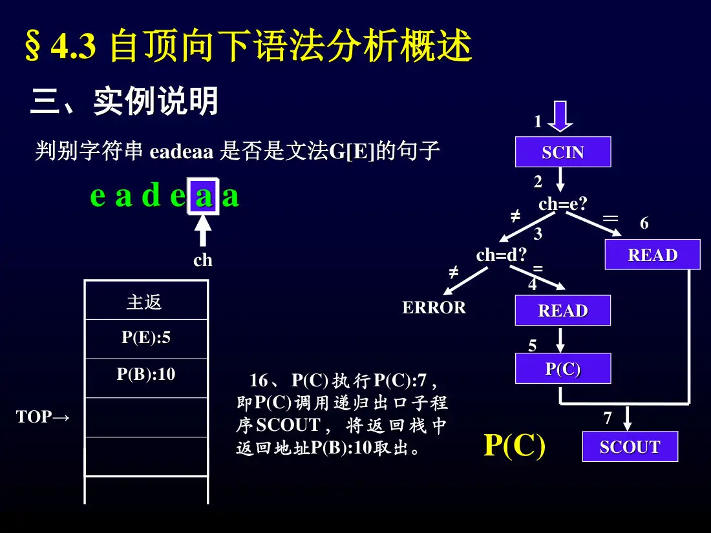

原文：

§4.3 自顶向下语法分析概述

三、实例说明

判别字符串 eadeaa 是否是文法G[E]的句子

e a d e a a

主返

ERROR

P(E):5

P(B):10

16、P(C)执行P(C):7，即P(C)调用递归出口子程序SCOUT，将返回栈中返回地址P(B):10取出。

P(C)

### §4.3 自顶向下语法分析概述

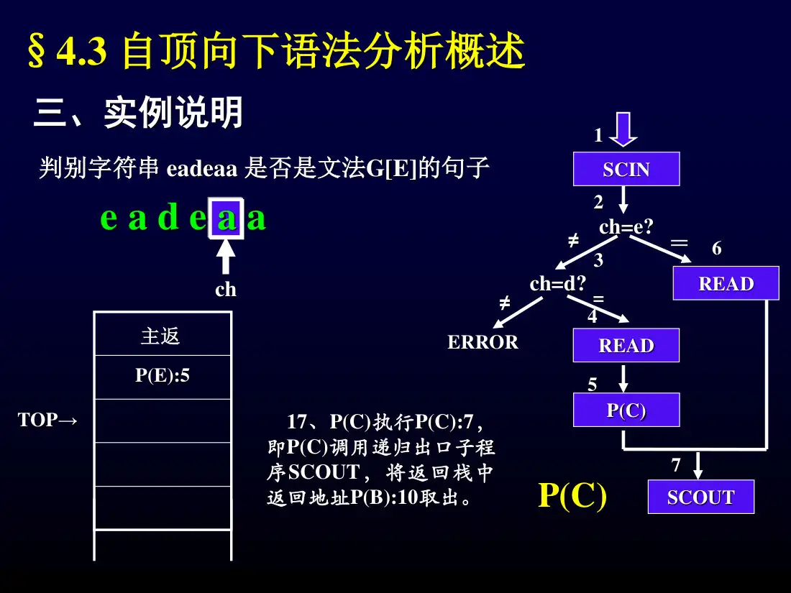

原文：

§4.3 自顶向下语法分析概述

三、实例说明

判别字符串 eadeaa 是否是文法G[E]的句子

e a d e a a

主返P(E):5

17、P(C)执行P(C):7，即P(C)调用递归出口子程序SCOUT，将返回栈中返回地址P(B):10取出。

P(C)

### §4.3 自顶向下语法分析概述

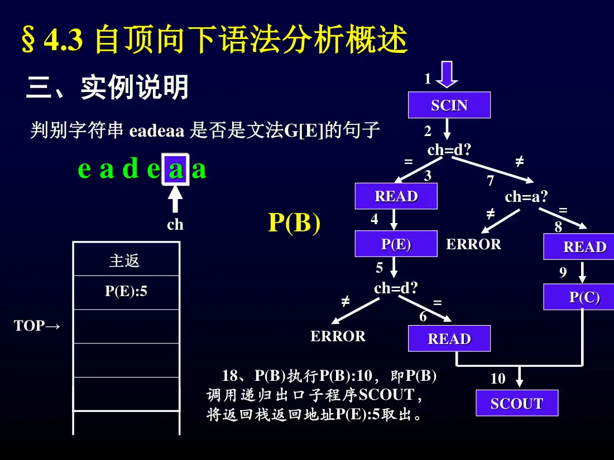

原文：

§4.3 自顶向下语法分析概述

三、实例说明

判别字符串 eadeaa 是否是文法G[E]的句子

e a d e a a

主返

P(E):5

P(B)

TOP→

18、P(B)执行P(B):10，即P(B)调用递归出口子程序SCOUT，将返回栈返回地址P(E):5取出。

SCOUT

### §4.3 自顶向下语法分析概述

原文：

§4.3 自顶向下语法分析概述

三、实例说明

判别字符串 eadeaa 是否是文法G[E]的句子

e a d e a a

P(B)

主返

TOP→

19、P(B)调用递归出口子程序SCOUT，将返回栈中P(B)在P(E)中的返回地址P(E):5取出。

SCOUT

### §4.3 自顶向下语法分析概述

原文：

§4.3 自顶向下语法分析概述

三、实例说明

判别字符串 eadeaa 是否是文法G[E]的句子

e a d e a a

主返

20 、 P(E) 执 行P(E):5，即 P(E) 子程序判别ch?＝a，现在是a，接着读入下一个字符。

P(E)

### §4.3 自顶向下语法分析概述

原文：

§4.3 自顶向下语法分析概述

三、实例说明

判别字符串 eadeaa 是否是文法G[E]的句子

e a d e a a

主返

21、读入下一个字符a，即ch＝a

P(E)

### §4.3 自顶向下语法分析概述

原文：

§4.3 自顶向下语法分析概述

三、实例说明

判别字符串 eadeaa 是否是文法G[E]的句子

e a d e a a

主返P(E):8

22 、 P(E) 子 程 序调用子程序P(A)，P(A)调用递归入口子 程 序 SCIN ， 将P(A) 在 P(E) 中 的 返回地址P(E):8送入返回栈中

P(E)

### §4.3 自顶向下语法分析概述

原文：

§4.3 自顶向下语法分析概述

三、实例说明

判别字符串 eadeaa 是否是文法G[E]的句子

e a d e a a a

T ch

ERROR

主返P(E):8

23、现在执行子程序P(A)，判断ch?＝a，现在ch＝a，接着读入下一个字符。

P(A)

### §4.3 自顶向下语法分析概述

原文：

§4.3 自顶向下语法分析概述

三、实例说明

判别字符串 eadeaa 是否是文法G[E]的句子

e a d e a a

ch

主返

P(E):8

TOP→

24 、 由 于 输 入 串eadeaa后面再也没有其他字符了，故读入的是句子的终结符‘#’

ERROR

P(A)

### §4.3 自顶向下语法分析概述

原文：

§4.3 自顶向下语法分析概述

三、实例说明

判别字符串 eadeaa 是否是文法G[E]的句子

e a d e a a

ch

ERROR

主返P(E):8

TOP→

25、P(A)调用递归出口子程序SCOUT，将返回栈中中返回地址P(E):8取出。

P(A)

### §4.3 自顶向下语法分析概述

原文：

§4.3 自顶向下语法分析概述

三、实例说明

判别字符串 eadeaa 是否是文法G[E]的句子

e a d e a a

ch

主返

TOP→

26、 P(A)调用递归 出 口 子 程 序SCOUT，将返回栈中 中 返 回 地 址P(E):8取出。

ERROR

P(A)

### §4.3 自顶向下语法分析概述

原文：

§4.3 自顶向下语法分析概述

三、实例说明

判别字符串 eadeaa 是否是文法G[E]的句子

e a d e a a

ch

主返

27 、 P(E) 执 行P(E):8，即 P(A)调用递归出口子程序SCOUT ， 将 返 回栈中返回地址主返取出。

P(E)

### §4.3 自顶向下语法分析概述

原文：

§4.3 自顶向下语法分析概述

三、实例说明

判别字符串 eadeaa 是否是文法G[E]的句子

e a d e a a

ch

TOP→

栈底

28 、 P(E) 执 行P(E):8，即P(A)调用递归出口子程序SCOUT，将返回栈中返回地址主返取出。

SCOUT

P(E)

### §4.3 自顶向下语法分析概述

原文：

§4.3 自顶向下语法分析概述

三、实例说明

判别字符串 eadeaa 是否是文法G[E]的句子

e a d e a a

TOP→

栈底

29、返回主程序，结束

结论—字符串eadeaa是文法的句子

SCOUT

P(E)

### §4.3 自顶向下语法分析概述

原文：

§4.3 自顶向下语法分析概述

三、实例说明

E::=eBaA

原例

A::=a｜bAcB

B::=dEd｜aC

C::=e｜dC

E::=eBaA 改 A::=a｜bAcB 例 B::=dEd｜dC C::=e｜dC

强化理解—为什么不能有回溯和左递归？

P(B)

### §4.3 自顶向下语法分析概述

原文：

§4.3 自顶向下语法分析概述

三、实例说明

E::=eBaA

原例

改例

A::=a｜bAcB

B::=dEd｜aC

C::=e｜dC

E::=eBaA A::=a｜bAcB B::=BEd｜aC C::=e｜dC

强化理解—为什么不能有回溯和左递归？

如果此时编译器扫描到的符号不是a，就会 一 直 陷 入P(B)中

P(B)..

### §4.2 自顶向下语法分析三、LL(1)分析法

原文：

§4.2 自顶向下语法分析三、LL(1)分析法

1、定义

LL（1）分析方法也是一种自顶向下不带回溯的分析方法，LL的意思是：从左（Left）到右扫描输入符号串并建立它的最左推导（Left most derivations）数字1是指向前看一个符号来决定选择同一个非终结符的不同规则。

如果向前查看K个符号（K>1）才能确定应选规则时，这种语法分析方法就称LL（K）分析法。

2022/4/18

65

### §4.2 自顶向下语法分析

原文：

§4.2 自顶向下语法分析

三、LL(1)分析法

2、LL(1)的分析方法

1）基本思想

借助于一张分析表及一个语法分析栈，在一个总控程序控制下实现。我们通常把按LL（1）方法执行语法分析任务的程序称为

LL（1）分析程序或LL（1）分析器，它由一个总控程序、一张分析表和一个分析栈组成，如下图所示。

2022/4/18

66

### §4.2 自顶向下语法分析

原文：

§4.2 自顶向下语法分析

三、LL(1)分析法

2、LL(1)的分析方法

1）基本思想

输入串

总控程序

分析表m

分析栈

2022/4/18

67

### §4.2 自顶向下语法分析

原文：

§4.2 自顶向下语法分析

三、LL(1)分析法

2、LL(1)的分析方法

2）LL(1)的方法分析过程考虑文法G［E］:E→TE′E′→＋TE′｜εT→FT′T′→\*FT′｜εF→（E）｜i

（1）建立文法LL（1）的分析表相应的分析表如下表所示（其构造方法，在后面叙述)。

2022/4/18

68

### §4.2 自顶向下语法分析

原文：

§4.2 自顶向下语法分析

三、LL(1)分析法

2、LL(1)的分析方法

2）LL(1)的方法分析过程

T′→\*FT′｜ε

F→（E）｜i

<table><tr><td></td><td>i</td><td>+</td><td>*</td><td>(</td><td>)</td><td>#</td></tr><tr><td>E</td><td> $E \rightarrow TE'$ </td><td></td><td></td><td> $E \rightarrow TE'$ </td><td></td><td></td></tr><tr><td> $E'$ </td><td></td><td> $E' \rightarrow +TE'$ </td><td></td><td></td><td> $E' \rightarrow \varepsilon$ </td><td> $E' \rightarrow \varepsilon$ </td></tr><tr><td>T</td><td> $T \rightarrow FT'$ </td><td></td><td></td><td> $T \rightarrow FT'$ </td><td></td><td></td></tr><tr><td> $T'$ </td><td></td><td> $T' \rightarrow \varepsilon$ </td><td> $T' \rightarrow *FT'$ </td><td></td><td> $T' \rightarrow \varepsilon$ </td><td> $T' \rightarrow \varepsilon$ </td></tr><tr><td>F</td><td> $F \rightarrow i$ </td><td></td><td></td><td> $F \rightarrow (E)$ </td><td></td><td></td></tr></table>

2022/4/18

69

### （2）分析过程

原文：

（2）分析过程

现在以输入符号串i＋i\*i为例，列出利用上述算法对此符号串的分析过程如下:

2022/4/18

70

### （2）分析过程

原文：

（2）分析过程

现在以输入符号串i＋i\*i为例，列出利用上述算法对此符号串的分析过程如下:

2022/4/18

71

### （2）分析过程

原文：

（2）分析过程

现在以输入符号串i＋i\*i为例，列出利用上述算法对此符号串的分析过程如下:

2022/4/18

72

### （2）分析过程

原文：

（2）分析过程

现在以输入符号串i＋i\*i为例，列出利用上述算法对此符号串的分析过程如下:

<table><tr><td>步骤</td><td>分析栈</td><td>余留输入串</td><td>所用产生式</td></tr><tr><td>(1)</td><td>#E</td><td>i+i*i #</td><td>E→TE&#x27;</td></tr><tr><td>(2)</td><td>#E&#x27;T</td><td>i+i*i #</td><td>T→FT&#x27;</td></tr><tr><td>(3)</td><td>#E&#x27;T&#x27;F</td><td>i+i*i #</td><td>F→i</td></tr></table>

2022/4/18

73

### （2）分析过程

原文：

（2）分析过程

现在以输入符号串i＋i\*i为例，列出利用上述算法对此符号串的分析过程如下:

<table><tr><td>步骤</td><td>分析栈</td><td>余留输入串</td><td>所用产生式</td></tr><tr><td>(1)</td><td>#E</td><td>i+i*i #</td><td>E→TE&#x27;</td></tr><tr><td>(2)</td><td>#E&#x27;T</td><td>i+i*i #</td><td>T→FT&#x27;</td></tr><tr><td>(3)</td><td>#E&#x27;T&#x27;F</td><td>i+i*i #</td><td>F→i</td></tr><tr><td>(4)</td><td>#E&#x27;T&#x27;i</td><td>i+i*i #</td><td></td></tr></table>

2022/4/18

74

### （2）分析过程

原文：

（2）分析过程

现在以输入符号串i＋i\*i为例，列出利用上述算法对此符号串的分析过程如下:

<table><tr><td>步骤</td><td>分析栈</td><td>余留输入串</td><td>所用产生式</td></tr><tr><td>(1)</td><td>#E</td><td>i+i*i #</td><td>E→TE'</td></tr><tr><td>(2)</td><td>#E'T</td><td>i+i*i #</td><td>T→FT'</td></tr><tr><td>(3)</td><td>#E'T'F</td><td>i+i*i #</td><td>F→i</td></tr><tr><td>(4)</td><td>#E'T'i</td><td>i+i*i #</td><td></td></tr><tr><td>(5)</td><td>#E'T'</td><td>+i*i #</td><td>T'→ε</td></tr><tr><td>(5)</td><td>#E'T'</td><td>+i*i #</td><td>T'→ε</td></tr><tr><td>(6)</td><td># E'</td><td>+i*i #</td><td>E'→+TE'</td></tr></table>

2022/4/18

75

### （2）分析过程

原文：

（2）分析过程

现在以输入符号串i＋i\*i为例，列出利用上述算法对此符号串的分析过程如下:

2022/4/18

76

### （2）分析过程

原文：

（2）分析过程

现在以输入符号串i＋i\*i为例，列出利用上述算法对此符号串的分析过程如下:

<table><tr><td>步骤</td><td>分析栈</td><td>余留输入串</td><td>所用产生式</td></tr><tr><td>(1)</td><td>#E</td><td>i+i*i #</td><td>E→TE&#x27;</td></tr><tr><td>(2)</td><td>#E&#x27;T</td><td>i+i*i #</td><td>T→FT&#x27;</td></tr><tr><td>(3)</td><td>#E&#x27;T&#x27;F</td><td>i+i*i #</td><td>F→i</td></tr><tr><td>(4)</td><td>#E&#x27;T&#x27;i</td><td>i+i*i #</td><td></td></tr><tr><td>(5)</td><td>#E&#x27;T&#x27;</td><td>+i*i #</td><td>T&#x27;→ε</td></tr><tr><td>(6)</td><td># E&#x27;</td><td>+i*i #</td><td>E&#x27;→+TE&#x27;</td></tr><tr><td>(7)</td><td># E&#x27;T+</td><td>+i*i #</td><td></td></tr></table>

2022/4/18

77

### （2）分析过程

原文：

（2）分析过程

现在以输入符号串i＋i\*i为例，列出利用上述算法对此符号串的分析过程如下:

<table><tr><td>步骤</td><td>分析栈</td><td>余留输入串</td><td>所用产生式</td></tr><tr><td>(1)</td><td>#E</td><td>i+i*i #</td><td>E→TE&#x27;</td></tr><tr><td>(2)</td><td>#E&#x27;T</td><td>i+i*i #</td><td>T→FT&#x27;</td></tr><tr><td>(3)</td><td>#E&#x27;T&#x27;F</td><td>i+i*i #</td><td>F→i</td></tr><tr><td>(4)</td><td>#E&#x27;T&#x27;i</td><td>i+i*i #</td><td></td></tr><tr><td>(5)</td><td>#E&#x27;T&#x27;</td><td>+i*i #</td><td>T&#x27;→ε</td></tr><tr><td>(6)</td><td># E&#x27;</td><td>+i*i #</td><td>E&#x27;→+TE&#x27;</td></tr><tr><td>(7)</td><td># E&#x27;T+</td><td>+i*i #</td><td></td></tr><tr><td>(8)</td><td># E&#x27;T</td><td>i*i #</td><td>T→FT&#x27;</td></tr></table>

2022/4/18

78

### （2）分析过程

原文：

（2）分析过程

现在以输入符号串i＋i\*i为例，列出利用上述算法对此符号串的分析过程如下:

<table><tr><td>步骤</td><td>分析栈</td><td>余留输入串</td><td>所用产生式</td></tr><tr><td>(1)</td><td>#E</td><td>i+i*i #</td><td>E→TE&#x27;</td></tr><tr><td>(2)</td><td>#E&#x27;T</td><td>i+i*i #</td><td>T→FT&#x27;</td></tr><tr><td>(3)</td><td>#E&#x27;T&#x27;F</td><td>i+i*i #</td><td>F→i</td></tr><tr><td>(4)</td><td>#E&#x27;T&#x27;i</td><td>i+i*i #</td><td></td></tr><tr><td>(5)</td><td>#E&#x27;T&#x27;</td><td>+i*i #</td><td>T&#x27;→ε</td></tr><tr><td>(6)</td><td># E&#x27;</td><td>+i*i #</td><td>E&#x27;→+TE&#x27;</td></tr><tr><td>(7)</td><td># E&#x27;T+</td><td>+i*i #</td><td></td></tr><tr><td>(8)</td><td># E&#x27;T</td><td>i*i #</td><td>T→FT&#x27;</td></tr><tr><td>(9)</td><td># E&#x27;T&#x27;F</td><td>i*i #</td><td>F→i</td></tr></table>

2022/4/18

79

### （2）分析过程

原文：

（2）分析过程

现在以输入符号串i＋i\*i为例，列出利用上述算法对此符号串的分析过程如下:

<table><tr><td>步骤</td><td>分析栈</td><td>余留输入串</td><td>所用产生式</td></tr><tr><td>(1)</td><td>#E</td><td>i+i*i #</td><td>E→TE&#x27;</td></tr><tr><td>(2)</td><td>#E&#x27;T</td><td>i+i*i #</td><td>T→FT&#x27;</td></tr><tr><td>(3)</td><td>#E&#x27;T&#x27;F</td><td>i+i*i #</td><td>F→i</td></tr><tr><td>(4)</td><td>#E&#x27;T&#x27;i</td><td>i+i*i #</td><td></td></tr><tr><td>(5)</td><td>#E&#x27;T&#x27;</td><td>+i*i #</td><td>T&#x27;→ε</td></tr><tr><td>(6)</td><td># E&#x27;</td><td>+i*i #</td><td>E&#x27;→+TE&#x27;</td></tr><tr><td>(7)</td><td># E&#x27;T+</td><td>+i*i #</td><td></td></tr><tr><td>(8)</td><td># E&#x27;T</td><td>i*i #</td><td>T→FT&#x27;</td></tr><tr><td>(9)</td><td># E&#x27;T&#x27;F</td><td>i*i #</td><td>F→i</td></tr><tr><td>(10)</td><td># E&#x27;T&#x27;i</td><td>i*i #</td><td></td></tr></table>

2022/4/18

80

### （2）分析过程

原文：

（2）分析过程

现在以输入符号串i＋i\*i为例，列出利用上述算法对此符号串的分析过程如下:

<table><tr><td>步骤</td><td>分析栈</td><td>余留输入串</td><td>所用产生式</td></tr><tr><td>(1)</td><td>#E</td><td>i+i*i #</td><td>E→TE&#x27;</td></tr><tr><td>(2)</td><td>#E&#x27;T</td><td>i+i*i #</td><td>T→FT&#x27;</td></tr><tr><td>(3)</td><td>#E&#x27;T&#x27;F</td><td>i+i*i #</td><td>F→i</td></tr><tr><td>(4)</td><td>#E&#x27;T&#x27;i</td><td>i+i*i #</td><td></td></tr><tr><td>(5)</td><td>#E&#x27;T&#x27;</td><td>+i*i #</td><td>T&#x27;→ε</td></tr><tr><td>(6)</td><td># E&#x27;</td><td>+i*i #</td><td>E&#x27;→+TE&#x27;</td></tr><tr><td>(7)</td><td># E&#x27;T+</td><td>+i*i #</td><td></td></tr><tr><td>(8)</td><td># E&#x27;T</td><td>i*i #</td><td>T→FT&#x27;</td></tr><tr><td>(9)</td><td># E&#x27;T&#x27;F</td><td>i*i #</td><td>F→i</td></tr><tr><td>(10)</td><td># E&#x27;T&#x27;i</td><td>i*i #</td><td></td></tr><tr><td>(11)</td><td># E&#x27;T&#x27;</td><td>*i #</td><td>T&#x27;→*FT&#x27;</td></tr></table>

2022/4/18

81

### （2）分析过程

原文：

（2）分析过程

现在以输入符号串i＋i\*i为例，列出利用上述算法对此符号串的分析过程如下:

<table><tr><td>步骤</td><td>分析栈</td><td>余留输入串</td><td>所用产生式</td></tr><tr><td>(1)</td><td>#E</td><td>i+i*i #</td><td>E→TE&#x27;</td></tr><tr><td>(2)</td><td>#E&#x27;T</td><td>i+i*i #</td><td>T→FT&#x27;</td></tr><tr><td>(3)</td><td>#E&#x27;T&#x27;F</td><td>i+i*i #</td><td>F→i</td></tr><tr><td>(4)</td><td>#E&#x27;T&#x27;i</td><td>i+i*i #</td><td></td></tr><tr><td>(5)</td><td>#E&#x27;T&#x27;</td><td>+i*i #</td><td>T&#x27;→ε</td></tr><tr><td>(6)</td><td># E&#x27;</td><td>+i*i #</td><td>E&#x27;→+TE&#x27;</td></tr><tr><td>(7)</td><td># E&#x27;T+</td><td>+i*i #</td><td></td></tr><tr><td>(8)</td><td># E&#x27;T</td><td>i*i #</td><td>T→FT&#x27;</td></tr><tr><td>(9)</td><td># E&#x27;T&#x27;F</td><td>i*i #</td><td>F→i</td></tr><tr><td>(10)</td><td># E&#x27;T&#x27;i</td><td>i*i #</td><td></td></tr><tr><td>(11)</td><td># E&#x27;T&#x27;</td><td>*i #</td><td>T&#x27;→*FT&#x27;</td></tr><tr><td>(12)</td><td># E&#x27;T&#x27;F*</td><td>*i #</td><td></td></tr></table>

2022/4/18

82

### （2）分析过程

原文：

（2）分析过程

现在以输入符号串i＋i\*i为例，列出利用上述算法对此符号串的分析过程如下:

<table><tr><td>步骤</td><td>分析栈</td><td>余留输入串</td><td>所用产生式</td></tr><tr><td>(1)</td><td>#E</td><td>i+i*i #</td><td>E→TE&#x27;</td></tr><tr><td>(2)</td><td>#E&#x27;T</td><td>i+i*i #</td><td>T→FT&#x27;</td></tr><tr><td>(3)</td><td>#E&#x27;T&#x27;F</td><td>i+i*i #</td><td>F→i</td></tr><tr><td>(4)</td><td>#E&#x27;T&#x27;i</td><td>i+i*i #</td><td></td></tr><tr><td>(5)</td><td>#E&#x27;T&#x27;</td><td>+i*i #</td><td>T&#x27;→ε</td></tr><tr><td>(6)</td><td># E&#x27;</td><td>+i*i #</td><td>E&#x27;→+TE&#x27;</td></tr><tr><td>(7)</td><td># E&#x27;T+</td><td>+i*i #</td><td></td></tr><tr><td>(8)</td><td># E&#x27;T</td><td>i*i #</td><td>T→FT&#x27;</td></tr><tr><td>(9)</td><td># E&#x27;T&#x27;F</td><td>i*i #</td><td>F→i</td></tr><tr><td>(10)</td><td># E&#x27;T&#x27;i</td><td>i*i #</td><td></td></tr><tr><td>(11)</td><td># E&#x27;T&#x27;</td><td>*i #</td><td>T&#x27;→*FT&#x27;</td></tr><tr><td>(12)</td><td># E&#x27;T&#x27;F*</td><td>*i #</td><td></td></tr><tr><td>(13)</td><td># E&#x27;T&#x27;F</td><td>i #</td><td>F→i</td></tr></table>

2022/4/18

83

### （2）分析过程

原文：

（2）分析过程

现在以输入符号串i＋i\*i为例，列出利用上述算法对此符号串的分析过程如下:

<table><tr><td>步骤</td><td>分析栈</td><td>余留输入串</td><td>所用产生式</td></tr><tr><td>(1)</td><td>#E</td><td>i+i*i #</td><td>E→TE&#x27;</td></tr><tr><td>(2)</td><td>#E&#x27;T</td><td>i+i*i #</td><td>T→FT&#x27;</td></tr><tr><td>(3)</td><td>#E&#x27;T&#x27;F</td><td>i+i*i #</td><td>F→i</td></tr><tr><td>(4)</td><td>#E&#x27;T&#x27;i</td><td>i+i*i #</td><td></td></tr><tr><td>(5)</td><td>#E&#x27;T&#x27;</td><td>+i*i #</td><td>T&#x27;→ε</td></tr><tr><td>(6)</td><td># E&#x27;</td><td>+i*i #</td><td>E&#x27;→+TE&#x27;</td></tr><tr><td>(7)</td><td># E&#x27;T+</td><td>+i*i #</td><td></td></tr><tr><td>(8)</td><td># E&#x27;T</td><td>i*i #</td><td>T→FT&#x27;</td></tr><tr><td>(9)</td><td># E&#x27;T&#x27;F</td><td>i*i #</td><td>F→i</td></tr><tr><td>(10)</td><td># E&#x27;T&#x27;i</td><td>i*i #</td><td></td></tr><tr><td>(11)</td><td># E&#x27;T&#x27;</td><td>*i #</td><td>T&#x27;→*FT&#x27;</td></tr><tr><td>(12)</td><td># E&#x27;T&#x27;F*</td><td>*i #</td><td></td></tr><tr><td>(13)</td><td># E&#x27;T&#x27;F</td><td>i #</td><td>F→i</td></tr><tr><td>(14)</td><td># E&#x27;T&#x27;i</td><td>i #</td><td></td></tr></table>

2022/4/18

84

### （2）分析过程

原文：

（2）分析过程

现在以输入符号串i＋i\*i为例，列出利用上述算法对此符号串的分析过程如下:

<table><tr><td>步骤</td><td>分析栈</td><td>余留输入串</td><td>所用产生式</td></tr><tr><td>(1)</td><td>#E</td><td>i+i*i #</td><td>E→TE&#x27;</td></tr><tr><td>(2)</td><td>#E&#x27;T</td><td>i+i*i #</td><td>T→FT&#x27;</td></tr><tr><td>(3)</td><td>#E&#x27;T&#x27;F</td><td>i+i*i #</td><td>F→i</td></tr><tr><td>(4)</td><td>#E&#x27;T&#x27;i</td><td>i+i*i #</td><td></td></tr><tr><td>(5)</td><td>#E&#x27;T&#x27;</td><td>+i*i #</td><td>T&#x27;→ε</td></tr><tr><td>(6)</td><td># E&#x27;</td><td>+i*i #</td><td>E&#x27;→+TE&#x27;</td></tr><tr><td>(7)</td><td># E&#x27;T+</td><td>+i*i #</td><td></td></tr><tr><td>(8)</td><td># E&#x27;T</td><td>i*i #</td><td>T→FT&#x27;</td></tr><tr><td>(9)</td><td># E&#x27;T&#x27;F</td><td>i*i #</td><td>F→i</td></tr><tr><td>(10)</td><td># E&#x27;T&#x27;i</td><td>i*i #</td><td></td></tr><tr><td>(11)</td><td># E&#x27;T&#x27;</td><td>*i #</td><td>T&#x27;→*FT&#x27;</td></tr><tr><td>(12)</td><td># E&#x27;T&#x27;F*</td><td>*i #</td><td></td></tr><tr><td>(13)</td><td># E&#x27;T&#x27;F</td><td>i #</td><td>F→i</td></tr><tr><td>(14)</td><td># E&#x27;T&#x27;i</td><td>i #</td><td></td></tr><tr><td>(15)</td><td># E&#x27;T&#x27;</td><td>#</td><td>T&#x27;→ ε</td></tr></table>

2022/4/18

85

### （2）分析过程

原文：

（2）分析过程

现在以输入符号串i＋i\*i为例，列出利用上述算法对此符号串的分析过程如下:

<table><tr><td>步骤</td><td>分析栈</td><td>余留输入串</td><td>所用产生式</td></tr><tr><td>(1)</td><td>#E</td><td>i+i*i #</td><td>E→TE&#x27;</td></tr><tr><td>(2)</td><td>#E&#x27;T</td><td>i+i*i #</td><td>T→FT&#x27;</td></tr><tr><td>(3)</td><td>#E&#x27;T&#x27;F</td><td>i+i*i #</td><td>F→i</td></tr><tr><td>(4)</td><td>#E&#x27;T&#x27;i</td><td>i+i*i #</td><td></td></tr><tr><td>(5)</td><td>#E&#x27;T&#x27;</td><td>+i*i #</td><td>T&#x27;→ε</td></tr><tr><td>(6)</td><td># E&#x27;</td><td>+i*i #</td><td>E&#x27;→+TE&#x27;</td></tr><tr><td>(7)</td><td># E&#x27;T+</td><td>+i*i #</td><td></td></tr><tr><td>(8)</td><td># E&#x27;T</td><td>i*i #</td><td>T→FT&#x27;</td></tr><tr><td>(9)</td><td># E&#x27;T&#x27;F</td><td>i*i #</td><td>F→i</td></tr><tr><td>(10)</td><td># E&#x27;T&#x27;i</td><td>i*i #</td><td></td></tr><tr><td>(11)</td><td># E&#x27;T&#x27;</td><td>*i #</td><td>T&#x27;→*FT&#x27;</td></tr><tr><td>(12)</td><td># E&#x27;T&#x27;F*</td><td>*i #</td><td></td></tr><tr><td>(13)</td><td># E&#x27;T&#x27;F</td><td>i #</td><td>F→i</td></tr><tr><td>(14)</td><td># E&#x27;T&#x27;i</td><td>i #</td><td></td></tr><tr><td>(15)</td><td># E&#x27;T&#x27;</td><td>#</td><td>T&#x27;→ε</td></tr><tr><td>(16)</td><td># E&#x27;</td><td>#</td><td>E&#x27;→ε</td></tr></table>

2022/4/18

86

### （2）分析过程

原文：

（2）分析过程

现在以输入符号串i＋i\*i为例，列出利用上述算法对此符号串的分析过程如下:

<table><tr><td>步骤</td><td>分析栈</td><td>余留输入串</td><td>所用产生式</td></tr><tr><td>(1)</td><td>#E</td><td>i+i*i #</td><td>E→TE&#x27;</td></tr><tr><td>(2)</td><td>#E&#x27;T</td><td>i+i*i #</td><td>T→FT&#x27;</td></tr><tr><td>(3)</td><td>#E&#x27;T&#x27;F</td><td>i+i*i #</td><td>F→i</td></tr><tr><td>(4)</td><td>#E&#x27;T&#x27;i</td><td>i+i*i #</td><td></td></tr><tr><td>(5)</td><td>#E&#x27;T&#x27;</td><td>+i*i #</td><td>T&#x27;→ε</td></tr><tr><td>(6)</td><td># E&#x27;</td><td>+i*i #</td><td>E&#x27;→+TE&#x27;</td></tr><tr><td>(7)</td><td># E&#x27;T+</td><td>+i*i #</td><td></td></tr><tr><td>(8)</td><td># E&#x27;T</td><td>i*i #</td><td>T→FT&#x27;</td></tr><tr><td>(9)</td><td># E&#x27;T&#x27;F</td><td>i*i #</td><td>F→i</td></tr><tr><td>(10)</td><td># E&#x27;T&#x27;i</td><td>i*i #</td><td></td></tr><tr><td>(11)</td><td># E&#x27;T&#x27;</td><td>*i #</td><td>T&#x27;→*FT&#x27;</td></tr><tr><td>(12)</td><td># E&#x27;T&#x27;F*</td><td>*i #</td><td></td></tr><tr><td>(13)</td><td># E&#x27;T&#x27;F</td><td>i #</td><td>F→i</td></tr><tr><td>(14)</td><td># E&#x27;T&#x27;i</td><td>i #</td><td></td></tr><tr><td>(15)</td><td># E&#x27;T&#x27;</td><td>#</td><td>T&#x27;→ε</td></tr><tr><td>(16)</td><td># E&#x27;</td><td>#</td><td>E&#x27;→ε</td></tr><tr><td>(17)</td><td>#</td><td>#</td><td>成功</td></tr></table>

由上述分析过程可以看出，LL（1）分析器确实构造了输入串的一个最左推导。

87

2022/4/18

### §4.2 自顶向下语法分析

原文：

§4.2 自顶向下语法分析

三、LL(1)分析法

2、LL(1)的分析方法

2）LL(1)的方法分析过程具体步骤如下—

（1）分析开始时，首先将符号#及文法的开始符号S依次置于分析栈的底部，并把各指示器调整至起始位置,即分别指向分析栈的栈顶元素和输入串的首字符。然后反复执行第（2）步

（2）设在分析的某一步，分析栈及余留的输入符号串处于如下：

↓ $m ^ { 2 } + 4 0 + 5 \times 2 0 + 1 1 0 + 1 1 1$ aiai+1…#

其中，X1，X2，…，Xm为分析过程中所得的文法符号，此时，可视栈顶符号Xm的不同情况，分别做如下的动作:

2022/4/18

88

### §4.2 自顶向下语法分析

原文：

§4.2 自顶向下语法分析

三、LL(1)分析法

2、LL(1)的分析方法

2）LL(1)的方法分析过程具体步骤如下—

① 若 $\mathbb { S } \mathbb { S } \mathbb { = } \mathbb { V } \mathbb { = }$ 则以 $\pmb { \mathrm { D } } \pmb { \mathrm { ( 1 1 ) } } \pmb { \mathrm { ( 2 3 ) } }$ 组成符号对 $\textcircled { + } \textcircled { < } \textcircled { < } \textcircled { < }$ 查分析表M，设M $\mathbb { E } ^ { \sharp }$ 为一产生式， 譬如说 $\therefore \angle B = \angle C A B = \angle C$ 此时将 $\mathbb { S }$ 分析栈中退出，并将UVW按反序推入栈中（即用该产生式推导一步），从而得到新的格局:

X $1 0 0 0 0 0 0 0 0 0 0 0 0 0 0 0 0 0 0 0 0 0 0 0 0$

$$
\mathbf {a _ {i} a _ {i + 1}} \dots \#
$$

但若M $\angle B A C = \angle C A E = \angle C A E = \angle C A E = \angle C A E$ 则调用出错处理程序2022/4/18 进行处理 ;

89

### §4.2 自顶向下语法分析

原文：

§4.2 自顶向下语法分析

三、LL(1)分析法

2、LL(1)的分析方法

2）LL(1)的方法分析过程具体步骤如下—

② 若 $\angle 3 = \angle A = \angle B = \angle C$ 则表明栈顶符号已与当前正扫视的输入符号得到匹配，此时应将X （即a）从栈中退出，并将输入符号指示器向前推进一个位置；

③ 若 $\pmb { \mathrm { X } } \pmb { \mathrm { S } } \pmb { \mathrm { W } } = \pmb { \mathrm { Q } } \pmb { \mathrm { W } } = \pmb { \mathrm { W } }$ 则表明输入串已完全得到匹配，此时即可宣告分析成功而结束分析工作。

2022/4/18

90

### §4.2 自顶向下语法分析

原文：

§4.2 自顶向下语法分析

三、LL(1)分析法

2、LL(1)的分析方法

3）几点说明

（1）分析表M根据具体文法构造，文法不同M就不同

（2）LL（1）分析法的总控程序对于不同文法总是一样的

（3）分析表M[A，a]或指出应选规则或指出错误（空白时）

（4）LL（1）语法分析程序的机器模型是一个下推自动机

构造一个LL（1）分析器问题，主要归结为构造LL（1）分析表的问题。

2022/4/18

91

### §4.2 自顶向下语法分析

原文：

§4.2 自顶向下语法分析

三、LL(1)分析法

3、构造LL(1)分析表

1）头终结符号集合和后继终结符号集合

（1）定义

为了构造分析表，我们引进与文法有关的集合FIRST集和FOLLOW集。

假定α是文法G的任一符号串，或者说 $\langle n | = ( 1 0 0 - 1 0 ) \times n \rangle$ 我们定义

FIRST $( 0 ) - ( - 1 ) ( 1 0 - 2 ) \times ( - 1 ) ( - 1 ) = ( - 1 ) ( - 1 )$

特别是，若 $\mathtt { m } = \mathtt { m }$ ，则规定ε∈ FIRST（α）

即 FIRST（α）是α的所有可能推导的开头终结符或可能的ε

2022/4/18

92

### §4.2 自顶向下语法分析

原文：

§4.2 自顶向下语法分析

三、LL(1)分析法

3、构造LL(1)分析表

1）头终结符号集合和后继终结符号集合

例如：设文法GT ∷＝AB$\mathbf { \Delta } _ { \mathbf { a } } \mathbf { a } _ { \mathbf { b } } = \mathbf { \Delta } _ { \mathbf { b } } \mathbf { a } _ { \mathbf { b } } \mathbf { a } _ { \mathbf { b } } ( \mathbf { a } _ { \mathbf { b } } )$ $1 2 0 0 = 1 0 0 ( m )$ $\textcircled { 9 } \times \times \times \textcircled { 1 } \textcircled { 9 } \times$ $1 3 0 0 = 1 7 3 7 0$ $\textcircled { 4 } \textcircled { 4 } \textcircled { < } \textcircled { 6 } \textcircled { 9 }$ 求FIRST（PQ）

由定义有 $1 2 0 2 - 2 0 2 0 0 = 1 0$ $1 2 0 2 \div 2 0 0 2 = 2 0 2 = 2 0 0 2 = 2 0 0 0$ $) 1 2 ( 0 ) = 1 \times ( 0 ) = 1 0 ( 0 ) = 1 0$ 所以 FIRST（PQ）={p,q, }同理 FIRST（BC) ={b,e}

对于一个简单的文法我们用手工可以求得其FISRT集，对于复杂的文法我们通常使用下述算法求解

2022/4/18

93

### §4.2 自顶向下语法分析

原文：

§4.2 自顶向下语法分析

三、LL(1)分析法

3、构造LL(1)分析表

2）构造头终结符号集合（First集合）的方法

对于文法中的每一个文法符 $\scriptstyle \sum = ( 0 , 0 , 0 , 0 )$ 构造FIRST（X）时，只要连续使用下列规则，直至每个FIRST集不再扩大为止。

（1）若 $\therefore \angle 1 = \angle C$ ，则FIRST $( \pm 3 ) = ( \pm 4 )$ 。

（2）若 $\mathbf { \nabla } \times \mathbf { \equiv } \mathbf { \vec { u } }$ 且有形如 $\pm \pm \infty = \pm \pm \sqrt { 1 5 }$ 规则 $( \mathbf { e } \mathbf { e } \mathbf { = } \mathbf { w } )$ ，或$\pm \infty = \pm 9$ 的规则，把a或（和）ε加入FIRST（X）中。

2022/4/18

94

### §4.2 自顶向下语法分析

原文：

§4.2 自顶向下语法分析

三、LL(1)分析法

3、构造LL(1)分析表

2）构造头终结符号集合（First集合）的方法

（3）设文法G中有形如 $1 0 0 0 - 1 0 0 0 0 0 0 0 0 0 0 0 0 0 0 0 0 0 0 0 0 0 0 0 0 0 0 0 0 0 0 0 0 0 0 0 0 0 0 0 0 0 0 0 0 0 0 0 0 0 0 0 0 0 0 0 0 0 0 0 0 0 0 0 0 0 0 0 0 0 0 0 0 0 0 0 0 0 0 0 0 0 0 0 0 0 0 0 0 0 0 0 0 0 0 0 0 0 0 0 0 0 0 0 0 0 0 0 0 0 0 0 0 0 0 0 0 0 0 0 0 0 0 0 0 0 0 0 0 0 0 0 0 0 0 0 0 0 0 0 0 0 0 0 0 0 0 0 0 0 0 0 0 0 0 0 0 0 0 0 0 0 0 0 0 0 0 0 0 0 0 0 0 0 0 0 0 0 0 0 0 0 0 0 0 0 0 0 0 0 0 0 0 0 0 0 0 0 0 0 0 0 0 0 0 0 0 0 0 0 0 0 0 0 0 0 0 0 0 0 0 0 0 0 0 0 0 0 0 0 0 0 0 0 0 0 0 0 0 0 0 0 0 0 0 0 0 0 0 0 0 0 0 0 0 0 0 0 0 0 0 0 0 0 0 0 0 0 0 0 0 0 0 0 0 0 0 0 0 0 0 0 0 0 0 0 0 0 0 0 0 0 0 0 0 0 0 0 0 0 0 0 0 0 0 0 0 0 0 0 0 0 0 0 0 0 0 0 0 0 0 0 0 0 0 0 0 0 0 0 0 0 0 0 0 0 0 0 0 0 0 0 0 0 0 0 0 0 0 0 0 0 0 0 0 0 0 0 0 0 0 0 0 0 0 0 0 0 0 0 0 0 0 0 0 0 0 0 0 0 0 0 0 0 0 0 0 0 0 0 0 0 0 0 0 0 0 0 0 0 0 0 0 0 0 0 0 0 0 0 0 0 0 0 0 0 0 0 0 0 0 0 0 0 0 0 0 0 0 0 0 0 0 0 0 0 0 0 0 0 0 0 0 0 0 0 0 0 0 0 0 0 0 0 0 0 0 0 0 0 0 0 0 0 0 0 0 0 0 0 0 0 0 0 0 0 0 0 0 0 0 0 0 0 0 0 0 0 0 0 0 0 0 0 0 0 0 0 0 0 0 0 0 0 0 0 0 0 0 0 0 0 0 0 0 0 0 0 0 0 0 0 0 0 0 0 0 0 0 0 0 0 0 0 0 0 0 0 0 0 0 0 0 0 0 0 0 0 0 0 0 0 0 0 0 0 0 0 0 0 0 0 0 0 0 0 0 0 0 0 0$ 的规则，若 $\nabla \times \equiv \mathbb { M }$ 则将FIRST $\mathbf { \langle \pmb { \left( \left( \delta \eta \right) \right)} \vert \mathcal { U } ^ { \prime } \vert  }$ 中一切非ε符号加进FIRST（X）中，对于一切 $\angle B = \angle B$ 若 $\angle B = \angle A$ 则把Y2中首符号集（除ε外）也加进FIRST（X）中，如此继续下去，直到 $1 0 0 0 0 0 0$ 则把 $x ^ { 2 } = \pm \sqrt { \frac { \pi } { 2 } } = 1$ 首符号集（除ε外）也入FIRST(X)中。

（4）若 $1 7 - 1 7 = 1 7 7$ 每个非终结符号都可能推导出空符号串，即$\sqrt [ 3 ] { 4 \times 2 } = 2 \times 2$ 则把ε也加进FIRST（X）中。

2022/4/18

95

### §4.2 自顶向下语法分析

原文：

§4.2 自顶向下语法分析

三、LL(1)分析法

3、构造LL(1)分析表

2）构造头终结符号集合（First集合）的方法

考虑文法G［E］E→TE′E′→＋TE′｜εT→FT′T′→\*FT′｜εF→（E）｜i由算法步骤（1）得FIRST（+）={+}FIRST（\*）={\*}FIRST（（）={（}FIRST（））={）}FIRST（i）={i}

由算法步骤（2）得FIRST（E’）={+，ε}FIRST（T’）={\*，ε}FIRST（F）={（，i}§4.2 自顶向下语法分析

2022/4/18

96

### 三、LL(1)分析法

原文：

三、LL(1)分析法

3、构造LL(1)分析表

2）构造头终结符号集合（First集合）的方法文法G［E］:E→TE′, E′→＋TE′｜ε, T→FT′T′→\*FT′｜ε , F→（E）｜i

对于算法步骤 （3）和（4）

因为T→FT′

所以 FIRST（T）=FIRST（F）=又因为F不能推出， 所以FIRST（T’）不能被加入FIRST（T）

2022/4/18

97

### §4.2 自顶向下语法分析

原文：

§4.2 自顶向下语法分析

三、LL(1)分析法

3、构造LL(1)分析表

E→TE′, E′→＋TE′｜ε, T→FT′ T′→\*FT′｜ε , F→（E）｜i

2）构造头终结符号集合（First集合）的方法利用该算法还能方便地得到如下的符号串头终结符号集：FIRST（TE’）=FIRST（T） =FIRST（F） ={（，i}FIRST（+TE’）=FIRST（+）FIRST（FT’）=FIRST（F）={（，i}FIRST（\*FT’）=FIRST（\*）={\*}FIRST（（E））=FIRST（（）={（}FIRST（ ε）={ε}

2022/4/18

98

### §4.2 自顶向下语法分析

原文：

§4.2 自顶向下语法分析

三、LL(1)分析法

3、构造LL(1)分析表

3）构造后继终结符号集合（Follow集合）的方法

（1）定义

假定S是文法G的开始符号，对于G的任何非终结符A，

我们定义—

FOLLOW（A） $= ( - 1 ) ( - 2 ) \times ( - 1 ) ( - 1 ) ( - 1 ) ( - 1 )$

特别是，若S \*…A，则规定#∈FOLLOW（A）

即： FOLLOW（A）是所有句型中出现在紧接A之后的终结符或#

2022/4/18

99

### §4.2 自顶向下语法分析

原文：

§4.2 自顶向下语法分析

三、LL(1)分析法

3、构造LL(1)分析表

3）构造后继终结符号集合（Follow集合）的方法对文法中每个非终结符A，为了构造FOLLOW（A）可反复应用如下规则，直到每个FOLLOW集不再扩大为止

（1）对于文法的开始符号S，令#∈FOLLOW（S）。

（2）若文法中有形如A∷＝αBβ的规则，且β≠ε，则将FIRST（β）中一切非ε符号加进FOLLOW（B）中。

2022/4/18

100

### §4.2 自顶向下语法分析

原文：

§4.2 自顶向下语法分析

三、LL(1)分析法

3、构造LL(1)分析表

3）构造后继终结符号集合（Follow集合）的方法

（3）若文法中有形如 $\mathbf { \Delta } L \mathbf { a } \mathbf { a } = \mathbf { \Delta } \mathbf { a } \mathbf { \Delta } \mathbf { \partial } \mathbf { \partial } \mathbf { \partial } \mathbf { \partial } \mathbf { \partial } $ 或 $\pmb { L } \pmb { \mathrm { S } } \pmb { \mathrm { Q } } \pmb { \mathrm { Q } } = \pmb { \mathrm { U } } \pmb { \mathrm { b } }$ β的规则，且$1 1 = 2 0$ 则FOLLOW（A）中全部终结符均属于FOLLOW（B），其中α可以为ε。

2022/4/18

101

### §4.2 自顶向下语法分析

原文：

§4.2 自顶向下语法分析

三、LL(1)分析法

考虑文法G［E］:

①E→TE′ ② E′→＋TE′｜ε ③T→FT′

④T′→\*FT′｜ε ⑤F→（E）｜i

1）求FOLLOW（E）＝{ ＃, ）}

由算法步骤（1）得：#∈FOLLOW（E）（E是文法开始符号）

由算法步骤（2） 规则⑤得： ）∈ FOLLOW（E）

所以 FOLLOW（E）＝{ ＃, ）}§4.2 自顶向下语法分析三、LL(1)分析法3、构造LL(1)分析表下面举例介绍构造LL(1)分析表的过程—考虑文法G［E］:①E→TE′ ② E′→＋TE′｜ε ③T→FT′④T′→\*FT′｜ε ⑤F→（E）｜i2）求FOLLOW（E’）＝{ ＃, ）}由算法步骤（3）规则①得： FOLLOW（E） FOLLOW（E’）所以 FOLLOW（E’）＝{ ＃,）}

102

### 2022/4/18

原文：

2022/4/18

103

### 104

原文：

§4.2 自顶向下语法分析三、LL(1)分析法3、构造LL(1)分析表下面举例介绍构造LL(1)分析表的过程—3）求FOLLOW（T）＝{ +,＃,）}由算法步骤 （2）规则①、 ②得：+∈ FOLLOW（T）(因为 FIRST(E’) -{ε}={+})由算法步骤 （3）规则①得：FOLLOW (E) ⊆FOLLOW (T) 即 {)，#} ⊆FOLLOW(T)}由规则②得：E’\*ε，所以由算法（3）规则②得：FOLLOW (E') ⊆FOLLOW (T) 即 {)，#}⊆FOLLOW(T)})2022/4/18 所以 FOLLOW（T）＝{ +,＃,）}

104

### §4.2 自顶向下语法分析

原文：

§4.2 自顶向下语法分析

三、LL(1)分析法

3、构造LL(1)分析表下面举例介绍构造LL(1)分析表的过程—

4）求FOLLOW（T’)＝{ +,＃,）}

由算法步骤（3）规则③得：

FOLLOW（T）FOLLOW（ T’）即 {+， # ,）}

 FOLLOW(T’)

所以 FOLLOW（ T’)＝{+， # ,）}§4.2 自顶向下语法分析三、LL(1)分析法3、构造LL(1)分析表下面举例介绍构造LL(1)分析表的过程—5）求FOLLOW（F）＝{ +,\*，＃,）}由算法步骤（2）规则③ 、④得：\* ∈ FOLLOW（F）(因为 FIRST(T’) -{ε}={\*})由算法步骤（3）规则③得：FOLLOW (T) ⊆FOLLOW (F) 即 {+,) ，#} ⊆FOLLOW(F)}由规则④得：T′ \*ε,所以由算法（3）规则③得：FOLLOW (T’) ⊆FOLLOW (F) 即 {+,) ，#} ⊆FOLLOW(F)}所以 FOLLOW（T）＝{ +,\*,＃,）}2022/4/18

2022/4/18

105

### 106

原文：

106

### §4.2 自顶向下语法分析

原文：

§4.2 自顶向下语法分析

三、LL(1)分析法

3、构造LL(1)分析表求出出First集和Follow集后，就可以构造出LL(1)分析表—

1）构造分析表M过程（以文法G［E］为例） 下面列出文法G［E］符号串头终结符号集合和非终结符后 继终结符号集合，文法G［E］:

① E→TE′

② E′→＋TE′｜ε

③ T→FT′

④ T′→\*FT′ ε

⑤ F→（E）｜i

2022/4/18

107

### §4.2 自顶向下语法分析

原文：

§4.2 自顶向下语法分析

三、LL(1)分析法

3、构造LL(1)分析表求出出First集和Follow集后，就可以构造出LL(1)分析表—

1）构造分析表M过程（以文法G［E］为例）

下面列出文法G［E］符号串头终结符号集合和非终结符后继终结符号集合，文法G［E］:

FIRST（TE’）=={（，i}FIRST（+TE’）={+}FIRST（FT’）={（，i}FIRST（\*FT’）={\*}FIRST（（E））=={（}

FIRST（ ε）={ε}

FOLLOW（E）=FOLLOW（E’）={），#}

FOLLOW（E’）＝{ ＃,）}

FOLLOW（T）=FOLLOW（T’）={），#，+}

FOLLOW（T’)＝{ +,＃,）}

FOLLOW（F）={），#，+，\*}

2022/4/18

108

### §4.2 自顶向下语法分析

原文：

§4.2 自顶向下语法分析

三、LL(1)分析法

3、构造LL(1)分析表

2）构造分析表M算法（以文法G［E］为例）求出FIRST集和FOLLOW集后，根据前面构造文法G的LL（1）分析表的过程，我们就可以得出构造分析表M算法，对于G中每一个规则 $L _ { \mathrm { a s , o u s e } } ^ { \mathrm { a s o u s e } } \mathrm { = } \emptyset$ 可按如下算法确定表中各元素：

① 对FIRST（α）中每一终结符a，置M $\mathrm { | | } \mathbf { \mathit { p } _ { 4 } ^ { \prime } } \mathbf { \mathit { s p } _ { 4 } ^ { \prime } } \mathbf { \mathit { s p } _ { 4 } ^ { \prime } } = \mathrm { | | \mathbf { \mathit { n } _ { 4 } ^ { \prime } } \mathbf { \mathit { s p } _ { 4 } ^ { \prime } } | } = \mathbf { \mathit { n } _ { 4 } ^ { \prime } } \mathbf { \mathit { s p } _ { 4 } ^ { \prime } }$

②若ε∈FIRST（α），则对属于FOLLOW（A）中的每一符号b(b为终结符或＃)，置M $\mathrm { \Delta }$

把M中所有不能按规则①、②定义的元素均置为出错。

2022/4/18

109

### §4.2 自顶向下语法分析

原文：

<table><tr><td></td><td>i</td><td>+</td><td>*</td><td>(</td><td>)</td><td>#</td></tr><tr><td>E</td><td> $E \rightarrow TE'$ </td><td></td><td></td><td> $E \rightarrow TE'$ </td><td></td><td></td></tr><tr><td>E&#x27;</td><td></td><td></td><td></td><td></td><td></td><td></td></tr><tr><td>T</td><td></td><td></td><td></td><td></td><td></td><td></td></tr><tr><td>T&#x27;</td><td></td><td></td><td></td><td></td><td></td><td></td></tr><tr><td>F</td><td></td><td></td><td></td><td></td><td></td><td></td></tr></table>

§4.2 自顶向下语法分析

三、LL(1)分析法

3、构造LL(1)分析表

2）构造分析表M算法（以文法G［E］为例）

（1）对于规则① E→TE′于是置 M[E,（] = E→TE由于FIRST（TE’）={(，i}，M[E，i] = E→TE§4.2 自顶向下语法分析三、LL(1)分析法3、构造LL(1)分析表2）构造分析表M算法（以文法G［E］为例）（2）对于规则②E′→＋TE′｜ε由于FIRST（+TE’）={+} ，于是置 M[E′,+]= E′→＋TE由于E′→ ε，则 FIRST（ ε）={ε}，而 FOLLOW（E’）={ )，#}于是置 M[E′，）]= E′→ ε M[ E

110

### M[E′，#]= E′→ ε

原文：

M[E′，#]= E′→ ε

2022/4/18

111

### §4.2 自顶向下语法分析

原文：

§4.2 自顶向下语法分析

三、LL(1)分析法

3、构造LL(1)分析表

2）构造分析表M算法（以文法G［E］为例）

<table><tr><td></td><td>i</td><td>+</td><td>*</td><td>(</td><td>)</td><td>#</td></tr><tr><td>E</td><td> $E \rightarrow TE'$ </td><td></td><td></td><td> $E \rightarrow TE'$ </td><td></td><td></td></tr><tr><td> $E'$ </td><td></td><td> $E' \rightarrow +TE'$ </td><td></td><td></td><td> $E' \rightarrow \varepsilon$ </td><td> $E' \rightarrow \varepsilon$ </td></tr><tr><td>T</td><td></td><td></td><td></td><td></td><td></td><td></td></tr><tr><td> $T'$ </td><td></td><td></td><td></td><td></td><td></td><td></td></tr><tr><td>F</td><td></td><td></td><td></td><td></td><td></td><td></td></tr></table>

2022/4/18

112

### §4.2 自顶向下语法分析

原文：

§4.2 自顶向下语法分析

三、LL(1)分析法

3、构造LL(1)分析表

2）构造分析表M算法（以文法G［E］为例）

（3）对于规则③T→FT′ 由于FIRST（FT’）={ (，i }， 于是置 M[ T，（] = T→FT’ M [T，i] = T→FT’ §4.2 自顶向下语法分析

<table><tr><td></td><td>i</td><td>+</td><td>*</td><td>(</td><td>)</td><td>#</td></tr><tr><td>E</td><td> $E \rightarrow TE'$ </td><td></td><td></td><td> $E \rightarrow TE'$ </td><td></td><td></td></tr><tr><td>E&#x27;</td><td></td><td> $E' \rightarrow +TE'$ </td><td></td><td></td><td> $E' \rightarrow \varepsilon$ </td><td> $E' \rightarrow \varepsilon$ </td></tr><tr><td>T</td><td> $T \rightarrow FT'$ </td><td></td><td></td><td> $T \rightarrow FT'$ </td><td></td><td></td></tr><tr><td>T&#x27;</td><td></td><td></td><td></td><td></td><td></td><td></td></tr><tr><td>F</td><td></td><td></td><td></td><td></td><td></td><td></td></tr></table>

2022/4/18

113

### 三、LL(1)分析法

原文：

三、LL(1)分析法

3、构造LL(1)分析表

2）构造分析表M算法（以文法G［E］为例）

（4）对于规则④T′→\*FT′｜ε由于FIRST(\*FT’)={\*} ，于是置 M[T′，\*]=“T′→\*FT′”由于T′→ ε ，则 FIRST（ ε）={ε}，而 FOLLOW（T’）={），#，+}，于是置 M[T’，）] = “T′→ ε”M[T’，#] = “T′→ ε”M[T’，+] = “T′→ ε”2022/4/18

114

### §4.2 自顶向下语法分析

原文：

§4.2 自顶向下语法分析

三、LL(1)分析法

3、构造LL(1)分析表

2）构造分析表M算法（以文法G［E］为例）

<table><tr><td></td><td>i</td><td>+</td><td>*</td><td>(</td><td>)</td><td>#</td></tr><tr><td>E</td><td> $E \rightarrow TE'$ </td><td></td><td></td><td> $E \rightarrow TE'$ </td><td></td><td></td></tr><tr><td> $E'$ </td><td></td><td> $E \rightarrow +TE'$ </td><td></td><td></td><td> $E' \rightarrow \varepsilon$ </td><td> $E' \rightarrow \varepsilon$ </td></tr><tr><td>T</td><td> $T \rightarrow FT'$ </td><td></td><td></td><td> $T \rightarrow FT'$ </td><td></td><td></td></tr><tr><td> $T'$ </td><td></td><td> $T' \rightarrow \varepsilon$ </td><td> $T \rightarrow *FT'$ </td><td></td><td> $T' \rightarrow \varepsilon$ </td><td> $T' \rightarrow \varepsilon$ </td></tr><tr><td>F</td><td></td><td></td><td></td><td></td><td></td><td></td></tr></table>

2022/4/18

115

### §4.2 自顶向下语法分析

原文：

§4.2 自顶向下语法分析

三、LL(1)分析法

3、构造LL(1)分析表

2）构造分析表M算法（以文法G［E］为例）

（5）对于规则⑤F→（E）｜i由于FIRST（（E））={（ } ，于是置 M[ F，( ]= = “F→（E）由于FIRST（i）={ i } ，于是置 M[ F，i ] = “F→i”

2022/4/18

116

### §4.2 自顶向下语法分析

原文：

§4.2 自顶向下语法分析

三、LL(1)分析法

3、构造LL(1)分析表

2）构造分析表M算法（以文法G［E］为例）

<table><tr><td></td><td>i</td><td>+</td><td>*</td><td>(</td><td>)</td><td>#</td></tr><tr><td>E</td><td> $E \rightarrow TE'$ </td><td></td><td></td><td> $E \rightarrow TE'$ </td><td></td><td></td></tr><tr><td> $E'$ </td><td></td><td> $E \rightarrow +TE'$ </td><td></td><td></td><td> $E' \rightarrow \varepsilon$ </td><td> $E' \rightarrow \varepsilon$ </td></tr><tr><td>T</td><td> $T \rightarrow FT'$ </td><td></td><td></td><td> $T \rightarrow FT'$ </td><td></td><td></td></tr><tr><td> $T'$ </td><td></td><td> $T' \rightarrow \varepsilon$ </td><td> $T \rightarrow *FT'$ </td><td></td><td> $T' \rightarrow \varepsilon$ </td><td> $T' \rightarrow \varepsilon$ </td></tr><tr><td>F</td><td> $F \rightarrow i$ </td><td></td><td></td><td> $F \rightarrow (E)$ </td><td></td><td></td></tr></table>

2022/4/18

117

### §4.2 自顶向下语法分析四、LL(1)文法

原文：

§4.2 自顶向下语法分析四、LL(1)文法

一个文法G，如果它的分析表M不含多重定义入口，则称该文法是LL（1）文法，可以证明，一个LL(1)文法所定义的语言，恰好是它分析表M所识别全部句子。

所谓多重定义入口是指分析表中某M[A，a]有两个或两个以上产生式。

LL（1）文法是2型文法，但并不是所有2型文法都是LL（1）文法。对LL（1）文法进行LL（1）分析才是有意义的。

2022/4/18

118

### §4.2 自顶向下语法分析

原文：

§4.2 自顶向下语法分析

四、LL(1)文法

例如 ：文法G［S］：

$$
S: := \mathrm{iCtSS} ^ {\prime} \mid \mathrm{a}
$$

它是2型文法却不是LL（1）文法。

我们可以按照上述方法构造它的分析表，从该表可以看出，元素M[S’, e]有两条规则，即M[S’, e]有多重定义入口，所以该文法不是LL（1）文法。

2022/4/18

119

### §4.2 自顶向下语法分析

原文：

§4.2 自顶向下语法分析

四、LL(1)文法

例如 ：文法G［S］：

S∷＝iCtSS′｜a S′∷＝eS｜ε C∷＝b

<table><tr><td></td><td>a</td><td>b</td><td>e</td><td>i</td><td>t</td><td>#</td></tr><tr><td>S</td><td>S::=a</td><td></td><td></td><td>S::=iCtSS&#x27;</td><td></td><td></td></tr><tr><td>S&#x27;</td><td></td><td></td><td>S&#x27;::eS, S&#x27;::=ε</td><td></td><td></td><td>S&#x27;::=ε</td></tr><tr><td>C</td><td></td><td>C::=b</td><td></td><td></td><td></td><td></td></tr></table>

2022/4/18

120

### 第四章 语法分析

原文：

第四章 语法分析

§4.1 引言

§4.2 自顶向下语法分析

§4.3 自底向上语法分析

§4.4 语法分析程序的自动生成

2022/4/18

121

### 第四章 语法分析

原文：

第四章 语法分析

§4.1 引言

§4.2 自顶向下语法分析

§4.3 自底向上语法分析

§4.4 语法分析程序的自动生成

2022/4/18

122

### §4.3 自底向上语法分析

原文：

§4.3 自底向上语法分析

自底向上语法分析，是从输入符号串出发，试图把它归约成识别符号。从图形上看，自底向上分析过程是以输入符号串作为末端结点符号串，向着根结点方向往上构造语法树，使识别符号正是该语法树的根结点。自底向上分析是一个不断进行直接归约的过程。任何自底向上分析方法的关键是要找出这种句柄。

目前已有多种自底向上分析技术的实现方法。如简单优先分析法、算符优先分析法以及LR(K)分析法等

2022/4/18

123

### §4.3 自底向上语法分析

原文：

§4.3 自底向上语法分析

一、简单优先文法

1、与文法有关的一些关系的定义

一般说来，一集合上的（二目）关系R就是指某一性质，此性质对集合中任意两个符号来说，或者满足或者不满足。如果在集合中两个元素c和d之间满足某一关系R，就表示成cRd，如：3<5, 5>3。所以可以把关系看成是有序偶的集合：即 $( \lg \gamma ) \mathop { = } \lvert \Downarrow \rvert$ 当且仅当cRd。

2022/4/18

124

### §4.3 自底向上语法分析

原文：

§4.3 自底向上语法分析

一、简单优先文法

1、与文法有关的一些关系的定义

关系R可以具有自反、非自反、对称、非对称 、传递性质外，还具有转置性质，即若cRd，则d(R)Tc称关系(R)T是关系R的转置 。如‘>’是‘<‘的转置。

设R和P是同一集合上的两个关系，则R和P乘积RP定义为 cRPd 当且仅当存在一个e使得cRe, ePd

由此可定义关系的方幂为：

R1＝R，R2＝RR，…，Rn=RRn-1＝Rn-1R （n>1）

2022/4/18

125

### §4.3 自底向上语法分析

原文：

§4.3 自底向上语法分析

一、简单优先文法

1、与文法有关的一些关系的定义

关系R的同等关系记为R0， $( 9 7 0 )$ 当且仅当c=d

关系R的传递闭包R＋定义为： $\mathbf { \Theta } _ { \mathbf { 0 } } ( \mathbf { 0 } ) ( \mathbf { 0 } ) = \mathbf { 0 }$ 当且仅当对某个n>0， $\mathbf { Q } \mathbf { [ \vec { \nu } ] } =$ 若把关系看作有序对集合时，$| : | \boldsymbol { x } | | = | : | \boldsymbol { y } | | = | : | \boldsymbol { y } | | = | : | \boldsymbol { y } | | = | : | \boldsymbol { y } | |$

关系R自反传递闭包R\*定义为 $\Theta ^ { \prime \prime } ( 0 ) ^ { \prime \prime }$ 当且仅当a=b 或aR＋b，所以 $\vert : \vert : \vert = \vert : \vert : \vert ( \vert : \vert ) : \vert : \vert : \vert = 1 : \vert : \vert ( \vert : \vert ) : \vert : \vert = 1 : \vert : \vert ( \vert : \vert )$

2022/4/18

126

### §4.3 自底向上语法分析

原文：

§4.3 自底向上语法分析

一、简单优先文法

1、与文法有关的一些关系的定义下面我们定义与任何文法有关的几个关系。

（1）

设V为已知文法的有穷字汇表，U是任一非终结符，V上关系L可定义为ULS当且仅当存在规则 $\boxed { 1 0 } \boxed { 6 0 } \boxed { 5 }$ 其中S可以是终结符或非终结符。或表示成

L＝｛（U，S）｜ $( 0 . 0 2 \times 2 . 0 2 \times 2 . 0 2 \times 2 . 0 2 \times 2 . 0 2 \times 2 . 0 2 \times 2 . 0 2 \times 2 . 0 2 \times 2 . 0 2 \times 2 . 0 2 \times 2 . 0 2 \times 2 . 0 2 \times 2 . 0 2 \times 2 . 0 2 \times 2 . 0 2 \times 2 . 0 2 \times 2 . 0 2 \times 2 . 0 2 \times 2 . 0 2 \times 2 . 0 2 \times 2 . 0 2 \times 2 . 0 2 \times 2 . 0 2 \times 2 . 0 2 \times 2 . 0 2 \times 2 . 0 2 \times 2 . 0 2 \times 2 . 0 2 \times 2 . 0 2 \times 2 . 0 2 \times 2 . 0 2 \times 2 . 0 2 \times 2 . 0 2 \times 2 . 0 2 \times 2 . 0 2 \times 2 . 0 2 \times 2 . 0 2 \times . 0 2 \times 2 . 0 2 \times . 0 2 \times . 0 2 \times . 0 2 \times . 0 2 \times . 0 2 \times .$

关系L的意思是由文法规则左部非终结符与右部首符号组成的有序偶集合

2022/4/18

127

### §4.3 自底向上语法分析

原文：

§4.3 自底向上语法分析

一、简单优先文法

1、与文法有关的一些关系的定义

下面我们定义与任何文法有关的几个关系。

（1）

例4.5 设文法G［A

A∷＝Af

B∷＝DdC｜De

C∷＝e

D∷＝Bf

由L定义求得

L＝｛(A,A)，(A,B)，(B,D)，(C, e)，(D,B)

2022/4/18

128

### §4.3 自底向上语法分析

原文：

§4.3 自底向上语法分析

一、简单优先文法

1、与文法有关的一些关系的定义

下面我们定义与任何文法有关的几个关系。

（1）V上关系传递闭包L +

V上关系传递闭包L+定义为：U L+ S当且仅当存在一条规则序列（至少有一条规则），使得U→S1…，S1→S2…，S2→S3…，Sn→S…即L⁺={(U，S）|U⇒+S...,S∈(VT∪VN)}显然L+ = L1 ∪L2 ∪L3…

2022/4/18

129

### 130

原文：

§4.3 自底向上语法分析一、简单优先文法1、与文法有关的一些关系的定义下面我们定义与任何文法有关的几个关系。（2）V上关系传递闭包L+例4.5 设文法G［AA∷＝Af B∷＝DdC｜De C∷＝e$[ 1 , 1 , 1 , 1 , 1 , 1 , 1 , 1 , 1 , 1 , 1 , 1 , 1 , 1 , 1 , 1 , 1 , 1 , 1 , 1 , 1 , 1 , 1 , 1 , 1 , 1 , 1 , 1 , 1 , 1 , 1 , 1 , 1 , 1 , 1 , 1 , 1 , 1 , 1 , 1 , 1 , 1 , 1 , 1 , 1 , 1 , 1 , 1 , 1 , 1 , 1 , 1 , 1 , 1 , 1 , 1 , 1 , 1 , 1 , 1 , 1 , 1 , 1 , 1 , 1 , 1 , 1 , 1 , 1 , 1 , 1 , 1 , 1 , 1 , 1 , 1 , 1 , 1 , 1 , 1 , 1 , 1 , 1 , 1 , 1 , 1 , 1 , 1 , 1 , 1 , 1 , 1 , 1 , 1 , 1 , 1 , 1 , 1 , 1 , 1 , 1 , 1 , 1 , 1 , 1 , 1 , 1 , 1 , 1 , 1 , 1 , 1 , 1 , 1 , 1 , 1 , 1 , 1 , 1 , 1 , 1 , 1 , 1 , 1 , 1 , 1 , 1 , 1 , 1 , 1 , 1 , 1 , 1 , 1 , 1 , 1 , 1 , 1 , 1 , 1 , 1 , 1 , 1 , 1 , 1 , 1 , 1 , 1 , 1 , 1 , 1 , 1 , 1 , 1 , 1 , 1 , 1 , 1 , 1 , 1 , 1 , 1 , 1 , 1 , 1 , 1 , 1 , 1 , 1 , 1 , 1 , 1 , 1 , 1 , 1 , 1 , 1 , 1 , 1 , 1 , 1 , 1 , 1 , 1 , 1 , 1 , 1 , 1 , 1 , 1 , 1 , 1 , 1 , 1 , 1 , 1 , 1 , 1 , 1 , 1 , 1 , 1 , 1 , 1 , 1 , 1 , 1 , 1 , 1 , 1 , 1 , 1 , 1 , 1 , 1 , 1 , 1 , 1 , 1 , 1 , 1 , 1 , 1 , 1 , 1 , 1 , 1 , 1 , 1 , 1 , 1 , 1 , 1 , 1 , 1 , 1 , 1 , 1 , 1 , 1 , 1 , 1 , 1 , 1 , 1 , 1 , 1 , 1 , 1 , 1 , 1 , 1 , 1 , 1 , 1 , 1 , 1 , 1 , 1 , 1 , 1 , 1 , 1 , 1 , 1 , 1 , 1 , 1 , 1 , 1 , 1 , 1 , 1 , 1 , 1 , 1 , 1 , 1 , 1 , 1 , 1 , 1 , 1 , 1 , 1 , 1 , 1 , 1$ 因为 A→B… B→D… 所以增加 （A, D)B→D… D→B… 所以增加 （B, B)D→B… B→D…所以增加 （D, D)所以 L＋＝｛(A,A), (A,B), (A,D), (B,B),2022/4/18(B, D), (D, B), (D, D), (C, e) ｝

130

### §4.3 自底向上语法分析

原文：

§4.3 自底向上语法分析

一、简单优先文法

1、与文法有关的一些关系的定义下面我们定义与任何文法有关的几个关系。

（3）V上关系自反传递闭包L

V上关系自反传递闭包L\*定义为：

L\* =I∪ L+

I 为恒等关系

即L\* ＝｛（U，S）｜ $( 1 ) = ( - \frac { 1 } { 2 } + 2 \times \frac { 1 } { 2 } ) \times ( - \frac { 1 } { 2 } + 2 \times \frac { 1 } { 2 } )$

显然

L\* = L0∪L1 ∪L2 ∪L3…

2022/4/18

131

### §4.3 自底向上语法分析

原文：

§4.3 自底向上语法分析

一、简单优先文法

1、与文法有关的一些关系的定义

（3）V上关系自反传递闭包L 米

C∷＝e

D∷＝Bf

因为 I= ｛(A,A), (B,B), (C, C), (D,D), (d, d), (e,e), (f,f)｝

L＋＝｛(A，A)，(A，B)，(A，D)，(B，B)，

(B，D)，(D，B)，(D，D)，(C，e)｝

所以L\*＝{ (A,A),(B,B),(C,C),(D,D),

(e,e), (f,f), (d,d), (A,B), (A,D), (B,D), (C,e)

2022/4/18

132

### §4.3 自底向上语法分析

原文：

§4.3 自底向上语法分析

一、简单优先文法

1、与文法有关的一些关系的定义下面我们定义与任何文法有关的几个关系。

（4）V上关系R (用类似方法可以定义)U R S 当且仅当存在规则 U → …所以 $: ( 1 0 0 ) ( 1 0 0 - 2 0 0 ) = ( 1 0 0 0 ) ( 1 0 0 - 2 0 0 ) = ( 1 0 0 0 ) ( 1 0 0 - 2 0 0 )$

（5）V上关系R+

$$
\mathbf {R} ^ {+} = \{(\mathrm{U}, \mathrm{S}) | \mathrm{U} \Rightarrow + \dots \mathrm{S}, \quad \mathrm{S} \in (\mathrm{V} _ {\mathrm{T}} \cup \mathrm{V} _ {\mathrm{N}}) \}
$$

$$
\mathsf {R} ^ {+} = \mathsf {R} ^ {1} \cup \mathsf {R} ^ {2} \cup \mathsf {R} ^ {3} \cup \dots
$$

2022/4/18

133

### 关系R的意思是由文法规则左部符号与右部尾符号组成的有序偶集合

原文：

§4.3 自底向上语法分析一、简单优先文法1、与文法有关的一些关系的定义下面我们定义与任何文法有关的几个关系。

（6）V上关系 $\pmb { \bigtriangledown }$ $\begin{array} { r } { \boxed { \mathbf { \dot { \rho } } } \boxed { \mathbf { \dot { \rho } } } = \boxed { | \mathbf { \dot { \rho } } | } \boxed { \mathbf { \dot { \rho } } } \boxed { | \mathbf { \dot { \rho } } | } \boxed { | \mathbf { \dot { \rho } } | } } \end{array}$ $: \angle A = ( 1 0 \angle 2 ) ( 1 1 0 - \angle A ) = ( 1 1 0 \angle A ) = ( 1 1 0 \angle A ) = ( 1 1 0 \angle A ) = ( 1 1 0 \angle A ) = ( 1 1 0 \angle A ) = ( 1 1 0 \angle A ) = ( 1 1 0 \angle A ) = ( 1 1 0 \angle A ) = ( 1 1 0 \angle A ) = ( 1 1 0 \angle A ) = ( 1 1 0 \angle A ) = ( 1 1 0 \angle A ) = ( 1 1 0 \angle A ) = ( 1 1 0 \angle A ) = ( 1 1 0 \angle A ) = ( 1 1 0 \angle A ) = ( 1 1 0 \angle A ) = ( 1 1 0 \angle A ) = ( 1 1 0 \angle A ) = ( 1 1 0 \angle A ) = ( 1 1 0 \angle A ) = ( 1 1 0 \angle A ) = ( 1 1 0 \angle A ) = ( 1 1 0 \angle A ) = ( 1 1 0 \angle A ) = ( 1 1 0 \angle A ) = ( 1 1 0 \angle A ) = ( 1 1 0 \angle A ) = ( 1 1 0 \angle A ) = ( 1 1 0 \angle A ) = ( 1 1 0 \angle A ) = ( 1 1 0 \angle A ) = ( 1 0 \angle A ) = ( 1 1 0 \angle A ) = ( 1 0 \angle A ) = ( 1 0 \angle A ) = ( 1 0 \angle A ) = ( 1 0 \angle A ) = ( 1 0 \angle A ) = ( 1 0 \angle A ) = ( 1 0 \angle A ) = ( 1 0 \angle A ) = ( 1 0 \angle A ) = ( 1 0 \angle A ) = ( \angle A \angle A ) = \frac = ( 1 1 0 \angle A \times \angle A )$ $[ \mathbf { \bar { x } } : [ - 1 , \mathbf { \bar { x } } : ( 1 , 1 ) : ] = \mathbf { \bar { x } } : [ \mathbf { \bar { x } } : \mathbf { \bar { x } } : \mathbf { \bar { x } } : \mathbf { \bar { x } } : \mathbf { \bar { x } } : \mathbf { \bar { x } } : \mathbf { \bar { x } } : \mathbf { \bar { x } } : \mathbf { \bar { x } } : \mathbf { \bar { x } } : \mathbf { \bar { x } } : \mathbf { \bar { x } } : \mathbf { \bar { x } } : \mathbf { \bar { x } } : \mathbf { \bar { x } } : ]$

关系R的意思是由文法规则左部符号与右部尾符号组成的有序偶集合

2022/4/18

134

### §4.3 自底向上语法分析

原文：

§4.3 自底向上语法分析

一、简单优先文法

3、文法优先关系的概念

1） 优先关系

在简单优先分析法中，为了找到可规约的句柄需要在文法中确立任意符号对之间的优先关系。对文法的字母表中任一对符号S1和S2，假定有一句型…S1S2…，在规范分析中某一步，S1或S2或两者必须在句柄中，可发生以下三种情况：

2022/4/18

135

### §4.3 自底向上语法分析

原文：

§4.3 自底向上语法分析

一、简单优先文法

3、文法优先关系的概念

1) 优先关系

（1）S1是句柄一部分(恰好是尾)，但S2不是，用S1·>S2表示。 其意义就是S1优先于S2，因为S1必须在S2之前被归约。

2022/4/18

136

### §4.3 自底向上语法分析

原文：

§4.3 自底向上语法分析

一、简单优先文法

3、文法优先关系的概念

1)优先关系

（2）S1和S2两者都在句柄之中，这一情况可用S1 S2表示。其意义就是这两个符号具有相同的优先级而同时被归约。

2022/4/18

137

### §4.3 自底向上语法分析

原文：

§4.3 自底向上语法分析

一、简单优先文法

3、文法优先关系的概念

1)优先关系

（3） S2在句柄中（恰好是头），而S1不在句柄中，我们用S1<·S2表示其意义就是S2优于S1归约。

2022/4/18

138

### §4.3 自底向上语法分析

原文：

§4.3 自底向上语法分析

一、简单优先文法

3、文法优先关系的概念

2) 几点说明

（1）句型中… S1S2 …优先关系的确定是根据规范句型

（2）如果S1S2不同时在规范句型中，则S1和S2不存在优先关系

（3）引入的三种优先关系都不具有对称性，即若S1·>S2，并不一定有 S2<·S1，即使存在S1 <·S2也不意味着S2 ·> S1必然存在。

2022/4/18

139

### §4.3 自底向上语法分析

原文：

§4.3 自底向上语法分析

一、简单优先文法

3、文法优先关系的概念

3） 举例——

我们可以根据下面文法的不同句型，枚举出各符号对之间的优先关系

$$
E: := U
$$

$$
\mathrm{U} \mathrel {\mathop :} := \mathrm{T} \mid \mathrm{U} + \mathrm{T}
$$

T∷

V∷＝F｜V\*

F∷＝i｜(E)

2022/4/18

140

### §4.3 自底向上语法分析

原文：

§4.3 自底向上语法分析

一、简单优先文法

3、文法优先关系的概念

3） 举例— 句型U+i\*i

（1）句型U+i\*i中，第一个i是句柄，由此得+ <· i, i ·> \*

（2）将i归约到F，句型U+F\*i中， F是句柄，由此可得+ <· F, F ·> \*

（3）将F归约到V，句型 U+V\*i ，i是句柄，由此可得\* <· i

（4）将i归约到F,句型 U+V\*F, V\*F是句柄，由此可得 + <· V, V \*，\* F

（5）将V\*F归约到V,句型 U+V, V是句柄，由此得 + <· V

（6）将V归约到T,句型 U+T, U+T是句柄,由此得 U +，+ T

还有其它的符号对间的关系，必须借助于其它更多的句型来寻找。

2022/4/18

141

### §4.3 自底向上语法分析

原文：

§4.3 自底向上语法分析

一、简单优先文法

3、文法优先关系的概念

3） 举例—— 句型U+i\*i

由此看来，要找出文法符号对间全部关系是比较困难的。

下面将用其它方法比较容易地获得全部优先关系

2022/4/18

142

### §4.3 自底向上语法分析

原文：

§4.3 自底向上语法分析

一、简单优先文法

3、文法优先关系的概念

4）优先矩阵定义：根据文法G上多种符号间优先关系列成一张二维表，称为优先矩阵。

$$
\begin{array}{l} \mathrm {E: := U \square U: := T | U+ T \square} \\ \mathrm {T: := V \square V: := F | V* F} \\ \mathrm {F: := i | (E)} \end{array}
$$

2022/4/18

143

### §4.3 自底向上语法分析

原文：

§4.3 自底向上语法分析

一、简单优先文法

4、文法优先关系的构造

1）优先关系的形式定义

为了较容易地构造文法优先关系，可以通过文法G的产生规则来重新定义文法的优先关系。

（1） S1 S2当且仅当G中有规则 $1 0 0 0 - 1 0 0 0 = 1 0 0 0 0$

（2）S1<· S2当且仅当G中有规则 $[ 0 . 0 0 ] = \mathrm { c m } \cdot \mathrm { s } [ \mathrm { s } ]$ …并使得 AL＋S2

（3）S1 ·> S2当且仅当G中有规则 $\pmb { \mathrm { u g n } } = \pmb { \mathrm { o m } } \pmb { \mathrm { u p } }$ …并使得$\mathbf { L } \mathbf { u } \mathbf { \Xi }$ 与 $\pmb { \bigtriangledown }$ 成立

2022/4/18

144

### §4.3 自底向上语法分析

原文：

§4.3 自底向上语法分析

一、简单优先文法

4、文法优先关系的构造

2）优先关系的构造

（1）构造 关系关系的构造比较简单，对文法中所有形如U∷＝ …S1S2…的产生式右部…S1S2… ，就可得 S1 S2 ＝ { ( S1, S2 ) | U∷＝ …S1S2…}所以求 关系，只要察看文法中所有规则，就可以求出文法中全部 关系

2022/4/18

145

### §4.3 自底向上语法分析

原文：

§4.3 自底向上语法分析

一、简单优先文法

4、文法优先关系的构造

2）优先关系的构造

（2） 构造<·关系 $- \infty , 0 , 0 , 1 , 0 , 1 , 0 , 1 , 1 , 0 , 1 , 1 , 0 , 1 , 1 , 0 , 1 , 1 , 0 , 1 , 1 , 0 , 1 , 1 , 1 , 0 , 1 , 1 , 1 , 0 , 1 , 1 , 1 , 1 , 0 , 1 , 1 , 1 , 1 , 0 , 1 , 1 , 1 , 1 , 1 , 1 , 1 , 1 , 1 , 1 , 1 , 1 , 1 , 1 , 1 , 1 , 1 , 1 , 1 , 1 , 1 , 1 , 1 , 1 , 1 , 1 , 1 , 1 , 1 , 1 , 1 , 1 , 1 , 1 , 1 , 1 , 1 , 1 , 1 , 1 , 1 , 1 , 1 , 1 , 1 , 1 , 1 , 1 , 1 , 1 , 1 , 1 , 1 , 1 , 1 , 1 , 1 , 1 , 1 , 1 , 1 , 1 , 1 , 1 , 1 , 1 , 1 , 1 , 1 , 1 , 1 , 1 , 1 , 1 , 1 , 1 , 1 , 1 , 1 , 1 , 1 , 1 , 1 , 1 , 1 , 1 , 1 , 1 , 1 , 1 , 1 , 1 , 1 , 1 , 1 , 1 , 1 , 1 , 1 , 1 , 1 , 1 , 1 , 1 , 1 , 1 , 1 , 1 , 1 , 1 , 1 , 1 , 1 , 1 , 1 , 1 , 1 , 1 , 1 , 1 , 1 , 1 , 1 , 1 , 1 , 1 , 1 , 1 , 1 , 1 , 1 , 1 , 1 , 1 , 1 , 1 , 1 , 1 , 1 , 1 , 1 , 1 , 1 , 1 , 1 , 1 , 1 , 1 , 1 , 1 , 1 , 1 , 1 , 1 , 1 , 1 , 1 , 1 , 1 , 1 , 1 , 1 , 1 , 1 , 1 , 1 , , 1 , 1 , 1 , 1 , 1 , 1 , 1 , , 1 , 1 , 1 , 1 , 1 , 1 , 1 , , 1 , 1 , 1 , 1 , 1 , 1 , , 1 , 1 , 1 , 1 , 1 , , 1 , 1 , 1 , 1 , , 1 , 1 , 1 , 1 , 1 , 1 , , 1 , 1 , 1 , 1 , 1 , , 1 , 1 , 1 , 1 , , 1 , 1 , 1 , 1 , , 1 , 1 , 1 , 1 , , 1 , 1 , 1 , , 1 , 1 , 1 , , 1 , 1 , 1 , , 1 , 1 , 1 , 1 , , 1 , 1 , , 1 , 1 , 1 , , 1 , 1 , 1 $

证明：

由关系S1<·S2的定义，我们知道一定存在规则$( 1 ) P _ { 2 } ( \cdot , \cdot , \cdot , \cdot , \cdot , \cdot , \cdot , \cdot , \cdot , \cdot , \cdot , \cdot , \cdot , \cdot , \cdot , \cdot , \cdot , \cdot \ , \cdot \ , \cdot \ , \cdot \ , \cdot \ , \cdot \ , \cdot \ \ , \cdot \ \ , \cdot \ \ \ , \cdot \ \ \ \ \ \ \cdot \ \ \ \ \ \ \ \cdot \ \ \ \ \ \ \ \ \ \ \ \ \ \rho , \cdot \ \ \ \ \ \ \ \ \ \ \ \ \rho , \ \ \ \ \ \ \ \ \ \ \ \ \rho \ \ \ \ \ \ \ \ \ \ \ \ \ \ \ \ \ \ \ \ \ \ \ \ \ \rho \ \ \ \ \ \ \ \ \ \ \ \ \ \ \ \ \ \ \ \ \ \ \ \ \ \ \ \ \ \ \ \ \rho \ \ \ \ \ \ \ \ \ \ \ \ \ \ \ \ \ \ \ \ \ \ \ \ \ \ \ \ \ \ \ \ \rho \ \ \ \ \ \ \ \ \ \ \ \ \ \ \ \ \ \ \ \ \ \ \ \ \ \ \ \rho \ \ \ \ \ \ \ \ \ \ \ \ \ \ \ \ \ \ \ \ \ \ \ \ \ \ \ \ \ \ \ \rho \ \ \ \ \ \ \ \ \ \ \ \ \ \ \ \ \ \ \ \ \ \ \ \ \ \ \ \ \ \ \ \ \ \rho \ \ \ \ \ \ \ \ \ \ \ \ \ \ \ \ \ \ \ \ \ \ \ \ \ \ \ \ \ \ \ \ \ \ \ \ \ \ \ \ \ \ \rho \ \ \ \ \ \ \ \ \ \ \ \ \ \ \ \ \ \ \ \ \ \ \ \ \ \ \ \ \ \ \ \ \ \ \ \ \ \ \ \ \ \ \ \ \ \ \ \ \ \ \ \ \ \ \ \ \ \ \ \ \ \ \ \ \ \ \ \ \ \ \ \ \ \ \ \ \ \ \ \ \ \ \ \ \ \ \ \ \ \ \ \ \ \ \ \ \ \ \ \ \ \ \ \ \ \ \ \ \ \ \ \ \ \ \ \ \ \ \ \ \ \ \ \ \ \ \ \ \ \ \ \ \ \ \ \ \ \ \ \ \ \ \ \ \ \ \ \ \ \ \ \ \ \ \ \ \ \ \ \ \ \ \ \ \ \ \ \ \ \ \ \ \ \ \ \ \ \ \ \ \ \ \ \ \ \ \ \ \ \ \ \ \ \ $ 因此有 S1 A，AL＋由关系的乘积得 $\angle A = \angle C = \angle A = \angle C = 9 0 ^ { \circ }$ 所以 $S _ { \Delta } = ( \frac { 1 } { 2 } ) \times ( 1 - \frac { 1 } { 2 } )$

2022/4/18

146

### §4.3 自底向上语法分析

原文：

§4.3 自底向上语法分析

一、简单优先文法

4、文法优先关系的构造

2）优先关系的构造

（3）构造·>关系

$\mathtt { a } = ( \mathtt { a } \mathtt { a } \mathtt { a } ) \mathtt { a } \mathtt { a } \mathtt { a } \mathtt { a } \mathtt { a } \mathtt { a } \mathtt { a } \mathtt { a } \mathtt { a } \mathtt { a } \mathtt { a } \mathtt { a } \mathtt { a } \mathtt { a } \mathtt { a } \mathtt { a } \mathtt { a } \mathtt { a } \mathtt { a } \mathtt { a } \mathtt { a } \mathtt { a } \mathtt { a } \mathtt { a }$ 其中(R＋)T是R＋的转置。

证明：

由关系S1 ·> S2的定义，我们知道一定存在规则，

U∷＝…AB… 且AR＋S1，BL\*S2 并且S2是终结符

根据关系的转置

AR＋S1＝>S1(R＋)T

因此有

S1(R＋)TA，A B，BL\*S2

由关系的乘积得

S1(R＋)T·( )·(L\* ))S2

所以

·> ＝(R＋)T·( )·(L\*)

2022/4/18

147

### §4.3 自底向上语法分析

原文：

§4.3 自底向上语法分析

一、简单优先文法

5、简单优先文法

根据文法符号之间的优先关系可以确定归约先后，但要使上下文无关文法满足符号间唯一优先关系，使得归约是唯一的，必须对文法作必要的限制。也就是说只有简单优先文法才能满足上述条件。

定义：若文法G满足如下两个条件：

（1）在字汇表中，任意两个符号间至多只有一种优先关系成立

（2）任意两条规则都没有相同右部，称文法G是简单优先文法

2022/4/18

148

### §4.3 自底向上语法分析

原文：

§4.3 自底向上语法分析

一、简单优先文法

5、简单优先文法

1）简单优先文法定义

例如： 文法G［Z］

Z∷＝bMb

$$
\mathbf {M} \vdots := (\mathbf {L} \mid \mathbf {a}
$$

$$
L: := \mathrm{Ma})
$$

$$
\begin{array}{c c c c c c c c} & Z & b & M & L & a & ( & ) \\ \hline Z & & & & & & \\ \hline b & & & I & & \swarrow & \swarrow & \\ \hline M & & I & & & I & & \\ \hline L & & > & & & > & & \\ \hline a & & > & & & > & & I \\ \hline ( & & & <   & I & <   & <   & \\ \hline) & & > & & & > & & \\ \hline \end{array}
$$

是简单优先文法，因为其优先关系矩阵中任意两个符号间的优先关系是唯一的，同时任意两条规则没有相同的右部。

2022/4/18

149

### §4.3 自底向上语法分析

原文：

§4.3 自底向上语法分析

一、简单优先文法

5、简单优先文法

1）简单优先文法定义

但是，对于文法E∷＝E+E|E\*E|(E)|I

却不是简单优先文法，因为从句型

E+E和句型E+E+E对应的语法树能得出

\+ E，+ <·E两种优先关系。

\+ E

\+ E

2022/4/18

150

### §4.3 自底向上语法分析

原文：

§4.3 自底向上语法分析

一、简单优先文法

5、简单优先文法

2）简单优先文法的性质

（1）它的每个句型S1S2…Sn具有一个唯一句柄，该句柄是满足下列条件 Si-1<·Si Si+1 Sj·>Sj+1的最左子串SiSi+1 …Sj

为了保证即便句柄是从第一个符号开始或到最后一个符号结束时，上述结论也正确，约定每个句型被括在两个符号＃之间

，并且对文法的任意符号S均有 ＃<·S和S·>

由该性质可知：若从左向右看Sj ·> Sj+1,说明Sj是句柄尾

若从右向左看Si-1 <·Si ,说明Si是句柄头

2022/4/18

151

### §4.3 自底向上语法分析

原文：

§4.3 自底向上语法分析

一、简单优先文法

5、简单优先文法

2）简单优先文法的性质

（2）简单优先文法是无二义性的，因为它的任一句型的句柄都是唯一的。二义性就是指一个句型有不同的句柄 ，如文法E∷＝E+E|E\*E|(E)|i

该文法的一个句型E+E\*E，就存在E+E和E\*E两个不同的句柄，所以该文法是二义的。它也不是简单优先文法。(我们在前面讲过)

2022/4/18

152

### §4.3 自底向上语法分析

原文：

§4.3 自底向上语法分析

一、简单优先文法

6、简单优先文法的分析算法（就是找句柄的算法）

对于简单优先文法，根据它满足的两个条件及优先关系的定义，不难找到其句型的句柄，即通过自左至右地扫描句型，逐 个 比 较 相 邻 符 号 直 至 遇 到 第 一 对 关 系$\mathbb { S }$ 为止，这时符号S 为句柄尾；然后，由S 开始自右向 左 逐 个 比 较 相 邻 符 号 直 到 遇 到 第 一 对 符 号$\Xi$ 为止，这时S为句柄头。这样很容易找到了句型的句柄。又由于简单优先文法没有相同的右部规则，于是能唯一地确定进行归约句柄的规则。

2022/4/18

153

### §4.3 自底向上语法分析

原文：

§4.3 自底向上语法分析

一、简单优先文法

6、简单优先文法的分析算法（就是找句柄的算法）

1）首先将符号“#”送入栈S的栈底。

2）将输入符号串a1a2…an＃依次逐个存入符号栈S中，直至符号栈顶的符号S(j)与下一待输入的符号R，有关系S(j)·>

3）句柄尾符号S(j)已在符号栈S的栈顶，然后再回头找句柄的首符号S(i)，即第一个遇到的关系S(i-1)<·S(i)为止，这时符号S (i)

2022/4/18

154

### §4.3 自底向上语法分析

原文：

§4.3 自底向上语法分析

一、简单优先文法

6、简单优先文法的分析算法（就是找句柄的算法）

分析算法

4）根据句柄S(i)…S(j)查文法，即在文法G中找和句柄 S(i)…S(j)相同的右部规则。如找到，将句柄归约为相应的左部 即在符号栈顶用规则左部符号取代句柄S(i)…S(j)；如果找不 到，则输入串a1a2…an

5）重复上述过程，直到栈中只剩下文法开始符号而下一输入符号是＃为止。

2022/4/18

155

### §4.3 自底向上语法分析

原文：

§4.3 自底向上语法分析

一、简单优先文法

6、简单优先文法的分析算法（就是找句柄的算法）

我们仍然以前面的例子文法来说明分析过程

文法G［Z］：Z∷＝bMb

M∷＝(L｜a

L∷＝Ma)

试用上述算法分析符号串b(aa)b是否为此文法的句子。

依据前面构造的该文法的优先关系矩阵

2022/4/18

156

### §4.3 自底向上语法分析

原文：

§4.3 自底向上语法分析

一、简单优先文法

6、简单优先文法的分析算法（就是找句柄的算法）

2022/4/18

157

### §4.3 自底向上语法分析

原文：

§4.3 自底向上语法分析

一、简单优先文法

6、简单优先文法的分析算法（就是找句柄的算法）

步骤 符号栈 关系 输入串 规则

2022/4/18

158

### §4.3 自底向上语法分析

原文：

§4.3 自底向上语法分析

一、简单优先文法

6、简单优先文法的分析算法（就是找句柄的算法）

<table><tr><td>步骤</td><td>符号栈</td><td>关系</td><td>输入串</td><td>规则</td></tr><tr><td>1</td><td>#</td><td>&lt;</td><td>b(aa)b#</td><td></td></tr></table>

2022/4/18

159

### §4.3 自底向上语法分析

原文：

§4.3 自底向上语法分析

一、简单优先文法

6、简单优先文法的分析算法（就是找句柄的算法）

<table><tr><td>步骤</td><td>符号栈</td><td>关系</td><td>输入串</td><td>规则</td></tr><tr><td>1</td><td>#</td><td>&lt;</td><td>b(aa)b#</td><td></td></tr><tr><td>2</td><td>#b</td><td>&lt;</td><td>(aa)b#</td><td></td></tr></table>

2022/4/18

160

### §4.3 自底向上语法分析

原文：

§4.3 自底向上语法分析

一、简单优先文法

6、简单优先文法的分析算法（就是找句柄的算法）

<table><tr><td>步骤</td><td>符号栈</td><td>关系</td><td>输入串</td><td>规则</td></tr><tr><td>1</td><td>#</td><td>&lt;</td><td>b(aa)b#</td><td></td></tr><tr><td>2</td><td>#b</td><td>&lt;</td><td>(aa)b#</td><td></td></tr><tr><td>3</td><td>#b(</td><td>&lt;</td><td>aa)b#</td><td></td></tr></table>

2022/4/18

161

### §4.3 自底向上语法分析

原文：

§4.3 自底向上语法分析

一、简单优先文法

6、简单优先文法的分析算法（就是找句柄的算法）

<table><tr><td>步骤</td><td>符号栈</td><td>关系</td><td>输入串</td><td>规则</td></tr><tr><td>1</td><td>#</td><td>&lt;</td><td>b(aa)b#</td><td></td></tr><tr><td>2</td><td>#b</td><td>&lt;</td><td>(aa)b#</td><td></td></tr><tr><td>3</td><td>#b(</td><td>&lt;</td><td>aa)b#</td><td></td></tr><tr><td>4</td><td>#b(a</td><td>&gt;</td><td>a)b#</td><td></td></tr></table>

2022/4/18

162

### §4.3 自底向上语法分析

原文：

§4.3 自底向上语法分析

一、简单优先文法

6、简单优先文法的分析算法（就是找句柄的算法）

<table><tr><td>步骤</td><td>符号栈</td><td>关系</td><td>输入串</td><td>规则</td></tr><tr><td>1</td><td>#</td><td>&lt;</td><td>b(aa)b#</td><td></td></tr><tr><td>2</td><td>#b</td><td>&lt;</td><td>(aa)b#</td><td></td></tr><tr><td>3</td><td>#b(</td><td>&lt;</td><td>aa)b#</td><td></td></tr><tr><td>4</td><td>#b(a</td><td>&gt;</td><td>a)b#</td><td></td></tr><tr><td>5</td><td>#b(M</td><td>=</td><td>a)b#</td><td>M::=a</td></tr></table>

2022/4/18

163

### §4.3 自底向上语法分析

原文：

§4.3 自底向上语法分析

一、简单优先文法

6、简单优先文法的分析算法（就是找句柄的算法）

<table><tr><td>步骤</td><td>符号栈</td><td>关系</td><td>输入串</td><td>规则</td></tr><tr><td>1</td><td>#</td><td>&lt;</td><td>b(aa)b#</td><td></td></tr><tr><td>2</td><td>#b</td><td>&lt;</td><td>(aa)b#</td><td></td></tr><tr><td>3</td><td>#b(</td><td>&lt;</td><td>aa)b#</td><td></td></tr><tr><td>4</td><td>#b(a</td><td>&gt;</td><td>a)b#</td><td></td></tr><tr><td>5</td><td>#b(M</td><td>=</td><td>a)b#</td><td>M::=a</td></tr><tr><td>6</td><td>#b(Ma</td><td>=</td><td>)b#</td><td></td></tr></table>

2022/4/18

164

### §4.3 自底向上语法分析

原文：

§4.3 自底向上语法分析

一、简单优先文法

6、简单优先文法的分析算法（就是找句柄的算法）

<table><tr><td>步骤</td><td>符号栈</td><td>关系</td><td>输入串</td><td>规则</td></tr><tr><td>1</td><td>#</td><td>&lt;</td><td>b(aa)b#</td><td></td></tr><tr><td>2</td><td>#b</td><td>&lt;</td><td>(aa)b#</td><td></td></tr><tr><td>3</td><td>#b(</td><td>&lt;</td><td>aa)b#</td><td></td></tr><tr><td>4</td><td>#b(a</td><td>&gt;</td><td>a)b#</td><td></td></tr><tr><td>5</td><td>#b(M</td><td>-</td><td>a)b#</td><td>M::=a</td></tr><tr><td>6</td><td>#b(Ma</td><td>-</td><td>) b#</td><td></td></tr><tr><td>7</td><td>#b(Ma)</td><td>&gt;</td><td>b#</td><td></td></tr></table>

2022/4/18

165

### §4.3 自底向上语法分析

原文：

§4.3 自底向上语法分析

一、简单优先文法

6、简单优先文法的分析算法（就是找句柄的算法）

<table><tr><td>步骤</td><td>符号栈</td><td>关系</td><td>输入串</td><td>规则</td></tr><tr><td>1</td><td>#</td><td>&lt;</td><td>b(aa)b#</td><td></td></tr><tr><td>2</td><td>#b</td><td>&lt;</td><td>(aa)b#</td><td></td></tr><tr><td>3</td><td>#b(</td><td>&lt;</td><td>aa)b#</td><td></td></tr><tr><td>4</td><td>#b(a</td><td>&gt;</td><td>a)b#</td><td></td></tr><tr><td>5</td><td>#b(M</td><td>-</td><td>a)b#</td><td>M::=a</td></tr><tr><td>6</td><td>#b(Ma</td><td>-</td><td>)b#</td><td></td></tr><tr><td>7</td><td>#b(Ma)</td><td>&gt;</td><td>b#</td><td></td></tr><tr><td>8</td><td>#b(L</td><td>&gt;</td><td>b#</td><td>L::=Ma)</td></tr></table>

2022/4/18

166

### §4.3 自底向上语法分析

原文：

§4.3 自底向上语法分析

一、简单优先文法

6、简单优先文法的分析算法（就是找句柄的算法）

<table><tr><td>步骤</td><td>符号栈</td><td>关系</td><td>输入串</td><td>规则</td></tr><tr><td>1</td><td>#</td><td>&lt;</td><td>b(aa)b#</td><td></td></tr><tr><td>2</td><td>#b</td><td>&lt;</td><td>(aa)b#</td><td></td></tr><tr><td>3</td><td>#b(</td><td>&lt;</td><td>aa)b#</td><td></td></tr><tr><td>4</td><td>#b(a</td><td>&gt;</td><td>a)b#</td><td></td></tr><tr><td>5</td><td>#b(M</td><td>-</td><td>a)b#</td><td>M::=a</td></tr><tr><td>6</td><td>#b(Ma</td><td>-</td><td>) b#</td><td></td></tr><tr><td>7</td><td>#b(Ma)</td><td>&gt;</td><td>b#</td><td></td></tr><tr><td>8</td><td>#b(L</td><td>&gt;</td><td>b#</td><td>L::=Ma)</td></tr><tr><td>9</td><td>#bM</td><td>-</td><td>b#</td><td>M::=(L</td></tr></table>

2022/4/18

167

### §4.3 自底向上语法分析

原文：

§4.3 自底向上语法分析

一、简单优先文法

6、简单优先文法的分析算法（就是找句柄的算法）

<table><tr><td>步骤</td><td>符号栈</td><td>关系</td><td>输入串</td><td>规则</td></tr><tr><td>1</td><td>#</td><td>&lt;</td><td>b(aa)b#</td><td></td></tr><tr><td>2</td><td>#b</td><td>&lt;</td><td>(aa)b#</td><td></td></tr><tr><td>3</td><td>#b(</td><td>&lt;</td><td>aa)b#</td><td></td></tr><tr><td>4</td><td>#b(a</td><td>&gt;</td><td>a)b#</td><td></td></tr><tr><td>5</td><td>#b(M</td><td>=</td><td>a)b#</td><td>M::=a</td></tr><tr><td>6</td><td>#b(Ma</td><td>=</td><td>)b#</td><td></td></tr><tr><td>7</td><td>#b(Ma)</td><td>&gt;</td><td>b#</td><td></td></tr><tr><td>8</td><td>#b(L</td><td>&gt;</td><td>b#</td><td>L::=Ma)</td></tr><tr><td>9</td><td>#bM</td><td>=</td><td>b#</td><td>M::=(L</td></tr><tr><td>10</td><td>#bMb</td><td>&gt;</td><td>#</td><td></td></tr></table>

2022/4/18

168

### §4.3 自底向上语法分析

原文：

§4.3 自底向上语法分析

一、简单优先文法

6、简单优先文法的分析算法（就是找句柄的算法）

<table><tr><td>步骤</td><td>符号栈</td><td>关系</td><td>输入串</td><td>规则</td></tr><tr><td>1</td><td>#</td><td>&lt;</td><td>b(aa)b#</td><td></td></tr><tr><td>2</td><td>#b</td><td>&lt;</td><td>(aa)b#</td><td></td></tr><tr><td>3</td><td>#b(</td><td>&lt;</td><td>aa)b#</td><td></td></tr><tr><td>4</td><td>#b(a</td><td>&gt;</td><td>a)b#</td><td></td></tr><tr><td>5</td><td>#b(M</td><td>=</td><td>a)b#</td><td>M::=a</td></tr><tr><td>6</td><td>#b(Ma</td><td>=</td><td>)b#</td><td></td></tr><tr><td>7</td><td>#b(Ma)</td><td>&gt;</td><td>b#</td><td></td></tr><tr><td>8</td><td>#b(L</td><td>&gt;</td><td>b#</td><td>L::=Ma)</td></tr><tr><td>9</td><td>#bM</td><td>=</td><td>b#</td><td>M::=(L</td></tr><tr><td>10</td><td>#bMb</td><td>&gt;</td><td>#</td><td></td></tr><tr><td>11</td><td>#Z</td><td>&gt;</td><td>#</td><td>Z::=bMb</td></tr></table>

2022/4/18

169

### §4.3 自底向上语法分析

原文：

§4.3 自底向上语法分析

二、算符优先文法

1、算符优先关系的定义

简单优先文法分析技术是对字汇表中一切符号引进优先关系，实际上，对于一些语法成分，不需要任意两个符号之间的优先关系。

1）算符优先关系只需要对文法的终结符号集中任意两个符号之间的优先关系比较，这种优先关系称算符优先关系 。

2022/4/18

170

### §4.3 自底向上语法分析

原文：

§4.3 自底向上语法分析

二、算符优先文法

1、算符优先关系的定义

2）算符优先关系形式定义已知文法G，对于终结符号集 $\mathbb { M }$ 中任意两个符号a和b，其算符优先关系定义如下：

（1） $\mathbf { \dot { \varepsilon } }$ 当且仅当有规则 $\mathrm { \ u m }$ 或 $\mathrm { | 0 H 0 - l n 0 0 | _ { \Omega } \mathrm { = } \Omega \mathrm { = } \Omega \mathrm { = } \Omega \mathrm { = } \Omega \mathrm { = } \Omega \mathrm { = } \Omega \mathrm { = } \Omega \mathrm { = } \Omega \mathrm { = } \Omega }$ …

（2）a·<b 当且仅当有规则 $\mathrm  \Delta [ [ u p g ] = \partial _ { \Omega } [ u p g ] _ { \Delta } \mathrm { \sim _ { \Delta } \mathrm { \sim _ { \Delta } \mathrm { \sim _ { \Delta } \mathrm { \sim _ { \Delta } \mathrm { \sim _ { \Delta } \mathrm { \sim _ { \Delta } \mathrm { \sim _ { \Delta } \mathrm { \sim _ { \Delta } \mathrm { \sim _ { \Delta } \mathrm { \sim _ { \Delta } \mathrm { \sim _ { \Delta } \mathrm { \sim _ { \Delta } \mathrm { \sim _ { \Delta } \mathrm { \sim _ { \Delta } \mathrm { \sim _ { \Delta } \mathrm { \sim _ { \Delta } \mathrm { \sim _ { \Delta } \mathrm { \sim _ { \Delta } \mathrm { \sim _ \Delta } \mathrm { \sim _ { \Delta } \mathrm \Omega } } } } } } } } } } } } } } } } } } }$ 而 $\mathrm { L } \mathrm { = } \mathrm { \overline { { \Omega } } \bullet \bullet \bullet \bullet \bullet \bullet }$ …或$\mathrm { L } \equiv \mathrm { z } \equiv \| \mathrm { \bf 0 } \| \mathrm { \bf 0 } \|$

（3）a>·b 当且仅当有规则 $\textcircled { 1 } \textcircled { 1 } \textcircled { 2 } \textcircled { < } \textcircled { < } \textcircled { < } \textcircled { < } \textcircled { > } \textcircled { > } \textcircled { > }$ 而A ＋…a或 $\mathrm { L } \mathrm { = } \mathrm { { c m p } \mathrm { = } \mathrm { { c m p } \mathrm { { i } ) } } }$ 其中A和 $\boxed { \bullet } \boxed { = } \boxed { \bullet }$ 此处算符优先关系〧、·<和>·与前面简单优先关系含义是不一样的。它只限于两个终结符之间的优先关系

2022/4/18

171

### §4.3 自底向上语法分析

原文：

§4.3 自底向上语法分析

二、算符优先文法

例4.10 已知文法G［E］E∷=E+T T∷=T\*F F∷=(E)｜i该文法是一个算符文法。根据算符优先关系的定义，文法G［E］中由形式定义1) 对F∷＝(E) 得 ( 〧 )由形式定义2) 对E∷＝E+T，由于T+i得 +·<i由于T+T\*F 得 +·<\*由于T+(E) 得 +·<(由形式定义3) 对E∷＝E+T， 由于E+i 得 i>·+由于EE+T得 +>·+

2022/4/18

172

### §4.3 自底向上语法分析

原文：

§4.3 自底向上语法分析

二、算符优先文法

2、算符优先文法

1） 算符文法若存在一个文法G，如果G中不含有形如 $\textcircled { 1 } \textcircled { 2 } \times 2 = \textcircled { 1 } \times 2$ 的规则，其中A， $| \mathbf { \{ } | =  | \mathbf { \{ } | $ 则称文法G为算符文法。

如：文法 $1 0 0 0 = 1 0 0 0 ( 0 0 ) = 1 0 0 ( 0 0 )$

A∷=+|-|\*|/|↑

就不是算符文法，因为它含有连续两个非终结符在一起的产生式右部EAE

若改成下面的等价文法，就是算符文法。

E∷=E+E|E-E|E\*E|E/E|E↑E|(E)|-E|i

2022/4/18

173

### §4.3 自底向上语法分析

原文：

§4.3 自底向上语法分析

二、算符优先文法

2、算符优先文法

2） 算符优先文法

如果一个算符文法的任意两个终结符号对(a，b)之间至多只满足下

述三个关系之一： $\therefore \angle 1 = \angle D E F = \angle D E F = \angle D$

则称这是一个算符优先文法。

例如：文法G [Z]：

$$
Z:: := \mathrm{bMb}
$$

M∷＝(L｜a

$$
L: := \mathrm{Ma})
$$

是简单优先文法，却不是算符优先文法。因为(和a之间有·<和>·两种优先关系。

由形式定义2) 对 $\mathbb { V } \mathbb { B } \mathbb { = } \mathbb { ( } \mathbb { 1 }$ ，由于 $\scriptstyle | | v _ { i } = z = | | v _ { i } | |$ 得 $\mathbf { ( ) } \mathbf { ( ) } = \mathbf { ( ) }$ 由形式定义3) 对 $\mathbb { B } \mathbb { B } \mathbb { B } \mathbb { B } \mathbb { B }$ ),由于 $\| \mathbf { V } \| \equiv \sum \limits _ { i = 1 } ^ { n } ( 1 )$ 得 $\boxed { 6 } \boxed { 2 }$

2022/4/18

174

### §4.3 自底向上语法分析

原文：

§4.3 自底向上语法分析

二、算符优先文法

2、算符优先文法

4）根据布尔矩阵B〧 、B·< 、B>·，便得到文法G[E]算符优先关系矩阵

$$
\begin{array}{c c c c c c} & + & * & ( & ) & i \\ \hline + & > & <   & <   & > & <   \\ * & > & > & <   & > & <   \\ ( & <   & <   & <   & = & <   \\ ) & > & > & & > & \\ i & > & > & & > & \end{array}
$$

2022/4/18

175

### §4.3 自底向上语法分析

原文：

§4.3 自底向上语法分析

二、算符优先文法

3、最左素短语

1）问题的提出

对于算符优先文法，由于仅仅在终结符号之间定义优先关系，完全不考虑非终结符，非终结符对于句型分析是“不可见的，因而不能使用这些算符优先关系去找出由单个非终结符号组成的句柄，从而也就不能象简单优先分析法那样，每次都是找出一个句型的句柄，然后进行归约。

2022/4/18

176

### §4.3 自底向上语法分析

原文：

§4.3 自底向上语法分析

二、算符优先文法

3、最左素短语

2）最左素短语的概念所谓句型素短语，是指这样一种短语，它至少包含一个终结符号，且除它自身外，不再包含其它的素短语。 最左边的素短语就称为最左素短语。

在算符优先分析过程中，每次归约的符号串就是当前句型的最左素短语, 它不是规范归约

我们仍然以文法G[E]为例

E : = E + T | T

T∷＝T\*

F∷＝(E)｜i

2022/4/18

177

### §4.3 自底向上语法分析

原文：

§4.3 自底向上语法分析

二、算符优先文法

3、最左素短语

2）最左素短语的概念

T是相对于非终结符E的简单短语，也是句柄

T\*F是相对于非终结符T的简单短语

i是相对于非终结符F的简单短语

T+T\*F是相对于非终结符E的短语

由素短语定义知 T\*F和i 是素短语，T\*F还是最左素短语

T+T\*F不是素短语，因为它包含了素短语T\*F，

T因为不含终结符也不是素短语

2022/4/18

178

### §4.3 自底向上语法分析

原文：

§4.3 自底向上语法分析

二、算符优先文法

3、最左素短语

3）句型最左素短语的判别方法

对于算符文法来说，其句型总可以表示成如下形式：

$$
\# \mathrm{N} _ {1} \mathrm{a} _ {1} \mathrm{N} _ {2} \mathrm{a} _ {2} \dots \mathrm{N} _ {\mathrm{n}} \mathrm{a} _ {\mathrm{n}} \mathrm{N} _ {\mathrm{n+1}} \#
$$

其中a为终结符号，N是可有可无的非终结符号。

换句话说，句型是由n个终结符号组成，而且每对相邻终结符号

之间至多只能出现一个非终结符(因为是算符文法)。

2022/4/18

179

### 180

原文：

§4.3 自底向上语法分析二、算符优先文法3、最左素短语3）句型最左素短语的判别方法最左素短语判断定理：一个算符优先文法，其句型的最左素短语是满足如下条件$\angle B = \angle C A E = \angle B E = \angle E B E = \angle E B E = \angle E B E$ 的最左子串 $\angle B A E = \angle B A E = \angle C A E = \angle C A B = \angle C A E = \angle C A E = \angle C A E = \angle C A E = \angle C A E = \angle C A E = \angle C A E = \angle C A E = \angle C A E = \angle C A E = \angle C A E = \angle C A E = \angle C A E = \angle C A E = \angle C A E = \angle C A E = \angle C A E = \angle C A E = \angle C A E = \angle C A E = \angle C A E = \angle C A E = \angle C A E = \angle C A E = \angle C A E = \angle C A E = \angle C A E = \angle C A E = \angle C A E = \angle C A E = \angle C A E = \angle C A E = \angle C A E = \angle C A E = \angle C A E = \angle C A E = \angle C A E = \angle C A E = \angle C A E = \angle C A E = \angle C A E = \angle C A E = \angle B E = \angle C A E = \angle B E = \angle C A E = \angle B E = \angle C A E = \angle B E = \angle C A E = = \angle C A E = \angle B E = \angle B E = \angle B E = \angle B E = \angle C A E = = \angle B E = \angle B E = \angle B E = \angle B E = \angle B E = \angle B E = \angle B E = = \angle C A E = \angle B E = = \angle B E = \angle B E = \angle B E = \angle B E = \angle B E = \angle B E = = \angle B E = \angle B E = \angle B E = \angle B E = = \angle B E = \angle B E = \angle B E = \angle B E = \angle B E = = \angle B E = \angle B E = \angle B E = \angle B E = = \angle B E = \ d \ d = \ d = \ d \frac .$ 例如，刚才讨论文法G［E］＃T＋T\*F＋i若令 $\angle B A C = \angle B A C = \angle C A C = \angle C = \angle C = \angle C = \angle C$ 由表4.8$9 7 - 4 5 = 5 7 3$ 所以T\*F(即 $\sqrt { 5 5 + 5 } = 5 5$ )是最左素短语，结论正确。2022/4/18

180

### §4.3 自底向上语法分析

原文：

§4.3 自底向上语法分析

二、算符优先文法

4、算符优先分析法

算符优先分析过程是不断识别和归约最左素短语的过程，也是一个自底向上分析方法 。

1）分析特点

（1）找最左素短语（而非句柄）进行归约，不是规范归约。

（1）寻找素短语仅比较终结符优先关系，与非终结符无关。

2）分析基本思想在算符优先分析中，设S为分析栈，用于存放文法符号，其指示器为i，并用S(1)，S(2)，…表示栈中各项。R是以文法符号为值的变量， $\operatorname { g r e s } \operatorname { g m o z }$ ＃是要分析的输入符号串，取任意的名字（如V）来代替所有的非终结符。

2022/4/18

181

### §4.3 自底向上语法分析

原文：

§4.3 自底向上语法分析

二、算符优先文法

4、算符优先分析法

1）首先将符号“#”送入栈S的栈底。

2）将输入符号串 $\textcircled { 2 } \textcircled { 2 } \textcircled { 2 } \textcircled { 2 } \textcircled { 2 } \textcircled { 2 }$ #依次逐个存入符号栈S中，直至符号栈顶符号S(j)与下一个待输入符号R，有关系S(j)>·R为止。

3）最左素短语尾S(j)已在符号栈S栈顶，然后再回头在栈中找最左素短语的首符号S(i)，直至找到第一个关系S(i-1)·<S(i)为止,这时符号S(i)是最左素短语头。

4）最左素短语就是S(i)…S(j)，此时调语义处理程序并 同时用非终结符V来代替S(i)…S(j)。

5）重复上述过程，直到i=2和R=#为止。

2022/4/18

182

### §4.3 自底向上语法分析

原文：

§4.3 自底向上语法分析

二、算符优先文法

4、算符优先分析法— —实例

下面根据文法G[E]

E : = E + T | T

T∷＝T\*

F∷＝(E)｜i

来分析符号串i\*(i+i)

其优先关系矩阵表为：

<table><tr><td>-</td><td> $\smile$ </td><td> $\frown$ </td><td>*</td><td>+</td><td></td></tr><tr><td> $\vee$ </td><td> $\vee$ </td><td> $\ddot{\wedge}$ </td><td> $\vee$ </td><td> $\vee$ </td><td>+</td></tr><tr><td> $\vee$ </td><td> $\vee$ </td><td> $\ddot{\wedge}$ </td><td> $\vee$ </td><td> $\ddot{\wedge}$ </td><td>*</td></tr><tr><td></td><td></td><td> $\ddot{\wedge}$ </td><td> $\ddot{\wedge}$ </td><td> $\ddot{\wedge}$ </td><td> $\frown$ </td></tr><tr><td> $\vee$ </td><td> $\vee$ </td><td> $||\blacksquare$ </td><td> $\vee$ </td><td> $\vee$ </td><td> $\smile$ </td></tr><tr><td></td><td></td><td> $\ddot{\wedge}$ </td><td> $\ddot{\wedge}$ </td><td> $\ddot{\wedge}$ </td><td> $-$ </td></tr></table>

2022/4/18

183

### §4.3 自底向上语法分析

原文：

§4.3 自底向上语法分析

<table><tr><td></td><td>+</td><td>*</td><td>(</td><td>)</td><td>i</td></tr><tr><td>+</td><td>&gt;</td><td>&lt;</td><td>&lt;</td><td>&gt;</td><td>&lt;</td></tr><tr><td>*</td><td>&gt;</td><td>&gt;</td><td>&lt;</td><td>&gt;</td><td>&lt;</td></tr><tr><td>(</td><td>&lt;</td><td>&lt;</td><td>&lt;</td><td>=</td><td>&lt;</td></tr><tr><td>)</td><td>&gt;</td><td>&gt;</td><td></td><td>&gt;</td><td></td></tr><tr><td>i</td><td>&gt;</td><td>&gt;</td><td></td><td>&gt;</td><td></td></tr></table>

自底向上分析符号串i\*(i+i)

<table><tr><td>符号栈S</td><td>关系</td><td>输入串</td><td>最左素短语</td></tr><tr><td></td><td></td><td></td><td></td></tr><tr><td></td><td></td><td></td><td></td></tr><tr><td></td><td></td><td></td><td></td></tr><tr><td></td><td></td><td></td><td></td></tr><tr><td></td><td></td><td></td><td></td></tr><tr><td></td><td></td><td></td><td></td></tr><tr><td></td><td></td><td></td><td></td></tr><tr><td></td><td></td><td></td><td></td></tr><tr><td></td><td></td><td></td><td></td></tr><tr><td></td><td></td><td></td><td></td></tr><tr><td></td><td></td><td></td><td></td></tr><tr><td></td><td></td><td></td><td></td></tr></table>

2022/4/18

184

### §4.3 自底向上语法分析

原文：

§4.3 自底向上语法分析

<table><tr><td></td><td>+</td><td>*</td><td>(</td><td>)</td><td>i</td></tr><tr><td>+</td><td>&gt;</td><td>&lt;</td><td>&lt;</td><td>&gt;</td><td>&lt;</td></tr><tr><td>*</td><td>&gt;</td><td>&gt;</td><td>&lt;</td><td>&gt;</td><td>&lt;</td></tr><tr><td>(</td><td>&lt;</td><td>&lt;</td><td>&lt;</td><td>=</td><td>&lt;</td></tr><tr><td>)</td><td>&gt;</td><td>&gt;</td><td></td><td>&gt;</td><td></td></tr><tr><td>i</td><td>&gt;</td><td>&gt;</td><td></td><td>&gt;</td><td></td></tr></table>

自底向上分析符号串i\*(i+i)

<table><tr><td>符号栈S</td><td>关系</td><td>输入串</td><td>最左素短语</td></tr><tr><td>#</td><td></td><td>i*(i+i)#</td><td></td></tr><tr><td></td><td></td><td></td><td></td></tr><tr><td></td><td></td><td></td><td></td></tr><tr><td></td><td></td><td></td><td></td></tr><tr><td></td><td></td><td></td><td></td></tr><tr><td></td><td></td><td></td><td></td></tr><tr><td></td><td></td><td></td><td></td></tr><tr><td></td><td></td><td></td><td></td></tr><tr><td></td><td></td><td></td><td></td></tr><tr><td></td><td></td><td></td><td></td></tr><tr><td></td><td></td><td></td><td></td></tr><tr><td></td><td></td><td></td><td></td></tr><tr><td></td><td></td><td></td><td></td></tr></table>

2022/4/18

185

### §4.3 自底向上语法分析

原文：

§4.3 自底向上语法分析

<table><tr><td></td><td>+</td><td>*</td><td>(</td><td>)</td><td>i</td></tr><tr><td>+</td><td>&gt;</td><td>&lt;</td><td>&lt;</td><td>&gt;</td><td>&lt;</td></tr><tr><td>*</td><td>&gt;</td><td>&gt;</td><td>&lt;</td><td>&gt;</td><td>&lt;</td></tr><tr><td>(</td><td>&lt;</td><td>&lt;</td><td>&lt;</td><td>=</td><td>&lt;</td></tr><tr><td>)</td><td>&gt;</td><td>&gt;</td><td></td><td>&gt;</td><td></td></tr><tr><td>i</td><td>&gt;</td><td>&gt;</td><td></td><td>&gt;</td><td></td></tr></table>

自底向上分析符号串i\*(i+i)

<table><tr><td>符号栈S</td><td>关系</td><td>输入串</td><td>最左素短语</td></tr><tr><td>#</td><td>•&lt;</td><td>i*(i+i)#</td><td></td></tr><tr><td></td><td></td><td></td><td></td></tr><tr><td></td><td></td><td></td><td></td></tr><tr><td></td><td></td><td></td><td></td></tr><tr><td></td><td></td><td></td><td></td></tr><tr><td></td><td></td><td></td><td></td></tr><tr><td></td><td></td><td></td><td></td></tr><tr><td></td><td></td><td></td><td></td></tr><tr><td></td><td></td><td></td><td></td></tr><tr><td></td><td></td><td></td><td></td></tr><tr><td></td><td></td><td></td><td></td></tr><tr><td></td><td></td><td></td><td></td></tr><tr><td></td><td></td><td></td><td></td></tr></table>

2022/4/18

186

### §4.3 自底向上语法分析

原文：

§4.3 自底向上语法分析

<table><tr><td></td><td>+</td><td>*</td><td>(</td><td>)</td><td>i</td></tr><tr><td>+</td><td>&gt;</td><td>&lt;</td><td>&lt;</td><td>&gt;</td><td>&lt;</td></tr><tr><td>*</td><td>&gt;</td><td>&gt;</td><td>&lt;</td><td>&gt;</td><td>&lt;</td></tr><tr><td>(</td><td>&lt;</td><td>&lt;</td><td>&lt;</td><td>=</td><td>&lt;</td></tr><tr><td>)</td><td>&gt;</td><td>&gt;</td><td></td><td>&gt;</td><td></td></tr><tr><td>i</td><td>&gt;</td><td>&gt;</td><td></td><td>&gt;</td><td></td></tr></table>

自底向上分析符号串i\*(i+i)

<table><tr><td>符号栈S</td><td>关系</td><td>输入串</td><td>最左素短语</td></tr><tr><td>#</td><td>•&lt;</td><td>i*(i+i)#</td><td></td></tr><tr><td>#i</td><td></td><td>*(i+i)#</td><td></td></tr><tr><td></td><td></td><td></td><td></td></tr><tr><td></td><td></td><td></td><td></td></tr><tr><td></td><td></td><td></td><td></td></tr><tr><td></td><td></td><td></td><td></td></tr><tr><td></td><td></td><td></td><td></td></tr><tr><td></td><td></td><td></td><td></td></tr><tr><td></td><td></td><td></td><td></td></tr><tr><td></td><td></td><td></td><td></td></tr><tr><td></td><td></td><td></td><td></td></tr><tr><td></td><td></td><td></td><td></td></tr><tr><td></td><td></td><td></td><td></td></tr><tr><td></td><td></td><td></td><td></td></tr></table>

2022/4/18

187

### §4.3 自底向上语法分析

原文：

§4.3 自底向上语法分析

<table><tr><td></td><td>+</td><td>*</td><td>(</td><td>)</td><td>i</td></tr><tr><td>+</td><td>&gt;</td><td>&lt;</td><td>&lt;</td><td>&gt;</td><td>&lt;</td></tr><tr><td>*</td><td>&gt;</td><td>&gt;</td><td>&lt;</td><td>&gt;</td><td>&lt;</td></tr><tr><td>(</td><td>&lt;</td><td>&lt;</td><td>&lt;</td><td>=</td><td>&lt;</td></tr><tr><td>)</td><td>&gt;</td><td>&gt;</td><td></td><td>&gt;</td><td></td></tr><tr><td>i</td><td>&gt;</td><td>&gt;</td><td></td><td>&gt;</td><td></td></tr></table>

自底向上分析符号串i\*(i+i)

<table><tr><td>符号栈S</td><td>关系</td><td>输入串</td><td>最左素短语</td></tr><tr><td>#</td><td>•&lt;</td><td>i*(i+i)#</td><td></td></tr><tr><td>#i</td><td>&gt;•</td><td>*(i+i)#</td><td></td></tr><tr><td></td><td></td><td></td><td></td></tr><tr><td></td><td></td><td></td><td></td></tr><tr><td></td><td></td><td></td><td></td></tr><tr><td></td><td></td><td></td><td></td></tr><tr><td></td><td></td><td></td><td></td></tr><tr><td></td><td></td><td></td><td></td></tr><tr><td></td><td></td><td></td><td></td></tr><tr><td></td><td></td><td></td><td></td></tr><tr><td></td><td></td><td></td><td></td></tr><tr><td></td><td></td><td></td><td></td></tr><tr><td></td><td></td><td></td><td></td></tr><tr><td></td><td></td><td></td><td></td></tr></table>

2022/4/18

188

### §4.3 自底向上语法分析

原文：

§4.3 自底向上语法分析

<table><tr><td></td><td>+</td><td>*</td><td>(</td><td>)</td><td>i</td></tr><tr><td>+</td><td>&gt;</td><td>&lt;</td><td>&lt;</td><td>&gt;</td><td>&lt;</td></tr><tr><td>*</td><td>&gt;</td><td>&gt;</td><td>&lt;</td><td>&gt;</td><td>&lt;</td></tr><tr><td>(</td><td>&lt;</td><td>&lt;</td><td>&lt;</td><td>=</td><td>&lt;</td></tr><tr><td>)</td><td>&gt;</td><td>&gt;</td><td></td><td>&gt;</td><td></td></tr><tr><td>i</td><td>&gt;</td><td>&gt;</td><td></td><td>&gt;</td><td></td></tr></table>

自底向上分析符号串i\*(i+i)

<table><tr><td>符号栈S</td><td>关系</td><td>输入串</td><td>最左素短语</td></tr><tr><td>#</td><td>•&lt;</td><td>i*(i+i)#</td><td></td></tr><tr><td>#i</td><td>&gt;•</td><td>*(i+i)#</td><td>i</td></tr><tr><td></td><td></td><td></td><td></td></tr><tr><td></td><td></td><td></td><td></td></tr><tr><td></td><td></td><td></td><td></td></tr><tr><td></td><td></td><td></td><td></td></tr><tr><td></td><td></td><td></td><td></td></tr><tr><td></td><td></td><td></td><td></td></tr><tr><td></td><td></td><td></td><td></td></tr><tr><td></td><td></td><td></td><td></td></tr><tr><td></td><td></td><td></td><td></td></tr><tr><td></td><td></td><td></td><td></td></tr><tr><td></td><td></td><td></td><td></td></tr><tr><td></td><td></td><td></td><td></td></tr></table>

2022/4/18

189

### §4.3 自底向上语法分析

原文：

§4.3 自底向上语法分析

<table><tr><td></td><td>+</td><td>*</td><td>(</td><td>)</td><td>i</td></tr><tr><td>+</td><td>&gt;</td><td>&lt;</td><td>&lt;</td><td>&gt;</td><td>&lt;</td></tr><tr><td>*</td><td>&gt;</td><td>&gt;</td><td>&lt;</td><td>&gt;</td><td>&lt;</td></tr><tr><td>(</td><td>&lt;</td><td>&lt;</td><td>&lt;</td><td>=</td><td>&lt;</td></tr><tr><td>)</td><td>&gt;</td><td>&gt;</td><td></td><td>&gt;</td><td></td></tr><tr><td>i</td><td>&gt;</td><td>&gt;</td><td></td><td>&gt;</td><td></td></tr></table>

自底向上分析符号串i\*(i+i)

<table><tr><td>符号栈S</td><td>关系</td><td>输入串</td><td>最左素短语</td></tr><tr><td>#</td><td>•&lt;</td><td>i*(i+i)#</td><td></td></tr><tr><td>#i</td><td>&gt;•</td><td>*(i+i)#</td><td>i</td></tr><tr><td>#V</td><td></td><td>*(i+i)#</td><td></td></tr><tr><td></td><td></td><td></td><td></td></tr><tr><td></td><td></td><td></td><td></td></tr><tr><td></td><td></td><td></td><td></td></tr><tr><td></td><td></td><td></td><td></td></tr><tr><td></td><td></td><td></td><td></td></tr><tr><td></td><td></td><td></td><td></td></tr><tr><td></td><td></td><td></td><td></td></tr><tr><td></td><td></td><td></td><td></td></tr><tr><td></td><td></td><td></td><td></td></tr><tr><td></td><td></td><td></td><td></td></tr><tr><td></td><td></td><td></td><td></td></tr></table>

2022/4/18

190

### §4.3 自底向上语法分析

原文：

§4.3 自底向上语法分析

<table><tr><td></td><td>+</td><td>*</td><td>(</td><td>)</td><td>i</td></tr><tr><td>+</td><td>&gt;</td><td>&lt;</td><td>&lt;</td><td>&gt;</td><td>&lt;</td></tr><tr><td>*</td><td>&gt;</td><td>&gt;</td><td>&lt;</td><td>&gt;</td><td>&lt;</td></tr><tr><td>(</td><td>&lt;</td><td>&lt;</td><td>&lt;</td><td>=</td><td>&lt;</td></tr><tr><td>)</td><td>&gt;</td><td>&gt;</td><td></td><td>&gt;</td><td></td></tr><tr><td>i</td><td>&gt;</td><td>&gt;</td><td></td><td>&gt;</td><td></td></tr></table>

自底向上分析符号串i\*(i+i)

<table><tr><td>符号栈S</td><td>关系</td><td>输入串</td><td>最左素短语</td></tr><tr><td>#</td><td>•&lt;</td><td>i*(i+i)#</td><td></td></tr><tr><td>#i</td><td>&gt;•</td><td>*(i+i)#</td><td>i</td></tr><tr><td>#V</td><td>•&lt;</td><td>*(i+i)#</td><td></td></tr><tr><td></td><td></td><td></td><td></td></tr><tr><td></td><td></td><td></td><td></td></tr><tr><td></td><td></td><td></td><td></td></tr><tr><td></td><td></td><td></td><td></td></tr><tr><td></td><td></td><td></td><td></td></tr><tr><td></td><td></td><td></td><td></td></tr><tr><td></td><td></td><td></td><td></td></tr><tr><td></td><td></td><td></td><td></td></tr><tr><td></td><td></td><td></td><td></td></tr><tr><td></td><td></td><td></td><td></td></tr><tr><td></td><td></td><td></td><td></td></tr><tr><td></td><td></td><td></td><td></td></tr></table>

2022/4/18

191

### §4.3 自底向上语法分析

原文：

§4.3 自底向上语法分析

<table><tr><td></td><td>+</td><td>*</td><td>(</td><td>)</td><td>i</td></tr><tr><td>+</td><td>&gt;</td><td>&lt;</td><td>&lt;</td><td>&gt;</td><td>&lt;</td></tr><tr><td>*</td><td>&gt;</td><td>&gt;</td><td>&lt;</td><td>&gt;</td><td>&lt;</td></tr><tr><td>(</td><td>&lt;</td><td>&lt;</td><td>&lt;</td><td>=</td><td>&lt;</td></tr><tr><td>)</td><td>&gt;</td><td>&gt;</td><td></td><td>&gt;</td><td></td></tr><tr><td>i</td><td>&gt;</td><td>&gt;</td><td></td><td>&gt;</td><td></td></tr></table>

自底向上分析符号串i\*(i+i)

<table><tr><td>符号栈S</td><td>关系</td><td>输入串</td><td>最左素短语</td></tr><tr><td>#</td><td>•&lt;</td><td>i*(i+i)#</td><td></td></tr><tr><td>#i</td><td>&gt;•</td><td>*(i+i)#</td><td>i</td></tr><tr><td>#V</td><td>•&lt;</td><td>*(i+i)#</td><td></td></tr><tr><td>#V*</td><td></td><td>(i+i)#</td><td></td></tr><tr><td></td><td></td><td></td><td></td></tr><tr><td></td><td></td><td></td><td></td></tr><tr><td></td><td></td><td></td><td></td></tr><tr><td></td><td></td><td></td><td></td></tr><tr><td></td><td></td><td></td><td></td></tr><tr><td></td><td></td><td></td><td></td></tr><tr><td></td><td></td><td></td><td></td></tr><tr><td></td><td></td><td></td><td></td></tr><tr><td></td><td></td><td></td><td></td></tr><tr><td></td><td></td><td></td><td></td></tr></table>

2022/4/18

192

### §4.3 自底向上语法分析

原文：

§4.3 自底向上语法分析

<table><tr><td></td><td>+</td><td>*</td><td>(</td><td>)</td><td>i</td></tr><tr><td>+</td><td>&gt;</td><td>&lt;</td><td>&lt;</td><td>&gt;</td><td>&lt;</td></tr><tr><td>*</td><td>&gt;</td><td>&gt;</td><td>&lt;</td><td>&gt;</td><td>&lt;</td></tr><tr><td>(</td><td>&lt;</td><td>&lt;</td><td>&lt;</td><td>=</td><td>&lt;</td></tr><tr><td>)</td><td>&gt;</td><td>&gt;</td><td></td><td>&gt;</td><td></td></tr><tr><td>i</td><td>&gt;</td><td>&gt;</td><td></td><td>&gt;</td><td></td></tr></table>

自底向上分析符号串i\*(i+i)

<table><tr><td>符号栈S</td><td>关系</td><td>输入串</td><td>最左素短语</td></tr><tr><td>#</td><td>-&lt;</td><td>i*(i+i)#</td><td></td></tr><tr><td>#i</td><td>&gt;-</td><td>*(i+i)#</td><td>i</td></tr><tr><td>#V</td><td>-&lt;</td><td>*(i+i)#</td><td></td></tr><tr><td>#V*</td><td>-&lt;</td><td>(i+i)#</td><td></td></tr><tr><td></td><td></td><td></td><td></td></tr><tr><td></td><td></td><td></td><td></td></tr><tr><td></td><td></td><td></td><td></td></tr><tr><td></td><td></td><td></td><td></td></tr><tr><td></td><td></td><td></td><td></td></tr><tr><td></td><td></td><td></td><td></td></tr><tr><td></td><td></td><td></td><td></td></tr><tr><td></td><td></td><td></td><td></td></tr><tr><td></td><td></td><td></td><td></td></tr><tr><td></td><td></td><td></td><td></td></tr></table>

2022/4/18

193

### §4.3 自底向上语法分析

原文：

§4.3 自底向上语法分析

<table><tr><td></td><td>+</td><td>*</td><td>(</td><td>)</td><td>i</td></tr><tr><td>+</td><td>&gt;</td><td>&lt;</td><td>&lt;</td><td>&gt;</td><td>&lt;</td></tr><tr><td>*</td><td>&gt;</td><td>&gt;</td><td>&lt;</td><td>&gt;</td><td>&lt;</td></tr><tr><td>(</td><td>&lt;</td><td>&lt;</td><td>&lt;</td><td>=</td><td>&lt;</td></tr><tr><td>)</td><td>&gt;</td><td>&gt;</td><td></td><td>&gt;</td><td></td></tr><tr><td>i</td><td>&gt;</td><td>&gt;</td><td></td><td>&gt;</td><td></td></tr></table>

自底向上分析符号串i\*(i+i)

<table><tr><td>符号栈S</td><td>关系</td><td>输入串</td><td>最左素短语</td></tr><tr><td>#</td><td>•&lt;</td><td>i*(i+i)#</td><td></td></tr><tr><td>#i</td><td>&gt;•</td><td>*(i+i)#</td><td>i</td></tr><tr><td>#V</td><td>•&lt;</td><td>*(i+i)#</td><td></td></tr><tr><td>#V*</td><td>•&lt;</td><td>(i+i)#</td><td></td></tr><tr><td>#V*(</td><td></td><td>i+i)#</td><td></td></tr><tr><td></td><td></td><td></td><td></td></tr><tr><td></td><td></td><td></td><td></td></tr><tr><td></td><td></td><td></td><td></td></tr><tr><td></td><td></td><td></td><td></td></tr><tr><td></td><td></td><td></td><td></td></tr><tr><td></td><td></td><td></td><td></td></tr><tr><td></td><td></td><td></td><td></td></tr><tr><td></td><td></td><td></td><td></td></tr></table>

2022/4/18

194

### §4.3 自底向上语法分析

原文：

§4.3 自底向上语法分析

<table><tr><td></td><td>+</td><td>*</td><td>(</td><td>)</td><td>i</td></tr><tr><td>+</td><td>&gt;</td><td>&lt;</td><td>&lt;</td><td>&gt;</td><td>&lt;</td></tr><tr><td>*</td><td>&gt;</td><td>&gt;</td><td>&lt;</td><td>&gt;</td><td>&lt;</td></tr><tr><td>(</td><td>&lt;</td><td>&lt;</td><td>&lt;</td><td>=</td><td>&lt;</td></tr><tr><td>)</td><td>&gt;</td><td>&gt;</td><td></td><td>&gt;</td><td></td></tr><tr><td>i</td><td>&gt;</td><td>&gt;</td><td></td><td>&gt;</td><td></td></tr></table>

自底向上分析符号串i\*(i+i)

<table><tr><td>符号栈S</td><td>关系</td><td>输入串</td><td>最左素短语</td></tr><tr><td>#</td><td>•&lt;</td><td>i*(i+i)#</td><td></td></tr><tr><td>#i</td><td>&gt;•</td><td>*(i+i)#</td><td>i</td></tr><tr><td>#V</td><td>•&lt;</td><td>*(i+i)#</td><td></td></tr><tr><td>#V*</td><td>•&lt;</td><td>(i+i)#</td><td></td></tr><tr><td>#V*(</td><td>•&lt;</td><td>i+i)#</td><td></td></tr><tr><td></td><td></td><td></td><td></td></tr><tr><td></td><td></td><td></td><td></td></tr><tr><td></td><td></td><td></td><td></td></tr><tr><td></td><td></td><td></td><td></td></tr><tr><td></td><td></td><td></td><td></td></tr><tr><td></td><td></td><td></td><td></td></tr><tr><td></td><td></td><td></td><td></td></tr><tr><td></td><td></td><td></td><td></td></tr></table>

2022/4/18

195

### §4.3 自底向上语法分析

原文：

§4.3 自底向上语法分析

<table><tr><td></td><td>+</td><td>*</td><td>(</td><td>)</td><td>i</td></tr><tr><td>+</td><td>&gt;</td><td>&lt;</td><td>&lt;</td><td>&gt;</td><td>&lt;</td></tr><tr><td>*</td><td>&gt;</td><td>&gt;</td><td>&lt;</td><td>&gt;</td><td>&lt;</td></tr><tr><td>(</td><td>&lt;</td><td>&lt;</td><td>&lt;</td><td>=</td><td>&lt;</td></tr><tr><td>)</td><td>&gt;</td><td>&gt;</td><td></td><td>&gt;</td><td></td></tr><tr><td>i</td><td>&gt;</td><td>&gt;</td><td></td><td>&gt;</td><td></td></tr></table>

自底向上分析符号串i\*(i+i)

<table><tr><td>符号栈S</td><td>关系</td><td>输入串</td><td>最左素短语</td></tr><tr><td>#</td><td>-&lt;</td><td>i*(i+i)#</td><td></td></tr><tr><td>#i</td><td>&gt;-</td><td>*(i+i)#</td><td>i</td></tr><tr><td>#V</td><td>-&lt;</td><td>*(i+i)#</td><td></td></tr><tr><td>#V*</td><td>-&lt;</td><td>(i+i)#</td><td></td></tr><tr><td>#V*(</td><td>-&lt;</td><td>i+i)#</td><td></td></tr><tr><td>#V*(i</td><td></td><td>+i)#</td><td></td></tr><tr><td></td><td></td><td></td><td></td></tr><tr><td></td><td></td><td></td><td></td></tr><tr><td></td><td></td><td></td><td></td></tr><tr><td></td><td></td><td></td><td></td></tr><tr><td></td><td></td><td></td><td></td></tr><tr><td></td><td></td><td></td><td></td></tr><tr><td></td><td></td><td></td><td></td></tr><tr><td></td><td></td><td></td><td></td></tr></table>

2022/4/18

196

### §4.3 自底向上语法分析

原文：

§4.3 自底向上语法分析

<table><tr><td></td><td>+</td><td>*</td><td>(</td><td>)</td><td>i</td></tr><tr><td>+</td><td>&gt;</td><td>&lt;</td><td>&lt;</td><td>&gt;</td><td>&lt;</td></tr><tr><td>*</td><td>&gt;</td><td>&gt;</td><td>&lt;</td><td>&gt;</td><td>&lt;</td></tr><tr><td>(</td><td>&lt;</td><td>&lt;</td><td>&lt;</td><td>=</td><td>&lt;</td></tr><tr><td>)</td><td>&gt;</td><td>&gt;</td><td></td><td>&gt;</td><td></td></tr><tr><td>i</td><td>&gt;</td><td>&gt;</td><td></td><td>&gt;</td><td></td></tr></table>

自底向上分析符号串i\*(i+i)

<table><tr><td>符号栈S</td><td>关系</td><td>输入串</td><td>最左素短语</td></tr><tr><td>#</td><td>•&lt;</td><td>i*(i+i)#</td><td></td></tr><tr><td>#i</td><td>&gt;•</td><td>*(i+i)#</td><td>i</td></tr><tr><td>#V</td><td>•&lt;</td><td>*(i+i)#</td><td></td></tr><tr><td>#V*</td><td>•&lt;</td><td>(i+i)#</td><td></td></tr><tr><td>#V*(</td><td>•&lt;</td><td>i+i)#</td><td></td></tr><tr><td>#V*(i</td><td>&gt;•</td><td>+i)#</td><td></td></tr><tr><td></td><td></td><td></td><td></td></tr><tr><td></td><td></td><td></td><td></td></tr><tr><td></td><td></td><td></td><td></td></tr><tr><td></td><td></td><td></td><td></td></tr><tr><td></td><td></td><td></td><td></td></tr><tr><td></td><td></td><td></td><td></td></tr><tr><td></td><td></td><td></td><td></td></tr><tr><td></td><td></td><td></td><td></td></tr></table>

2022/4/18

197

### §4.3 自底向上语法分析

原文：

§4.3 自底向上语法分析

<table><tr><td></td><td>+</td><td>*</td><td>(</td><td>)</td><td>i</td></tr><tr><td>+</td><td>&gt;</td><td>&lt;</td><td>&lt;</td><td>&gt;</td><td>&lt;</td></tr><tr><td>*</td><td>&gt;</td><td>&gt;</td><td>&lt;</td><td>&gt;</td><td>&lt;</td></tr><tr><td>(</td><td>&lt;</td><td>&lt;</td><td>&lt;</td><td>=</td><td>&lt;</td></tr><tr><td>)</td><td>&gt;</td><td>&gt;</td><td></td><td>&gt;</td><td></td></tr><tr><td>i</td><td>&gt;</td><td>&gt;</td><td></td><td>&gt;</td><td></td></tr></table>

自底向上分析符号串i\*(i+i)

<table><tr><td>符号栈S</td><td>关系</td><td>输入串</td><td>最左素短语</td></tr><tr><td>#</td><td>•&lt;</td><td>i*(i+i)#</td><td></td></tr><tr><td>#i</td><td>&gt;•</td><td>*(i+i)#</td><td>i</td></tr><tr><td>#V</td><td>•&lt;</td><td>*(i+i)#</td><td></td></tr><tr><td>#V*</td><td>•&lt;</td><td>(i+i)#</td><td></td></tr><tr><td>#V*(</td><td>•&lt;</td><td>i+i)#</td><td></td></tr><tr><td>#V*(i</td><td>&gt;•</td><td>+i)#</td><td>i</td></tr><tr><td></td><td></td><td></td><td></td></tr><tr><td></td><td></td><td></td><td></td></tr><tr><td></td><td></td><td></td><td></td></tr><tr><td></td><td></td><td></td><td></td></tr><tr><td></td><td></td><td></td><td></td></tr><tr><td></td><td></td><td></td><td></td></tr><tr><td></td><td></td><td></td><td></td></tr><tr><td></td><td></td><td></td><td></td></tr></table>

2022/4/18

198

### §4.3 自底向上语法分析

原文：

§4.3 自底向上语法分析

<table><tr><td></td><td>+</td><td>*</td><td>(</td><td>)</td><td>i</td></tr><tr><td>+</td><td>&gt;</td><td>&lt;</td><td>&lt;</td><td>&gt;</td><td>&lt;</td></tr><tr><td>*</td><td>&gt;</td><td>&gt;</td><td>&lt;</td><td>&gt;</td><td>&lt;</td></tr><tr><td>(</td><td>&lt;</td><td>&lt;</td><td>&lt;</td><td>=</td><td>&lt;</td></tr><tr><td>)</td><td>&gt;</td><td>&gt;</td><td></td><td>&gt;</td><td></td></tr><tr><td>i</td><td>&gt;</td><td>&gt;</td><td></td><td>&gt;</td><td></td></tr></table>

自底向上分析符号串i\*(i+i)

<table><tr><td>符号栈S</td><td>关系</td><td>输入串</td><td>最左素短语</td></tr><tr><td>#</td><td>•&lt;</td><td>i*(i+i)#</td><td></td></tr><tr><td>#i</td><td>&gt;•</td><td>*(i+i)#</td><td>i</td></tr><tr><td>#V</td><td>•&lt;</td><td>*(i+i)#</td><td></td></tr><tr><td>#V*</td><td>•&lt;</td><td>(i+i)#</td><td></td></tr><tr><td>#V*(</td><td>•&lt;</td><td>i+i)#</td><td></td></tr><tr><td>#V*(i</td><td>&gt;•</td><td>+i)#</td><td>i</td></tr><tr><td>#V*(V</td><td></td><td>+i)#</td><td></td></tr><tr><td></td><td></td><td></td><td></td></tr><tr><td></td><td></td><td></td><td></td></tr><tr><td></td><td></td><td></td><td></td></tr><tr><td></td><td></td><td></td><td></td></tr><tr><td></td><td></td><td></td><td></td></tr><tr><td></td><td></td><td></td><td></td></tr><tr><td></td><td></td><td></td><td></td></tr></table>

2022/4/18

199

### §4.3 自底向上语法分析

原文：

§4.3 自底向上语法分析

<table><tr><td></td><td>+</td><td>*</td><td>(</td><td>)</td><td>i</td></tr><tr><td>+</td><td>&gt;</td><td>&lt;</td><td>&lt;</td><td>&gt;</td><td>&lt;</td></tr><tr><td>*</td><td>&gt;</td><td>&gt;</td><td>&lt;</td><td>&gt;</td><td>&lt;</td></tr><tr><td>(</td><td>&lt;</td><td>&lt;</td><td>&lt;</td><td>=</td><td>&lt;</td></tr><tr><td>)</td><td>&gt;</td><td>&gt;</td><td></td><td>&gt;</td><td></td></tr><tr><td>i</td><td>&gt;</td><td>&gt;</td><td></td><td>&gt;</td><td></td></tr></table>

自底向上分析符号串i\*(i+i)

<table><tr><td>符号栈S</td><td>关系</td><td>输入串</td><td>最左素短语</td></tr><tr><td>#</td><td>-&lt;</td><td>i*(i+i)#</td><td></td></tr><tr><td>#i</td><td>&gt;-</td><td>*(i+i)#</td><td>i</td></tr><tr><td>#V</td><td>-&lt;</td><td>*(i+i)#</td><td></td></tr><tr><td>#V*</td><td>-&lt;</td><td>(i+i)#</td><td></td></tr><tr><td>#V*(</td><td>-&lt;</td><td>i+i)#</td><td></td></tr><tr><td>#V*(i</td><td>&gt;-</td><td>+i)#</td><td>i</td></tr><tr><td>#V*(V</td><td>-&lt;</td><td>+i)#</td><td></td></tr><tr><td></td><td></td><td></td><td></td></tr><tr><td></td><td></td><td></td><td></td></tr><tr><td></td><td></td><td></td><td></td></tr><tr><td></td><td></td><td></td><td></td></tr><tr><td></td><td></td><td></td><td></td></tr><tr><td></td><td></td><td></td><td></td></tr><tr><td></td><td></td><td></td><td></td></tr></table>

2022/4/18

200

### §4.3 自底向上语法分析

原文：

§4.3 自底向上语法分析

<table><tr><td></td><td>+</td><td>*</td><td>(</td><td>)</td><td>i</td></tr><tr><td>+</td><td>&gt;</td><td>&lt;</td><td>&lt;</td><td>&gt;</td><td>&lt;</td></tr><tr><td>*</td><td>&gt;</td><td>&gt;</td><td>&lt;</td><td>&gt;</td><td>&lt;</td></tr><tr><td>(</td><td>&lt;</td><td>&lt;</td><td>&lt;</td><td>=</td><td>&lt;</td></tr><tr><td>)</td><td>&gt;</td><td>&gt;</td><td></td><td>&gt;</td><td></td></tr><tr><td>i</td><td>&gt;</td><td>&gt;</td><td></td><td>&gt;</td><td></td></tr></table>

自底向上分析符号串i\*(i+i)

<table><tr><td>符号栈S</td><td>关系</td><td>输入串</td><td>最左素短语</td></tr><tr><td>#</td><td>•&lt;</td><td>i*(i+i)#</td><td></td></tr><tr><td>#i</td><td>&gt;•</td><td>*(i+i)#</td><td>i</td></tr><tr><td>#V</td><td>•&lt;</td><td>*(i+i)#</td><td></td></tr><tr><td>#V*</td><td>•&lt;</td><td>(i+i)#</td><td></td></tr><tr><td>#V*(</td><td>•&lt;</td><td>i+i)#</td><td></td></tr><tr><td>#V*(i</td><td>&gt;•</td><td>+i)#</td><td>i</td></tr><tr><td>#V*(V</td><td>•&lt;</td><td>+i)#</td><td></td></tr><tr><td>#V*(V+</td><td></td><td>i)#</td><td></td></tr><tr><td></td><td></td><td></td><td></td></tr><tr><td></td><td></td><td></td><td></td></tr><tr><td></td><td></td><td></td><td></td></tr><tr><td></td><td></td><td></td><td></td></tr><tr><td></td><td></td><td></td><td></td></tr><tr><td></td><td></td><td></td><td></td></tr></table>

2022/4/18

201

### §4.3 自底向上语法分析

原文：

§4.3 自底向上语法分析

<table><tr><td></td><td>+</td><td>*</td><td>(</td><td>)</td><td>i</td></tr><tr><td>+</td><td>&gt;</td><td>&lt;</td><td>&lt;</td><td>&gt;</td><td>&lt;</td></tr><tr><td>*</td><td>&gt;</td><td>&gt;</td><td>&lt;</td><td>&gt;</td><td>&lt;</td></tr><tr><td>(</td><td>&lt;</td><td>&lt;</td><td>&lt;</td><td>=</td><td>&lt;</td></tr><tr><td>)</td><td>&gt;</td><td>&gt;</td><td></td><td>&gt;</td><td></td></tr><tr><td>i</td><td>&gt;</td><td>&gt;</td><td></td><td>&gt;</td><td></td></tr></table>

自底向上分析符号串i\*(i+i)

<table><tr><td>符号栈S</td><td>关系</td><td>输入串</td><td>最左素短语</td></tr><tr><td>#</td><td>•&lt;</td><td>i*(i+i)#</td><td></td></tr><tr><td>#i</td><td>&gt;•</td><td>*(i+i)#</td><td>i</td></tr><tr><td>#V</td><td>•&lt;</td><td>*(i+i)#</td><td></td></tr><tr><td>#V*</td><td>•&lt;</td><td>(i+i)#</td><td></td></tr><tr><td>#V*(</td><td>•&lt;</td><td>i+i)#</td><td></td></tr><tr><td>#V*(i</td><td>&gt;•</td><td>+i)#</td><td>i</td></tr><tr><td>#V*(V</td><td>•&lt;</td><td>+i)#</td><td></td></tr><tr><td>#V*(V+</td><td>•&lt;</td><td>i)#</td><td></td></tr><tr><td></td><td></td><td></td><td></td></tr><tr><td></td><td></td><td></td><td></td></tr><tr><td></td><td></td><td></td><td></td></tr><tr><td></td><td></td><td></td><td></td></tr><tr><td></td><td></td><td></td><td></td></tr><tr><td></td><td></td><td></td><td></td></tr></table>

2022/4/18

202

### §4.3 自底向上语法分析

原文：

§4.3 自底向上语法分析

<table><tr><td></td><td>+</td><td>*</td><td>(</td><td>)</td><td>i</td></tr><tr><td>+</td><td>&gt;</td><td>&lt;</td><td>&lt;</td><td>&gt;</td><td>&lt;</td></tr><tr><td>*</td><td>&gt;</td><td>&gt;</td><td>&lt;</td><td>&gt;</td><td>&lt;</td></tr><tr><td>(</td><td>&lt;</td><td>&lt;</td><td>&lt;</td><td>=</td><td>&lt;</td></tr><tr><td>)</td><td>&gt;</td><td>&gt;</td><td></td><td>&gt;</td><td></td></tr><tr><td>i</td><td>&gt;</td><td>&gt;</td><td></td><td>&gt;</td><td></td></tr></table>

自底向上分析符号串i\*(i+i)

<table><tr><td>符号栈S</td><td>关系</td><td>输入串</td><td>最左素短语</td></tr><tr><td>#</td><td>•&lt;</td><td>i*(i+i)#</td><td></td></tr><tr><td>#i</td><td>&gt;•</td><td>*(i+i)#</td><td>i</td></tr><tr><td>#V</td><td>•&lt;</td><td>*(i+i)#</td><td></td></tr><tr><td>#V*</td><td>•&lt;</td><td>(i+i)#</td><td></td></tr><tr><td>#V*(</td><td>•&lt;</td><td>i+i)#</td><td></td></tr><tr><td>#V*(i</td><td>&gt;•</td><td>+i)#</td><td>i</td></tr><tr><td>#V*(V</td><td>•&lt;</td><td>+i)#</td><td></td></tr><tr><td>#V*(V+</td><td>•&lt;</td><td>i)#</td><td></td></tr><tr><td>#V*(V+i</td><td></td><td>)#</td><td></td></tr><tr><td></td><td></td><td></td><td></td></tr><tr><td></td><td></td><td></td><td></td></tr><tr><td></td><td></td><td></td><td></td></tr><tr><td></td><td></td><td></td><td></td></tr><tr><td></td><td></td><td></td><td></td></tr></table>

2022/4/18

203

### §4.3 自底向上语法分析

原文：

§4.3 自底向上语法分析

<table><tr><td></td><td>+</td><td>*</td><td>(</td><td>)</td><td>i</td></tr><tr><td>+</td><td>&gt;</td><td>&lt;</td><td>&lt;</td><td>&gt;</td><td>&lt;</td></tr><tr><td>*</td><td>&gt;</td><td>&gt;</td><td>&lt;</td><td>&gt;</td><td>&lt;</td></tr><tr><td>(</td><td>&lt;</td><td>&lt;</td><td>&lt;</td><td>=</td><td>&lt;</td></tr><tr><td>)</td><td>&gt;</td><td>&gt;</td><td></td><td>&gt;</td><td></td></tr><tr><td>i</td><td>&gt;</td><td>&gt;</td><td></td><td>&gt;</td><td></td></tr></table>

自底向上分析符号串i\*(i+i)

<table><tr><td>符号栈S</td><td>关系</td><td>输入串</td><td>最左素短语</td></tr><tr><td>#</td><td>-&lt;</td><td>i*(i+i)#</td><td></td></tr><tr><td>#i</td><td>&gt;·</td><td>*(i+i)#</td><td>i</td></tr><tr><td>#V</td><td>-&lt;</td><td>*(i+i)#</td><td></td></tr><tr><td>#V*</td><td>-&lt;</td><td>(i+i)#</td><td></td></tr><tr><td>#V*(</td><td>-&lt;</td><td>i+i)#</td><td></td></tr><tr><td>#V*(i</td><td>&gt;·</td><td>+i)#</td><td>i</td></tr><tr><td>#V*(V</td><td>-&lt;</td><td>+i)#</td><td></td></tr><tr><td>#V*(V+</td><td>-&lt;</td><td>i)#</td><td></td></tr><tr><td>#V*(V+i</td><td>&gt;·</td><td>)#</td><td></td></tr><tr><td></td><td></td><td></td><td></td></tr><tr><td></td><td></td><td></td><td></td></tr><tr><td></td><td></td><td></td><td></td></tr><tr><td></td><td></td><td></td><td></td></tr><tr><td></td><td></td><td></td><td></td></tr></table>

2022/4/18

204

### §4.3 自底向上语法分析

原文：

§4.3 自底向上语法分析

<table><tr><td></td><td>+</td><td>*</td><td>(</td><td>)</td><td>i</td></tr><tr><td>+</td><td>&gt;</td><td>&lt;</td><td>&lt;</td><td>&gt;</td><td>&lt;</td></tr><tr><td>*</td><td>&gt;</td><td>&gt;</td><td>&lt;</td><td>&gt;</td><td>&lt;</td></tr><tr><td>(</td><td>&lt;</td><td>&lt;</td><td>&lt;</td><td>=</td><td>&lt;</td></tr><tr><td>)</td><td>&gt;</td><td>&gt;</td><td></td><td>&gt;</td><td></td></tr><tr><td>i</td><td>&gt;</td><td>&gt;</td><td></td><td>&gt;</td><td></td></tr></table>

自底向上分析符号串i\*(i+i)

<table><tr><td>符号栈S</td><td>关系</td><td>输入串</td><td>最左素短语</td></tr><tr><td>#</td><td>-&lt;</td><td>i*(i+i)#</td><td></td></tr><tr><td>#i</td><td>&gt;·</td><td>*(i+i)#</td><td>i</td></tr><tr><td>#V</td><td>-&lt;</td><td>*(i+i)#</td><td></td></tr><tr><td>#V*</td><td>-&lt;</td><td>(i+i)#</td><td></td></tr><tr><td>#V*(</td><td>-&lt;</td><td>i+i)#</td><td></td></tr><tr><td>#V*(i</td><td>&gt;·</td><td>+i)#</td><td>i</td></tr><tr><td>#V*(V</td><td>-&lt;</td><td>+i)#</td><td></td></tr><tr><td>#V*(V+</td><td>-&lt;</td><td>i)#</td><td></td></tr><tr><td>#V*(V+i</td><td>&gt;·</td><td>)#</td><td>i</td></tr><tr><td></td><td></td><td></td><td></td></tr><tr><td></td><td></td><td></td><td></td></tr><tr><td></td><td></td><td></td><td></td></tr><tr><td></td><td></td><td></td><td></td></tr><tr><td></td><td></td><td></td><td></td></tr></table>

2022/4/18

205

### §4.3 自底向上语法分析

原文：

§4.3 自底向上语法分析

<table><tr><td></td><td>+</td><td>*</td><td>(</td><td>)</td><td>i</td></tr><tr><td>+</td><td>&gt;</td><td>&lt;</td><td>&lt;</td><td>&gt;</td><td>&lt;</td></tr><tr><td>*</td><td>&gt;</td><td>&gt;</td><td>&lt;</td><td>&gt;</td><td>&lt;</td></tr><tr><td>(</td><td>&lt;</td><td>&lt;</td><td>&lt;</td><td>=</td><td>&lt;</td></tr><tr><td>)</td><td>&gt;</td><td>&gt;</td><td></td><td>&gt;</td><td></td></tr><tr><td>i</td><td>&gt;</td><td>&gt;</td><td></td><td>&gt;</td><td></td></tr></table>

自底向上分析符号串i\*(i+i)

<table><tr><td>符号栈S</td><td>关系</td><td>输入串</td><td>最左素短语</td></tr><tr><td>#</td><td>&lt;</td><td>i*(i+i)#</td><td></td></tr><tr><td>#i</td><td>&gt;</td><td>*(i+i)#</td><td>i</td></tr><tr><td>#V</td><td>&lt;</td><td>*(i+i)#</td><td></td></tr><tr><td>#V*</td><td>&lt;</td><td>(i+i)#</td><td></td></tr><tr><td>#V*(</td><td>&lt;</td><td>i+i)#</td><td></td></tr><tr><td>#V*(i</td><td>&gt;</td><td>+i)#</td><td>i</td></tr><tr><td>#V*(V</td><td>&lt;</td><td>+i)#</td><td></td></tr><tr><td>#V*(V+</td><td>&lt;</td><td>i)#</td><td></td></tr><tr><td>#V*(V+i</td><td>&gt;</td><td>)#</td><td>i</td></tr><tr><td>#V*(V+V</td><td></td><td>)#</td><td></td></tr><tr><td></td><td></td><td></td><td></td></tr><tr><td></td><td></td><td></td><td></td></tr><tr><td></td><td></td><td></td><td></td></tr><tr><td></td><td></td><td></td><td></td></tr></table>

2022/4/18

### §4.3 自底向上语法分析

原文：

§4.3 自底向上语法分析

<table><tr><td></td><td>+</td><td>*</td><td>(</td><td>)</td><td>i</td></tr><tr><td>+</td><td>&gt;</td><td>&lt;</td><td>&lt;</td><td>&gt;</td><td>&lt;</td></tr><tr><td>*</td><td>&gt;</td><td>&gt;</td><td>&lt;</td><td>&gt;</td><td>&lt;</td></tr><tr><td>(</td><td>&lt;</td><td>&lt;</td><td>&lt;</td><td>=</td><td>&lt;</td></tr><tr><td>)</td><td>&gt;</td><td>&gt;</td><td></td><td>&gt;</td><td></td></tr><tr><td>i</td><td>&gt;</td><td>&gt;</td><td></td><td>&gt;</td><td></td></tr></table>

自底向上分析符号串i\*(i+i)

<table><tr><td>符号栈S</td><td>关系</td><td>输入串</td><td>最左素短语</td></tr><tr><td>#</td><td>&lt;</td><td>i*(i+i)#</td><td></td></tr><tr><td>#i</td><td>&gt;</td><td>*(i+i)#</td><td>i</td></tr><tr><td>#V</td><td>&lt;</td><td>*(i+i)#</td><td></td></tr><tr><td>#V*</td><td>&lt;</td><td>(i+i)#</td><td></td></tr><tr><td>#V*(</td><td>&lt;</td><td>i+i)#</td><td></td></tr><tr><td>#V*(i</td><td>&gt;</td><td>+i)#</td><td>i</td></tr><tr><td>#V*(V</td><td>&lt;</td><td>+i)#</td><td></td></tr><tr><td>#V*(V+</td><td>&lt;</td><td>i)#</td><td></td></tr><tr><td>#V*(V+i</td><td>&gt;</td><td>)#</td><td>i</td></tr><tr><td>#V*(V+V</td><td>&gt;</td><td>)#</td><td></td></tr><tr><td></td><td></td><td></td><td></td></tr><tr><td></td><td></td><td></td><td></td></tr><tr><td></td><td></td><td></td><td></td></tr><tr><td></td><td></td><td></td><td></td></tr></table>

2022/4/18

207

### §4.3 自底向上语法分析

原文：

§4.3 自底向上语法分析

<table><tr><td></td><td>+</td><td>*</td><td>(</td><td>)</td><td>i</td></tr><tr><td>+</td><td>&gt;</td><td>&lt;</td><td>&lt;</td><td>&gt;</td><td>&lt;</td></tr><tr><td>*</td><td>&gt;</td><td>&gt;</td><td>&lt;</td><td>&gt;</td><td>&lt;</td></tr><tr><td>(</td><td>&lt;</td><td>&lt;</td><td>&lt;</td><td>=</td><td>&lt;</td></tr><tr><td>)</td><td>&gt;</td><td>&gt;</td><td></td><td>&gt;</td><td></td></tr><tr><td>i</td><td>&gt;</td><td>&gt;</td><td></td><td>&gt;</td><td></td></tr></table>

自底向上分析符号串i\*(i+i)

<table><tr><td>符号栈S</td><td>关系</td><td>输入串</td><td>最左素短语</td></tr><tr><td>#</td><td>&lt;</td><td>i*(i+i)#</td><td></td></tr><tr><td>#i</td><td>&gt;</td><td>*(i+i)#</td><td>i</td></tr><tr><td>#V</td><td>&lt;</td><td>*(i+i)#</td><td></td></tr><tr><td>#V*</td><td>&lt;</td><td>(i+i)#</td><td></td></tr><tr><td>#V*(</td><td>&lt;</td><td>i+i)#</td><td></td></tr><tr><td>#V*(i</td><td>&gt;</td><td>+i)#</td><td>i</td></tr><tr><td>#V*(V</td><td>&lt;</td><td>+i)#</td><td></td></tr><tr><td>#V*(V+</td><td>&lt;</td><td>i)#</td><td></td></tr><tr><td>#V*(V+i</td><td>&gt;</td><td>)#</td><td>i</td></tr><tr><td>#V*(V+V</td><td>&gt;</td><td>)#</td><td>V+V</td></tr><tr><td></td><td></td><td></td><td></td></tr><tr><td></td><td></td><td></td><td></td></tr><tr><td></td><td></td><td></td><td></td></tr><tr><td></td><td></td><td></td><td></td></tr></table>

2022/4/18

### §4.3 自底向上语法分析

原文：

§4.3 自底向上语法分析

<table><tr><td></td><td>+</td><td>*</td><td>(</td><td>)</td><td>i</td></tr><tr><td>+</td><td>&gt;</td><td>&lt;</td><td>&lt;</td><td>&gt;</td><td>&lt;</td></tr><tr><td>*</td><td>&gt;</td><td>&gt;</td><td>&lt;</td><td>&gt;</td><td>&lt;</td></tr><tr><td>(</td><td>&lt;</td><td>&lt;</td><td>&lt;</td><td>=</td><td>&lt;</td></tr><tr><td>)</td><td>&gt;</td><td>&gt;</td><td></td><td>&gt;</td><td></td></tr><tr><td>i</td><td>&gt;</td><td>&gt;</td><td></td><td>&gt;</td><td></td></tr></table>

自底向上分析符号串 $\mathbb { R } \mathbb { = } \mathbb { 0 }$

<table><tr><td>符号线S</td><td>关系</td><td>输入串</td><td>最左素短语</td></tr><tr><td>#</td><td>&lt;</td><td>i*(i+i)#</td><td></td></tr><tr><td>#i</td><td>&gt;</td><td>*(i+i)#</td><td>i</td></tr><tr><td>#V</td><td>&lt;</td><td>*(i+i)#</td><td></td></tr><tr><td>#V*</td><td>&lt;</td><td>(i+i)#</td><td></td></tr><tr><td>#V*(</td><td>&lt;</td><td>i+i)#</td><td></td></tr><tr><td>#V*(i</td><td>&gt;</td><td>+i)#</td><td>i</td></tr><tr><td>#V*(V</td><td>&lt;</td><td>+i)#</td><td></td></tr><tr><td>#V*(V+</td><td>&lt;</td><td>i)#</td><td></td></tr><tr><td>#V*(V+i</td><td>&gt;</td><td>)#</td><td>i</td></tr><tr><td>#V*(V+V</td><td>&gt;</td><td>)#</td><td>V+V</td></tr><tr><td>#V*(V</td><td></td><td>)#</td><td></td></tr><tr><td></td><td></td><td></td><td></td></tr><tr><td></td><td></td><td></td><td></td></tr><tr><td></td><td></td><td></td><td></td></tr></table>

2022/4/18

209

### §4.3 自底向上语法分析

原文：

§4.3 自底向上语法分析

<table><tr><td></td><td>+</td><td>*</td><td>(</td><td>)</td><td>i</td></tr><tr><td>+</td><td>&gt;</td><td>&lt;</td><td>&lt;</td><td>&gt;</td><td>&lt;</td></tr><tr><td>*</td><td>&gt;</td><td>&gt;</td><td>&lt;</td><td>&gt;</td><td>&lt;</td></tr><tr><td>(</td><td>&lt;</td><td>&lt;</td><td>&lt;</td><td>=</td><td>&lt;</td></tr><tr><td>)</td><td>&gt;</td><td>&gt;</td><td></td><td>&gt;</td><td></td></tr><tr><td>i</td><td>&gt;</td><td>&gt;</td><td></td><td>&gt;</td><td></td></tr></table>

自底向上分析符号串i\*(i+i)

<table><tr><td>符号栈S</td><td>关系</td><td>输入串</td><td>最左素短语</td></tr><tr><td>#</td><td>•&lt;</td><td>i*(i+i)#</td><td></td></tr><tr><td>#i</td><td>&gt;•</td><td>*(i+i)#</td><td>i</td></tr><tr><td>#V</td><td>•&lt;</td><td>*(i+i)#</td><td></td></tr><tr><td>#V*</td><td>•&lt;</td><td>(i+i)#</td><td></td></tr><tr><td>#V*(</td><td>•&lt;</td><td>i+i)#</td><td></td></tr><tr><td>#V*(i</td><td>&gt;•</td><td>+i)#</td><td>i</td></tr><tr><td>#V*(V</td><td>•&lt;</td><td>+i)#</td><td></td></tr><tr><td>#V*(V+</td><td>•&lt;</td><td>i)#</td><td></td></tr><tr><td>#V*(V+i</td><td>&gt;•</td><td>)#</td><td>i</td></tr><tr><td>#V*(V+V</td><td>&gt;•</td><td>)#</td><td>V+V</td></tr><tr><td>#V*(V</td><td>≡</td><td>)#</td><td></td></tr><tr><td></td><td></td><td></td><td></td></tr><tr><td></td><td></td><td></td><td></td></tr><tr><td></td><td></td><td></td><td></td></tr></table>

2022/4/18

210

### §4.3 自底向上语法分析

原文：

§4.3 自底向上语法分析

<table><tr><td></td><td>+</td><td>*</td><td>(</td><td>)</td><td>i</td></tr><tr><td>+</td><td>&gt;</td><td>&lt;</td><td>&lt;</td><td>&gt;</td><td>&lt;</td></tr><tr><td>*</td><td>&gt;</td><td>&gt;</td><td>&lt;</td><td>&gt;</td><td>&lt;</td></tr><tr><td>(</td><td>&lt;</td><td>&lt;</td><td>&lt;</td><td>=</td><td>&lt;</td></tr><tr><td>)</td><td>&gt;</td><td>&gt;</td><td></td><td>&gt;</td><td></td></tr><tr><td>i</td><td>&gt;</td><td>&gt;</td><td></td><td>&gt;</td><td></td></tr></table>

自底向上分析符号串i\*(i+i)

<table><tr><td>符号栈S</td><td>关系</td><td>输入串</td><td>最左素短语</td></tr><tr><td>#</td><td>&lt;</td><td>i*(i+i)#</td><td></td></tr><tr><td>#i</td><td>&gt;</td><td>*(i+i)#</td><td>i</td></tr><tr><td>#V</td><td>&lt;</td><td>*(i+i)#</td><td></td></tr><tr><td>#V*</td><td>&lt;</td><td>(i+i)#</td><td></td></tr><tr><td>#V*(</td><td>&lt;</td><td>i+i)#</td><td></td></tr><tr><td>#V*(i</td><td>&gt;</td><td>+i)#</td><td>i</td></tr><tr><td>#V*(V</td><td>&lt;</td><td>+i)#</td><td></td></tr><tr><td>#V*(V+</td><td>&lt;</td><td>i)#</td><td></td></tr><tr><td>#V*(V+i</td><td>&gt;</td><td>)#</td><td>i</td></tr><tr><td>#V*(V+V</td><td>&gt;</td><td>)#</td><td>V+V</td></tr><tr><td>#V*(V</td><td>=</td><td>)#</td><td></td></tr><tr><td>#V*(V)</td><td></td><td>#</td><td></td></tr><tr><td></td><td></td><td></td><td></td></tr><tr><td></td><td></td><td></td><td></td></tr></table>

2022/4/18

211

### §4.3 自底向上语法分析

原文：

§4.3 自底向上语法分析

<table><tr><td></td><td>+</td><td>*</td><td>(</td><td>)</td><td>i</td></tr><tr><td>+</td><td>&gt;</td><td>&lt;</td><td>&lt;</td><td>&gt;</td><td>&lt;</td></tr><tr><td>*</td><td>&gt;</td><td>&gt;</td><td>&lt;</td><td>&gt;</td><td>&lt;</td></tr><tr><td>(</td><td>&lt;</td><td>&lt;</td><td>&lt;</td><td>=</td><td>&lt;</td></tr><tr><td>)</td><td>&gt;</td><td>&gt;</td><td></td><td>&gt;</td><td></td></tr><tr><td>i</td><td>&gt;</td><td>&gt;</td><td></td><td>&gt;</td><td></td></tr></table>

自底向上分析符号串i\*(i+i)

<table><tr><td>符号栈S</td><td>关系</td><td>输入串</td><td>最左素短语</td></tr><tr><td>#</td><td>&lt;</td><td>i*(i+i)#</td><td></td></tr><tr><td>#i</td><td>&gt;</td><td>*(i+i)#</td><td>i</td></tr><tr><td>#V</td><td>&lt;</td><td>*(i+i)#</td><td></td></tr><tr><td>#V*</td><td>&lt;</td><td>(i+i)#</td><td></td></tr><tr><td>#V*(</td><td>&lt;</td><td>i+i)#</td><td></td></tr><tr><td>#V*(i</td><td>&gt;</td><td>+i)#</td><td>i</td></tr><tr><td>#V*(V</td><td>&lt;</td><td>+i)#</td><td></td></tr><tr><td>#V*(V+</td><td>&lt;</td><td>i)#</td><td></td></tr><tr><td>#V*(V+i</td><td>&gt;</td><td>)#</td><td>i</td></tr><tr><td>#V*(V+V</td><td>&gt;</td><td>)#</td><td>V+V</td></tr><tr><td>#V*(V</td><td>=</td><td>)#</td><td></td></tr><tr><td>#V*(V)</td><td>&gt;</td><td>#</td><td></td></tr><tr><td></td><td></td><td></td><td></td></tr><tr><td></td><td></td><td></td><td></td></tr></table>

2022/4/18

212

### §4.3 自底向上语法分析

原文：

§4.3 自底向上语法分析

<table><tr><td></td><td>+</td><td>*</td><td>(</td><td>)</td><td>i</td></tr><tr><td>+</td><td>&gt;</td><td>&lt;</td><td>&lt;</td><td>&gt;</td><td>&lt;</td></tr><tr><td>*</td><td>&gt;</td><td>&gt;</td><td>&lt;</td><td>&gt;</td><td>&lt;</td></tr><tr><td>(</td><td>&lt;</td><td>&lt;</td><td>&lt;</td><td>=</td><td>&lt;</td></tr><tr><td>)</td><td>&gt;</td><td>&gt;</td><td></td><td>&gt;</td><td></td></tr><tr><td>i</td><td>&gt;</td><td>&gt;</td><td></td><td>&gt;</td><td></td></tr></table>

自底向上分析符号串i\*(i+i)

<table><tr><td>符号栈S</td><td>关系</td><td>输入串</td><td>最左素短语</td></tr><tr><td>#</td><td>&lt;</td><td>i*(i+i)#</td><td></td></tr><tr><td>#i</td><td>&gt;</td><td>*(i+i)#</td><td>i</td></tr><tr><td>#V</td><td>&lt;</td><td>*(i+i)#</td><td></td></tr><tr><td>#V*</td><td>&lt;</td><td>(i+i)#</td><td></td></tr><tr><td>#V*(</td><td>&lt;</td><td>i+i)#</td><td></td></tr><tr><td>#V*(i</td><td>&gt;</td><td>+i)#</td><td>i</td></tr><tr><td>#V*(V</td><td>&lt;</td><td>+i)#</td><td></td></tr><tr><td>#V*(V+</td><td>&lt;</td><td>i)#</td><td></td></tr><tr><td>#V*(V+i</td><td>&gt;</td><td>)#</td><td>i</td></tr><tr><td>#V*(V+V</td><td>&gt;</td><td>)#</td><td>V+V</td></tr><tr><td>#V*(V</td><td>=</td><td>)#</td><td></td></tr><tr><td>#V*(V)</td><td>&gt;</td><td>#</td><td>(V)</td></tr><tr><td></td><td></td><td></td><td></td></tr><tr><td></td><td></td><td></td><td></td></tr></table>

2022/4/18

213

### §4.3 自底向上语法分析

原文：

§4.3 自底向上语法分析

<table><tr><td></td><td>+</td><td>*</td><td>(</td><td>)</td><td>i</td></tr><tr><td>+</td><td>&gt;</td><td>&lt;</td><td>&lt;</td><td>&gt;</td><td>&lt;</td></tr><tr><td>*</td><td>&gt;</td><td>&gt;</td><td>&lt;</td><td>&gt;</td><td>&lt;</td></tr><tr><td>(</td><td>&lt;</td><td>&lt;</td><td>&lt;</td><td>=</td><td>&lt;</td></tr><tr><td>)</td><td>&gt;</td><td>&gt;</td><td></td><td>&gt;</td><td></td></tr><tr><td>i</td><td>&gt;</td><td>&gt;</td><td></td><td>&gt;</td><td></td></tr></table>

自底向上分析符号串i\*(i+i)

<table><tr><td>符号栈S</td><td>关系</td><td>输入串</td><td>最左素短语</td></tr><tr><td>#</td><td>&lt;</td><td>i*(i+i)#</td><td></td></tr><tr><td>#i</td><td>&gt;</td><td>*(i+i)#</td><td>i</td></tr><tr><td>#V</td><td>&lt;</td><td>*(i+i)#</td><td></td></tr><tr><td>#V*</td><td>&lt;</td><td>(i+i)#</td><td></td></tr><tr><td>#V*(</td><td>&lt;</td><td>i+i)#</td><td></td></tr><tr><td>#V*(i</td><td>&gt;</td><td>+i)#</td><td>i</td></tr><tr><td>#V*(V</td><td>&lt;</td><td>+i)#</td><td></td></tr><tr><td>#V*(V+</td><td>&lt;</td><td>i)#</td><td></td></tr><tr><td>#V*(V+i</td><td>&gt;</td><td>)#</td><td>i</td></tr><tr><td>#V*(V+V</td><td>&gt;</td><td>)#</td><td>V+V</td></tr><tr><td>#V*(V</td><td>=</td><td>)#</td><td></td></tr><tr><td>#V*(V)</td><td>&gt;</td><td>#</td><td>(V)</td></tr><tr><td>#V*V</td><td></td><td>#</td><td></td></tr><tr><td></td><td></td><td></td><td></td></tr></table>

2022/4/18

214

### §4.3 自底向上语法分析

原文：

§4.3 自底向上语法分析

<table><tr><td></td><td>+</td><td>*</td><td>(</td><td>)</td><td>i</td></tr><tr><td>+</td><td>&gt;</td><td>&lt;</td><td>&lt;</td><td>&gt;</td><td>&lt;</td></tr><tr><td>*</td><td>&gt;</td><td>&gt;</td><td>&lt;</td><td>&gt;</td><td>&lt;</td></tr><tr><td>(</td><td>&lt;</td><td>&lt;</td><td>&lt;</td><td>=</td><td>&lt;</td></tr><tr><td>)</td><td>&gt;</td><td>&gt;</td><td></td><td>&gt;</td><td></td></tr><tr><td>i</td><td>&gt;</td><td>&gt;</td><td></td><td>&gt;</td><td></td></tr></table>

自底向上分析符号串i\*(i+i)

<table><tr><td>符号栈S</td><td>关系</td><td>输入串</td><td>最左素短语</td></tr><tr><td>#</td><td>&lt;</td><td>i*(i+i)#</td><td></td></tr><tr><td>#i</td><td>&gt;</td><td>*(i+i)#</td><td>i</td></tr><tr><td>#V</td><td>&lt;</td><td>*(i+i)#</td><td></td></tr><tr><td>#V*</td><td>&lt;</td><td>(i+i)#</td><td></td></tr><tr><td>#V*(</td><td>&lt;</td><td>i+i)#</td><td></td></tr><tr><td>#V*(i</td><td>&gt;</td><td>+i)#</td><td>i</td></tr><tr><td>#V*(V</td><td>&lt;</td><td>+i)#</td><td></td></tr><tr><td>#V*(V+</td><td>&lt;</td><td>i)#</td><td></td></tr><tr><td>#V*(V+i</td><td>&gt;</td><td>)#</td><td>i</td></tr><tr><td>#V*(V+V</td><td>&gt;</td><td>)#</td><td>V+V</td></tr><tr><td>#V*(V</td><td>=</td><td>)#</td><td></td></tr><tr><td>#V*(V)</td><td>&gt;</td><td>#</td><td>(V)</td></tr><tr><td>#V*V</td><td>&gt;</td><td>#</td><td></td></tr><tr><td></td><td></td><td></td><td></td></tr></table>

2022/4/18

215

### §4.3 自底向上语法分析

原文：

§4.3 自底向上语法分析

<table><tr><td></td><td>+</td><td>*</td><td>(</td><td>)</td><td>i</td></tr><tr><td>+</td><td>&gt;</td><td>&lt;</td><td>&lt;</td><td>&gt;</td><td>&lt;</td></tr><tr><td>*</td><td>&gt;</td><td>&gt;</td><td>&lt;</td><td>&gt;</td><td>&lt;</td></tr><tr><td>(</td><td>&lt;</td><td>&lt;</td><td>&lt;</td><td>=</td><td>&lt;</td></tr><tr><td>)</td><td>&gt;</td><td>&gt;</td><td></td><td>&gt;</td><td></td></tr><tr><td>i</td><td>&gt;</td><td>&gt;</td><td></td><td>&gt;</td><td></td></tr></table>

自底向上分析符号串i\*(i+i)

<table><tr><td>符号栈S</td><td>关系</td><td>输入串</td><td>最左素短语</td></tr><tr><td>#</td><td>&lt;</td><td>i*(i+i)#</td><td></td></tr><tr><td>#i</td><td>&gt;</td><td>*(i+i)#</td><td>i</td></tr><tr><td>#V</td><td>&lt;</td><td>*(i+i)#</td><td></td></tr><tr><td>#V*</td><td>&lt;</td><td>(i+i)#</td><td></td></tr><tr><td>#V*(</td><td>&lt;</td><td>i+i)#</td><td></td></tr><tr><td>#V*(i</td><td>&gt;</td><td>+i)#</td><td>i</td></tr><tr><td>#V*(V</td><td>&lt;</td><td>+i)#</td><td></td></tr><tr><td>#V*(V+</td><td>&lt;</td><td>i)#</td><td></td></tr><tr><td>#V*(V+i</td><td>&gt;</td><td>)#</td><td>i</td></tr><tr><td>#V*(V+V</td><td>&gt;</td><td>)#</td><td>V+V</td></tr><tr><td>#V*(V</td><td>=</td><td>)#</td><td></td></tr><tr><td>#V*(V)</td><td>&gt;</td><td>#</td><td>(V)</td></tr><tr><td>#V*V</td><td>&gt;</td><td>#</td><td>V*V</td></tr><tr><td></td><td></td><td></td><td></td></tr></table>

2022/4/18

216

### §4.3 自底向上语法分析

原文：

§4.3 自底向上语法分析

<table><tr><td></td><td>+</td><td>*</td><td>(</td><td>)</td><td>i</td></tr><tr><td>+</td><td>&gt;</td><td>&lt;</td><td>&lt;</td><td>&gt;</td><td>&lt;</td></tr><tr><td>*</td><td>&gt;</td><td>&gt;</td><td>&lt;</td><td>&gt;</td><td>&lt;</td></tr><tr><td>(</td><td>&lt;</td><td>&lt;</td><td>&lt;</td><td>=</td><td>&lt;</td></tr><tr><td>)</td><td>&gt;</td><td>&gt;</td><td></td><td>&gt;</td><td></td></tr><tr><td>i</td><td>&gt;</td><td>&gt;</td><td></td><td>&gt;</td><td></td></tr></table>

自底向上分析符号串i\*(i+i)

<table><tr><td>符号栈S</td><td>关系</td><td>输入串</td><td>最左素短语</td></tr><tr><td>#</td><td>&lt;</td><td>i*(i+i)#</td><td></td></tr><tr><td>#i</td><td>&gt;</td><td>*(i+i)#</td><td>i</td></tr><tr><td>#V</td><td>&lt;</td><td>*(i+i)#</td><td></td></tr><tr><td>#V*</td><td>&lt;</td><td>(i+i)#</td><td></td></tr><tr><td>#V*(</td><td>&lt;</td><td>i+i)#</td><td></td></tr><tr><td>#V*(i</td><td>&gt;</td><td>+i)#</td><td>i</td></tr><tr><td>#V*(V</td><td>&lt;</td><td>+i)#</td><td></td></tr><tr><td>#V*(V+</td><td>&lt;</td><td>i)#</td><td></td></tr><tr><td>#V*(V+i</td><td>&gt;</td><td>)#</td><td>i</td></tr><tr><td>#V*(V+V</td><td>&gt;</td><td>)#</td><td>V+V</td></tr><tr><td>#V*(V</td><td>=</td><td>)#</td><td></td></tr><tr><td>#V*(V)</td><td>&gt;</td><td>#</td><td>(V)</td></tr><tr><td>#V*V</td><td>&gt;</td><td>#</td><td>V*V</td></tr><tr><td>#V</td><td></td><td>#</td><td></td></tr></table>

2022/4/18

217

### §4.3 自底向上语法分析

原文：

§4.3 自底向上语法分析

二、算符优先文法

4、算符优先分析法

算符优先分析优点—

1）算符优先分析是在终结符号之间建立优先关系，所以算符优先分析比简单优先分析优先关系矩阵体积小，节省存贮空间；

2）算符优先分析不对规则归约，因此功效更高。

2022/4/18

218

### §4.3 自底向上语法分析

原文：

§4.3 自底向上语法分析

三、优先函数及其构造

1、优先函数的定义

在优先关系矩阵中，当字汇表有n个元素时，则需要n\*n的矩阵表示信息，占用大量存储空间，而优先函数只用f和g两个函数来表示优先关系，只需要2n存储空间，因此可节约大量存储空间。

利用函数f和g其函数值进行文法符号优先比较，称函数f和g是优先函数。下面给出优先函数具体定义（简单优先文法和算符优先文法同样适用)

对于文法G的字汇表V中所有符号，f和g

(1) 若R S 则 f(R)=g(S)

(2) 若R<·S 则 f(R)<g(S)

(3) 若R·>S 则f(R)>g(S)

2022/4/18

219

### §4.3 自底向上语法分析

原文：

§4.3 自底向上语法分析

三、优先函数及其构造

1、优先函数的定义

如：对于文法G[Z] Z∷＝bMb M∷＝(L｜a L∷＝Ma)

<table><tr><td></td><td>Z</td><td>b</td><td>M</td><td>L</td><td>a</td><td>(</td><td>)</td></tr><tr><td>f</td><td>1</td><td>4</td><td>7</td><td>8</td><td>9</td><td>2</td><td>8</td></tr><tr><td>g</td><td>1</td><td>7</td><td>4</td><td>2</td><td>7</td><td>8</td><td>9</td></tr></table>

我们根据前面优先矩阵可得该文法的优先函数f和g对应于 $\pmb { \| \bigtriangledown \| } \mathbf { \| \pmb { \bigtriangledown \| } } \mathbf { \| \pmb { \bigtriangledown \| } } \|$ 有 $\mathrm { I } ^ { \prime } ( 0 . 5 1 ) = 3 ( 0 . 5 1 ) = 7 6$ 对应于 $n = 1 0$ 有 $: ( 0 , 0 ) = : 0 , 0 , 0 , 0 , 0 , 0 , 0 , 0 , 0 , 0 , 0 , 0 , 0 , 0 , 0 , 0 , 0 , 0 , 0 , 0 , 0 , 0 , 0 , 0 , 0 , 0 , 0 , 0 , 0 , 0 , 0 , 0 , 0 , 0 , 0 , 0 , 0 , 0 , 0 , 0 , 0 , 0 , 0 , 0 , 0 , 0 , 0 , 0 , 0 , 0 , 0 , 0 , 0 , 0 , 0 , 0 , 0 , 0 , 0 , 0 , 0 , 0 , 0 , 0 , 0 , 0 , 0 , 0 , 0 , 0 , 0 , 0 , 0 , 0 , 0 , 0 , 0 , 0 , 0 , 0 , 0 , 0 , 0 , 0 , 0 , 0 , 0 , 0 , 0 , 0 , 0 , 0 , 0 , 0 , 0 , 0 , 0 , 0 , 0 , 0 , 0 , 0 , 0 , 0 , 0 , 0 , 0 , 0 , 0 , 0 , 0 , 0 , 0 , 0 , 0 , 0 , 0 , 0 , 0 , 0 , 0 , 0 , 0 , 0 , 0 , 0 , 0 , 0 , 0 , 0 , 0 , 0 , 0 , 0 , 0 , 0 , 0 , 0 , 0 , 0 , 0 , 0 , 0 , 0 0 , 0 , 0 , 0 , 0 , 0 , 0 , 0 , 0 , 0 0 , 0 , 0 , 0 , 0 , 0 , 0 0 , 0 , 0 , 0 , 0 , 0 0 , 0 , 0 , 0 , 0 0 , 0 , 0 , 0 0 , 0 , 0 , 0 , 0 0 , 0 , 0 , 0 0 , 0 , 0 , 0 0 , 0 , 0 0 , 0 , 0 , 0 0 , 0 , 0 0 , 0 , 0 , 0 0 , 0 , 0 0 , 0 , 0 0 , 0 , 0 0 , 0 0 , 0 , 0 0 , 0 0 , 0 , 0 0 , 0 0 , 0 0 , 0 0 , 0 , 0 0 , 0 0 , 0 0 , 0 0 , 0 0 , 0 0 , 0 0 , 0 0 , 0 0 , 0 0 , 0 0 , 0 0 , 0 0 0 , 0 0 0 , 0 0 , 0 0 0 , 0 0 0 , 0 0 , 0 0 0 , 0 0 0 , 0 0 0 0 , 0 0 0 , 0 0 0 , 0 0 0 0 , 0 0 0 0 0 0 , 0 0 0 0 , 0 0 0 0 , 0 0 0 0 0 0 , 0 0 0 0 0 0 0 , 0 0 0 0 0 0 0 0 0 0 0 0 0 0 ,$ 对应于(<·M,有f $( 0 ) = 0 . 4 3 ( 0 . 5 1 ) = 1$ 等等。显然，函数f和g是满足上述条件的

2022/4/18

220

### §4.3 自底向上语法分析

原文：

§4.3 自底向上语法分析

三、优先函数及其构造

2、优先函数矩阵的构造

1）迭代方法(Floyd方法)

（1）对文法G字汇表V中所有符号S，置初始值,令 $( 1 0 - 9 ) = ( 3 - 9 ) = ( 1 0 - 9 ) \times ( 1 0 - 9 ) = ( 1 0 - 9 ) \times ( 1 0 - 9 ) ( 1 0 - 9 ) = ( 1 0 - 9 )$

（2）对于 $\Re$ 如果 $( 1 0 - 1 ) \div 2 = ( 1 0 - 1 )$ ，则令 $3 ( 1 - 2 ) = 1 ( 1 - 2 ) = 1 1$

（3）对于 $y = \frac { 1 } { 2 }$ 如果 $[ ( 1 0 , 1 ) ] = ( 1 0 , 1 )$ ,则令 $( 1 1 0 - 1 ) = 3 ( 1 0 - 1 ) = 1 1$

（4）对于 $\mathbb { S } ^ { \mathrm { g } }$ ，如果 $( 1 0 0 - 1 ) \div 2 ( 1 0 - 1 )$ ，则令 $1 9 \textcircled { 1 } 1$ 和g(Sj)中小者等于大者

（5）重复(2)～(4)，直到构造过程收敛为止，此时得到f和g即所求的优先函数，如果f(S)或g(S)>2n，则该过程不会收敛，此时表明对应优先函数不存在。

2022/4/18

221

### §4.3 自底向上语法分析

原文：

§4.3 自底向上语法分析

三、优先函数及其构造

2、优先函数矩阵的构造

1）迭代方法(Floyd方法)例4.13 根据文法G [ Z ]：

$$
\mathrm{Z}:: = \mathrm{bMb}
$$

$$
\mathbf {M}: := (\mathbf {L} | \mathbf {a}
$$

$$
\mathrm{L}: := \mathrm{Ma})
$$

<table><tr><td></td><td>Z</td><td>b</td><td>M</td><td>L</td><td>a</td><td>(</td><td>)</td></tr><tr><td>f</td><td>1</td><td>1</td><td>1</td><td>1</td><td>1</td><td>1</td><td>1</td></tr><tr><td>g</td><td>1</td><td>1</td><td>1</td><td>1</td><td>1</td><td>1</td><td>1</td></tr></table>

<table><tr><td></td><td>Z</td><td>b</td><td>M</td><td>L</td><td>a</td><td>(</td><td>)</td></tr><tr><td>Z</td><td></td><td></td><td></td><td></td><td></td><td></td><td></td></tr><tr><td>b</td><td></td><td></td><td> $\pm$ </td><td></td><td> $<$ </td><td> $<$ </td><td></td></tr><tr><td>M</td><td></td><td> $\pm$ </td><td></td><td></td><td> $\pm$ </td><td></td><td></td></tr><tr><td>L</td><td></td><td> $>$ </td><td></td><td></td><td> $>$ </td><td></td><td></td></tr><tr><td>a</td><td></td><td> $>$ </td><td></td><td></td><td> $>$ </td><td></td><td> $\pm$ </td></tr><tr><td>(</td><td></td><td></td><td> $<$ </td><td> $\pm$ </td><td> $<$ </td><td> $<$ </td><td></td></tr><tr><td>)</td><td></td><td> $>$ </td><td></td><td></td><td> $>$ </td><td></td><td></td></tr></table>

利用上述迭代算法，求相应优先函数f和g，构造过程如下：

① 根据算法（1），置初始值

2022/4/18

222

### §4.3 自底向上语法分析

原文：

§4.3 自底向上语法分析

三、优先函数及其构造

2、优先函数矩阵的构造

1）迭代方法(Floyd方法)例4.13 根据文法G [ Z ]：

Z::=bMb

M::=(L|a

$$
\mathrm{L}:: := \mathrm{Ma})
$$

<table><tr><td></td><td>Z</td><td>b</td><td>M</td><td>L</td><td>a</td><td>(</td><td>)</td></tr><tr><td>Z</td><td></td><td></td><td></td><td></td><td></td><td></td><td></td></tr><tr><td>b</td><td></td><td></td><td> $\overline{\mathbf{I}}$ </td><td></td><td> $<$ </td><td> $<$ </td><td></td></tr><tr><td>M</td><td></td><td> $\overline{\mathbf{I}}$ </td><td></td><td></td><td> $\overline{\mathbf{I}}$ </td><td></td><td></td></tr><tr><td>L</td><td></td><td> $>$ </td><td></td><td></td><td> $>$ </td><td></td><td></td></tr><tr><td>a</td><td></td><td> $>$ </td><td></td><td></td><td> $>$ </td><td></td><td> $\overline{\mathbf{I}}$ </td></tr><tr><td>(</td><td></td><td></td><td> $<$ </td><td> $\overline{\mathbf{I}}$ </td><td> $<$ </td><td> $<$ </td><td></td></tr><tr><td>)</td><td></td><td> $>$ </td><td></td><td></td><td> $>$ </td><td></td><td></td></tr></table>

②根据算法2)，对于优先关系<·，修改f和g值

<table><tr><td></td><td>Z</td><td>b</td><td>M</td><td>L</td><td>a</td><td>(</td><td>)</td></tr><tr><td>f</td><td>1</td><td>1</td><td>1</td><td>1</td><td>1</td><td>1</td><td>1</td></tr><tr><td>g</td><td>1</td><td>1</td><td>2</td><td>1</td><td>2</td><td>2</td><td>1</td></tr></table>

b a f(b)=1=g(a)=1g(a)=f(b)+1=2b ( f(b)=1=g(()=1g(()=f(b)+1=2( M f(()=1=g(M)=1g(M)=f(()+1=2

2022/4/18

223

### §4.3 自底向上语法分析

原文：

§4.3 自底向上语法分析

三、优先函数及其构造

2、优先函数矩阵的构造

1）迭代方法(Floyd方法)例4.13 根据文法G [ Z ]：

Z::=bMb

M::=(L|a

L::=Ma)

<table><tr><td></td><td>Z</td><td>b</td><td>M</td><td>L</td><td>a</td><td>(</td><td>)</td></tr><tr><td>Z</td><td></td><td></td><td></td><td></td><td></td><td></td><td></td></tr><tr><td>b</td><td></td><td></td><td> $\overline{\mathbf{I}}$ </td><td></td><td> $<$ </td><td> $<$ </td><td></td></tr><tr><td>M</td><td></td><td> $\overline{\mathbf{I}}$ </td><td></td><td></td><td> $\overline{\mathbf{I}}$ </td><td></td><td></td></tr><tr><td>L</td><td></td><td> $>$ </td><td></td><td></td><td> $>$ </td><td></td><td></td></tr><tr><td>a</td><td></td><td> $>$ </td><td></td><td></td><td> $>$ </td><td></td><td> $\overline{\mathbf{I}}$ </td></tr><tr><td>(</td><td></td><td></td><td> $<$ </td><td> $\overline{\mathbf{I}}$ </td><td> $<$ </td><td> $<$ </td><td></td></tr><tr><td>)</td><td></td><td> $>$ </td><td></td><td></td><td> $>$ </td><td></td><td></td></tr></table>

②根据算法2)，对于优先关系<·，修改f和g值

$$
\begin{array}{c c c c c c c c} & Z & b & M & L & a & ( & ) \\ \hline f & 1 & 1 & 1 & 1 & 1 & 1 & 1 \\ \hline g & 1 & 1 & 2 & 1 & 2 & 2 & 1 \end{array}
$$

$$
\begin{array}{r l} & (<   \mathrm{a} f (()) = 1 \leq g (\mathrm{a}) = 2 \\ & \text {成立} \end{array}
$$

( ( f(()=1≤g(()=2成立

2022/4/18

224

### §4.3 自底向上语法分析

原文：

§4.3 自底向上语法分析

三、优先函数及其构造

2、优先函数矩阵的构造

1）迭代方法(Floyd方法)例4.13 根据文法G [ Z ]：

$$
\mathrm{Z}:: = \mathrm{bMb}
$$

M::=(L|a

L::=Ma)

<table><tr><td></td><td>Z</td><td>b</td><td>M</td><td>L</td><td>a</td><td>(</td><td>)</td></tr><tr><td>Z</td><td></td><td></td><td></td><td></td><td></td><td></td><td></td></tr><tr><td>b</td><td></td><td></td><td> $\pm$ </td><td></td><td>&lt;</td><td>&lt;</td><td></td></tr><tr><td>M</td><td></td><td> $\pm$ </td><td></td><td></td><td> $\pm$ </td><td></td><td></td></tr><tr><td>L</td><td></td><td>&gt;</td><td></td><td></td><td>&gt;</td><td></td><td></td></tr><tr><td>a</td><td></td><td>&gt;</td><td></td><td></td><td>&gt;</td><td></td><td> $\pm$ </td></tr><tr><td>(</td><td></td><td></td><td>&lt;</td><td> $\pm$ </td><td>&lt;</td><td>&lt;</td><td></td></tr><tr><td>)</td><td></td><td>&gt;</td><td></td><td></td><td>&gt;</td><td></td><td></td></tr></table>

③根据算法3)，对于优先关系 ，修改f和g值

<table><tr><td></td><td>Z</td><td>b</td><td>M</td><td>L</td><td>a</td><td>(</td><td>)</td></tr><tr><td>f</td><td>1</td><td>1</td><td>1</td><td>2</td><td>1</td><td>1</td><td>1</td></tr><tr><td>g</td><td>1</td><td>1</td><td>2</td><td>1</td><td>2</td><td>2</td><td>1</td></tr></table>

$$
\begin{array}{r l} \mathsf {L} > \mathsf {b} & f (\mathsf {L}) = 1 = g (\mathsf {b}) = 1 \\ & f (\mathsf {L}) = g (\mathsf {b}) + 1 = 2 \end{array}
$$

2022/4/18

225

### §4.3 自底向上语法分析

原文：

§4.3 自底向上语法分析

三、优先函数及其构造

2、优先函数矩阵的构造

1）迭代方法(Floyd方法)例4.13 根据文法G [ Z ]：

$$
\mathrm{Z}:: = \mathrm{bMb}
$$

M::=(L|a

L::=Ma)

<table><tr><td></td><td>Z</td><td>b</td><td>M</td><td>L</td><td>a</td><td>(</td><td>)</td></tr><tr><td>Z</td><td></td><td></td><td></td><td></td><td></td><td></td><td></td></tr><tr><td>b</td><td></td><td></td><td> $\pm$ </td><td></td><td>&lt;</td><td>&lt;</td><td></td></tr><tr><td>M</td><td></td><td> $\pm$ </td><td></td><td></td><td> $\pm$ </td><td></td><td></td></tr><tr><td>L</td><td></td><td>&gt;</td><td></td><td></td><td>&gt;</td><td></td><td></td></tr><tr><td>a</td><td></td><td>&gt;</td><td></td><td></td><td>&gt;</td><td></td><td> $\pm$ </td></tr><tr><td>(</td><td></td><td></td><td>&lt;</td><td> $\pm$ </td><td>&lt;</td><td>&lt;</td><td></td></tr><tr><td>)</td><td></td><td>&gt;</td><td></td><td></td><td>&gt;</td><td></td><td></td></tr></table>

③根据算法3)，对于优先关系 ，修改f和g值

<table><tr><td></td><td>Z</td><td>b</td><td>M</td><td>L</td><td>a</td><td>(</td><td>)</td></tr><tr><td>f</td><td>1</td><td>1</td><td>1</td><td>3</td><td>1</td><td>1</td><td>1</td></tr><tr><td>g</td><td>1</td><td>1</td><td>2</td><td>1</td><td>2</td><td>2</td><td>1</td></tr></table>

$$
\begin{array}{l l} \text {L > a} & f (L) = 2 = g (a) = 2 \\ & f (L) = g (a) + 1 = 3 \end{array}
$$

2022/4/18

226

### §4.3 自底向上语法分析

原文：

§4.3 自底向上语法分析

三、优先函数及其构造

2、优先函数矩阵的构造

1）迭代方法(Floyd方法)例4.13 根据文法G [ Z ]：

Z::=bMb

M::=(L|a

L::=Ma)

③根据算法3)，对于优先关系 ，修改f和g值

根据优先关系矩阵中的其他 关系依次修改其他的f和g值

2022/4/18

227

### §4.3 自底向上语法分析

原文：

§4.3 自底向上语法分析

三、优先函数及其构造

2、优先函数矩阵的构造

1）迭代方法(Floyd方法)例4.13 根据文法G [ Z ]：

$$
\mathrm{Z}:: = \mathrm{bMb}
$$

$$
\mathbf {M}: := (\mathbf {L} | \mathbf {a}
$$

$$
\mathrm{L}: := \mathrm{Ma})
$$

<table><tr><td></td><td>Z</td><td>b</td><td>M</td><td>L</td><td>a</td><td>(</td><td>)</td></tr><tr><td>Z</td><td></td><td></td><td></td><td></td><td></td><td></td><td></td></tr><tr><td>b</td><td></td><td></td><td> $\pm$ </td><td></td><td>&lt;</td><td>&lt;</td><td></td></tr><tr><td>M</td><td></td><td> $\pm$ </td><td></td><td></td><td> $\pm$ </td><td></td><td></td></tr><tr><td>L</td><td></td><td>&gt;</td><td></td><td></td><td>&gt;</td><td></td><td></td></tr><tr><td>a</td><td></td><td>&gt;</td><td></td><td></td><td>&gt;</td><td></td><td> $\pm$ </td></tr><tr><td>(</td><td></td><td></td><td>&lt;</td><td> $\pm$ </td><td>&lt;</td><td>&lt;</td><td></td></tr><tr><td>)</td><td></td><td>&gt;</td><td></td><td></td><td>&gt;</td><td></td><td></td></tr></table>

根据算法4)，对于优先关系 ，修改f和g的值

<table><tr><td></td><td>Z</td><td>b</td><td>M</td><td>L</td><td>a</td><td>(</td><td>)</td></tr><tr><td>f</td><td>1</td><td>2</td><td>2</td><td>3</td><td>3</td><td>1</td><td>3</td></tr><tr><td>g</td><td>1</td><td>1</td><td>2</td><td>1</td><td>2</td><td>2</td><td>1</td></tr></table>

$$
M \pm b f (M) = 1 = g (b) = 1
$$

$$
\left[ M \pm a f (M) = 1 \leq g (a) = 2 \right.
$$

f(M)=g(a)=2

2022/4/18

228

### §4.3 自底向上语法分析

原文：

§4.3 自底向上语法分析

三、优先函数及其构造

2、优先函数矩阵的构造

1）迭代方法(Floyd方法)例4.13 根据文法G [ Z ]：

$$
\mathrm{Z}:: = \mathrm{bMb}
$$

$$
\mathbf {M}: := (\mathbf {L} | \mathbf {a}
$$

L::=Ma)

根据算法4)，对于优先关系 ，修改f和g的值

根据优先关系矩阵中的其他 关系依次修改其他的f和g函数值

2022/4/18

229

### §4.3 自底向上语法分析

原文：

§4.3 自底向上语法分析

三、优先函数及其构造

2、优先函数矩阵的构造

1）迭代方法(Floyd方法)例4.13 根据文法G [ Z ]：

Z::=bMb

M::=(L|a

$$
\mathrm{L}:: := \mathrm{Ma})
$$

⑤ 根据算法5)，重复②～④

<table><tr><td></td><td>Z</td><td>b</td><td>M</td><td>L</td><td>a</td><td>(</td><td>)</td></tr><tr><td>Z</td><td></td><td></td><td></td><td></td><td></td><td></td><td></td></tr><tr><td>b</td><td></td><td></td><td> $\text{I}$ </td><td></td><td>&lt;</td><td>&lt;</td><td></td></tr><tr><td>M</td><td></td><td> $\text{I}$ </td><td></td><td></td><td> $\text{I}$ </td><td></td><td></td></tr><tr><td>L</td><td></td><td>&gt;</td><td></td><td></td><td>&gt;</td><td></td><td></td></tr><tr><td>a</td><td></td><td>&gt;</td><td></td><td></td><td>&gt;</td><td></td><td> $\text{I}$ </td></tr><tr><td>(</td><td></td><td></td><td>&lt;</td><td> $\text{I}$ </td><td>&lt;</td><td>&lt;</td><td></td></tr><tr><td>)</td><td></td><td>&gt;</td><td></td><td></td><td>&gt;</td><td></td><td></td></tr></table>

<table><tr><td></td><td>Z</td><td>b</td><td>M</td><td>L</td><td>a</td><td>(</td><td>)</td></tr><tr><td>f</td><td>1</td><td>4</td><td>7</td><td>8</td><td>9</td><td>2</td><td>8</td></tr><tr><td>g</td><td>1</td><td>7</td><td>4</td><td>2</td><td>7</td><td>8</td><td>9</td></tr></table>

2022/4/18

230

### §4.3 自底向上语法分析

原文：

§4.3 自底向上语法分析

三、优先函数及其构造

3、利用优先函数进行语法分析

2022/4/18

231

### §4.3 自底向上语法分析

原文：

§4.3 自底向上语法分析

四、LR分析法

1、LR分析法的一般概述前面介绍的几种语法分析方法对文法都有一定的要求。例如：

不带回溯的自顶向下分析方法要求文法不存在左递归，并且每一规则的各候选式的终结首符集两两不相交；

算符优先分析方法则要求文法的各终结符号对间至多只有一种优先关系，等等。

因此，上述这些方法在使用上有一定局限性。 LR分析法是1965年由Knuth提出的一种自底向上语法分析方法，可用于一大类上下文无关文法分析，这种技术叫做LR(K)分析技术。2022/4/18

232

### 第 233 页

原文：

§4.3 自底向上语法分析四、LR分析法1、LR分析法的一般概述LR(K)分析法意思是：L是指从左到右扫描输入符号串，R是构造其最右推导过程自底向上的分析方法。K是指在决定分析动作时向前看符号的个数。若K＝0，就为LR(0)分析，即分析动作时，不向前看任何符号，若K=1，就是LR(1)分析，说明分析动作时只向前看一个符号。

这是一类对上下文无关文法进行“自左到右扫描和最左归约”的自底向上的分析方法，在这种分析过程中，它至多只向前查看K个输入符号就能确定当前的动作是移进还是归约；若动作归约，它还能唯一地选中一个规则去归约当前已识别的句柄。74/18 233§4.3 自底向上语法分析

### 四、LR分析法

原文：

四、LR分析法

1、LR分析法的一般概述

LR分析法的特点—

1） LR分析器基本上可以识别所有上下文无关文法写的编程语言结构，分析能力强且适用范围广

2）LR分析法是当前最一般的“移进-归约”分析方法

3）LR分析法在自左向右扫描输入串时能发现其中错误，并能指出出错地点。

4）LR分析程序可以自动生成

2022/4/18

234

### §4.3 自底向上语法分析

原文：

§4.3 自底向上语法分析

四、LR分析法

1、LR分析法的一般概述

LR分析法的种类—

1）最简单分析表LR(0)：局限性大，但它是建立其它分析表的基础

2）简单分析表SLR：比较容易实现，SLR分析表的功能比LR(0)稍强

3）LR(K)分析表：分析能力最强，但实现代价高。主要讨论LR(1)

4）LALR分析表：称为向前看LR分析表，功能介于SLR(1)和LR(1)之间，适用于大多数程序设计语言的结构，并且可以比较有效地实现。

2022/4/18

235

### §4.3 自底向上语法分析

原文：

§4.3 自底向上语法分析

四、LR分析法

2、LR分析器的工作原理

1）LR分析器的逻辑结构

一个LR分析器由一个输入符号串，一个下推状态栈，以及一个总控程序和分析表组成。为使分析解释更清楚，我们另设一个符号栈（实际上只有一个状态栈用于存放状态）。

状态栈

状态栈 符号栈

2022/4/18

236

### §4.3 自底向上语法分析

原文：

§4.3 自底向上语法分析

四、LR分析法

2、LR分析器的工作原理

1）LR分析器的逻辑结构LR分析器核心是分析表，分析表由两个子表组成：

（1）分析动作表

<table><tr><td></td><td> $a_1$ </td><td> $a_2$ </td><td>...</td><td> $a_m$ </td></tr><tr><td> $S_1$ </td><td>ACTION[ $S_1,a_1$ ]</td><td>ACTION[ $S_1,a_2$ ]</td><td>...</td><td>ACTION[ $S_1,a_m$ ]</td></tr><tr><td> $S_2$ </td><td>ACTION[ $S_2,a_1$ ]</td><td>ACTION[ $S_2,a_2$ ]</td><td>...</td><td>ACTION[ $S_2,a_m$ ]</td></tr><tr><td>...</td><td>...</td><td>...</td><td>...</td><td>...</td></tr><tr><td> $S_n$ </td><td>ACTION[ $S_n,a_1$ ]</td><td>ACTION[ $S_n,a_2$ ]</td><td>...</td><td>ACTION[ $S_n,a_m$ ]</td></tr></table>

2022/4/18

237

### §4.3 自底向上语法分析

原文：

§4.3 自底向上语法分析

四、LR分析法

2、LR分析器的工作原理

1）LR分析器的逻辑结构

（1）分析动作表

其中： $S _ { n } = S _ { n } = S _ { n } = S _ { n } = S _ { n }$ 为分析器各状态

$\textcircled { 2 } \textcircled { 1 } \textcircled { 2 } \textcircled { 2 } \textcircled { 2 } \textcircled { 2 } \textcircled { 2 } \textcircled { 1 1 }$ 为文法的全部终结符号和句子界限符

ACTION $\mathbb { E } \mathbb { E } \mathbb { E } \mathbb { E } \mathbb { I }$ 指明，当状态S面临输入符号a时应采取的分析动作

有如下四个取值：

ACTION $\vert \overrightarrow { b } \overrightarrow { b } \overrightarrow { b } \vert = \overrightarrow { b }$ 移进动作，当前输入符号进桟

ACTION $\mathbf { F e } ( 0 ) = \mathbf { F e } ( 0 ) = \mathbf { F e } ( 0 )$ 按第j个产生式进行归约

ACTION $\mathbf { \mathbb { E } } [ \mathbf { \bar { s } } , \mathbf { \bar { s } } , \mathbf { \bar { s } } ] = \mathbf { \mathbb { E } } [ \mathbf { \bar { s } } , \mathbf { \bar { s } } , \mathbf { \bar { s } } ]$ 接受

ACTION $\mathrm { | | \langle | o a t i m a l | | o a t i m a l | | }$ 出错

2022/4/18

238

### §4.3 自底向上语法分析

原文：

§4.3 自底向上语法分析

四、LR分析法

2、LR分析器的工作原理

1）LR分析器的逻辑结构

（2）状态转换表

<table><tr><td></td><td> $X_1$ </td><td> $X_2$ </td><td>...</td><td> $X_P$ </td></tr><tr><td> $S_1$ </td><td>GOTO $[S_1,X_1]$ </td><td>GOTO $[S_1,X_2]$ </td><td>...</td><td>GOTO $[S_1,X_p]$ </td></tr><tr><td> $S_2$ </td><td>GOTO $[S_2,X_1]$ </td><td>GOTO $[S_2,X_2]$ </td><td>...</td><td>GOTO $[S_2,X_p]$ </td></tr><tr><td>...</td><td>...</td><td>...</td><td>...</td><td>...</td></tr><tr><td> $S_n$ </td><td>GOTO $[S_n,X_1]$ </td><td>GOTO $[S_n,X_2]$ </td><td>...</td><td>GOTO $[S_n,X_p]$ </td></tr></table>

X1，X2，…，X 是文法字汇表中全部非终结符号S1，S2，…， $\textcircled { \bullet }$ 为分析器各状态2022/4/18GOTO $\boxed { 1 }$ 指明当状态S面对文法符号X时下一状态是什么§4.3 自底向上语法分析

239

### 四、LR分析法

原文：

四、LR分析法

2、LR分析器的工作原理

2）LR分析器的基本工作过程下面我们通过一个例子来说明LR分析器分析过程例4.15设已知文法G[E]：(首先对每个文法规则要编号）

① E∷=E+T

② E∷=T

③ T∷=T\*

④ T∷=F

⑤ F∷=（E）

⑥ F∷=i

为了节省空间，我们将文法G［E］分析动作表（ACTION）和状态转换表（GOTO）关于终结符的各列对应地进行合并，合并之后分析表如下表所示。（关于表的构造方法以后再讨论）

2022/4/18

240

### §4.3 自底向上语法分析

原文：

§4.3 自底向上语法分析

四、LR分析法

2、LR分析器的工作原理

2）LR分析器的基本工作过程表中所引用记号的意义是：

（1） $\mathfrak { G }$ ：把下一个状态j和现行输入符号a

（2） rj：按第j

（3） acc

（4） 空白格出错标志，GOTO表仅对所有非终结符A列出GOTO $\mathbb { E }$ 的值，表明所要到达的状态的值。

2022/4/18

241

### 2022/4/18

原文：

<table><tr><td rowspan="2">状态</td><td colspan="6">ACTION (动作)</td><td colspan="3">GOTO (状态转换)</td></tr><tr><td>i</td><td>+</td><td>*</td><td>(</td><td>)</td><td>#</td><td>E</td><td>T</td><td>F</td></tr><tr><td>0</td><td> $S_5$ </td><td></td><td></td><td> $S_4$ </td><td></td><td></td><td>1</td><td>2</td><td>3</td></tr><tr><td>1</td><td></td><td> $S_6$ </td><td></td><td></td><td></td><td>acc</td><td></td><td></td><td></td></tr><tr><td>2</td><td></td><td> $r_2$ </td><td> $S_7$ </td><td></td><td> $r_2$ </td><td> $r_2$ </td><td></td><td></td><td></td></tr><tr><td>3</td><td></td><td> $r_4$ </td><td> $r_4$ </td><td></td><td> $r_4$ </td><td> $r_4$ </td><td></td><td></td><td></td></tr><tr><td>4</td><td> $S_5$ </td><td></td><td></td><td> $S_4$ </td><td></td><td></td><td>8</td><td>2</td><td>3</td></tr><tr><td>5</td><td></td><td> $r_6$ </td><td> $r_6$ </td><td></td><td> $r_6$ </td><td> $r_6$ </td><td></td><td></td><td></td></tr><tr><td>6</td><td> $S_5$ </td><td></td><td></td><td> $S_4$ </td><td></td><td></td><td></td><td>9</td><td>3</td></tr><tr><td>7</td><td> $S_5$ </td><td></td><td></td><td> $S_4$ </td><td></td><td></td><td></td><td></td><td>10</td></tr><tr><td>8</td><td></td><td> $S_6$ </td><td></td><td></td><td> $S_{11}$ </td><td></td><td></td><td></td><td></td></tr><tr><td>9</td><td></td><td> $r_1$ </td><td> $S_7$ </td><td></td><td> $r_1$ </td><td> $r_1$ </td><td></td><td></td><td></td></tr><tr><td>10</td><td></td><td> $r_3$ </td><td> $r_3$ </td><td></td><td> $r_3$ </td><td> $r_3$ </td><td></td><td></td><td></td></tr><tr><td>11</td><td></td><td> $r_5$ </td><td> $r_5$ </td><td></td><td> $r_5$ </td><td> $r_5$ </td><td></td><td></td><td></td></tr></table>

2022/4/18

242

### ② 实例分析过程

原文：

② 实例分析过程

现以输入串为i+i\*i为例，给出LR分析器对它进行分析过程如下表

<table><tr><td>步骤1</td><td>状态栈0</td><td>符号栈#</td><td>输入串i+i*i#</td><td>分析动作</td><td>下一状态</td></tr></table>

2022/4/18

243

### ② 实例分析过程

原文：

② 实例分析过程

现以输入串为i+i\*i为例，给出LR分析器对它进行分析过程如下表

<table><tr><td>步骤1</td><td>状态栈0</td><td>符号栈#</td><td>输入串i+i*i#</td><td>分析动作 $S_5$ </td><td>下一状态5</td></tr></table>

2022/4/18

244

### ② 实例分析过程

原文：

② 实例分析过程

现以输入串为i+i\*i为例，给出LR分析器对它进行分析过程如下表

<table><tr><td>步骤12</td><td>状态栈005</td><td>符号栈#i</td><td>输入串i+i*i#+i*i#</td><td>分析动作S5</td><td>下一状态5</td></tr></table>

2022/4/18

245

### ② 实例分析过程

原文：

② 实例分析过程

现以输入串为i+i\*i为例，给出LR分析器对它进行分析过程如下表

<table><tr><td>步骤12</td><td>状态栈005</td><td>符号栈#i</td><td>输入串i+i*i#+i*i#</td><td>分析动作 $S_5$  $r_6$ </td><td>下一状态5</td></tr></table>

2022/4/18

246

### ② 实例分析过程

原文：

② 实例分析过程

现以输入串为i+i\*i为例，给出LR分析器对它进行分析过程如下表

<table><tr><td>步骤</td><td>状态栈</td><td>符号栈</td><td>输入串</td><td>分析动作</td><td>下一状态</td></tr><tr><td>1</td><td>0</td><td>#</td><td>i+i*i#</td><td> $S_5$ </td><td>5</td></tr><tr><td>2</td><td>05</td><td>#i</td><td>+i*i#</td><td> $r_6$ </td><td></td></tr><tr><td>3</td><td>0</td><td>#</td><td>+i*i#</td><td></td><td></td></tr></table>

2022/4/18

247

### ② 实例分析过程

原文：

② 实例分析过程

现以输入串为i+i\*i为例，给出LR分析器对它进行分析过程如下表

<table><tr><td>步骤</td><td>状态栈</td><td>符号栈</td><td>输入串</td><td>分析动作</td><td>下一状态</td></tr><tr><td>1</td><td>0</td><td>#</td><td>i+i*i#</td><td> $S_5$ </td><td>5</td></tr><tr><td>2</td><td>05</td><td>#i</td><td>+i*i#</td><td> $r_6$ </td><td></td></tr><tr><td>3</td><td>0</td><td>#F</td><td>+i*i#</td><td></td><td></td></tr></table>

2022/4/18

248

### ② 实例分析过程

原文：

② 实例分析过程

现以输入串为i+i\*i为例，给出LR分析器对它进行分析过程如下表

<table><tr><td>步骤</td><td>状态栈</td><td>符号栈</td><td>输入串</td><td>分析动作</td><td>下一状态</td></tr><tr><td>1</td><td>0</td><td>#</td><td>i+i*i#</td><td> $S_5$ </td><td>5</td></tr><tr><td>2</td><td>05</td><td>#i</td><td>+i*i#</td><td> $r_6$ </td><td>GOTO[0,F]=3</td></tr><tr><td>3</td><td>0</td><td>#F</td><td>+i*i#</td><td></td><td></td></tr></table>

2022/4/18

249

### ② 实例分析过程

原文：

② 实例分析过程

现以输入串为i+i\*i为例，给出LR分析器对它进行分析过程如下表

<table><tr><td>步骤</td><td>状态栈</td><td>符号栈</td><td>输入串</td><td>分析动作</td><td>下一状态</td></tr><tr><td>1</td><td>0</td><td>#</td><td>i+i*i#</td><td> $S_5$ </td><td>5</td></tr><tr><td>2</td><td>05</td><td>#i</td><td>+i*i#</td><td> $r_6$ </td><td>GOTO[0,F]=3</td></tr><tr><td>3</td><td>03</td><td>#F</td><td>+i*i#</td><td></td><td></td></tr></table>

2022/4/18

250

### ② 实例分析过程

原文：

② 实例分析过程

现以输入串为i+i\*i为例，给出LR分析器对它进行分析过程如下表

<table><tr><td>步骤</td><td>状态栈</td><td>符号栈</td><td>输入串</td><td>分析动作</td><td>下一状态</td></tr><tr><td>1</td><td>0</td><td>#</td><td>i+i*i#</td><td> $S_5$ </td><td>5</td></tr><tr><td>2</td><td>05</td><td>#i</td><td>+i*i#</td><td> $r_6$ </td><td>GOTO[0,F]=3</td></tr><tr><td>3</td><td>03</td><td>#F</td><td>+i*i#</td><td> $r_4$ </td><td></td></tr></table>

2022/4/18

251

### ② 实例分析过程

原文：

② 实例分析过程

现以输入串为i+i\*i为例，给出LR分析器对它进行分析过程如下表

<table><tr><td>步骤</td><td>状态栈</td><td>符号栈</td><td>输入串</td><td>分析动作</td><td>下一状态</td></tr><tr><td>1</td><td>0</td><td>#</td><td>i+i*i#</td><td> $S_5$ </td><td>5</td></tr><tr><td>2</td><td>05</td><td>#i</td><td>+i*i#</td><td> $r_6$ </td><td>GOTO[0,F]=3</td></tr><tr><td>3</td><td>03</td><td>#F</td><td>+i*i#</td><td> $r_4$ </td><td></td></tr><tr><td>4</td><td>0</td><td>#</td><td>+i*i#</td><td></td><td></td></tr></table>

2022/4/18

252

### ② 实例分析过程

原文：

② 实例分析过程

现以输入串为i+i\*i为例，给出LR分析器对它进行分析过程如下表

<table><tr><td>步骤</td><td>状态栈</td><td>符号栈</td><td>输入串</td><td>分析动作</td><td>下一状态</td></tr><tr><td>1</td><td>0</td><td>#</td><td>i+i*i#</td><td> $S_5$ </td><td>5</td></tr><tr><td>2</td><td>05</td><td>#i</td><td>+i*i#</td><td> $r_6$ </td><td>GOTO[0,F]=3</td></tr><tr><td>3</td><td>03</td><td>#F</td><td>+i*i#</td><td> $r_4$ </td><td></td></tr><tr><td>4</td><td>0</td><td>#T</td><td>+i*i#</td><td></td><td></td></tr></table>

2022/4/18

253

### ② 实例分析过程

原文：

② 实例分析过程

现以输入串为i+i\*i为例，给出LR分析器对它进行分析过程如下表

<table><tr><td>步骤</td><td>状态栈</td><td>符号栈</td><td>输入串</td><td>分析动作</td><td>下一状态</td></tr><tr><td>1</td><td>0</td><td>#</td><td>i+i*i#</td><td> $S_5$ </td><td>5</td></tr><tr><td>2</td><td>05</td><td>#i</td><td>+i*i#</td><td> $r_6$ </td><td>GOTO[0,F]=3</td></tr><tr><td>3</td><td>03</td><td>#F</td><td>+i*i#</td><td> $r_4$ </td><td>GOTO[0,T]=2</td></tr><tr><td>4</td><td>0</td><td>#T</td><td>+i*i#</td><td></td><td></td></tr></table>

2022/4/18

254

### ② 实例分析过程

原文：

② 实例分析过程

现以输入串为i+i\*i为例，给出LR分析器对它进行分析过程如下表

<table><tr><td>步骤</td><td>状态栈</td><td>符号栈</td><td>输入串</td><td>分析动作</td><td>下一状态</td></tr><tr><td>1</td><td>0</td><td>#</td><td>i+i*i#</td><td> $S_5$ </td><td>5</td></tr><tr><td>2</td><td>05</td><td>#i</td><td>+i*i#</td><td> $r_6$ </td><td>GOTO[0,F]=3</td></tr><tr><td>3</td><td>03</td><td>#F</td><td>+i*i#</td><td> $r_4$ </td><td>GOTO[0,T]=2</td></tr><tr><td>4</td><td>02</td><td>#T</td><td>+i*i#</td><td></td><td></td></tr></table>

2022/4/18

255

### ② 实例分析过程

原文：

② 实例分析过程

现以输入串为i+i\*i为例，给出LR分析器对它进行分析过程如下表

<table><tr><td>步骤</td><td>状态栈</td><td>符号栈</td><td>输入串</td><td>分析动作</td><td>下一状态</td></tr><tr><td>1</td><td>0</td><td>#</td><td>i+i*i#</td><td> $S_5$ </td><td>5</td></tr><tr><td>2</td><td>05</td><td>#i</td><td>+i*i#</td><td> $r_6$ </td><td>GOTO[0,F]=3</td></tr><tr><td>3</td><td>03</td><td>#F</td><td>+i*i#</td><td> $r_4$ </td><td>GOTO[0,T]=2</td></tr><tr><td>4</td><td>02</td><td>#T</td><td>+i*i#</td><td> $r_2$ </td><td></td></tr></table>

2022/4/18

256

### ② 实例分析过程

原文：

② 实例分析过程

现以输入串为i+i\*i为例，给出LR分析器对它进行分析过程如下表

步骤 状态栈

符号栈

输入串

分析动作

$$
\begin{array}{c} \mathrm {S_ {5}} \\ \mathrm {r_ {6}} \\ \mathrm {r_ {4}} \\ \mathrm {r_ {2}} \end{array}
$$

下一状态

5 GOTO[0,F]=3 GOTO[0,T]=2

2022/4/18

257

### ② 实例分析过程

原文：

② 实例分析过程

现以输入串为i+i\*i为例，给出LR分析器对它进行分析过程如下表

步骤 状态栈

符号栈

输入串

分析动作

$$
\begin{array}{c} \mathrm {S_ {5}} \\ \mathrm {r_ {6}} \\ \mathrm {r_ {4}} \\ \mathrm {r_ {2}} \end{array}
$$

下一状态

5 GOTO[0,F]=3 GOTO[0,T]=2

2022/4/18

258

### ② 实例分析过程

原文：

<table><tr><td>步骤</td><td>状态栈</td><td>符号栈</td><td>输入串</td><td>分析动作</td><td>下一状态</td></tr><tr><td>1</td><td>0</td><td>#</td><td>i+i*i#</td><td> $S_5$ </td><td>5</td></tr><tr><td>2</td><td>05</td><td>#i</td><td>+i*i#</td><td> $r_6$ </td><td>GOTO[0,F]=3</td></tr><tr><td>3</td><td>03</td><td>#F</td><td>+i*i#</td><td> $r_4$ </td><td>GOTO[0,T]=2</td></tr><tr><td>4</td><td>02</td><td>#T</td><td>+i*i#</td><td> $r_2$ </td><td>GOTO[0,E]=1</td></tr><tr><td>5</td><td>0</td><td>#E</td><td>+i*i#</td><td></td><td></td></tr></table>

② 实例分析过程

现以输入串为i+i\*i为例，给出LR分析器对它进行分析过程如下表

2022/4/18

259

### ② 实例分析过程

原文：

<table><tr><td>步骤</td><td>状态栈</td><td>符号栈</td><td>输入串</td><td>分析动作</td><td>下一状态</td></tr><tr><td>1</td><td>0</td><td>#</td><td>i+i*i#</td><td> $S_5$ </td><td>5</td></tr><tr><td>2</td><td>05</td><td>#i</td><td>+i*i#</td><td> $r_6$ </td><td>GOTO[0,F]=3</td></tr><tr><td>3</td><td>03</td><td>#F</td><td>+i*i#</td><td> $r_4$ </td><td>GOTO[0,T]=2</td></tr><tr><td>4</td><td>02</td><td>#T</td><td>+i*i#</td><td> $r_2$ </td><td>GOTO[0,E]=1</td></tr><tr><td>5</td><td>01</td><td>#E</td><td>+i*i#</td><td></td><td></td></tr></table>

② 实例分析过程

现以输入串为i+i\*i为例，给出LR分析器对它进行分析过程如下表

2022/4/18

260

### ② 实例分析过程

原文：

② 实例分析过程

现以输入串为i+i\*i为例，给出LR分析器对它进行分析过程如下表

输入串

分析动作

$$
\begin{array}{c} \mathrm{S} _ {5} \\ \mathrm{r} _ {6} \\ \mathrm{r} _ {4} \\ \mathrm{r} _ {2} \\ \mathrm{S} _ {6} \end{array}
$$

下一状态

5 GOTO[0,F]=3 GOTO[0,T]=2 GOTO[0,E]=1 6

2022/4/18

261

### ② 实例分析过程

原文：

② 实例分析过程

现以输入串为i+i\*i为例，给出LR分析器对它进行分析过程如下表

步骤 状态栈

符号栈

输入串

分析动作

$$
\begin{array}{c} \mathrm{S} _ {5} \\ \mathrm{r} _ {6} \\ \mathrm{r} _ {4} \\ \mathrm{r} _ {2} \\ \mathrm{S} _ {6} \end{array}
$$

下一状态

$$
\begin{array}{c} 5 \\ \mathrm{GOTO} [ 0, \mathrm{F} ] = 3 \\ \mathrm{GOTO} [ 0, \mathrm{T} ] = 2 \\ \mathrm{GOTO} [ 0, \mathrm{E} ] = 1 \\ 6 \end{array}
$$

2022/4/18

262

### ② 实例分析过程

原文：

② 实例分析过程

现以输入串为i+i\*i为例，给出LR分析器对它进行分析过程如下表

步骤 状态栈

符号栈

输入串

分析动作

$$
\begin{array}{l} \mathrm {S_ {5}} \\ \mathrm {r_ {6}} \\ \mathrm {r_ {4}} \\ \mathrm {r_ {2}} \\ \mathrm {S_ {6}} \\ \mathrm {S_ {5}} \end{array}
$$

下一状态

$$
\begin{array}{c} 5 \\ \mathrm {GOTO[0,F] = 3} \\ \mathrm {GOTO[0,T] = 2} \\ \mathrm {GOTO[0,E] = 1} \\ 6 \\ 5 \end{array}
$$

2022/4/18

263

### ② 实例分析过程

原文：

② 实例分析过程

现以输入串为i+i\*i为例，给出LR分析器对它进行分析过程如下表

步骤 状态栈

符号栈

\+ #E+i 输入串

分析动作

$$
\begin{array}{l} S _ {5} \\ r _ {6} \\ r _ {4} \\ r _ {2} \\ S _ {6} \\ S _ {5} \end{array}
$$

下一状态

$$
\begin{array}{c} 5 \\ \mathrm{GOTO} [ 0, \mathrm{F} ] = 3 \\ \mathrm{GOTO} [ 0, \mathrm{T} ] = 2 \\ \mathrm{GOTO} [ 0, \mathrm{E} ] = 1 \\ 6 \\ 5 \end{array}
$$

2022/4/18

264

### ② 实例分析过程

原文：

② 实例分析过程

现以输入串为i+i\*i为例，给出LR分析器对它进行分析过程如下表

步骤 状态栈

符号栈

\+ #E+i 输入串

分析动作

$$
\begin{array}{c} \mathrm{S} _ {5} \\ \mathrm{r} _ {6} \\ \mathrm{r} _ {4} \\ \mathrm{r} _ {2} \\ \mathrm{S} _ {6} \\ \mathrm{S} _ {5} \\ \mathrm{r} _ {6} \end{array}
$$

下一状态

$$
\begin{array}{c} 5 \\ \mathrm{GOTO} [ 0, \mathrm{F} ] = 3 \\ \mathrm{GOTO} [ 0, \mathrm{T} ] = 2 \\ \mathrm{GOTO} [ 0, \mathrm{E} ] = 1 \\ 6 \\ 5 \end{array}
$$

2022/4/18

265

### ② 实例分析过程

原文：

② 实例分析过程

现以输入串为i+i\*i为例，给出LR分析器对它进行分析过程如下表

步骤 状态栈

符号栈

输入串

分析动作

下一状态

1 2 3 4 5 6 7 8

$$
\begin{array}{l} \mathrm {S_ {5}} \\ \mathrm {r_ {6}} \\ \mathrm {r_ {4}} \\ \mathrm {r_ {2}} \\ \mathrm {S_ {6}} \\ \mathrm {S_ {5}} \\ \mathrm {r_ {6}} \end{array}
$$

2022/4/18

266

### ② 实例分析过程

原文：

② 实例分析过程

现以输入串为i+i\*i为例，给出LR分析器对它进行分析过程如下表

步骤 状态栈

符号栈

输入串

分析动作

下一状态

E+i #E+F

1 2 3 4 5 6 7 8

$$
\begin{array}{l} \mathrm {S_ {5}} \\ \mathrm {r_ {6}} \\ \mathrm {r_ {4}} \\ \mathrm {r_ {2}} \\ \mathrm {S_ {6}} \\ \mathrm {S_ {5}} \\ \mathrm {r_ {6}} \end{array}
$$

2022/4/18

267

### ② 实例分析过程

原文：

<table><tr><td>步骤</td><td>状态栈</td><td>符号栈</td><td>输入串</td><td>分析动作</td><td>下一状态</td></tr><tr><td>1</td><td>0</td><td>#</td><td>i+i*i#</td><td> $S_5$ </td><td>5</td></tr><tr><td>2</td><td>05</td><td>#i</td><td>+i*i#</td><td> $r_6$ </td><td>GOTO[0,F]=3</td></tr><tr><td>3</td><td>03</td><td>#F</td><td>+i*i#</td><td> $r_4$ </td><td>GOTO[0,T]=2</td></tr><tr><td>4</td><td>02</td><td>#T</td><td>+i*i#</td><td> $r_2$ </td><td>GOTO[0,E]=1</td></tr><tr><td>5</td><td>01</td><td>#E</td><td>+i*i#</td><td> $S_6$ </td><td>6</td></tr><tr><td>6</td><td>016</td><td>#E+</td><td>i*i#</td><td> $S_5$ </td><td>5</td></tr><tr><td>7</td><td>0165</td><td>#E+i</td><td>*i#</td><td> $r_6$ </td><td>GOTO[6,F]=3</td></tr><tr><td>8</td><td>016</td><td>#E+F</td><td>*i#</td><td></td><td></td></tr></table>

② 实例分析过程

现以输入串为i+i\*i为例，给出LR分析器对它进行分析过程如下表

2022/4/18

268

### ② 实例分析过程

原文：

<table><tr><td>步骤</td><td>状态栈</td><td>符号栈</td><td>输入串</td><td>分析动作</td><td>下一状态</td></tr><tr><td>1</td><td>0</td><td>#</td><td>i+i*i#</td><td> $S_5$ </td><td>5</td></tr><tr><td>2</td><td>05</td><td>#i</td><td>+i*i#</td><td> $r_6$ </td><td>GOTO[0,F]=3</td></tr><tr><td>3</td><td>03</td><td>#F</td><td>+i*i#</td><td> $r_4$ </td><td>GOTO[0,T]=2</td></tr><tr><td>4</td><td>02</td><td>#T</td><td>+i*i#</td><td> $r_2$ </td><td>GOTO[0,E]=1</td></tr><tr><td>5</td><td>01</td><td>#E</td><td>+i*i#</td><td> $S_6$ </td><td>6</td></tr><tr><td>6</td><td>016</td><td>#E+</td><td>i*i#</td><td> $S_5$ </td><td>5</td></tr><tr><td>7</td><td>0165</td><td>#E+i</td><td>*i#</td><td> $r_6$ </td><td>GOTO[6,F]=3</td></tr><tr><td>8</td><td>0163</td><td>#E+F</td><td>*i#</td><td></td><td></td></tr></table>

② 实例分析过程

现以输入串为i+i\*i为例，给出LR分析器对它进行分析过程如下表

2022/4/18

269

### ② 实例分析过程

原文：

② 实例分析过程

现以输入串为i+i\*i为例，给出LR分析器对它进行分析过程如下表

符号栈

分析动作

下一状态

1 2 3 4 5 6 7 8

$$
\begin{array}{c} \mathrm {S_ {5}} \\ \mathrm {r_ {6}} \\ \mathrm {r_ {4}} \\ \mathrm {r_ {2}} \\ \mathrm {S_ {6}} \\ \mathrm {S_ {5}} \\ \mathrm {r_ {6}} \\ \mathrm {r_ {4}} \end{array}
$$

$$
\begin{array}{c} 5 \\ \mathrm{GOTO[0,F]=3} \\ \mathrm{GOTO[0,T]=2} \\ \mathrm{GOTO[0,E]=1} \\ 6 \\ 5 \\ \mathrm{GOTO[6,F]=3} \end{array}
$$

2022/4/18

270

### ② 实例分析过程

原文：

② 实例分析过程

现以输入串为i+i\*i为例，给出LR分析器对它进行分析过程如下表

步骤 状态栈

符号栈

输入串

分析动作

下一状态

1 2 3 4 5 6 7 8 9

$$
\begin{array}{c} \mathrm {S_ {5}} \\ \mathrm {r_ {6}} \\ \mathrm {r_ {4}} \\ \mathrm {r_ {2}} \\ \mathrm {S_ {6}} \\ \mathrm {S_ {5}} \\ \mathrm {r_ {6}} \\ \mathrm {r_ {4}} \end{array}
$$

$$
\begin{array}{c} 5 \\ \mathrm {GOTO[ 0 , F ] = 3} \\ \mathrm {GOTO[ 0 , T ] = 2} \\ \mathrm {GOTO[ 0 , E ] = 1} \\ 6 \\ 5 \\ \mathrm {GOTO[ 6 , F ] = 3} \end{array}
$$

2022/4/18

271

### ② 实例分析过程

原文：

② 实例分析过程

现以输入串为i+i\*i为例，给出LR分析器对它进行分析过程如下表

步骤 状态栈

符号栈

输入串

分析动作

1 2 3 4 5 6 7 8 9

$$
\begin{array}{c} \mathrm {S_ {5}} \\ \mathrm {r_ {6}} \\ \mathrm {r_ {4}} \\ \mathrm {r_ {2}} \\ \mathrm {S_ {6}} \\ \mathrm {S_ {5}} \\ \mathrm {r_ {6}} \\ \mathrm {r_ {4}} \end{array}
$$

下一状态

$$
\begin{array}{c} 5 \\ \mathrm {GOTO[0,F] = 3} \\ \mathrm {GOTO[0,T] = 2} \\ \mathrm {GOTO[0,E] = 1} \\ 6 \\ 5 \\ \mathrm {GOTO[6,F] = 3} \end{array}
$$

2022/4/18

272

### ② 实例分析过程

原文：

② 实例分析过程

现以输入串为i+i\*i为例，给出LR分析器对它进行分析过程如下表

步骤 状态栈

符号栈

输入串

分析动作

下一状态

1 2 3 4 5 6 7 8 9

$$
\begin{array}{c} \mathrm{S} _ {5} \\ \mathrm{r} _ {6} \\ \mathrm{r} _ {4} \\ \mathrm{r} _ {2} \\ \mathrm{S} _ {6} \\ \mathrm{S} _ {5} \\ \mathrm{r} _ {6} \\ \mathrm{r} _ {4} \end{array}
$$

2022/4/18

273

### ② 实例分析过程

原文：

② 实例分析过程

现以输入串为i+i\*i为例，给出LR分析器对它进行分析过程如下表

步骤 状态栈

符号栈

输入串

分析动作

下一状态

1 2 3 4 5 6 7 8 9

$$
\begin{array}{c} \mathrm{S} _ {5} \\ \mathrm{r} _ {6} \\ \mathrm{r} _ {4} \\ \mathrm{r} _ {2} \\ \mathrm{S} _ {6} \\ \mathrm{S} _ {5} \\ \mathrm{r} _ {6} \\ \mathrm{r} _ {4} \end{array}
$$

2022/4/18

274

### ② 实例分析过程

原文：

② 实例分析过程

现以输入串为i+i\*i为例，给出LR分析器对它进行分析过程如下表

步骤 状态栈

符号栈

输入串

分析动作

下一状态

$$
\begin{array}{l} \mathrm {S_ {5}} \\ \mathrm {r_ {6}} \\ \mathrm {r_ {4}} \\ \mathrm {r_ {2}} \\ \mathrm {S_ {6}} \\ \mathrm {S_ {5}} \\ \mathrm {r_ {6}} \\ \mathrm {r_ {4}} \\ \mathrm {S_ {7}} \end{array}
$$

1 2 3 4 5 6 7 8 9

GOTO[6,F]=3 GOTO[6,T]=9 7

2022/4/18

275

### ② 实例分析过程

原文：

② 实例分析过程

现以输入串为i+i\*i为例，给出LR分析器对它进行分析过程如下表

符号栈

分析动作

下一状态

<table><tr><td>步骤</td><td>状态栈</td></tr><tr><td>1</td><td>0</td></tr><tr><td>2</td><td>05</td></tr><tr><td>3</td><td>03</td></tr><tr><td>4</td><td>02</td></tr><tr><td>5</td><td>01</td></tr><tr><td>6</td><td>016</td></tr><tr><td>7</td><td>0165</td></tr><tr><td>8</td><td>0163</td></tr><tr><td>9</td><td>0169</td></tr><tr><td>10</td><td>01697</td></tr></table>

S7

GOTO[6,F]=3 GOTO[6,T]=9 7

2022/4/18

276

### ② 实例分析过程

原文：

② 实例分析过程

现以输入串为i+i\*i为例，给出LR分析器对它进行分析过程如下表

符号栈

分析动作

下一状态

S5

<table><tr><td>步骤</td><td>状态栈</td></tr><tr><td>1</td><td>0</td></tr><tr><td>2</td><td>05</td></tr><tr><td>3</td><td>03</td></tr><tr><td>4</td><td>02</td></tr><tr><td>5</td><td>01</td></tr><tr><td>6</td><td>016</td></tr><tr><td>7</td><td>0165</td></tr><tr><td>8</td><td>0163</td></tr><tr><td>9</td><td>0169</td></tr><tr><td>10</td><td>01697</td></tr></table>

GOTO[6,F]=3 GOTO[6,T]=9 7 5

2022/4/18

277

### ② 实例分析过程

原文：

② 实例分析过程

现以输入串为i+i\*i为例，给出LR分析器对它进行分析过程如下表

<table><tr><td>步骤</td><td>状态栈</td></tr><tr><td>1</td><td>0</td></tr><tr><td>2</td><td>05</td></tr><tr><td>3</td><td>03</td></tr><tr><td>4</td><td>02</td></tr><tr><td>5</td><td>01</td></tr><tr><td>6</td><td>016</td></tr><tr><td>7</td><td>0165</td></tr><tr><td>8</td><td>0163</td></tr><tr><td>9</td><td>0169</td></tr><tr><td>10</td><td>01697</td></tr><tr><td>11</td><td>016975</td></tr></table>

S5

分析动作

下一状态

GOTO[6,F]=3 GOTO[6,T]=9 7 5

2022/4/18

278

### ② 实例分析过程

原文：

② 实例分析过程

现以输入串为i+i\*i为例，给出LR分析器对它进行分析过程如下表

<table><tr><td>步骤</td><td>状态栈</td></tr><tr><td>1</td><td>0</td></tr><tr><td>2</td><td>05</td></tr><tr><td>3</td><td>03</td></tr><tr><td>4</td><td>02</td></tr><tr><td>5</td><td>01</td></tr><tr><td>6</td><td>016</td></tr><tr><td>7</td><td>0165</td></tr><tr><td>8</td><td>0163</td></tr><tr><td>9</td><td>0169</td></tr><tr><td>10</td><td>01697</td></tr><tr><td>11</td><td>016975</td></tr></table>

分析动作

下一状态

GOTO[6,F]=3 GOTO[6,T]=9 7 5

2022/4/18

279

### ② 实例分析过程

原文：

② 实例分析过程

现以输入串为i+i\*i为例，给出LR分析器对它进行分析过程如下表

<table><tr><td>步骤</td><td>状态栈</td></tr><tr><td>1</td><td>0</td></tr><tr><td>2</td><td>05</td></tr><tr><td>3</td><td>03</td></tr><tr><td>4</td><td>02</td></tr><tr><td>5</td><td>01</td></tr><tr><td>6</td><td>016</td></tr><tr><td>7</td><td>0165</td></tr><tr><td>8</td><td>0163</td></tr><tr><td>9</td><td>0169</td></tr><tr><td>10</td><td>01697</td></tr><tr><td>11</td><td>016975</td></tr><tr><td>12</td><td>01697</td></tr></table>

分析动作

下一状态

GOTO[6,F]=3 GOTO[6,T]=9 7 5

2022/4/18

280

### ② 实例分析过程

原文：

② 实例分析过程

现以输入串为i+i\*i为例，给出LR分析器对它进行分析过程如下表

<table><tr><td>步骤</td><td>状态栈</td></tr><tr><td>1</td><td>0</td></tr><tr><td>2</td><td>05</td></tr><tr><td>3</td><td>03</td></tr><tr><td>4</td><td>02</td></tr><tr><td>5</td><td>01</td></tr><tr><td>6</td><td>016</td></tr><tr><td>7</td><td>0165</td></tr><tr><td>8</td><td>0163</td></tr><tr><td>9</td><td>0169</td></tr><tr><td>10</td><td>01697</td></tr><tr><td>11</td><td>016975</td></tr><tr><td>12</td><td>01697</td></tr></table>

分析动作

下一状态

GOTO[6,F]=3 GOTO[6,T]=9 7 5

2022/4/18

281

### ② 实例分析过程

原文：

② 实例分析过程

现以输入串为i+i\*i为例，给出LR分析器对它进行分析过程如下表

<table><tr><td>步骤</td><td>状态栈</td></tr><tr><td>1</td><td>0</td></tr><tr><td>2</td><td>05</td></tr><tr><td>3</td><td>03</td></tr><tr><td>4</td><td>02</td></tr><tr><td>5</td><td>01</td></tr><tr><td>6</td><td>016</td></tr><tr><td>7</td><td>0165</td></tr><tr><td>8</td><td>0163</td></tr><tr><td>9</td><td>0169</td></tr><tr><td>10</td><td>01697</td></tr><tr><td>11</td><td>016975</td></tr><tr><td>12</td><td>01697</td></tr></table>

分析动作

下一状态

$$
\begin{array}{c} 5 \\ \mathrm{GOTO} [ 0, \mathrm{F} ] = 3 \\ \mathrm{GOTO} [ 0, \mathrm{T} ] = 2 \\ \mathrm{GOTO} [ 0, \mathrm{E} ] = 1 \\ 6 \\ 5 \end{array}
$$

GOTO[6,F]=3GOTO[6,T]=975GOTO[7,F]=10

2022/4/18

282

### ② 实例分析过程

原文：

② 实例分析过程

现以输入串为i+i\*i为例，给出LR分析器对它进行分析过程如下表

<table><tr><td>步骤</td><td>状态栈</td></tr><tr><td>1</td><td>0</td></tr><tr><td>2</td><td>05</td></tr><tr><td>3</td><td>03</td></tr><tr><td>4</td><td>02</td></tr><tr><td>5</td><td>01</td></tr><tr><td>6</td><td>016</td></tr><tr><td>7</td><td>0165</td></tr><tr><td>8</td><td>0163</td></tr><tr><td>9</td><td>0169</td></tr><tr><td>10</td><td>01697</td></tr><tr><td>11</td><td>016975</td></tr><tr><td>12</td><td>0169710</td></tr></table>

分析动作

下一状态

$$
\begin{array}{c} 5 \\ \mathrm{GOTO} [ 0, \mathrm{F} ] = 3 \\ \mathrm{GOTO} [ 0, \mathrm{T} ] = 2 \\ \mathrm{GOTO} [ 0, \mathrm{E} ] = 1 \\ 6 \\ 5 \end{array}
$$

GOTO[6,F]=3GOTO[6,T]=975GOTO[7,F]=10

2022/4/18

283

### ② 实例分析过程

原文：

② 实例分析过程

现以输入串为i+i\*i为例，给出LR分析器对它进行分析过程如下表

<table><tr><td>步骤</td><td>状态栈</td></tr><tr><td>1</td><td>0</td></tr><tr><td>2</td><td>05</td></tr><tr><td>3</td><td>03</td></tr><tr><td>4</td><td>02</td></tr><tr><td>5</td><td>01</td></tr><tr><td>6</td><td>016</td></tr><tr><td>7</td><td>0165</td></tr><tr><td>8</td><td>0163</td></tr><tr><td>9</td><td>0169</td></tr><tr><td>10</td><td>01697</td></tr><tr><td>11</td><td>016975</td></tr><tr><td>12</td><td>0169710</td></tr></table>

分析动作

下一状态

5 GOTO[0,F]=3 GOTO[0,T]=2 GOTO[0,E]=1 6 5

GOTO[6,F]=3GOTO[6,T]=975GOTO[7,F]=10

2022/4/18

284

### ② 实例分析过程

原文：

② 实例分析过程

现以输入串为i+i\*i为例，给出LR分析器对它进行分析过程如下表

<table><tr><td>步骤</td><td>状态栈</td></tr><tr><td>1</td><td>0</td></tr><tr><td>2</td><td>05</td></tr><tr><td>3</td><td>03</td></tr><tr><td>4</td><td>02</td></tr><tr><td>5</td><td>01</td></tr><tr><td>6</td><td>016</td></tr><tr><td>7</td><td>0165</td></tr><tr><td>8</td><td>0163</td></tr><tr><td>9</td><td>0169</td></tr><tr><td>10</td><td>01697</td></tr><tr><td>11</td><td>016975</td></tr><tr><td>12</td><td>0169710</td></tr><tr><td>13</td><td>016</td></tr></table>

分析动作

S5 r6 r4 r2 S6 S5 r 6 r4 S7 S5 r6 r3

下一状态

$$
\begin{array}{c} 5 \\ \mathrm{GOTO} [ 0, \mathrm{F} ] = 3 \\ \mathrm{GOTO} [ 0, \mathrm{T} ] = 2 \\ \mathrm{GOTO} [ 0, \mathrm{E} ] = 1 \\ 6 \\ 5 \end{array}
$$

GOTO[6,F]=3GOTO[6,T]=975GOTO[7,F]=10

2022/4/18

285

### ② 实例分析过程

原文：

② 实例分析过程

现以输入串为i+i\*i为例，给出LR分析器对它进行分析过程如下表

<table><tr><td>步骤</td><td>状态栈</td></tr><tr><td>1</td><td>0</td></tr><tr><td>2</td><td>05</td></tr><tr><td>3</td><td>03</td></tr><tr><td>4</td><td>02</td></tr><tr><td>5</td><td>01</td></tr><tr><td>6</td><td>016</td></tr><tr><td>7</td><td>0165</td></tr><tr><td>8</td><td>0163</td></tr><tr><td>9</td><td>0169</td></tr><tr><td>10</td><td>01697</td></tr><tr><td>11</td><td>016975</td></tr><tr><td>12</td><td>0169710</td></tr><tr><td>13</td><td>016</td></tr></table>

分析动作

下一状态

5 GOTO[0,F]=3 GOTO[0,T]=2 GOTO[0,E]=1 6 5

GOTO[6,F]=3GOTO[6,T]=975GOTO[7,F]=10

2022/4/18

286

### ② 实例分析过程

原文：

② 实例分析过程

现以输入串为i+i\*i为例，给出LR分析器对它进行分析过程如下表

<table><tr><td>步骤</td><td>状态栈</td></tr><tr><td>1</td><td>0</td></tr><tr><td>2</td><td>05</td></tr><tr><td>3</td><td>03</td></tr><tr><td>4</td><td>02</td></tr><tr><td>5</td><td>01</td></tr><tr><td>6</td><td>016</td></tr><tr><td>7</td><td>0165</td></tr><tr><td>8</td><td>0163</td></tr><tr><td>9</td><td>0169</td></tr><tr><td>10</td><td>01697</td></tr><tr><td>11</td><td>016975</td></tr><tr><td>12</td><td>0169710</td></tr><tr><td>13</td><td>016</td></tr></table>

分析动作

下一状态

5 GOTO[0,F]=3 GOTO[0,T]=2 GOTO[0,E]=1 6 5

GOTO[6,F]=3 GOTO[6,T]=9 7 5

GOTO[7,F]=10GOTO[6,T]=9

2022/4/18

287

### ② 实例分析过程

原文：

② 实例分析过程

现以输入串为i+i\*i为例，给出LR分析器对它进行分析过程如下表

<table><tr><td>步骤</td><td>状态栈</td></tr><tr><td>1</td><td>0</td></tr><tr><td>2</td><td>05</td></tr><tr><td>3</td><td>03</td></tr><tr><td>4</td><td>02</td></tr><tr><td>5</td><td>01</td></tr><tr><td>6</td><td>016</td></tr><tr><td>7</td><td>0165</td></tr><tr><td>8</td><td>0163</td></tr><tr><td>9</td><td>0169</td></tr><tr><td>10</td><td>01697</td></tr><tr><td>11</td><td>016975</td></tr><tr><td>12</td><td>0169710</td></tr><tr><td>13</td><td>0169</td></tr></table>

分析动作

下一状态

5 GOTO[0,F]=3 GOTO[0,T]=2 GOTO[0,E]=1 6 5

GOTO[6,F]=3 GOTO[6,T]=9 7 5

GOTO[7,F]=10GOTO[6,T]=9

2022/4/18

288

### ② 实例分析过程

原文：

② 实例分析过程

现以输入串为i+i\*i为例，给出LR分析器对它进行分析过程如下表

<table><tr><td>步骤</td><td>状态栈</td></tr><tr><td>1</td><td>0</td></tr><tr><td>2</td><td>05</td></tr><tr><td>3</td><td>03</td></tr><tr><td>4</td><td>02</td></tr><tr><td>5</td><td>01</td></tr><tr><td>6</td><td>016</td></tr><tr><td>7</td><td>0165</td></tr><tr><td>8</td><td>0163</td></tr><tr><td>9</td><td>0169</td></tr><tr><td>10</td><td>01697</td></tr><tr><td>11</td><td>016975</td></tr><tr><td>12</td><td>0169710</td></tr><tr><td>13</td><td>0169</td></tr></table>

分析动作

下一状态

$$
\begin{array}{c} 5 \\ \mathrm{GOTO} [ 0, \mathrm{F} ] = 3 \\ \mathrm{GOTO} [ 0, \mathrm{T} ] = 2 \\ \mathrm{GOTO} [ 0, \mathrm{E} ] = 1 \\ 6 \\ 5 \end{array}
$$

GOTO[6,F]=3 GOTO[6,T]=9 7 5

GOTO[7,F]=10GOTO[6,T]=9

2022/4/18

289

### ② 实例分析过程

原文：

<table><tr><td>步骤</td><td>状态栈</td></tr><tr><td>1</td><td>0</td></tr><tr><td>2</td><td>05</td></tr><tr><td>3</td><td>03</td></tr><tr><td>4</td><td>02</td></tr><tr><td>5</td><td>01</td></tr><tr><td>6</td><td>016</td></tr><tr><td>7</td><td>0165</td></tr><tr><td>8</td><td>0163</td></tr><tr><td>9</td><td>0169</td></tr><tr><td>10</td><td>01697</td></tr><tr><td>11</td><td>016975</td></tr><tr><td>12</td><td>0169710</td></tr><tr><td>13</td><td>0169</td></tr><tr><td>14</td><td>0</td></tr></table>

② 实例分析过程

现以输入串为i+i\*i为例，给出LR分析器对它进行分析过程如下表

分析动作

下一状态

5 GOTO[0,F]=3 GOTO[0,T]=2 GOTO[0,E]=1 6 5

GOTO[6,F]=3 GOTO[6,T]=9 7 5

GOTO[7,F]=10GOTO[6,T]=9

2022/4/18

290

### ② 实例分析过程

原文：

<table><tr><td>步骤</td><td>状态栈</td></tr><tr><td>1</td><td>0</td></tr><tr><td>2</td><td>05</td></tr><tr><td>3</td><td>03</td></tr><tr><td>4</td><td>02</td></tr><tr><td>5</td><td>01</td></tr><tr><td>6</td><td>016</td></tr><tr><td>7</td><td>0165</td></tr><tr><td>8</td><td>0163</td></tr><tr><td>9</td><td>0169</td></tr><tr><td>10</td><td>01697</td></tr><tr><td>11</td><td>016975</td></tr><tr><td>12</td><td>0169710</td></tr><tr><td>13</td><td>0169</td></tr><tr><td>14</td><td>0</td></tr></table>

② 实例分析过程

现以输入串为i+i\*i为例，给出LR分析器对它进行分析过程如下表

分析动作

下一状态

5 GOTO[0,F]=3 GOTO[0,T]=2 GOTO[0,E]=1 6 5

GOTO[6,F]=3 GOTO[6,T]=9 7 5

GOTO[7,F]=10GOTO[6,T]=9

2022/4/18

291

### ② 实例分析过程

原文：

<table><tr><td>步骤</td><td>状态栈</td></tr><tr><td>1</td><td>0</td></tr><tr><td>2</td><td>05</td></tr><tr><td>3</td><td>03</td></tr><tr><td>4</td><td>02</td></tr><tr><td>5</td><td>01</td></tr><tr><td>6</td><td>016</td></tr><tr><td>7</td><td>0165</td></tr><tr><td>8</td><td>0163</td></tr><tr><td>9</td><td>0169</td></tr><tr><td>10</td><td>01697</td></tr><tr><td>11</td><td>016975</td></tr><tr><td>12</td><td>0169710</td></tr><tr><td>13</td><td>0169</td></tr><tr><td>14</td><td>0</td></tr></table>

② 实例分析过程

现以输入串为i+i\*i为例，给出LR分析器对它进行分析过程如下表

分析动作

下一状态

5 GOTO[0,F]=3 GOTO[0,T]=2 GOTO[0,E]=1 6 5

GOTO[6,F]=3 GOTO[6,T]=9 7 5

GOTO[7,F]=10GOTO[6,T]=9GOTO[0,E]=1

2022/4/18

292

### ② 实例分析过程

原文：

② 实例分析过程

现以输入串为i+i\*i为例，给出LR分析器对它进行分析过程如下表

<table><tr><td>步骤</td><td>状态栈</td></tr><tr><td>1</td><td>0</td></tr><tr><td>2</td><td>05</td></tr><tr><td>3</td><td>03</td></tr><tr><td>4</td><td>02</td></tr><tr><td>5</td><td>01</td></tr><tr><td>6</td><td>016</td></tr><tr><td>7</td><td>0165</td></tr><tr><td>8</td><td>0163</td></tr><tr><td>9</td><td>0169</td></tr><tr><td>10</td><td>01697</td></tr><tr><td>11</td><td>016975</td></tr><tr><td>12</td><td>0169710</td></tr><tr><td>13</td><td>0169</td></tr><tr><td>14</td><td>01</td></tr></table>

分析动作

下一状态

5 GOTO[0,F]=3 GOTO[0,T]=2 GOTO[0,E]=1 6 5

GOTO[6,F]=3 GOTO[6,T]=9 7 5

GOTO[7,F]=10GOTO[6,T]=9GOTO[0,E]=1

2022/4/18

293

### ② 实例分析过程

原文：

<table><tr><td>步骤</td><td>状态栈</td></tr><tr><td>1</td><td>0</td></tr><tr><td>2</td><td>05</td></tr><tr><td>3</td><td>03</td></tr><tr><td>4</td><td>02</td></tr><tr><td>5</td><td>01</td></tr><tr><td>6</td><td>016</td></tr><tr><td>7</td><td>0165</td></tr><tr><td>8</td><td>0163</td></tr><tr><td>9</td><td>0169</td></tr><tr><td>10</td><td>01697</td></tr><tr><td>11</td><td>016975</td></tr><tr><td>12</td><td>0169710</td></tr><tr><td>13</td><td>0169</td></tr><tr><td>14</td><td>01</td></tr></table>

② 实例分析过程

现以输入串为i+i\*i为例，给出LR分析器对它进行分析过程如下表

分析动作acc

下一状态

5 GOTO[0,F]=3 GOTO[0,T]=2 GOTO[0,E]=1 6 5

GOTO[6,F]=3 GOTO[6,T]=9 7 5

GOTO[7,F]=10GOTO[6,T]=9GOTO[0,E]=1

2022/4/18

294

### §4.3 自底向上语法分析

原文：

§4.3 自底向上语法分析

四、LR分析法

2、LR分析器的工作原理

2）LR分析器的基本工作过程LR分析器的工作是在总控程序控制下进行，其过程如下—

分析开始时，首先将初始状态S 及句子左界限符#推入分析栈和输入串构成一个三元式为 $( 6 7 0 , 7 9 , 9 9 , 9 9 , 9 9 , 9 9 )$ 其中S 为初态，#为句子左界限符， $\operatorname { g l e g } \operatorname { g m o z }$ 是输入串，其后#为句子右界限符。

② 设在分析的某一步，

$$
(\mathrm{S} _ {0} \mathrm{S} _ {1} \dots \mathrm{S} _ {\mathrm{m}}, \# \mathrm{X} _ {1} \mathrm{X} _ {2} \dots \mathrm{X} _ {\mathrm{m}}, \mathrm{a} _ {\mathrm{i}} \mathrm{a} _ {\mathrm{i+1}} \dots \mathrm{a} _ {\mathrm{n}} \#)
$$

这时用当前栈顶状态S 及正扫视的输入符号a组成符号对去查分析动作表，并根据分析表中元素ACTION $\mathbb { E } _ { \mathbf { \eta } ^ { \mathrm { m e f } } }$ 所规定的动作进行分析。

2022/4/18

295

### §4.3 自底向上语法分析

原文：

§4.3 自底向上语法分析

四、LR分析法

2、LR分析器的工作原理

2）LR分析器的基本工作过程分析动作表每一元素 $\pm \operatorname { T a u p } \times \operatorname { G a u p } \left( 0 \right) \operatorname { E i l f s } \left( 0 \right) \operatorname { W } \left( 0 \right)$ 所规定动作不外是下列四种可能之一：

（1）若ACTION $\mathbb { E }$ ＝移进S，这表明句柄尚未在栈顶部形成，正期待着移进输入符号以形成句柄，故将当前输入符号a推入栈中，其三元式变为： $( 6 7 ) \div ( 1 1 2 ) \cdots ( 2 9 ) \div ( 2 9 ) \div ( 2 9 ) \div ( 2 9 ) \div ( 2 9 ) \div ( 2 9 ) \div ( 2 9 )$ 然后以符号对 $( 6 ) \times ( 6 0 - 7 ) \times ( 2 0 - 1 ) \times ( 2 0 - 1 ) \times ( 2 0 - 1 ) \times ( 2 0 - 1 ) \times ( 2 0 - 1 ) \times ( 2 0 - 1 ) \times ( 2 0 - 1 ) \times ( 2 0 - 1 )$ 查状态转换表，若相应表元素为ACTION $\textcircled { 1 } \frac { 1 } { 1 1 5 } = \frac { 1 } { 1 1 5 }$ 再将此新状态S $\sin \angle A$ 推入栈中，则三元式变为$( 6 0 0 0 0 0 0 0 0 0 0 0 0 0 0 0 0 0 0 0 0 0 0 0 0 0 0 0 0 0 0 0 0 0 0 0 0 0 0 0 0 0 0 0 0 0 0 0 0 0 0 0 0 0 0 0 0 0 0 0 0 0 0 0 0 0 0 0 0 0 0 0 0 0 0 0 0 0 0 0 0 0 0 0 0 0 0 0 0 0 0 0 0 0 0 0 0 0 0 0 0 0 0 0 0 0 0 0 0 0 0 0 0 0 0 0 0 0 0 0 0 0 0 0 0 0 0 0 0 0 0 0 0 0 0 0 0 0 0 0 0 0 0 0 0 0 0 0 0 0 0 0 0 0 0 0 0 0 0 0 0 0 0 0 0 0 0 0 0 0 0 0 0 0 0 0 0 0 0 0 0 0 0 0 0 0 0 0 0 0 0 0 0 0 0 0 0 0 0 0 0 0 0 0 0 0 0 0 0 0 0 0 0 0 0 0 0 0 0 0 0 0 0 0 0 0 0 0 0 0 0 0 0 0 0 0 0 0 0 0 0 0 0 0 0 0 0 0 0 0 0 0 0 0 0 0 0 0 0 0 0 0 0 0 0 0 0 0 0 0 0 0 0 0 0 0 0 0 0 0 0 0 0 0 0 0 0 0 0 0 0 0 0 0 0 0 0 0 0 0 0 0 0 0 0 0 0 0 0 0 0 0 0 0 0 0 0 0 0 0 0 0 0 0 0 0 0 0 0 0 0 0 0 0 0 0 0 0 0 0 0 0 0 0 0 0 0 0 0 0 0 0 0 0 0 0 0 0 0 0 0 0 0 0 0 0 0 0 0 0 0 0 0 0 0 0 0 0 0 0 0 0 0 0 0 0 0 0 0 0 0 0 0 0 0 0 0 0 0 0 0 0 0 0 0 0 0 0 0 0 0 0 0 0 0 0 0 0 0 0 0 0 0 0 0 0 0 0 0 0 0 0 0 0 0 0 0 0 0 0 0 0 0 0 0 0 0 0 0 0 0 0 0 0 0 0 0 0 0 0 0 0 0 0 0 0 0 0 0 0 0 0 0 0 0 0 0 0 0 0 0 0 0 0 0 0 0 0 0 0 0 0 0 0 0 0 0 0 0 0 0 0 0 0 0 0 0 0 0 0 0 0 0 0 0 0 0 0 0 0 0 0 0 0 0 0 0 0 0 0 0 0 0 0 0 0 0 0 0 0 0 0 0 0 0 0 0 0 0 0 0 0 0 0 0 0 0 0 0 0 0 0 0 0 0 0 0 0 0 0 0 0 0 0 0$ 2022/4/18

296

### ② 实例分析过程

原文：

<table><tr><td>步骤</td><td>状态栈</td></tr><tr><td>1</td><td>0</td></tr><tr><td>2</td><td>05</td></tr><tr><td>3</td><td>03</td></tr><tr><td>4</td><td>02</td></tr><tr><td>5</td><td>01</td></tr><tr><td>6</td><td>016</td></tr><tr><td>7</td><td>0165</td></tr><tr><td>8</td><td>0163</td></tr><tr><td>9</td><td>0169</td></tr><tr><td>10</td><td>01697</td></tr><tr><td>11</td><td>016975</td></tr><tr><td>12</td><td>0169710</td></tr><tr><td>13</td><td>0169</td></tr><tr><td>14</td><td>01</td></tr></table>

② 实例分析过程

现以输入串为i+i\*i为例，给出LR分析器对它进行分析过程如下表

分析动作acc

下一状态

5 GOTO[0,F]=3 GOTO[0,T]=2 GOTO[0,E]=1 6 5

GOTO[6,F]=3 GOTO[6,T]=9 7 5

GOTO[7,F]=10GOTO[6,T]=9GOTO[0,E]=1

2022/4/18

297

### §4.3 自底向上语法分析

原文：

§4.3 自底向上语法分析

四、LR分析法

2、LR分析器的工作原理

2）LR分析器的基本工作过程

（2） 若ACTION $\mathbb { E }$ ＝归约 $1 4 \pi$ 其中r是指文法中第j个规则$L _ { \mathrm { a } } ^ { \mathrm { a } } \mathrm { e } \mathrm { e } = \mathrm { 0 }$ r是规则右部长度。此时按规则 $\mathbf { \Delta } [ \mathbf { a } ] = \mathbf { \Delta }$ β执行一次归约动作，这表明栈顶部的符号串 $\sin \angle B = \frac { \sqrt { 3 } } { 2 } = \frac { 1 } { 2 } \cos \angle B = \frac { 1 } { 2 }$ 已是当前句型（对非终结符A）的句柄。按第j个产生式进行归约，此时将分析栈从顶向下的r个符号退出，使状态S 变成栈顶状态，再将文法符号A推入 $\frac { 1 } { 1 1 0 } = \frac { 1 } { 2 }$ 栈中，其三元式为

$$
(\mathrm{S} _ {0} \mathrm{S} _ {1} \dots \mathrm{S} _ {\mathrm{m-r}}, \# \mathrm{X} _ {1} \mathrm{X} _ {2} \dots \mathrm{X} _ {\mathrm{m-r}} \mathsf {A}, \mathrm{a} _ {\mathrm{i}} \mathrm{a} _ {\mathrm{i+1}} \dots \mathrm{a} _ {\mathrm{n}} \#)
$$

2022/4/18

298

### §4.3 自底向上语法分析

原文：

§4.3 自底向上语法分析

四、LR分析法

2、LR分析器的工作原理

2）LR分析器的基本工作过程

（2） 然后再以 $\mathbf { \pmb { \mathrm { L } } } \mathbf { \pmb { \mathrm { S } } }$ 查状态转换表，设GOTO $\mathbf { \left| E \right| _ { \mathbf { i } = \mathbf { j } \times \mathbf { i } } } = \mathbf { \left| E \right| _ { \mathbf { i } = \mathbf { j } \times \mathbf { i } } }$ 将此新状态推入栈中则三元式变为

$$
(\mathrm{S} _ {0} \mathrm{S} _ {1} \dots \mathrm{S} _ {\mathrm{m-r}} \mathrm{S} _ {\mathrm{k}}, \# \mathrm{X} _ {1} \mathrm{X} _ {2} \dots \mathrm{X} _ {\mathrm{m-r}} \mathrm{A}, \mathrm{a} _ {\mathrm{i}} \mathrm{a} _ {\mathrm{i+1}} \dots \mathrm{a} _ {\mathrm{n}} \#)
$$

归约动作不改变现行输入符号，输入串指示器不向前推进，它仍然指向动作前的位置。

2022/4/18

299

### ② 实例分析过程

原文：

<table><tr><td>步骤</td><td>状态栈</td></tr><tr><td>1</td><td>0</td></tr><tr><td>2</td><td>05</td></tr><tr><td>3</td><td>03</td></tr><tr><td>4</td><td>02</td></tr><tr><td>5</td><td>01</td></tr><tr><td>6</td><td>016</td></tr><tr><td>7</td><td>0165</td></tr><tr><td>8</td><td>0163</td></tr><tr><td>9</td><td>0169</td></tr><tr><td>10</td><td>01697</td></tr><tr><td>11</td><td>016975</td></tr><tr><td>12</td><td>0169710</td></tr><tr><td>13</td><td>0169</td></tr><tr><td>14</td><td>01</td></tr></table>

② 实例分析过程

现以输入串为i+i\*i为例，给出LR分析器对它进行分析过程如下表

分析动作acc

下一状态

5 GOTO[0,F]=3 GOTO[0,T]=2 GOTO[0,E]=1 6 5

GOTO[6,F]=3 GOTO[6,T]=9 7 5

GOTO[7,F]=10GOTO[6,T]=9GOTO[0,E]=1

2022/4/18

300

### §4.3 自底向上语法分析

原文：

§4.3 自底向上语法分析

四、LR分析法

2、LR分析器的工作原理

2）LR分析器的基本工作过程

（3）若ACTION $\boxed { 6 } \boxed { 1 1 2 } \boxed { 2 }$ ＝接受acc，则表明当前输入串已被成功地分析完毕，则三元式不再变化，宣布分析成功。

（4）若ACTION $\boxed { 6 } \boxed { 1 1 2 } \boxed { 2 }$ ＝报错ERROR，则三元式变化过程终止，报告错误。

重复上述 ② ，直到在分析某一步，栈顶出现“接受状态” 或“出错状态II 为止。

2022/4/18

301

### §4.3 自底向上语法分析

原文：

§4.3 自底向上语法分析

四、LR分析法

3、LR(0)分析表的构造

1）规范句型的活前缀

字的前缀：是指字的任意首部。如字abc的前缀有, a, ab, abc.

活 前缀：规范句型（右句型）的一个前缀，如果它不含句柄后任何符号，则称它是该规范句型的一个活前缀。

如： S+abcdef, 其中cd是句柄，则—, a, ab, abc, abcd 是该规范句型的活前缀，而abcd是包含句柄的活前缀。

2022/4/18

302

### §4.3 自底向上语法分析

原文：

§4.3 自底向上语法分析

四、LR分析法

3、LR(0)分析表的构造

2）LR(0)项目

（1）活前缀与句柄之间的关系

活前缀已包含句柄全部符号，这表明规则 $\mathbb { L } \mathbb { M } \mathbb { \Lambda } = \mathbb { H }$ 的右部符号串β已在分析栈顶，因此相应的分析动作应是用此规则进行归约，称可归约的活前缀。我们用 $\mathrm { \Delta \mathbb { L } \mathbb { S } \mathbb { B } \mathbb { \Lambda } }$ ·表示

2022/4/18

303

### §4.3 自底向上语法分析

原文：

§4.3 自底向上语法分析

四、LR分析法

3、LR(0)分析表的构造

2）LR(0)项目

（1）活前缀与句柄之间的关系

活前缀中只含句柄一部分符号，意味着形如规则 $\angle \Delta B O C = \angle B O D$ 的右部子串 $\textcircled { 1 }$ 已出现在栈顶，正期待着从余留输入串中看到能由β2推出的符号串。 我们用 $\angle A B C = \angle B = \angle B$ 表示

活前缀不包含句柄的任何符号，这表明规则 $\mathbb { L } \mathbb { M } \mathbb { \Lambda } = \mathbb { M }$ 的右部符号串β不在分析栈顶，正期待从余留输入串中由规则 $\angle A B E = \angle B = \angle B = \angle B$ 所能推出的符号串。 我们用 $\mathbb { L } \mathbb { S } \mathbb { \Lambda } \mathbb { \Lambda } = \mathbb { \Lambda } \mathbb { 0 }$ 表示

2022/4/18

304

### §4.3 自底向上语法分析

原文：

§4.3 自底向上语法分析

四、LR分析法

3、LR(0)分析表的构造

2）LR(0)项目

（2）LR(0)项目

我们把右部某位置上标有圆点的规则称为相应文法的一个LR(0)项目。

A∷＝β $\angle \Delta B O E = \angle B$ 一个LR（0）项目

$\angle \Delta B O C = \angle B O D$ $\angle A B C = \angle B E D = \angle C$ 一个LR（0）项目

$\angle \alpha = \angle B$ $\angle \Delta E B E = \angle B$ 一个LR（0）项目

若 $\mathbf { L } \mathbf { M } \mathbf { \Sigma } \mathbf { \Sigma } \mathbf { \Sigma } \mathbf { \Sigma } \mathbf { \Sigma } \mathbf { \Sigma } \mathbf { \Sigma } \mathbf { \Sigma } \mathbf { \Sigma } \mathbf { \Sigma } \mathbf { \Sigma } \mathbf { \Sigma } \mathbf { \Sigma } \mathbf { \Sigma } \mathbf { \Sigma } \mathbf { \Sigma } \mathbf { \Sigma } \mathbf { \Sigma } \mathbf { \Sigma } \mathbf { \Sigma } \mathbf { \Sigma } \mathbf { \Sigma } \mathbf { \Sigma } \mathbf { \Sigma } \mathbf { \Sigma } \mathbf { \Sigma } \mathbf { \Sigma } \mathbf { \Sigma } \mathbf { \Sigma } \mathbf { \Sigma } \mathbf { \Sigma } \mathbf { \Sigma } \mathbf { \Sigma } \mathbf { \Sigma } \mathbf { \Sigma } \mathbf { \Sigma } \mathbf { \Sigma } \mathbf { \Sigma } \mathbf { \Sigma } \mathbf { \Sigma } \mathbf { \Sigma } \mathbf { \Sigma } \mathbf { \Sigma } \mathbf { \Sigma } \mathbf { \Sigma } \mathbf { \Sigma } \mathbf { \Sigma } \mathbf { \Sigma } \mathbf { \Sigma } \mathbf { \Sigma } \mathbf { \Sigma } \mathbf { \Sigma } \mathbf { \Sigma } \mathbf { \Sigma } \mathbf { \Sigma } \mathbf { \Sigma } \mathbf { \Sigma } \mathbf { \Sigma } \mathbf { \Sigma } \mathbf { \Sigma } \mathbf { \Sigma } \mathbf { \Sigma } \mathbf { \Sigma } \mathbf { \Sigma } \mathbf { \Sigma } \mathbf { \Sigma } \mathbf { \Sigma } \mathbf { \Sigma } \mathbf { \Sigma } \mathbf { \Sigma } \mathbf { \Sigma } \mathbf { \Sigma } \mathbf { \Sigma } \mathbf { \Sigma } \mathbf { \Sigma } \mathbf { \Sigma } \mathbf { \Sigma } \mathbf { \Sigma } \mathbf { \Sigma } \mathbf { \Sigma } \mathbf \Sigma \Sigma \mathbf { } \Sigma \Sigma \mathbf { } \Sigma \Sigma \mathbf { } \Sigma \mathbf { \Sigma } \Sigma \mathbf \Sigma \Sigma \Sigma \mathbf { } \Sigma \Sigma \Sigma \mathbf { } \Sigma \Sigma \mathbf \Sigma \Sigma \Sigma \Sigma \Sigma \Sigma \Sigma \mathbf \Sigma \Sigma \Sigma \Sigma \Sigma \Sigma \Sigma \Sigma \Sigma \Sigma \Sigma \Sigma \Sigma \Sigma \Sigma \Sigma \Sigma \Sigma \Sigma \Sigma \Sigma \Sigma \Sigma \Sigma \Sigma \Sigma \Sigma \Sigma \Sigma \Sigma \Sigma \Sigma \Sigma \Sigma \Sigma \Sigma \Sigma \Sigma \Sigma \Sigma \Sigma \Sigma \Sigma \Sigma \Sigma \Sigma \Sigma \Sigma \Sigma \Sigma \Sigma \Sigma \Sigma \Sigma \Sigma \Sigma \Sigma \Sigma \Sigma \Sigma \Sigma \Sigma \Sigma \Sigma \Sigma \Sigma \Sigma \Sigma \Sigma \Sigma$ $L _ { \mathrm { a d o a s e } } ^ { \mathrm { a v } }$ 一个LR（0）项目

2022/4/18

305

### §4.3 自底向上语法分析

原文：

§4.3 自底向上语法分析

四、LR分析法

3、LR(0)分析表的构造

2）LR(0)项目

（2）LR(0)项目

例如，一个规则 $\mathrm { L i m e a m i n f i t i o }$ 根据圆点的位置不同可以有4个LR(0)项目$\mathrm { L a m } = \mathrm { c m } \cdot \mathrm { l n } ( 0 )$ 正期待着从余留输入串中由aBC推出的符号串进栈$\mathrm { \Delta \mathrm { L i m } } = \mathrm { \Psi _ { 0 } D _ { 0 } } \mathrm { \Delta \mathrm { \Omega } }$ a已进栈，期待从余留输入串中由BC推出的符号串进栈$\mathrm { \Delta } L \mathrm { \Delta }$ aB推出的符号串进栈，期待着从余留输入串中由C推出的符号串进栈$\mathbf { \check { L } } \mathbf { \check { m } } \mathbf { \check { \Lambda } } = \mathbf { \check { m } } \mathbf { \check { \Lambda } } \mathbf { \check { 0 } } \mathbf { \check { \Lambda } }$ aBC推出的符号串进栈规则A∷＝β对应项目数为｜β｜＋1个。（｜β｜表示β所含字符个数）显然，不同的LR(0)项目反映了分析过程中栈顶的不同情况。2022/4/18 306§4.3 自底向上语法分析

### 四、LR分析法

原文：

四、LR分析法

3、LR(0)分析表的构造

3）构造识别活前缀的有穷自动机(FA)M

（1）文法G的全部项目例4.16 设有文法G［E］=(｛E,A,B｝,｛a, b, c, d｝, P, E)，其中P由下列规则组成:

① $| \Im \mathrm { B E } | = \Re \mathrm { A }$

④ A∷=d

② E∷=bB

⑤ B∷=cB

③ A∷=cA

⑥ B∷=d

2022/4/18

307

### §4.3 自底向上语法分析

原文：

§4.3 自底向上语法分析

四、LR分析法

3、LR(0)分析表的构造

3）构造识别活前缀的有穷自动机(FA)M

（1） 文法G的全部项目

为了方便起见，我们在上述文法中引入一个新的开始符号S′，并将S’∷=E作为第0个规则，从而得到所谓G的拓广文法G′，显然，

$$
\mathrm{L} (\mathrm{G}) = \mathrm{L} (\mathrm{G} ^ {\prime})
$$

S’∷=E

① E∷=aA

② E∷=bB

③ A∷=cA

④ $\bf \delta _ { 4 } S o _ { 8 } = 0$

⑤ B∷=cB

⑥ B∷=d

将文法拓广的目的是使文法只有一个开始符作为左部规则，这样构造出来的分析器有唯一接受项目。否则 $| \pmb { \mathrm { J } } _ { \mathbf { I } } ^ { \mathbf { D } } \pmb { \mathrm { K } } | \equiv \pmb { \mathrm { J } } _ { \mathbf { A } } ^ { \mathbf { A } }$ 和E∷=bB就有两个归约项目。

2022/4/18

308

### §4.3 自底向上语法分析

原文：

§4.3 自底向上语法分析

四、LR分析法

3、LR(0)分析表的构造

3）构造识别活前缀的有穷自动机(FA)M

（1） 文法G的全部项目

对于文法G′,其LR(0)

⑴ $\bigcirc \mathrm { { B R P } } \bigcirc \mathrm { { B P } }$

⑺ $\pmb { \mathrm { R e } } = \pmb { \mathrm { \check { \alpha } } } \pmb { \mathrm { \check { \alpha } } } \pmb { \mathrm { \check { \alpha } } }$

⑵ $\textcircled { \bullet } \textcircled { \div } \textcircled { \div } \textcircled { \div } \textcircled { \div } \textcircled { \div }$

⑻ $\pmb { \mathrm { R e } } = \pmb { \mathrm { \check { \sigma } } } _ { \ast } \mathbf { \check { \sigma } } _ { \ast }$

⑼ $\pmb { \mathrm { A } } \pmb { \mathrm { B } } \pmb { \mathrm { G } } = \pmb { \mathrm { G } }$

⑶ $| \bf \delta | \psi _ { 0 } | \bf \delta = \psi _ { 0 } | \bf \delta _ { \psi } |$

⑽ $\mathtt { A } \mathtt { N a d } \mathtt { = } \mathtt { 0 }$

⒀ $\boxed { 1 0 } \times \boxed { 6 } = \boxed { 1 } \boxed { 3 }$

⑷ $\lvert \mathrm { \Omega } \rvert \mathrm { \Omega }$

⑾ $| \Im \mathrm { d } \ell \mathrm { = } \ell | \Im \mathrm { : } $

⒁ $| \mathrm { B R P } | { \bf \Xi } | \bigstar | { \bf \Xi } | { \bf \Lambda } | $

⑸ $| \bf \delta | \cdot \mathrm { e q } \in \bf \delta \cdot \mathrm { V _ { 4 } }$

⑿ $| \mathbf { \{ \widetilde { y } \widetilde { z } \widetilde { z } \widetilde { z } \widetilde { z } \widetilde { z } \widetilde { z } \widetilde { \mathbf { \{ \widetilde { y } \widetilde { z } } \widetilde { \mathbf { \{ \xi } } } }    |$

⒂ $| \mathbf { \{ \theta \mathbf { ) } } \mathbf { ) }$

⑹ $\pm \infty \mathrm { = } \infty \mathrm { = } \pm \infty \mathrm { = } \pm \pm$

⒃ $\boxed { 1 } \boxed { 1 } \boxed { 2 } \boxed { 6 } \boxed { 6 } \boxed { 1 }$

⒄ $| { \bf u } | = 0$

⒅ $\boxed { 1 } \boxed { 2 } \boxed { 2 } \boxed { 2 } \boxed { 1 }$

2022/4/18

309

### §4.3 自底向上语法分析

原文：

§4.3 自底向上语法分析

四、LR分析法

3、LR(0)分析表的构造

3）构造识别活前缀的有穷自动机(FA)M

（1） 文法G的全部项目

我们可根据它们不同作用,将一个文法全部LR(0)项目进行分三类。

（a）对于形如A∷=β·项目, 因为它表明右部符号串β已出现在栈顶，此时相应分析动作应按规则进行归约，称此种项目为归约项目。上例中的项目(2),(5),(8),(10),(13),(16),(18)都是归约项目。对于项目②显然仅用于分析过程中最后一次归约,它表明整个分析过程已成功地完成,是一个特殊的归约项目,称接受项目。

2022/4/18

310

### §4.3 自底向上语法分析

原文：

§4.3 自底向上语法分析

四、LR分析法

3、LR(0)分析表的构造

3）构造识别活前缀的有穷自动机(FA)M

（1） 文法G的全部项目

（b）对于形如 $1 0 0 - 1 1 0 0 = 1 1 0 0 0$ ,其中β1可以是ε，a是终结符，相应分析动作应将当前输入符号移入栈中，故称此项目为移进项目。上例中项目(3),(6),(9),(11),(14),(17)都是移进项目。

（c）对于形如 $1 0 0 0 = 1 3 0 0 0 ( d m )$ 其中 $\textcircled { 1 }$ 可以是ε，B是非终结符，由于我们期待着从余留输入符号串中进行归约而得到B，称此类项目为待约项目。上例中的(1),(4),(7),(12),(15)都是待约项目。

2022/4/18

311

### $$

原文：

$$
\begin{array}{c}\mathrm {I_ {0} :}\\\mathrm {S^ {\prime} \rightarrow\bullet E}\\\mathrm {E\rightarrow\bullet aA}\\\mathrm {E\rightarrow\bullet bB}\end{array}
$$

$$
\begin{array}{c}\mathrm{I} _ {4}:\\\mathrm{A} \rightarrow \mathrm{c} \cdot \mathrm{A}\\\mathrm{A} \rightarrow \cdot \mathrm{cA}\\\mathrm{A} \rightarrow \cdot \mathrm{d}\end{array}
$$

c

$$
\begin{array}{c}\mathrm{I} _ {2}:\\\mathrm{E} \rightarrow \mathrm{a} \cdot \mathrm{A}\\\mathrm{A} \rightarrow \cdot \mathrm{cA}\\\mathrm{A} \rightarrow \cdot \mathrm{d}\end{array}
$$

I10: A→ d •

I8: A→ cA •

$$
\begin{array}{c}\mathrm{I} _ {6}:\\\mathrm {\bf E} \rightarrow \mathrm{aA} \cdot\end{array}
$$

$$
\begin{array}{c}\mathrm{I} _ {3}:\\\mathrm{E} \rightarrow \mathrm{b} \bullet \mathrm{B}\\\mathrm{B} \rightarrow \bullet \mathrm{cB}\\\mathrm{B} \rightarrow \bullet \mathrm{d}\end{array}
$$

B

I7: E→ bB •

$$
\begin{array}{c}\mathrm{I} _ {5}:\\\mathrm {\bf B} \rightarrow \mathrm {\bf c} \cdot \mathrm {\bf B}\\\mathrm {\bf B} \rightarrow \cdot \mathrm {\bf cB}\\\mathrm {\bf B} \rightarrow \cdot \mathrm {\bf d}\end{array}
$$

$$
\begin{array}{c}\mathrm{I} _ {1 1}:\\\mathrm {\bf B} \rightarrow \mathrm {\bf d} \cdot\end{array}
$$

B

$$
\begin{array}{c}\mathrm{I} _ {9}:\\\mathrm{B} \rightarrow \mathrm{cB} \cdot\end{array}
$$

2022/4/18

312

### §4.3 自底向上语法分析

原文：

§4.3 自底向上语法分析

四、LR分析法

3、LR(0)分析表的构造

4）DFA中状态及转换函数与文法项目之间的关系

①DFA状态与文法项目的关系由DFA状态图可以看出：DFA的每一状态都是一个项目子集。首先来看一下状态 $\mathbb { I }$ 中包含的各个项目是如何确定的。$1 1 7 \div 1 5 4 5 = 1 0 0 0 0 0 ( c m ) = 1 0 0 0 ( m )$

规定S $1 0 0 \equiv 1 0$ 是属于 $1 1 1$ 的一个项目，而E又是非终结符，E的规则为： $| \mathbf { \bar { \nu } } | \mathbf { \bar { \nu } } | \mathbf { \bar { \nu } } | = | \mathbf { \nu } | \mathbf { \bar { \nu } } | \mathbf { \bar { \nu } } | \mathbf { \nu } | ^ { 2 }$ 所以状态 $\sqrt { \frac { 1 } { 2 } }$ 还包含 $\lvert \Im \mathrm { { B R } \Re \Re \Re } \rvert \Im \Psi _ { \mathrm { { e } } } \Psi _ { \bullet } ^ { \mathrm { A } }$ 和 $| \Im \mathrm { d e } \{ \vline 0 \} $ 由此即得状态 $\mathbb { I }$ 的项目子集 $\mathbf { \{ \hat { s } \mathbf { / \hat { e } \mathbf { \hat { \theta } } \mathbf { \tilde { \theta } } \mathbf { \tilde { \theta } } \mathbf { \tilde { \theta } } \mathbf { \tilde { \theta } } } } \mathbf { \tilde { \theta } }$ $| \Im \mathrm { H } | \equiv \Re \mathrm { H } _ { \bullet } ^ { } | $ $| \Im \mathrm { g } \rangle \langle | \Im | 3 \rangle$

2022/4/18

313

### §4.3 自底向上语法分析

原文：

§4.3 自底向上语法分析

四、LR分析法

3、LR(0)分析表的构造

4）DFA中状态及转换函数与文法项目之间的关系

①DFA状态与文法项目的关系

结论—

若某一状态的相应项目为 $1 \times \frac { 1 } { 2 } \times ( 1 + \frac { 1 } { 2 } + 1 ) = 1 \times ( 1 + \frac { 1 } { 2 } )$ 而B是非终结符号，如果有形如规则 $\boxed { \mathbf { 5 } } \mathbf { 8 } \mathbf { 6 } = \boxed { \mathbf { 6 } }$ 其相应项目B∷＝·β均为项目子集中一个项目，如果新获得圆点之后的符号又为非终结符号，则又将派生出新的项目，如此继续下去，直到全部新获得项目的圆点之后的符号为终结符号或圆点之后无符号为止。

这时，所有获得新项目连同原有项目构成一个项目子集，作为DFA一个状态。(如：状态I )

2022/4/18

314

### §4.3 自底向上语法分析

原文：

§4.3 自底向上语法分析

四、LR分析法

3、LR(0)分析表的构造

4）DFA中状态及转换函数与文法项目之间的关系

② DFA转换函数与文法项目的关系

结论—

设X为一个文法符号（终结符或非终结符），若I中有圆点位于X左边的项目 $\angle A B C = \angle B A C = \angle C$ （其中 $1 3 5$ 可以是ε），则可从 $\boxed { 1 }$ 出发画一条弧，标记为X，而到下一状态；设此状态为 $1 1 - 1 1 = 1 1$ 其项目$1 2 . 5 8 8 = 1 1 2 . 5 8 ( d m )$ 为J，显然是新状态集 $\boxed { 1 } \boxed { 2 } \boxed { 3 } \boxed { 2 }$ 个基本的项目，因此按照上面构造项目集I 相类似方法， 就可以构造出I

2022/4/18

315

### §4.3 自底向上语法分析

原文：

§4.3 自底向上语法分析

四、LR分析法

3、LR(0)分析表的构造

5）由文法LR(0)项目直接构造DFA

（1）将一般文法G改写成拓广文法G′如果S是文法G的开始符号，则拓广文法G′中增加一个规则$\bigcirc \mathrm { i } \bigcirc \mathrm { i } \bigcirc \mathrm { = } \bigcirc$ S′是文法G′开始符号，显然 $\mathbb { m } ( \Theta ) = \mathbb { m } ( \Theta )$ 这样就使得拓广文法G′中有项目S′∷=S·是唯一接受项目例如上面我们举的例子中的拓广文法G′为：

S′∷=E

① $\lvert \Im \mathrm { B E } \Re \rvert = \langle \mathbf { \vec { \sigma } } \mathbf { \vec { \sigma } } \mathbf { \vec { \sigma } } \mathbf { \vec { \sigma } } \mathbf { \vec { \sigma } } \mathbf { \vec { \sigma } } \mathbf { \vec { \sigma } } \mathbf { \vec { \sigma } } \mathbf { \vec { \sigma } } \mathbf { \vec { \sigma } } \mathbf { \vec { \sigma } } \mathbf { \vec { \sigma } } \mathbf { \vec { \sigma } } \mathbf { \vec { \sigma } } \mathbf { \vec { \sigma } } \mathbf { \vec { \sigma } } \mathbf { \vec { \sigma } } \mathbf { \vec { \sigma } } \mathbf { \vec { \sigma } } \mathbf { \vec { \sigma } } \mathbf { \vec { \sigma } } \mathbf { \vec { \sigma } } \mathbf { \vec { \sigma } } \mathbf { \vec \vec { \sigma } } \mathbf { \vec \sigma }$

④ $\mathbb { A } \mathbb  \mathrm  ~ \frac { ~ 6 ~ 9 ~ }  ~ 9 ~ 9 ~ 9 ~ 9 ~ 9 ~ 9 ~ 9 ~ 9 ~ 9 ~ 9 ~ 9 ~ 9 ~ 9 ~ 9 ~ 9 ~ 9 ~ 9 ~ 9 ~ 9 ~ 9 ~ 9 ~ 9 ~ 9 ~ 9 ~ 9 ~ 9 ~ 9 ~ 9 ~ 9 ~ 9 ~ 9 ~ 9 ~ 9 ~ 9 ~ 9 ~ 9 ~ 9 ~ 9 ~ 9 ~ 9 ~ 9 ~ 9 ~ 9 ~ 9 ~ 9 ~ 9 ~ 9 ~ 9 ~ 9 ~ 9 ~ 9 ~ 9 ~ 9 ~ 9 ~ 9 ~ 9 ~ 9 ~ 9 ~ 9 ~ 9 ~ 9 ~ 9 ~ 9 ~ 9 ~ 9 ~ 9 ~ 9 ~ 9 ~ 9 ~ 9 ~ 9 ~ 9 ~ 9 ~ 9 ~ 9 ~ 9 ~ 9 ~ 9 ~ 9 ~ 9 ~ 9 ~ 9 ~ 9 ~ 9 ~ 9 ~ 9 ~ 9 ~ 9 ~ 9 ~ 9 ~ 9 ~ 9 ~ 9 ~ 9 ~ 9 ~ 9 ~ 9 ~ 9 ~ 9 ~ 9 ~ 9 ~ 9 ~ 9 ~ 9 ~ 9 ~ 9 ~ 9 ~ 9 ~ 9 ~ 9 ~ 9 ~ 9 ~ 9 ~ 9 ~ 9 ~ 9 ~ 9 ~ 9 ~ 9 ~ 9 ~ 9 ~ 9 ~ 9 ~ 9 ~ 9 ~ 9 ~ 9 ~ 9 ~ 9 ~ 9 ~ 9 ~ 9 ~ 9 ~ 9 ~ 9 ~ 9 ~ 9 ~ 9 ~ 9 ~ 9 ~ 9 ~ 9 ~ 9 ~ 9 ~ 9 ~ 9 ~ 9 ~ 9 ~ 9 ~ 9 ~ 9 ~ 9 ~ 9 ~ 9 ~ 9 ~ 9 ~ 9 ~ 9 ~ 9 ~ 9 ~ 9 ~ 9 ~ 9 ~ 9 ~ 9 ~ 9 ~ 9 ~ 9 ~ 9 ~ 9 ~ 9 ~ 9 ~ 9 ~ 9 ~ 9 ~ 9 ~ 9 ~ 9 ~ 9 ~ 9 ~ 9 ~ 9 ~ 9 ~ 9 ~ 9 ~ 9 ~ 9 ~ 9 ~ 9 ~ 9 ~ 9 ~ 9 ~ 9 ~ 9 ~ 9 ~ 9 ~ 9 ~ 9 9 ~ 9 ~ 9 ~ 9 ~ 9 ~ 9 ~ 9 ~ 9 ~ 9 9 ~ 9 ~ 9 ~ 9 ~ 9 9 ~ 9 ~ 9 ~ 9 ~ 9 ~ 9 9 ~ 9 ~ 9 ~ 9 9 ~ 9 ~ 9 ~ 9 9 ~ 9 ~ 9 ~ 9 9 ~ 9 ~ 9 9 ~ 9 ~ 9 9 ~ 9 ~ 9 9 ~ 9 9 ~ 9 ~ 9 ~ 9 9 ~ 9 9 ~ 9 ~ 9 9 ~ 9 9 ~ 9 9 9 ~ 9 ~ 9 9 ~ 9 9 ~ 9 9 ~ 9 9 ~ 9 9 9 ~ 9 ~ 9 9 9 9 ~ 9 ~ 9 9 9 ~ 9 9 9 ~ 9 9 9 ~ 9 9 9 ~ 9 9 9 9 9 9 ~ 9 9 9 9 ~ 9 9 9 9 ~ $

② $\boxed { 1 0 } \boxed { 6 0 } = \boxed { 1 } \boxed { 3 }$

⑤ $\boxed { 1 } \boxed { 1 } \boxed { 2 } \boxed { 2 } \boxed { 1 } \boxed { 2 }$

③ $\mathbb { A } \mathbb { \mathrm { ~ \frac { ~ 6 ~ 0 ~ } { ~ 6 ~ 0 ~ } ~ } } = \mathbb { O } \mathbb { \frac { \lambda } { 6 } }$

⑥ $\lfloor 3 \lfloor 9 \rfloor = 0$

2022/4/18

316

### §4.3 自底向上语法分析

原文：

§4.3 自底向上语法分析

四、LR分析法

3、LR(0)分析表的构造

5）由文法LR(0)项目直接构造DFA

（2）写出拓广文法G′LR(0)的全部项目对于文法G′,其LR(0)

⑴ $\textcircled { \bullet } \textcircled { \div } \textcircled { \div } \textcircled { \div } \textcircled { \bullet }$

⑺ $\pmb { \mathrm { R e } } = \pmb { \mathrm { \check { \alpha } } } \pmb { \mathrm { \check { \alpha } } } \pmb { \mathrm { \check { \alpha } } }$

⒀ $| \nabla \mathbf { u } \mathbf { \times } \mathbf { \times } | \nabla \mathbf { \cdot } \mathbf { \times }$

⑵ $S _ { \Delta B C E } = \sqrt { 3 }$

⑻ $\pm \infty = \infty \Delta q$

⒁ $| \mathbf { \overrightarrow { b } } \mathbf { \overrightarrow { d } } \mathbf { \overrightarrow { d } } = \mathbf { \overrightarrow { d } } \mathbf { \overrightarrow { b } } \mathbf { \overrightarrow { d } }$

⑶ $| \pmb { \mathrm { J } } \pmb { \mathrm { J } } | \pmb { \mathrm { J } } | = \pmb { \mathrm { J } } \pmb { \mathrm { J } } \pmb { \mathrm { A } }$

⑼ $\pmb { \mathrm { A } } \pmb { \mathrm { R } } \pmb { \mathrm { \equiv } } \pmb { \mathrm { U } }$

⒂ $| \mathbf { \vec { \mathbf { \psi } } } \mathbf { \vec { \mathbf { \psi } } } | \mathbf { \vec { \mathbf { \psi } } } = ( \mathbf { \vec { \mathbf { \psi } } } \mathbf { \vec { \mathbf { \psi } } } \mathbf { \vec { \mathbf { \psi } } } )$

⑷ $\boxed { 1 } \boxed { 2 } \boxed { 2 } \boxed { 2 } \boxed { 2 } \boxed { 4 }$

⑽ $\mathtt { A } \mathtt { N a } \mathtt { N } \mathtt { = } \mathtt { 0 }$

⒃ $\boxed { 1 } \boxed { 2 } \boxed { 2 } \boxed { 6 } \boxed { 1 } \boxed { 2 }$

⑸ $| \bf \delta | \cdot \mathrm { e q } \in \bf \delta \cdot \mathrm { V _ { 4 } }$

⑾ $| \Im \mathrm { d e t } = \Re \{ \Im \} :$

⒄ B∷=·d

⑹ $\pmb { \mathrm { R e } } \equiv \pmb { \mathrm { C } } \pmb { \mathrm { \theta } } _ { \ast }$

⑿ $| \mathbf { \{ \nabla \eta \mathbf { ) } \mathbf { ) } }  \mathbf { ) }$

⒅ $\bf { \lvert \Downarrow \rvert } \bf { \lvert \Downarrow \rvert \Uparrow \lvert \eta = \Uparrow \lvert \eta \rvert }$

2022/4/18

317

### §4.3 自底向上语法分析

原文：

§4.3 自底向上语法分析

四、LR分析法

3、LR(0)分析表的构造

5）由文法LR(0)项目直接构造DFA

（3）构造DFA

2022/4/18

318

### I0:S’→ • E

原文：

I0:S’→ • E

2022/4/18

319

### $$

原文：

$$
\mathrm{S} ^ {\prime} \rightarrow \cdot \mathrm{E}
$$

$$
\mathbf {E} \rightarrow \bullet \mathbf {a A}
$$

$$
\mathbf {E} \rightarrow \bullet \mathbf {b B}
$$

2022/4/18

320

### $$

原文：

$$
\mathrm{S} ^ {\prime} \rightarrow \cdot \mathrm{E}
$$

$$
\mathbf {E} \rightarrow \bullet \mathbf {a A}
$$

$$
\mathbf {E} \rightarrow \bullet \mathbf {b B}
$$

E

2022/4/18

321

### $$

原文：

$$
\begin{array}{c} \mathrm {I_ {0}} \colon \\ \mathrm {S^ {\prime} \to\bullet E} \\ \mathrm {E\to\bullet aA} \\ \mathrm {E\to\bullet bB} \end{array}
$$

$$
\begin{array}{c}\mathrm{I} _ {1}:\\\mathrm{S} ^ {\prime} \rightarrow \mathrm{E} \cdot\end{array}
$$

2022/4/18

322

### $$

原文：

$$
\begin{array}{c}\mathrm{I} _ {0}:\\\mathrm{S} ^ {\prime} \rightarrow \bullet \mathrm{E}\\\mathrm{E} \rightarrow \bullet \mathrm{aA}\\\mathrm{E} \rightarrow \bullet \mathrm{bB}\end{array}
$$

$$
\begin{array}{c}\mathrm{I} _ {1}:\\\mathrm{S} ^ {\prime} \rightarrow \mathrm{E} \cdot\end{array}
$$

2022/4/18

323

### $$

原文：

$$
\begin{array}{c} \mathbf {I _ {0}} \colon \\ \mathbf {S ^ {\prime}} \to \bullet \mathbf {E} \\ \mathbf {E} \to \bullet \mathbf {a A} \\ \mathbf {E} \to \bullet \mathbf {b B} \end{array}
$$

$$
\mathbf {a}
$$

$$
\begin{array}{c} \mathrm{I} _ {2}: \\ \mathrm{E} \to \mathrm{a} \cdot \mathrm{A} \end{array}
$$

E

$$
\begin{array}{c} \mathrm{I} _ {1}: \\ \mathrm{S} ^ {\prime} \to \mathrm{E} \cdot \end{array}
$$

2022/4/18

324

### $$

原文：

$$
\begin{array}{c} \mathbf {I _ {0}} \colon \\ \mathbf {S ^ {\prime}} \to \bullet \mathbf {E} \\ \mathbf {E} \to \bullet \mathbf {a A} \\ \mathbf {E} \to \bullet \mathbf {b B} \end{array}
$$

$$
\begin{array}{c}\mathrm{I} _ {2}:\\\mathrm{E} \rightarrow \mathrm{a} \cdot \mathrm{A}\\\mathrm{A} \rightarrow \cdot \mathrm{cA}\\\mathrm{A} \rightarrow \cdot \mathrm{d}\end{array}
$$

E

$$
\begin{array}{c}\mathrm{I} _ {1}:\\\mathrm{S} ^ {\prime} \rightarrow \mathrm{E} \cdot\end{array}
$$

2022/4/18

325

### $$

原文：

$$
\begin{array}{c}\mathbf {I _ {0}}:\\\mathbf {S ^ {\prime}} \rightarrow \bullet \mathbf {E}\\\mathbf {E} \rightarrow \bullet \mathbf {a A}\\\mathbf {E} \rightarrow \bullet \mathbf {b B}\end{array}
$$

$$
\begin{array}{c}\mathrm{I} _ {2}:\\\mathrm{E} \rightarrow \mathrm{a} \cdot \mathrm{A}\\\mathrm{A} \rightarrow \cdot \mathrm{cA}\\\mathrm{A} \rightarrow \cdot \mathrm{d}\end{array}
$$

$$
\begin{array}{c}\mathrm{I} _ {1}:\\\mathrm{S} ^ {\prime} \rightarrow \mathrm{E} \cdot\end{array}
$$

b

2022/4/18

326

### $$

原文：

$$
\begin{array}{c}\mathrm{I} _ {0}:\\\mathrm{S} ^ {\prime} \rightarrow \bullet \mathrm{E}\\\mathrm{E} \rightarrow \bullet \mathrm{aA}\\\mathrm{E} \rightarrow \bullet \mathrm{bB}\end{array}
$$

$$
\begin{array}{c}\mathrm{I} _ {2}:\\\mathrm{E} \rightarrow \mathrm{a} \cdot \mathrm{A}\\\mathrm{A} \rightarrow \cdot \mathrm{cA}\\\mathrm{A} \rightarrow \cdot \mathrm{d}\end{array}
$$

$$
\begin{array}{c}\mathrm{I} _ {1}:\\\mathrm{S} ^ {\prime} \rightarrow \mathrm{E} \cdot\end{array}
$$

b

$$
\begin{array}{c}\mathrm{I} _ {3}:\\\mathrm {\bf E} \rightarrow \mathrm {\bf b} \cdot \mathrm {\bf B}\end{array}
$$

2022/4/18

327

### $$

原文：

$$
\begin{array}{c} \mathbf {I _ {0}} \colon \\ \mathbf {S ^ {\prime}} \to \bullet \mathbf {E} \\ \mathbf {E} \to \bullet \mathbf {a A} \\ \mathbf {E} \to \bullet \mathbf {b B} \end{array}
$$

$$
\begin{array}{c}\mathrm{I} _ {2}:\\\mathrm{E} \rightarrow \mathrm{a} \cdot \mathrm{A}\\\mathrm{A} \rightarrow \cdot \mathrm{cA}\\\mathrm{A} \rightarrow \cdot \mathrm{d}\end{array}
$$

$$
\begin{array}{c}\mathrm{I} _ {1}:\\\mathrm{S} ^ {\prime} \rightarrow \mathrm{E} \cdot\end{array}
$$

b

$$
\begin{array}{l}\mathrm{I} _ {3}:\\\mathrm {\bf E} \rightarrow \mathrm {\bf b} \cdot \mathrm {\bf B}\\\mathrm {\bf B} \rightarrow \cdot \mathrm {\bf cB}\\\mathrm {\bf B} \rightarrow \cdot \mathrm {\bf d}\end{array}
$$

2022/4/18

328

### $$

原文：

$$
\begin{array}{c}\mathbf {I _ {0}}:\\\mathbf {S ^ {\prime}} \rightarrow \bullet \mathbf {E}\\\mathbf {E} \rightarrow \bullet \mathbf {a A}\\\mathbf {E} \rightarrow \bullet \mathbf {b B}\end{array}
$$

a

E

$$
\begin{array}{c}\mathrm{I} _ {2}:\\\mathrm {\bf E} \rightarrow \mathrm {\bf a} \cdot \mathrm {\bf A}\\\mathrm {\bf A} \rightarrow \mathrm {\bf \cdot cA}\\\mathrm {\bf A} \rightarrow \mathrm {\bf \cdot d}\end{array}
$$

$$
\begin{array}{c}\mathrm{I} _ {1}:\\\mathrm{S} ^ {\prime} \rightarrow \mathrm{E} \cdot\end{array}
$$

b

$$
\begin{array}{l}\mathrm{I} _ {3}:\\\mathrm {\bf E} \rightarrow \mathrm {\bf b} \cdot \mathrm {\bf B}\\\mathrm {\bf B} \rightarrow \cdot \mathrm {\bf cB}\\\mathrm {\bf B} \rightarrow \cdot \mathrm {\bf d}\end{array}
$$

2022/4/18

329

### $$

原文：

$$
\begin{array}{c}\mathbf {I _ {0}}:\\\mathbf {S ^ {\prime}} \rightarrow \bullet \mathbf {E}\\\mathbf {E} \rightarrow \bullet \mathbf {a A}\\\mathbf {E} \rightarrow \bullet \mathbf {b B}\end{array}
$$

$$
\begin{array}{c}\mathrm{I} _ {4}:\\\mathrm {\bf A} \rightarrow \mathrm {\bf c} \cdot \mathrm {\bf A}\end{array}
$$

c

E

b

$$
\begin{array}{c}\mathrm{I} _ {2}:\\\mathrm{E} \rightarrow \mathrm{a} \cdot \mathrm{A}\\\mathrm{A} \rightarrow \cdot \mathrm{cA}\\\mathrm{A} \rightarrow \cdot \mathrm{d}\end{array}
$$

$$
\begin{array}{c}\mathrm{I} _ {1}:\\\mathrm{S} ^ {\prime} \rightarrow \mathrm{E} \cdot\end{array}
$$

$$
\begin{array}{l}\mathrm{I} _ {3}:\\\mathrm {\bf E} \rightarrow \mathrm {\bf b} \cdot \mathrm {\bf B}\\\mathrm {\bf B} \rightarrow \cdot \mathrm {\bf cB}\\\mathrm {\bf B} \rightarrow \cdot \mathrm {\bf d}\end{array}
$$

2022/4/18

330

### $$

原文：

$$
\begin{array}{c}\mathbf {I _ {0}}:\\\mathbf {S ^ {\prime}} \rightarrow \bullet \mathbf {E}\\\mathbf {E} \rightarrow \bullet \mathbf {a A}\\\mathbf {E} \rightarrow \bullet \mathbf {b B}\end{array}
$$

$$
\begin{array}{c}\mathrm{I} _ {4}:\\\mathrm{A} \rightarrow \mathrm{c} \cdot \mathrm{A}\\\mathrm{A} \rightarrow \cdot \mathrm{cA}\\\mathrm{A} \rightarrow \cdot \mathrm{d}\end{array}
$$

E

b

$$
\begin{array}{c}\mathrm{I} _ {2}:\\\mathrm{E} \rightarrow \mathrm{a} \cdot \mathrm{A}\\\mathrm{A} \rightarrow \cdot \mathrm{cA}\\\mathrm{A} \rightarrow \cdot \mathrm{d}\end{array}
$$

$$
\begin{array}{c}\mathrm{I} _ {1}:\\\mathrm{S} ^ {\prime} \rightarrow \mathrm{E} \cdot\end{array}
$$

$$
\begin{array}{l}\mathrm{I} _ {3}:\\\mathrm {\bf E} \rightarrow \mathrm {\bf b} \cdot \mathrm {\bf B}\\\mathrm {\bf B} \rightarrow \cdot \mathrm {\bf cB}\\\mathrm {\bf B} \rightarrow \cdot \mathrm {\bf d}\end{array}
$$

2022/4/18

331

### $$

原文：

c

$$
\begin{array}{c}\mathbf {I _ {0}}:\\\mathbf {S ^ {\prime}} \rightarrow \bullet \mathbf {E}\\\mathbf {E} \rightarrow \bullet \mathbf {a A}\\\mathbf {E} \rightarrow \bullet \mathbf {b B}\end{array}
$$

$$
\begin{array}{c}\mathrm{I} _ {4}:\\\mathrm{A} \rightarrow \mathrm{c} \cdot \mathrm{A}\\\mathrm{A} \rightarrow \cdot \mathrm{cA}\\\mathrm{A} \rightarrow \cdot \mathrm{d}\end{array}
$$

a

c

E

$$
\begin{array}{c}\mathrm{I} _ {2}:\\\mathrm{E} \rightarrow \mathrm{a} \cdot \mathrm{A}\\\mathrm{A} \rightarrow \cdot \mathrm{cA}\\\mathrm{A} \rightarrow \cdot \mathrm{d}\end{array}
$$

b

$$
\begin{array}{c}\mathrm{I} _ {1}:\\\mathrm{S} ^ {\prime} \rightarrow \mathrm{E} \cdot\end{array}
$$

$$
\begin{array}{l}\mathrm{I} _ {3}:\\\mathrm {\bf E} \rightarrow \mathrm {\bf b} \cdot \mathrm {\bf B}\\\mathrm {\bf B} \rightarrow \cdot \mathrm {\bf cB}\\\mathrm {\bf B} \rightarrow \cdot \mathrm {\bf d}\end{array}
$$

2022/4/18

332

### $$

原文：

c

a

$$
\begin{array}{c}\mathbf {I _ {0}}:\\\mathbf {S ^ {\prime}} \rightarrow \bullet \mathbf {E}\\\mathbf {E} \rightarrow \bullet \mathbf {a A}\\\mathbf {E} \rightarrow \bullet \mathbf {b B}\end{array}
$$

E

b

$$
\begin{array}{c}\mathrm{I} _ {4}:\\\mathrm{A} \rightarrow \mathrm{c} \cdot \mathrm{A}\\\mathrm{A} \rightarrow \cdot \mathrm{cA}\\\mathrm{A} \rightarrow \cdot \mathrm{d}\end{array}
$$

c

$$
\begin{array}{c}\mathrm{I} _ {2}:\\\mathrm {\bf E} \rightarrow \mathrm {\bf a} \cdot \mathrm {\bf A}\\\mathrm {\bf A} \rightarrow \mathrm {\bf \cdot c A}\\\mathrm {\bf A} \rightarrow \mathrm {\bf \cdot d}\end{array}
$$

$$
\begin{array}{c}\mathrm{I} _ {1}:\\\mathrm{S} ^ {\prime} \rightarrow \mathrm{E} \cdot\end{array}
$$

$$
\begin{array}{l}\mathrm{I} _ {3}:\\\mathrm {\bf E} \rightarrow \mathrm {\bf b} \cdot \mathrm {\bf B}\\\mathrm {\bf B} \rightarrow \cdot \mathrm {\bf cB}\\\mathrm {\bf B} \rightarrow \cdot \mathrm {\bf d}\end{array}
$$

c

2022/4/18

333

### $$

原文：

a

$$
\begin{array}{c} \mathbf {I _ {0}} \colon \\ \mathbf {S ^ {\prime}} \to \bullet \mathbf {E} \\ \mathbf {E} \to \bullet \mathbf {a A} \\ \mathbf {E} \to \bullet \mathbf {b B} \end{array}
$$

E

b

$$
\begin{array}{c}\mathrm{I} _ {4}:\\\mathrm{A} \rightarrow \mathrm{c} \cdot \mathrm{A}\\\mathrm{A} \rightarrow \cdot \mathrm{cA}\\\mathrm{A} \rightarrow \cdot \mathrm{d}\end{array}
$$

c

$$
\begin{array}{c}\mathrm{I} _ {2}:\\\mathrm {\bf E} \rightarrow \mathrm {\bf a} \cdot \mathrm {\bf A}\\\mathrm {\bf A} \rightarrow \mathrm {\bf \cdot c A}\\\mathrm {\bf A} \rightarrow \mathrm {\bf \cdot d}\end{array}
$$

$$
\begin{array}{c}\mathrm{I} _ {1}:\\\mathrm{S} ^ {\prime} \rightarrow \mathrm{E} \cdot\end{array}
$$

$$
\begin{array}{c}\mathrm{I} _ {3}:\\\mathrm {\bf E} \rightarrow \mathrm {\bf b} \cdot \mathrm {\bf B}\\\mathrm {\bf B} \rightarrow \cdot \mathrm {\bf cB}\\\mathrm {\bf B} \rightarrow \cdot \mathrm {\bf d}\end{array}
$$

I5: B→ c • B

2022/4/18

334

### $$

原文：

$$
\begin{array}{c} \mathbf {I _ {0}} \colon \\ \mathbf {S ^ {\prime}} \to \bullet \mathbf {E} \\ \mathbf {E} \to \bullet \mathbf {a A} \\ \mathbf {E} \to \bullet \mathbf {b B} \end{array}
$$

$$
\begin{array}{c}\mathrm{I} _ {4}:\\\mathrm{A} \rightarrow \mathrm{c} \cdot \mathrm{A}\\\mathrm{A} \rightarrow \cdot \mathrm{cA}\\\mathrm{A} \rightarrow \cdot \mathrm{d}\end{array}
$$

a

E

b

$$
\begin{array}{c}\mathrm{I} _ {2}:\\\mathrm {\bf E} \rightarrow \mathrm {\bf a} \cdot \mathrm {\bf A}\\\mathrm {\bf A} \rightarrow \mathrm {\bf \cdot c A}\\\mathrm {\bf A} \rightarrow \mathrm {\bf \cdot d}\end{array}
$$

$$
\begin{array}{c}\mathrm{I} _ {1}:\\\mathrm{S} ^ {\prime} \rightarrow \mathrm{E} \cdot\end{array}
$$

$$
\begin{array}{c}\mathrm{I} _ {3}:\\\mathrm {\bf E} \rightarrow \mathrm {\bf b} \cdot \mathrm {\bf B}\\\mathrm {\bf B} \rightarrow \cdot \mathrm {\bf cB}\\\mathrm {\bf B} \rightarrow \cdot \mathrm {\bf d}\end{array}
$$

c

$$
\begin{array}{c}\mathrm{I} _ {5}:\\\mathrm {\bf B} \rightarrow \mathrm {\bf c} \cdot \mathrm {\bf B}\\\mathrm {\bf B} \rightarrow \cdot \mathrm {\bf cB}\\\mathrm {\bf B} \rightarrow \cdot \mathrm {\bf d}\end{array}
$$

2022/4/18

335

### $$

原文：

$$
\begin{array}{c} \mathbf {I _ {0}} \colon \\ \mathbf {S ^ {\prime}} \to \bullet \mathbf {E} \\ \mathbf {E} \to \bullet \mathbf {a A} \\ \mathbf {E} \to \bullet \mathbf {b B} \end{array}
$$

$$
\begin{array}{c}\mathrm{I} _ {4}:\\\mathrm{A} \rightarrow \mathrm{c} \cdot \mathrm{A}\\\mathrm{A} \rightarrow \cdot \mathrm{cA}\\\mathrm{A} \rightarrow \cdot \mathrm{d}\end{array}
$$

a

E

$$
\begin{array}{c}\mathrm{I}_{2} \colon \\ \mathrm{E}\to \mathrm{a}\bullet \mathrm{A} \\ \mathrm{A}\to \mathrm {\cdot c A} \\ \mathrm{A}\to \mathrm {\cdot d} \end{array}
$$

$$
\begin{array}{c}\mathrm{I} _ {1}:\\\mathrm{S} ^ {\prime} \rightarrow \mathrm{E} \cdot\end{array}
$$

b

$$
\begin{array}{c}\mathrm{I} _ {3}:\\\mathrm {\bf E} \rightarrow \mathrm {\bf b} \cdot \mathrm {\bf B}\\\mathrm {\bf B} \rightarrow \cdot \mathrm {\bf cB}\\\mathrm {\bf B} \rightarrow \cdot \mathrm {\bf d}\end{array}
$$

$$
\begin{array}{c}\mathrm{I} _ {5}:\\\mathrm {\bf B} \rightarrow \mathrm {\bf c} \cdot \mathrm {\bf B}\\\mathrm {\bf B} \rightarrow \cdot \mathrm {\bf cB}\\\mathrm {\bf B} \rightarrow \cdot \mathrm {\bf d}\end{array}
$$

2022/4/18

336

### 2022/4/18

原文：

2022/4/18

337

### $$

原文：

$$
\begin{array}{c}\mathrm{I} _ {4}:\\\mathrm{A} \rightarrow \mathrm{c} \cdot \mathrm{A}\\\mathrm{A} \rightarrow \cdot \mathrm{cA}\\\mathrm{A} \rightarrow \cdot \mathrm{d}\end{array}
$$

$$
\begin{array}{c} \mathbf {I _ {0}} \colon \\ \mathbf {S ^ {\prime}} \to \bullet \mathbf {E} \\ \mathbf {E} \to \bullet \mathbf {a A} \\ \mathbf {E} \to \bullet \mathbf {b B} \end{array}
$$

$$
\begin{array}{c}\mathrm{I} _ {2}:\\\mathrm{E} \rightarrow \mathrm{a} \cdot \mathrm{A}\\\mathrm{A} \rightarrow \cdot \mathrm{cA}\\\mathrm{A} \rightarrow \cdot \mathrm{d}\end{array}
$$

I6: E→ aA •

$$
\begin{array}{c}\mathrm{I} _ {1}:\\\mathrm{S} ^ {\prime} \rightarrow \mathrm{E} \cdot\end{array}
$$

b

$$
\begin{array}{c}\mathrm{I} _ {3}:\\\mathrm {\bf E} \rightarrow \mathrm {\bf b} \cdot \mathrm {\bf B}\\\mathrm {\bf B} \rightarrow \cdot \mathrm {\bf cB}\\\mathrm {\bf B} \rightarrow \cdot \mathrm {\bf d}\end{array}
$$

$$
\begin{array}{c}\mathrm{I} _ {5}:\\\mathrm {\bf B} \rightarrow \mathrm {\bf c} \cdot \mathrm {\bf B}\\\mathrm {\bf B} \rightarrow \cdot \mathrm {\bf cB}\\\mathrm {\bf B} \rightarrow \cdot \mathrm {\bf d}\end{array}
$$

2022/4/18

338

### 2022/4/18

原文：

2022/4/18

339

### I6: E→ aA •

原文：

I6: E→ aA •

I7: E→ bB •

2022/4/18

340

### I6: E→ aA •

原文：

I6: E→ aA •

I7: E→ bB •

2022/4/18

341

### I6: E→ aA •

原文：

I6: E→ aA •

I7: E→ bB •

2022/4/18

342

### I7: E→ bB •

原文：

I7: E→ bB •

2022/4/18

343

### I6: E→ aA •

原文：

I6: E→ aA •

I7: E→ bB •

2022/4/18

344

### I6: E→ aA •

原文：

I6: E→ aA •

I7: E→ bB • c

2022/4/18

345

### I8: A→ cA •

原文：

b

B

I8: A→ cA •

I10: A→ d •

I6: E→ aA •

I7: E→ bB •

2022/4/18

346

### $$

原文：

$$
\begin{array}{c}\mathrm {I_ {0} :}\\\mathrm {S^ {\prime} \rightarrow\bullet E}\\\mathrm {E\rightarrow\bullet aA}\\\mathrm {E\rightarrow\bullet bB}\end{array}
$$

$$
\begin{array}{c} \mathrm{I} _ {4}: \\ \mathrm{A} \to \mathrm{c} \cdot \mathrm{A} \\ \mathrm{A} \to \cdot \mathrm{cA} \\ \mathrm{A} \to \cdot \mathrm{d} \end{array}
$$

c

b

$$
\begin{array}{c}\mathrm{I} _ {3}:\\\mathrm {\bf E} \rightarrow \mathrm {\bf b} \cdot \mathrm {\bf B}\\\mathrm {\bf B} \rightarrow \cdot \mathrm {\bf cB}\\\mathrm {\bf B} \rightarrow \cdot \mathrm {\bf d}\end{array}
$$

$$
\begin{array}{c}\mathrm{I} _ {5}:\\\mathrm {\bf B} \rightarrow \mathrm {\bf c} \cdot \mathrm {\bf B}\\\mathrm {\bf B} \rightarrow \cdot \mathrm {\bf cB}\\\mathrm {\bf B} \rightarrow \cdot \mathrm {\bf d}\end{array}
$$

B

I8: A→ cA •

I10: A→ d •

I6: E→ aA •

I7: E→ bB •

I9: B→ cB •

2022/4/18

347

### $$

原文：

$$
\begin{array}{c}\mathrm {I_ {0} :}\\\mathrm {S^ {\prime} \rightarrow\bullet E}\\\mathrm {E\rightarrow\bullet aA}\\\mathrm {E\rightarrow\bullet bB}\end{array}
$$

$$
\begin{array}{c}\mathrm{I} _ {4}:\\\mathrm{A} \rightarrow \mathrm{c} \cdot \mathrm{A}\\\mathrm{A} \rightarrow \cdot \mathrm{cA}\\\mathrm{A} \rightarrow \cdot \mathrm{d}\end{array}
$$

a

c

E

$$
\begin{array}{l}\mathbf {E} \rightarrow \mathbf {a} \cdot \mathbf {A}\\\mathbf {A} \rightarrow \mathbf {\nabla} \cdot \mathbf {c A}\\\mathbf {A} \rightarrow \mathbf {\nabla} \cdot \mathbf {d}\end{array}
$$

b

$$
\begin{array}{c}\mathrm{I} _ {3}:\\\mathrm {\bf E} \rightarrow \mathrm {\bf b} \cdot \mathrm {\bf B}\\\mathrm {\bf B} \rightarrow \cdot \mathrm {\bf cB}\\\mathrm {\bf B} \rightarrow \cdot \mathrm {\bf d}\end{array}
$$

$$
\begin{array}{c}\mathrm{I} _ {5}:\\\mathrm {\bf B} \rightarrow \mathrm {\bf c} \cdot \mathrm {\bf B}\\\mathrm {\bf B} \rightarrow \cdot \mathrm {\bf cB}\\\mathrm {\bf B} \rightarrow \cdot \mathrm {\bf d}\end{array}
$$

B

B

A

d

d

$$
\begin{array}{c} \mathrm {I_ {8}} \colon \\ \mathrm {\bf A} \to \mathrm {\bf cA} \bullet \end{array}
$$

$$
\begin{array}{c}\mathrm{I} _ {1 0}:\\\mathrm {\bf A} \rightarrow \mathrm {\bf d} \cdot\end{array}
$$

$$
\begin{array}{c}\mathrm{I} _ {6}:\\\mathrm {\bf E} \rightarrow \mathrm{aA} \cdot\end{array}
$$

I7: E→ bB •

$$
\begin{array}{c}\mathrm{I} _ {1 1}:\\\mathrm {\bf B} \rightarrow \mathrm {\bf d} \cdot\end{array}
$$

$$
\begin{array}{c}\mathrm{I} _ {9}:\\\mathrm{B} \rightarrow \mathrm{cB} \cdot\end{array}
$$

2022/4/18

348

### $$

原文：

$$
\begin{array}{c} \mathbf {I _ {0}} \colon \\ \mathbf {S ^ {\prime}} \to \bullet \mathbf {E} \\ \mathbf {E} \to \bullet \mathbf {a A} \\ \mathbf {E} \to \bullet \mathbf {b B} \end{array}
$$

$$
\begin{array}{c}\mathrm{I} _ {4}:\\\mathrm{A} \rightarrow \mathrm{c} \cdot \mathrm{A}\\\mathrm{A} \rightarrow \cdot \mathrm{cA}\\\mathrm{A} \rightarrow \cdot \mathrm{d}\end{array}
$$

c

$$
\begin{array}{l}\mathbf {E} \rightarrow \mathbf {a} \cdot \mathbf {A}\\\mathbf {A} \rightarrow \mathbf {\nabla} \cdot \mathbf {c A}\\\mathbf {A} \rightarrow \mathbf {\nabla} \cdot \mathbf {d}\end{array}
$$

E

b

$$
\begin{array}{c}\mathrm{I} _ {3}:\\\mathrm {\bf E} \rightarrow \mathrm {\bf b} \cdot \mathrm {\bf B}\\\mathrm {\bf B} \rightarrow \cdot \mathrm {\bf cB}\\\mathrm {\bf B} \rightarrow \cdot \mathrm {\bf d}\end{array}
$$

$$
\begin{array}{c}\mathrm{I} _ {5}:\\\mathrm {\bf B} \rightarrow \mathrm {\bf c} \cdot \mathrm {\bf B}\\\mathrm {\bf B} \rightarrow \cdot \mathrm {\bf cB}\\\mathrm {\bf B} \rightarrow \cdot \mathrm {\bf d}\end{array}
$$

B

A

d

B

$$
\begin{array}{c}\mathrm {I_ {8}}:\\\mathrm {\bf A} \rightarrow \mathrm {\bf cA} \bullet\end{array}
$$

$$
\begin{array}{c} \mathrm{I} _ {1 0}: \\ \mathrm{A} \to \mathrm{d} \cdot \end{array}
$$

I6: E→ aA •

I7: E→ bB •

$$
\begin{array}{c}\mathrm{I} _ {1 1}:\\\mathrm {\bf B} \rightarrow \mathrm {\bf d} \cdot\end{array}
$$

$$
\begin{array}{c}\mathrm{I} _ {9}:\\\mathrm{B} \rightarrow \mathrm{cB} \cdot\end{array}
$$

2022/4/18

349

### §4.3 自底向上语法分析

原文：

§4.3 自底向上语法分析

四、LR分析法

3、LR(0)分析表的构造

6） LR(0)项目集规范族

构成识别一个文法的活前缀的DFA的项目集(状态)的全体称为这个文法的LR(0)项目集规范族。

上例中文法G［E］的LR(0)项目集规范族为

{ I0，I1，I2，I3，…I11 }

2022/4/18

350

### §4.3 自底向上语法分析

原文：

§4.3 自底向上语法分析

四、LR分析法

3、LR(0)分析表的构造

7） LR(0)文法

（1） 冲突项目

如果一个项目集中既有移进项目又含有归约项目，或一个项目集中有两个以上不同归约项目，则称这些项目是冲突项目。

（2）LR（0）文法

如果一个文法的项目规范族的每个项目集不存在任何冲突项目则称该文法为LR（0）文法。

如：上例文法的LR（0）项目集规范族的每个项目集中就不存在冲突项目，所以该文法就是LR（0）文法。

2022/4/18

351

### $$

原文：

$$
\begin{array}{c} \mathbf {I _ {0}} \colon \\ \mathbf {S ^ {\prime}} \to \bullet \mathbf {E} \\ \mathbf {E} \to \bullet \mathbf {a A} \\ \mathbf {E} \to \bullet \mathbf {b B} \end{array}
$$

$$
\begin{array}{c}\mathrm{I} _ {4}:\\\mathrm{A} \rightarrow \mathrm{c} \cdot \mathrm{A}\\\mathrm{A} \rightarrow \cdot \mathrm{cA}\\\mathrm{A} \rightarrow \cdot \mathrm{d}\end{array}
$$

c

$$
\begin{array}{l}\mathbf {E} \rightarrow \mathbf {a} \cdot \mathbf {A}\\\mathbf {A} \rightarrow \mathbf {\nabla} \cdot \mathbf {c A}\\\mathbf {A} \rightarrow \mathbf {\nabla} \cdot \mathbf {d}\end{array}
$$

E

b

$$
\begin{array}{c}\mathrm{I} _ {3}:\\\mathrm {\bf E} \rightarrow \mathrm {\bf b} \cdot \mathrm {\bf B}\\\mathrm {\bf B} \rightarrow \cdot \mathrm {\bf cB}\\\mathrm {\bf B} \rightarrow \cdot \mathrm {\bf d}\end{array}
$$

$$
\begin{array}{c}\mathrm{I} _ {5}:\\\mathrm {\bf B} \rightarrow \mathrm {\bf c} \cdot \mathrm {\bf B}\\\mathrm {\bf B} \rightarrow \cdot \mathrm {\bf cB}\\\mathrm {\bf B} \rightarrow \cdot \mathrm {\bf d}\end{array}
$$

B

A

d

B

I8: A→ cA •

$$
\begin{array}{c} \mathrm{I} _ {1 0}: \\ \mathrm{A} \to \mathrm{d} \cdot \end{array}
$$

I6: E→ aA •

I7: E→ bB •

$$
\begin{array}{c}\mathrm{I} _ {1 1}:\\\mathrm {\bf B} \rightarrow \mathrm {\bf d} \cdot\end{array}
$$

$$
\begin{array}{c}\mathrm{I} _ {9}:\\\mathrm{B} \rightarrow \mathrm{cB} \cdot\end{array}
$$

2022/4/18

352

### 表4.17 文法G[S']LR(0)分析表

原文：

表4.17 文法G[S']LR(0)分析表
<table><tr><td rowspan="2">状态</td><td colspan="5">ACTION</td><td colspan="3">GOTO</td></tr><tr><td>a</td><td>b</td><td>c</td><td>d</td><td>#</td><td>E</td><td>A</td><td>B</td></tr><tr><td>0</td><td> $S_2$ </td><td> $S_3$ </td><td></td><td></td><td></td><td>1</td><td></td><td></td></tr><tr><td>1</td><td></td><td></td><td></td><td></td><td>acc</td><td></td><td></td><td></td></tr><tr><td>2</td><td></td><td></td><td> $S_4$ </td><td> $S_{10}$ </td><td></td><td></td><td>6</td><td></td></tr><tr><td>3</td><td></td><td></td><td> $S_5$ </td><td> $S_{11}$ </td><td></td><td></td><td></td><td>7</td></tr><tr><td>4</td><td></td><td></td><td> $S_4$ </td><td> $S_{10}$ </td><td></td><td></td><td>8</td><td></td></tr><tr><td>5</td><td></td><td></td><td> $S_5$ </td><td> $S_{11}$ </td><td></td><td></td><td></td><td></td></tr><tr><td>6</td><td> $r_1$ </td><td> $r_1$ </td><td> $r_1$ </td><td> $r_1$ </td><td> $r_1$ </td><td></td><td></td><td>9</td></tr><tr><td>7</td><td> $r_2$ </td><td> $r_2$ </td><td> $r_2$ </td><td> $r_2$ </td><td> $r_2$ </td><td></td><td></td><td></td></tr><tr><td>8</td><td> $r_3$ </td><td> $r_3$ </td><td> $r_3$ </td><td> $r_3$ </td><td> $r_3$ </td><td></td><td></td><td></td></tr><tr><td>9</td><td> $r_5$ </td><td> $r_5$ </td><td> $r_5$ </td><td> $r_5$ </td><td> $r_5$ </td><td></td><td></td><td></td></tr><tr><td>10</td><td> $r_4$ </td><td> $r_4$ </td><td> $r_4$ </td><td> $r_4$ </td><td> $r_4$ </td><td></td><td></td><td></td></tr><tr><td>11</td><td> $r_6$ </td><td> $r_6$ </td><td> $r_6$ </td><td> $r_6$ </td><td> $r_6$ </td><td></td><td></td><td></td></tr></table>

### §4.3 自底向上语法分析

原文：

§4.3 自底向上语法分析

四、LR分析法

3、LR(0)分析表的构造

8） LR(0)分析表的构造为了方便，我们用 $( 1 ) ( 1 - 1 ) ( 1 - 2 ) \times 1 = 2 ( c m )$ n表示状态 $( 1 ) 1 5 0 \div 5 = 1 5 0 ( m )$

（1）对于每个项目集I中有形如 $\Delta B A B = \Delta B D \sim \Delta B D$ 项目，且I状态经过X到达 $\boxed { 1 }$ 状态，若 $v ^ { \prime } = \rho _ { 0 } = \rho _ { 0 }$ 则置ACTION $\boxed { 1 } \boxed { 2 } \boxed { 2 }$ 若$x = \pm \sqrt { 2 }$ 则置GOTO[ i , X]=j

如：

I 中有E $V _ { \mathrm { { B C } } } = \mathrm { { C P } _ { \mathrm { { A } } } }$ 而I 经过a到达I 状态，且 $\bf { \delta Q } \equiv \lambda \times \lambda _ { 0 }$ 所以置ACTION［0 , a］＝S ( 见p125表4.17）I2中有 $\underline { { \mathbf { \hat { \delta } } } } \mathbf { \delta }$ 而I 经过A到达 $\frac { 1 } { 1 2 }$ 状态， $V \equiv V _ { \Delta } = V _ { \Delta }$ 所以置GOTO[ 2，A]=6 ( 见p125表4.17）

2022/4/18

354

### §4.3 自底向上语法分析

原文：

§4.3 自底向上语法分析

四、LR分析法

3、LR(0)分析表的构造

8） LR(0)分析表的构造

（2）若归约项目 $\angle \Delta B O E = \angle B$ 属于I，设 $\mathbb { L } \mathbb { M } \mathbb { \bar { \Lambda } } = \mathbb { \bar { \Lambda } } \mathbb { \Lambda }$ 是文法第j个规则，则对任意终结符a和句子右界符#，均置ACTION［i , a或# $\Xi \Psi$ 表示按文法第j条规则将符号栈顶符号串β归约为A。

如：

I6有项目 $\mathrm { | \nabla \mathcal { V } _ { \mathrm { { o } } } \mathcal { C } = \mathrm { | \nabla \mathcal { V } _ { \mathrm { { o } } } \mathcal { C } _ { \mathrm { { o } } } } }$ ·,其规则 $\boxed { 1 } \boxed { 2 } \boxed { 2 } \boxed { 2 } \boxed { 3 } \boxed { 4 }$ 是文法的第一个规则

所以置ACTION[ 6, a ]=ACTION[6 , b]=ACTION[6,c]=ACTION[6,d]$\equiv \gamma _ { \mathrm { s } } \langle \langle | \langle | \langle | \boldsymbol { \mathsf { I } } | | \langle | \boldsymbol { \mathsf { I } } | | \langle | \boldsymbol { \mathsf { I } } | | \boldsymbol { \mathsf { I } } | | \boldsymbol { \mathsf { I } } | | \boldsymbol { \mathsf { I } } | | \boldsymbol { \mathsf { I } } \rangle \langle | | \boldsymbol { \mathsf { I } } | | \boldsymbol { \mathsf { I } } \rangle \langle | | \boldsymbol { \mathsf { I } } | | \boldsymbol { \mathsf { I } } \rangle \langle | | \boldsymbol { \mathsf { I } } \rangle \langle | | \boldsymbol { \mathsf { I } } \rangle \langle | | \boldsymbol { \mathsf { I } } \rangle ,$ (见p125表4.17）

2022/4/18

355

### §4.3 自底向上语法分析

原文：

§4.3 自底向上语法分析

四、LR分析法

3、LR(0)分析表的构造

8） LR(0)分析表的构造

（3）若接受项目S′∷＝S·属于I，则置ACTION[i,#］＝acc，表示接受

如：

$1 0 0 0 = 1 0 0$ 属于I ，所以置ACTION[ 1，# ]=acc (见p125表4.17）

（4）分析表中，凡不能用前3个规则填入信息的空白格位置上，均表示出错。

2022/4/18

356

### §4.3 自底向上语法分析

原文：

§4.3 自底向上语法分析

四、LR分析法

3、LR(0)分析表的构造LR(0)分析表的构造小结

(1) 写出给定文法G的拓广文法G’并编号，同时写出全部项目

(2) 写出 $\textcircled { 6 9 }$ 初始状态I ，项目集基本项目 $\bigcirc$ 并由此基本项目求 $\sqrt { \frac { x } { 1 2 } }$ 项目集合。

(3) 由 $\mathbb { I } _ { 0 }$ 项目集合，再求出LR（0）项目其它项目集 $5 0 5 0 0$

(4)构造识别活前缀的DFA

(5)由DFA根据算法构造LR（0）分析表

2022/4/18

357

### §4.3 自底向上语法分析

原文：

§4.3 自底向上语法分析

四、LR分析法

4、SLR(1)分析表的构造

1）问题的提出

LR(0)方法，是从左向右扫描源程序，当到达某规则右部最右符号时，便识别出这条规则，并且对于每一句柄，无需查看句柄之外任何输入符号。该方法要求文法的每一个项目集都不含冲突性的项目。但通常程序设计语言文法不一定符合这种要求。

例如 LR(0)项目集规范族中有这样一个项目集I$1 1 - 1 = 1 1 - 1 = 1 1 1$

其中第一个项目是移进项目，第二、三个项目是归约项目。仔细分析LR（0）分析表的构造可以知道，由于这三个项目相互冲突，因而使得LR（0）分析表中出现多重定义的分析动作。其原因在于

2022/4/18

358

### §4.3 自底向上语法分析

原文：

§4.3 自底向上语法分析

四、LR分析法

4、SLR(1)分析表的构造

1）问题的提出

LR(0)分析表构造规则（2），当有归约项目 $\boxed { \bullet } \bf { 8 0 } = \boxed { \dot { \bf { 6 } } }$ 时，不论当前输入符号是什么，在LR(0)分析表的第i行上均置r（假定$\boxed { \pm } \boxed { \pm } \boxed { \pm } \boxed { \pm } \boxed { \pm } \boxed { \pm } \boxed { \pm }$ 是文法第j个规则)，同样道理，对于项目 $\textcircled { \bullet } \% = \textcircled { \div } \textcircled { \div }$ 仍在LR(0)分析表第i行上置 $1 5 0 \div 5 = 1 0 0$ (假定 $\textcircled { \bullet } \textcircled { \bullet } \ = \textcircled { \bullet }$ 是文法第m个规则)。而Ii中第一个项目 $\angle A B C = \angle B C D = \angle B C D$ 指出将下一输入符b移入分析栈，于是发生了是归约还是移进，如果归约是将栈顶β归约为B，还是归约为C。使得在分析表第i行上造成多重定义。

2022/4/18

359

### §4.3 自底向上语法分析

原文：

§4.3 自底向上语法分析

四、LR分析法

4、SLR(1)分析表的构造

1）问题的提出为什么LR(0)分析表构造会出现多重定义？

由于LR(0)分析表构造时，若是归约项目 $\mathbf { A } \mathbf { . } \mathbf { q } \mathbf { a } = \mathbf { \ " } \mathbf { b }$ 属于I 时，A∷＝β是文法第j个规则，对任意终结符a和句子右界符#，均置ACTION［i, a或# $\equiv$ 表示按文法第j条规则将符号栈顶符号串β归约为A。由于不考虑句柄后任一符号，即不向前看符号，一律为r所以当有两个以上归约项目时会出现冲突。

解决这种矛盾办法是在i行上根据输入符号a决定在第i行置上唯元素。为此我们引入SLR(1)分析法。

2022/4/18

360

### §4.3 自底向上语法分析四、LR分析法4、SLR(1)分析表的构造

原文：

§4.3 自底向上语法分析四、LR分析法4、SLR(1)分析表的构造

2）解决冲突项目对于 $\angle B = \angle C D E = \angle A D E = \angle B E C = \angle C = \angle B$ 若集合FOLLOW（B）和FOLLOW（C）不相交，而且不包含b，那么，当状态I面临任何输入符号a时，可采用如下“移进---归约”的决策①当a=b时，则移进，置ACTION［i,a］=Sj②当a∈FOLLOW（B）时，置ACTION［i,a］=rj③当a∈FOLLOW（C）时，置ACTION［i,a］＝r④当a不属于三种情况之一，置ACTION［i,a］＝“ERRORII

2022/4/18

361

### §4.3 自底向上语法分析

原文：

§4.3 自底向上语法分析

四、LR分析法

4、SLR(1)分析表的构造

3）SLR(1)分析表的构造

有了SLR方法之后，只须对LR(0)分析表构造方法②进行修改，其它方法保持不变。即若归约项目 $\pmb { L } \pmb { \mathrm { S } } \pmb { \mathrm { B } } \pmb { \mathrm { G } } \pmb { \mathrm { G } } = \pmb { \mathrm { G } } \pmb { \mathrm { D } }$ 属于 $\textcircled { 1 }$ 设A$\mathbf { \delta E } \mathbf { = } \mathbf { 0 }$ 是文法第j个规则，则对于属于FOLLOW(A)的输入符号a 置于 $I _ { 2 } ( 0 ) / / ( 0 ) \sum \frac { 1 } { 2 } ( 0 ) / ( 0 ) = 1 / 2$ 表示按文法的第j条规则 $\pmb { L } \pmb { \mathrm { S } } \pmb { \mathrm { G } } \pmb { \mathrm { G } } = \pmb { \mathrm { G } }$ 将栈顶符号串α归约成A。

2022/4/18

362

### §4.3 自底向上语法分析

原文：

§4.3 自底向上语法分析

四、LR分析法

4、SLR(1)分析表的构造

4）SLR(1)文法

对于给定的文法G，若按上述方法构造的分析表不含多重定义的元素，则称文法G是SLR(1)文法。这里SLR(1)中的S代表Simple(简单)的意思，而数字1代表查看句柄外一个输入符号，即在分析过程中至多只需要向前查看一个符号。

2022/4/18

363

### §4.3 自底向上语法分析四、LR分析法4、SLR(1)分析表的构造

原文：

§4.3 自底向上语法分析四、LR分析法4、SLR(1)分析表的构造

例4.17 设有文法G［E］

E : = E + T | T

T∷＝T\* F

F∷＝（E）｜i

构造该文法SLR(1)分析表。

2022/4/18

364

### §4.3 自底向上语法分析

原文：

§4.3 自底向上语法分析

四、LR分析法

4、SLR(1)分析表的构造

① 将文法G拓广为G′，同时对每一规则进行编号

（0） $\bigcirc \bigcirc \bigcirc \bigcirc \bigcirc \bigcirc \bigcirc \bigcirc \bigcirc$

（4） $\boxed { 1 } \boxed { 8 } \boxed { 6 } \boxed { 5 }$

（1） $= \frac { 1 } { 2 0 0 0 } = \frac { 1 } { 2 0 0 0 }$

（5） $\boxed { 1 } \boxed { 1 0 } \boxed { 1 } \boxed { 1 0 } \boxed { 1 }$

（2） $\exists : \mathbf { a } \mathbf { b } \mathbf { \equiv }$

（6） $\boxed { \pm } \boxed { \pm } \boxed { \pm } \boxed { \pm } \boxed { \pm } \boxed { \pm }$

（3） $\boxed { 1 } \boxed { 1 0 0 } \boxed { 1 } \boxed { 1 } \boxed { 2 } \boxed { 1 }$

2022/4/18

365

### §4.3 自底向上语法分析

原文：

§4.3 自底向上语法分析

四、LR分析法

4、SLR(1)分析表的构造

$$
\begin{array}{l l} \text {I} _ {8}: & \text {F} \to (\text {E} \cdot) \\ & \text {E} \to \text {E} \cdot + \text {T} \\ \text {I} _ {9}: & \text {E} \to \text {E} + \text {T} \cdot \\ & \text {T} \to \text {T} \cdot * \text {F} \\ \text {I} _ {1 0}: & \text {T} \to \text {T} * \text {F} \cdot \\ \text {I} _ {1 1}: & \text {F} \to (\text {E}) \cdot [ \end{array}
$$

② 对G′构造文法LR（0）项目集规范族如下

$$
\begin{array}{l l}\text {I} _ {0}:&\mathbf {S ^ {\prime}} \rightarrow \cdot \mathbf {E}\\&\mathbf {E} \rightarrow \cdot \mathbf {E} + \mathbf {T}\\&\mathbf {E} \rightarrow \cdot \mathbf {T}\\&\mathbf {T} \rightarrow \cdot \mathbf {T} * \mathbf {F}\\&\mathbf {T} \rightarrow \cdot \mathbf {F}\\&\mathbf {F} \rightarrow \cdot (\mathbf {E})\\&\mathbf {F} \rightarrow \cdot \mathbf {i}\\\text {I} _ {1}:&\mathbf {S ^ {\prime}} \rightarrow \mathbf {E} \cdot\\&\mathbf {E} \rightarrow \mathbf {E} \cdot + \mathbf {T}\end{array}
$$

$$
\begin{array}{l l}\text {I} _ {2}:&\mathrm{E} \rightarrow \mathrm{T} \cdot\\&\mathrm{T} \rightarrow \mathrm{T} \cdot * \mathrm{F}\\\text {I} _ {3}:&\mathrm{T} \rightarrow \mathrm{F} \cdot\\\text {I} _ {4}:&\mathrm{F} \rightarrow (\cdot \mathrm{E})\\&\mathrm{E} \rightarrow \cdot \mathrm{E} + \mathrm{T}\\&\mathrm{E} \rightarrow \cdot \mathrm{T}\\&\mathrm{T} \rightarrow \cdot \mathrm{T} * \mathrm{F}\\&\mathrm{T} \rightarrow \cdot \mathrm{F}\\&\mathrm{F} \rightarrow \cdot (\mathrm{E})\\&\mathrm{F} \rightarrow \cdot \mathrm{i}\\&\end{array}
$$

$$
\begin{array}{l l} \text {I} _ {5}: & \text {F} \to \mathbf {i} \cdot \\ \text {I} _ {6}: & \text {E} \to \text {E} + \cdot \text {T} \\ & \text {T} \to \cdot \text {T} * \text {F} \\ & \text {T} \to \cdot \text {F} \\ & \text {F} \to \cdot (\text {E}) \\ & \text {F} \to \cdot \mathbf {i} \\ \text {I} _ {7}: & \text {T} \to \text {T} * \cdot \text {F} \\ & \text {F} \to \cdot (\text {E}) \\ & \text {F} \to \cdot \mathbf {i} \\ & \end{array}
$$

2022/4/18

366

### ③ 取这些项目集作为各状态，并画出识别文法G′的有穷自动机

原文：

③ 取这些项目集作为各状态，并画出识别文法G′的有穷自动机

$$
\begin{array}{c}\mathrm{I} _ {1}:\\\mathrm{S} ^ {\prime} \rightarrow \mathrm{E} \bullet\\\mathrm{E} \rightarrow \mathrm{E} \bullet + \mathrm{T}\end{array}
$$

$$
\begin{array}{l}\mathbf{I}_{0} \colon \\ \mathbf{S}^{\prime}\to \bullet \mathbf{E}\\ \mathbf{E}\to \bullet \mathbf{E} + \mathbf{T}\\ \mathbf{E}\to \bullet \mathbf{T}\\ \mathbf{T}\to \bullet \mathbf{T}*\mathbf{F}\\ \mathbf{T}\to \bullet \mathbf{F}\\ \mathbf{F}\to \bullet (\mathbf{E})\\ \mathbf{F}\to \bullet \mathbf{i} \end{array}
$$

$$
\begin{array}{c} \mathrm{I} _ {2}: \\ \mathrm{E} \to \mathrm{T} \bullet \\ \mathrm{T} \to \mathrm{T} \bullet * \mathrm{F} \end{array}
$$

$$
\begin{array}{c} \mathrm{I} _ {5}: \\ \mathrm{F} \to \mathrm{i} \bullet \end{array}
$$

$$
\begin{array}{l}\mathrm {I_ {4} :}\\\mathrm {\bf F} \rightarrow (\bullet \mathrm {\bf E})\\\mathrm {\bf E} \rightarrow \bullet \mathrm {\bf E + T}\\\mathrm {\bf E} \rightarrow \bullet \mathrm {\bf T}\\\mathrm {\bf T} \rightarrow \bullet \mathrm {\bf T* F}\\\mathrm {\bf T} \rightarrow \bullet \mathrm {\bf F}\\\mathrm {\bf F} \rightarrow \bullet (\mathrm {\bf E})\\\mathrm {\bf F} \rightarrow \bullet \mathrm {\bf i}\end{array}
$$

\*

$$
\begin{array}{l} \mathbf {E} \to \mathbf {E} + \bullet \mathbf {T} \\ \mathbf {T} \to \bullet \mathbf {T} * \mathbf {F} \\ \mathbf {T} \to \bullet \mathbf {F} \\ \mathbf {F} \to \bullet (\mathbf {E}) \\ \mathbf {F} \to \bullet \mathbf {i} \end{array}
$$

$$
\begin{array}{c}\mathbf {I _ {8}} \colon\\\mathbf {F} \rightarrow (\mathbf {E} \bullet)\\\mathbf {E} \rightarrow \mathbf {E} \bullet + \mathbf {T}\end{array}
$$

$$
\begin{array}{l} \mathrm{I} _ {7}: \\ \mathrm{T} \to \mathrm{T} ^ {*} \bullet \mathrm{F} \\ \mathrm{F} \to \bullet (\mathrm{E}) \\ \mathrm{F} \to \bullet \mathrm{i} \end{array}
$$

F

$$
\begin{array}{c} \mathrm{I} _ {1 1}: \\ \mathbf {F} \to (\mathbf {E}) \bullet \end{array}
$$

I9: E → E+T • T → T • \*F

I10: T → T\*F •

2022/4/18

367

### 2022/4/18

原文：

④ 用SLR方法解决“移进---归约”冲突。在十二个项目集中，I 、I 和I 都含有“移进---归约”冲突，其解决办法是：

● 对于项目集 $m = ( 8 + m ) - ( 2 m - 1 ) - ( 2 m )$ 由于集合FOLLOW（S′）＝｛＃｝与集合｛＋｝不相交，所以当状态为1时面临着输入符号为＋时便移进，而面临着输入符号为＃时，则按规则S′∷＝E归约。

● 对于项目集I ＝｛E∷＝T·，T∷＝T·\*F｝，由于集合FOLLOW（E）＝｛＋，），＃｝与集合｛\*｝不相交，因此状态2面临输入符号为\*时移进，而面临输入符号为＋或）或＃时，按规则E∷＝T归约。

● 对于项目集 $\angle B = \angle B = \angle C = \angle C = \angle C = \angle C = \angle C = \angle C = \angle C$ ，同样由于FOLLOW（E)={+,),#}与集合｛\*｝不相交，因此状态9面临着输入符号为\*时移进，面临着输入符号为＋或）或＃ 时，按规则E∷＝E＋T归约。

2022/4/18

368

### ⑤ 根据SLR(1）分析表构造方法构造SLR(1）分析表.

原文：

⑤ 根据SLR(1）分析表构造方法构造SLR(1）分析表.

 对于冲突项目的状态，如状态1，2，9，按用SLR方法解决构造SLR(1）分析表.

对于其他状态项目集，只有一个归约项目，也是按照修改后构造SLR(1）分析表方法进行构造

<table><tr><td rowspan="2">状态</td><td colspan="6">ACTION (动作)</td><td colspan="3">GOTO (状态转换)</td></tr><tr><td>i</td><td>+</td><td>*</td><td>(</td><td>)</td><td>#</td><td>E</td><td>T</td><td>F</td></tr><tr><td>0</td><td> $S_5$ </td><td></td><td></td><td> $S_4$ </td><td></td><td></td><td>1</td><td>2</td><td>3</td></tr><tr><td>1</td><td></td><td> $S_6$ </td><td></td><td></td><td></td><td>acc</td><td></td><td></td><td></td></tr><tr><td>2</td><td></td><td> $r_2$ </td><td> $S_7$ </td><td></td><td> $r_2$ </td><td> $r_2$ </td><td></td><td></td><td></td></tr><tr><td>3</td><td></td><td> $r_4$ </td><td> $r_4$ </td><td></td><td> $r_4$ </td><td> $r_4$ </td><td></td><td></td><td></td></tr><tr><td>4</td><td> $S_5$ </td><td></td><td></td><td> $S_4$ </td><td></td><td></td><td>8</td><td>2</td><td>3</td></tr><tr><td>5</td><td></td><td> $r_6$ </td><td> $r_6$ </td><td></td><td> $r_6$ </td><td> $r_6$ </td><td></td><td></td><td></td></tr><tr><td>6</td><td> $S_5$ </td><td></td><td></td><td> $S_4$ </td><td></td><td></td><td></td><td>9</td><td>3</td></tr><tr><td>7</td><td> $S_5$ </td><td></td><td></td><td> $S_4$ </td><td></td><td></td><td></td><td></td><td>10</td></tr><tr><td>8</td><td></td><td> $S_6$ </td><td></td><td></td><td> $S_{11}$ </td><td></td><td></td><td></td><td></td></tr><tr><td>9</td><td></td><td> $r_1$ </td><td> $S_7$ </td><td></td><td> $r_1$ </td><td> $r_1$ </td><td></td><td></td><td></td></tr><tr><td>10</td><td></td><td> $r_3$ </td><td> $r_3$ </td><td></td><td> $r_3$ </td><td> $r_3$ </td><td></td><td></td><td></td></tr><tr><td>11</td><td></td><td> $r_5$ </td><td> $r_5$ </td><td></td><td> $r_5$ </td><td> $r_5$ </td><td></td><td></td><td></td></tr></table>

2022/4/18

369

### §4.3 自底向上语法分析

原文：

§4.3 自底向上语法分析

四、LR分析法

例如，p148 第30题

1）判断是否LR（0）文法。

要求证明不是LR（0）文法根据文法找出某一项目集存在冲突项目，包括“移进--归约”或 “归约—归约”冲突

2）判断是SLR（1）文法，但不是LR（0）文法先找出某项目集有冲突项目，但冲突项目的FOLLOW集不相交，可用SLR（1）消去冲突，因此是SLR（1）文法。

2022/4/18

370

### §4.3 自底向上语法分析四、LR分析法5、LR(1)分析表的构造

原文：

§4.3 自底向上语法分析四、LR分析法5、LR(1)分析表的构造

1）问题的提出由SLR（1）分析表构造可知SLR（1）分析法有如下优点：

（1）状态数少，造表简单；

（2）大多数程序设计语言都能用SLR（1）文法描述同时SLR（1）也存在不足，即如果冲突项目的非终结符FOLLOW集与有关集合相交时，就不能用SLR（1）方法解决。

2022/4/18

371

### §4.3 自底向上语法分析四、LR分析法5、LR(1)分析表的构造

原文：

§4.3 自底向上语法分析四、LR分析法5、LR(1)分析表的构造

例4.18 设拓广文法G［S’］：

（0） $\mathfrak { S } \mathfrak { s o s } = \mathfrak { S }$

（4） $\boxed { \bullet } \boxed { \bullet } \boxed { \bullet } \boxed { \bullet }$

（1） $\pmb { \mathcal { B } } \mathbf { \bar { \Psi } } = \mathbf { \bar { \Psi } } ( \mathbf { \bar { \Psi } } | \mathbf { \bar { \Psi } } ) = \mathbf { \bar { \Psi } } ( \mathbf { \bar { \Psi } } | \mathbf { \bar { \Psi } } ) = \mathbf { \Psi } ( \mathbf { \bar { \Psi } } | \mathbf { \bar { \Psi } } )$

（5） $\mathbf { \partial } \mathbf { \boxed { 5 } } \mathbf { \dot { 6 } } \mathbf { \dot { 6 } } \mathbf { \dot { 6 } } \mathbf { \dot { 6 } } \mathbf { \dot { 6 } } \mathbf { \dot { 6 } } \mathbf { \dot { 6 } } \mathbf { \dot { 6 } }$

（2） $\mathrm { \Delta \mathrm { L i m } ( \mathrm { a } , \mathrm { c } , \mathrm { e } ) = \mathrm { \Delta \mathrm { L i m } ( \mathrm { a } ) } }$

（6） $\mathbf { \check { s } } \mathbf { \check { s } } \mathbf { \check { s } } = \mathbf { \check { s } } \mathbf { \check { s } }$

（3） $\mathbf { L } \mathbf { M } \mathbf { \Sigma } \mathbf { 0 } \mathbf { = } \mathbf { \Psi } \mathbf { 0 } \mathbf { [ \bar { \mathbf { \Gamma } } ] }$

（7） $\boxed { \bullet } \boxed { \bullet } \boxed { \bullet } \boxed { \bullet }$

识别此文法的全部活前缀的DFA如下图所示

2022/4/18

372

### 识别文法G[S’]全部活前缀的DFA

原文：

识别文法G[S’]全部活前缀的DFA

2022/4/18

373

### 2022/4/18

原文：

由图可知，项目集 $3 0 0 \div ( 1 0 0 + 2 0 0 ) = ( 1 0 0 0 ) ( 3 0 0 - 2 0 0 ) = ( 1 0 0 0 )$ 存在“移进---归约”冲突，但由于FOLLOW（S）＝｛＃｝与｛a｝不相交，故上述冲突可通过SLR（1）规则得到解决。而项目集 $1 1 0 = 1 0 0 0 0 = 1 0 0$ $\boxed { \mathbf { D } } \boxed { \mathbf { \delta } } \boxed { \mathbf { \delta } } \boxed { \mathbf { \delta } } \boxed { \mathbf { \delta } } \boxed { \mathbf { \delta } } \boxed { \mathbf { \delta } }$ 中，含有归约冲突项目，由于FOLLOW（C）＝｛b,a｝与FOLLOW（D）＝｛b｝相交，故不能用SLR（1）方法简单地解决项目冲突。产生这种困境的原因是SLR（1）分析方法包含的信息还不够。例如，在分析某一个时刻：

2022/4/18

374

### 2022/4/18

原文：

此时栈顶状态为8(I )，栈顶符号为a，对于下一个输入的符号为b时，此时，由规则C∷＝a和D $\boxed { 2 0 } \boxed { \pm } \boxed { 2 }$ ，是将a归约成C还是D呢？

如果将a归约成C，此时栈中就变成＃CbC，然后再读入b，栈中就变成＃CbCb，而该文法不存在活前缀CbCb，因为分析栈中应该全是活前缀。

如果将a归约成D，则CbDb是活前缀，Db是句柄 $( ( 1 5 7 ) \div 5 ) = ( 1 ) ( 1 ) =$ 文法规则）。即项目D $\mathbf { \delta } _ { \mathrm { d e c } } ^ { \mathrm { g o u t e } } = \mathbf { \delta } _ { \mathrm { d e c } } ^ { \mathrm { g o u t } }$ ·对Cba有效，项目 $\circledcirc$ ·对Cba无效为什么用D $\boxed { 2 0 } \boxed { 5 }$ 规则归约，而不用 $\circledcirc$ 规则归约，这说明SLR(1)分析方法包含的信息还不够。所以在归约时，不但要向前看个符号，而且还要看栈中符号串情况，才可以知道用某种规则归约，为了解决这个问题，我们必须将原LR(0)的项目定义加以扩充，而变成LR(1)项目。

2022/4/18

375

### 2022/4/18

原文：

§4.3 自底向上语法分析四、LR分析法5、LR(1)分析表的构造2）LR(1)项目

（1）定义所谓一个LR（1）项目 $\boxed { V _ { 4 } } \cdot \boxed { V _ { 4 } } = \boxed { V _ { 4 } } \boxed { V _ { 4 } }$ 对活前缀$\pmb { \Vert 2 } \pmb { \Vert 2 } \pmb { \Vert 2 } \pmb { \Vert 2 }$ 有效，是指存在规范推导—$\mathrm { S = 2 0 0 0 0 0 0 0 0 0 0 0 0 0 0 0 0 0 0 0 0 0 0 }$ ( 显然δαβ是可归约活前缀 ）其中满足下列条件：① $\cong \mathbb { O } \mathbb { E } \equiv \mathbb { 1 }$ 时，a是ω首符号；②当ω＝ε时，a＝＃。

2022/4/18

376

### §4.3 自底向上语法分析

原文：

§4.3 自底向上语法分析

5、LR(1)分析表的构造

2）LR(1)项目

（1）定义例如上例文法，因有一个规范推导$( 3 = ( 9 1 ) 1 9 . 5 = ( 9 1 ) 1 9 . 1 1 = ( 9 1 ) 1 1 . 1 1$ 存在A::=ab和B::=Db两条规则

$$
\delta = \mathrm{Cb}, \quad \mathsf {A} = \mathsf {B}, \quad \alpha = \mathsf {D}, \quad \beta = \mathsf {b}, \quad \omega = \mathsf {a b}
$$

$$
[ \mathbf {B} \because := \mathbf {D} \cdot \mathbf {b}, \mathbf {a} ]
$$

再看它的另一个规范推导$( 5 7 . 0 1 9 ) \times 2 \times ( 1 1 ) \times 2 \times ( 1 1 ) = ( 1 1 ) ( 1 1 ) ( 1 1 ) = ( 1 1 ) ( 1 1 ) ( 1 1 )$ $( 1 ) [ ( 1 ) ( 1 ) ( 1 ) ( 1 ) ( 1 + ( 1 + 1 ) ( 1 + 1 + 1 ) ) ] \div ( 1 + 1 + 1 ) ( 1 + 1 + 1 )$

存在规则D::=a

故LR（1）项目［D∷＝a·,b］对活前缀γ＝Cba有效，应将栈顶符号 a归约为D。 2022/4/18

377

### §4.3 自底向上语法分析

原文：

§4.3 自底向上语法分析

四、LR分析法

5、LR(1)分析表的构造

2）LR(1)项目

（2）LR（1）项目集规范族的构造

① I的任何项目都属于状态I中的元素；

若项目 $\mathbf { \mathbb { L } } \mathbf { \Psi } \mathbf { \Psi } \mathbf { \Psi } = \mathbf { \Psi } ( \mathbf { \Psi } ) : \mathbf { \Psi } \mathbf { \Psi } \mathbf { \Psi } \mathbf { \Psi } \mathbf { \Psi } \mathbf { \Psi }$ 属于状态I，并对活前缀 $\pmb { [ 0 \pmb { [ 0 \pmb { [ 0 \pmb { [ \bar { \tau } } ] } } ] } \pmb { [ 0 \pmb { [ \bar { \tau } } ] } ] \pmb { [ \bar { \tau } ] }$ 效，若有 $\boxed { \bullet } \boxed { \bullet } \boxed { \bullet } \boxed { \bullet } \boxed { \bullet }$ 规则，那么对FIRST（βa）中每个终结符b形如 $\boxed { 1 } \boxed { 1 } \boxed { 2 } \boxed { 1 } \boxed { 1 } \boxed { 1 } \boxed { 1 }$ 的所有项目也属于状态I；

③ 重复执行步骤②，直到状态I的集合不再扩大，所得状态I便是LR（1）一个项目集。

2022/4/18

378

### §4.3 自底向上语法分析

原文：

§4.3 自底向上语法分析

四、LR分析法

5、LR(1)分析表的构造

2）LR(1)项目

（3）转换函数的构造

同LR(0)相同

例如，对于例4.18文法，其LR（1）项目集及状态转换图如下图

（0） $\mathfrak { S } \mathfrak { k } \mathfrak { k } = \mathfrak { S }$

（4） $\boxed { \bullet } \boxed { \bullet } \boxed { \bullet } \boxed { \bullet }$

（1） $\langle \Psi _ { 0 } | = \langle | \Psi _ { 0 } | \rangle | _ { \ast } \rangle _ { \ast }$

（5） $\boxed { \bf 3 } \boxed { \bf 9 } \boxed { \bf 5 } \boxed { \bf 9 }$

（2） $\mathrm { \Delta \mathrm { \Omega _ { \mathrm { L B } } ^ { \mathrm { L B } } } \mathrm { \Delta \mathrm { \Omega _ { \mathrm { L B } } ^ { \mathrm { L B } } } \mathrm { = \Delta \mathrm { \Omega _ { \mathrm { L B } } ^ { \mathrm { L B } } \mathrm { \Omega _ { \mathrm { L B } } ^ { \mathrm { L B } } } } } } }$

（6） $\circledcirc$

（3） $\mathbf { L } \mathbf { m } \mathbf { \equiv } \mathbf { \bar { \ n } } \mathbf { \equiv } \mathbf { \bar { \ n } } \mathbf { \bar { \ n } }$

（7） $\boxed { \bullet } \boxed { \bullet \bullet } \boxed { \bullet \bullet }$

2022/4/18

379

### 2022/4/18

原文：

2022/4/18

380

### 2022/4/18

原文：

§4.3 自底向上语法分析四、LR分析法5、LR(1)分析表的构造3）LR(1)分析表的构造

（1）若项目 $\mathbf { \left| \Psi \mathbf { U } _ { a } ^ { A } \mathbf { U } _ { a } ^ { A } \mathbf { - } \Psi \mathbf { U } _ { a } ^ { A } \mathbf { - } \Psi \mathbf { 0 } _ { a } ^ { A } \mathbf { 0 } _ { a } ^ { B } \mathbf { 0 } _ { a } ^ { B } \right| }$ 属于 $1 5$ 且GO $( 0 . 1 5 - 0 . 5 ) = 0 . 7 5$ 当$: \Longleftrightarrows = 0 . 0$ 置ACTION［i,X $\Xi ( s )$ 当 $: \pmb { \mathrm { = } } \pmb { \mathrm { | \pmb { \mathrm { \Lambda } } } } \pmb { \mathrm { | \pmb { \mathrm { \Lambda } } } }$ 则置GOTO[i，X]=j；由图4.19和表4.18可知 $[ ( \frac { 4 } { 5 } - \frac { 5 } { 5 } ) ] = [ ( 1 7 - \frac { 2 } { 5 } ) ] = [ ( \frac { 2 } { 5 } - \frac { 2 } { 5 } ) ] = [ ( \frac { 2 } { 5 } - \frac { 2 } { 5 } ) ] = [ ( \frac { 2 } { 5 } - \frac { 2 } { 5 } ) ] = [ ( \frac { 2 } { 5 } - \frac { 2 } { 5 } ) ] = [ ( \frac { 2 } { 5 } - \frac { 2 } { 5 } ) ]$ 所以ACTION[0，a]=S ；又如 $\boxed { 1 5 0 0 } = \boxed { 1 0 } \boxed { 1 } \boxed { 3 } \boxed { 4 }$ #] $\circledequiv$ $\bf { C } = \bf { U } _ { \mathrm { ~ \tiny ~ \equiv ~ } } \otimes \bf { \equiv } \breve { = }$ $( 6 0 0 0 0 0 0 0 0 0 0 0 0 ) \div 5 0 0 0 0$ 所以GOTO[0，C]=2

2022/4/18

381

### §4.3 自底向上语法分析

原文：

§4.3 自底向上语法分析

四、LR分析法

5、LR(1)分析表的构造

3）LR(1)分析表的构造

（2）若项目 $\mathbb { L } \mathbb { S } \mathbb { \bar { \alpha } } = \mathbb { m }$ a］属于I，设 $L _ { \mathrm { a } } ^ { \mathrm { a } } \mathrm { e } \hbar \mathrm { e } \hbar L _ { \mathrm { a } }$ 是文法第j个规则，则置ACTION $\boxed { 1 } \boxed { 1 } \boxed { 2 } \boxed { 1 }$ 表示按文法第j个规则将α归约为A;

如：上例中 $\mathbf { \hat { I } } \mathbf { \hat { ( 6 ) } } \mathbf { \hat { ) } } = \mathbf { \hat { ) } } \mathbf { 0 }$ a $\circledequiv$ 而 $\bf \delta \mathscr { Q } = \mathscr { Q }$ 为文法的第6条规则，则ACTION[8， $9 7 \equiv 1 7 0$

（3） 若项目 $\mathbf { \hat { b } } ^ { \mathbf { \ell } } \mathbf { \dot { \mathbf { \delta } } } \mathbf { \hat { \mathbf { \delta } } } \mathbf { \bar { \mathbf { \delta } } } = \mathbf { \hat { \mathbf { \delta } } } \mathbf { \hat { \mathbf { \delta } } }$ ·，＃］属于Ii，则置ACTION[i,#]＝acc，表示接受。

（4）分析表中不能按上述规则填入信息的空白格位置上，均表示出错ERROR

2022/4/18

382

### 2022/4/18

原文：

<table><tr><td rowspan="2">状态</td><td colspan="3">ACTION</td><td colspan="5">GOTO</td></tr><tr><td>a</td><td>b</td><td>#</td><td>S</td><td>A</td><td>B</td><td>C</td><td>D</td></tr><tr><td>0</td><td> $S_3$ </td><td></td><td></td><td>1</td><td></td><td></td><td>2</td><td></td></tr><tr><td>1</td><td></td><td></td><td>acc</td><td></td><td></td><td></td><td></td><td></td></tr><tr><td>2</td><td></td><td> $S_4$ </td><td></td><td></td><td></td><td></td><td></td><td></td></tr><tr><td>3</td><td></td><td> $r_6$ </td><td></td><td></td><td></td><td></td><td></td><td></td></tr><tr><td>4</td><td> $S_8$ </td><td></td><td></td><td></td><td></td><td>5</td><td>6</td><td>7</td></tr><tr><td>5</td><td> $S_{11}$ </td><td></td><td></td><td></td><td>10</td><td></td><td></td><td></td></tr><tr><td>6</td><td> $r_4$ </td><td></td><td></td><td></td><td></td><td></td><td></td><td></td></tr><tr><td>7</td><td></td><td> $S_9$ </td><td></td><td></td><td></td><td></td><td></td><td></td></tr><tr><td>8</td><td> $r_6$ </td><td> $r_7$ </td><td></td><td></td><td></td><td></td><td></td><td></td></tr><tr><td>9</td><td> $r_5$ </td><td></td><td></td><td></td><td></td><td></td><td></td><td></td></tr><tr><td>10</td><td> $S_{13}$ </td><td></td><td> $r_1$ </td><td></td><td></td><td></td><td></td><td></td></tr><tr><td>11</td><td></td><td> $S_{12}$ </td><td></td><td></td><td></td><td></td><td></td><td></td></tr><tr><td>12</td><td> $r_3$ </td><td></td><td> $r_3$ </td><td></td><td></td><td></td><td></td><td></td></tr><tr><td>13</td><td></td><td> $S_{14}$ </td><td></td><td></td><td></td><td></td><td></td><td></td></tr><tr><td>14</td><td> $r_2$ </td><td></td><td> $r_2$ </td><td></td><td></td><td></td><td></td><td></td></tr></table>

2022/4/18

383

### §4.3 自底向上语法分析四、LR分析法5、LR(1)分析表的构造

原文：

§4.3 自底向上语法分析四、LR分析法5、LR(1)分析表的构造

4）说明

（1）按照上述算法构造的分析表，若不存在多重定义的元素，则称此分析表为规范LR（1）分析表。具有规范LR（1）分析表的文法称为一个LR（1）文法。

（2）LR（1）分析法比LR（0），SLR（1）适用范围更广，对多数程序设计语言来说有足够有效分析能力。

（3）若LR（1）分析表项有多重定义，可继续向前搜k个符号，相应分析表称LR（K）分析表。

（4）任何二义性文法都不是LR（K）文法。

2022/4/18

384

### §4.3 自底向上语法分析

原文：

§4.3 自底向上语法分析

四、LR分析法

6、LALR分析表的构造

1）问题的提出

设文法G $\mathbb { E }$

（0） $\mathfrak { s o a s }$

（2） $\mathbf { \boxed { 5 } } \mathbf { \boxed { 6 0 6 6 } } = \mathbf { \boxed { 9 } } \mathbf { \boxed { 3 } }$

（1） $\pmb { \mathrm { s u m } } = \pmb { \mathrm { s u m } } = \pmb { \mathrm { s u m } }$

（3） $\boxed { \div } \boxed { \times } \boxed { = } \boxed { 0 }$

由该文法，我们LR（1）项目集及转换函数如下图所示：

2022/4/18

385

### I4: B → b •, a/b

原文：

I0: S’→ • S, # S → • BB, # B → • aB, a/b B → • b, a/b

a

b

I4: B → b •, a/b

a

b

I3: B → a • B, a/b B → • aB, a/b B → • b, a/b

B

I8: B → aB • , a/b

S

I1: S’→ S •, #

B

I2: S → B • B, # B → • aB, # B → • b, #

b

I7: B → b •, #

B

I5: S’→ BB • , #

a

a

I6: B → a • B, # B → • aB, # B → • b, #

b

B

I9: B → aB •, #

2022/4/18

386

### 2022/4/18

原文：

<table><tr><td rowspan="2">状态</td><td colspan="3">ACTION</td><td colspan="2">GOTO</td></tr><tr><td>a</td><td>b</td><td>#</td><td>S</td><td>B</td></tr><tr><td>0</td><td> $S_3$ </td><td> $S_4$ </td><td></td><td>1</td><td>2</td></tr><tr><td>1</td><td></td><td></td><td>acc</td><td></td><td></td></tr><tr><td>2</td><td> $S_6$ </td><td> $S_7$ </td><td></td><td></td><td>5</td></tr><tr><td>3</td><td> $S_3$ </td><td> $S_4$ </td><td></td><td></td><td>8</td></tr><tr><td>4</td><td> $r_3$ </td><td> $r_3$ </td><td></td><td></td><td></td></tr><tr><td>5</td><td></td><td></td><td> $r_1$ </td><td></td><td></td></tr><tr><td>6</td><td> $S_6$ </td><td> $S_7$ </td><td></td><td></td><td>9</td></tr><tr><td>7</td><td></td><td></td><td> $r_3$ </td><td></td><td></td></tr><tr><td>8</td><td> $r_2$ </td><td> $r_2$ </td><td></td><td></td><td></td></tr><tr><td>9</td><td></td><td></td><td> $r_2$ </td><td></td><td></td></tr></table>

2022/4/18

387

### §4.3 自底向上语法分析四、LR分析法6、LALR分析表的构造

原文：

§4.3 自底向上语法分析四、LR分析法6、LALR分析表的构造

1）问题的提出从图中可以看出，I 和I ，它们只有一个项目，而且第一个成分（B∷＝b·）相同（核心项），不同的只是第二成分向前搜索符（分别为a/b和#）。

该文法语言为a\*ba\*b。若LR分析器正在分析输入串aa…baa…b＃，分析器把第一组a和后面第一个b移进栈，此时进入状态4，如果下一个输入符号是a或b时，将使用规则B∷＝b把栈顶的b归约为B。状态4的作用在于，若第一个b后是#，它就及时地报错。当读入第二个b后分析器进入状态7，若状态7面临着输入符号不是#，而是a或b时，就立即报告错误；只有当它看到句末符#时，分析器选用规则B∷＝b将栈顶b归约成B。

2022/4/18

388

### §4.3 自底向上语法分析

原文：

§4.3 自底向上语法分析

四、LR分析法

6、LALR分析表的构造

1）问题的提出现在我们把状态I 和I 合并成I $\yen 1$

I47＝｛［B∷＝b·，a/b/#］｝

此时当栈顶为b时，在 $y = \frac { 1 } { 2 }$ 状态下，不论遇a,b或#均将b归约为B，虽然未能及时发现错误，但输入下一个符号时就会发现错误，于是我们类似将以上同样状态合并使状态减少，变成LALR分析。

2022/4/18

389

### §4.3 自底向上语法分析

原文：

§4.3 自底向上语法分析

四、LR分析法

6、LALR分析表的构造

2）同心集的概念

（1）定义

如果除去搜索符以外，两个LR（1）项目集是相同的，则称为同心集。

如I4与I7 ， I3与I6 ， I8 与I9

（2）说明

① 同心集合并后，其转换函数GO[I，X]可通过自身合成而得到

② 同心集合并后不会存在“移进—归约”冲突，但存在“归约—归约”冲突,

因为移进和归约不同心，所以不会出现“移进—归约”冲突。

2022/4/18

390

### §4.3 自底向上语法分析四、LR分析法6、LALR分析表的构造

原文：

§4.3 自底向上语法分析四、LR分析法6、LALR分析表的构造

2）同心集的概念

例如文法S′∷＝S$\mathrm { \mathbb { S } \mathrm { \# } \mathrm { \mathbf { n } = \mathbb { P } \mathrm { \mathbf { n } = \boldsymbol { \Omega } } } }$ bBdaBe｜bAeA∷＝cB∷＝c

该文法一共产生四个句子acd,bcd,ace,bce它的LR（1）分析表不会出现冲突，在LR（1）项目集中｛［A∷＝c·，d］，［B∷＝c·，e］｝｛［A ∷＝c·，e］，［B∷＝c·，d］｝，它们均不含有冲突且为同心的，将它们合并，则｛［A∷＝c·，d/e］，［B∷＝c·,d/e］｝就产生“归约--归约”冲突，因为面对d或e时，不知道应该用A∷＝c还是用B∷＝c归约。

2022/4/18

391

### §4.3 自底向上语法分析

原文：

§4.3 自底向上语法分析

四、LR分析法

6、LALR分析表的构造

3）LALR分析表构造方法

（1）寻找并构造同心集

（2）修正ACTION表

（3）修正GOTO表

2022/4/18

392

### §4.3 自底向上语法分析

原文：

§4.3 自底向上语法分析

四、LR分析法

6、LALR分析表的构造

3）LALR分析表构造方法

<table><tr><td rowspan="2">状态</td><td colspan="3">ACTION</td><td colspan="2">GOTO</td></tr><tr><td>a</td><td>b</td><td>#</td><td>S</td><td>B</td></tr><tr><td>0</td><td> $S_{36}$ </td><td> $S_{47}$ </td><td></td><td>1</td><td>2</td></tr><tr><td>1</td><td></td><td></td><td>acc</td><td></td><td></td></tr><tr><td>2</td><td> $S_{36}$ </td><td> $S_{47}$ </td><td></td><td></td><td>5</td></tr><tr><td>36</td><td> $S_{36}$ </td><td> $S_{47}$ </td><td></td><td></td><td>89</td></tr><tr><td>47</td><td> $r_3$ </td><td> $r_3$ </td><td> $r_3$ </td><td></td><td></td></tr><tr><td>5</td><td></td><td></td><td> $r_1$ </td><td></td><td></td></tr><tr><td>89</td><td> $r_2$ </td><td> $r_2$ </td><td> $r_2$ </td><td></td><td></td></tr></table>

2022/4/18

393

### §4.3 自底向上语法分析

原文：

§4.3 自底向上语法分析

四、LR分析法

6、LALR分析表的构造

3）LALR分析表构造方法

经上述步骤构造出的分析表若不存在冲突，则称它为LALR分析表，利用LALR分析表的LR分析器称为LALR分析器，能构成LALR分析表的文法称为LALR（1）文法。

<table><tr><td>步骤</td><td>状态栈</td><td>符号栈</td><td>输入串</td><td>分析动作</td><td>下一状态</td></tr><tr><td>1</td><td>0</td><td>#</td><td>aab#</td><td> $S_3$ </td><td>3</td></tr><tr><td>2</td><td>03</td><td>#a</td><td>ab#</td><td> $S_3$ </td><td>3</td></tr><tr><td>3</td><td>033</td><td>#aa</td><td>b#</td><td> $S_4$ </td><td>4</td></tr><tr><td>4</td><td>0334</td><td>#aab</td><td>#</td><td>报错</td><td></td></tr></table>

2022/4/18

394

### §4.3 自底向上语法分析

原文：

§4.3 自底向上语法分析

四、LR分析法

6、LALR分析表的构造

3）LALR分析表构造方法

<table><tr><td>步骤</td><td>状态栈</td><td>符号栈</td><td>输入串</td><td>分析动作</td><td>下一状态</td></tr><tr><td>1</td><td>0</td><td>#</td><td>aab#</td><td> $S_{36}$ </td><td>36</td></tr><tr><td>2</td><td>036</td><td>#a</td><td>ab#</td><td> $S_{36}$ </td><td>36</td></tr><tr><td>3</td><td>036 36</td><td>#aa</td><td>b#</td><td> $S_{47}$ </td><td>47</td></tr><tr><td>4</td><td>036 36 47</td><td>#aab</td><td>#</td><td> $r_3$ </td><td>GOTO[36, B]=89</td></tr><tr><td>5</td><td>036 36 89</td><td>#aAB</td><td>#</td><td> $r_2$ </td><td>GOTO[36, B]=89</td></tr><tr><td>6</td><td>036 89</td><td>#aB</td><td>#</td><td> $r_2$ </td><td>GOTO[0, B]=2</td></tr><tr><td>7</td><td>02</td><td>#B</td><td>#</td><td>报错</td><td></td></tr></table>

2022/4/18

395

### §4.3 自底向上语法分析

原文：

§4.3 自底向上语法分析

四、LR分析法

以上我们介绍了一种简单的构造LALR（1）分析表方法即首先构造完整的LR（1）项目集族，然后依据它再构造LALR（1）分析表 。

值得一提的是，不管文法是LR（0），SLR（1）LALR（1），还是LR（1），它们语法分析算法基本上都是相同的，不同之处仅在于分析表的构造一个比一个复杂，但适用的文法一个比一个更广泛。

究竟如何判断某文法是LR（0），SLR（1），LALR（1），还是LR（1）呢？

2022/4/18

396

### §4.3 自底向上语法分析

原文：

§4.3 自底向上语法分析

四、LR分析法

例如，p148 第30题

1）判断是否LR（0）文法。

要求证明不是LR（0）文法根据文法找出某一项目集存在冲突项目，包括“移进--归约”或 “归约—归约”冲突

2）判断是SLR（1）文法，但不是LR（0）文法先找出某项目集有冲突项目，但冲突项目的FOLLOW集不相交，可用SLR（1）消去冲突，因此是SLR（1）文法。

2022/4/18

397

### §4.3 自底向上语法分析四、LR分析法

原文：

§4.3 自底向上语法分析四、LR分析法

3）证明是LR（1）文法，但不是SLR（1）文法先证明某项目集有冲突，但其FOLLOW集交又不等于空，此时可用LR（1）项目集解决，所以是LR（1）文法。

4）证明是LR（1）文法，但不是LALR（1）文法先证明是LR（1）文法，即冲突项目中向前搜索符号不同但同心集合并后仍然有“归约--归约”冲突，所以不是LALR（1）文法。

2022/4/18

398
