# 《编译原理》第5章 语法制导翻译（课件）

原件的每一页，下面附识别出的文字。

### 编译原理 Compiler Principles

原文：

编译原理 Compiler Principles

南京邮电大学计算机学院

徐 康

My E-mail: kxu@njupt.edu.cn

教材：《编译技术原理及其实现方法》王汝传 编著

2022/6/21

1

### 第五章 语法制导翻译

原文：

第五章 语法制导翻译

§5.1 语法制导翻译概述

§5.2 中间语言

§5.3 自底向上的语法制导翻译

2022/6/21

2

### 第五章 语法制导翻译

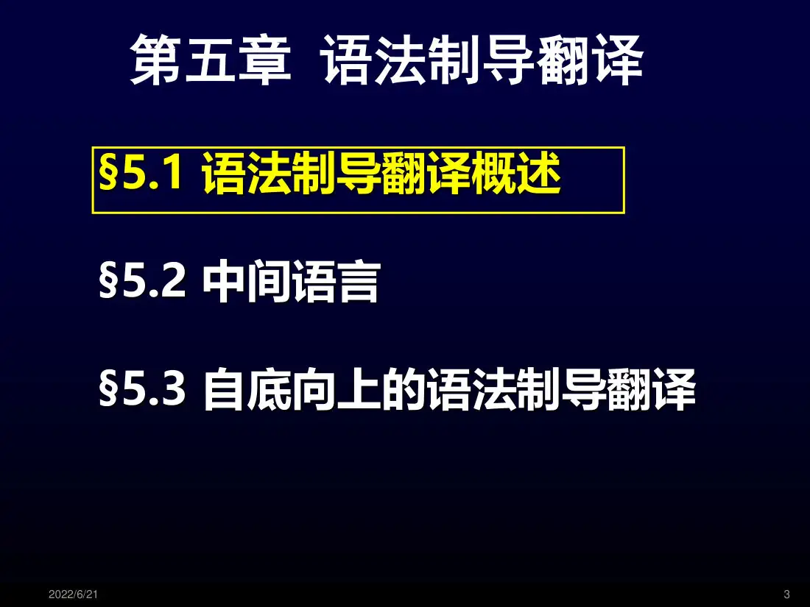

原文：

第五章 语法制导翻译

§5.1 语法制导翻译概述

§5.2 中间语言

§5.3 自底向上的语法制导翻译

2022/6/21

3

### §5.1 语法制导翻译概述

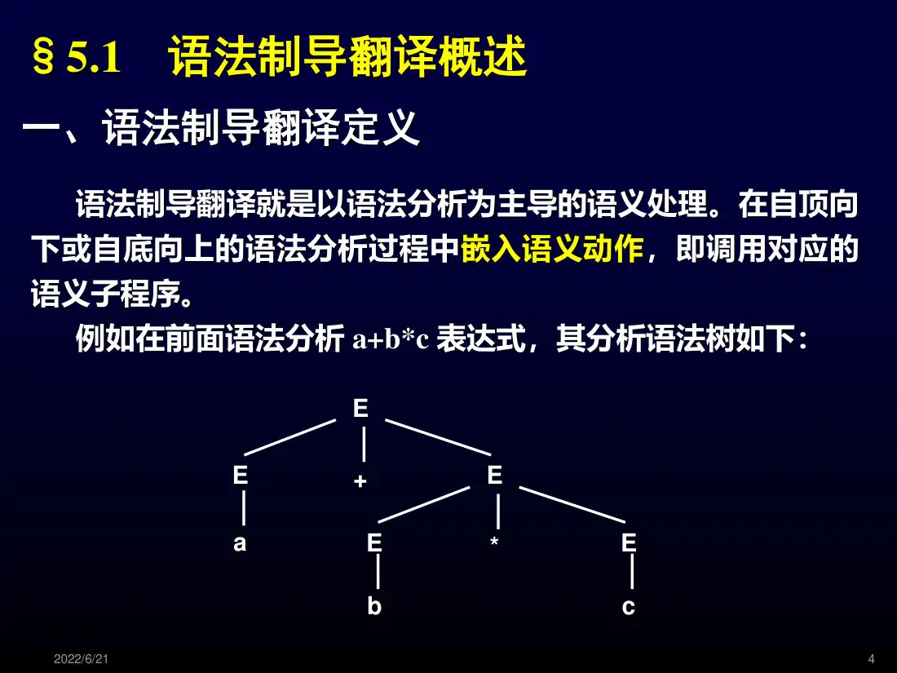

原文：

§5.1 语法制导翻译概述

一、语法制导翻译定义

语法制导翻译就是以语法分析为主导的语义处理。在自顶向下或自底向上的语法分析过程中嵌入语义动作，即调用对应的语义子程序。

例如在前面语法分析 $\boxed { 2 } \boxed { 3 } \boxed { 1 } \boxed { 2 } \boxed { 3 } \boxed { 4 }$ 表达式，其分析语法树如下：

2022/6/21

4

### §5.1 语法制导翻译概述

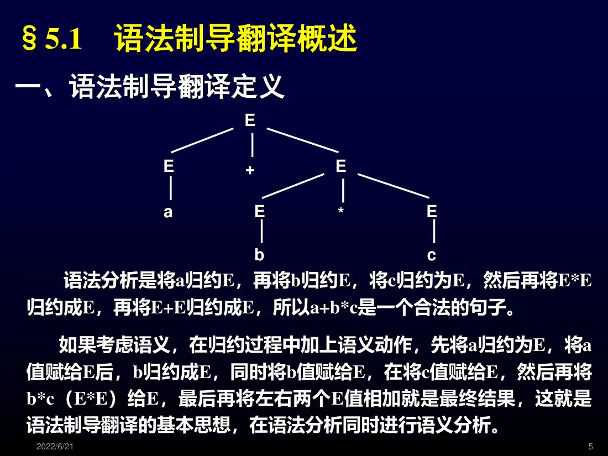

原文：

§5.1 语法制导翻译概述

一、语法制导翻译定义

语法分析是将a归约E，再将b归约E，将c归约为E，然后再将E\*E归约成E，再将E+E归约成E，所以 $\angle B = \angle D = \angle C$ 是一个合法的句子。

如果考虑语义，在归约过程中加上语义动作，先将a归约为E，将a值赋给E后，b归约成E，同时将b值赋给E，在将c值赋给E，然后再将$\boxed { 1 } \boxed { 2 } \boxed { 1 }$ （E\*E）给E，最后再将左右两个E值相加就是最终结果，这就是语法制导翻译的基本思想，在语法分析同时进行语义分析。

2022/6/21

5

### §5.1 语法制导翻译概述

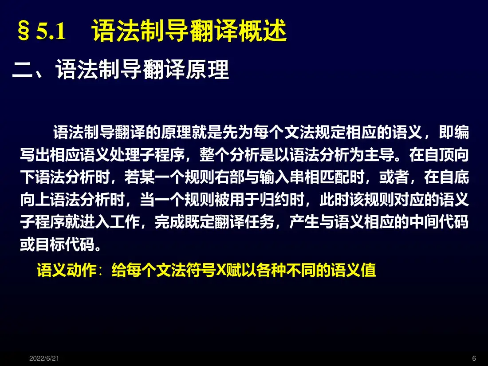

原文：

§5.1 语法制导翻译概述

二、语法制导翻译原理

语法制导翻译的原理就是先为每个文法规定相应的语义，即编写出相应语义处理子程序，整个分析是以语法分析为主导。在自顶向下语法分析时，若某一个规则右部与输入串相匹配时，或者，在自底向上语法分析时，当一个规则被用于归约时，此时该规则对应的语义子程序就进入工作，完成既定翻译任务，产生与语义相应的中间代码或目标代码。

语义动作：给每个文法符号X赋以各种不同的语义值

2022/6/21

6

### §5.1 语法制导翻译概述二、语法制导翻译原理

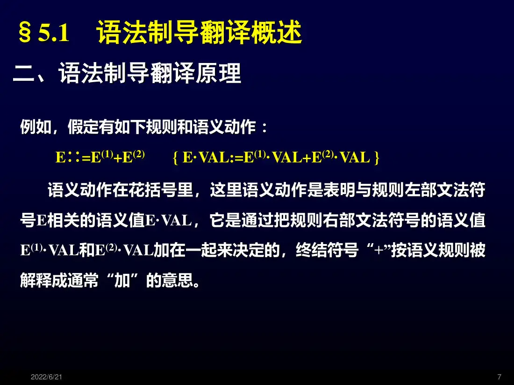

原文：

§5.1 语法制导翻译概述二、语法制导翻译原理

例如，假定有如下规则和语义动作 ：

$1 0 0 0 = 1 0 ( 1 0 ) = 1 0 ( 2 )$ $( 1 0 0 0 \% 0 0 0 0 \% 0 0 0 \% 0 0 0 \% 0 0 0 \% 0 0 0 \% 0 0 0 \% 0 0 0 \% 0 0 0 \% 0 0 0 \%$

语义动作在花括号里，这里语义动作是表明与规则左部文法符号E相关的语义值E·VAL，它是通过把规则右部文法符号的语义值E(1)·VAL和E(2)·VAL加在一起来决定的，终结符号“+”按语义规则被解释成通常“加”的意思。

2022/6/21

7

### §5.1 语法制导翻译概述

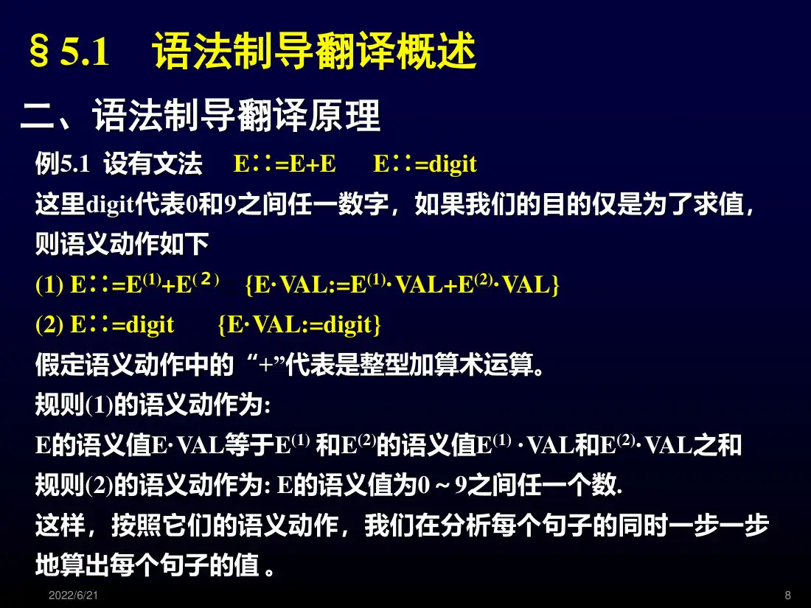

原文：

§5.1 语法制导翻译概述

二、语法制导翻译原理

例5.1 设有文法 $| \mathbf { \{ \nabla \mathbf { ) } } _ { \mathbf { ) } } \mathbf { \vec { \mathbf { \mathbf { \mathbf { \phi } } } _ { \mathbf { ) } } } = } | \mathbf  \vec { \mathbf { \mathbf { \mathbf { \mathbf { \ u } } } } _ { \mathbf { ) } } } _ { \mathbf { \vec { \mathbf { \mathbf { \theta } } } _ { \mathbf { \tilde { \mathbf { \mathbf { \theta } } } _ { \mathbf { \theta } } } } } } | \ \mathbf { \vec { \mathbf { \mathbf { \theta } } } } |$ $1 0 0 0 = 0 1 0 0 0$ 这里digit代表0和9之间任一数字，如果我们的目的仅是为了求值，则语义动作如下

(1) $1 0 0 0 = 1 0 0 0 0 0 ( c m )$ $( 1 0 2 4 , 1 1 0 2 , 1 9 2 , 1 9 2 , 1 9 2 , 1 9 2 , 1 9 2 )$

(2) $1 0 0 0 = 0 1 0 0 ( m )$ $1 0 0 \times 1 0 = 1 1 ( m ^ { 2 } )$

假定语义动作中的“+”代表是整型加算术运算。

E的语义值E·VAL等于E(1) 和E(2)的语义值E(1) ·VAL和E(2)·VAL之和

规则(2)的语义动作为:E的语义值为0～9之间任一个数.

2022/6/21

8

### §5.1 语法制导翻译概述

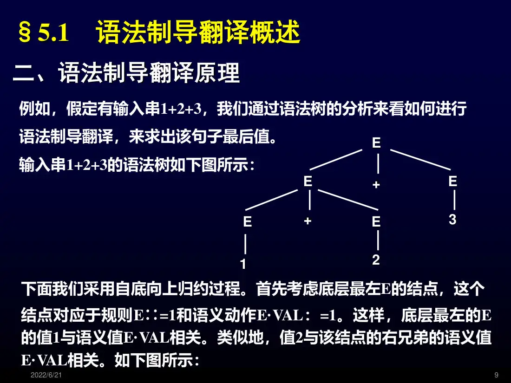

原文：

§5.1 语法制导翻译概述

二、语法制导翻译原理

例如，假定有输入串1+2+3，我们通过语法树的分析来看如何进行语法制导翻译，来求出该句子最后值。 E

输入串1+2+3的语法树如下图所示：

下面我们采用自底向上归约过程。首先考虑底层最左E的结点，这个结点对应于规则E∷=1和语义动作E·VAL：=1。这样，底层最左的E的值1与语义值E·VAL相关。类似地，值2与该结点的右兄弟的语义值E·VAL相关。如下图所示：

2022/6/21

9

### §5.1 语法制导翻译概述

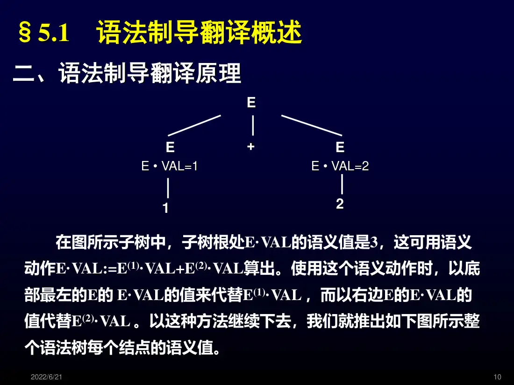

原文：

§5.1 语法制导翻译概述

二、语法制导翻译原理

$$
\begin{array}{c} E \\ E \cdot V A L = 2 \\ \big | \\ 2 \end{array}
$$

在图所示子树中，子树根处E·VAL的语义值是3，这可用语义动作E $V _ { 2 } \cdot V D = V ( 1 ) A ^ { \prime } J _ { 2 } \cdot V D ^ { \prime } ( 2 ) A ^ { \prime } J _ { 2 } \cdot V D$ 算出。使用这个语义动作时，以底部最左的E的 E·VAL的值来代替E(1)·VAL，而以右边E的E·VAL的值代替E(2)·VAL。以这种方法继续下去，我们就推出如下图所示整个语法树每个结点的语义值。

2022/6/21

10

### §5.1 语法制导翻译概述

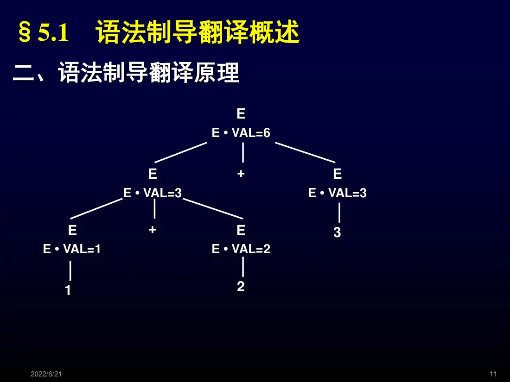

原文：

§5.1 语法制导翻译概述

二、语法制导翻译原理

2022/6/21

11

### A•VAL:=Y•VAL和X•VAL的处理结果

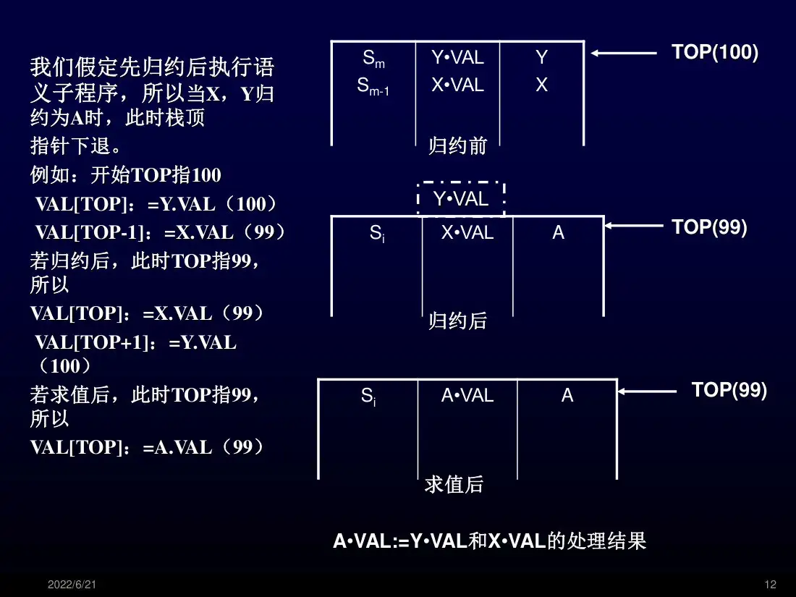

原文：

我们假定先归约后执行语义子程序，所以当X，Y归约为A时，此时栈顶指针下退。例如：开始TOP指100VAL[TOP]：=Y.VAL（100）VAL[TOP-1]：=X.VAL（99）若归约后，此时TOP指99，所以VAL[TOP]：=X.VAL（99）VAL[TOP+1]：=Y.VAL（100）若求值后，此时TOP指99，所以VAL[TOP]：=A.VAL（99）

A•VAL:=Y•VAL和X•VAL的处理结果

2022/6/21

12

### 例5.2 考虑下面文法及其语义描述：

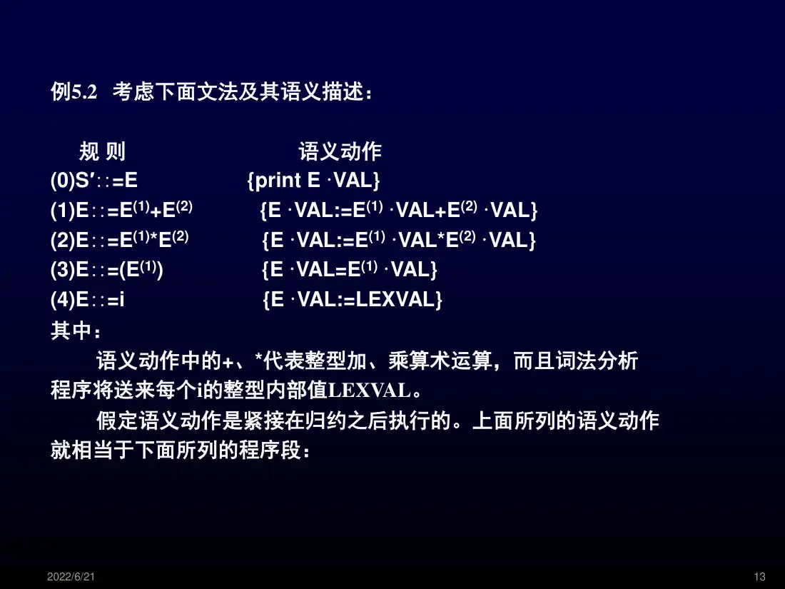

原文：

例5.2 考虑下面文法及其语义描述：

规 则

语义动作

$$
(0) S ^ {\prime}: := E
$$

{print E·VAL}

(1)E∷=E(1)+E(2)

$$
\{E \cdot V A L := E ^ {(1)} \cdot V A L + E ^ {(2)} \cdot V A L \}
$$

(2)E∷=E(1)\*E(2)

$$
\{E \cdot V A L := E ^ {(1)} \cdot V A L * E ^ {(2)} \cdot V A L \}
$$

(3)E∷=(E(1))

$$
\{E \cdot V A L = E ^ {(1)} \cdot V A L \}
$$

$$
(4) E: := i
$$

$$
\{E \cdot V A L := L E X V A L \}
$$

其中：

语义动作中的+、\*代表整型加、乘算术运算，而且词法分析程序将送来每个i的整型内部值LEXVAL。

假定语义动作是紧接在归约之后执行的。上面所列的语义动作就相当于下面所列的程序段：

2022/6/21

13

### 规 则

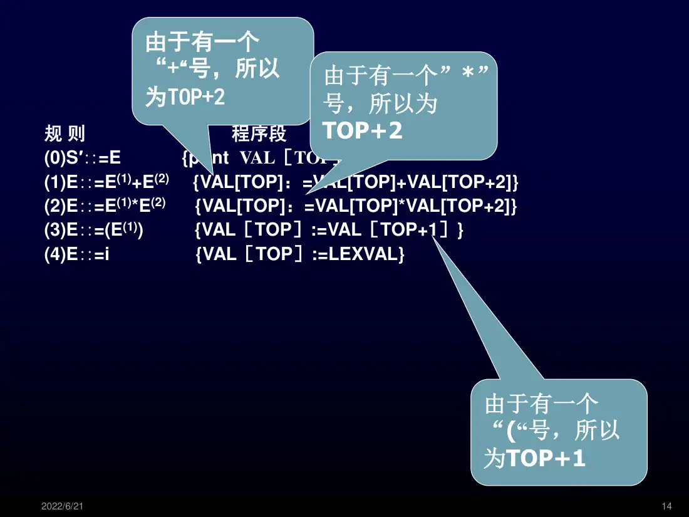

原文：

规 则

由于有一个“+“号，所以为TOP+2

(0)S′∷=E

(1)E∷=E(1)+E(2)由于有一个”\*”号，所以为TOP+2

(2)E∷=E(1)\*E(2)

(3)E∷=(E(1))

(4)E∷=i

程序段

{print VAL［TOP］

{VAL[TOP]：=VAL[TOP]+VAL[TOP+2]}

{VAL[TOP]：=VAL[TOP]\*VAL[TOP+2]}

{VAL［TOP］:=VAL［TOP+1］}

{VAL［TOP］:=LEXVAL}

由于有一个“(“号，所以为TOP+1

2022/6/21

14

### 根据上述程序段，若输入2\*3+2，就有如下图所示的语法制导翻译的分析树。

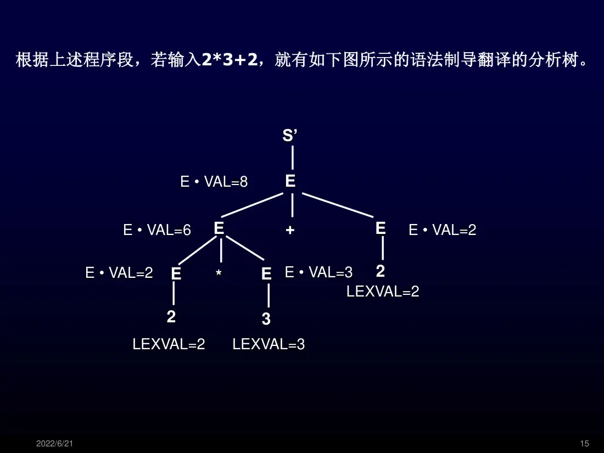

原文：

根据上述程序段，若输入2\*3+2，就有如下图所示的语法制导翻译的分析树。

2022/6/21

15

### 2022/6/21

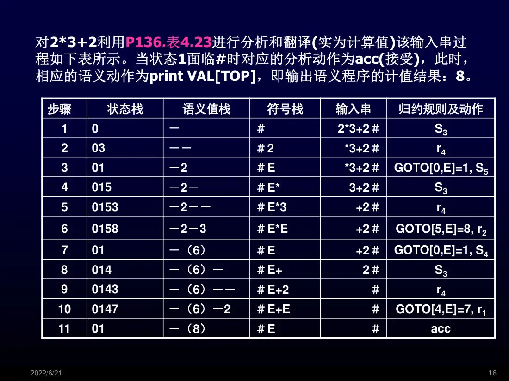

原文：

对2\*3+2利用P136.表4.23进行分析和翻译(实为计算值)该输入串过程如下表所示。当状态1面临#时对应的分析动作为acc(接受)，此时，相应的语义动作为print VAL[TOP]，即输出语义程序的计值结果：8。

<table><tr><td>步骤</td><td>状态栈</td><td>语义值栈</td><td>符号栈</td><td>输入串</td><td>归约规则及动作</td></tr><tr><td>1</td><td>0</td><td>—</td><td>#</td><td>2*3+2 #</td><td> $S_3$ </td></tr><tr><td>2</td><td>03</td><td>— —</td><td># 2</td><td>*3+2 #</td><td> $r_4$ </td></tr><tr><td>3</td><td>01</td><td>-2</td><td># E</td><td>*3+2 #</td><td>GOTO[0,E]=1,  $S_5$ </td></tr><tr><td>4</td><td>015</td><td>-2—</td><td># E*</td><td>3+2 #</td><td> $S_3$ </td></tr><tr><td>5</td><td>0153</td><td>-2— —</td><td># E*3</td><td>+2 #</td><td> $r_4$ </td></tr><tr><td>6</td><td>0158</td><td>-2—3</td><td># E*E</td><td>+2 #</td><td>GOTO[5,E]=8,  $r_2$ </td></tr><tr><td>7</td><td>01</td><td>— (6)</td><td># E</td><td>+2 #</td><td>GOTO[0,E]=1,  $S_4$ </td></tr><tr><td>8</td><td>014</td><td>— (6) —</td><td># E+</td><td>2 #</td><td> $S_3$ </td></tr><tr><td>9</td><td>0143</td><td>— (6) — —</td><td># E+2</td><td>#</td><td> $r_4$ </td></tr><tr><td>10</td><td>0147</td><td>— (6) —2</td><td># E+E</td><td>#</td><td>GOTO[4,E]=7,  $r_1$ </td></tr><tr><td>11</td><td>01</td><td>— (8)</td><td># E</td><td>#</td><td>acc</td></tr></table>

2022/6/21

16

### 第五章 语法制导翻译

原文：

第五章 语法制导翻译

§5.1 语法制导翻译概述

§5.2 中间语言

§5.3 自底向上的语法制导翻译

2022/6/21

17

### 第五章 语法制导翻译

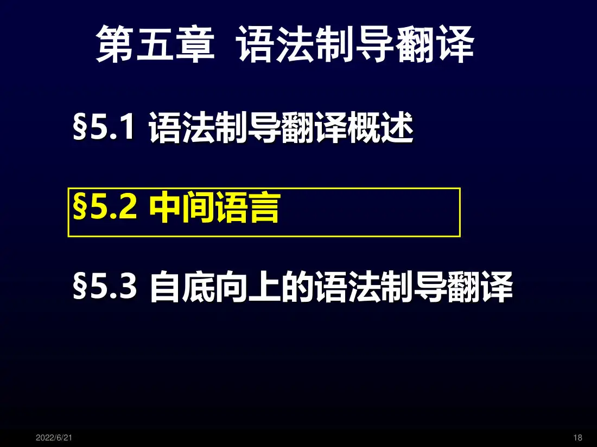

原文：

第五章 语法制导翻译

§5.1 语法制导翻译概述

§5.2 中间语言

§5.3 自底向上的语法制导翻译

2022/6/21

18

### §5.2 中间语言

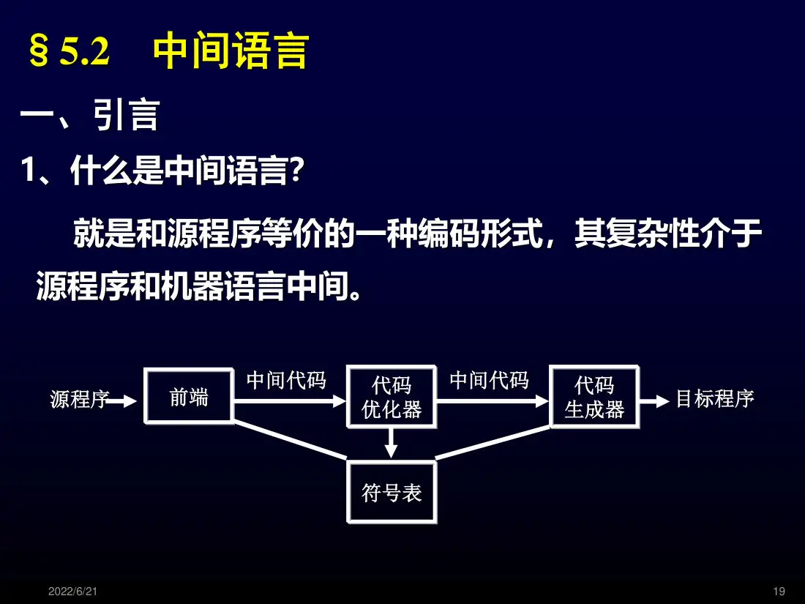

原文：

§5.2 中间语言

一、引言

1、什么是中间语言？

就是和源程序等价的一种编码形式，其复杂性介于源程序和机器语言中间。

源程序

前端

中间代码代码优化器中间代码

代码生成器目标程序

符号表

2022/6/21

19

### §5.2 中间语言

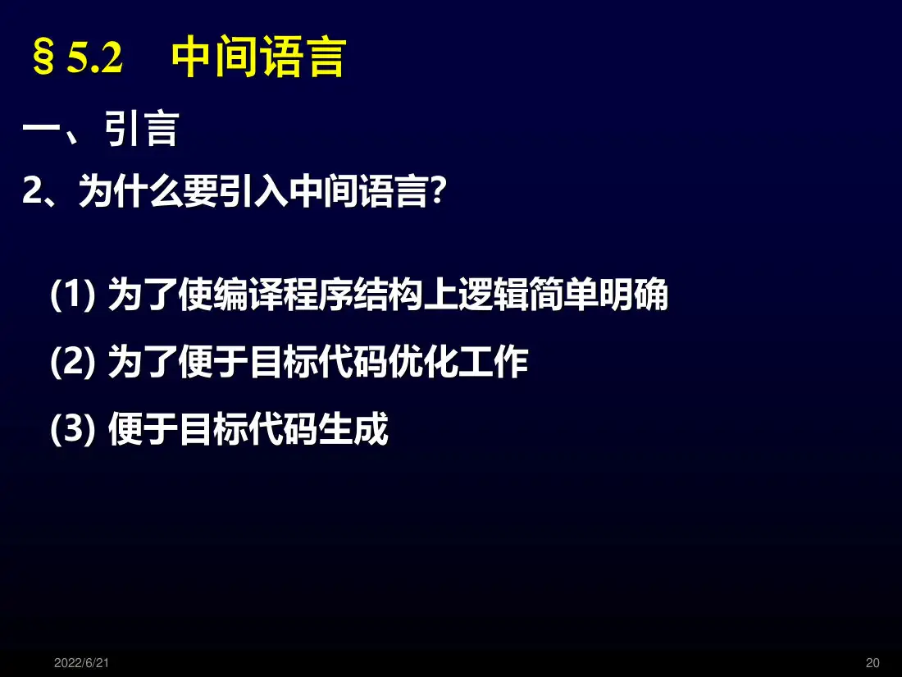

原文：

§5.2 中间语言

一、引言

2、为什么要引入中间语言？

(1) 为了使编译程序结构上逻辑简单明确

(2) 为了便于目标代码优化工作

(3) 便于目标代码生成

2022/6/21

20

### §5.2 中间语言

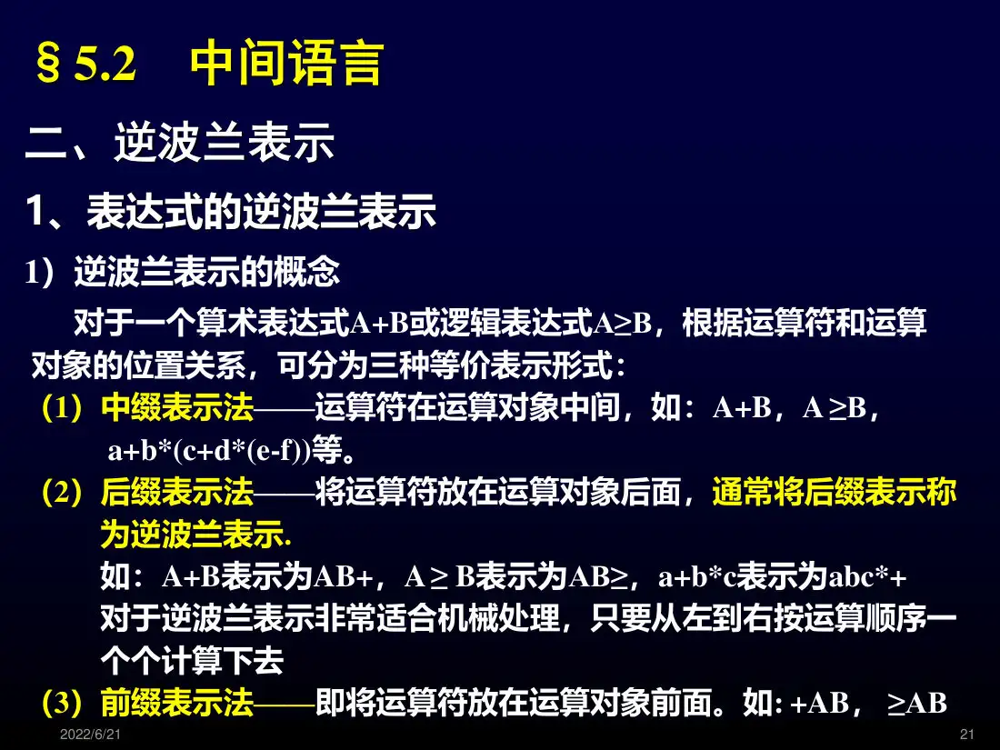

原文：

§5.2 中间语言

二、逆波兰表示

1、表达式的逆波兰表示

1）逆波兰表示的概念对于一个算术表达式A+B或逻辑表达式A≥B，根据运算符和运算对象的位置关系，可分为三种等价表示形式：

（1）中缀表示法— 运算符在运算对象中间，如：A+B，A≥B，$\mathrm { : : \Sigma \Sigma ^ { D A } ( C _ { 1 } = C _ { 1 } E _ { 2 } ( C = \bar { 2 } ) ) }$ 等。

（2）后缀表示法——将运算符放在运算对象后面，通常将后缀表示称为逆波兰表示.如：A+B表示为AB+，A≥ B表示为AB≥，a+b\*c表示为 $\boxed { 2 } \boxed { 1 } \boxed { 1 } \boxed { 2 } \boxed { 2 } \boxed { 1 }$ 对于逆波兰表示非常适合机械处理，只要从左到右按运算顺序个个计算下去

（3）前缀表示法— 即将运算符放在运算对象前面。如: +AB， ≥AB

2022/6/21

21

### §5.2 中间语言

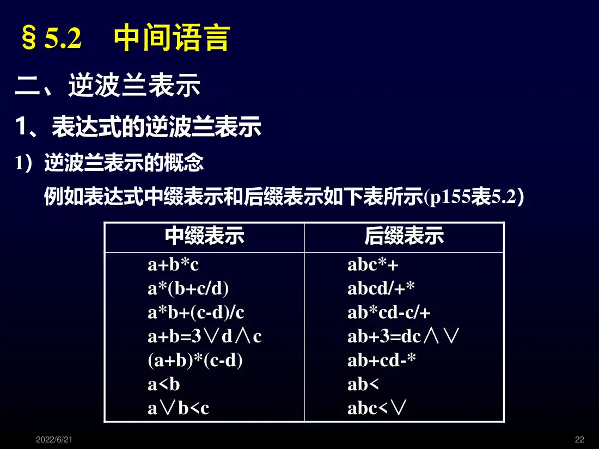

原文：

§5.2 中间语言

二、逆波兰表示

1、表达式的逆波兰表示

1）逆波兰表示的概念

例如表达式中缀表示和后缀表示如下表所示(p155表5.2）

中缀表示

$$
\begin{array}{l} \text {a+b*c} \\ \text {a*(b+c/d)} \\ \text {a*b+(c-d)/c} \\ \text {a+b=3\vee d\wedge c} \\ (\text {a+b} {* (c - d)} \\ \text {a< b} \\ \text {a\vee b< c} \end{array}
$$

后缀表示

$$
\begin{array}{l} \text {abc* + } \\ \text {abcd/+ *} \\ \text {ab*cd - c / + } \\ \text {ab+3 = dc\wedge\vee} \\ \text {ab+cd-*} \\ \text {ab<  } \\ \text {abc<  \vee} \end{array}
$$

2022/6/21

22

### §5.2 中间语言

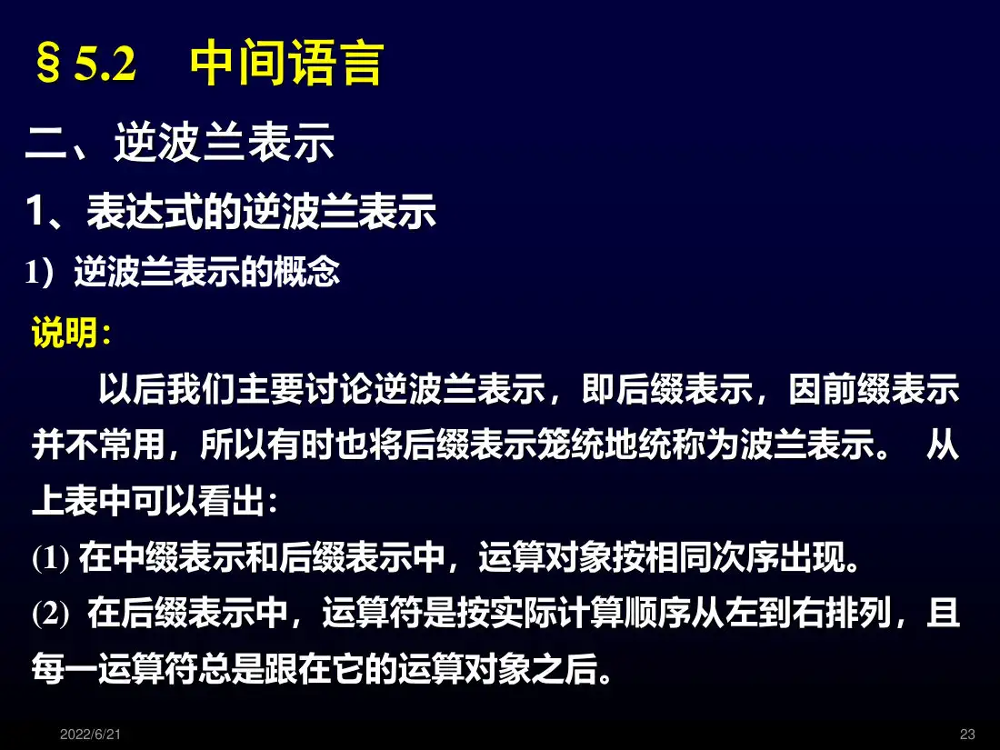

原文：

§5.2 中间语言

二、逆波兰表示

1、表达式的逆波兰表示

1）逆波兰表示的概念

说明：

以后我们主要讨论逆波兰表示，即后缀表示，因前缀表示并不常用，所以有时也将后缀表示笼统地统称为波兰表示。 从上表中可以看出：

(1) 在中缀表示和后缀表示中，运算对象按相同次序出现。

(2) 在后缀表示中，运算符是按实际计算顺序从左到右排列，且每一运算符总是跟在它的运算对象之后。

2022/6/21

23

### §5.2 中间语言

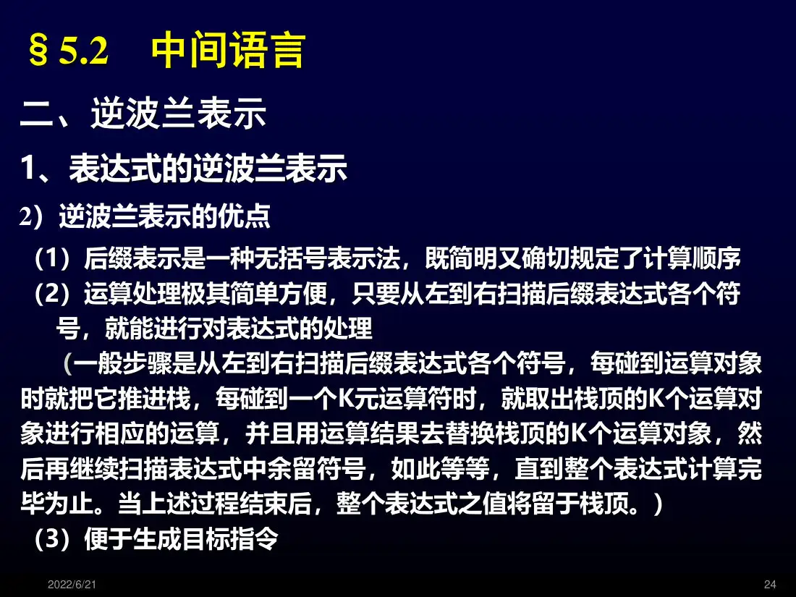

原文：

§5.2 中间语言

二、逆波兰表示

1、表达式的逆波兰表示

2）逆波兰表示的优点

（1）后缀表示是一种无括号表示法，既简明又确切规定了计算顺序

（2）运算处理极其简单方便，只要从左到右扫描后缀表达式各个符号，就能进行对表达式的处理

（一般步骤是从左到右扫描后缀表达式各个符号，每碰到运算对象时就把它推进栈，每碰到一个K元运算符时，就取出栈顶的K个运算对象进行相应的运算，并且用运算结果去替换栈顶的K个运算对象，然后再继续扫描表达式中余留符号，如此等等，直到整个表达式计算完毕为止。当上述过程结束后，整个表达式之值将留于栈顶。）

（3）便于生成目标指令

2022/6/21

24

### §5.2 中间语言

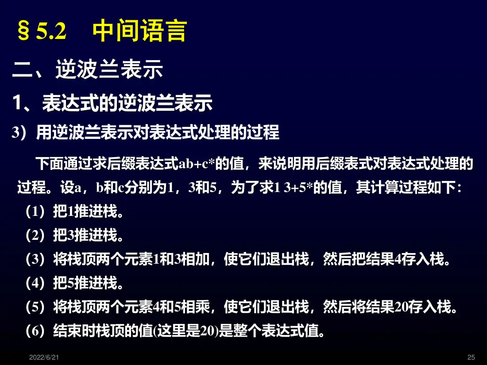

原文：

§5.2 中间语言

二、逆波兰表示

1、表达式的逆波兰表示

3）用逆波兰表示对表达式处理的过程

下面通过求后缀表达式ab+c\*的值，来说明用后缀表式对表达式处理的过程。设a，b和c分别为1，3和5，为了求1 3+5\*的值，其计算过程如下：

（1）把1推进栈。

（2）把3推进栈。

（3）将栈顶两个元素1和3相加，使它们退出栈，然后把结果4存入栈。

（4）把5推进栈。

（5）将栈顶两个元素4和5相乘，使它们退出栈，然后将结果20存入栈。

（6）结束时栈顶的值(这里是20)是整个表达式值。

2022/6/21

25

### §5.2 中间语言

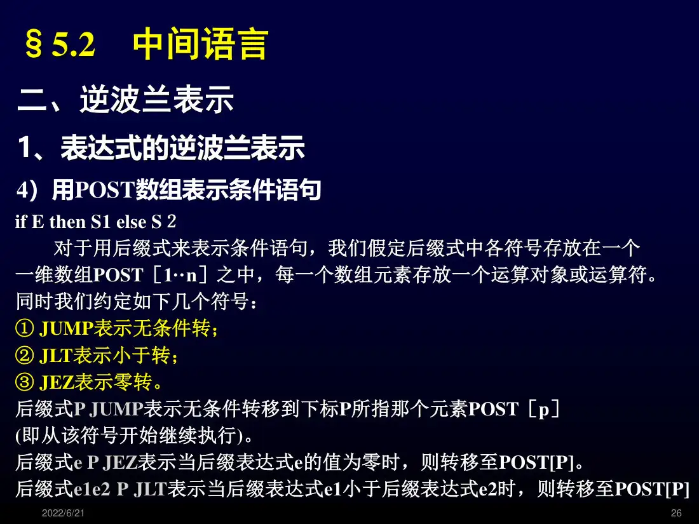

原文：

§5.2 中间语言

二、逆波兰表示

1、表达式的逆波兰表示

4）用POST数组表示条件语句

if E then S1 else S2

对于用后缀式来表示条件语句，我们假定后缀式中各符号存放在一个维数组POST［1··n］之中，每一个数组元素存放一个运算对象或运算符。

同时我们约定如下几个符号：

① JUMP表示无条件转；

② JLT表示小于转；

③ JEZ表示零转。

后缀式P JUMP表示无条件转移到下标P所指那个元素POST［p］

(即从该符号开始继续执行)。

后缀式e P JEZ表示当后缀表达式e的值为零时，则转移至POST[P]。

后缀式e1e2 P JLT表示当后缀表达式e1小于后缀表达式e2时，则转移至POST[P]

2022/6/21

26

### §5.2 中间语言

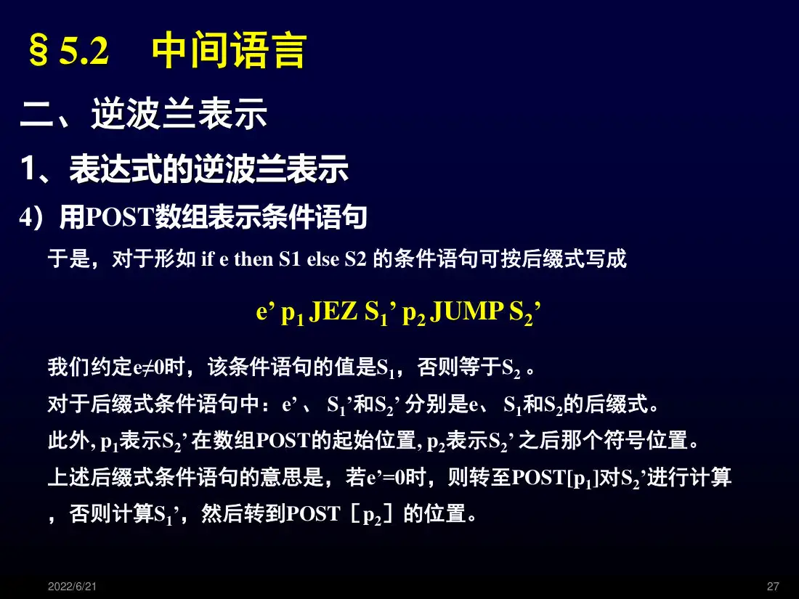

原文：

§5.2 中间语言

二、逆波兰表示

1、表达式的逆波兰表示

）用POST数组表示条件语句于是，对于形如ife then S1 elseS2 的条件语句可按后缀式写成

$$
\mathrm {e^ {\prime} p_ {1} JEZ S_ {1} ^ {\prime} p_ {2} JUMPS_ {2} ^ {\prime}}
$$

我们约定 $\mathtt { C a m } \mathtt { C a m }$ 时，该条件语句的值是 $\beta$ 否则等于 $\textcircled { > }$ 对于后缀式条件语句中： $\circledcirc$ $\beta$ ’和 $\textcircled { \bullet }$ 分别是e、 $\textcircled { \bullet }$ 和 $\bigtriangledown$ 的后缀式。此外, $\textcircled { 1 }$ 表示 $\textcircled { \bullet }$ 在数组POST的起始位置, $\textcircled { 4 2 }$ 表示 $\textcircled { \bullet }$ 之后那个符号位置。上述后缀式条件语句的意思是，若e’=0时，则转至POST $\boxed { 1 0 }$ 对 $\bigcirc$ ’进行计算否则计算S ’，然后转到POST $[ 1 3 , 1 5 ]$ 的位置。

2022/6/21

27

### §5.2 中间语言

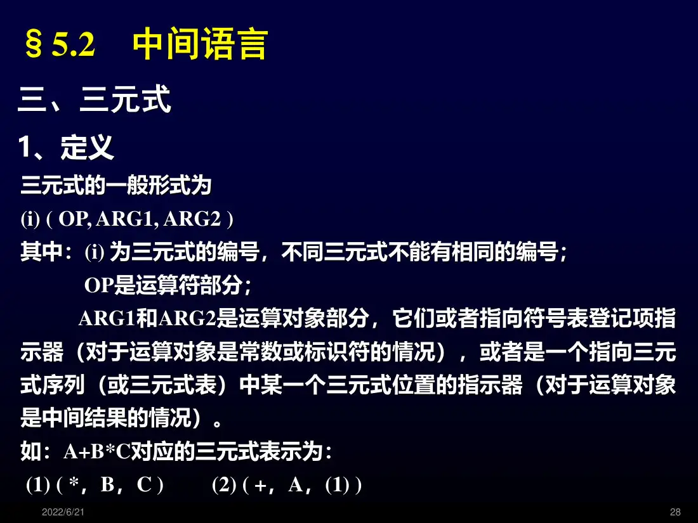

原文：

§5.2 中间语言

三、三元式

1、定义

三元式的一般形式为

(i) ( OP, ARG1, ARG2 )

其中：(i) 为三元式的编号，不同三元式不能有相同的编号；

OP是运算符部分；

ARG1和ARG2是运算对象部分，它们或者指向符号表登记项指示器（对于运算对象是常数或标识符的情况），或者是一个指向三元式序列（或三元式表）中某一个三元式位置的指示器（对于运算对象是中间结果的情况）。

如： $\angle A = \angle B = \angle B = \angle C$ C对应的三元式表示为：

(1) ( \*，B，C ) (2) ( +，A，(1) )

2022/6/21

28

### §5.2 中间语言

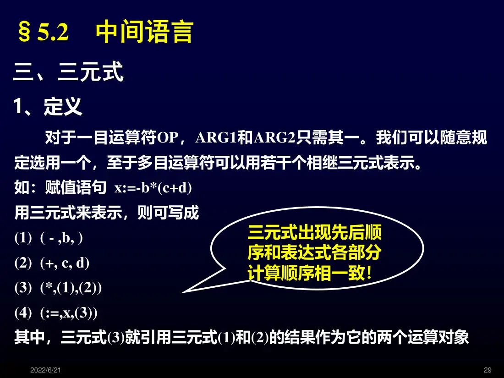

原文：

§5.2 中间语言

三、三元式

1、定义

对于一目运算符OP，ARG1和ARG2只需其一。我们可以随意规定选用一个，至于多目运算符可以用若干个相继三元式表示。

如：赋值语句 $: \angle B = \angle D = ( \angle B = 1 ) , \angle C$

用三元式来表示，则可写成

(1) ( - ,b, )

(2) (+, c, d)

(3) (\*,(1),(2))

三元式出现先后顺序和表达式各部分计算顺序相一致！

(4) (:=,x,(3))

其中，三元式(3)就引用三元式(1)和(2)的结果作为它的两个运算对象

2022/6/21

29

### §5.2 中间语言

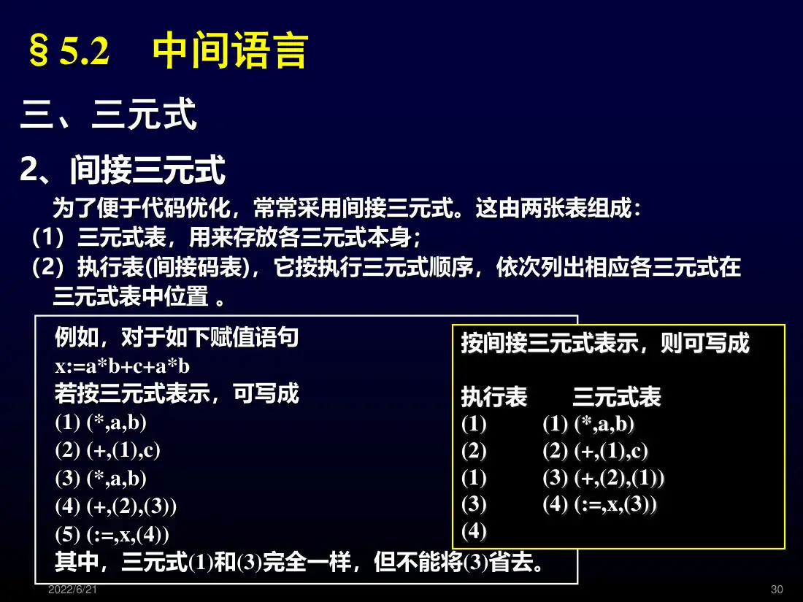

原文：

§5.2 中间语言

三、三元式

2、间接三元式为了便于代码优化，常常采用间接三元式。这由两张表组成：

（1）三元式表，用来存放各三元式本身；

（2）执行表(间接码表)，它按执行三元式顺序，依次列出相应各三元式在三元式表中位置 。

例如，对于如下赋值语句$\cdot \cos ( 0 . 5 \sqrt { 2 } + \sqrt { 2 } ) = \frac { 1 } { 2 } ( 2 \sqrt { 2 } + \sqrt { 2 } )$ 若按三元式表示，可写成(1) (\*,a,b)(2) (+,(1),c)(3) (\*,a,b)(4) (+,(2),(3))(5) (:=,x,(4))

按间接三元式表示，则可写成

执行表 三元式表 (4) (1) (\*,a,b) (2) (+,(1),c) (3) (+,(2),(1)) (4) (:=,x,(3))

其中，三元式(1)和(3)完全一样，但不能将(3)省去。

2022/6/21

30

### §5.2 中间语言

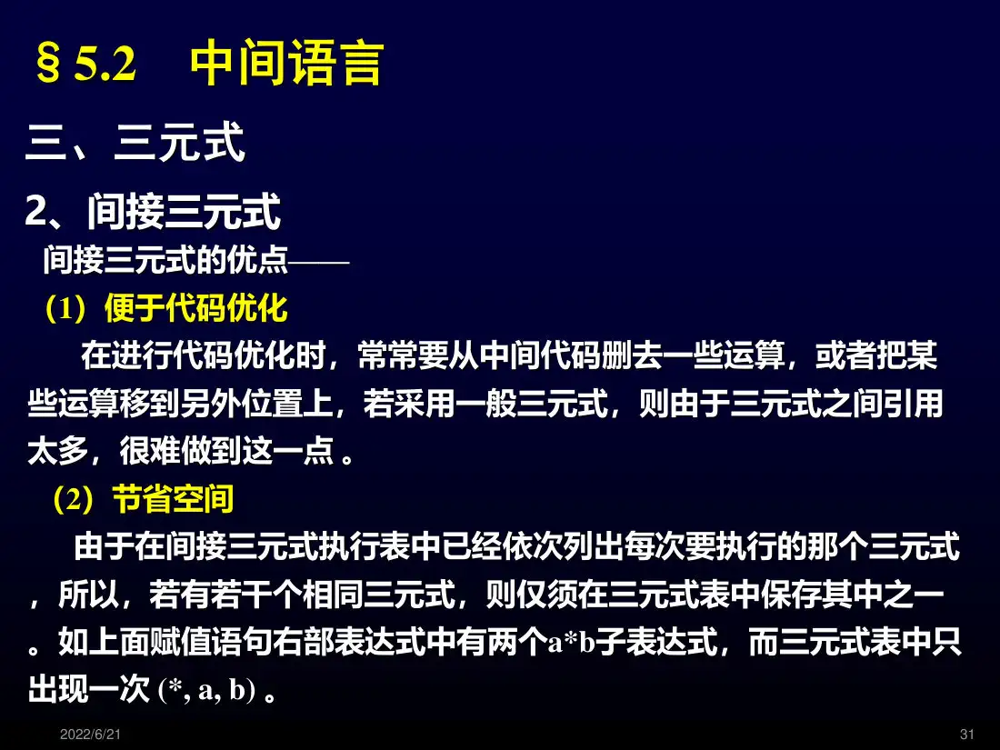

原文：

§5.2 中间语言

三、三元式

2、间接三元式间接三元式的优点—

（1）便于代码优化

在进行代码优化时，常常要从中间代码删去一些运算，或者把某些运算移到另外位置上，若采用一般三元式，则由于三元式之间引用太多，很难做到这一点。

（2）节省空间

由于在间接三元式执行表中已经依次列出每次要执行的那个三元式所以，若有若干个相同三元式，则仅须在三元式表中保存其中之一如上面赋值语句右部表达式中有两个a\*b子表达式，而三元式表中只出现一次 (\*, a, b) 。

2022/6/21

31

### §5.2 中间语言

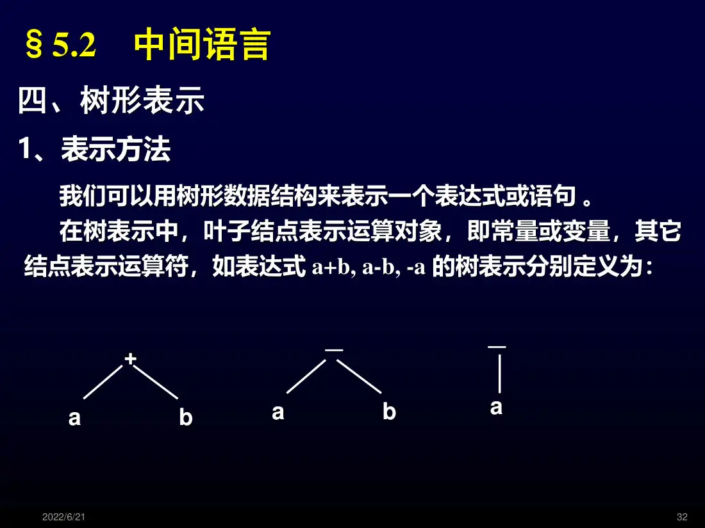

原文：

§5.2 中间语言

四、树形表示

1、表示方法

我们可以用树形数据结构来表示一个表达式或语句 。

在树表示中，叶子结点表示运算对象，即常量或变量，其它结点表示运算符，如表达式a+b, a-b,-a 的树表示分别定义为：

2022/6/21

32

### §5.2 中间语言

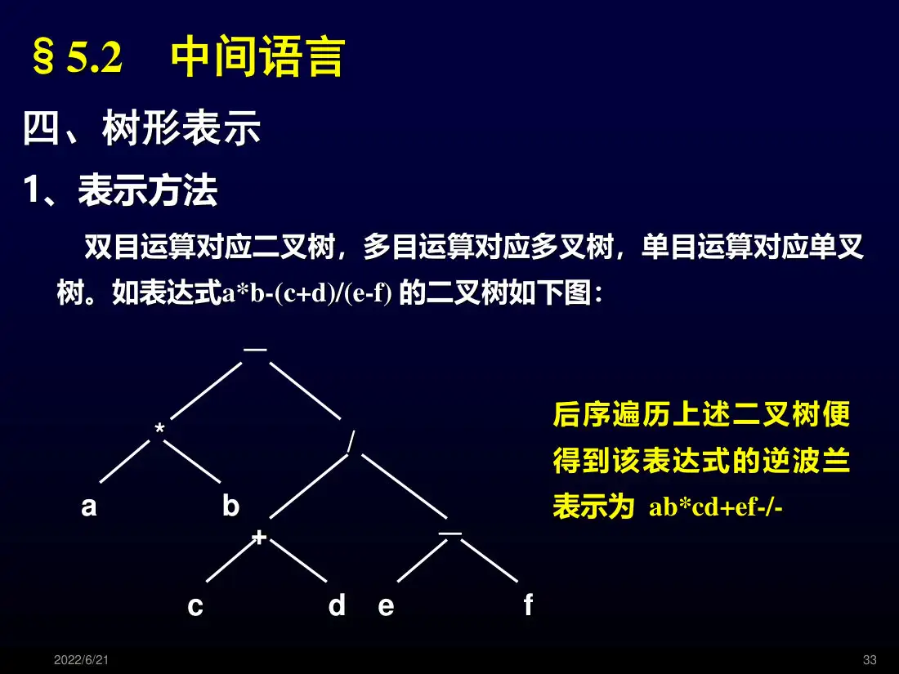

原文：

§5.2 中间语言

四、树形表示

1、表示方法

双目运算对应二叉树，多目运算对应多叉树，单目运算对应单叉树。如表达式 $\angle D A E = \angle C A E = \angle D A C = 1 0 ^ { \circ }$ 的二叉树如下图：

后序遍历上述二叉树便得到该表达式的逆波兰表示为 $\textcircled { 2 } \textcircled { 1 } \textcircled { 2 } \textcircled { 4 } \textcircled { 5 } \textcircled { 2 } \textcircled { 2 } \textcircled { 2 }$

2022/6/21

33

### §5.2 中间语言

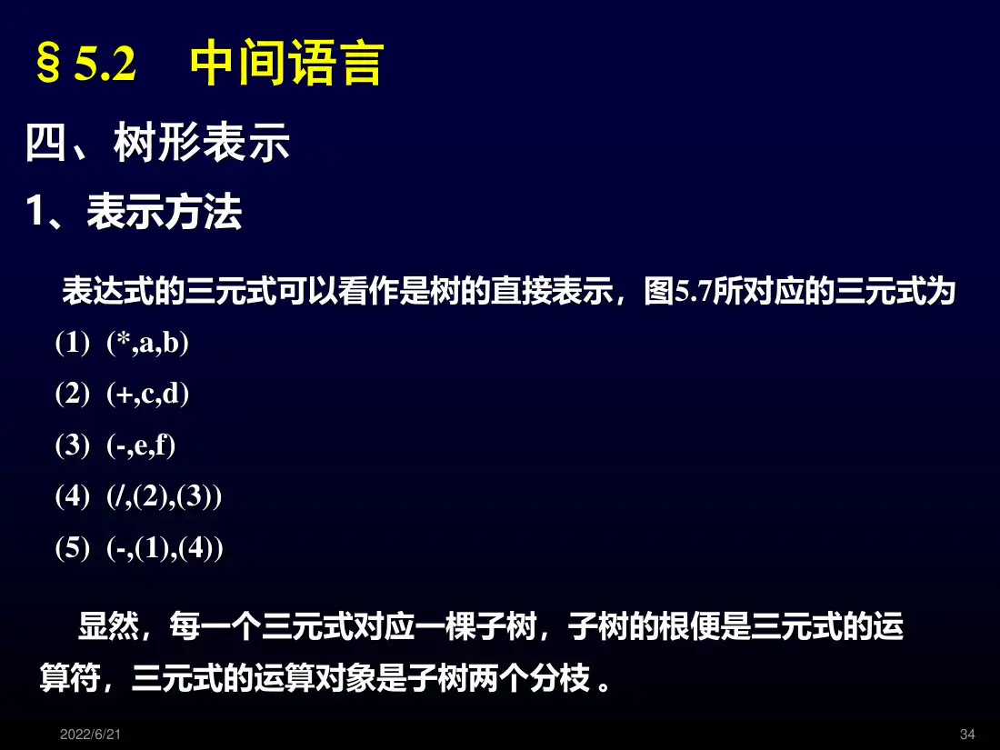

原文：

§5.2 中间语言

四、树形表示

1、表示方法

表达式的三元式可以看作是树的直接表示，图5.7所对应的三元式为

(1) (\*,a,b)

(2) (+,c,d)

(3) (-,e,f)

(4) (/,(2),(3))

(5) (-,(1),(4))

显然，每一个三元式对应一棵子树，子树的根便是三元式的运算符，三元式的运算对象是子树两个分枝。

2022/6/21

34

### §5.2 中间语言

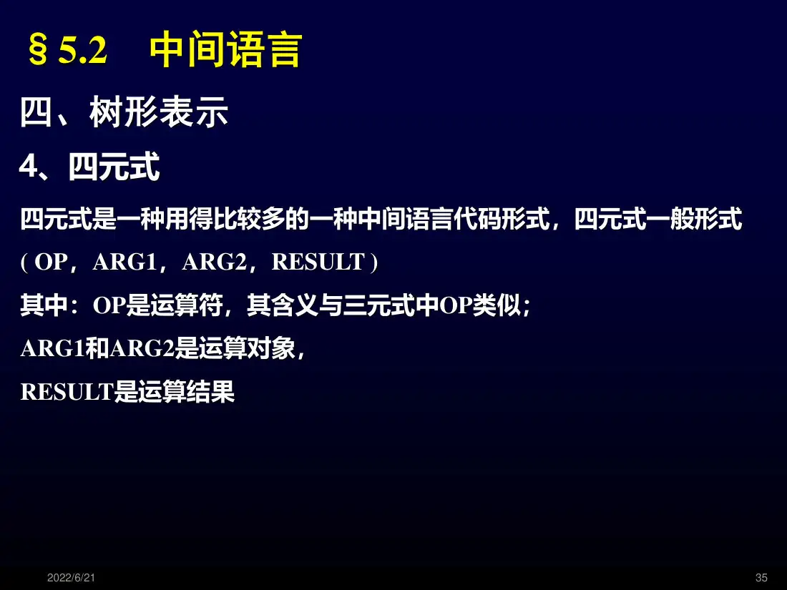

原文：

§5.2 中间语言

四、树形表示

4、四元式

四元式是一种用得比较多的一种中间语言代码形式，四元式一般形式

( OP，ARG1，ARG2，RESULT )

其中：OP是运算符，其含义与三元式中OP类似；

ARG1和ARG2是运算对象，

RESULT是运算结果

2022/6/21

35

### §5.2 中间语言

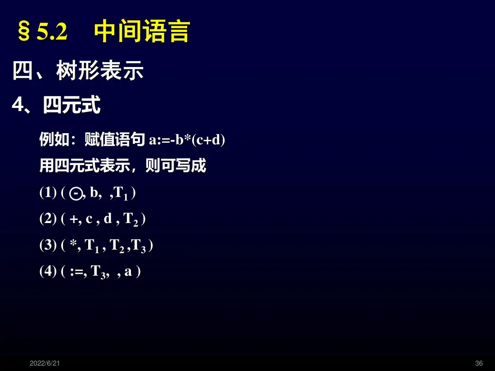

原文：

§5.2 中间语言

四、树形表示

4、四元式例如：赋值语句 $: \angle B = \angle D = ( \angle C = \angle D )$ 用四元式表示，则可写成(1) $( 1 0 , 1 ) = ( 1 0 , 1 )$ (2) $( 1 0 0 0 0 0 0 0 0 0 0 0 0 0 0 0 0 0 0 0 0 0 0 0 0 0 0 0 0 0 0 0 0 0 0 0 0 0 0 0 0 0 0 0 0 0 0 0 0 0 0 0 0 0 0 0 0 0 0 0 0 0 0 0 0 0 0 0 0 0 0 0 0 0 0 0 0 0 0 0 0 0 0 0 0 0 0 0 0 0 0 0 0 0 0 0 0 0 0 0 0 0 0 0 0 0 0 0 0 0 0 0 0 0 0 0 0 0 0 0 0 0 0 0 0 0 0 0 0 0 0 0 0 0 0 0 0 0 0 0 0 0 0 0 0 0 0 0 0 0 0 0 0 0 0 0 0 0 0 0 0 0 0 0 0 0 0 0 0 0 0 0 0 0 0 0 0 0 0 0 0 0 0 0 0 0 0 0 0 0 0 0 0 0 0 0 0 0 0 0 0 0 0 0 0 0 0 0 0 0 0 0 0 0 0 0 0 0 0 0 0 0 0 0 0 0 0 0 0 0 0 0 0 0 0 0 0 0 0 0 0 0 0 0 0 0 0 0 0 0 0 0 0 0 0 0 0 0 0 0 0 0 0 0 0 0 0 0 0 0 0 0 0 0 0 0 0 0 0 0 0 0 0 0 0 0 0 0 0 0 0 0 0 0 0 0 0 0 0 0 0 0 0 0 0 0 0 0 0 0 0 0 0 0 0 0 0 0 0 0 0 0 0 0 0 0 0 0 0 0 0 0 0 0 0 0 0 0 0 0 0 0 0 0 0 0 0 0 0 0 0 0 0 0 0 0 0 0 0 0 0 0 0 0 0 0 0 0 0 0 0 0 0 0 0 0 0 0 0 0 0 0 0 0 0 0 0 0 0 0 0 0 0 0 0 0 0 0 0 0 0 0 0 0 0 0 0 0 0 0 0 0 0 0 0 0 0 0 0 0 0 0 0 0 0 0 0 0 0 0 0 0 0 0 0 0 0 0 0 0 0 0 0 0 0 0 0 0 0 0 0 0 0 0 0 0 0 0 0 0 0 0 0 0 0 0 0 0 0 0 0 0 0 0 0 0 0 0 0 0 0 0 0 0 0 0 0 0 0 0 0 0 0 0 0 0 0 0 0 0 0 0 0 0 0 0 0 0 0 0 0 0 0 0 0 0 0 0 0 0 0 0 0 0 0 0 0 0 0 0 0 0 0 0 0 0 0 0 0 0 0 0 0 0 0 0 0 0 0 0 0 0 0 0 0 0 0 0 0 0 0 0 0 0 0 0 0 0 0 0 0 0 0 0 0$ (3) $( 1 0 0 0 0 0 0 0 0 0 0 0 0 0 0 0 0 0 0 0 0 0 0 0 0 0 0 0 0 0 0 0 0 0 0 0 0 0 0 0 0 0 0 0 0 0 0 0 0 0 0 0 0 0 0 0 0 0 0 0 0 0 0 0 0 0 0 0 0 0 0 0 0 0 0 0 0 0 0 0 0 0 0 0 0 0 0 0 0 0 0 0 0 0 0 0 0 0 0 0 0 0 0 0 0 0 0 0 0 0 0 0 0 0 0 0 0 0 0 0 0 0 0 0 0 0 0 0 0 0 0 0 0 0 0 0 0 0 0 0 0 0 0 0 0 0 0 0 0 0 0 0 0 0 0 0 0 0 0 0 0 0 0 0 0 0 0 0 0 0 0 0 0 0 0 0 0 0 0 0 0 0 0 0 0 0 0 0 0 0 0 0 0 0 0 0 0 0 0 0 0 0 0 0 0 0 0 0 0 0 0 0 0 0 0 0 0 0 0 0 0 0 0 0 0 0 0 0 0 0 0 0 0 0 0 0 0 0 0 0 0 0 0 0 0 0 0 0 0 0 0 0 0 0 0 0 0 0 0 0 0 0 0 0 0 0 0 0 0 0 0 0 0 0 0 0 0 0 0 0 0 0 0 0 0 0 0 0 0 0 0 0 0 0 0 0 0 0 0 0 0 0 0 0 0 0 0 0 0 0 0 0 0 0 0 0 0 0 0 0 0 0 0 0 0 0 0 0 0 0 0 0 0 0 0 0 0 0 0 0 0 0 0 0 0 0 0 0 0 0 0 0 0 0 0 0 0 0 0 0 0 0 0 0 0 0 0 0 0 0 0 0 0 0 0 0 0 0 0 0 0 0 0 0 0 0 0 0 0 0 0 0 0 0 0 0 0 0 0 0 0 0 0 0 0 0 0 0 0 0 0 0 0 0 0 0 0 0 0 0 0 0 0 0 0 0 0 0 0 0 0 0 0 0 0 0 0 0 0 0 0 0 0 0 0 0 0 0 0 0 0 0 0 0 0 0 0 0 0 0 0 0 0 0 0 0 0 0 0 0 0 0 0 0 0 0 0 0 0 0 0 0 0 0 0 0 0 0 0 0 0 0 0 0 0 0 0 0 0 0 0 0 0 0 0 0 0 0 0 0 0 0 0 0 0 0 0 0 0 0 0 0 0 0 0 0 0 0 0 0 0 0 0 0 0 0 0 0 0 0 0 0 0 0 0 0 0 0 0 0 0 0 0 0 0 0 0 0 0 0 0 0 0 0 0 0 0 0 0 0 0 0 0 0 0$ (4) $( 1 0 - 1 1 4 ) \times 2 = 1 0 0 ( c m )$

2022/6/21

36

### 第五章 语法制导翻译

原文：

第五章 语法制导翻译

§5.1 语法制导翻译概述

§5.2 中间语言

§5.3 自底向上的语法制导翻译

2022/6/21

37

### 第五章 语法制导翻译

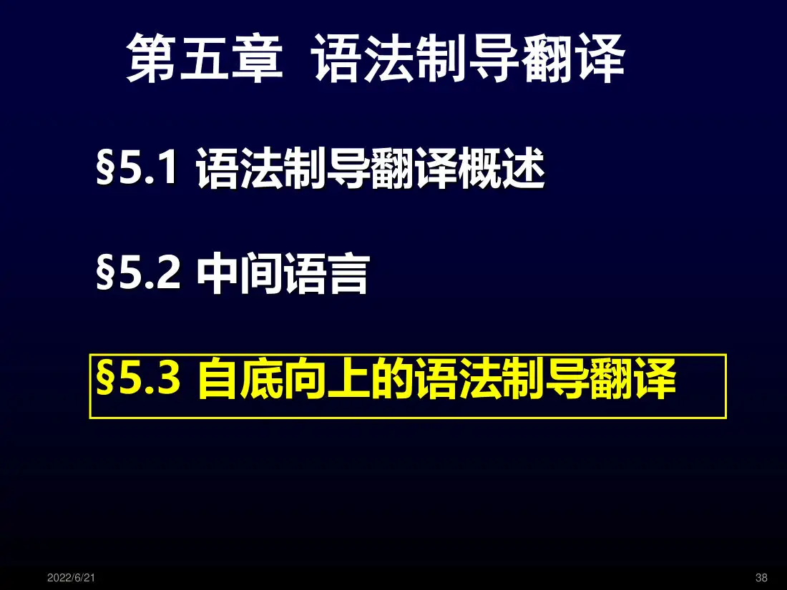

原文：

第五章 语法制导翻译

§5.1 语法制导翻译概述

§5.2 中间语言

§5.3 自底向上的语法制导翻译

2022/6/21

38

### §5.3 自底向上的语法制导翻译一、简单算数表达式和赋值语句翻译为四元式

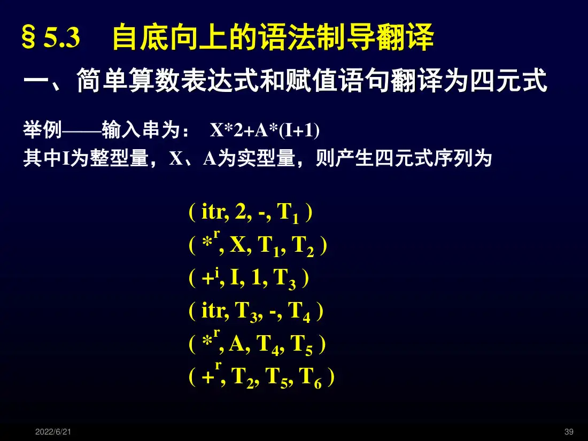

原文：

§5.3 自底向上的语法制导翻译一、简单算数表达式和赋值语句翻译为四元式

举例——输入串为： $: ( - \infty , 0 ) = \infty , 0 \in ( 0 , 1 )$ 其中I为整型量，X、A为实型量，则产生四元式序列为

( itr, 2, -, T1 ) ( \*r, X, T1, T2 ) ( +i, I, 1, T3 ) ( itr, T3, -, T4 ) ( \*r, A, T4, T5 ) ( + , T2, T5, T6 )

2022/6/21

39

### §5.3 自底向上的语法制导翻译二、布尔表达式的翻译

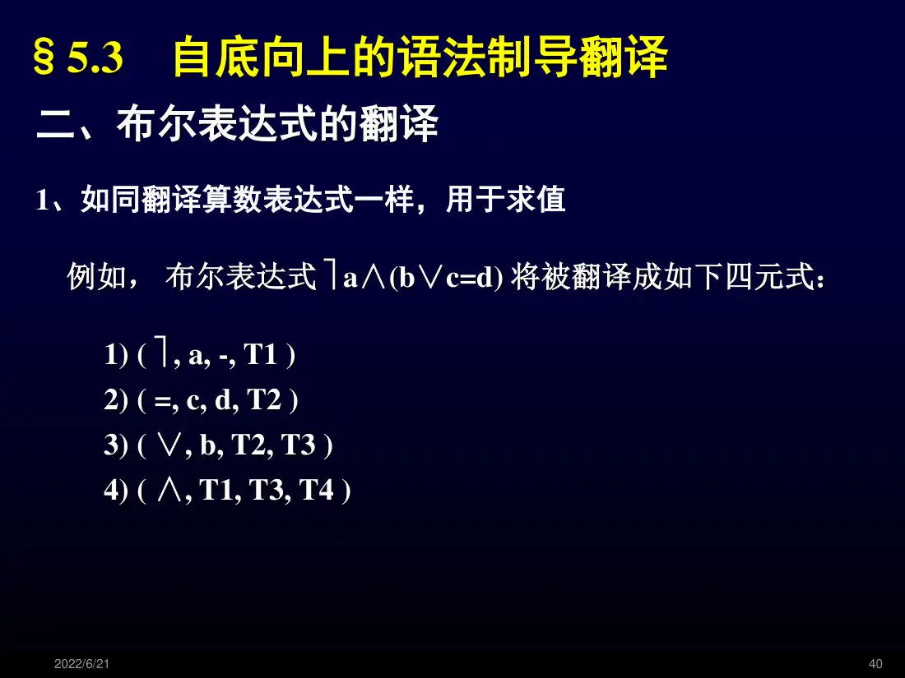

原文：

§5.3 自底向上的语法制导翻译二、布尔表达式的翻译

1、如同翻译算数表达式一样，用于求值

例如， 布尔表达式  a∧(b∨c=d) 将被翻译成如下四元式：

1) (  , a, -, T1 )

2) ( =, c, d, T2 )

3) ( ∨, b, T2, T3 )

4) ( ∧, T1, T3, T4 )

2022/6/21

40

### §5.3 自底向上的语法制导翻译二、布尔表达式的翻译

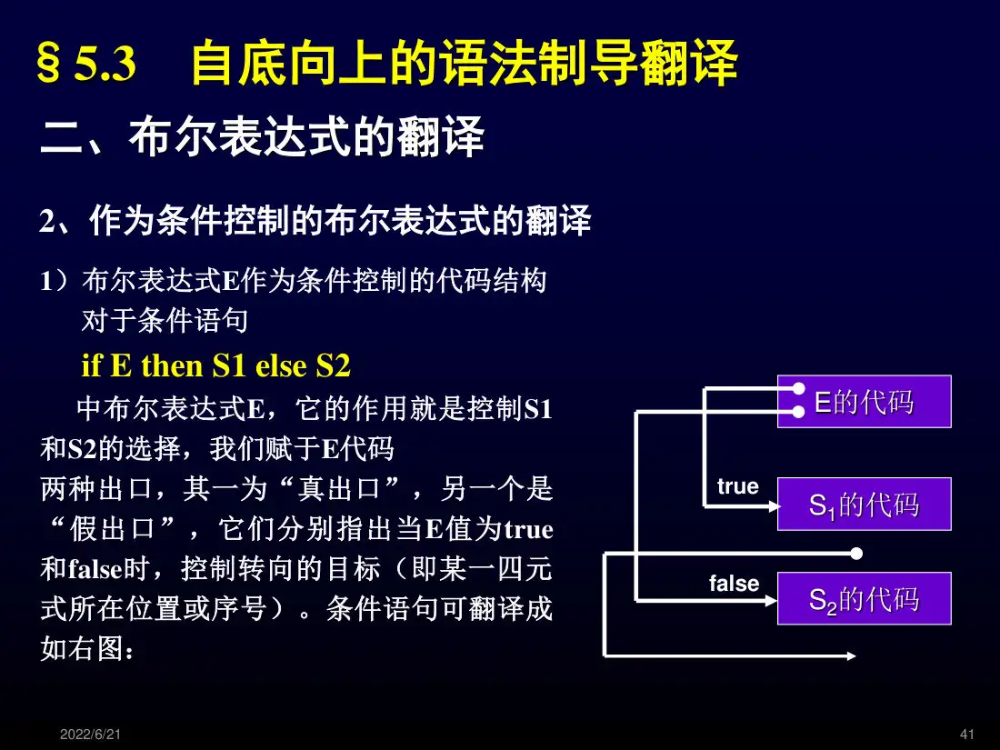

原文：

§5.3 自底向上的语法制导翻译二、布尔表达式的翻译

2、作为条件控制的布尔表达式的翻译

1）布尔表达式E作为条件控制的代码结构对于条件语句

if E then S1 else S2

中布尔表达式E，它的作用就是控制S1和S2的选择，我们赋于E代码两种出口，其一为“真出口”，另一个是“假出口”，它们分别指出当E值为true和false时，控制转向的目标（即某一四元式所在位置或序号）。条件语句可翻译成如右图：

true

E的代码

S1的代码

S2的代码

2022/6/21

41

### §5.3 自底向上的语法制导翻译二、布尔表达式的翻译

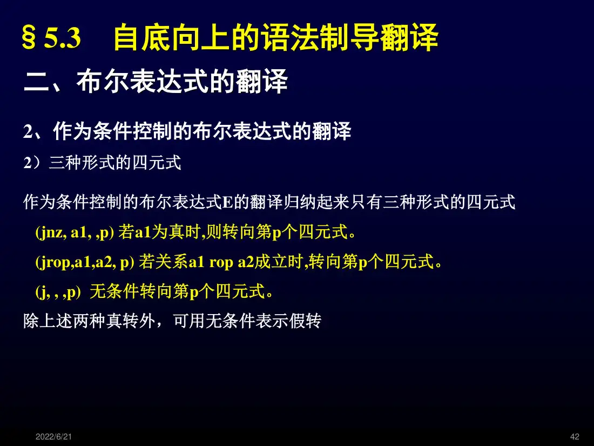

原文：

§5.3 自底向上的语法制导翻译二、布尔表达式的翻译

2、作为条件控制的布尔表达式的翻译

2）三种形式的四元式

作为条件控制的布尔表达式E的翻译归纳起来只有三种形式的四元式(jnz, a1, ,p) 若a1为真时,则转向第p个四元式。

(jrop,a1,a2, p) 若关系a1 rop a2成立时,转向第p个四元式。

(j,, ,p) 无条件转向第p个四元式。

除上述两种真转外，可用无条件表示假转

2022/6/21

42

### §5.3 自底向上的语法制导翻译二、布尔表达式的翻译

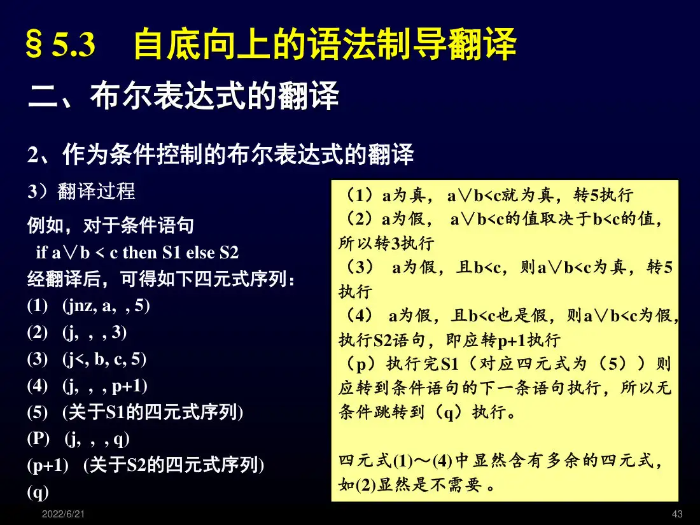

原文：

§5.3 自底向上的语法制导翻译二、布尔表达式的翻译

2、作为条件控制的布尔表达式的翻译

3）翻译过程

例如，对于条件语句

if a∨b < c then S1 else S2

经翻译后，可得如下四元式序列：

(1) (jnz, a, , 5)

(2) (j, , , 3)

(3) (j<, b, c, 5)

(4) (j, , , p+1)

(5) (关于S1的四元式序列)

(P) (j, , , q)

(p+1) (关于S2的四元式序列)

(q)

（1）a为真， a∨b<c就为真，转5执行

（2）a为假， a∨b<c的值取决于b<c的值，所以转3执行

（3） a为假，且b<c，则a∨b<c为真，转5执行

（4） a为假，且b<c也是假，则a∨b<c为假，执行S2语句，即应转p+1执行

（p）执行完S1（对应四元式为（5））则应转到条件语句的下一条语句执行，所以无条件跳转到（q）执行。

四元式(1)～(4)中显然含有多余的四元式，如(2)显然是不需要。

2022/6/21

43

### §5.3 自底向上的语法制导翻译二、布尔表达式的翻译

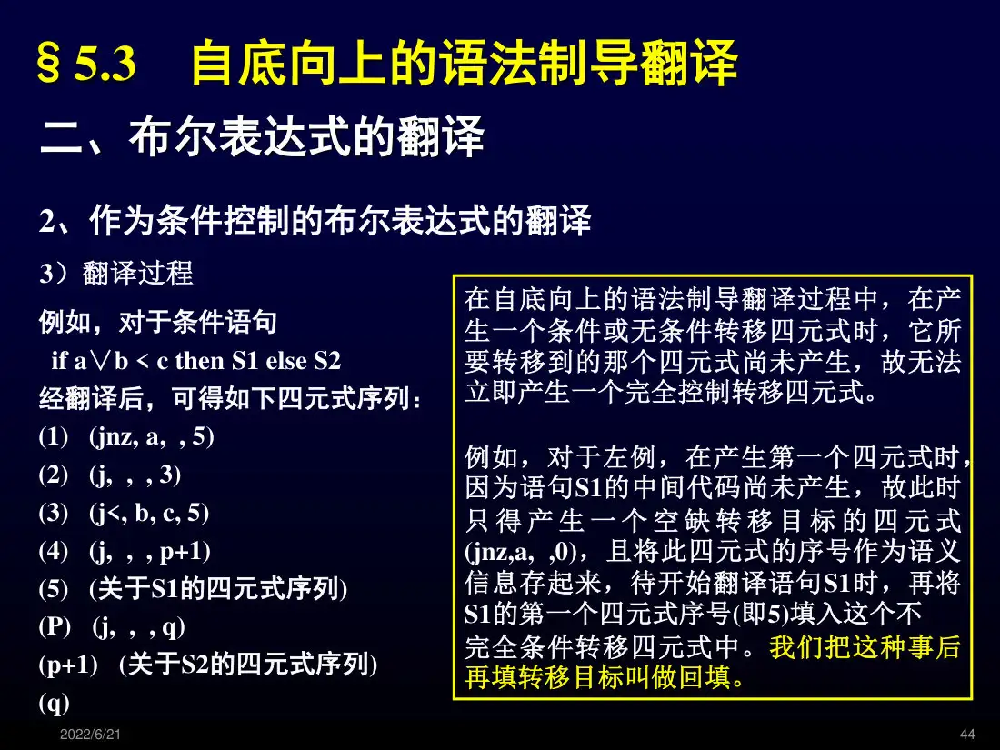

原文：

§5.3 自底向上的语法制导翻译二、布尔表达式的翻译

2、作为条件控制的布尔表达式的翻译

3）翻译过程例如，对于条件语句if a∨b < c then S1 else S2经翻译后，可得如下四元式序列：

(1) (jnz, a, , 5)

(2) (j, , , 3)

(3) (j<, b, c, 5)

(4) (j, , , p+1)

(5) (关于S1的四元式序列)

(P) (j, , , q)

(p+1) (关于S2的四元式序列)

(q)

在自底向上的语法制导翻译过程中，在产生一个条件或无条件转移四元式时，它所要转移到的那个四元式尚未产生，故无法立即产生一个完全控制转移四元式。

例如，对于左例，在产生第一个四元式时因为语句S1的中间代码尚未产生，故此时只得产生一个空缺转移目标的四元式(jnz,a, ,0)，且将此四元式的序号作为语义信息存起来，待开始翻译语句S1时，再将S1的第一个四元式序号(即5)填入这个不完全条件转移四元式中。我们把这种事后再填转移目标叫做回填。

2022/6/21

44

### §5.3 自底向上的语法制导翻译二、布尔表达式的翻译

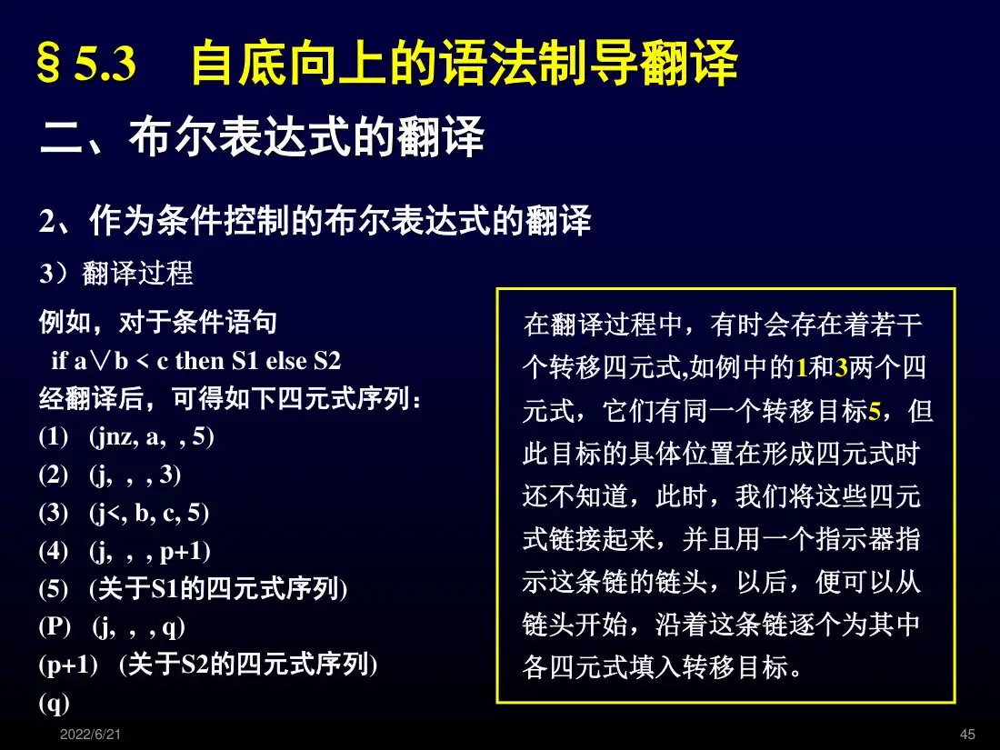

原文：

§5.3 自底向上的语法制导翻译二、布尔表达式的翻译

2、作为条件控制的布尔表达式的翻译

3）翻译过程

例如，对于条件语句

if a∨b < c then S1 else S2

经翻译后，可得如下四元式序列：

(1) (jnz, a, , 5)

(2) (j, , , 3)

(3) (j<, b, c, 5)

(4) (j, , , p+1)

(5) (关于S1的四元式序列)

(P) (j, , , q)

(p+1) (关于S2的四元式序列)

(q)

在翻译过程中，有时会存在着若干个转移四元式,如例中的1和3两个四元式，它们有同一个转移目标5，但此目标的具体位置在形成四元式时还不知道，此时，我们将这些四元式链接起来，并且用一个指示器指示这条链的链头，以后，便可以从链头开始，沿着这条链逐个为其中各四元式填入转移目标。

2022/6/21

45

### §5.3 自底向上的语法制导翻译三、控制语句的翻译

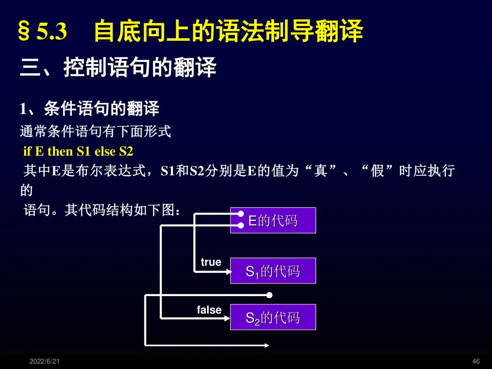

原文：

§5.3 自底向上的语法制导翻译三、控制语句的翻译

if E then S1 else S2

其中E是布尔表达式，S1和S2分别是E的值为“真”、“假”时应执行的

语句。其代码结构如下图：

E的代码

true

false

S1的代码

S2的代码

2022/6/21

46

### §5.3 自底向上的语法制导翻译三、控制语句的翻译

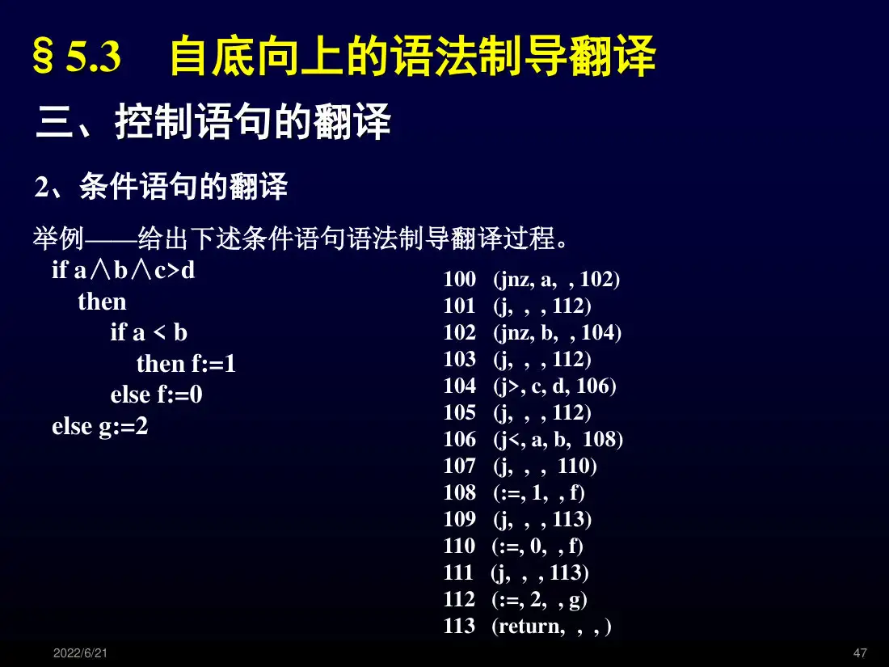

原文：

§5.3 自底向上的语法制导翻译三、控制语句的翻译

2、条件语句的翻译

举例—— 给出下述条件语句语法制导翻译过程。

then

$$
\mathrm{ifa< b}
$$

$$
\text { then } f := 1
$$

else g:=2

$$
\begin{array}{l l} 1 0 0 & (\mathrm{jnz,a,}, 1 0 2) \\ 1 0 1 & (\mathrm{j,},, 1 1 2) \\ 1 0 2 & (\mathrm{jnz,b,}, 1 0 4) \\ 1 0 3 & (\mathrm{j,},, 1 1 2) \\ 1 0 4 & (\mathrm{j>}, \mathrm{c,d,} 1 0 6) \\ 1 0 5 & (\mathrm{j,},, 1 1 2) \\ 1 0 6 & (\mathrm{j< ,a,b,} 1 0 8) \\ 1 0 7 & (\mathrm{j,},, 1 1 0) \\ 1 0 8 & (:= , 1, , \mathrm{f}) \\ 1 0 9 & (\mathrm{j,},, 1 1 3) \\ 1 1 0 & (:= , 0, , \mathrm{f}) \\ 1 1 1 & (\mathrm{j,},, 1 1 3) \\ 1 1 2 & (:= , 2, , \mathrm{g}) \\ 1 1 3 & (\text {return,},,) \end{array}
$$

2022/6/21

47

### §5.3 自底向上的语法制导翻译三、控制语句的翻译

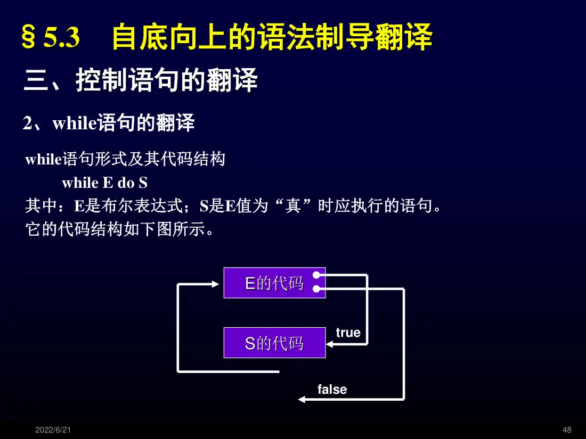

原文：

§5.3 自底向上的语法制导翻译三、控制语句的翻译

2、while语句的翻译

while语句形式及其代码结构while E do S

其中：E是布尔表达式；S是E值为“真”时应执行的语句。它的代码结构如下图所示。

E的代码

S的代码

2022/6/21

48

### §5.3 自底向上的语法制导翻译

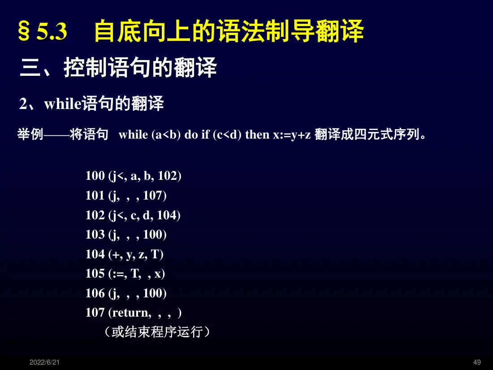

原文：

§5.3 自底向上的语法制导翻译

三、控制语句的翻译

2、while语句的翻译

举例——将语句 while (a<b) do if (c<d) then x:=y+z 翻译成四元式序列。

100 (j<, a, b, 102) 101 (j, , , 107) 102 (j<, c, d, 104) 103 (j, , , 100) 104 (+, y, z, T) 105 (:=, T, , x) 106 (j, , , 100) 107 (return, , , ) （或结束程序运行）

2022/6/21

49
