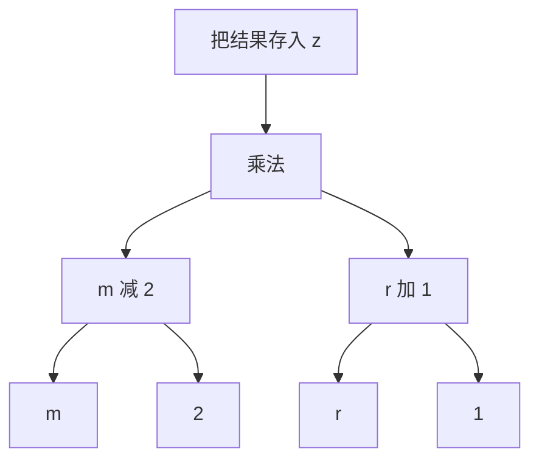
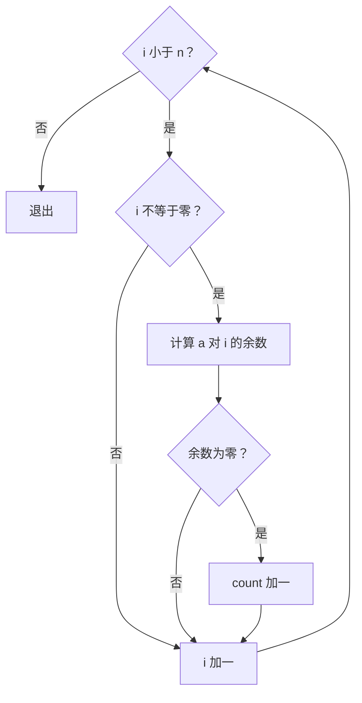

# 《编译原理》第5章 语法制导翻译（课件）

同一个分析器识别出表达式后，既可以立即算值，也可以生成一串待执行的中间代码。决定分组的是语法；决定怎样传值、何时插入类型转换、生成哪条操作的是语义动作。这份导读按原课件的 49 页组织，算例和图为独立编写。历史原件见页首。

## 归约选中了结构，语义动作才处理值（原件第 1–18 页）

[语法制导翻译](../../../topics/编译原理/语法制导翻译概述.md)把语义动作与文法产生式绑定。例如用某条加法规则把“左子式、加号、右子式”归约为表达式时，动作可以从两个子式的属性得到父结点的值。子式的计算结果在语法栈的结构中有确定位置，不必再从字符流里猜左、右操作数。词法阶段读出数值，传入数字 token 的属性；语法阶段识别组合；语义动作处理属性，或为下一阶段产生指令。

自底向上直接执行只依赖子结点的动作最自然：归约之前子结点的属性已就绪，读取后再把结果存到归约后的左部。实现时把整个右部的属性和出栈动作对齐，例如切勿在二元运算时把右子式当作左子式，也不要把运算符本身所在槽位当数值。原件第 12–14 页按归约后栈顶和相邻槽计算偏移，这是它采用的具体存储约定，不应把某个固定偏移抄到另一套栈布局。有些实现会先保存属性，再弹去右部，这更不依赖弹栈槽位仍然可读。

原件的连续加法用两种树都可求同一数值，这不意味着语法树无关紧要。改为 `8-3-2`，左结合得 $3$，右结合得 $7$。下文的布尔例子还会说明，求值顺序甚至能决定是否出错。原件的另一串同时含加法和乘法，从分析表先归约乘法可以得到值 8，归约顺序和语义栈记录的是同一棵树的两个侧面。参见 [简单算术表达式翻译](../../../topics/编译原理/简单算术表达式翻译.md)。

## 同一棵树，可以落成几种中间语言（第 19–38 页）

[中间表示](../../../topics/编译原理/中间语言.md)是前端、变换和目标代码生成之间约定的接口。前端把源语句结构显式化，后续步骤可复用这份表示而不重新理解源文法；表示仍须保留类型、名称绑定、求值顺序和可观察行为等足以维持语义的信息。不是把原句换成短一点的字符串就完成了翻译。

以赋值 `z := (m-2) * (r+1)` 为例，右部的各个局部计算有如下依赖：



| 表示法 | 怎么指出两个输入的结果 | 怎样处理顺序 |
|---|---|---|
| 表达式树 | 运算结点引用各子结点 | 子结点先得值；表达式树后序遍历产生后缀式 |
| 逆波兰式 | 读取操作数入栈，读到运算符取其输入 | 右部的后缀式为 `m 2 - r 1 + *`；二元减法第一次弹出的值是右操作数 |
| 三元式 | 可用其他三元式编号引用中间结果 | 右部可记成 1: `(-,m,2)`、2: `(+,r,1)`、3: `(*,(1),(2))`；编号引用结果，不是字面量 |
| 间接三元式 | 三元式表保存稳定编号，执行表另列顺序 | 调整合法顺序时可改执行表，而不是重编号全部引用 |
| 四元式 | 运算另外写出存放结果的名字 | 形如 `(op,arg1,arg2,result)`，可令乘积写入临时量，再赋给 z |

中缀写法把二元运算符放在两个操作数之间，波兰式把它提前，逆波兰式把它放在操作数之后；这是同一结构的三种顺序，不是三套优先级。逆波兰式虽无括号，却不能忽略运算符元数。二元运算需要两个值，一元运算只取一个；扫描结束还剩不止一个值，或运算时取不够，都不是有效的完整表达式。课件还给出把条件和分支写进 POST 数组的方式：先计算条件，条件为零时跳到假分支的入口；真分支完成后另用无条件跳转越过假分支。数组跳转目标是位置或标签，不是待运算的普通值；可用“小于则跳”直接比较两个操作数，也可用“为零则跳”检查已经算出的条件。

> [!CAUTION]
> 原件间接三元式例子把相同运算的记录只保存一份，但执行表可以仍引用它两次。==只保存一份不等于只执行一次==。若要删除重复计算，必须证明两次操作数求值之间没有影响结果的变化，并保留可能的副作用、异常和规定的求值顺序。

## 类型转换应出现在具体依赖边上（第 39 页）

知道 `m` 是整型、`r` 与 `z` 是实型，再把上面的树降为有类型的四元式。按示例语言的数值提升规则，`m-2` 应先做整数减法，其结果在进入实型乘法之前转换；`r+1` 这边把常数 1 表达为实型常量。这里用 `itr` 表示整型到实型转换，并约定常量可在编译期转换：

```text
(-i,  m,  2,   t0)
(itr, t0, -,   t1)
(+r,  r,  1.0, t2)
(*r,  t1, t2,  t3)
(:=,  t3, -,   z)
```

若 `m=7`、`r=1.5`，沿依赖得到 $5$、$5.0$、$2.5$、$12.5$，最终 `z` 为 $12.5$。不能见到式中有实数就把整棵树的整数操作全部提前改为实型：一旦源语言的整数行为、实数精度或异常与之不同，这种改动可能不等价。原件的混合型算例同样先保留整型子表达式，只在实型乘法需要该值时插转换。

## 布尔式可以产生值，也可以让执行走向两个出口（第 40–45 页）

如果布尔表达式的值要存入变量，就要明确哪个地方产生真值或假值；若它只控制分支，通常直接生成跳向真、假出口的代码。两者不是“总先把每个操作数求值再决定”。对具有短路规则的语言，即使用布尔运算结果作值，也应保留跳过不必求值部分的行为，必要时在两个出口分别写入真假值。参见 [布尔表达式翻译](../../../topics/编译原理/布尔表达式翻译.md)。

| 左边先得到的结果 | `A && B` | `A \|\| B` |
|---|---|---|
| 真 | 才去求 B | 直接走真出口 |
| 假 | 直接走假出口 | 才去求 B |

翻译过程可能还不知道目标指令的编号。先发出带空目标的条件跳转或无条件跳转，把同一目标的指令编号记作一张链表；知道目标入口后，再给这些指令逐一==回填==。构造合取时，把左边的真链回填到右边入口，合并两边的假链；构造析取时，把左边的假链回填到右边入口，合并两边的真链。取反可以交换两条出口链。这里的列表保存的是**待修改跳转指令的位置**，而不是还未确定的目标位置。

## 把条件的两条边接上语句结构（第 46–49 页）

独立例子：扫描从 `i` 到 `n-1` 的整数，仅统计非零且能整除 `a` 的项。外层循环条件是 `i < n`；内层条件是 `i != 0 && a % i == 0`。若 `i=0`，求余有风险，但短路决定它根本不能执行。无论内层真假，每轮都要增加 `i`，然后重新检查外层条件。



对应的四元式可写成：

```text
00 (j<,  i,     n,  02)
01 (j,   -,     -,  11)
02 (j!=, i,     0,  04)
03 (j,   -,     -,  09)
04 (rem, a,     i,  t0)
05 (j=,  t0,    0,  07)
06 (j,   -,     -,  09)
07 (+,   count, 1,  t1)
08 (:=,  t1,    -,  count)
09 (+,   i,     1,  i)
10 (j,   -,     -,  00)
11 (halt,-,     -,  -)
```

在编号尚未确定时，指令 03 和 06 是需要回填到同一入口的两条假边；循环条件本身的假边是 01，它不能混在其中，因为它要退出整个循环。以 `i=0,n=5,a=6,count=0` 手推，0 被直接跳过，1、2、3 使计数分别加一，4 不使计数改变，最终得到 `count=3`。若先无条件执行求余，再回头检查 `i!=0`，这个输入就在起点出错。

> [!TIP]
> 看到嵌套控制语句，先画清哪条边流向内层汇合、哪条边回外层条件、哪条边退出整个结构，再填写指令编号。一个普通 if–else 的真分支结束要越过假分支；单分支 if 的假边则直接接后续语句。在 [控制语句翻译](../../../topics/编译原理/控制语句翻译.md)中，每个汇合点都应该能用一条具体的输入轨迹验证。

原件末页的 while 嵌套单分支 if 也有两条回环路径：内层条件失败直接回外层测试，成功则执行赋值再回。中间代码正确不保证源程序会终止：若外层条件用到的量始终未变、初始又为真，回环可能一直发生。构造代码时不要以“这样看起来会退出”为理由偷偷添加原程序没有的更新。
