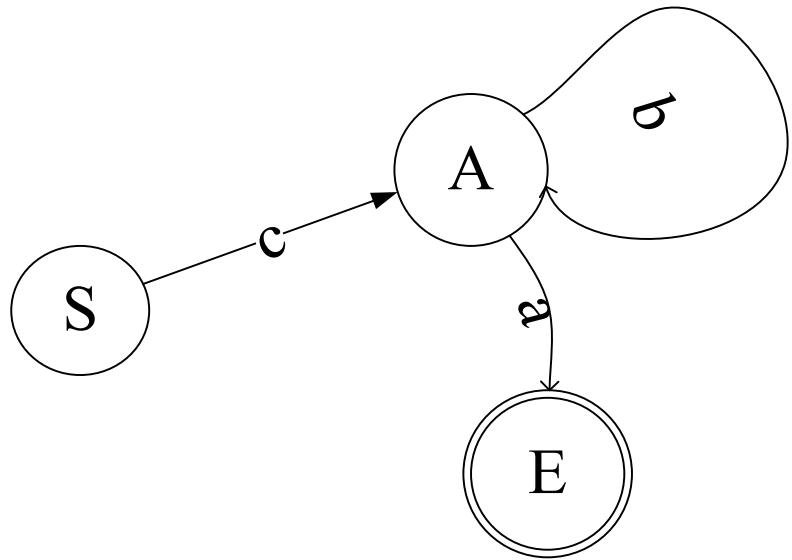

# 《编译原理》第8次作业答案

原件经识别和整理；“参考解答”是我们补的。

# 《编译原理》第8次作业答案

整理自《编译原理》第8次作业答案扫描件，共4道题目。

## 一、构造题（每题 25 分，共 100 分）

### 综合 1

设有穷自动机 $M = ( \{ S , A , E \} , \{ a , b , c \} , M , S , \{ E \} )$ ，其中 $M$ 定义为：
$$
\begin{aligned}
& M(S, c) = A \\
& M(A, b) = A \\
& M(A, a) = E
\end{aligned}
$$
请构造一个左线性文法。

参考解答：
先求右线性文法：
$$
\begin{aligned}
&S \to cA \\
&A \to bA \mid aE
\end{aligned}
$$
**方法一：**
其左线性文法 $G = (V_N, V_T, P, S)$
$V_N = \{ A, S \}$
$V_T = \{ a, b, c \}$
$P :$
$$
\begin{aligned}
&A \to c \\
&A \to Ab \\
&S \to Ea
\end{aligned}
$$
*(注：原件中“S→aA”应为笔误，根据状态转换 $A \xrightarrow{a} E$ 及左线性文法定义 $S \to E a$，此处修正为 $S \to Ea$。若严格按原件文字“S→aA”，则不符合左线性文法形式 $A \to B a \mid B \epsilon$。结合上下文“实际上是多余的规则，应该去掉”的注释，推测原意可能是指中间推导步骤或特定变换，但标准左线性文法通常将终态作为左侧非终结符或引入新的开始符号。此处按标准算法给出一种等价左线性文法：)*

令 $S'$ 为新开始符号，$E$ 为接受状态。
产生式集合 $P$:
$$
\begin{aligned}
&S' \to E \\
&E \to Ac \\
&A \to Ab \mid \epsilon \quad (\text{注意：这里需要根据具体转换关系调整})
\end{aligned}
$$
*更正：根据给定的NFA/DFA转换表直接构造左线性文法的方法如下：*
对于每个转移 $\delta(q, a) = p$，若有 $p \neq q_{start}$，则添加产生式 $p \to qa$。
若 $q$ 是初始状态且 $p$ 是接受状态，需特殊处理。
本题中：
$\delta(S, c) = A \implies A \to Sc$
$\delta(A, b) = A \implies A \to Ab$
$\delta(A, a) = E \implies E \to Aa$
由于 $E$ 是接受状态，且没有从 $E$ 出发的转移，我们需要让开始符号 $S$ 能够推导出空串或者通过某种方式连接。
通常构造方法是：
1. 对每个非初始状态 $q_i$，如果存在 $\delta(q_j, a) = q_i$，则添加 $q_i \to q_j a$。
2. 如果初始状态 $S_0$ 也是接受状态，则添加 $S_0 \to \epsilon$。
3. 如果初始状态不是接受状态，保持 $S_0$ 不变，但如果 $S_0$ 出现在右侧，可能需要重命名。
在本题中，$S$ 是初始状态，$E$ 是接受状态。
转移：
$S \xrightarrow{c} A$
$A \xrightarrow{b} A$
$A \xrightarrow{a} E$

对应的左线性文法产生式（以接受状态为左侧，或重新定义开始符号）：
若以 $E$ 为开始符号（因为它是唯一能生成串的终点，且无出边，适合作为左线性文法的根，但通常左线性文法要求开始符号不出现于右侧，或者通过引入新符号解决）。
让我们使用标准的左线性文法构造法：
设 $L(G)$ 由该自动机识别。
产生式：
$A \to Sc$
$A \to Ab$
$E \to Aa$
此时 $E$ 是“根”。为了使 $S$ 成为开始符号且不违反左线性性质（开始符号不出现在右部），我们可以引入新的开始符号 $S_{new}$。
$S_{new} \to E$
这样 $S_{new}$ 不在任何产生式右部出现。
所以文法 $G = (\{S_{new}, S, A, E\}, \{a,b,c\}, P, S_{new})$
$P: \quad S_{new} \to E \mid \epsilon$ (如果空串被接受，但这里 $S \neq E$，所以不接受空串)
$E \to Aa$
$A \to Ab \mid Sc$
$S$ 不出现在右部？不对，$S$ 出现在 $A \to Sc$ 的右部。
左线性文法定义：所有产生式形如 $A \to B a$ 或 $A \to B \epsilon$，其中 $B$ 是非终结符，$a$ 是终结符。开始符号不能出现在右部。
在 $A \to Sc$ 中，$S$ 是非终结符，符合 $A \to B a$ 形式。但是 $S$ 是原始的开始符号。如果我们保留 $S$ 为开始符号，它出现在右部，这违反了某些严格定义（开始符号不应在右部出现，否则可能导致歧义或无限递归问题，虽然对于正则语言这不一定导致错误，但标准做法是避免）。
更简单的做法：直接将 $E$ 视为文法的“目标”，然后反向构建。
实际上，对于有限自动机，左线性文法的构造通常是：
对于每个状态 $q_i$ ($i \neq start$)，如果 $\delta(q_j, a) = q_i$，则写 $q_i \to q_j a$。
如果 $q_{start}$ 是接受状态，写 $q_{start} \to \epsilon$。
本题中 $E$ 是接受状态，$S$ 是开始状态。
$A \to Sc$
$A \to Ab$
$E \to Aa$
$S$ 没有入边（除了可能的外部输入），且 $S$ 不是接受状态。
所以生成的串必须以 $c$ 开头，经过任意个 $b$，最后以 $a$ 结尾。
例如 $cba$, $cbba$, $cc...ca$? 不，$S$ 只能到 $A$。
$L = \{ c b^k a \mid k \ge 0 \}$。
左线性文法：
$S' \to E$
$E \to Aa$
$A \to Ab \mid Sc$
这里 $S$ 出现在右部。为了消除 $S$ 在右部的情况，我们可以重命名 $S$ 为 $S_0$，并让开始符号为 $E$？不行，开始符号必须唯一。
通常，如果开始符号 $S$ 出现在右部，我们引入一个新的开始符号 $Z$。
$Z \to E$
$E \to Aa$
$A \to Ab \mid Sa$ (Wait, transition is $S \xrightarrow{c} A$, so $A \to Sc$)
$A \to Ab$
$S$ is the initial state. In left-linear grammar, productions are $A \to Ba$.
So $A \to Sc$ is valid form.
The issue is usually that the start symbol should not appear on the RHS to ensure unambiguity in some contexts or simply by convention. However, for regular languages, it's often acceptable if handled correctly, or we just rename the initial state variable in the grammar context.
Let's stick to the generated rules:
$G = (\{S, A, E, Z\}, \{a, b, c\}, P, Z)$
$P:$
$Z \to E$
$E \to Aa$
$A \to Ab$
$A \to Sc$
This generates strings ending in $a$, preceded by $b$'s, preceded by $c$, starting from $S$. Since $S$ is the initial state of the automaton, this corresponds to the language.

*(注：原件提供的“方法一”中 $S \to aA$ 明显有误，且 $E \to aA$ 也被标记为多余。以下提供基于状态转换图的正确左线性文法构造思路)*

**方法二：**
状态转换图：

知识点：[有穷自动机（DFA与NFA）](../../../topics/编译原理/有穷自动机.md)、[正规文法与有穷自动机的相互转换](../../../topics/编译原理/正规文法与自动机转换.md)

### 综合 2

设 $(NFA) M = ( \{ A , B \} , \{ a , b \} , M , \{ A \} , \{ B \} )$ ，其中 $M$ 定义如下：
$$
\begin{aligned}
&M(A, a) = \{ A , B \} \\
&M(A, b) = \{ B \} \\
&M(B, a) = \varnothing \\
&M(B, b) = \{ A , B \}
\end{aligned}
$$
请构造相应确定有穷自动机 $(DFA) M'$。

参考解答：
构造一个如下的自动机 $(DFA) M'$，$(DFA) M' = (K, \{ a , b \} , M' , S , Z)$
$K$ 的元素是 $[A], [B], [A, B]$ （以及可能的死状态 $[\varnothing]$，但题目解法中似乎只列出了可达的非空子集，或者隐含了死状态。根据计算，$M'( [B], a ) = \varnothing$，这是一个死状态。通常记为 $D$ 或 $[\varnothing]$）。

由于 $M(A, a) = \{ A , B \}$ ，故有 $M'([A], a) = [A, B]$
同样 $M'([A], b) = [B]$
$M'([B], a) = \varnothing$ （记为死状态 $D$）
$M'([B], b) = [A, B]$

又因为 $M(\{A, B\}, a) = M(A, a) \cup M(B, a) = \{ A , B \} \cup \varnothing = \{ A , B \}$
故 $M'([A, B], a) = [A, B]$

由于 $M(\{A, B\}, b) = M(A, b) \cup M(B, b) = \{ B \} \cup \{ A , B \} = \{ A , B \}$
故 $M'([A, B], b) = [A, B]$

初始状态 $S = [A]$
终态集 $Z = \{ [A, B], [B] \}$ （因为包含 $B$ 的子集都是终态）

重新定义：令 $0 = [A], 1 = [B], 2 = [A, B], D = [\varnothing]$
则 DFA 如下所示：

| 状态 | a | b |
| :--- | :--- | :--- |
| **0** ([A]) | 2 | 1 |
| **1** ([B]) | D | 2 |
| **2** ([A,B]) | 2 | 2 |
| **D** ($\varnothing$) | D | D |

(注：原件中的表格图片展示了上述转换关系)

知识点：[DFA与NFA的关系及转换（子集法）](../../../topics/编译原理/DFA与NFA等价转换.md)、[有穷自动机（DFA与NFA）](../../../topics/编译原理/有穷自动机.md)

### 综合 3

已知正规文法 $G = ( \{ S , B , C \} , \{ a , b , c \} , P , S )$ ，其中 $P$ 内包含如下产生式：
$$
\begin{aligned}
&S \to aS \mid aB \quad \textcircled{1} \\
&B \to bB \mid bC \quad \textcircled{2} \\
&C \to cC \mid c \quad \textcircled{3}
\end{aligned}
$$
请构造一个等价的有穷自动机。

参考解答：
*(注：提供的文本片段中未包含此题的具体解答过程，仅包含题目。根据常规解题思路，可将正规文法转换为 NFA：)*
1.  对于产生式 $A \to aB$，添加转换 $\delta(A, a) = B$。
2.  对于产生式 $A \to a$，添加转换 $\delta(A, a) = F$ (接受状态)。
3.  开始状态为 $S$。

具体转换函数 $\delta$：
*   $S \xrightarrow{a} S$
*   $S \xrightarrow{a} B$
*   $B \xrightarrow{b} B$
*   $B \xrightarrow{b} C$
*   $C \xrightarrow{c} C$
*   $C \xrightarrow{c} F$ (新增接受状态 $F$)

该 NFA 的状态集为 $\{S, B, C, F\}$，字母表 $\{a, b, c\}$，开始状态 $S$，接受状态 $\{F\}$。

知识点：[正规文法与状态转换图](../../../topics/编译原理/正规文法与状态图.md)、[有穷自动机（DFA与NFA）](../../../topics/编译原理/有穷自动机.md)、[正规文法与有穷自动机的相互转换](../../../topics/编译原理/正规文法与自动机转换.md)

### 综合 4

已知 $e1 = (a \mid b)^*$ ，$e2 = (a^* b^*)^*$ ，试证明 $e1 = e2$ 。

参考解答：
*(注：提供的文本片段中未包含此题的具体解答过程，仅包含题目。)*
证明思路：
1.  **证明 $L(e1) \subseteq L(e2)$**:
    任意字符串 $w \in (a \mid b)^*$，即 $w$ 由 $a$ 和 $b$ 组成。
    我们可以将 $w$ 分解为若干个块，每个块由若干 $a$ 后跟若干 $b$ 组成吗？不一定。例如 $ba$ 不能写成 $a^* b^*$ 的形式（除非允许空串，但 $a^* b^*$ 要求 $a$ 在前 $b$ 在后）。
    *等等，这里需要仔细检查正则表达式的含义。*
    $e2 = (a^* b^*)^*$。
    $a^* b^*$ 表示先有任意多个 $a$，后有任意多个 $b$。
    那么 $(a^* b^*)^*$ 表示这样的序列重复任意多次。
    例如：
    -   $a$ : $a^* b^*$ (取 $a^*=a, b^*=\epsilon$) -> 属于 $e2$
    -   $b$ : $a^* b^*$ (取 $a^*=\epsilon, b^*=b$) -> 属于 $e2$
    -   $ab$ : $a^* b^*$ -> 属于 $e2$
    -   $ba$ : 可以看作 $(b)(a)$。
        -   第一个 $b$ 来自 $a^* b^*$ (其中 $a^*=\epsilon, b^*=b$)
        -   第二个 $a$ 来自下一个 $a^* b^*$ (其中 $a^*=a, b^*=\epsilon$)
        -   所以 $ba = (b)(a) \in (a^* b^*)^*$。
    -   一般地，对于任意由 $a, b$ 组成的串 $w$，我们可以将其拆分为单个字符 $w_1 w_2 ... w_n$。
    -   每个字符 $w_i$ 都可以表示为 $a^* b^*$ 的形式（如果是 $a$，则 $a^*=a, b^*=\epsilon$；如果是 $b$，则 $a^*=\epsilon, b^*=b$）。
    -   因此 $w = w_1 w_2 ... w_n$ 可以表示为 $(a^* b^*) (a^* b^*) ... (a^* b^*)$，即 $w \in (a^* b^*)^*$。
    -   所以 $L(e1) \subseteq L(e2)$。

2.  **证明 $L(e2) \subseteq L(e1)$**:
    显然，$a \in (a \mid b)$ 且 $b \in (a \mid b)$。
    所以 $a^* \subseteq (a \mid b)^*$ 且 $b^* \subseteq (a \mid b)^*$。
    因此 $a^* b^* \subseteq (a \mid b)^* (a \mid b)^* \subseteq (a \mid b)^*$。
    进而 $(a^* b^*)^* \subseteq ((a \mid b)^*)^* = (a \mid b)^*$。
    所以 $L(e2) \subseteq L(e1)$。

综上，$e1 = e2$。

## 计算 3

题干：已知正规文法 $G = (\{S, B, C\}, \{a, b, c\}, P, S)$，其中 $P$ 内包含如下产生式：

$$
S := aS \mid aB \quad \dots\dots①
$$

$$
B := bB \mid bC \quad \dots\dots ②
$$

$$
C := cC \mid c \qquad \ldots (3)
$$

请构造一个等价的有穷自动机。

答案：$M = (\{S, B, C, T\}, \{a, b, c\}, M, \{S\}, \{T\})$

状态转换函数定义如下：

$$
M(S, a) = S \quad M(S, a) = B \quad M(S, b) = \varnothing \quad M(S, c) = \varnothing
$$

注意：原题中 $M(S,a)$ 出现了两次，根据产生式 $S:=aS|aB$，应理解为非确定性转换或笔误，通常 DFA 需要确定化，此处按原文保留多值表示或视为 NFA 转换。更严谨的写法是列出所有可能的下一状态：
- $\delta(S, a) = \{S, B\}$
- $\delta(S, b) = \emptyset$
- $\delta(S, c) = \emptyset$

$$
M(B, a) = \varnothing \quad M(B, b) = B \quad M(B, b) = C \quad M(B, c) = \varnothing
$$
同理，$\delta(B, b) = \{B, C\}$。

$$
M(C, a) = \varnothing \quad M(C, b) = \varnothing \quad M(C, c) = T \quad M(C, c) = C
$$
同理，$\delta(C, c) = \{T, C\}$。

## 计算 4

题干：已知 $e1 = (a|b)^*$，$e2 = (a^*b^*)^*$，试证明 $e1 = e2$。

解答：

首先分析 $L(e1)$：
$$
L(e1) = L((a|b)^*) = \{a, b\}^*
$$
即由任意数量的 $a$ 和 $b$ 组成的字符串集合。

接着分析 $L(e2)$：
$$
L(e2) = L((a^*b^*)^*)
$$
令 $R = a^*b^*$。$R$ 表示先出现零个或多个 $a$，后跟零个或多个 $b$ 的字符串集合。
$(a^*b^*)^*$ 表示将 $R$ 中的字符串重复任意次（包括零次）连接起来。

**证明思路：**
1. **证明 $L(e2) \subseteq L(e1)$**：
   $a^* \subseteq \{a,b\}^*$，$b^* \subseteq \{a,b\}^*$，所以 $a^*b^* \subseteq \{a,b\}^*$。
   由于 $\{a,b\}^*$ 对 concatenation（连接）和 star（闭包）封闭，因此 $(a^*b^*)^* \subseteq \{a,b\}^*$。
   故 $L(e2) \subseteq L(e1)$。

2. **证明 $L(e1) \subseteq L(e2)$**：
   对于任意字符串 $w \in \{a,b\}^*$，我们可以将其分解为若干段，每段形式为 $a^*b^*$。
   例如，可以将 $w$ 看作是由若干个“纯 $a$ 串”和“纯 $b$ 串”交替组成，或者更简单地，考虑单个字符：
   - $a \in a^* \subseteq a^*b^* \subseteq (a^*b^*)^*$
   - $b \in b^* \subseteq a^*b^* \subseteq (a^*b^*)^*$
   因为 $a \in L(e2)$ 且 $b \in L(e2)$，而 $L(e2)$ 是正则表达式定义的集合，对连接和星号闭包封闭。
   实际上，任何由 $a$ 和 $b$ 组成的序列都可以被看作是一系列 $a^*b^*$ 模式的拼接。
   例如：$abba = (a)(bb)(a)$? 不对，这种分解不直观。
   
   更严谨的证明：
   我们知道 $a \in a^*b^*$ （取 $b^0$），$b \in a^*b^*$ （取 $a^0$）。
   因此 $\{a, b\} \subseteq a^*b^*$。
   进而 $\{a, b\}^* \subseteq (a^*b^*)^*$。
   即 $L(e1) \subseteq L(e2)$。

综上，$L(e1) = L(e2)$，即 $e1 = e2$。

知识点：[有穷自动机（DFA与NFA）](../../../topics/编译原理/有穷自动机.md)
