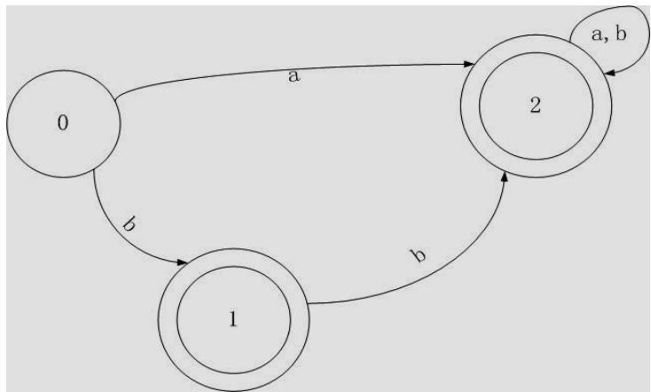

# 《编译原理》第8次作业答案

按原件页序整理。原文中的“解”“答”等保留原件答案；“参考解答”为补充。

## 原件第1页

1、设有穷自动机 $\mathbf { M } = ( \{ \mathbf { S } , \mathbf { A } , \mathbf { E } \} , \{ \mathbf { a } , \mathbf { b } , \mathbf { c } \} , \mathbf { M } , \mathbf { S } , \{ \mathbf { E } \} )$ ，其中M定义为$\begin{array} { r l } { \mathbf { M } \left( \mathbf { S } , \mathbf { c } \right) = \mathbf { A } } & { { } \mathbf { M } \left( \mathbf { A } , \mathbf { b } \right) = \mathbf { A } \mathbf { M } \left( \mathbf { A } , \mathbf { a } \right) = \mathbf { E } } \end{array}$ 请构造一个左线性文法。

2、设 $\left( \mathrm { N F A } \right) \mathbf { M } = \left( \ \{ \mathbf { A } , \mathbf { B } \} , \{ \mathbf { a } , \mathbf { b } \} , \mathbf { M } , \{ \mathbf { A } \} , \{ \mathbf { B } \} \right)$ ，其中M定义如下：$\mathrm { ~ \bf ~ M ~ } ( { \bf A } , { \bf a } ) = \{ { \bf A } , { \bf B } \} \mathrm { ~ \bf ~ M ~ } ( { \bf A } , { \bf b } ) = \{ { \bf B } \} \mathrm { ~ \bf ~ M ~ } ( { \bf B } , { \bf a } ) = \pmb { \varpi } \mathrm { ~ \bf ~ M ~ } ( { \bf B } , { \bf b } ) = \{ { \bf A } , { \bf B } \}$ 请构造相应确定有穷自动机 $\mathbf { \nabla } _ { \mathbf { \rho } } ( \mathbf { D F A } ) \mathbf { M ^ { \prime } }$

3、已知正规文法 ${ \sf G } = ( \{ \sf S  , { \sf B } , { \sf C } \} , \{ { \sf a } , { \sf b } , { \sf c } \} , { \sf P } , { \sf S } )$ ，其中P内包含如下产生式：$\mathsf { S } _ { \bullet } = \mathsf { a S } \mid \mathsf { a B } \qquad \ldots \ldots \textcircled { 1 }$ $\mathbf { B } _ { : : } = \mathbf { b } \mathbf { B } \mid \mathbf { b C } \ldots \textcircled { 2 }$ $\complement _ { * * } = \complement \mid { \textbf { c } } \qquad \implies \implies \implies \bigotimes \big ( \bigstar \big )$ 请构造一个等价的有穷自动机。

4、已知 $| { \bf e } 1 = ( { \mathsf { a } } | { \mathsf { b } } ) \cdot , { \mathsf { e } } 2 { = } ( { \mathsf { a } } \star { \mathsf { b } } \star ) \star$ ，试证明 ${ \tt e 1 } = { \tt e 2 }$ 1、设有穷自动机 $\begin{array} { r } { \mathbf { \{ M = ( \{ S , A , E \} , \{ a , b , c \} , M , S , \{ E \} ) } }  \end{array}$ ，其中M定义为M $\begin{array} { r } { \mathrm { ~ { ~ \bf ~ I ~ } ~ } ( { \bf S } , { \bf c } ) = { \bf A } \quad \mathrm { ~ { ~ \bf ~ M ~ } ~ } ( { \bf A } , { \bf b } ) = { \bf A } \quad \quad \mathrm { ~ { ~ \bf ~ M ~ } ~ } ( { \bf A } , { \bf a } ) = { \bf E } } \end{array}$ 请构造一个左线性文法。

## 原件第2页

解：先求右线性文法S→cA A→bA A→a | aE方法一：其左线性文法 $\mathbf { G } { = \mathbf { \Gamma } ( \mathbf { V N } , \mathbf { V T } , \mathbf { P } , \mathbf { S } ) }$ $\scriptstyle \mathbf { V N } = \{ \mathbf { A } , \mathbf { S } \} \mathbf { V T } = \{ \mathbf { a } , \mathbf { b } , \mathbf { c } \}$ $\mathbf { P } \colon \mathbf { A } { \longrightarrow } \mathbf { c } \quad \mathbf { A } { \longrightarrow } \mathbf { A } \mathbf { b } \quad \mathbf { S } { \longrightarrow } \mathbf { A } { \mathbf { a } }$ {E→aA实际上是多余的规则，应该去掉 }

方法二：

状态转换图

## 原件第3页

2、 $\left( \mathrm { N F A } \right) \mathrm { M } = \left( \{ \mathrm { A } , \mathrm { B } \} , \{ \mathrm { a } , \mathrm { b } \} , \mathrm { M } , \{ \mathrm { A } \} , \{ \mathrm { B } \} \right)$ ，其中M定义如下：$\mathrm { ~ M ~ } ( \mathbf { A } , \mathbf { a } ) = \left\{ \mathbf { A } , \mathbf { B } \right\} \mathrm { ~ M ~ } ( \mathbf { A } , \mathbf { b } ) = \left\{ \mathbf { B } \right\} \mathrm { ~ M ~ } ( \mathbf { B } , \mathbf { a } ) = \pmb { \varpi } \mathrm { ~ \textbf ~ { ~ M ~ } ( \mathbf { B } , \mathbf { b } ) = \left\{ \mathbf { A } , \mathbf { B } \right\} ~ }$ 请构造相应确定有穷自动机 $\mathbf { \nabla } _ { \mathbf { \lambda } } ( \mathbf { D F A } ) \mathbf { M ^ { \prime } }$ o解：构造一个如下的自动机 $\scriptstyle \mathbf { . ( D F A ) } \mathbf { M } ^ { \prime } , ( \mathbf { D F A } ) \mathbf { M } ^ { \prime } = \{ \mathbf { K } , \{ \mathbf { a } , \mathbf { b } \} , \mathbf { M } ^ { \prime } , \mathbf { S } , \mathbf { Z } \}$ K的元素是 $[ \mathbf { A } ] \quad [ \mathbf { B } ] \quad [ \mathbf { A } , \mathbf { B } ]$ 由于 $\textbf { M } ( \mathbf { A } , \mathbf { a } ) = \{ \mathbf { A } , \mathbf { B } \}$ ，故有 $\mathbf { M } ^ { \prime } \left( \mathbf { [ A ] } , \mathbf { a } \right) = \mathbf { [ A , }$ B]同样 $\mathbf { M } ^ { \prime } \left( \mathbf { \left[ A \right] } , \mathbf { b } \right) \mathbf { \left[ \alpha = \left[ B \right] \right. }$ $\mathbf { M } ^ { \prime } \left( \left[ \mathbf { B } \right] , \mathbf { a } \right) = \pmb { \alpha }$ $\mathbf { M } ^ { \prime } \mathbf { \Sigma } ( [ \mathbf { B } ] , \mathbf { \Sigma } \mathbf { b } ) \mathbf { \Sigma } = \mathbf { [ A , \Sigma \Sigma B ] }$ $\begin{array} { r } { \boxplus \mp \mathbb { M } \textrm { ( \{ A , } B \} , \textrm { a ) } = \mathbf { M } \textrm { ( A , } \textrm { a ) } \mathbf { U } \mathbf { M } \textrm { ( B , } \textrm { a ) } = \{ \mathbf { A } , \textrm { } \textrm { B } \} \mathbf { U } \otimes = \{ \mathbf { A } , \textrm { } \textrm { B } \} \mathbf { M } \textrm { ( } B , } \end{array}$ 故 $\begin{array} { r } { \mathbf { M } ^ { \prime } \left( \left[ \mathbf { A } , \mathbf { B } \right] , \mathbf { a } \right) = \left[ \mathbf { A } , \mathbf { \Lambda } \right. } \end{array}$ B]由于 $\textbf { M } \left( \{ \mathbf { A } , \mathbf { B } \} , \ \mathbf { b } \right) = \mathbf { M } \ \left( \mathbf { A } , \ \mathbf { b } \right) \ \textbf { U M } \left( \mathbf { B } , \ \mathbf { b } \right) \ = \{ \mathbf { B } \} \mathbf { U } \ \{ \mathbf { A } , \ \mathbf { B } \} = \{ \mathbf { A } , \ \mathbf { B } \}$ 故 $\begin{array} { r } { \mathbf { M } ^ { \prime } \left( [ \mathbf { A } , \mathbf { B } ] , \mathbf { b } \right) = [ \mathbf { A } , } \end{array}$ ，B]$\scriptstyle \mathbf { S } = [ \mathbf { A } ]$ ，终态集 $\scriptstyle  { \mathbf { Z } } = \{ [ \mathbf { A } , { \mathbf { B } } ]$ ，[B]}重新定义：令 $\mathbf { \partial } \cdot \mathbf { 0 } = [ \mathbf { A } ] \ 1 { = } [ \mathbf { B } ] \ 2 { = } [ \mathbf { A } , \mathbf { B } ]$ ，则DFA如下所示：

## 原件第4页

3. 已知正规文法 $\mathbf { G } = ( \{ \mathbb { S } , \mathbf { B } , \mathbf { C } \} , \{ \mathbf { a } , \mathbf { b } , \mathbf { c } \} , \mathbf { P } , \mathbf { S } )$ ，其中P内包含如下产生式：

$$
\mathrm{S} \mathrel {\mathop :} = \mathrm{aS} \mid \mathrm{aB} \quad \dots\dots①
$$

$$
\mathbf {B}: := \mathbf {b} \mathbf {B} \mid \mathbf {b} \mathbf {C} \quad \dots\dots ②
$$

$\mathbf { C { : : = } c C } \mid \mathbf { c } \qquad \ldots \mathbf { ( } 3 )$ 请构造一个等价的有穷自动机。

解： $\mathbf { M } { = } ( \left\{ \mathbf { S } , \mathbf { B } , \mathbf { C } , \mathbf { T } \right\} , \left\{ \mathbf { a } , \mathbf { b } , \mathbf { c } \right\} , \mathbf { M } , \{ \mathbf { S } \} , \{ \mathbf { T } \} )$

$$
\mathbf {M} (\mathrm{S}, \mathrm{a}) = \mathrm{S} \quad \mathbf {M} (\mathrm{S}, \mathrm{a}) = \mathrm{B} \quad \mathbf {M} (\mathrm{S}, \mathrm{b}) = \varnothing \quad \mathbf {M} (\mathrm{S}, \mathrm{c}) = \varnothing
$$

$$
\mathbf {M} (\mathbf {B}, \mathbf {a}) = \boldsymbol {\varnothing} \quad \mathbf {M} (\mathbf {B}, \mathbf {b}) = \mathbf {B} \quad \mathbf {M} (\mathbf {B}, \mathbf {b}) = \mathbf {C} \quad \mathbf {M} (\mathbf {B}, \mathbf {c}) = \boldsymbol {\varnothing}
$$

$$
\mathbf {M} (\mathbf {C}, \mathbf {a}) = \boldsymbol {\varnothing} \quad \mathbf {M} (\mathbf {C}, \mathbf {b}) = \boldsymbol {\varnothing} \quad \mathbf {M} (\mathbf {C}, \mathbf {c}) = \mathbf {T} \quad \mathbf {M} (\mathbf {C}, \mathbf {c}) = \mathbf {C}
$$

## 原件第5页

4、已知 ${ \mathsf { e } } 1 = ( { \mathsf { a } } | { \mathsf { b } } ) ^ { \star }$ ${ \mathrm { e } } 2 = ( { \mathrm { a } } \star { \mathrm { b } } \star ) \star$ ，试证明 ${ \tt e l } = { \tt e } 2$

$\mathsf { L } ( \mathsf { e } \bot ) \mathsf { = } \{ \mathsf { a } , \mathsf { b } \} ^ { \star }$

$L ( e 2 ) = \{ \{ { \sf a } \} * \{ b \} * \} * = ?$

## 补充讲解

### 核对后的解答 1

参考解答：两者都表示 $\{a,b\}^{*}$。$a^{*}b^{*}$ 中的每个串都只含 $a,b$，所以 $(a^{*}b^{*})^{*}\subseteq\{a,b\}^{*}$。反过来，单字符 $a$ 和 $b$ 都属于 $a^{*}b^{*}$，因此任意 $a,b$ 串都能按单字符分块，成为若干个 $a^{*}b^{*}$ 串的连接；空串也属于外层闭包。故 $\{a,b\}^{*}\subseteq(a^{*}b^{*})^{*}$，从而 $e_1=e_2$。

