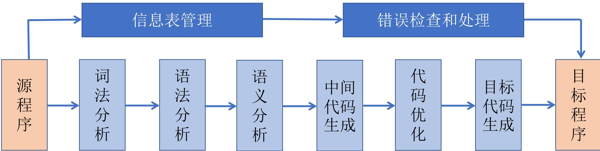

# 《编译原理》第一章 引论 课后作业答案

原件经识别和整理；“参考解答”是我们补的。

# 第一章 引论 作业答案

本题为《编译原理》第一章引论的课后作业及答案，按原件顺序整理，答案保留原件表述。

## 一、作业题目

### 简答 1

画出编译程序的逻辑结构。

参考解答：由于题目图片无法直接显示，但根据《编译原理》中经典的**编译程序逻辑结构图**，该图通常包含以下阶段及辅助模块。以下给出各部分的名称及其功能说明：

## 结论

编译程序的逻辑结构由 **5个主要阶段** 和 **2个辅助模块** 组成：

| 阶段/模块 | 输入 | 输出 | 主要任务 |
| :--- | :--- | :--- | :--- |
| **词法分析** | 源程序（字符流） | 单词符号（Token流） | 识别单词，过滤空白/注释 |
| **语法分析** | Token流 | 语法树 / 抽象语法树 (AST) | 检查语法结构，构建层次关系 |
| **语义分析与中间代码生成** | AST | 中间代码（如三地址码） | 类型检查、语义验证，生成与机器无关的中间表示 |
| **代码优化** | 中间代码 | 优化后的中间代码 | 等价变换以提高执行效率或减少资源消耗 |
| **目标代码生成** | 优化后的中间代码 | 目标代码（机器码/汇编） | 寄存器分配、指令选择，生成特定机器代码 |
| **表格管理（符号表）** | — | — | 贯穿全过程，记录标识符的属性信息供各阶段查询/更新 |
| **出错处理** | — | — | 贯穿全过程，检测并报告各阶段的错误，尝试恢复以继续编译 |

## 推理与分析过程

1. **数据流向**：源程序从左至右依次经过各阶段，每个阶段将前一阶段的输出作为输入，逐步从低级表示（字符）转换为高级表示（语法树），再转换回低级表示（目标机器码）。
2. **前端与后端划分**：
   - **前端**：词法分析 + 语法分析 + 语义分析与中间代码生成（依赖于源语言，独立于目标机器）。
   - **后端**：代码优化 + 目标代码生成（依赖于目标机器，独立于源语言）。
3. **贯穿性模块**：符号表和出错处理用虚线连接所有阶段，因为每个阶段都需要查填符号表，也都可能发现错误并调用出错处理程序。

知识点：[编译的基本过程（词法、语法、语义、优化、目标代码生成）](../../../topics/编译原理/编译过程概述.md)、[翻译程序、编译程序与编译系统](../../../topics/编译原理/翻译程序与编译程序.md)、[编译器在计算机系统中的位置](../../../topics/编译原理/编译器与计算机系统.md)

### 简答 2

遍是什么？编译程序的分遍由哪些因素决定？

参考解答：**结论：** 正确。

编译程序的一个“趟”（pass）指对源程序或其等价形式从头到尾扫描一遍，并在扫描过程中完成词法分析、语法分析、语义分析或代码优化等加工处理。题目所述定义与编译原理中“遍”的通常含义一致。

决定编译程序分遍的主要因素包括：

- 计算机存储容量的大小——存储越小，越可能需要分成多遍以减少同时驻留内存的数据量；
- 编译程序功能的强弱——功能越强，处理逻辑越复杂，可能需要更多遍；
- 源语言的繁简——语言结构越复杂，通常需要更多遍进行分析和处理；
- 目标程序优化程度——优化要求越高，可能需要额外的分析遍或优化遍；
- 设计与实现编译程序时使用工具的先进程度——工具越先进，可能越容易合并遍或自动生成多遍结构；
- 参加人员多少及素质等——团队组织方式和技术水平也会影响分遍设计。

因此，该说法是正确的。

知识点：[编译的基本过程（词法、语法、语义、优化、目标代码生成）](../../../topics/编译原理/编译过程概述.md)

### 简答 3

系统程序设计语言是什么？

参考解答：**结论：正确。**

**推理过程：**

- **系统程序设计语言**的定义即为：适合编写编译程序、操作系统、设备驱动等系统软件的高级语言。
- 这类语言通常具备直接操作硬件的能力（如位运算、指针/内存管理）以及较高的执行效率，典型代表有 C、C++、Rust 等。
- 题目表述与标准定义一致，故该说法正确。

知识点：[程序设计语言的发展历程（机器语言到超高级语言）](../../../topics/编译原理/程序设计语言发展历程.md)、[编译原理课程定位与教学目标](../../../topics/编译原理/编译原理课程定位.md)

### 简答 4

已知 A 机器上存在一个 C 语言的编译器，利用 T 型图描述在 A 机器上，利用 C 语言编写 C++ 语言翻译程序的自编译过程。

参考解答：**结论**：该自编译过程可得到用 A 机器语言实现的 C++ 编译器，其功能是将 C++ 程序翻译为 A 机器语言。

**推理过程**：

1. 用 C 语言编写一个 C++ 编译器，其源语言为 C++，目标语言为 A 机器语言。
2. 利用已有的 C 编译器（用 C 语言编写，目标为 A 机器语言）对上述 C++ 编译器进行编译，得到用 A 机器语言实现的 C++ 编译器。
3. 该编译器可直接在 A 机器上运行，将 C++ 源程序编译为 A 机器语言。

**T 型图组合**：

- 第一个 T 型图：源语言 C++，实现语言 C，目标语言 A 机器语言。
- 第二个 T 型图：源语言 C，实现语言 C，目标语言 A 机器语言。
- 第三个 T 型图：源语言 A 机器语言，实现语言 A 机器语言，目标语言 A 机器语言（表示 A 机器上的执行环境）。

通过上述组合，最终得到在 A 机器上运行的 C++ 编译器。

知识点：[编译程序的构建方法（T型图、自编译、自展、交叉编译、移植）](../../../topics/编译原理/编译程序构建方法.md)

### 简答 5

利用 T 型图进行描述，将 A 机器上的 C++ 语言的编译器移植到 B 机器上。

参考解答：该 T 型图描述存在错误，第三行不合法。

T 型图 $T(S, I, T)$ 要求实现语言 $I$ 必须是目标机器能直接执行的语言或已在该机器上可用的翻译器语言。前两行合法：第一行表示用 C++ 编写的 C++ 到 B 机器语言的编译器源码；第二行表示该编译器已在 B 机器上编译生成的可执行版本（即自举结果）。但第三行 $T(\text{C++}, \text{A 机器语言}, \text{A 机器语言})$ 中，实现语言和目标语言均为 A 机器语言，而当前目标是移植到 **B 机器**，A 机器语言无法在 B 机器上直接运行，也无法作为 B 机器上的实现基础，因此该行与“移植到 B 机器”的前提矛盾，属于无效描述。

知识点：[编译程序的构建方法（T型图、自编译、自展、交叉编译、移植）](../../../topics/编译原理/编译程序构建方法.md)、[编译的基本过程（词法、语法、语义、优化、目标代码生成）](../../../topics/编译原理/编译过程概述.md)

### 判断 6

判断题（对下列叙述中正确的说法，在题后括号内打“√”，错误的打“×”）

1. 编译程序是一种常用的应用软件。（ ）
2. C 语言的编译程序可以用 C 语言来编写。（ ）
3. 编译方式与解释方式的根本区别在于是否生成目标代码。（ ）
4. 编译程序与具体的语言无关。（ ）
5. 编译程序与具体的机器有关。（ ）
6. 对编译程序而言，代码优化是不可缺少的一部分。（ ）
7. 对编译程序而言，中间代码生成是不可缺少的一部分。（ ）
8. 编译程序生成的目标程序一定是可执行的程序。（ ）
9. 含有优化部分的编译程序的执行效率高。（ ）

## 二、作业答案

参考解答：**结论：**

1. ×  
2. √  
3. √  
4. ×  
5. √  
6. ×  
7. ×  
8. ×  
9. ×  

---

**简明理由：**

1. 编译程序属于**系统软件**，不是应用软件。  
2. 编译器本身也是程序，可以用任意语言编写，包括 C 语言本身（自举）。  
3. 编译方式生成目标代码，解释方式不生成目标代码，这是根本区别。  
4. 编译程序显然与源语言相关，不同语言需要不同的编译器。  
5. 编译程序要生成针对特定机器的目标代码，因此与具体机器有关。  
6. 代码优化是可选阶段，很多编译器可以不优化，仍能完成编译。  
7. 中间代码生成也是可选阶段，有些编译器直接生成目标代码。  
8. 目标程序可能是汇编代码、目标模块等，不一定直接可执行。  
9. “含有优化部分”不等于编译后程序执行效率一定更高，优化效果取决于具体优化策略和程序本身。

知识点：[编译程序的构建方法（T型图、自编译、自展、交叉编译、移植）](../../../topics/编译原理/编译程序构建方法.md)、[编译的基本过程（词法、语法、语义、优化、目标代码生成）](../../../topics/编译原理/编译过程概述.md)、[翻译程序、编译程序与编译系统](../../../topics/编译原理/翻译程序与编译程序.md)

### 简答 1

编译程序的逻辑结构如下图所示。

参考解答：由于题目图片无法直接显示，但根据《编译原理》中经典的**编译程序逻辑结构图**，该图通常包含以下阶段及辅助模块。以下给出各部分的名称及其功能说明：

## 结论

编译程序的逻辑结构由 **5个主要阶段** 和 **2个辅助模块** 组成：

| 阶段/模块 | 输入 | 输出 | 主要任务 |
| :--- | :--- | :--- | :--- |
| **词法分析** | 源程序（字符流） | 单词符号（Token流） | 识别单词，过滤空白/注释 |
| **语法分析** | Token流 | 语法树 / 抽象语法树 (AST) | 检查语法结构，构建层次关系 |
| **语义分析与中间代码生成** | AST | 中间代码（如三地址码） | 类型检查、语义验证，生成与机器无关的中间表示 |
| **代码优化** | 中间代码 | 优化后的中间代码 | 等价变换以提高执行效率或减少资源消耗 |
| **目标代码生成** | 优化后的中间代码 | 目标代码（机器码/汇编） | 寄存器分配、指令选择，生成特定机器代码 |
| **表格管理（符号表）** | — | — | 贯穿全过程，记录标识符的属性信息供各阶段查询/更新 |
| **出错处理** | — | — | 贯穿全过程，检测并报告各阶段的错误，尝试恢复以继续编译 |

## 推理与分析过程

1. **数据流向**：源程序从左至右依次经过各阶段，每个阶段将前一阶段的输出作为输入，逐步从低级表示（字符）转换为高级表示（语法树），再转换回低级表示（目标机器码）。
2. **前端与后端划分**：
   - **前端**：词法分析 + 语法分析 + 语义分析与中间代码生成（依赖于源语言，独立于目标机器）。
   - **后端**：代码优化 + 目标代码生成（依赖于目标机器，独立于源语言）。
3. **贯穿性模块**：符号表和出错处理用虚线连接所有阶段，因为每个阶段都需要查填符号表，也都可能发现错误并调用出错处理程序。

知识点：[编译的基本过程（词法、语法、语义、优化、目标代码生成）](../../../topics/编译原理/编译过程概述.md)、[翻译程序、编译程序与编译系统](../../../topics/编译原理/翻译程序与编译程序.md)、[编译器在计算机系统中的位置](../../../topics/编译原理/编译器与计算机系统.md)

### 简答 2

从头到尾扫描一遍源程序或等价源程序，并做有关加工处理，称趟程（遍）。

编译程序分遍由以下因素决定：计算机存储容量大小；编译程序功能强弱；源语言繁简；目标程序优化程度；设计和实现编译程序时使用工具的先进程度以及参加人员多少和素质等等。

参考解答：**结论：** 正确。

编译程序的一个“趟”（pass）指对源程序或其等价形式从头到尾扫描一遍，并在扫描过程中完成词法分析、语法分析、语义分析或代码优化等加工处理。题目所述定义与编译原理中“遍”的通常含义一致。

决定编译程序分遍的主要因素包括：

- 计算机存储容量的大小——存储越小，越可能需要分成多遍以减少同时驻留内存的数据量；
- 编译程序功能的强弱——功能越强，处理逻辑越复杂，可能需要更多遍；
- 源语言的繁简——语言结构越复杂，通常需要更多遍进行分析和处理；
- 目标程序优化程度——优化要求越高，可能需要额外的分析遍或优化遍；
- 设计与实现编译程序时使用工具的先进程度——工具越先进，可能越容易合并遍或自动生成多遍结构；
- 参加人员多少及素质等——团队组织方式和技术水平也会影响分遍设计。

因此，该说法是正确的。

知识点：[编译的基本过程（词法、语法、语义、优化、目标代码生成）](../../../topics/编译原理/编译过程概述.md)

### 简答 3

能够编写编译程序或其他系统软件的高级语言称为系统程序设计语言。

参考解答：**结论：正确。**

**推理过程：**

- **系统程序设计语言**的定义即为：适合编写编译程序、操作系统、设备驱动等系统软件的高级语言。
- 这类语言通常具备直接操作硬件的能力（如位运算、指针/内存管理）以及较高的执行效率，典型代表有 C、C++、Rust 等。
- 题目表述与标准定义一致，故该说法正确。

知识点：[程序设计语言的发展历程（机器语言到超高级语言）](../../../topics/编译原理/程序设计语言发展历程.md)、[编译原理课程定位与教学目标](../../../topics/编译原理/编译原理课程定位.md)

### 简答 4

自编译过程的 T 型图描述如下：

| 源语言 | 实现语言 | 目标语言 |
| --- | --- | --- |
| C++ | C | A 机器语言 |
| C | C | A 机器语言 |
| — | A 机器语言 | A 机器语言 |

参考解答：**结论**：该自编译过程可得到用 A 机器语言实现的 C++ 编译器，其功能是将 C++ 程序翻译为 A 机器语言。

**推理过程**：

1. 用 C 语言编写一个 C++ 编译器，其源语言为 C++，目标语言为 A 机器语言。
2. 利用已有的 C 编译器（用 C 语言编写，目标为 A 机器语言）对上述 C++ 编译器进行编译，得到用 A 机器语言实现的 C++ 编译器。
3. 该编译器可直接在 A 机器上运行，将 C++ 源程序编译为 A 机器语言。

**T 型图组合**：

- 第一个 T 型图：源语言 C++，实现语言 C，目标语言 A 机器语言。
- 第二个 T 型图：源语言 C，实现语言 C，目标语言 A 机器语言。
- 第三个 T 型图：源语言 A 机器语言，实现语言 A 机器语言，目标语言 A 机器语言（表示 A 机器上的执行环境）。

通过上述组合，最终得到在 A 机器上运行的 C++ 编译器。

知识点：[编译程序的构建方法（T型图、自编译、自展、交叉编译、移植）](../../../topics/编译原理/编译程序构建方法.md)

### 简答 5

移植到 B 机器上的 T 型图描述如下：

| 源语言 | 实现语言 | 目标语言 |
| --- | --- | --- |
| C++ | C++ | B 机器语言 |
| C++ | B 机器语言 | B 机器语言 |
| C++ | A 机器语言 | A 机器语言 |

参考解答：该 T 型图描述存在错误，第三行不合法。

T 型图 $T(S, I, T)$ 要求实现语言 $I$ 必须是目标机器能直接执行的语言或已在该机器上可用的翻译器语言。前两行合法：第一行表示用 C++ 编写的 C++ 到 B 机器语言的编译器源码；第二行表示该编译器已在 B 机器上编译生成的可执行版本（即自举结果）。但第三行 $T(\text{C++}, \text{A 机器语言}, \text{A 机器语言})$ 中，实现语言和目标语言均为 A 机器语言，而当前目标是移植到 **B 机器**，A 机器语言无法在 B 机器上直接运行，也无法作为 B 机器上的实现基础，因此该行与“移植到 B 机器”的前提矛盾，属于无效描述。

知识点：[编译程序的构建方法（T型图、自编译、自展、交叉编译、移植）](../../../topics/编译原理/编译程序构建方法.md)、[编译的基本过程（词法、语法、语义、优化、目标代码生成）](../../../topics/编译原理/编译过程概述.md)

### 判断 6

1. 编译程序是一种常用的应用软件。（×）
2. C 语言的编译程序可以用 C 语言来编写。（√）
3. 编译方式与解释方式的根本区别在于是否生成目标代码。（√）
4. 编译程序与具体的语言无关。（×）
5. 编译程序与具体的机器有关。（√）
6. 对编译程序而言，代码优化是不可缺少的一部分。（×）
7. 对编译程序而言，中间代码生成是不可缺少的一部分。（×）
8. 编译程序生成的目标程序一定是可执行的程序。（×）
9. 含有优化部分的编译程序的执行效率高。（×）

参考解答：**结论：**

1. ×  
2. √  
3. √  
4. ×  
5. √  
6. ×  
7. ×  
8. ×  
9. ×  

---

**简明理由：**

1. 编译程序属于**系统软件**，不是应用软件。  
2. 编译器本身也是程序，可以用任意语言编写，包括 C 语言本身（自举）。  
3. 编译方式生成目标代码，解释方式不生成目标代码，这是根本区别。  
4. 编译程序显然与源语言相关，不同语言需要不同的编译器。  
5. 编译程序要生成针对特定机器的目标代码，因此与具体机器有关。  
6. 代码优化是可选阶段，很多编译器可以不优化，仍能完成编译。  
7. 中间代码生成也是可选阶段，有些编译器直接生成目标代码。  
8. 目标程序可能是汇编代码、目标模块等，不一定直接可执行。  
9. “含有优化部分”不等于编译后程序执行效率一定更高，优化效果取决于具体优化策略和程序本身。

知识点：[编译程序的构建方法（T型图、自编译、自展、交叉编译、移植）](../../../topics/编译原理/编译程序构建方法.md)、[编译的基本过程（词法、语法、语义、优化、目标代码生成）](../../../topics/编译原理/编译过程概述.md)、[翻译程序、编译程序与编译系统](../../../topics/编译原理/翻译程序与编译程序.md)
