# 《编译原理》第一章 概述（课件）

原件的每一页，下面附识别出的文字。

### 编译原理 Compiler Principles

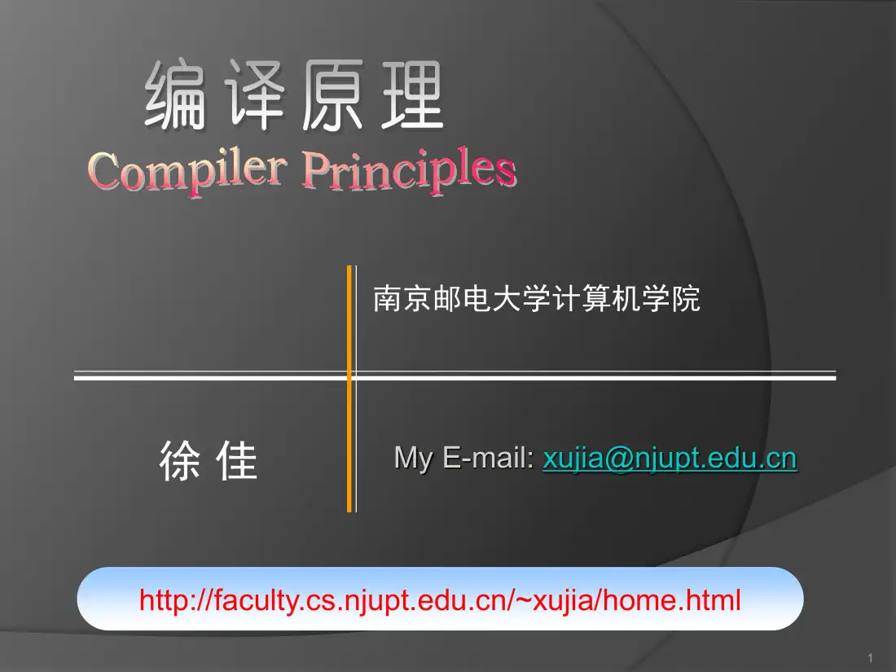

原文：

编译原理 Compiler Principles

南京邮电大学计算机学院

徐 佳

My E-mail: xujia@njupt.edu.cn

http://faculty.cs.njupt.edu.cn/\~xujia/home.html

1

### 第一章 概 述

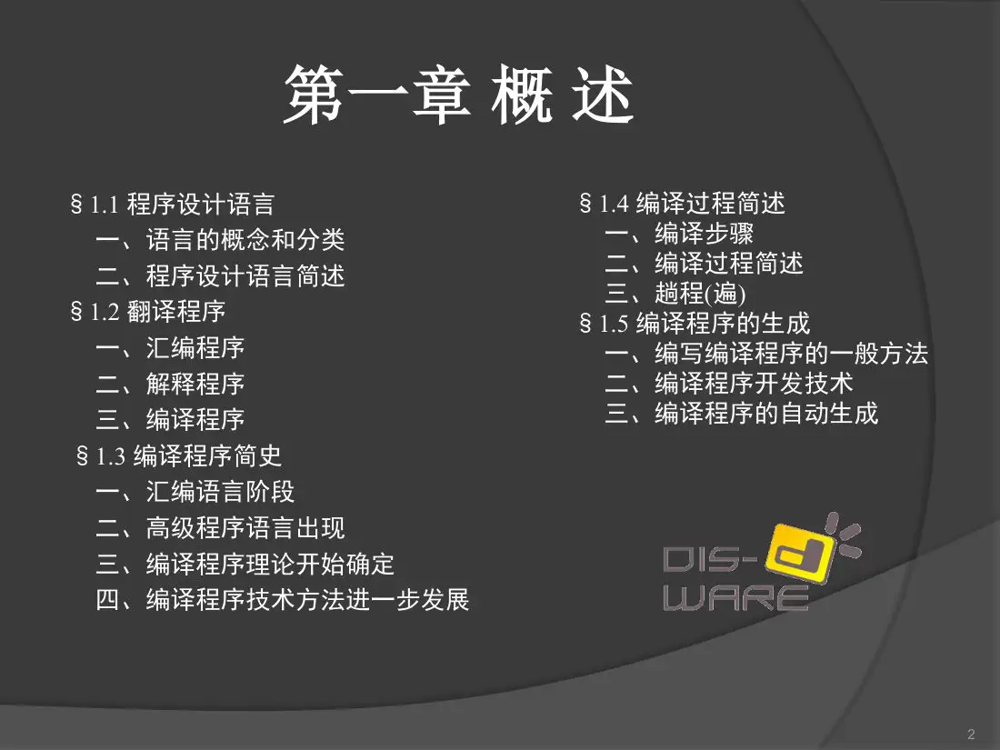

原文：

第一章 概 述

§ 1.1 程序设计语言
    一、语言的概念和分类
    二、程序设计语言简述
§ 1.2 翻译程序
    一、汇编程序
    二、解释程序
    三、编译程序
§ 1.3 编译程序简史
    一、汇编语言阶段
    二、高级程序语言出现
    三、编译程序理论开始确定
    四、编译程序技术方法进一步发展

§ 1.4 编译过程简述
    一、编译步骤
    二、编译过程简述
    三、趟程(遍)
§ 1.5 编译程序的生成
    一、编写编译程序的一般方法
    二、编译程序开发技术
    三、编译程序的自动生成

2

### 第一章 概 述

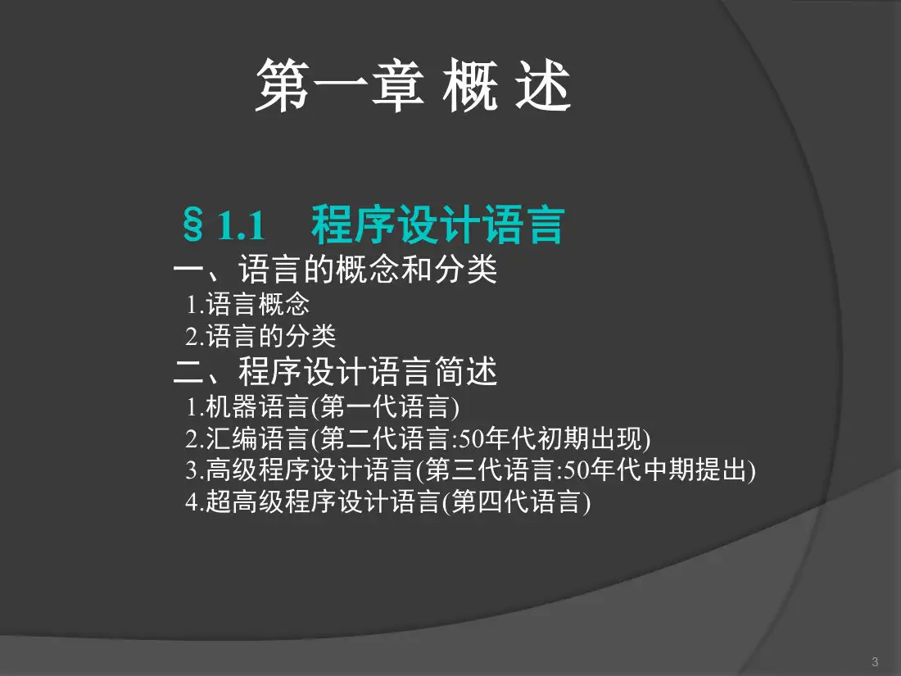

原文：

第一章 概 述

§1.1 程序设计语言

一、语言的概念和分类

1.语言概念

2.语言的分类

二、程序设计语言简述

1.机器语言(第一代语言)

2.汇编语言(第二代语言:50年代初期出现)

3.高级程序设计语言(第三代语言:50年代中期提出)

4.超高级程序设计语言(第四代语言)

3

### 第一章 概 述

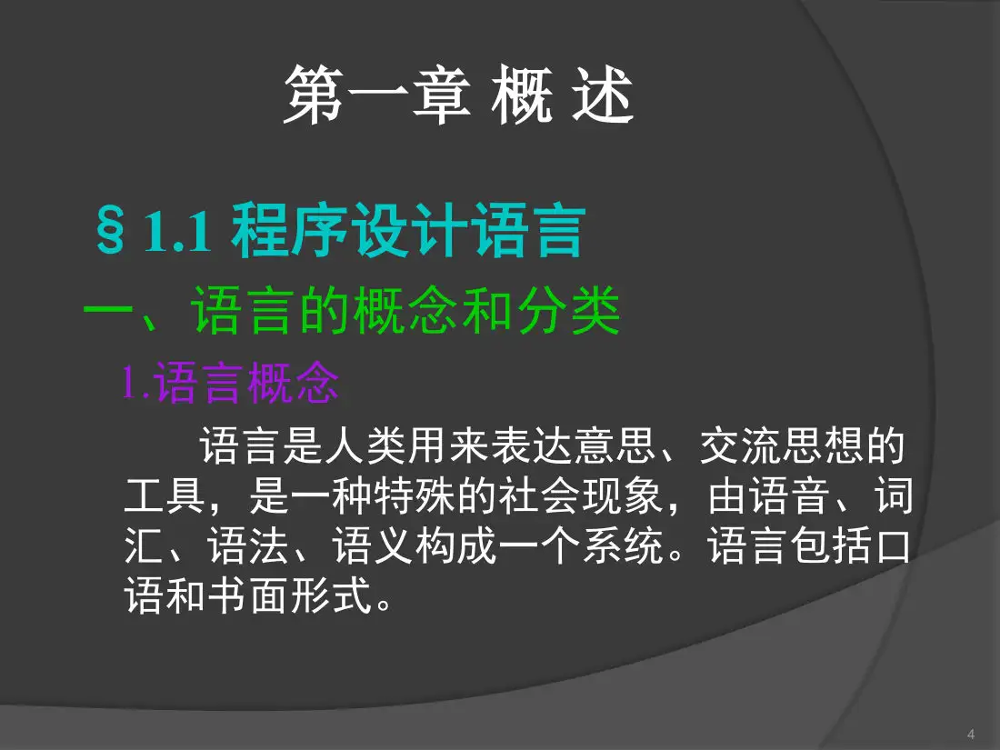

原文：

第一章 概 述

§1.1 程序设计语言语言的概念和分类

1.语言概念

语言是人类用来表达意思、交流思想的工具，是一种特殊的社会现象，由语音、词汇、语法、语义构成一个系统。语言包括口语和书面形式。

4

### 第一章 概 述

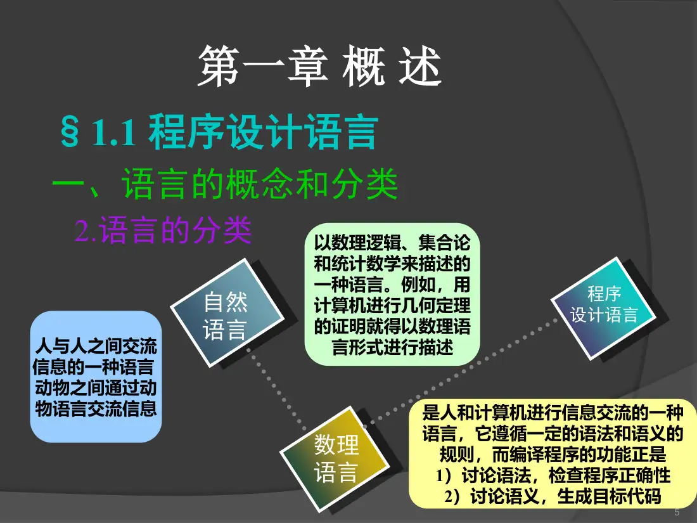

原文：

第一章 概 述

语言的概念和分类

2.语言的分类

人与人之间交流信息的一种语言动物之间通过动物语言交流信息自然语言

以数理逻辑、集合论和统计数学来描述的一种语言。例如，用计算机进行几何定理的证明就得以数理语言形式进行描述

程序设计语言

数理语言

是人和计算机进行信息交流的一种语言，它遵循一定的语法和语义的规则，而编译程序的功能正是

1）讨论语法，检查程序正确性

2）讨论语义，生成目标代码

5

### 第一章 概 述

原文：

第一章 概 述

§1.1 程序设计语言

一、语言的概念和分类

1.语言概念

2.语言的分类

二、程序设计语言简述

1.机器语言(第一代语言)

2.汇编语言(第二代语言:50年代初期出现)

3.高级程序设计语言(第三代语言:50年代中期提出)

4.超高级程序设计语言(第四代语言)

6

### 电子计算机之父

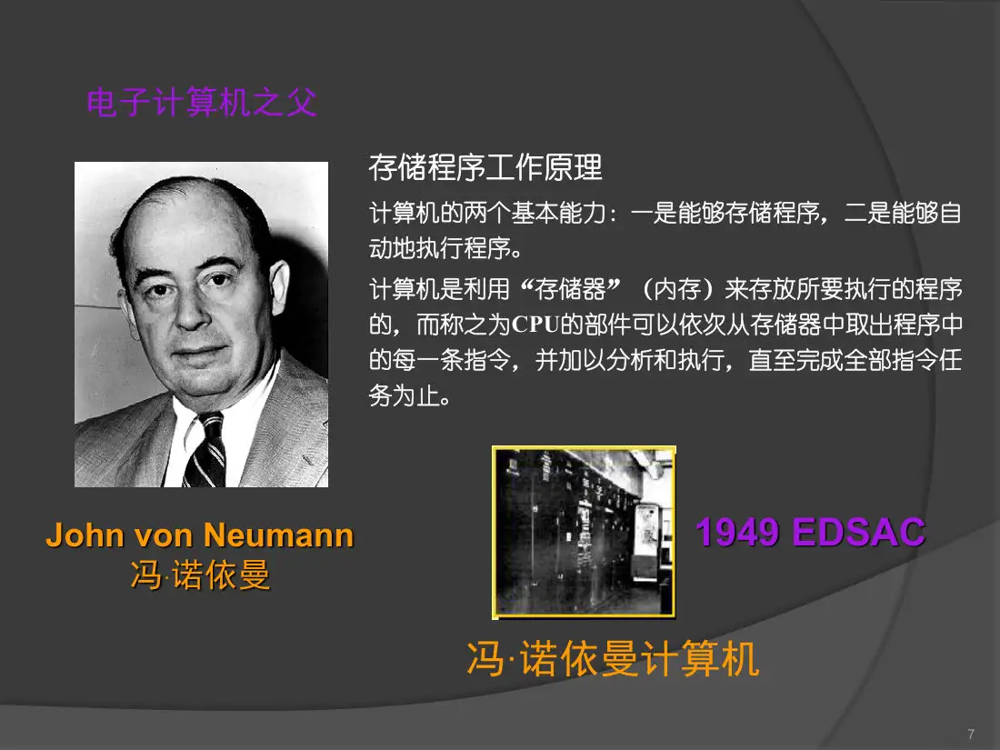

原文：

电子计算机之父

John von Neumann 冯·诺依曼

存储程序工作原理

计算机的两个基本能力：一是能够存储程序，二是能够自动地执行程序。

计算机是利用“存储器”（内存）来存放所要执行的程序的，而称之为CPU的部件可以依次从存储器中取出程序中的每一条指令，并加以分析和执行，直至完成全部指令任务为止。

1949 EDSAC

7

### §1.1 程序设计语言

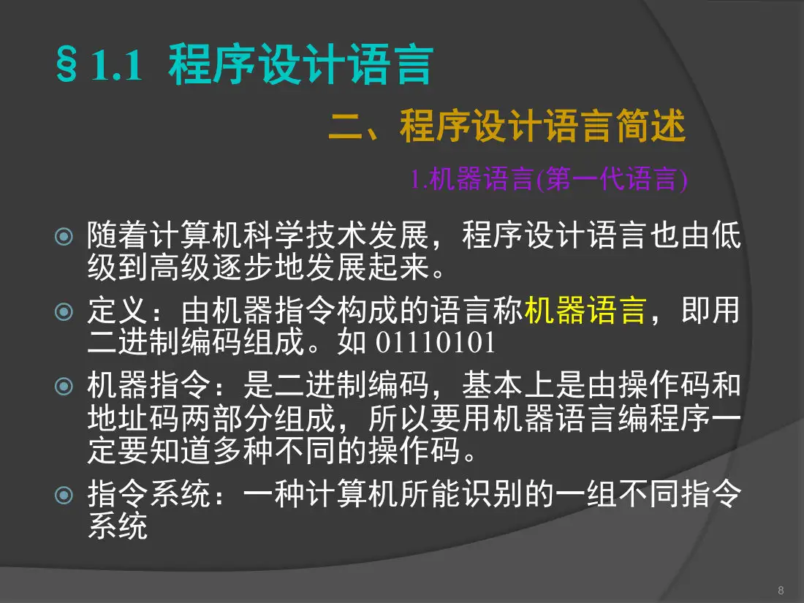

原文：

§1.1 程序设计语言

二、程序设计语言简述

1.机器语言(第一代语言)

随着计算机科学技术发展，程序设计语言也由低级到高级逐步地发展起来。

定义：由机器指令构成的语言称机器语言，即用二进制编码组成。如01110101

机器指令：是二进制编码，基本上是由操作码和地址码两部分组成，所以要用机器语言编程序定要知道多种不同的操作码。

 指令系统：一种计算机所能识别的一组不同指令系统

8

### §1.1 程序设计语言

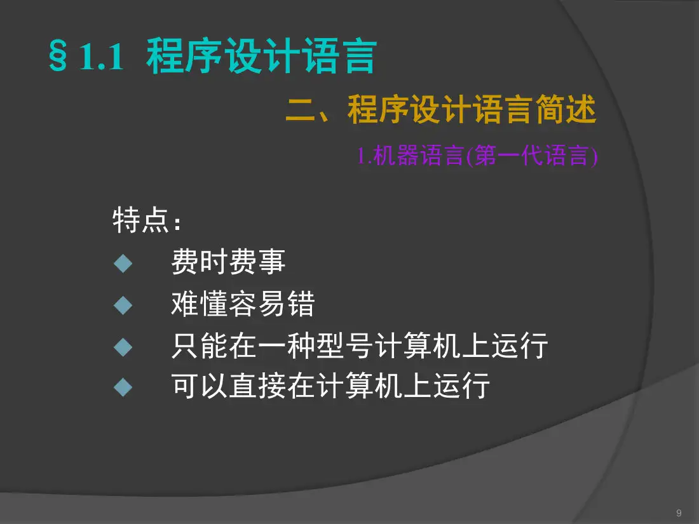

原文：

§1.1 程序设计语言

二、程序设计语言简述

1.机器语言(第一代语言)

特点：

费时费事

◆ 难懂容易错

◆ 只能在一种型号计算机上运行

◆ 可以直接在计算机上运行

9

### §1.1 程序设计语言

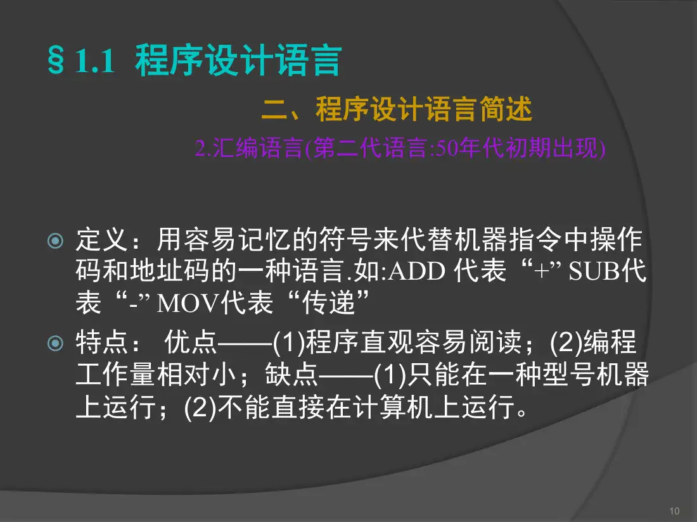

原文：

§1.1 程序设计语言

二、程序设计语言简述

2.汇编语言(第二代语言:50年代初期出现)

定义：用容易记忆的符号来代替机器指令中操作码和地址码的一种语言.如:ADD 代表“+” SUB代表“-” MOV代表“传递”

 特点： 优点——(1)程序直观容易阅读；(2)编程工作量相对小；缺点——(1)只能在一种型号机器上运行；(2)不能直接在计算机上运行。

10

### §1.1 程序设计语言

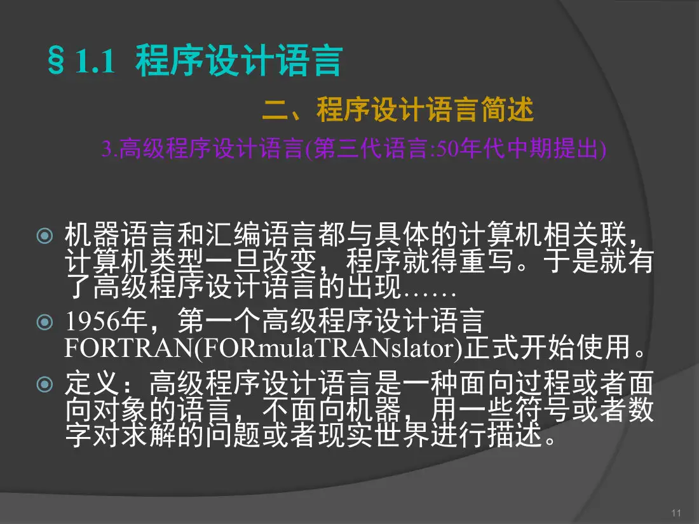

原文：

§1.1 程序设计语言

二、程序设计语言简述

3.高级程序设计语言(第三代语言:50年代中期提出)

 机器语言和汇编语言都与具体的计算机相关联，计算机类型一旦改变，程序就得重写。于是就有了高级程序设计语言的出现

 1956年，第一个高级程序设计语言FORTRAN(FORmulaTRANslator)正式开始使用。

 定义：高级程序设计语言是一种面向过程或者面向对象的语言，不面向机器，用一些符号或者数字对求解的问题或者现实世界进行描述。

11

### §1.1 程序设计语言

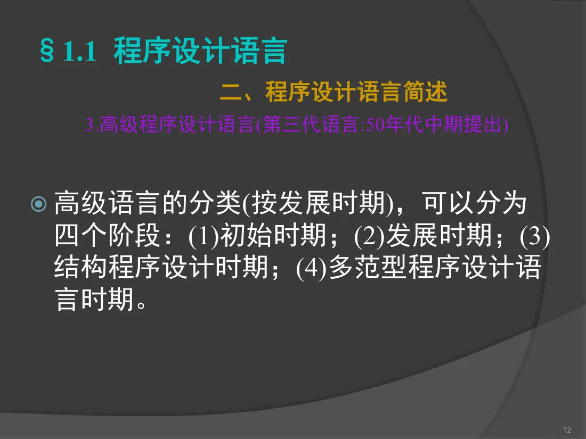

原文：

§1.1 程序设计语言

二、程序设计语言简述

3.高级程序设计语言(第三代语言:50年代中期提出)

高级语言的分类(按发展时期)，可以分为四个阶段：(1)初始时期；(2)发展时期；(3)结构程序设计时期；(4)多范型程序设计语言时期。

12

### 高级语言初始时期

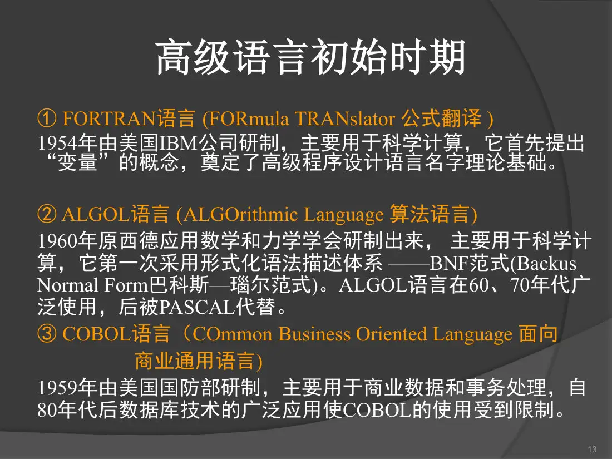

原文：

高级语言初始时期

① FORTRAN语言 (FORmula TRANslator 公式翻译 )1954年由美国IBM公司研制，主要用于科学计算，它首先提出“变量”的概念，奠定了高级程序设计语言名字理论基础。

② ALGOL语言 (ALGOrithmic Language 算法语言)

1960年原西德应用数学和力学学会研制出来， 主要用于科学计算，它第一次采用形式化语法描述体系——BNF范式(BackusNormal Form巴科斯—瑙尔范式)。ALGOL语言在60、70年代广泛使用，后被PASCAL代替。

③ COBOL语言（COmmon Business Oriented Language 面向商业通用语言)

1959年由美国国防部研制，主要用于商业数据和事务处理，自80年代后数据库技术的广泛应用使COBOL的使用受到限制。

13

### 高级语言发展时期(1/3)

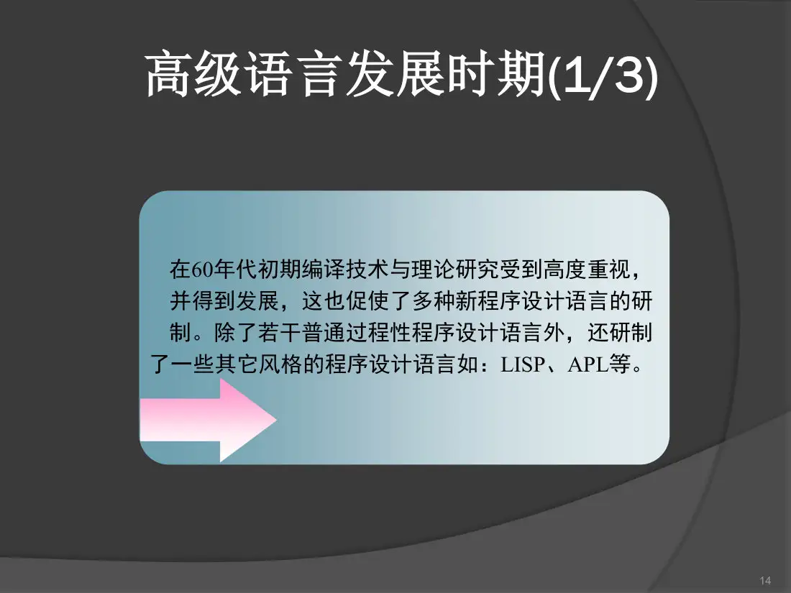

原文：

高级语言发展时期(1/3)

在60年代初期编译技术与理论研究受到高度重视，并得到发展，这也促使了多种新程序设计语言的研制。除了若干普通过程性程序设计语言外，还研制了一些其它风格的程序设计语言如：LISP、APL等。

14

### 高级语言发展时期(2/3)

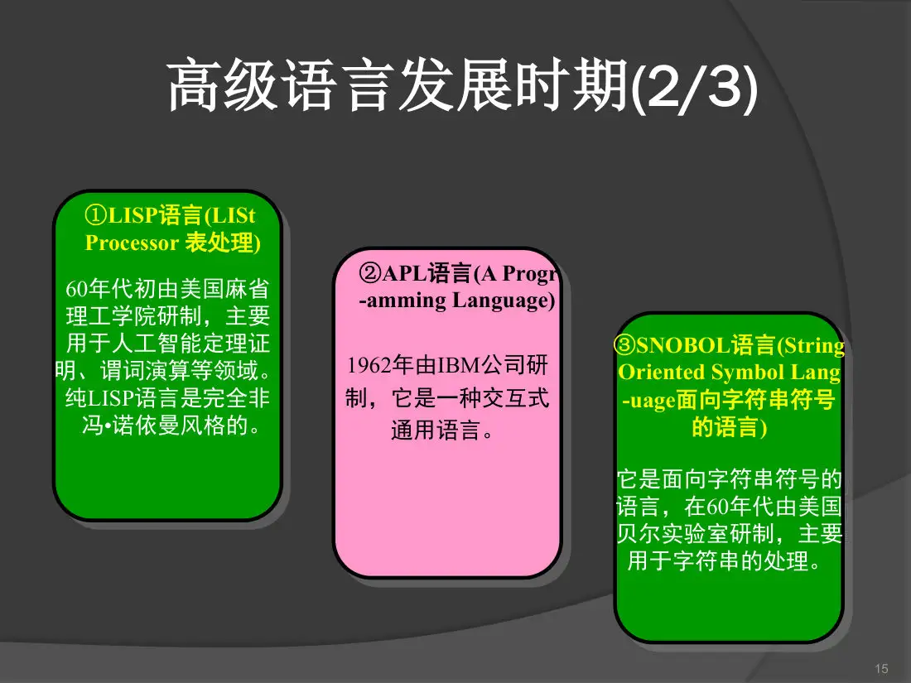

原文：

高级语言发展时期(2/3)

①LISP语言(LIStProcessor 表处理)

60年代初由美国麻省理工学院研制，主要用于人工智能定理证明、谓词演算等领域。纯LISP语言是完全非冯•诺依曼风格的。

②APL语言(A Progr -amming Language)

1962年由IBM公司研制，它是一种交互式通用语言。

③SNOBOL语言(String Oriented Symbol Lang -uage面向字符串符号 的语言)

它是面向字符串符号的语言，在60年代由美国贝尔实验室研制，主要用于字符串的处理。

15

### 高级语言发展时期(3/3)

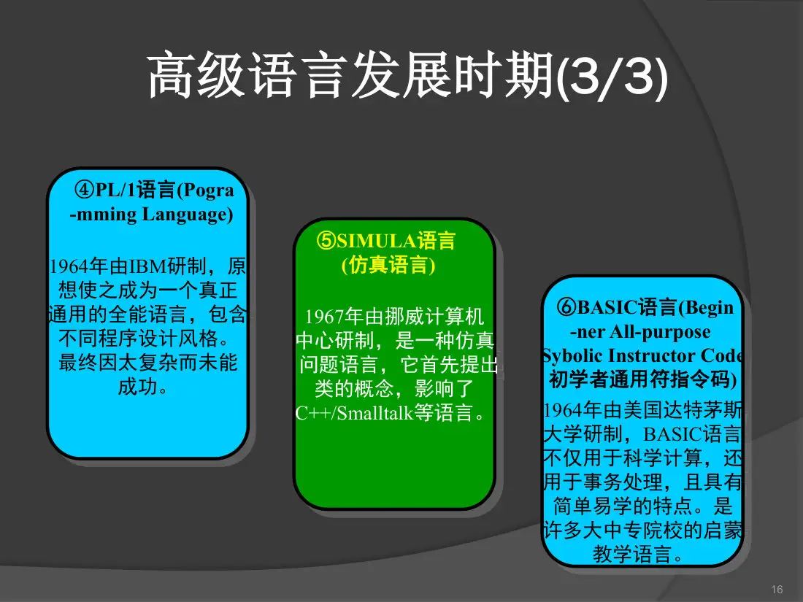

原文：

高级语言发展时期(3/3)

④PL/1语言(Pogra -mming Language)

1964年由IBM研制，原想使之成为一个真正通用的全能语言，包含不同程序设计风格。最终因太复杂而未能成功。

⑤SIMULA语言 (仿真语言)

1967年由挪威计算机中心研制，是一种仿真问题语言，它首先提出类的概念，影响了C++/Smalltalk等语言。

⑥BASIC语言(Begin-ner All-purposeSybolic Instructor Code初学者通用符指令码)1964年由美国达特茅斯大学研制，BASIC语言不仅用于科学计算，还用于事务处理，且具有简单易学的特点。是许多大中专院校的启蒙教学语言。

16

### 结构程序设计时期(1/3)

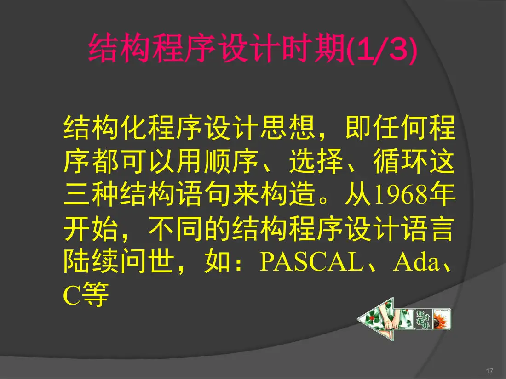

原文：

结构程序设计时期(1/3)

结构化程序设计思想，即任何程序都可以用顺序、选择、循环这三种结构语句来构造。从1968年开始，不同的结构程序设计语言陆续问世，如：PASCAL、Ada、C等

BY MENG

17

### 结构程序设计时期(2/3)

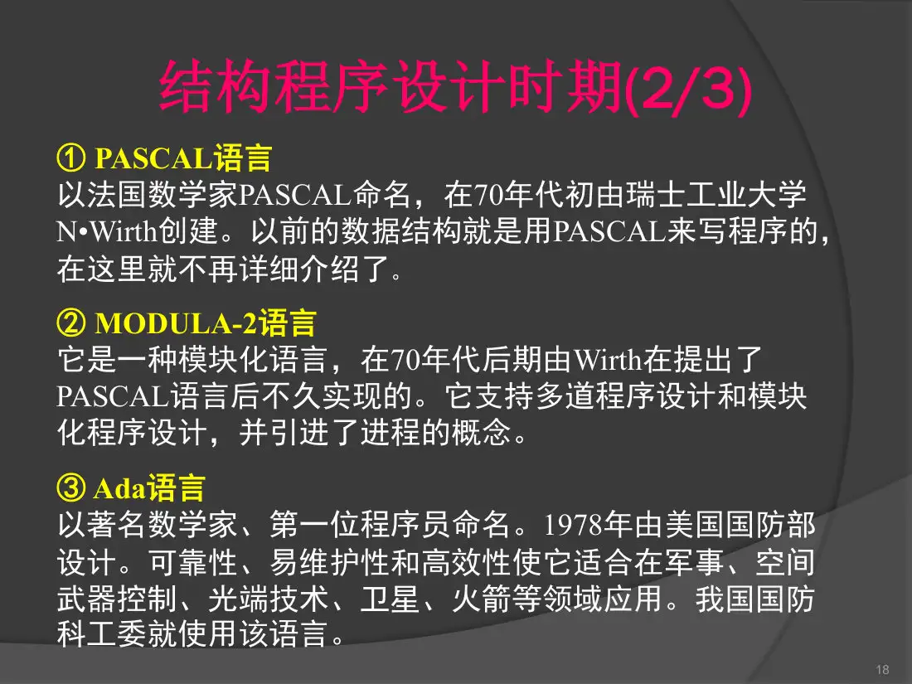

原文：

结构程序设计时期(2/3)

① PASCAL语言以法国数学家PASCAL命名，在70年代初由瑞士工业大学N•Wirth创建。以前的数据结构就是用PASCAL来写程序的，在这里就不再详细介绍了。

② MODULA-2语言它是一种模块化语言，在70年代后期由Wirth在提出了PASCAL语言后不久实现的。它支持多道程序设计和模块化程序设计，并引进了进程的概念。

③ Ada语言

以著名数学家、第一位程序员命名。1978年由美国国防部设计。可靠性、易维护性和高效性使它适合在军事、空间武器控制、光端技术、卫星、火箭等领域应用。我国国防科工委就使用该语言。

18

### 结构程序设计时期(3/3)

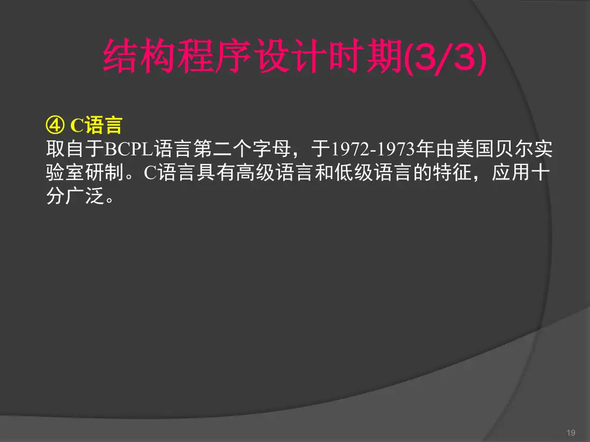

原文：

结构程序设计时期(3/3)

取自于BCPL语言第二个字母，于1972-1973年由美国贝尔实验室研制。C语言具有高级语言和低级语言的特征，应用十分广泛。

19

### 多范型程序设计语言时期(1/4)

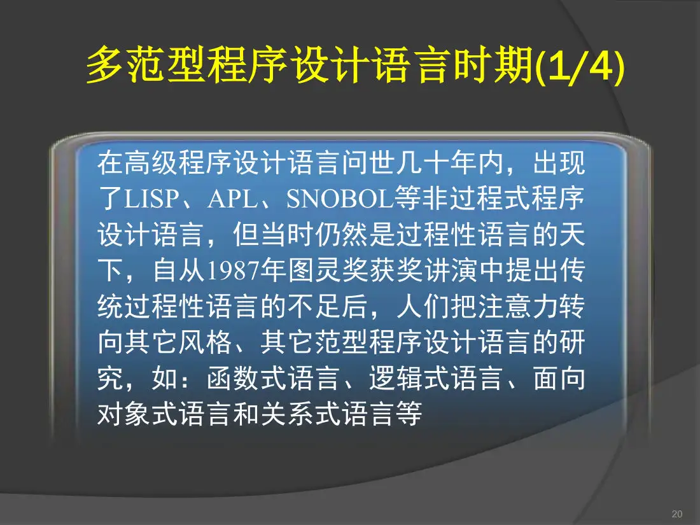

原文：

多范型程序设计语言时期(1/4)

在高级程序设计语言问世几十年内，出现了LISP、APL、SNOBOL等非过程式程序设计语言，但当时仍然是过程性语言的天下，自从1987年图灵奖获奖讲演中提出传统过程性语言的不足后，人们把注意力转向其它风格、其它范型程序设计语言的研究，如：函数式语言、逻辑式语言、面向对象式语言和关系式语言等

20

### 多范型程序设计语言时期(2/4)

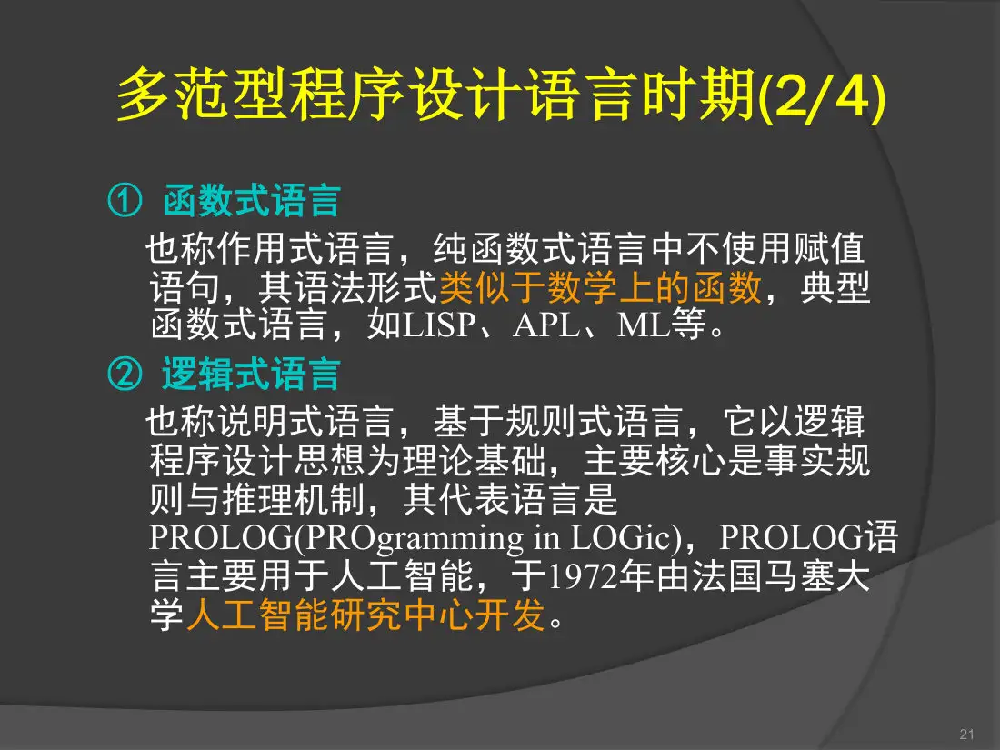

原文：

多范型程序设计语言时期(2/4)

函数式语言也称作用式语言，纯函数式语言中不使用赋值语句，其语法形式类似于数学上的函数，典型函数式语言，如LISP、APL、ML等。

逻辑式语言也称说明式语言，基于规则式语言，它以逻辑程序设计思想为理论基础，主要核心是事实规则与推理机制，其代表语言是PROLOG(PROgramming in LOGic)，PROLOG语言主要用于人工智能，于1972年由法国马塞大学人工智能研究中心开发。

21

### 多范型程序设计语言时期(3/4)

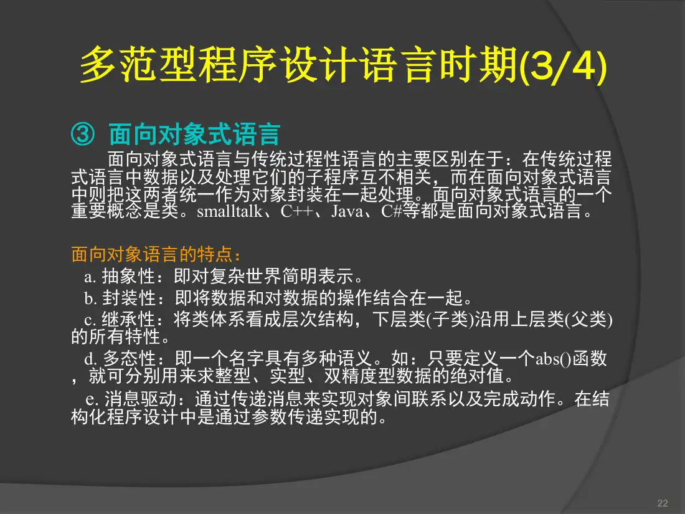

原文：

多范型程序设计语言时期(3/4)

③ 面向对象式语言

面向对象式语言与传统过程性语言的主要区别在于：在传统过程式语言中数据以及处理它们的子程序互不相关，而在面向对象式语言中则把这两者统一作为对象封装在一起处理。面向对象式语言的一个重要概念是类。smalltalk、C++、Java、C#等都是面向对象式语言。

面向对象语言的特点：

a. 抽象性：即对复杂世界简明表示。

b. 封装性：即将数据和对数据的操作结合在一起。

c. 继承性：将类体系看成层次结构，下层类(子类)沿用上层类(父类)的所有特性。

d. 多态性：即一个名字具有多种语义。如：只要定义一个abs()函数，就可分别用来求整型、实型、双精度型数据的绝对值。

e. 消息驱动：通过传递消息来实现对象间联系以及完成动作。在结构化程序设计中是通过参数传递实现的。

22

### 多范型程序设计语言时期(4/4)

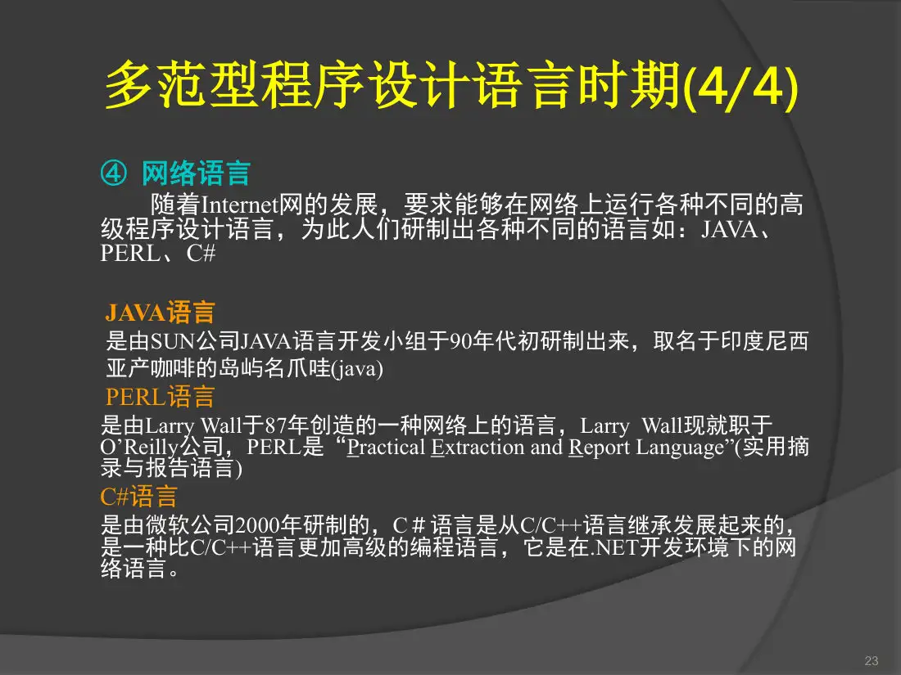

原文：

多范型程序设计语言时期(4/4)

网络语言

随着Internet网的发展，要求能够在网络上运行各种不同的高级程序设计语言，为此人们研制出各种不同的语言如：JAVA、PERL、C#

JAVA语言是由SUN公司JAVA语言开发小组于90年代初研制出来，取名于印度尼西亚产咖啡的岛屿名爪哇(java)PERL语言

是由Larry Wall于87年创造的一种网络上的语言，Larry Wall现就职于O’Reilly公司，PERL是“Practical Extraction and Report Language”(实用摘录与报告语言)

C#语言

是由微软公司2000年研制的，C＃语言是从C/C++语言继承发展起来的，是一种比C/C++语言更加高级的编程语言，它是在.NET开发环境下的网络语言。

23

### §1.1 程序设计语言

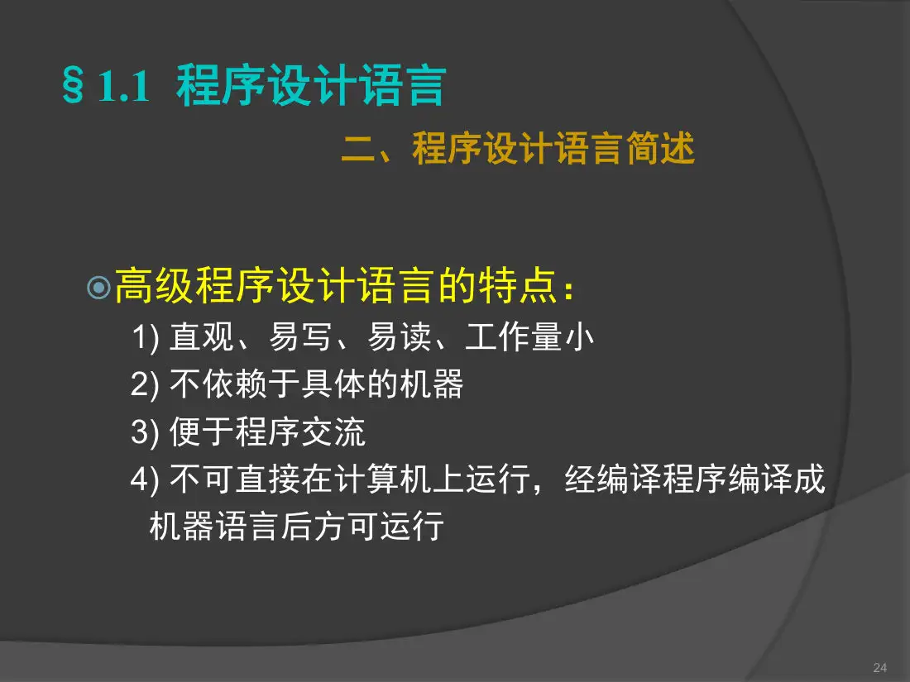

原文：

§1.1 程序设计语言

二、程序设计语言简述

高级程序设计语言的特点：

1) 直观、易写、易读、工作量小

2) 不依赖于具体的机器

3) 便于程序交流

4) 不可直接在计算机上运行，经编译程序编译成机器语言后方可运行

24

### §1.1 程序设计语言

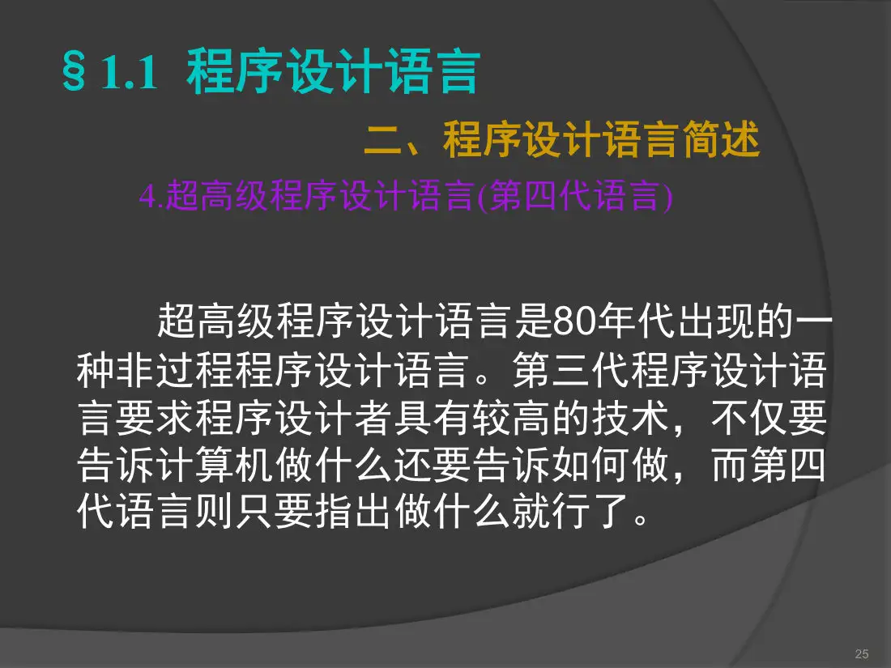

原文：

§1.1 程序设计语言

二、程序设计语言简述

4.超高级程序设计语言(第四代语言)

超高级程序设计语言是80年代出现的一种非过程程序设计语言。第三代程序设计语言要求程序设计者具有较高的技术，不仅要告诉计算机做什么还要告诉如何做，而第四代语言则只要指出做什么就行了。

25

### 超高级程序设计语言时期

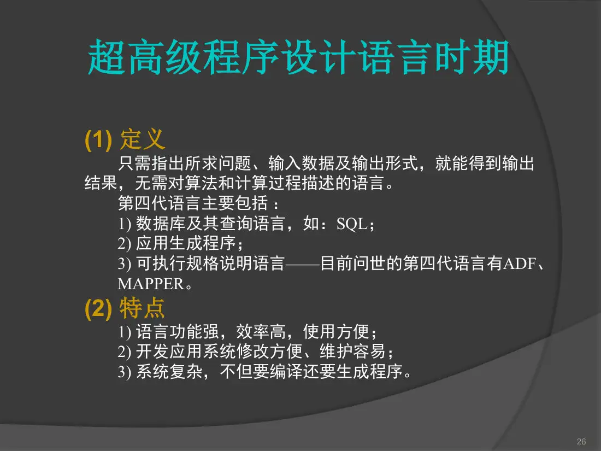

原文：

超高级程序设计语言时期

(1) 定义

只需指出所求问题、输入数据及输出形式，就能得到输出结果，无需对算法和计算过程描述的语言。

第四代语言主要包括 ：

1) 数据库及其查询语言，如：SQL；

2) 应用生成程序；

3) 可执行规格说明语言— —目前问世的第四代语言有ADF、MAPPER。

(2) 特点

1) 语言功能强，效率高，使用方便；

2) 开发应用系统修改方便、维护容易；

3) 系统复杂，不但要编译还要生成程序。

26

### 程序设计语言总结

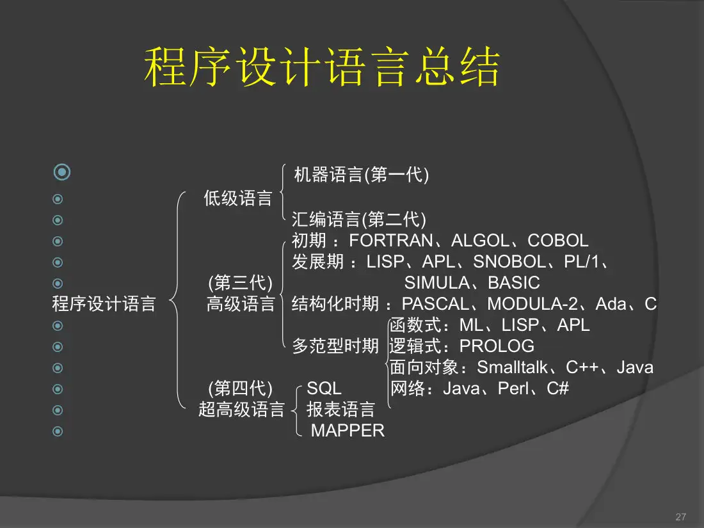

原文：

程序设计语言总结

机器语言(第一代)

低级语言

汇编语言(第二代)

初期 ：FORTRAN、ALGOL、COBOL

发展期 ：LISP、APL、SNOBOL、PL/1、

程序设计语言

(第三代)

SIMULA、BASIC

高级语言

结构化时期 ：PASCAL、MODULA-2、Ada、C

函数式：ML、LISP、APL

多范型时期

逻辑式：PROLOG

面向对象：Smalltalk、C++、Java

(第四代)

超高级语言

SQL

网络：Java、Perl、C#

报表语言

MAPPER

27

### 第一章 概 述

原文：

第一章 概 述

§ 1.1 程序设计语言
    一、语言的概念和分类
    二、程序设计语言简述
§ 1.2 翻译程序
    一、汇编程序
    二、解释程序
    三、编译程序
§ 1.3 编译程序简史
    一、汇编语言阶段
    二、高级程序语言出现
    三、编译程序理论开始确定
    四、编译程序技术方法进一步发展

§ 1.4 编译过程简述
    一、编译步骤
    二、编译过程简述
    三、趟程(遍)
§ 1.5 编译程序的生成
    一、编写编译程序的一般方法
    二、编译程序开发技术
    三、编译程序的自动生成

28

### 第一章 概 述

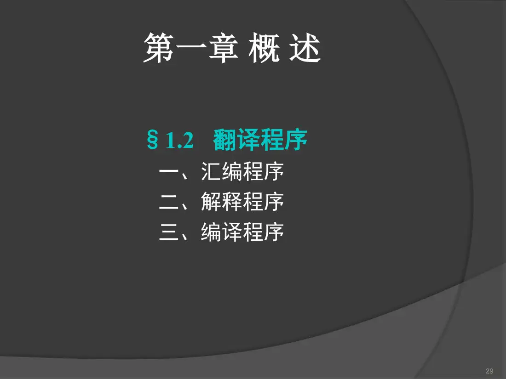

原文：

第一章 概 述

§1.2 翻译程序

一、汇编程序

二、解释程序

三、编译程序

29

###  §1.2 翻译程序

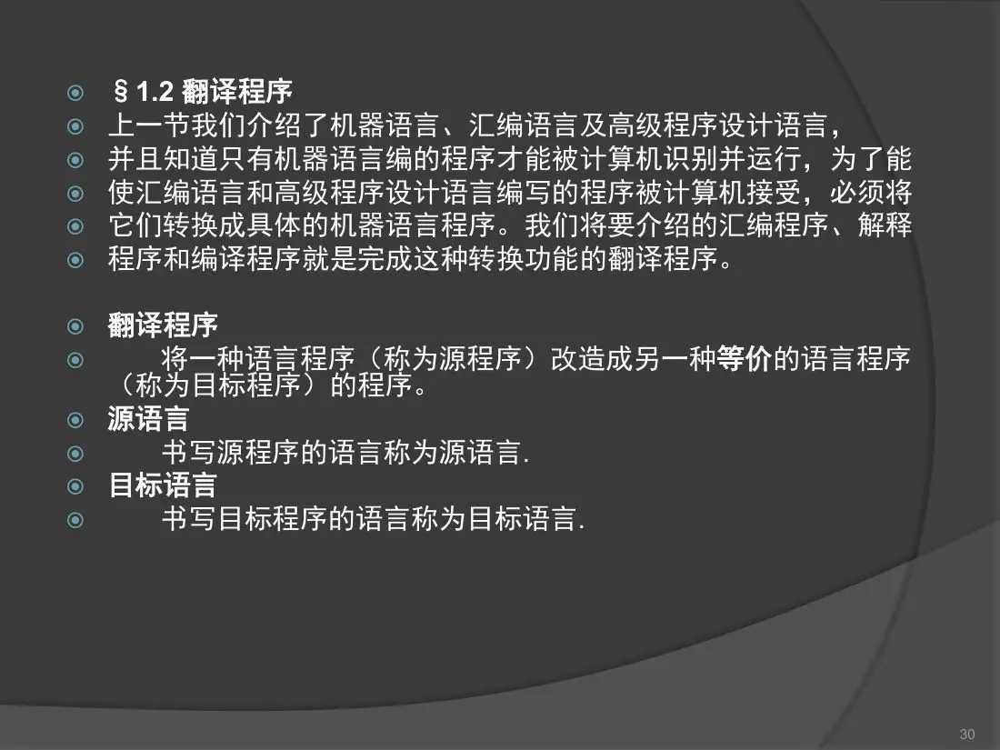

原文：

 §1.2 翻译程序

 上一节我们介绍了机器语言、汇编语言及高级程序设计语言，

 并且知道只有机器语言编的程序才能被计算机识别并运行，为了能

 使汇编语言和高级程序设计语言编写的程序被计算机接受，必须将

 它们转换成具体的机器语言程序。我们将要介绍的汇编程序、解释

 程序和编译程序就是完成这种转换功能的翻译程序。

 翻译程序

将一种语言程序（称为源程序）改造成另一种等价的语言程序（称为目标程序）的程序。

 源语言

书写源程序的语言称为源语言.

 目标语言

书写目标程序的语言称为目标语言.

30

### §1.2 翻译程序

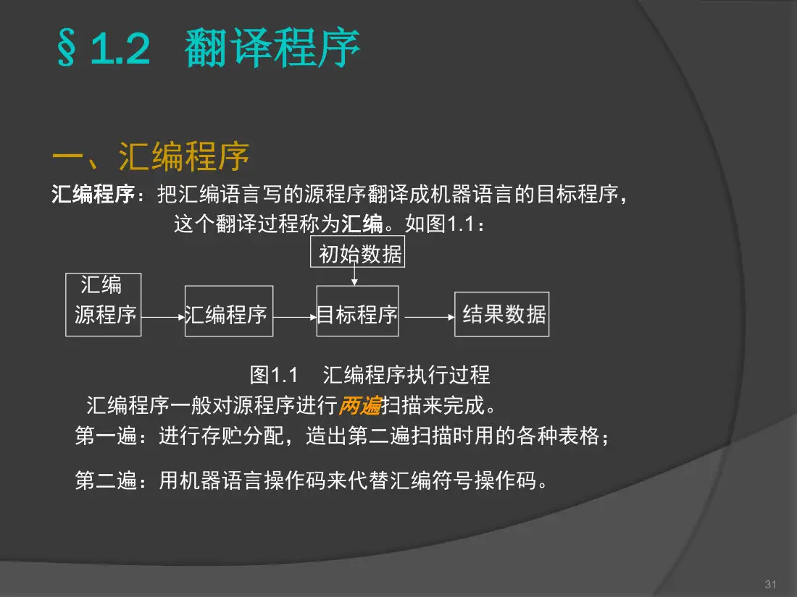

原文：

§1.2 翻译程序

汇编程序

汇编程序：把汇编语言写的源程序翻译成机器语言的目标程序，这个翻译过程称为汇编。如图1.1：

初始数据

汇编源程序汇编程序

目标程序

结果数据

图1.1 汇编程序执行过程

汇编程序一般对源程序进行两遍扫描来完成。

第一遍：进行存贮分配，造出第二遍扫描时用的各种表格；

第二遍：用机器语言操作码来代替汇编符号操作码。

31

### §1.2 翻译程序

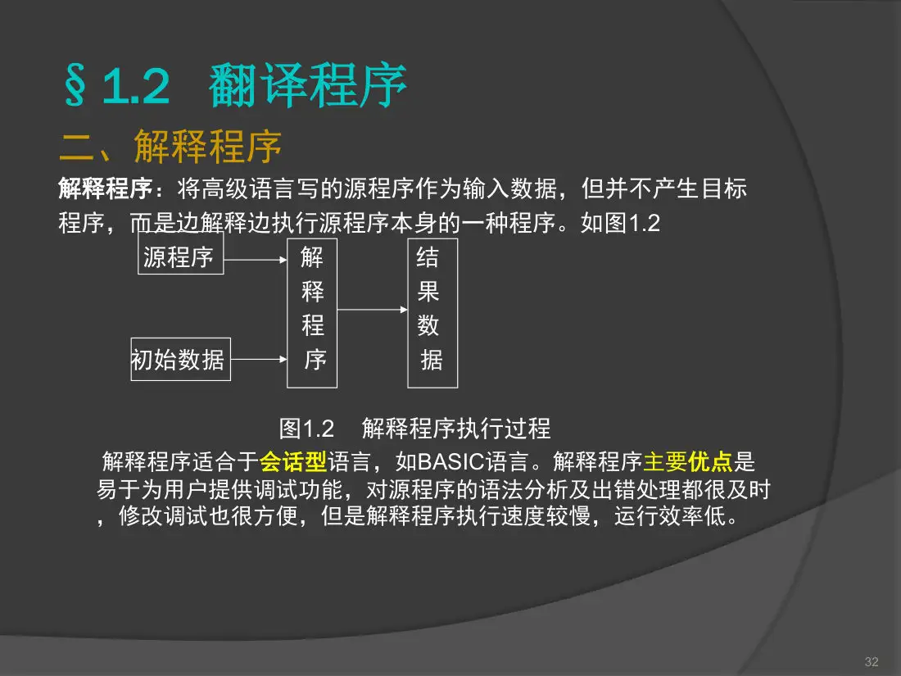

原文：

§1.2 翻译程序

二、解释程序

解释程序：将高级语言写的源程序作为输入数据，但并不产生目标程序，而是边解释边执行源程序本身的一种程序。如图1.2

源程序

初始数据

图1.2 解释程序执行过程

解释程序适合于会话型语言，如BASIC语言。解释程序主要优点是易于为用户提供调试功能，对源程序的语法分析及出错处理都很及时，修改调试也很方便，但是解释程序执行速度较慢，运行效率低。

32

### §1.2 翻译程序

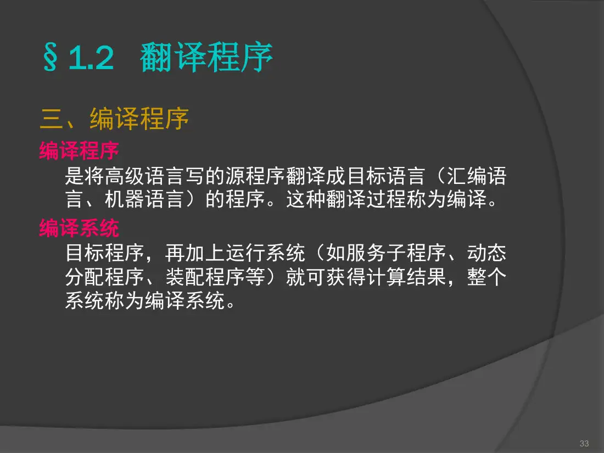

原文：

§1.2 翻译程序

三、编译程序

编译程序

是将高级语言写的源程序翻译成目标语言（汇编语言、机器语言）的程序。这种翻译过程称为编译。

编译系统

目标程序，再加上运行系统（如服务子程序、动态分配程序、装配程序等）就可获得计算结果，整个系统称为编译系统。

33

### 编译程序执行过程

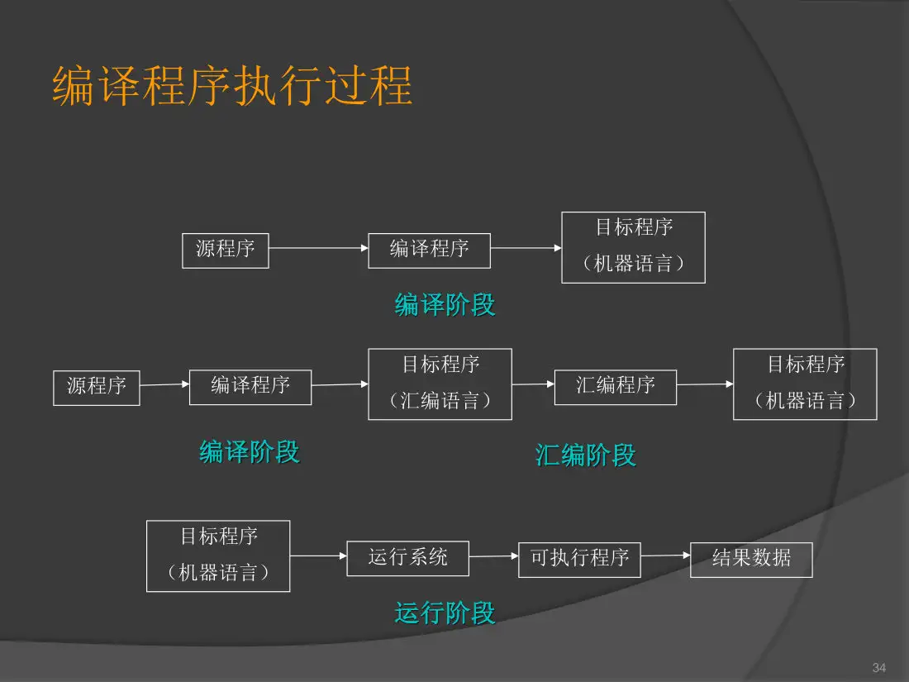

原文：

编译程序执行过程

源程序

编译程序

目标程序

（机器语言）

编译阶段

源程序

编译程序

目标程序

（汇编语言）

目标程序

汇编程序

（机器语言）

编译阶段

汇编阶段

目标程序

（机器语言）

运行系统

可执行程序

结果数据

运行阶段

34

### 35

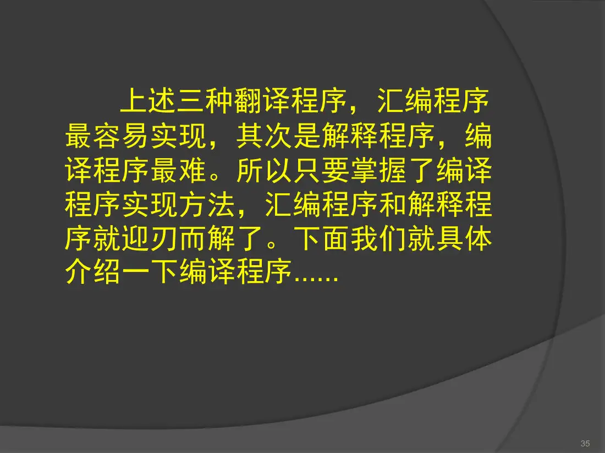

原文：

上述三种翻译程序，汇编程序最容易实现，其次是解释程序，编译程序最难。所以只要掌握了编译程序实现方法，汇编程序和解释程序就迎刃而解了。下面我们就具体介绍一下编译程序……

35

### 第一章 概 述

原文：

第一章 概 述

§ 1.1 程序设计语言
一、语言的概念和分类
二、程序设计语言简述
§ 1.2 翻译程序
一、汇编程序
二、解释程序
三、编译程序
§ 1.3 编译程序简史
一、汇编语言阶段
二、高级程序语言出现
三、编译程序理论开始确定
四、编译程序技术方法进一步发展
§ 1.4 编译过程简述
一、编译步骤
二、编译过程简述
三、趟程(遍)
§ 1.5 编译程序的生成
一、编写编译程序的一般方法
二、编译程序开发技术
三、编译程序的自动生成

36

### 第一章 概 述

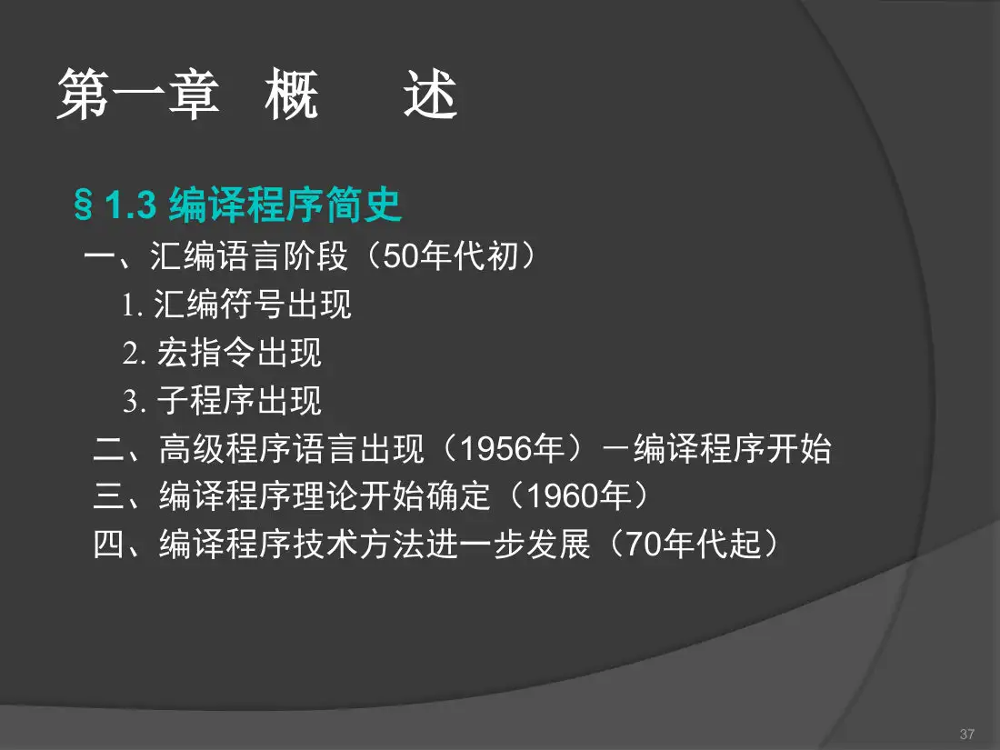

原文：

第一章 概 述

§1.3 编译程序简史

一、汇编语言阶段（50年代初）

1. 汇编符号出现

2. 宏指令出现

3. 子程序出现

二、高级程序语言出现（1956年）－编译程序开始

三、编译程序理论开始确定（1960年）

四、编译程序技术方法进一步发展（70年代起）

37

### §1.3 编译程序简史

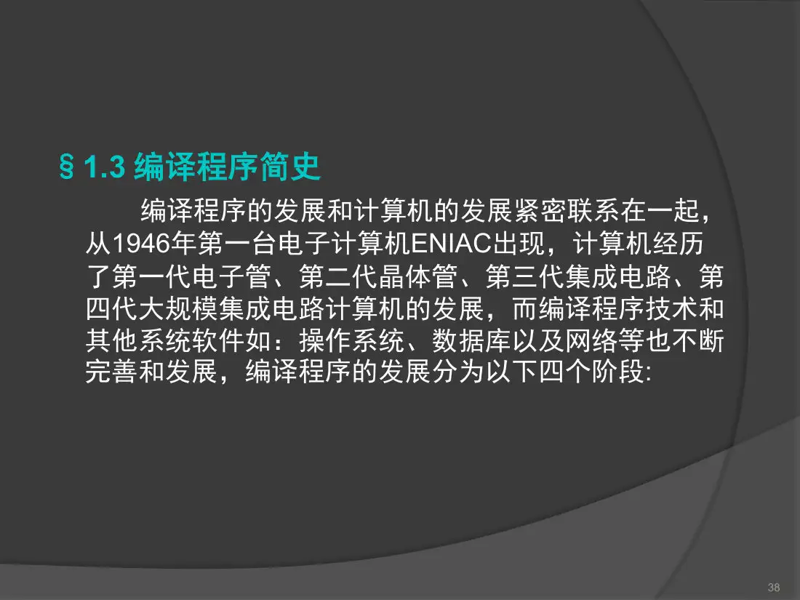

原文：

§1.3 编译程序简史

编译程序的发展和计算机的发展紧密联系在一起，从1946年第一台电子计算机ENIAC出现，计算机经历了第一代电子管、第二代晶体管、第三代集成电路、第四代大规模集成电路计算机的发展，而编译程序技术和其他系统软件如：操作系统、数据库以及网络等也不断完善和发展，编译程序的发展分为以下四个阶段:

38

### §1.3 编译程序简史

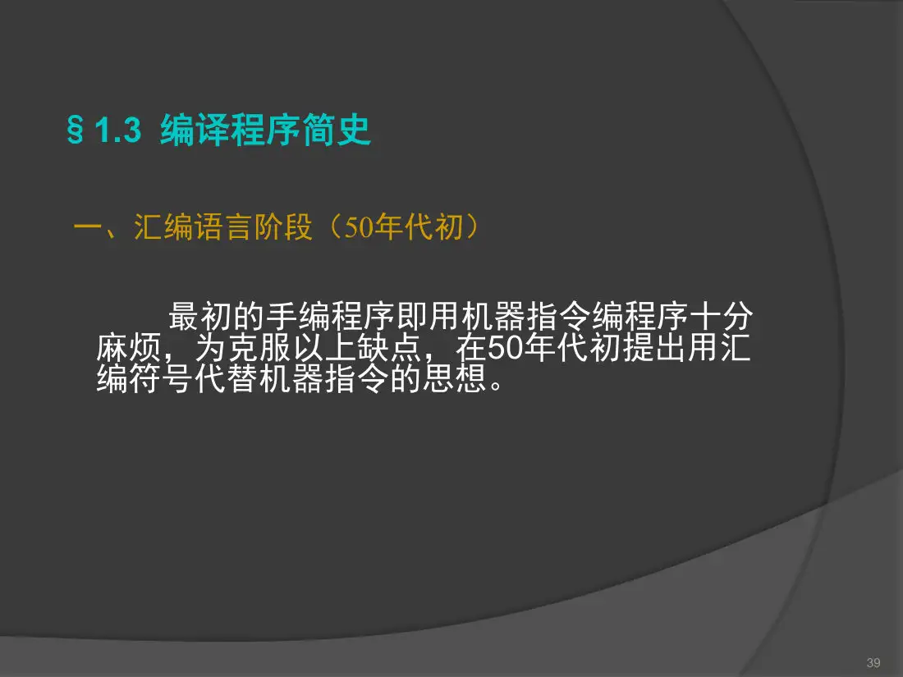

原文：

§1.3 编译程序简史

汇编语言阶段（50年代初）

最初的手编程序即用机器指令编程序十分麻烦，为克服以上缺点，在50年代初提出用汇编符号代替机器指令的思想。

39

### §1.3 编译程序简史

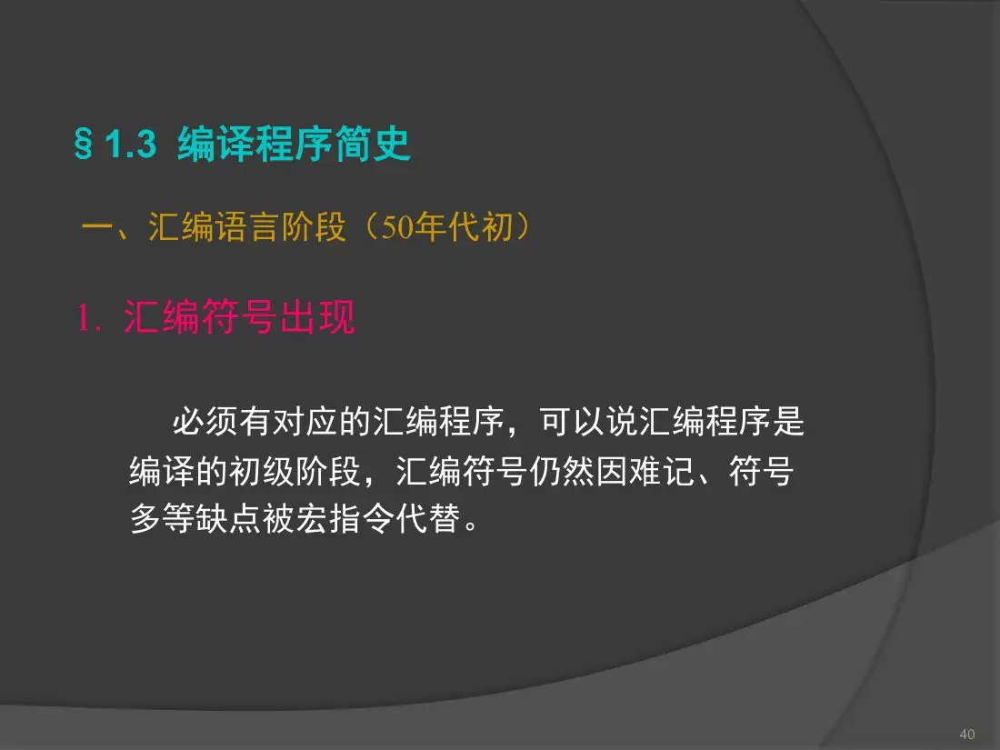

原文：

§1.3 编译程序简史

汇编语言阶段（50年代初）

1. 汇编符号出现

必须有对应的汇编程序，可以说汇编程序是编译的初级阶段，汇编符号仍然因难记、符号多等缺点被宏指令代替。

40

### §1.3 编译程序简史

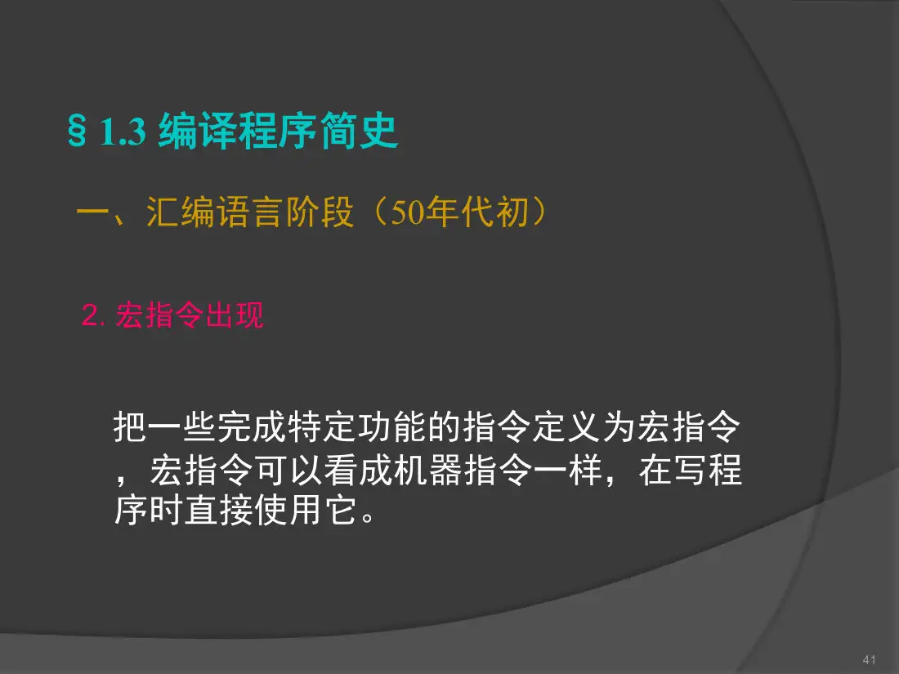

原文：

§1.3 编译程序简史

汇编语言阶段（50年代初）

2. 宏指令出现

把一些完成特定功能的指令定义为宏指令宏指令可以看成机器指令一样，在写程序时直接使用它。

41

### §1.3 编译程序简史

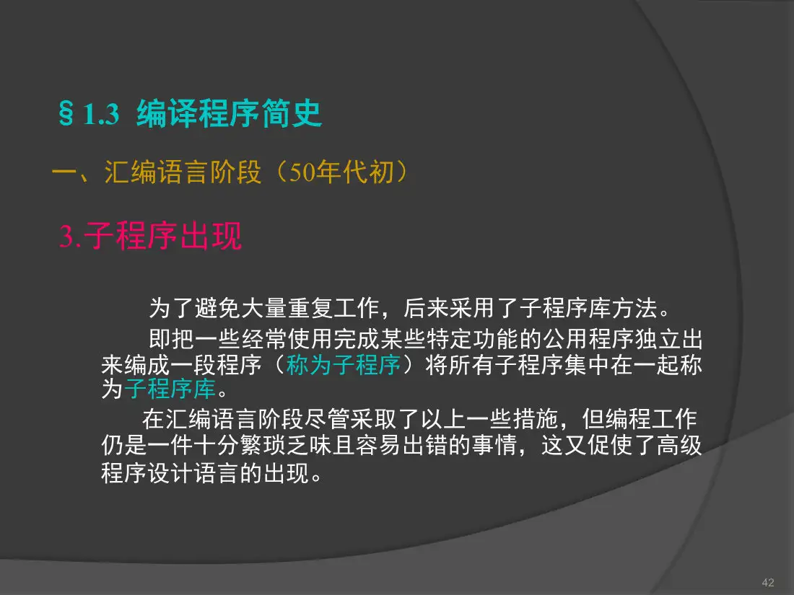

原文：

§1.3 编译程序简史

一、 汇编语言阶段（50年代初）

3.子程序出现

为了避免大量重复工作，后来采用了子程序库方法。

即把一些经常使用完成某些特定功能的公用程序独立出来编成一段程序（称为子程序）将所有子程序集中在一起称为子程序库。

在汇编语言阶段尽管采取了以上一些措施，但编程工作仍是一件十分繁琐乏味且容易出错的事情，这又促使了高级程序设计语言的出现。

42

### §1.3 编译程序简史

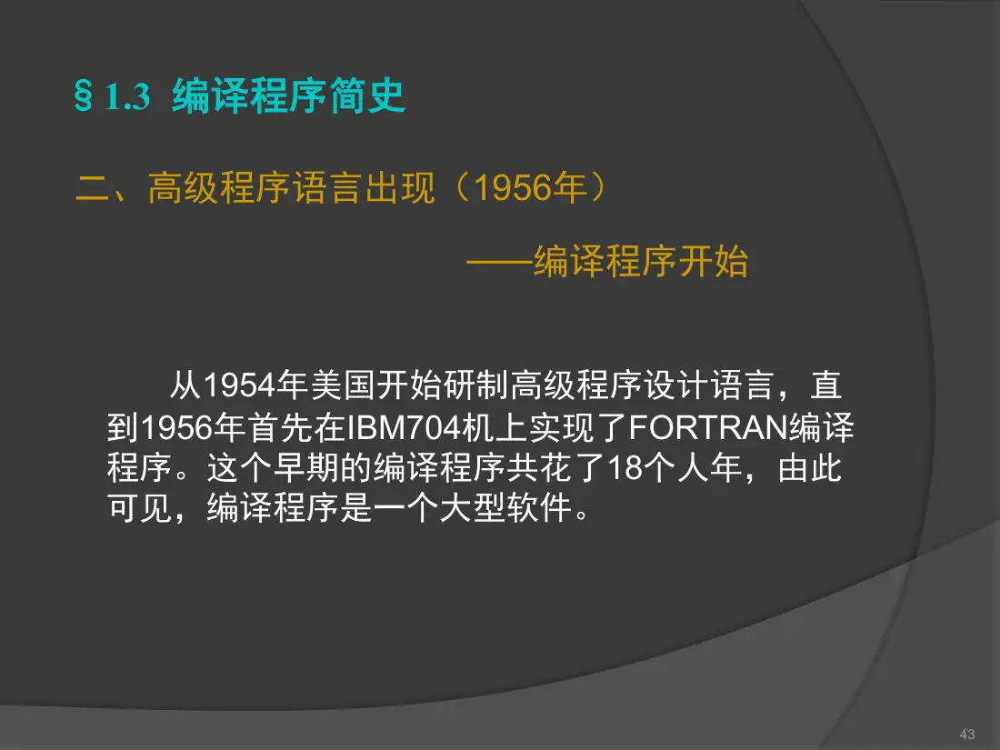

原文：

§1.3 编译程序简史

二、高级程序语言出现（1956年）

编译程序开始

从1954年美国开始研制高级程序设计语言，直到1956年首先在IBM704机上实现了FORTRAN编译程序。这个早期的编译程序共花了18个人年，由此可见，编译程序是一个大型软件。

43

### §1.3 编译程序简史

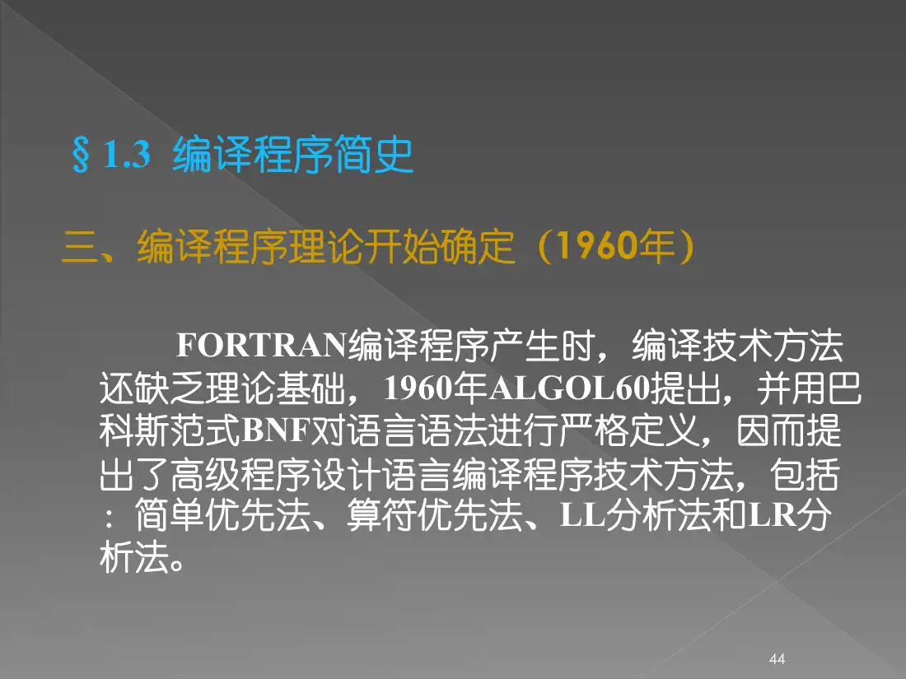

原文：

§1.3 编译程序简史

三、编译程序理论开始确定（1960年）

FORTRAN编译程序产生时，编译技术方法还缺乏理论基础，1960年ALGOL60提出，并用巴科斯范式BNF对语言语法进行严格定义，因而提出了高级程序设计语言编译程序技术方法，包括：简单优先法、算符优先法、LL分析法和LR分析法。

44

### §1.3 编译程序简史四、编译程序技术方法进一步发展（70年代起）

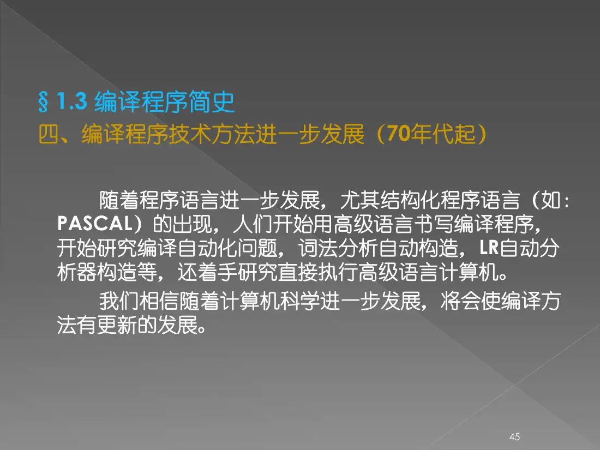

原文：

§1.3 编译程序简史四、编译程序技术方法进一步发展（70年代起）

随着程序语言进一步发展，尤其结构化程序语言（如：PASCAL）的出现，人们开始用高级语言书写编译程序，开始研究编译自动化问题，词法分析自动构造，LR自动分析器构造等，还着手研究直接执行高级语言计算机。

我们相信随着计算机科学进一步发展，将会使编译方法有更新的发展。

45

### 第一章 概 述

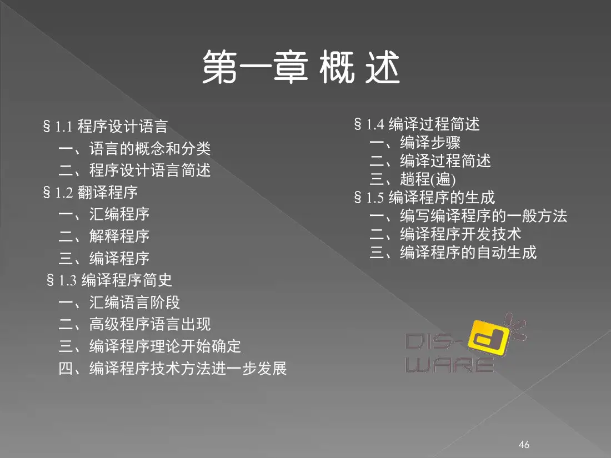

原文：

第一章 概 述

§ 1.1 程序设计语言
    一、语言的概念和分类
    二、程序设计语言简述
§ 1.2 翻译程序
    一、汇编程序
    二、解释程序
    三、编译程序
§ 1.3 编译程序简史
    一、汇编语言阶段
    二、高级程序语言出现
    三、编译程序理论开始确定
    四、编译程序技术方法进一步发展

§ 1.4 编译过程简述
    一、编译步骤
    二、编译过程简述
    三、趟程(遍)
§ 1.5 编译程序的生成
    一、编写编译程序的一般方法
    二、编译程序开发技术
    三、编译程序的自动生成

46

### § 1.4 编译过程简述

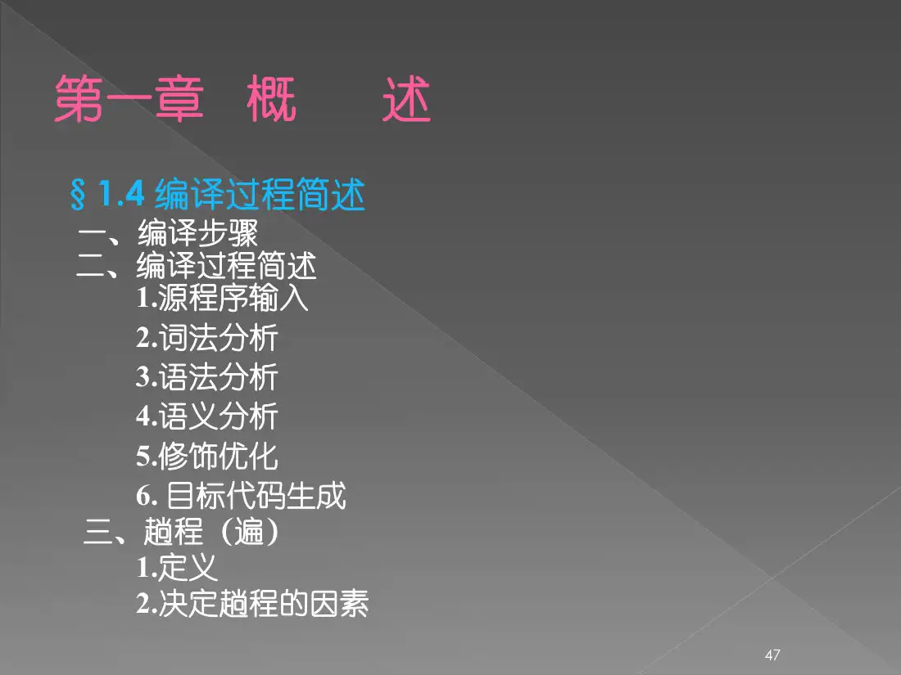

原文：

§ 1.4 编译过程简述
一、编译步骤
二、编译过程简述
1. 源程序输入
2. 词法分析
3. 语法分析
4. 语义分析
5. 修饰优化
6. 目标代码生成
三、趟程（遍）
1. 定义
2. 决定趟程的因素

第一章 概 述

47

### §1.4 编译过程简述 编译步骤

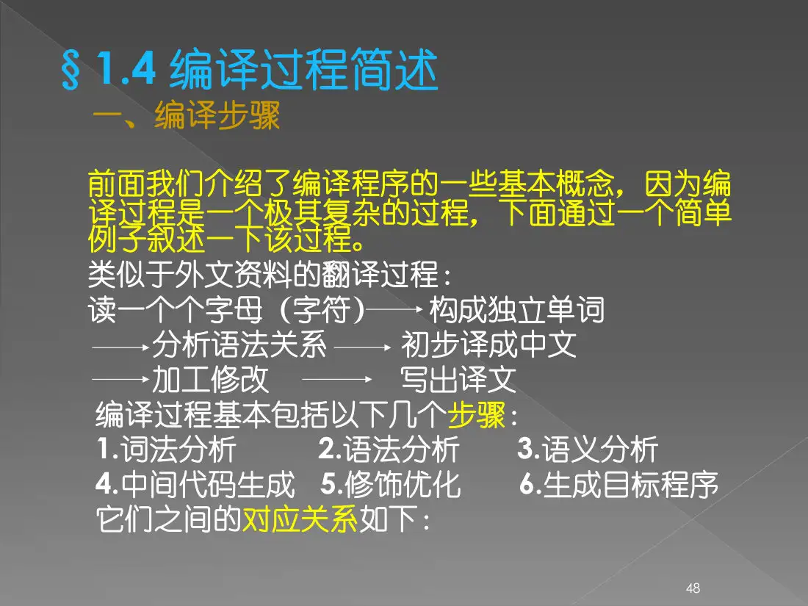

原文：

§1.4 编译过程简述 编译步骤

前面我们介绍了编译程序的一些基本概念，因为编译过程是一个极其复杂的过程，下面通过一个简单例子叙述一下该过程。

类似于外文资料的翻译过程：

读一个个字母（字符） 构成独立单词

分析语法关系 初步译成中文

加工修改 写出译文

编译过程基本包括以下几个步骤：

1.词法分析 2.语法分析 3.语义分析

4.中间代码生成 5.修饰优化 6.生成目标程序

它们之间的对应关系如下：

48

### 翻译外文资料 编译过程

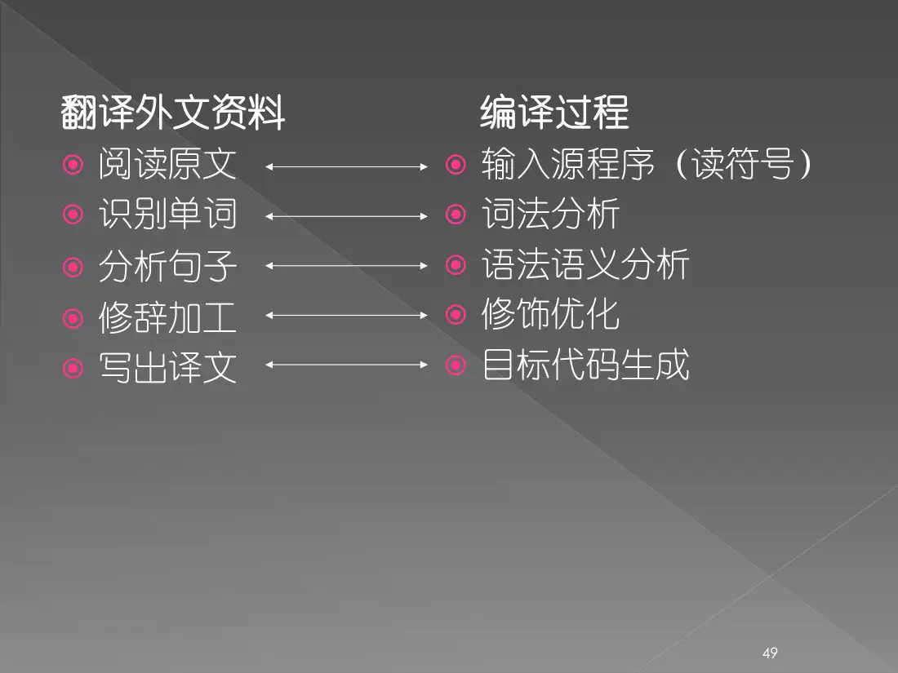

原文：

翻译外文资料 编译过程

 阅读原文 4  输入源程序（读符号）

 识别单词 4  词法分析

 分析句子  语法语义分析

 修辞加工 4  修饰优化

 写出译文  目标代码生成

49

### §1.4 编译过程简述二、编译过程简述

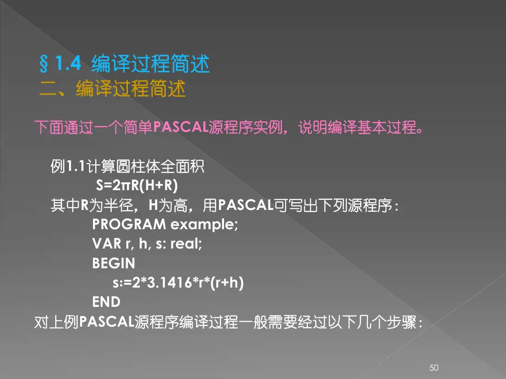

原文：

§1.4 编译过程简述二、编译过程简述

下面通过一个简单PASCAL源程序实例，说明编译基本过程。

例1.1计算圆柱体全面积S=2πR(H+R)

PROGRAM example;

VAR r, h, s: real;

BEGIN

END

对上例PASCAL源程序编译过程一般需要经过以下几个步骤：

50

### 第一章 概 述

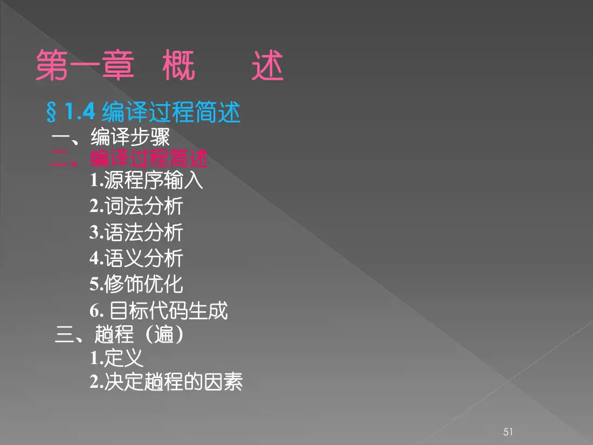

原文：

第一章 概 述

§1.4 编译过程简述

一、编译步骤

二、编译过程简述

1.源程序输入

2.词法分析

3.语法分析

4.语义分析

5.修饰优化

6. 目标代码生成

三、趟程（遍）

1.定义

2.决定趟程的因素

51

### §1.4 编译过程简述

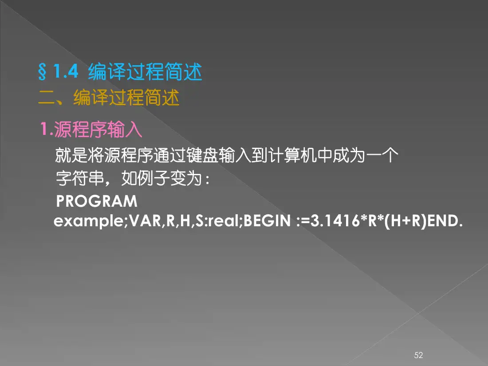

原文：

§1.4 编译过程简述

二、 编译过程简述

1.源程序输入就是将源程序通过键盘输入到计算机中成为一个字符串，如例子变为：PROGRAMexample;VAR,R,H,S:real;BEGIN :=3.1416\*R\*(H+R)END.

52

### 第一章 概 述

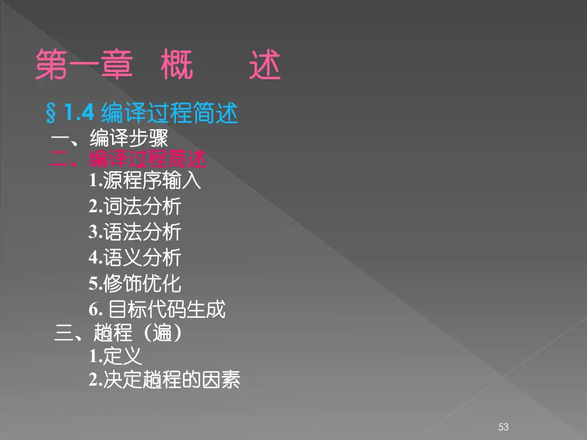

原文：

第一章 概 述

§1.4 编译过程简述

一、编译步骤

二、编译过程简述

1.源程序输入

2.词法分析

3.语法分析

4.语义分析

5.修饰优化

6. 目标代码生成

三、趟程（遍）

1.定义

2.决定趟程的因素

53

### §1.4 编译过程简述

原文：

§1.4 编译过程简述

二、编译过程简述

2.词法分析

（1）功能

1) 扫描源程序进行读符号，删除无用字符（如空格、注释等）2) 将一个个有独立意义的单词识别出来，并且转换成统一长度的内部编码。

3) 建立有关表格（如名字特征表、常数表），进行词法检查以供语法和语义分析用。

（2）分析过程

1) 识别单词：将有独立意义的单词分辨出来。源程序中有些符号具有独立意义，如: +、 有些单个符号又没有独立意义，如: b,g,a……,只有这些符号组成一个单词才有意义，如：

54

### ①.要求：

原文：

Begin,end,real等等，分别表示开始，结束和变量类型说明。又如：R，H，S经类型说明real修饰后也是有意义的，上述程序经过读符号，识别单词后一共有下面27个独立意义单词：PROGRAM example VAR R H S : real LBEGIN S := 2 米 3.1416 米 R \* ( H + R ) END

2) 将单词转换成内部编码识别出单词后，各单词在机器内部表示仍然是一个个字符、数字，如：begin是由5个字母组成，而R是由一个字母组成，它们长度不一，为了便于以后语法分析，必须转换成一种长度统一的内部编码。

①.要求：

a. 长度统一： 即在机器里有相等的二进制位数b.反映单词属性：即通过内部编码可以知道该单词的性质或类型。例子中：program ， begin， var， real ， end 是保留字+，\*是运算符9 ）是分隔符H ， R ，S是标识符c.便于编译程序进行内部加工处理②.程序内部编码：由类型和单词值两部分组成。格式如下：

55

### 类型 单词的值

原文：

类型 单词的值

a. 单词类型用整数表示，通常可将单词分为以下5个类型

1：保留字 如 PROGRAM BEGIN VAR REAL END

2：专用符号 如 +、\*、:=、;、,、（、）等

3：标识符 如 R、H、S

56

### 4.无符号整数 如 2

原文：

4.无符号整数 如 2

5.无符号实数 如3.1416

b.保留字及专用符号的单词值可以用一个三位八进制数表示，如本例中为保留字和专用字符指定了如下的单词值：

PROGRAM 000

BEGIN 001

END 002

REAL 003

VAR 004

米 005

\+ 006

57

### 100010012005

原文：

<table><tr><td>1</td><td>000</td></tr><tr><td>1</td><td>001</td></tr><tr><td>2</td><td>005</td></tr></table>

<table><tr><td>000</td><td colspan="2">R</td></tr><tr><td rowspan="2">002</td><td>实型</td><td>存储单元</td></tr><tr><td colspan="2">H</td></tr><tr><td rowspan="3">004</td><td>实型</td><td>存储单元</td></tr><tr><td colspan="2">S</td></tr><tr><td>实型</td><td>存储单元</td></tr></table>

根据内部编码的格式，例子中的PROGRAM，BEGIN和\*依次可以表示如下：

PROGRAMBEGIN米

3) 建立各种表以供语法和语义分析，如名字特性表，常数表等。对应上例名字特性表及常数表如下：名字特性表

每个名字占两个存储单元000，002，004表示相对地

58

### 常数表一个常数占一个存储单元

原文：

常数表一个常数占一个存储单元

对于标识符和常数，可以用其在特征表或常数表中的相对地址来表示单词值。如例中：

<table><tr><td>R</td><td>3</td><td>000</td></tr><tr><td>H</td><td>3</td><td>002</td></tr><tr><td>3.1416</td><td>5</td><td>001</td></tr><tr><td>2</td><td>4</td><td>000</td></tr></table>

59

### $$

原文：

$$
\begin{array}{l l l l l l l l} \text {所以经词法分析后，其内部编码形式于机器内为如下形式} & 1 0 0 0 & 3 7 7 7 & 2 0 1 2 & 1 0 0 4 & 3 0 0 0 & 2 0 0 7 & 3 0 0 2 & 2 0 0 7 \\ & \text {PROGRAM example} & ; & \text {VAR} & R & , & H & , \\ & 3 0 0 4 & 2 0 1 4 & 1 0 0 3 & 2 0 1 2 & 1 0 0 1 & 3 0 0 4 & 2 0 1 3 & 4 0 0 0 \\ & S & : & \text {real} & ; & \text {BEGIN} & S & := & 2 \\ & 2 0 0 5 & 5 0 0 1 & 2 0 0 5 & 3 0 0 0 & 2 0 0 5 & 2 0 1 0 & 3 0 0 2 & 2 0 0 6 \\ & * & 3. 1 4 1 6 & * & R & * & ( & H & + \\ & 3 0 0 0 & 2 0 1 1 & 1 0 0 2 & 2 0 1 5 \\ & R & ) & \text {END} & . \end{array}
$$

由上述分析可知，经词法分析，源程序转换成内部编码形式，不同类型的单词其长度是统一的，这有助于以后的语法分析 。

60

### 第一章 概 述

原文：

第一章 概 述

§1.4 编译过程简述

一、编译步骤

二、编译过程简述

1.源程序输入

2.词法分析

3.语法分析

4.语义分析

5.修饰优化

6. 目标代码生成

三、趟程（遍）

1.定义

2.决定趟程的因素

61

### §1.4 编译过程简述

原文：

§1.4 编译过程简述

编译过程简述

3. 语法分析

(1)功能

语法分析阶段就是将词法分析后所有单词组成句子，根据不同高级语言不同语法规则来分析这些句子乃至程序是否正确。

例如：上例中赋值语句形如：

〈变量〉:=〈表达式〉

语法分析检查赋值语句是否合乎规则，表达式是否符合语法。若表达式写为:2\*3.1416\*r\*(h+r，则表达式是错误的，少一个右括号“)”。

62

### (2)语法分析方法

原文：

(2)语法分析方法

采用语法分析方法，如递归子程序法、算符优先法、状态矩阵法、LR分析法等逐一查看源程序语法结构，若发现不合语法规则的就输出出错信息，否则作为正确程序提供给语义分析使用。

整个源程序经过语法分析后，若完全正确，则开头及说明部分可以去掉，所以最后形式为：BEGIN S = 2 \* 3.1416 \* R R + H END1001 3004 2013 4000 2005 5001 2005 3000 2005 2010 3000 2006 3002 2011 1002为方便问题的说明，在这里用 M1、M2、M3表示R、H和S ； 用 C1、C2表示2和3.1416最后的源程序：BEGIN $\angle A = \angle A = 9 0 ^ { \circ } , \angle C = 9 0 ^ { \circ } , \angle C = 9 0 ^ { \circ }$ END就表示成：BEGIN $U _ { 1 } ( { \bf s } ) = ( { \bf s } ) = ( { \bf s } ) \times ( { \bf s } ) \times [ { \bf s } ] = \langle U ( { \bf s } ) = U ( { \bf s } ) = { \bf s } \rangle$ END

63

### 64

原文：

64

### 第一章 概 述

原文：

第一章 概 述

§1.4 编译过程简述

一、编译步骤

1.源程序输入

2.词法分析

3.语法分析

4.语义分析

5.修饰优化

6.目标代码生成

三、趟程（遍）

 1.定义

2.决定趟程的因素

65

### §1.4 编译过程简述

原文：

§1.4 编译过程简述

4.语义分析

语义：就是源程序中各种语句的含义。如：A:=5\*C是赋值语句， 表示将赋值号右边表达式送给左部变量。

（1）功能

根据语义分析语句的含义，并将源程序表示成一种内部形式（中间语言）或直接生成目标程序。

内部形式即中间代码类型多样，如三元式、四元式、波兰和逆波兰等等，具体内容放在后面章节里专门介绍。

66

### 经语义分析：1）是一个赋值语句，将右部表达式计算结果送给左边变量。

原文：

例如上面的源程序：BEGIN S∶=2\*3.1416\*R\*(R+H) ENDBEGIN M3∶=C1\*C2\*M1\*(M2+M1) END

经语义分析：1）是一个赋值语句，将右部表达式计算结果送给左边变量。

2）在计算表达式值时先计算C1\*C2，然后再乘以M1，此时要保存中间结果，然后再将M2加上M1，其结果再与上面计算结果相乘。

3）将右部表达式计算结果送给M3

67

### 第一章 概 述

原文：

第一章 概 述

§1.4 编译过程简述

一、编译步骤

1.源程序输入

2.词法分析

3.语法分析

4.语义分析

5.修饰优化

6.目标代码生成

三、趟程（遍）

1.定义

2.决定趟程的因素

68

### §1.4 编译过程简述

原文：

§1.4 编译过程简述

5. 修饰优化

目的：使得生成的目标程序占有内存少，运行速度快。例：循环语句 FOR i:=1 to n DO $\mathbf { G } \mathbf { H } \mathbf { \Xi } \mathbf { \boxed { 5 6 } }$ i 每取一个值，表达式a\*b就要计算一次，当n值较大时，重复的次数就多了，若将其改写为：

t:=a\*b FOR i:=1 to n DO c[i]=t

则只要进行一次a\*b的计算，大大缩短了运行时间，提高了运行速度。

69

### 假设目标程序如下：BEGIN M3∶=(M2+M1)\*M1\*(M2+M1)

原文：

假设目标程序如下：BEGIN M3∶=(M2+M1)\*M1\*(M2+M1)

 不优化

 取 M2

 + M1

 送 T1

 米 M1

11条

 送 T2

 取 M2

 + M1

 送 T3

 取 T2

END

 T3

 送 M3

 优化后

 取 M2

7条

 + M1

 送 T1

 米 T1

 送 T2

 米 M1

 送 M3

70

### 第一章 概 述

原文：

第一章 概 述

§1.4 编译过程简述

一、编译步骤

二、 编译过程简述

1.源程序输入

2.词法分析

3.语法分析

4.语义分析

5.修饰优化

6.目标代码生成

三、趟程（遍）

1.定义

2.决定趟程的因素

71

### §1.4 编译过程简述

原文：

§1.4 编译过程简述

6.目标代码生成

目标代码生成就是将中间语言代码转换成机器语言程序或汇编语言程序，最后完成翻译。

72

### 整个编译过程如下图所示

原文：

整个编译过程如下图所示

信 息 表 管 理 程 序

源

程

序

词法

分析

程序

语法

分析

程序

语义

分析

程序

中间

代码

代码

生成

优化

程序

目

标

程

序

目标

代码

生成

错 误 检 查 和 处 理 程 序

大多情况下，将语义分析包含在语法分析过程中，这样就将编译过程分成5个阶段，事实上，这并非固定不变的，有时中间代码、优化可以省掉，有时还要进行错误检查和处理以及各种信息表格的管理。

73

### 第一章 概 述

原文：

第一章 概 述

§1.4 编译过程简述

一、编译步骤

二、编译过程简述

1.源程序输入

2.词法分析

3.语法分析

4.语义分析

5.修饰优化

6.目标代码生成

三、趟程（遍）

1.定义

2.决定趟程的因素

74

### §1.4 编译过程简述

原文：

§1.4 编译过程简述

在确定编译程序具体实现时，常常将编译程序按其扫描遍数分为一遍扫描或多遍扫描 。

75

### §1.4 编译过程简述

原文：

§1.4 编译过程简述

1. 定义

从头到尾扫描一遍源程序或等价源程序，并做有关加工处理，称趟程。

每经过一趟源程序都要进行等价变换并更接近目标程序。如果通过对源程序一遍扫描直接生成目标代码程序，则说编译程序是单遍的。

把源程序分为几遍来编译，每遍只完成编译程序中的部分或几个部分工作，称为多遍的。

比如第一遍进行词法、语法分析，检查语法错误；第二遍生成中间语言进行存储分配；第三遍生成可运行的目标程序。如：IBM PC DOS PASCAL就是一个多遍扫描编译程序。

如下图：

76

### 源程序

原文：

源程序

编译程序

目标程序

一遍扫描编译程序多遍扫描的优点弥补了单遍的缺点，单遍却避免了多遍的缺点

源程序

第一遍扫描程序 中间语言1

中间语言n-1

第n趟扫描程序

目标程序

多遍扫描编译程序

优点：加工充分；出错处理细致；目标程序质量高

缺点：编译时间长，开销大

77

### §1.4 编译过程简述

原文：

§1.4 编译过程简述

2.决定趟程的因素

（1）计算机存贮容量大小；

（2）编译程序功能强弱；

（3）源语言繁简；

（4）目标程序优化程度；

（5）设计和实现编译程序时使用工具的先进性

（6）参加人员多少和素质等。

78

### 第一章 概 述

原文：

第一章 概 述

§1.5 编译程序的生成

一、编写编译程序的一般方法

1.直接用机器语言编写编译程序

2.用汇编语言编写编译程序

3.用系统程序设计语言编写

二、编译程序开发技术

1.自编译

2.交叉编译

3.自展技术

4.移植

三、编译程序的自动生成

79

### 1.5 编译程序的生成

原文：

1.5 编译程序的生成

编译程序是一个非常复杂的软件系统，虽然编译理论和编译技术不断发展，已使编译程序的生产周期不断缩短，但目前研制一个编译程序仍需要相当长时间，而且工作相当艰巨。因此，如何高效地生成一个高质量的编译程序一直是人们追求的目标。

80

### §1.5 编译程序的生成

原文：

§1.5 编译程序的生成

1.直接用机器语言编写编译程序

机器语言是早期编写编译程序的唯一工具，但由于机器语言难读难写 ，现在几乎没有人再用它。

81

### §1.5 编译程序的生成

原文：

§1.5 编译程序的生成

2.用汇编语言编写编译程序

由于汇编语言太依赖于硬件环境, 且程序过于冗长, 现在也不常用, 不过由于它通过汇编程序产生的目标代码效率比较高, 所以在编译程序核心部分常用它编写。

82

### §1.5 编译程序的生成

原文：

§1.5 编译程序的生成

3.用系统程序设计语言编写

能够编写编译程序或其他系统软件的高级语言称系统程序设计语言。如PASCAL、C、C++由于用机器语言和汇编语言编写编译程序其主要缺点是效率低，因此越来越多的人倾向于使用高级语言作为工具来编写编译程序。80年代开始, 几乎所有的编译程序都是用高级语言编写, 从而避开了与机器有关许多烦琐细节,大大减轻编写编译程序工作量。并非所有高级语言都适合于编写编译程序。

83

### 第一章 概 述

原文：

第一章 概 述

§1.5 编译程序的生成

一、编写编译程序的一般方法

1.直接用机器语言编写编译程序

2.用汇编语言编写编译程序

3.用系统程序设计语言编写

编译程序开发技术

1.自编译

2.交叉编译

3.自展技术

4.移植

三、编译程序的自动生成

84

### 第一章 概 述

原文：

第一章 概 述

§1.5 编译程序的生成

一、编写编译程序的一般方法

1.直接用机器语言编写编译程序

2.用汇编语言编写编译程序

3.用系统程序设计语言编写

编译程序开发技术

1.自编译

2.交叉编译

3.自展技术

4.移植

三、编译程序的自动生成

85

### §1.5 编译程序的生成

原文：

§1.5 编译程序的生成

1. 自编译

（1）自编译概念

1）如果一种高级语言与之相应的编译程序也能直接用该语言本身写出来 , 具有这种性质语言称自编译语言 , 即自编译。能够编译自身的编译程序称自编译程序。

2）自编译语言除了书写自身编译程序外 ,般还可以编写其它语言编译程序 。

3）系统程序设计语言就是这样自编译语言，通常把能够编写编译程序或其它系统软件(如操作系统)的高级语言称系统设计语言，到目前为止,作为系统程序设计语言有PASCAL,MODULA,C,C++和ADA等。

86

### §1.5 编译程序的生成

原文：

§1.5 编译程序的生成

1. 自编译

（2）T型图

源语言、目标语言和编译程序书写语言之间的关系可用T型图来表示，如下图：

源语言

书写语言目标语言

87

### §1.5 编译程序的生成

原文：

§1.5 编译程序的生成

1. 自编译

（2）T型图

1）假设在A 机器上已有一个PASCAL 语言可供运行 , 即用A 机器上的A 代码书写的、产生A 目标代码的 PASCAL 语言的编译程序，如下图：

A代码指采用A机器上的指令系统的汇编语言或者机器语言

PASCAL

A代码

A代码

88

### §1.5 编译程序的生成

原文：

§1.5 编译程序的生成

1. 自编译

（2）T型图

2）这是一个能在A 机器上直接运行产生同一机器代码的PASCAL 语言编译程序 , 因此我们可以用PASCAL语言书写PASCAL语言编译程序, 然后借助于原有PASCAL 编译程序对新编写的 PASCAL编译程序进行编译, 从而编译后可得到在A 机器上运行的 PASCAL 编译程序

89

### §1.5 编译程序的生成

原文：

§1.5 编译程序的生成

1. 自编译

（2）T型图

3）在A机器上我们可用 PASCAL语言来书写FORTRAN 语言编译程序, 即产生一个A 代 码的FORTRAN 编译程序

90

### §1.5 编译程序的生成

原文：

§1.5 编译程序的生成

1. 自编译

（3）自编译的过程

1）下图说明自编译的过程，是把已有的编译程序的T形图写在中间下方,即表示在A机器已有PASCAL的编译程序，左上方是需要编写的编译程序的T形图，即表示用PASCAL语言写一个PASCAL语言的编译程序，右边是要得到的编译程序的T形图，即表示用机器语言写的PASCAL语言的编译程序。

91

### §1.5 编译程序的生成

原文：

§1.5 编译程序的生成

1. 自编译

（3）自编译的过程

2） 下图中间表示在A机器已有PASCAL的编译程序，左边表示用 PASCAL语言写一个FORTRAN语言的编译程序,右边表示用机器语言写的 FORTRAN语言的编译程序

92

### 问题：自编译有什么意义？

原文：

问题：自编译有什么意义？

93

### 第一章 概 述

原文：

第一章 概 述

§1.5 编译程序的生成

一、编写编译程序的一般方法

1.直接用机器语言编写编译程序

2.用汇编语言编写编译程序

3.用系统程序设计语言编写

编译程序开发技术

1.自编译

2.交叉编译

3.自展技术

4.移植

三、编译程序的自动生成

94

### §1.5 编译程序的生成

原文：

§1.5 编译程序的生成

3.自展技术

（1）自展技术的定

自展技术可以由一个功能较小的编译程序 ，一级一级扩充而变成一个功能较强的编译程序。

95

### §1.5 编译程序的生成

原文：

§1.5 编译程序的生成

3.自展技术

（2）自展技术的过程

目标为一个高级语言 L 在某机器 M 上配置一个编译程序 , 该机器语言为 M, 则自展技术过程如下：

1）选取 L 语言的一个子集 L1（语言核心部分），选取原则简单，刚够书写其自身的编译程序。首先用机器语言 M 来建立 L1的编译程序

96

### §1.5 编译程序的生成

原文：

§1.5 编译程序的生成

3.自展技术

（2）自展技术的过程

2）为了检验 L1 是否取得适当 ，以及建立 L1编译程序是否正确 ，可用 L1 重写一次 L1 编译程序

自编译技术

97

### §1.5 编译程序的生成

原文：

§1.5 编译程序的生成

3.自展技术

（2）自展技术的过程

3）然后再把上图通过原来机器的编译程序进行编译看能否得到M书写的编译程序

98

### §1.5 编译程序的生成

原文：

§1.5 编译程序的生成

3.自展技术

（2）自展技术的过程

4）然后把语言功能由L1扩展到L2(L2包含L1)，并进行编译加工

99

### §1.5 编译程序的生成

原文：

§1.5 编译程序的生成

3.自展技术

（2）自展技术的过程

5）然后把语言功能由L2扩展到L3(L3包含 L2)，并进行编译加工

100

### §1.5 编译程序的生成

原文：

§1.5 编译程序的生成

3.自展技术

（2）自展技术的过程

6）类似地对 L4,L5, … ,Li, …(其中 Li+1 包含 Li )按上述过程进行多次 , 直到扩展到所需 L为止 , 这就是由核心语言 L1 开始逐步扩展到 L 编译程序为止。

101

### 第一章 概 述

原文：

第一章 概 述

§1.5 编译程序的生成

一、编写编译程序的一般方法

1.直接用机器语言编写编译程序

2.用汇编语言编写编译程序

3.用系统程序设计语言编写

编译程序开发技术

1.自编译

2.交叉编译

3.自展技术

4.移植

三、编译程序的自动生成

102

### §1.5 编译程序的生成

原文：

§1.5 编译程序的生成

2.交叉编译

（1）交叉编译的概念

如果一个A 机器上编译程序能产生 B 机器的目标代码 , 则称这种程序为交叉编译程序。

103

### §1.5 编译程序的生成

原文：

§1.5 编译程序的生成

2.交叉编译

（1）交叉编译的概念

（1）交叉编译的概念

下图表示一个能在 A 机器上直接运行而产生B机器代码的PASCAL编译程序

104

### §1.5 编译程序的生成

原文：

§1.5 编译程序的生成

2.交叉编译

（1）交叉编译的概念

（1）交叉编译的

若A 机器上已有PASCAL 语言可以运行, 则可用A 机器 PASCAL语言写一个编译程序, 它的源语言是 PASCAL, 目标语言是 B 代码

105

### §1.5 编译程序的生成

原文：

§1.5 编译程序的生成

2.交叉编译

（2）交叉编译的过程

下图说明交叉编译的过程，是把已有的编译程序的T形图写在中间下方，即表示在A机器已有PASCAL的编译程序，左上方是需要编写的编译程序的T形图，即表示用PASCAL语言写一个PASCAL语言的编译程序，变成B机器代码，右边是要得到的编译程序的T形图，即表示用A机器代码将PASCAL语言变成B机器代码的编译程序

同样使用了自编译技术，只不过产生的是B代码

106

### 第一章 概 述

原文：

第一章 概 述

§1.5 编译程序的生成

一、编写编译程序的一般方法

1.直接用机器语言编写编译程序

2.用汇编语言编写编译程序

3.用系统程序设计语言编写

编译程序开发技术

1.自编译

2.交叉编译

3.自展技术

4.移植

三、编译程序的自动生成

107

### §1.5 编译程序的生成

原文：

§1.5 编译程序的生成

3.移植

（1）移植是编译程序开发中一项十分重要技术 , 移植就是把一台计算机上的软件移植到另一台计算机上去。

（2）移植方法：

一种方法是综合几种型号计算机抽象出一个通用的汇编语言,而每种型号计算机上只要配有一个简单汇编程序 , 用它来把通用汇编语言书写的程序翻译成机器语言程序。（分两步走）

（3）另一种方法就是利用交叉编译方法可以把一台计算机上自编译语言的编译程序移植到另一台计算机上。（一步完成）

108

### 第一章 概 述

原文：

第一章 概 述

§1.5 编译程序的生成

一、编写编译程序的一般方法

1.直接用机器语言编写编译程序

2.用汇编语言编写编译程序

3.用系统程序设计语言编写

二、编译程序开发技术

1.自编译

2.交叉编译

3.自展技术

4.移植

三、 编译程序的自动生成

109

### §1.5 编译程序的生成

原文：

§1.5 编译程序的生成

把源语言的定义以及机器语言的描述输入到这种软件中去 , 自动生成该语言编译程序, 这就是编译程序的自动生成 , 也称编译程序生成器或编译程序的编译程序, 称 CC(Compiler-Compiler)。

语言的语法定义

语义描述或机器定义

源程序

数据

110

### 习题教材第14－15页第2、3、4、5题

原文：

习题教材第14－15页第2、3、4、5题

补充题

1.为什么要对单词进行内部编码？其原则是什么？对标识符是如何进行内部编码？2.赋值语句A:=5\*C的语法和语义指的是什么？

思考题

1. 先有操作系统还是先有编译系统，谈谈你的看法？

111
