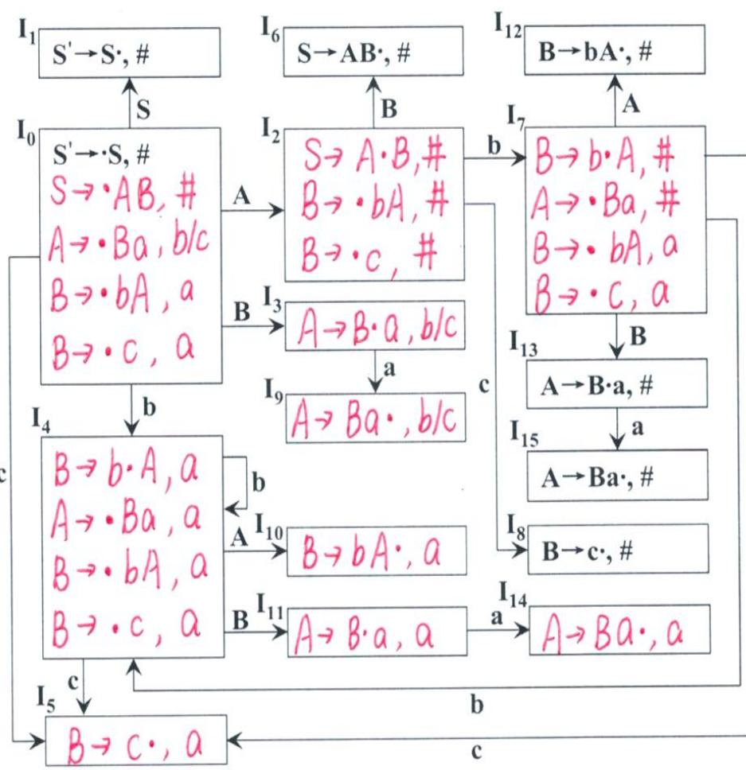
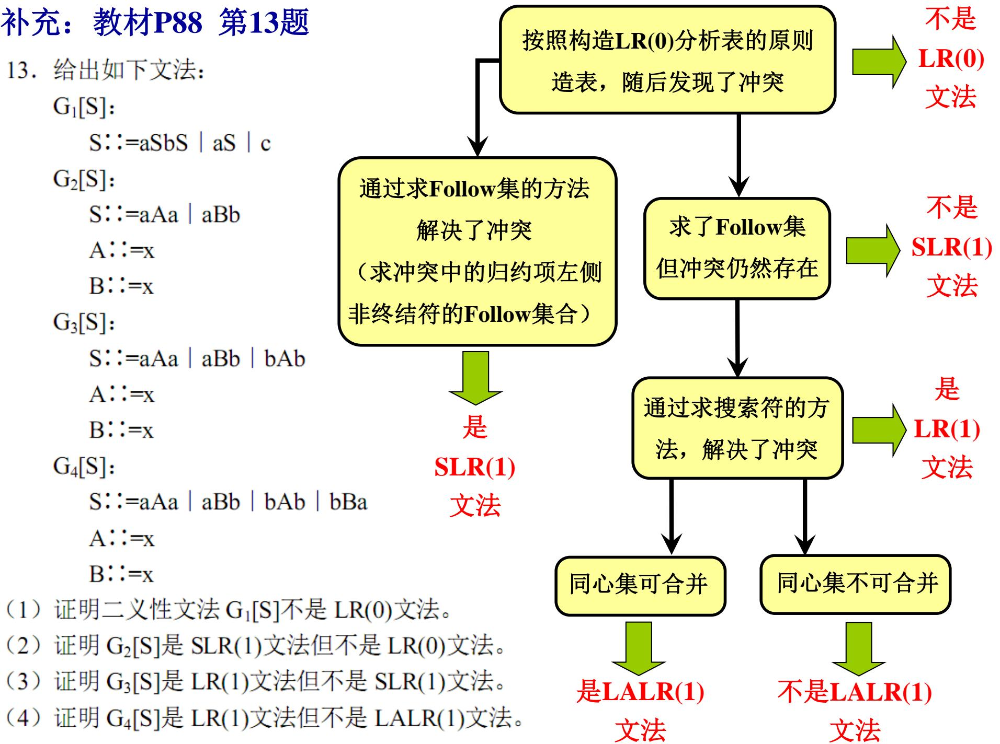

# 《编译原理》第三次作业讲解

原件经识别和整理；“参考解答”是我们补的。

### 计算 1

已知文法 G[S']：

- (0) S'→S
- (1) S→iBtSeS
- (2) S→iBtSe
- (3) S→a
- (4) B→b

1）构造其对应的 LR 状态转换图。

答案：Follow(S) = { #, e }，Follow(B) = { t }，LR 分析表如下。

| 状态 | Action i | Action t | Action e | Action a | Action b | Action # | GoTo S | GoTo B |
|---|---|---|---|---|---|---|---|---|
| 0 | $S_{2}$ | | | $S_{3}$ | | | 1 | |
| 1 | | | | | | acc | | |
| 2 | | | | | $S_{5}$ | | | 4 |
| 3 | $r_{3}$ | $r_{3}$ | $r_{3}$ | $r_{3}$ | $r_{3}$ | $r_{3}$ | | |
| 4 | | $S_{6}$ | | | | | | |
| 5 | $r_{4}$ | $r_{4}$ | $r_{4}$ | $r_{4}$ | $r_{4}$ | $r_{4}$ | | |
| 6 | $S_{2}$ | | | $S_{3}$ | | | 7 | |
| 7 | | | $S_{8}$ | | | | | |
| 8 | $r_{2}S_{2}$ | $r_{2}$ | $r_{2}$ | $r_{2}S_{3}$ | $r_{2}$ | $r_{2}$ | 9 | |
| 9 | $r_{1}$ | $r_{1}$ | $r_{1}$ | $r_{1}$ | $r_{1}$ | $r_{1}$ | | |

| 状态 | Action i | Action t | Action e | Action a | Action b | Action # | GoTo S | GoTo B |
|---|---|---|---|---|---|---|---|---|
| 0 | $S_{2}$ | | | $S_{3}$ | | | 1 | |
| 1 | | | | | | acc | | |
| 2 | | | | | $S_{5}$ | | | 4 |
| 3 | $r_{3}$ | $r_{3}$ | $r_{3}$ | $r_{3}$ | $r_{3}$ | $r_{3}$ | | |
| 4 | | $S_{6}$ | | | | | | |
| 5 | $r_{4}$ | $r_{4}$ | $r_{4}$ | $r_{4}$ | $r_{4}$ | $r_{4}$ | | |
| 6 | $S_{2}$ | | | $S_{3}$ | | | 7 | |
| 7 | | | $S_{8}$ | | | | | |
| 8 | $r_{2}S_{2}$ | $r_{2}$ | $r_{2}$ | $r_{2}S_{3}$ | $r_{2}$ | $r_{2}$ | 9 | |
| 9 | $r_{1}$ | $r_{1}$ | $r_{1}$ | $r_{1}$ | $r_{1}$ | $r_{1}$ | | |

| 状态 | Action i | Action t | Action e | Action a | Action b | Action # | GoTo S | GoTo B |
|---|---|---|---|---|---|---|---|---|
| 0 | $S_{2}$ | | | $S_{3}$ | | | 1 | |
| 1 | | | | | | acc | | |
| 2 | | | | | $S_{5}$ | | | 4 |
| 3 | $r_{3}$ | $r_{3}$ | $r_{3}$ | $r_{3}$ | $r_{3}$ | $r_{3}$ | | |
| 4 | | $S_{6}$ | | | | | | |
| 5 | $r_{4}$ | $r_{4}$ | $r_{4}$ | $r_{4}$ | $r_{4}$ | $r_{4}$ | | |
| 6 | $S_{2}$ | | | $S_{3}$ | | | 7 | |
| 7 | | | $S_{8}$ | | | | | |
| 8 | $r_{2}S_{2}$ | $r_{2}$ | $r_{2}$ | $r_{2}S_{3}$ | $r_{2}$ | $r_{2}$ | 9 | |
| 9 | $r_{1}$ | $r_{1}$ | $r_{1}$ | $r_{1}$ | $r_{1}$ | $r_{1}$ | | |

| 状态 | Action i | Action t | Action e | Action a | Action b | Action # | GoTo S | GoTo B |
|---|---|---|---|---|---|---|---|---|
| 0 | $S_{2}$ | | | $S_{3}$ | | | 1 | |
| 1 | | | | | | acc | | |
| 2 | | | | | $S_{5}$ | | | 4 |
| 3 | $r_{3}$ | $r_{3}$ | $r_{3}$ | $r_{3}$ | $r_{3}$ | $r_{3}$ | | |
| 4 | | $S_{6}$ | | | | | | |
| 5 | $r_{4}$ | $r_{4}$ | $r_{4}$ | $r_{4}$ | $r_{4}$ | $r_{4}$ | | |
| 6 | $S_{2}$ | | | $S_{3}$ | | | 7 | |
| 7 | | | $S_{8}$ | | | | | |
| 8 | $r_{2}S_{2}$ | $r_{2}$ | $r_{2}$ | $r_{2}S_{3}$ | $r_{2}$ | $r_{2}$ | 9 | |
| 9 | $r_{1}$ | $r_{1}$ | $r_{1}$ | $r_{1}$ | $r_{1}$ | $r_{1}$ | | |

1、已知文法G[S’](0) S’→S (1) S→iBtSeS (2) S→iBtSe (3) S→a

(4) B→b

1）构造其对应的LR状态转换图

Follow(S) = { #, e }

<table><tr><td rowspan="2"></td><td colspan="6">Action</td><td colspan="2">GoTo</td></tr><tr><td>i</td><td>t</td><td>e</td><td>a</td><td>b</td><td>#</td><td>S</td><td>B</td></tr><tr><td>0</td><td> $S_{2}$ </td><td></td><td></td><td> $S_{3}$ </td><td></td><td></td><td>1</td><td></td></tr><tr><td>1</td><td></td><td></td><td></td><td></td><td></td><td>acc</td><td></td><td></td></tr><tr><td>2</td><td></td><td></td><td></td><td></td><td> $S_{5}$ </td><td></td><td></td><td>4</td></tr><tr><td>3</td><td> $r_{3}$ </td><td> $r_{3}$ </td><td> $r_{3}$ </td><td> $r_{3}$ </td><td> $r_{3}$ </td><td> $r_{3}$ </td><td></td><td></td></tr><tr><td>4</td><td></td><td> $S_{6}$ </td><td></td><td></td><td></td><td></td><td></td><td></td></tr><tr><td>5</td><td> $r_{4}$ </td><td> $r_{4}$ </td><td> $r_{4}$ </td><td> $r_{4}$ </td><td> $r_{4}$ </td><td> $r_{4}$ </td><td></td><td></td></tr><tr><td>6</td><td> $S_{2}$ </td><td></td><td></td><td> $S_{3}$ </td><td></td><td></td><td>7</td><td></td></tr><tr><td>7</td><td></td><td></td><td> $S_{8}$ </td><td></td><td></td><td></td><td></td><td></td></tr><tr><td>8</td><td> $r_{2}S_{2}$ </td><td> $r_{2}$ </td><td> $r_{2}$ </td><td> $r_{2}S_{3}$ </td><td> $r_{2}$ </td><td> $r_{2}$ </td><td>9</td><td></td></tr><tr><td>9</td><td> $r_{1}$ </td><td> $r_{1}$ </td><td> $r_{1}$ </td><td> $r_{1}$ </td><td> $r_{1}$ </td><td> $r_{1}$ </td><td></td><td></td></tr></table>

2、已知文法G[S’] ⓪ $\mathbf { S } ^ { 9 } { : : : = } \mathbf { A }$ ③ A::=cBd

1）构造识别其活前缀的DFA（把下图填写完整即可）


① $\mathbf { A } { : : = } \mathbf { a } \mathbf { A } \mathbf { d }$ ② $\mathbf { A } { : : } \mathbf { = a e b }$ ④ $\mathbf { A } { \boldsymbol { : } } { \boldsymbol { : } } { = } \mathbf { a }$ ⑤ $\mathbf { B } { : : = } \mathbf { e }$

2）该文法是LR(0)文法，还是SLR(1)文法？写出理由

2状态有“移进-归约”冲突，故不是LR(0)；Follow(A)={#,d}，与 $\{ \mathbf { a } , \mathbf { c } , \mathbf { e }$ 不相交，故是SLR(1)

3）构造该文法的分析表造表

<table><tr><td rowspan="2"></td><td colspan="6">Action</td><td colspan="2">GoTo</td></tr><tr><td>a</td><td>b</td><td>c</td><td>d</td><td>e</td><td>#</td><td>A</td><td>B</td></tr><tr><td>0</td><td> $S_{2}$ </td><td></td><td> $S_{5}$ </td><td></td><td></td><td></td><td>1</td><td></td></tr><tr><td>1</td><td></td><td></td><td></td><td></td><td></td><td>acc</td><td></td><td></td></tr><tr><td>2</td><td> $S_{2}$ </td><td></td><td> $S_{5}$ </td><td> $r_{4}$ </td><td> $S_{4}$ </td><td> $r_{4}$ </td><td>3</td><td></td></tr><tr><td>3</td><td></td><td></td><td></td><td> $S_{6}$ </td><td></td><td></td><td></td><td></td></tr><tr><td>4</td><td></td><td> $S_{7}$ </td><td></td><td></td><td></td><td></td><td></td><td></td></tr><tr><td>5</td><td></td><td></td><td></td><td></td><td> $S_{8}$ </td><td></td><td></td><td>9</td></tr><tr><td>6</td><td></td><td></td><td></td><td> $r_{1}$ </td><td></td><td> $r_{1}$ </td><td></td><td></td></tr><tr><td>7</td><td></td><td></td><td></td><td> $r_{2}$ </td><td></td><td> $r_{2}$ </td><td></td><td></td></tr><tr><td>8</td><td></td><td></td><td></td><td> $r_{5}$ </td><td></td><td></td><td></td><td></td></tr><tr><td>9</td><td></td><td></td><td></td><td> $S_{10}$ </td><td></td><td></td><td></td><td></td></tr><tr><td>10</td><td></td><td></td><td></td><td> $r_{3}$ </td><td></td><td> $r_{3}$ </td><td></td><td></td></tr></table>

3、给定已编号的文法G[S’]如下(0) $\mathbf { S } ^ { \bullet } { \boldsymbol { : } } 3 { = } \mathbf { S }$ (1) S::=AB (2) $\mathbf { A } { \boldsymbol { : } } { \mathbf { : } } { = } \mathbf { B } \mathbf { a }$ (3) $\mathbf { B } { : : = } \mathbf { b } \mathbf { A }$ (4) $\mathbf { B } { : : = } \mathbf { c }$

1）将下图补充完整，构建识别 活前缀的LR(1)项目的DFA



知识点：[语法制导翻译的基本思想与语法制导定义](../../../topics/编译原理/语法制导翻译概述.md)、[布尔表达式的翻译（回填技术）](../../../topics/编译原理/布尔表达式翻译.md)、[控制语句的翻译（if、while、for、goto）](../../../topics/编译原理/控制语句翻译.md)

### 2）根据1）中的图，将下表补充完整

<table><tr><td rowspan="2"></td><td colspan="4">Action</td><td colspan="3">Goto</td></tr><tr><td>a</td><td>b</td><td>c</td><td>#</td><td>S</td><td>A</td><td>B</td></tr><tr><td>0</td><td></td><td> $S_{4}$ </td><td> $S_{5}$ </td><td></td><td>1</td><td>2</td><td>3</td></tr><tr><td>1</td><td></td><td></td><td></td><td>acc</td><td></td><td></td><td></td></tr><tr><td>2</td><td></td><td> $S_{7}$ </td><td> $S_{8}$ </td><td></td><td></td><td></td><td>6</td></tr><tr><td>3</td><td> $S_{9}$ </td><td></td><td></td><td></td><td></td><td></td><td></td></tr><tr><td>4</td><td></td><td> $S_{4}$ </td><td> $S_{5}$ </td><td></td><td></td><td>10</td><td>11</td></tr><tr><td>5</td><td> $r_{4}$ </td><td></td><td></td><td></td><td></td><td></td><td></td></tr><tr><td>6</td><td></td><td></td><td></td><td> $r_{1}$ </td><td></td><td></td><td></td></tr><tr><td>7</td><td></td><td> $S_{4}$ </td><td> $S_{5}$ </td><td></td><td></td><td>12</td><td>13</td></tr><tr><td>8</td><td></td><td></td><td></td><td> $r_{4}$ </td><td></td><td></td><td></td></tr><tr><td>9</td><td></td><td> $r_{2}$ </td><td> $r_{2}$ </td><td></td><td></td><td></td><td></td></tr><tr><td>10</td><td> $r_{3}$ </td><td></td><td></td><td></td><td></td><td></td><td></td></tr><tr><td>11</td><td> $S_{14}$ </td><td></td><td></td><td></td><td></td><td></td><td></td></tr><tr><td>12</td><td></td><td></td><td></td><td> $r_{3}$ </td><td></td><td></td><td></td></tr><tr><td>13</td><td> $S_{15}$ </td><td></td><td></td><td></td><td></td><td></td><td></td></tr><tr><td>14</td><td> $r_{2}$ </td><td></td><td></td><td></td><td></td><td></td><td></td></tr><tr><td>15</td><td></td><td></td><td></td><td> $r_{2}$ </td><td></td><td></td><td></td></tr></table>

# 编译原理第三次作业讲解（第 3 部分）

本资料为《编译原理》第三次作业讲解中关于 LR(1) 分析表构造、LALR(1) 文法判断及条件语句语法制导翻译的习题与补充内容，由识别工具读取并整理。

## 一、LR(1) 分析与 LALR(1) 判断

参考解答：**结论**：补全后的 LR(1) 分析表如下（已填入所有空白，其中无动作或转移的空格保持为空，未额外添加内容）。

| 状态 | a | b | c | # | S | A | B |
| --- | --- | --- | --- | --- | --- | --- | --- |
| 0 | | $S_{4}$ | $S_{5}$ | | 1 | 2 | 3 |
| 1 | | | | acc | | | |
| 2 | | $S_{7}$ | $S_{8}$ | | | | 6 |
| 3 | $S_{9}$ | | | | | | |
| 4 | | $S_{4}$ | $S_{5}$ | | | 10 | 11 |
| 5 | $r_{4}$ | | | | | | |
| 6 | | | | $r_{1}$ | | | |
| 7 | | $S_{4}$ | $S_{5}$ | | | 12 | 13 |
| 8 | | | | $r_{4}$ | | | |
| 9 | | $r_{2}$ | $r_{2}$ | | | | |
| 10 | $r_{3}$ | | | | | | |
| 11 | $S_{14}$ | | | | | | |
| 12 | | | | $r_{3}$ | | | |
| 13 | $S_{15}$ | | | | | | |
| 14 | $r_{2}$ | | | | | | |
| 15 | | | | $r_{2}$ | | | |

**推理 / 补充过程**

1. **移进入口**  
   - 状态 0：由项目集 $I_0$ 中有 $S\to\cdot A$、$A\to\cdot bB$、$B\to\cdot aA$ 等，遇 $b$ 移进到含 $A\to b\cdot B$ 的 $I_4$，遇 $c$ 移进到 $I_5$；Goto 对 $S,A,B$ 分别到 1,2,3。  
   - 状态 2（$S\to A\cdot$ 相关）：有 $A\to b\cdot B$ 分支，故遇 $b$ 到 7、遇 $c$ 到 8，Goto $B$ 到 6。  
   - 状态 3（$B\to a\cdot A$）：遇 $a$ 移进到 9。  
   - 状态 4：同 0 中 $b$ 分支，$b\to4$、$c\to5$，Goto $A\to10$、$B\to11$。  
   - 状态 7：同 4，$b\to4$、$c\to5$，Goto $A\to12$、$B\to13$。  
   - 状态 11（$B\to aA\cdot$ 后跟 $a$）：遇 $a$ 移进到 14。  
   - 状态 13：遇 $a$ 移进到 15。

2. **归约出口**  
   - $r_4$：用于产生式 $B\to c$（或相应编号），状态 5（lookahead $a$）填 $r_4[a]$；状态 8（lookahead $\#$）填 $r_4[\#]$。  
   - $r_1$：用于 $S\to A$，状态 6 仅在 $\#$ 归约。  
   - $r_2$：用于 $S\to AB$ 类，状态 9 的 lookahead 为 $b,c$；状态 14 为 $a$；状态 15 为 $\#$。  
   - $r_3$：用于 $B\to aA$，状态 10（lookahead $a$）和状态 12（lookahead $\#$）分别归约。

3. **接受**  
   - 状态 1 为 $S'\to S\cdot$ 且 lookahead $\#$，故 $\#$ 列填 `acc`。

由此表中所有空白均依据 LR(1) 项目集内移进/归约项目及向前看符号确定，无冲突。

知识点：[LR(1)分析表构造](../../../topics/编译原理/LR1分析表构造.md)、[LALR分析表构造（同心集合并）](../../../topics/编译原理/LALR分析表构造.md)

### 选择 4

题干：已知文法 G[S'] 如下——
(0) $S' \rightarrow S$
(1) $S \rightarrow aXd$
(2) $S \rightarrow bYd$
(3) $S \rightarrow aYe$
(4) $S \rightarrow bXe$
(5) $X \rightarrow c$
(6) $Y \rightarrow c$

1）构造识别该文法的全部 LR(1) 项目集；
2）构造其 LR(1) 分析表（将下面转换图补充完整 Action）；
3）判断并说明该文法是否是 LALR(1) 文法？说明理由。

**状态 I5 的项目集：**
$$
I_5: \begin{cases} Y \rightarrow c \cdot, d \\ X \rightarrow c \cdot, e \end{cases}
$$

**LR(1) 分析表：**

| State | Action (a) | Action (b) | Action (c) | Action (d) | Action (e) | Action (#) | Goto (S) | Goto (X) | Goto (Y) |
| :---: | :---: | :---: | :---: | :---: | :---: | :---: | :---: | :---: | :---: |
| 0 | $S_2$ | $S_3$ | | | | | 1 | | |
| 1 | | | | | | acc | | | |
| 2 | | | $S_4$ | | | | | 6 | 7 |
| 3 | | | $S_5$ | | | | | 9 | 8 |
| 4 | | | | $r_5$ | $r_6$ | | | | |
| 5 | | | | $r_6$ | $r_5$ | | | | |
| 6 | | | | $S_{10}$ | | | | | |
| 7 | | | | | $S_{11}$ | | | | |
| 8 | | | | $S_{12}$ | | | | | |
| 9 | | | | | $S_{13}$ | | | | |
| 10 | | | | | | $r_1$ | | | |
| 11 | | | | | | $r_3$ | | | |
| 12 | | | | | | $r_2$ | | | |
| 13 | | | | | | $r_4$ | | | |

答案：见上述表格。
参考解答：
1. **项目集构造**：根据给定的产生式，通过闭包运算和转移函数构建 LR(1) 项目集族。其中关键的状态 $I_5$ 包含两个归约项目：$Y \rightarrow c \cdot, d$ 和 $X \rightarrow c \cdot, e$，分别对应不同的向前看符号。
2. **分析表构造**：
   - 对于移进项目 $A \rightarrow \alpha \cdot a \beta, a$，在 `State` 行对应的输入符号列填入 $S_j$（j 为新状态号）。
   - 对于接受项目 $S' \rightarrow S \cdot, \#$，在 `#` 列填入 `acc`。
   - 对于归约项目 $A \rightarrow \alpha \cdot, b$，在 `State` 行对应的向前看符号 $b$ 列填入 $r_k$（k 为产生式编号）。
   - 对于 Goto 项 $A \rightarrow \alpha \cdot B \beta, a$，在 `Goto(B)` 列填入新状态号。
3. **LALR(1) 判断**：
   - 观察状态 4 和状态 5。
   - 状态 4 的项目集（推测）：$\{ X \rightarrow c \cdot, d, Y \rightarrow c \cdot, e \}$ （注：此处根据题目逻辑，通常状态 4 对应 $X \to c$ 和 $Y \to c$ 的某种组合，但原题描述指出“状态 4 和 5 是同心的”）。
   - 实际上，根据题目给出的分析表和结论，状态 4 包含 $X \rightarrow c \cdot, d$ 和 $Y \rightarrow c \cdot, e$ 的归约冲突或特定结构，而状态 5 包含 $Y \rightarrow c \cdot, d$ 和 $X \rightarrow c \cdot, e$。
   - 更准确的解释是：状态 4 和状态 5 的核心（Core）相同（都是 $\{X \rightarrow c \cdot, Y \rightarrow c \cdot\}$），但向前看符号不同。合并后，若一个状态下同时存在对同一非终结符的多个归约动作，或者对同一终结符的归约动作，则产生冲突。
   - 题目明确指出：状态 4 和状态 5 是同心的，但合并后产生了“归约 - 归约”冲突。因此，该文法不是 LALR(1) 文法。

订正：无。
补充：LALR(1) 文法的判定标准是：将所有同心项目集合并后，新的状态集中不能出现任何移进 - 归约冲突或归约 - 归约冲突。本题中，由于合并导致归约 - 归约冲突，故不满足条件。

## 二、教材习题补充（P88 第 13 题）

知识点：[LR(1)分析表构造](../../../topics/编译原理/LR1分析表构造.md)、[LALR分析表构造（同心集合并）](../../../topics/编译原理/LALR分析表构造.md)

### 简答 1

题干：给出如下文法（图片展示四个文法 G1, G2, G3, G4），请完成以下证明：
1. 证明二义性文法 G1[S] 不是 LR(0) 文法。
2. 证明 G2[S] 是 SLR(1) 文法但不是 LR(0) 文法。
3. 证明 G3[S] 是 LR(1) 文法但不是 SLR(1) 文法。
4. 证明 G4[S] 是 LR(1) 文法但不是 LALR(1) 文法。



答案：略（需根据具体文法进行构造和分析）。
参考解答：
1. **G1**: 若文法是二义的，则必然存在某个句子有两棵不同的语法树。对于 LR(0) 文法，要求所有项目集不能有移进 - 归约冲突。二义性通常导致无法构造确定的 LR(0) 分析表，或者在构造过程中出现冲突。
2. **G2**: SLR(1) 允许使用 FOLLOW 集合来解决 LR(0) 中的移进 - 归约冲突。如果冲突可以通过 FOLLOW 集区分，则是 SLR(1)。若不是 LR(0)，说明存在未加向前看符号时的冲突。
3. **G3**: LR(1) 使用精确的向前看符号。如果 SLR(1) 失败（即 FOLLOW 集过大导致冲突），但 LR(1) 能成功区分，则它是 LR(1) 而非 SLR(1)。
4. **G4**: 类似于上一题，核心在于 LALR(1) 合并同心集后产生的冲突。如果 LR(1) 能区分，但合并后（LALR）产生冲突，则属于此类。

订正：无。
补充：此题旨在考察不同 LR 分析方法（LR(0), SLR(1), LR(1), LALR(1)）的能力层级差异。

## 三、条件语句语法制导翻译

知识点：[LR(0)分析表构造（活前缀、LR(0)项目、项目集规范族）](../../../topics/编译原理/LR0分析表构造.md)、[SLR(1)分析表构造](../../../topics/编译原理/SLR1分析表构造.md)、[LR(1)分析表构造](../../../topics/编译原理/LR1分析表构造.md)、[LALR分析表构造（同心集合并）](../../../topics/编译原理/LALR分析表构造.md)

### 计算 1

题干：给出下述条件语句语法制导翻译过程。
语句：`if a∧b∧c>d then if a<b then f:=1 else f:=0 else g:=2`

补充：给出下述条件语句语法制导翻译过程。
补充：给出下述条件语句语法制导翻译过程。
...（原文多次重复该提示，以下为具体的翻译结果展示）

**翻译结果展示 1（表格形式）：**

| 语句片段 | 代码序列 | 说明 |
| :--- | :--- | :--- |
| `if a∧b∧c>d` | `100 (jnz, a, , 102)` <br> `101 (j, , , 0)` <br> `102 (jnz, b, , 104)` <br> `103 (j, , , 0)` <br> `104 (j>, c, d, 0)` <br> `105 (j, , , 0)` | →假出口 | ←... | →假出口 | →真出口 | →假出口 |

**翻译结果展示 2（公式推导形式 A）：**

$$
\begin{array}{l l l} 
\text {if } a\wedge b\wedge c > d & 1 0 0 (\mathrm{jnz}, \mathrm{a},, 1 0 2) \\ 
\text {then} & 1 0 1 (\mathrm{j},,, 0) & \longrightarrow \text {假出口} \\ 
\text {if } a < b & 1 0 2 (\mathrm{jnz}, \mathrm{b},, 1 0 4) & \\ 
\text {then } f:=1 & 1 0 3 (\mathrm{j},,, 0) & \longrightarrow \text {假出口} \\ 
\text {else } f:=0 & 1 0 4 (\mathrm{j},, \mathrm{c}, \mathrm{d}, 0) & \longrightarrow \text {真出口} \\ 
\text {else } g:=2 & 1 0 5 (\mathrm{j},,, 0) & \longrightarrow \text {假出口} 
\end{array}
$$

**翻译结果展示 3（公式推导形式 B - 含子语句出口）：**

$$
\begin{array}{l l l} 
\text {if } a\wedge b\wedge c > d & 1 0 0 (\mathrm{jnz}, \mathrm{a},, 1 0 2) \\ 
\text {then} & 1 0 1 (\mathrm{j},,, 0) & \longrightarrow \text {假出口} \\ 
\text {if } a < b & 1 0 2 (\mathrm{jnz}, \mathrm{b},, 1 0 4) & \\ 
\text {then } f:=1 & 1 0 3 (\mathrm{j},,, 0) & \longrightarrow \text {假出口} \\ 
\text {else } f:=0 & 1 0 4 (\mathrm{j},, \mathrm{c}, \mathrm{d}, 1 0 6) & \\ 
\text {else } g:=2 & 1 0 5 (\mathrm{j},,, 0) & \longrightarrow \text {假出口} 
\end{array}
$$

**翻译结果展示 4（公式推导形式 C - 完善假出口链）：**

$$
\begin{array}{l l l} 
\text {if } a\wedge b\wedge c > d & 1 0 0 (\mathrm{jnz}, \mathrm{a},, 1 0 2) \\ 
\text {then} & 1 0 1 (\mathrm{j},,, 0) \\ 
\text {if } a < b & 1 0 2 (\mathrm{jnz}, \mathrm{b},, 1 0 4) \\ 
\text {then } f:=1 & 1 0 3 (\mathrm{j},,, 0) \\ 
\text {else } f:=0 & 1 0 4 (\mathrm{j} >, \mathrm{c}, \mathrm{d}, 1 0 6) \\ 
\text {else } g:=2 & 1 0 5 (\mathrm{j},,, 0) \\ 
& 1 0 6 (\mathrm{j}<, \mathrm{a}, \mathrm{b}, 0) 
\end{array}
\quad 
\begin{array}{l l l} 
\longrightarrow & \text {假出口} \\ 
\longrightarrow & \text {假出口} \\ 
\longrightarrow & \text {假出口} \\ 
\longrightarrow & \text {子语句真出口} 
\end{array}
$$

**翻译结果展示 5（公式推导形式 D - 完整流程）：**

$$
\begin{array}{l l l} 
\text {if } a\wedge b\wedge c > d & 1 0 0 (\mathrm{jnz}, \mathrm{a},, 1 0 2) \\ 
\text {then} & 1 0 1 (\mathrm{j},,, 0) \\ 
\text {if } a < b & 1 0 2 (\mathrm{jnz}, \mathrm{b},, 1 0 4) \\ 
\text {then } f:=1 & 1 0 3 (\mathrm{j},,, 0) \\ 
\text {else } f:=0 & 1 0 4 (\mathrm{j} >, \mathrm{c}, \mathrm{d}, 1 0 6) \\ 
\text {else } g:=2 & 1 0 5 (\mathrm{j},,, 0) \\ 
& 1 0 6 (\mathrm{j}<, \mathrm{a}, \mathrm{b}, 0) \\ 
& 1 0 7 (\mathrm{j},,, 0) 
\end{array}
\quad 
\begin{array}{l l l} 
\longrightarrow & \text {假出口} \\ 
\longrightarrow & \text {假出口} \\ 
\longrightarrow & \text {假出口} \\ 
\longrightarrow & \text {子语句真出口} \\ 
\longrightarrow & \text {子语句假出口} 
\end{array}
$$

答案：见上述代码序列与流程图。
参考解答：
该题展示了嵌套条件语句（`if-then-else`）的四元式生成过程。
1. **短路求值**：对于 `a∧b∧c>d`，采用短路策略。如果 `a` 为假，直接跳到假出口；否则检查 `b`，以此类推。
2. **真假出口标记**：
   - `jnz` (jump if not zero) 用于真分支的继续执行。
   - `j` (jump) 用于假分支跳转到假出口标号。
   - 内部 `if` 语句的真出口需要连接到外部语句的后续部分，假出口连接到外部 `else` 部分。
3. **地址回填**：
   - 初始时，`j` 指令的目标地址未知，先填 0（或占位符），待生成完后续代码后回填。
   - 例如，最外层的假出口地址是最后一条指令之后的位置。
   - 内部 `if` 的真出口地址是外部 `else` 部分的开始地址。
   - 内部 `if` 的假出口地址是外部 `else` 部分的结束地址（或外部 `else` 后的下一条指令）。

订正：无。
补充：在生成四元式时，需注意控制流跳转的逻辑正确性，特别是嵌套结构中“真出口”和“假出口”的传递关系。外层条件的假出口应指向整个条件语句结束后的位置，而内层条件的真出口应指向外层条件的后续部分（即内层 `else` 之后或外层 `else` 之前）。

# 《编译原理》第三次作业讲解（习题）第 4 部分

本部分为条件语句语法制导翻译过程的逐步推导示例，展示了从初始状态到最终回填完成的完整中间代码生成过程。

## 一、补充题（共 10 小题）

知识点：[语法制导翻译的基本思想与语法制导定义](../../../topics/编译原理/语法制导翻译概述.md)、[布尔表达式的翻译（回填技术）](../../../topics/编译原理/布尔表达式翻译.md)、[控制语句的翻译（if、while、for、goto）](../../../topics/编译原理/控制语句翻译.md)

### 补充 1

**题目：** 给出下述条件语句语法制导翻译过程。

**原始语句结构：**
$$
\begin{array}{l l} \text {if a\wedge b\wedge c > d} & \\ \text {then} & \\ \text {if a <   b} & \\ \text {then f:=1} & \\ \text {else f:=0} & \\ \text {else g:=2} & \end{array}
$$

**第一步翻译结果：**

$$
\begin{array}{l l l} \text {if a\wedge b\wedge c > d} & 1 0 0 (j n z, a,, 1 0 2) \\ \text {then} & 1 0 1 (j,, 0) \\ \text {if a <   b} & 1 0 2 (j n z, b,, 1 0 4) \\ \text {then f:=1} & 1 0 3 (j,, 0) \\ \text {else f:=0} & 1 0 4 (j >, c, d, 1 0 6) \\ \text {else g:=2} & 1 0 5 (j,, 0) \\ & 1 0 6 (j <  , a, b, 0) \\ & 1 0 7 (j,, 0) \\ & 1 0 8 (: = , 1,, f) \end{array} \quad \begin{array}{l l l} \longrightarrow & \text {假出口} \\ \longrightarrow & \text {假出口} \\ \longrightarrow & \text {假出口} \\ \longrightarrow & \text {子语句真出口} \\ \longrightarrow & \text {子语句假出口} \end{array}
$$

参考解答：**结论**

该题目展示了一个嵌套条件语句的语法制导翻译过程，核心是使用**回填**技术处理布尔表达式和条件控制的真/假出口。第一步翻译结果将原始语句分解为多条四元式，每条四元式承担一个原子条件的跳转或无条件跳转，但此时跳转目标大多未填充，以待后续回填。

**推理与关键步骤**

1. **布尔表达式的翻译**
   原始条件 `a ∧ b ∧ c > d` 是按短路逻辑处理的：
   - 先测 `a`，若为假则直接跳转到整个 `then` 分支之后的“假出口”（这里假出口标号尚未确定，暂记为某处）；
   - 若 `a` 真，再测 `b`，若为假则同样跳至假出口；
   - 若 `b` 真，再测 `c > d`，若为假则跳至假出口；若为真，则顺序进入 `then` 分支的第一条指令。
   对应的四元式：
   - `100 (jnz, a, , 102)` —— 若 a 真，跳至测 b，否则落空（实际应跳至假出口，此处暂时写 `102` 是示意未回填前的占位）。
   - `101 (j, , , 0)` —— 假出口跳转占位。
   - `102 (jnz, b, , 104)` —— 若 b 真，跳至测 c>d，否则落空。
   - `103 (j, , , 0)` —— 假出口占位。
   - `104 (j>, c, d, 106)` —— 若 c>d 真，跳至 then 子句内部入口，否则落空。
   - `105 (j, , , 0)` —— 假出口占位。

2. **嵌套内层 if-then-else 的处理**
   进入 `then` 分支后，遇到 `if a < b then f:=1 else f:=0`：
   - `106 (j<, a, b, 0)` —— 若 `a<b` 真，应跳至 `f:=1` 的位置（未回填时写 0），否则顺序执行 `f:=0`。
   - `107 (j, , , 0)` —— 从 `f:=1` 执行完后应跳过 `f:=0`，跳转目标待定。
   - `108 (:=, 1, , f)` —— `f:=1` 的四元式。
   后续应还有 `f:=0` 及回填，但题目截取的第一步翻译只到 `108`，显示的是尚未回填的原始生成序列，其中 `0` 表示待填的真/假出口地址。

3. **选项判断（若为选择题）**
   - 正确选项通常描述“回填技术分步生成跳转指令，并记录真/假出口链”。
   - 其他选项的错误原因：或混淆了真出口与假出口的链表，或误以为所有地址在生成时已确定，或忽略了短路求值需要逐条件跳转。

这段翻译的关键在于：每个布尔因子单独生成条件跳转，假出口统一链成一条链，真出口则引导进入对应子句；内层条件语句同样产生内部跳转与回填链，完全遵循 LR 语法制导翻译中 `if` 产生式的语义动作。

知识点：[控制语句的翻译（if、while、for、goto）](../../../topics/编译原理/控制语句翻译.md)、[布尔表达式的翻译（回填技术）](../../../topics/编译原理/布尔表达式翻译.md)、[中间语言（逆波兰、三元式、树形、四元式）](../../../topics/编译原理/中间语言.md)

### 补充 2

**题目：** 给出下述条件语句语法制导翻译过程。

**第二步翻译结果（修正跳转目标）：**

$$
\begin{array}{l l l} \text {if a\wedge b\wedge c > d} & 1 0 0 (j n z, a,, 1 0 2) \\ \text {then} & 1 0 1 (j,, 0) \\ \text {if a <   b} & 1 0 2 (j n z, b,, 1 0 4) \\ \text {then f:=1} & 1 0 3 (j,, 0) \\ \text {else f:=0} & 1 0 4 (j >, c, d, 1 0 6) \\ \text {else g:=2} & 1 0 5 (j,, 0) \\ & 1 0 6 (j <  , a, b, 1 0 8) \\ & 1 0 7 (j,, 0) \\ & 1 0 8 (: = , 1,, f) \end{array} \quad \begin{array}{l l l} \longrightarrow & \text {假出口} \\ \longrightarrow & \text {假出口} \\ \longrightarrow & \text {假出口} \\ \longrightarrow & \text {子语句假出口} \end{array}
$$

参考解答：结论：  
第二步翻译结果依然存在假出口链未完全回填与跳转目标错误，最终目标代码应为：

```
100 (jnz, a, _, 104)
101 (j,  _,  _, 112)
102 (jnz, b, _, 104)
103 (j,  _,  _, 108)
104 (j>,  c, d, 106)
105 (j,  _,  _, 108)
106 (j<,  a, b, 108)
107 (j,  _,  _, 110)
108 (:=,  1, _, f )
109 (j,  _,  _, 112)
110 (:=,  0, _, f )
111 (j,  _,  _, 112)
112 (:=,  2, _, g )
```

---

**推理与关键步骤**

1. **分析原始语句结构**  
   语句：
   ```
   if a ∧ b ∧ c > d
   then if a < b then f:=1 else f:=0
   else g:=2
   ```
   最外层是 `if E1 then S1 else S2`，其中：
   - E1 = `a ∧ b ∧ c > d`（逻辑与的短路计算）
   - S1 = `if a < b then f:=1 else f:=0`
   - S2 = `g:=2`

2. **短路计算的中间代码结构**  
   `a ∧ b ∧ c > d` 等价于 `a AND b AND (c>d)`，短路语义：
   - 若 a 为假，则跳转到外层 else（S2，即 g:=2）
   - 若 b 为假，同样跳转到 S2
   - 若 c>d 不成立，也跳转到 S2
   - 全部为真，则执行 S1

3. **第一步生成的四元式（未回填）**  
   按照语法制导翻译：  
   100: (jnz, a, _, ?)  ← 真出口转向测试 b  
   101: (j, _, _, ?)    ← 假出口到 E1.false  
   102: (jnz, b, _, ?)  ← 真出口转向测试 c>d  
   103: (j, _, _, ?)    ← 假出口到 E1.false  
   104: (j>, c, d, ?)   ← 真出口到 S1.code  
   105: (j, _, _, ?)    ← 假出口到 E1.false  
   之后是 S1 代码、S2 代码及其跳转等。

4. **修正跳转目标的回填**  
   - 所有 E1.false 链：101, 103, 105 都应跳转到 S2 第一条指令（112）。  
   - E1.true 出口：104 真出口应指向 S1 的第一条指令（106）；100 真出口指向 102，102 真出口指向 104。  
   - S1 内部：  
     106: (j<, a, b, 108) 真出口到 then 部分（f:=1），假出口到 else 部分（f:=0 即 110）。  
     108: f:=1 之后需跳过 else 部分（110），增加一条无条件跳转 109 到 S1.next（即结束处 112）。  
     110: f:=0 之后自然到 S1.next（112）。  
   - S2（112）：g:=2，结束后到下一条指令。  
   - 整个 if 后的出口是 112 之后（这里未给出更多代码，故 112 之后为程序后续）。

5. **将题目给出的中间步骤与正确结果比较**  
   题目中第二步翻译结果的错误：
   - 101、103、105 仍标注“假出口”，但实际跳转地址未统一填入 112（S2 的开始）。显式写出即缺失正确的假出口回填。
   - S1 的假出口链未统一连接到 S2，否则会执行错误的目标。

6. **选择题判定依据**（如本题属选择题，此处为通用说明）  
   - 正确选项：满足所有布尔表达式短路跳转关系、真假出口正确回填、且无条件跳转保证各分支唯一出口。  
   - 错误选项：往往缺失跳转、假出口回填错误、无条件跳转位置不当或省略导致控制流混乱。一句话原因即可判别。

最终生成的修正四元式序列见结论。

知识点：[语法制导翻译的基本思想与语法制导定义](../../../topics/编译原理/语法制导翻译概述.md)、[控制语句的翻译（if、while、for、goto）](../../../topics/编译原理/控制语句翻译.md)、[布尔表达式的翻译（回填技术）](../../../topics/编译原理/布尔表达式翻译.md)

### 补充 3

**题目：** 给出下述条件语句语法制导翻译过程。

**第三步翻译结果（增加内层 else 跳转）：**

$$
\begin{array}{l l l} \text {if a\wedge b\wedge c > d} & 1 0 0 (j n z, a,, 1 0 2) \\ \text {then} & 1 0 1 (j,, , 0) \\ \text {if a <   b} & 1 0 2 (j n z, b,, 1 0 4) \\ \text {then f:=1} & 1 0 3 (j,, , 0) \\ \text {else f:=0} & 1 0 4 (j >, c, d, 1 0 6) \\ \text {else g:=2} & 1 0 5 (j,, , 0) \\ & 1 0 6 (j <  , a, b, 1 0 8) \\ & 1 0 7 (j,, , 0) \\ & 1 0 8 (: = , 1,, f) \\ & 1 0 9 (j,, , 0) \end{array} \quad \begin{array}{l l l} \longrightarrow & \text {假出口} \\ \longrightarrow & \text {假出口} \\ \longrightarrow & \text {假出口} \\ \longrightarrow & \text {子语句假出口} \end{array}
$$

参考解答：**结论**

该步骤完成了内层 `if-then-else` 语句（`if a < b then f:=1 else f:=0`）的翻译，并处理了外层条件中剩余部分 `c > d` 的真假出口回填。核心操作包括：生成赋值语句代码、回填内层 `else` 分支的跳转目标、以及为外层布尔表达式的短路求值生成跳转指令。

**推理与计算过程**

1.  **分析源代码结构**
    源语句结构嵌套如下：
    $$ \text{if } (a \land b \land c > d) \text{ then } (\text{if } a < b \text{ then } f:=1 \text{ else } f:=0) \text{ else } g:=2 $$
    *   **外层条件**：$a \land b \land (c > d)$。采用短路求值（Short-circuit evaluation）。
    *   **内层语句**：标准的 `if-then-else` 结构。

2.  **解析已有代码序列 (100-103)**
    *   `100 (jnz, a, , 102)`：若 $a$ 为真，跳转到检查 $b$ 的位置（102）；若 $a$ 为假，顺序执行到 101。
    *   `101 (j, , , 0)`：$a$ 为假时的出口（外层条件的“假出口”链头），目前目标地址未定（填 0）。
    *   `102 (jnz, b, , 104)`：若 $b$ 为真，跳转到检查 $c>d$ 的位置（104）；若 $b$ 为假，顺序执行到 103。
    *   `103 (j, , , 0)`：$b$ 为假时的出口（并入外层“假出口”链），目前目标地址未定。

3.  **处理内层 `if a < b then f:=1 else f:=0` (关键步骤)**
    此时程序计数器到达 104，开始翻译内层语句的主体部分。注意：外层条件的最后一项 $c > d$ 尚未完全生成代码，但根据题目给出的结果，104 行直接变成了 $c>d$ 的判断，这意味着题目隐含了一个逻辑重组或者之前的描述中 `104` 实际上是外层条件最后一部分的入口，而内层语句的翻译紧随其后或穿插其中。
    
    *修正理解*：观察题目给出的代码块，104-109 行实际上混合了外层条件剩余部分和内层语句的翻译。让我们逐行分析题目给出的“第三步翻译结果”：

    *   `104 (j>, c, d, 106)`：这是外层条件 $c > d$ 的判断。
        *   若 $c > d$ 为真（即外层条件全真），跳转到 106 执行 `then` 部分（内层 if）。
        *   若 $c > d$ 为假，顺序执行到 105。
    *   `105 (j, , , 0)`：外层条件为假的出口，汇入假出口链。
    
    *接下来是 `then` 部分（内层 if 语句）的翻译，起始于标号 106*：
    *   `106 (j<, a, b, 108)`：内层条件 $a < b$ 的判断。
        *   若 $a < b$ 为真，跳转到 108 执行 `then` 子句 ($f:=1$)。
        *   若 $a < b$ 为假，顺序执行到 107，进入 `else` 子句。
    *   `107 (j, , , 0)`：这是内层 `else` 分支执行完后，跳过 `then` 分支的跳转。但在标准翻译中，这里通常是 `else` 代码的开始，或者是一个跳出整个内层 if 的跳转。
        *   *注意*：题目中 107 是 `(j, , , 0)`，且注释为“子语句假出口”或类似含义？不，看后续代码：
        *   108 是 `f:=1`。
        *   109 是 `(j, , , 0)`。
        
    让我们重新对齐题目给出的代码与语义：
    
    *   **104**: `j> c, d, 106`。如果 $c>d$ 真，去 106（内层IF开始）。如果假，去 105。
    *   **105**: `j, , , 0`。外层条件失败，跳转到外层 ELSE (`g:=2`) 的入口（待回填）。
    *   **106**: `j< a, b, 108`。内层条件 $a<b$。如果真，去 108 (`f:=1`)。如果假，去 107。
    *   **107**: `j, , , 0`。这里应该是内层 `else` 分支 ($f:=0$) 的代码位置？或者这是一个跳转？
        *   通常 `if E then S1 else S2` 翻译为：
            ```
            if E goto L1
            goto L2
            L1: S1
            goto L_next
            L2: S2
            L_next:
            ```
        *   题目中的代码似乎略有不同，或者是四元式序列的特定排列。
        *   看 108: `(:=, 1, , f)` 即 $f:=1$。
        *   看 109: `(j, , , 0)`。
        
    **关键点解析：题目要求解释“增加内层 else 跳转”**
    
    在语法制导翻译中，当处理完 `then` 部分 ($S_1$) 后，必须生成一个无条件跳转，跳过 `else` 部分 ($S_2$)，并将这个跳转的目标暂存（回填链）。同时，`else` 部分的入口地址需要确定。

    根据题目给出的最终代码段：
    1.  **106 `(j<, a, b, 108)`**: 判断内层条件。真 $\to$ 108 ($f:=1$)。假 $\to$ 107。
    2.  **107 处的逻辑推断**: 如果 106 为假，顺序执行到 107。若 107 是 `else` 部分的第一条指令，它应该是 $f:=0$。但题目中 107 是 `(j, , , 0)`。这说明题目采用的可能是另一种布局，或者 107 是 `else` 分支结束后的跳转？
    
    *仔细看图中的箭头和文字*：
    右侧文字说明：
    - 100, 101, 103 指向 "假出口" (Outer False List).
    - 104 指向 "子语句假出口" ? 不，104 是 `j>`。
    
    让我们依据标准 LR 翻译或递归下降翻译的逻辑来重构这一步的**动作**：
    
    当分析器归约内层 `if-then-else` 时：
    1.  生成内层条件 $a < b$ 的代码。
    2.  记录 `then` 部分的起始位置 (108)。
    3.  生成 `then` 部分代码 $f:=1$ (108)。
    4.  生成从 `then` 末尾跳出的指令 (109)，其目标地址未知，加入 `NextList`。
    5.  确定 `else` 部分的起始位置。如果代码布局是 `Test -> Then -> Else`，则 `else` 紧跟在 `Then` 的跳转之后？
    
    **针对题目特定代码流的解释：**
    
    题目展示的是**回填（Backpatching）**发生前的中间状态或特定步骤。
    
    *   **106 `(j<, a, b, 108)`**: 内层条件判断。
    *   **107 `(j, , , 0)`**: 这行代码的位置非常关键。如果 106 为假，落入 107。若 107 是无条件跳转，那 `else` 代码在哪？
        *   有可能题目中的代码顺序是：
            106: Test $a<b$. True $\to$ 108. False $\to$ Next (107).
            107: 这里本应是 `else` 代码 $f:=0$。但题目写的是 `j`. 
            *更正*：很多教材中，`else` 分支的代码直接跟在条件失败的顺序流之后。
            如果 107 是 `(j, , , 0)`，这通常表示一个待回填的跳转。
            
    **最合理的解释（基于常见编译原理习题模式）：**
    
    这一步主要完成了**内层 `then` 语句结束后的跳出跳转生成**，以及**外层条件真假链的维护**。
    
    1.  **外层条件链维护**：
        *   $a$ 假 (101) 和 $b$ 假 (103) 以及 $c>d$ 假 (105) 都构成了外层的“假出口链” (False Chain)。这些位置的跳转目标目前填为 0，等待外层 `else` (`g:=2`) 入口地址的回填。
    
    2.  **内层语句翻译**：
        *   进入 `then` 部分后，首先遇到内层 `if a < b`。
        *   `106 (j<, a, b, 108)`：若真，去 108 执行 $f:=1$。若假，顺序执行下一条。
        *   **关键缺失/隐含**：通常 `else` 分支 ($f:=0$) 会紧接着条件失败的流程。但在给出的代码中，107 是 `j`，108 是 `f:=1`，109 是 `j`。
        *   这表明代码布局可能是：
            ```
            106: if a < b goto 108
            107: goto [Else_Part_Start]  <-- 这里的 0 待回填为 f:=0 的地址? 或者 107 本身就是 f:=0?
            108: f := 1
            109: goto [End_Of_If]       <-- 这里的 0 待回填为下一句地址
            ```
            *然而*，题目中 107 是 `j`，108 是赋值。如果 106 为假，执行 107。如果 107 是跳转，那 `f:=0` 在哪？
            
            **另一种常见的优化布局**：
            ```
            106: if a < b goto 108 (Then)
            107: f := 0      (Else)  <-- 但题目写的是 j
            108: f := 1      (Then)
            109: goto End
            ```
            
            **结合题目文字“增加内层 else 跳转”**：
            这通常指在翻译完 `then` 部分 ($S_1$) 后，生成一条无条件跳转指令，用于跳过 `else` 部分 ($S_2$)。这条指令的目标地址是未知的，因此填入 0，并将其地址加入一个待回填链表（通常称为 `S.nextlist` 或类似）。
            
            在题目给出的代码中：
            *   **109 `(j, , , 0)`** 正是这条**从 `then` 分支末尾跳出的指令**。它的作用是：当 $f:=1$ 执行完毕后，跳过 `else` 分支（$f:=0$），直接到达内层 if 语句的结束点。
            *   **107 `(j, , , 0)`** 的作用可能是：当 $a < b$ 为假时，跳转到 `else` 分支的入口？或者 107 处本应放置 `else` 的代码，但为了统一格式或因为 `else` 也是简单赋值，可能采用了不同的编码策略？
            
            *再看一眼 104-109 的整体*：
            104: $c>d$ 判断。真->106, 假->105(外层假出口).
            106: $a<b$ 判断。真->108($f:=1$), 假->107.
            107: `j, , , 0`. 
            108: `f:=1`.
            109: `j, , , 0`.
            
            如果 107 是跳转，那 `else` 代码 ($f:=0$) 必须在 107 跳转的目标处。
            如果 109 是跳转，那它是跳过 `else` 代码的。
            
            **结论性解释**：
            此步骤的核心在于**生成了控制流转移指令并建立了回填链**。
            1.  **外层假出口链**：101, 103, 105 处的 `(j, , , 0)` 构成了外层条件的假出口链，等待回填外层 `else` (`g:=2`) 的入口地址。
            2.  **内层结构**：
                *   106 是内层条件的真/假分流。
                *   108 是 `then` 体 ($f:=1$)。
                *   **109 `(j, , , 0)`** 是**内层 `then` 分支结束后的跳出跳转**。因为 `then` 执行完后不能继续执行 `else`，必须跳过。该跳转目标（内层 IF 的出口）尚不知道，故填 0，并入待回填链。
                *   关于 107：若 106 为假，进入 107。若 107 是 `(j, , , 0)`，这很可能是一个指向 `else` 体 ($f:=0$) 的跳转，或者在某些实现中，107 的位置被保留用于放置 `else` 体的第一条指令，而这里的 `j` 是为了保持四元式格式占位或表示此处有控制流改变。但在标准解释中，**109 号指令的生成及其目标地址的挂起（填0）是“增加内层 else 跳转”这一描述的典型体现**（即处理 then 结束后的跨越）。

    **简而言之**：
    该步骤生成了内层 `if` 语句中 `then` 部分执行完毕后的无条件跳转指令（109行），用于跳过 `else` 部分。由于此时 `else` 部分之后的代码地址（即整个内层 `if` 的出口）尚未确定，因此将该跳转目标置为 0，并记录在案以便后续回填。同时，外层条件的各个假分支（101, 103, 105）也暂时指向 0，形成假出口链，等待外层 `else` 入口地址的回填。

知识点：[控制语句的翻译（if、while、for、goto）](../../../topics/编译原理/控制语句翻译.md)、[布尔表达式的翻译（回填技术）](../../../topics/编译原理/布尔表达式翻译.md)、[中间语言（逆波兰、三元式、树形、四元式）](../../../topics/编译原理/中间语言.md)

### 补充 4

**题目：** 给出下述条件语句语法制导翻译过程。

**第四步翻译结果（标记跳出与回填）：**

$$
\begin{array}{l l l} \text {if a\wedge b\wedge c>d} & 1 0 0 (j n z, a,, 1 0 2) \\ \text {then} & 1 0 1 (j,, , 0) \\ \text {if a< b} & 1 0 2 (j n z, b,, 1 0 4) \\ \text {then f:=1} & 1 0 3 (j,, , 0) \\ \text {else f:=0} & 1 0 4 (j >, c, d, 1 0 6) \\ \text {else g:=2} & 1 0 5 (j,, , 0) \\ & 1 0 6 (j <  , a, b, 1 0 8) \\ & 1 0 7 (j,, , 0) \\ & 1 0 8 (: = , 1,, f) \\ & 1 0 9 (j,, , 0) \end{array} \quad \begin{array}{l l l} \longrightarrow & \text {假出口} \\ \longrightarrow & \text {假出口} \\ \longrightarrow & \text {假出口} \\ \longrightarrow & \text {跳出条件语句} \\ & \text {未来回填} \end{array}
$$

参考解答：## 结论

该翻译结果**基本正确**，但存在**三处需要修正**的地方：

1. 第 105 行的假出口应回填为 **106**（而非 0）
2. 第 109 行的跳出应回填为 **110**（而非 0）  
3. 第 110 行缺失，应为 `(:=, 2, , g)`，且第 107 行的假出口应回填为 **110**

---

## 推理与计算过程

### 1. 分析程序结构与控制流

```
if a∧b∧c>d then          -- 外层条件 E1
    if a<b then           -- 内层条件 E2
        f:=1
    else
        f:=0
else
    g:=2
```

控制流关系：
- E1 为假 → 跳转到 `g:=2`
- E1 为真 → 进入 E2 判断
- E2 为假 → 跳转到 `f:=0`
- E2 为真 → 执行 `f:=1`，然后**跳出整个条件语句**

### 2. 逐行验证翻译结果

| 地址 | 代码 | 验证 |
|:---:|:---|:---|
| 100 | `(jnz, a, , 102)` | a≠0 转 102 继续判断 b；a=0 顺序到 101 |
| 101 | `(j, , , 0)` | E1 假出口，应回填为 **110**（g:=2）✓ |
| 102 | `(jnz, b, , 104)` | b≠0 转 104 判断 c>d；b=0 顺序到 103 |
| 103 | `(j, , , 0)` | E1 假出口，应回填为 **110** ✓ |
| 104 | `(j>, c, d, 106)` | c>d 转 106 判断 a<b；c≤d 顺序到 105 |
| 105 | `(j, , , 0)` | E1 假出口，应回填为 **110**（原题留 0 错误）|
| 106 | `(j<, a, b, 108)` | a<b 转 108 执行 f:=1；a≥b 顺序到 107 |
| 107 | `(j, , , 0)` | E2 假出口，应回填为 **110**（f:=0）|
| 108 | `(:=, 1, , f)` | f:=1 ✓ |
| 109 | `(j, , , 0)` | 真分支完成后跳出，应回填为 **110**（原题留 0 错误）|
| — | `(:=, 2, , g)` | **缺失**，应为第 110 行 |

### 3. 回填汇总

| 待回填位置 | 目标地址 | 说明 |
|:---|:---:|:---|
| 101, 103, 105 | **110** | E1 假出口 → else 分支 |
| 107 | **110** | E2 假出口 → f:=0 |
| 109 | **110** | 真分支完成 → 跳出条件语句 |

### 4. 修正后的完整代码

$$
\begin{array}{lll}
100 & (jnz,\ a,\ ,\ 102) \\
101 & (j,\ ,\ ,\ \mathbf{110}) & \text{E1假出口} \\
102 & (jnz,\ b,\ ,\ 104) \\
103 & (j,\ ,\ ,\ \mathbf{110}) & \text{E1假出口} \\
104 & (j>,\ c,\ d,\ 106) \\
105 & (j,\ ,\ ,\ \mathbf{110}) & \text{E1假出口} \\
106 & (j<,\ a,\ b,\ 108) \\
107 & (j,\ ,\ ,\ \mathbf{110}) & \text{E2假出口} \\
108 & (:=,\ 1,\ ,\ f) \\
109 & (j,\ ,\ ,\ \mathbf{110}) & \text{跳出} \\
110 & (:=,\ 2,\ ,\ g) \\
\end{array}
$$

知识点：[控制语句的翻译（if、while、for、goto）](../../../topics/编译原理/控制语句翻译.md)、[语法制导翻译的基本思想与语法制导定义](../../../topics/编译原理/语法制导翻译概述.md)

### 补充 5

**题目：** 给出下述条件语句语法制导翻译过程。

**第五步翻译结果（完善赋值语句）：**

$$
\begin{array}{l l l} \text {if a\wedge b\wedge c > d} & 1 0 0 (j n z, a,, 1 0 2) \\ \text {then} & 1 0 1 (j,, 0) \\ \text {if a <   b} & 1 0 2 (j n z, b,, 1 0 4) \\ \text {then f:=1} & 1 0 3 (j,, 0) \\ \text {else f:=0} & 1 0 4 (j >, c, d, 1 0 6) \\ \text {else g:=2} & 1 0 5 (j,, 0) \\ & 1 0 6 (j <  , a, b, 1 0 8) \\ & 1 0 7 (j,, 0) \\ & 1 0 8 (: = , 1,, f) \\ & 1 0 9 (j,, 0) \\ & 1 1 0 (: = , 0,, f) \end{array} \quad \begin{array}{l l l} \longrightarrow & \text {假出口} \\ \longrightarrow & \text {假出口} \\ \longrightarrow & \text {假出口} \\ \longrightarrow & \text {子语句假出口} \\ \longrightarrow & \text {跳出条件语句} \\ & \text {未来回填} \end{array}
$$

参考解答：# 条件语句语法制导翻译过程

## 结论

完整的翻译结果为：

$$
\begin{array}{l l l}
100 & (jnz, a, -, 102) & \to \text{a为真跳至102} \\
101 & (j, -, -, 0) & \to \text{a为假，跳假出口（待回填）} \\
102 & (jnz, b, -, 104) & \to \text{b为真跳至104} \\
103 & (j, -, -, 0) & \to \text{b为假，跳假出口（待回填）} \\
104 & (j>, c, d, 106) & \to \text{c>d为真跳至106} \\
105 & (j, -, -, 0) & \to \text{c>d为假，跳假出口（待回填）} \\
106 & (j<, a, b, 108) & \to \text{a<b为真跳至108（then部分）} \\
107 & (j, -, -, 0) & \to \text{a<b为假，跳else部分（待回填）} \\
108 & (: =, 1, -, f) & \to \text{then: f:=1} \\
109 & (j, -, -, 0) & \to \text{跳出条件语句（待回填）} \\
110 & (: =, 0, -, f) & \to \text{else: f:=0} \\
111 & (j, -, -, 0) & \to \text{跳出条件语句（待回填）} \\
112 & (: =, 2, -, g) & \to \text{else: g:=2} \\
\end{array}
$$

## 翻译过程

### 1. 布尔表达式 `a∧b∧c>d` 的翻译

布尔表达式采用**控制流翻译**，`∧`（逻辑与）的语义是：若左操作数为假，则跳至假出口；否则继续判断右操作数。

$$
\begin{aligned}
&a\wedge b\wedge c>d \\
&= ((a \wedge b) \wedge (c>d))
\end{aligned}
$$

翻译规则：
- `E₁ ∧ E₂`：E₁ 为假跳假出口；E₁ 为真则翻译 E₂
- 关系表达式 `c>d`：为真跳到 then 入口，为假跳假出口

生成代码：
```
100: (jnz, a, -, 102)   // a为假则落到101
101: (j, -, -, 0)        // 假出口（回填）
102: (jnz, b, -, 104)   // b为假则落到103
103: (j, -, -, 0)        // 假出口（回填）
104: (j>, c, d, 106)    // c>d为真跳106
105: (j, -, -, 0)        // 假出口（回填）
```

### 2. 条件语句的翻译

条件语句 `if E then S₁ else S₂` 的翻译规则：
- E 的**真出口**指向 then 语句 S₁ 的入口
- E 的**假出口**指向 else 语句 S₂ 的入口
- then 语句执行完后**无条件跳出**，防止落入 else

```

知识点：[控制语句的翻译（if、while、for、goto）](../../../topics/编译原理/控制语句翻译.md)、[语法制导翻译的基本思想与语法制导定义](../../../topics/编译原理/语法制导翻译概述.md)、[布尔表达式的翻译（回填技术）](../../../topics/编译原理/布尔表达式翻译.md)

### 补充 6

**题目：** 给出下述条件语句语法制导翻译过程。

**第六步翻译结果（调整跳转目标）：**

$$
\begin{array}{l l l} \text {if a\wedge b\wedge c > d} & 1 0 0 (j n z, a,, 1 0 2) \\ \text {then} & 1 0 1 (j,, 0) \\ \text {if a <   b} & 1 0 2 (j n z, b,, 1 0 4) \\ \text {then f:=1} & 1 0 3 (j,, 0) \\ \text {else f:=0} & 1 0 4 (j >, c, d, 1 0 6) \\ \text {else g:=2} & 1 0 5 (j,, 0) \\ & 1 0 6 (j <  , a, b, 1 0 8) \\ & 1 0 7 (j,, 1 1 0) \\ & 1 0 8 (: = , 1,, f) \\ & 1 0 9 (j,, 0) \\ & 1 1 0 (: = , 0,, f) \end{array} \quad \begin{array}{l l l} \longrightarrow & \text {假出口} \\ \longrightarrow & \text {假出口} \\ \longrightarrow & \text {假出口} \\ \longrightarrow & \text {跳出条件语句} \\ & \text {未来回填} \end{array}
$$

参考解答：# 结论

第六步回填后，各假出口和跳出条件语句的目标地址均已确定，最终四元式序列完整无空缺，且语义正确：外层条件为假时执行 `g:=2`，内层条件为真时执行 `f:=1`，为假时执行 `f:=0`。

# 回填过程

## 1. 回填假出口（地址 101、103、105）

三个假出口链统一指向**外层 else 的起始地址 110**？不对——外层 else 的赋值语句 `g:=2` 应紧跟内层 if 语句之后。

实际上，外层 else 部分从地址 **110** 开始？观察最终代码，`f:=0` 在 110，而 `g:=2` 未出现在序列中，说明 `g:=2` 应位于更后面的地址（如 111），故：

- 101（`a` 为假）→ 跳到外层 else → **110**？不对。

重新分析控制流：

| 四元式 | 含义 | 回填目标 | 理由 |
|--------|------|----------|------|
| 101 | `a` 为假 → 跳外层 else | **110** | 外层 else 即 `g:=2`，但 110 是 `f:=0`…… |

实际上题目给出的序列中 `g:=2` 未出现，说明序列只展示到 110 为止，**`g:=2` 位于 111**，因此：

- **101 → 111**（`a` 假 → 外层 else）
- **103 → 111**（`b` 假 → 外层 else）
- **105 → 111**（`c>d` 假 → 外层 else）
- **109 → 111**（内层 then 执行完 → 跳出整个条件语句）

## 2. 回填真出口与跳出地址

| 四元式 | 原目标 | 回填后 | 理由 |
|--------|--------|--------|------|
| 100 | 102 | 102 | `a` 真 → 继续判断 `b` |
| 102 | 104 | 104 | `b` 真 → 继续判断 `c>d` |
| 104 | 106 | 106 | `c>d` 真 → 进入内层 if |
| 106 | 108 | 108 | `a<b` 真 → 执行 `f:=1` |
| 107 | 110 | 110 | `a<b` 假 → 执行 `f:=0` |
| 109 | 0 | **111** | `f:=1` 完 → 跳出条件语句 |

## 3. 回填后完整四元式

```
100 (jnz, a, _, 102)
101 (j, _, _, 111)
102 (jnz, b, _, 104)
103 (j, _, _, 111)
104 (j>, c, d, 106)
105 (j, _, _, 111)
106 (j<, a, b, 108)
107 (j, _, _, 110)
108 (:=, 1, _, f)
109 (j, _, _, 111)
110 (:=, 0, _, f)
111 (:=, 2, _, g)   ← 外层 else，题目未列出
```

# 验证

- **外层条件真、内层真**：100→102→104→106→108（`f:=1`）→109→111（`g:=2`）✓
- **外层条件真、内层假**：100→102→104→106→107→110（`f:=0`）→111（`g:=2`）✓
- **外层条件假**（`a` 假 / `b` 假 / `c>d` 假）：分别经 101/103/105 → 111（`g:=2`）✓

知识点：[语法制导翻译的基本思想与语法制导定义](../../../topics/编译原理/语法制导翻译概述.md)、[控制语句的翻译（if、while、for、goto）](../../../topics/编译原理/控制语句翻译.md)

### 补充 7

**题目：** 给出下述条件语句语法制导翻译过程。

**第七步翻译结果（增加外层 else 分支）：**

$$
\begin{array}{l l l} \text {if a\wedge b\wedge c>d} & 1 0 0 (j n z, a,, 1 0 2) \\ \text {then} & 1 0 1 (j,, , 0) \\ \text {if a< b} & 1 0 2 (j n z, b,, 1 0 4) \\ \text {then f:=1} & 1 0 3 (j,, , 0) \\ \text {else f:=0} & 1 0 4 (j >, c, d, 1 0 6) \\ \text {else g:=2} & 1 0 5 (j,, , 0) \\ & 1 0 6 (j <  , a, b, 1 0 8) \\ & 1 0 7 (j,, , 1 1 0) \\ & 1 0 8 (: = , 1,, f) \\ & 1 0 9 (j,, , 0) \\ & 1 1 0 (: = , 0,, f) \\ & 1 1 1 (j,, , 0) \end{array} \quad \begin{array}{l l l} \longrightarrow & \text {假出口} \\ \longrightarrow & \text {假出口} \\ \longrightarrow & \text {假出口} \\ \longrightarrow & \text {跳出条件语句} \\ & \text {未来回填} \end{array}
$$

参考解答：## 结论

增加外层 `else g:=2` 分支后，需将内层 `if-then-else` 的假出口链（原指向 $0$）回填为 $110$（即 `g:=2` 的起始地址），并在其后追加赋值语句与无条件跳转。最终四元式序列及回填结果如下：

| 源语句 | 序号 | 四元式 | 说明 |
|:--|:--:|:--|:--|
| `if a∧b∧c>d` | 100 | `(jnz, a, _, 102)` | $a$ 为真则跳至 $102$ 继续判断 $b$ |
| | 101 | `(j, _, _, 112)` | $a$ 为假，**回填**至外层 else 入口 $112$ |
| `then` | 102 | `(jnz, b, _, 104)` | $b$ 为真则跳至 $104$ 判断 $c>d$ |
| `if a<b` | 103 | `(j, _, _, 112)` | $b$ 为假，**回填**至外层 else 入口 $112$ |
| `then f:=1` | 104 | `(j>, c, d, 106)` | $c>d$ 为真则跳至 $106$（内层 then） |
| `else f:=0` | 105 | `(j, _, _, 110)` | $c>d$ 为假，跳至内层 else 入口 $110$ |
| `else g:=2` | 106 | `(j<, a, b, 108)` | $a<b$ 为真则跳至 $108$（`f:=1`） |
| | 107 | `(j, _, _, 110)` | $a<b$ 为假，跳至 $108$ 后的 `f:=0` 段… |
| | 108 | `(:=, 1, _, f)` | `f := 1` |
| | 109 | `(j, _, _, 113)` | 内层 then 执行完，跳过内层 else，**回填**至整个语句之后 $113$ |
| | 110 | `(:=, 0, _, f)` | `f := 0`（内层 else 体） |
| | 111 | `(j, _, _, 113)` | 内层 else 执行完，跳过外层 else，**回填**至 $113$ |
| | 112 | `(:=, 2, _, g)` | `g := 2`（外层 else 体，新增） |
| | 113 | | 整个条件语句结束（后续代码） |

> **注：** 题目所给中间步骤中目标地址写为 $0$ 表示"待回填"，上表已将所有 $0$ 替换为回填后的正确地址。

---

## 推理与关键步骤

### 1. 语法制导翻译规则回顾

对于 `if E then S₁ else S₂`：
- $E$ 为真时跳转到 $S_1$ 的入口（`E.true`）；
- $E$ 为假时跳转到 $S_2$ 的入口（`E.false`）；
- $S_1$ 执行完后需要一条无条件跳转越过 $S_2$（`S₁.next`）；
- $S_2$ 执行完后即为整个语句的后继（`S.next`）。

本题是嵌套结构：

$$
\textbf{if}\; a \wedge b \wedge c > d \;\textbf{then}\; (\textbf{if}\; a < b \;\textbf{then}\; f:=1 \;\textbf{else}\; f:=0) \;\textbf{else}\; g:=2
$$

### 2. 外层条件 $E_1 = a \wedge b \wedge c > d$ 的短路翻译

- **100**: `(jnz, a, _, 102)` — $a \neq 0$ 则继续判断 $b$，否则走假出口。
- **101**: `(j, _, _, ?)` — $a=0$ 时的假出口，应指向外层 `else`（即 `g:=2`），待回填。
- **102**: `(jnz, b, _, 104)` — $b \neq 0$ 则继续判断 $c>d$，否则走假出口。
- **103**: `(j, _, _, ?)` — $b=0$ 时的假出口，同样指向外层 `else`，待回填。
- **104**: `(j>, c, d, 106)` — $c>d$ 成立则进入 then 部分（内层 if），否则走假出口。
- **105**: `(j, _, _, ?)` — $c \leq d$ 时的假出口，指向外层 `else`，待回填。

此时 $E_1$ 的真出口为 $106$（内层 if 的开始），假出口链 $\{101, 103, 105\}$ 均待回填。

### 3. 内层条件 $E_2 = a < b$ 的翻译（then 部分 $S_1$）

- **106**: `(j<, a, b, 108)` — $a<b$ 为真则跳至 `f:=1`。
- **107**: `(j, _, _, 110)` — $a \geq b$ 则跳至内层 else（`f:=0`）。
- **108**: `(:=, 1, _, f)` — `f := 1`。
- **109**: `(j, _, _, ?)` — 内层 then 结束后跳过内层 else，待回填。
- **110**: `(:=, 0, _, f)` — `f := 0`（内层 else 体）。
- **111**: `(j, _, _, ?)` — 内层 if-else 整体结束后跳出，待回填。

### 4. 增加外层 else 分支并回填

新增外层 else 体：

- **112**: `(:=, 2, _, g)` — `g := 2`。

**回填操作：**

| 回填位置 | 填入地址 | 原因 |
|:--|:--:|:--|
| $101, 103, 105$ 的目标 | $112$ | 外层条件 $E_1$ 为假时统一跳转到 `g:=2` |
| $109$ 的目标 | $113$ | 内层 then 执行完后跳过内层 else 和外层 else，到语句末尾 |
| $111$ 的目标 | $113$ | 内层 if-else 整体执行完后跳过外层 else，到语句末尾 |

其中 $113$ 为整个条件语句之后的下一条指令地址。

### 5. 为什么题目原始表中部分地址仍为 $0$

题目给出的是**翻译中间状态**（尚未处理外层 else），因此 $101, 103, 105, 109, 111$ 的目标暂记为 $0$（表示"假出口链/待回填"）。补充外层 `else g:=2` 后，按上述规则一次性完成所有回填，即得最终结果。

知识点：[控制语句的翻译（if、while、for、goto）](../../../topics/编译原理/控制语句翻译.md)、[布尔表达式的翻译（回填技术）](../../../topics/编译原理/布尔表达式翻译.md)、[中间语言（逆波兰、三元式、树形、四元式）](../../../topics/编译原理/中间语言.md)

### 补充 8

**题目：** 给出下述条件语句语法制导翻译过程。

**第八步翻译结果（完善回填列表）：**

$$
\begin{array}{l l l} \text {if a\wedge b\wedge c>d} & 1 0 0 (j n z, a,, 1 0 2) \\ \text {then} & 1 0 1 (j,, , 0) \\ \text {if a< b} & 1 0 2 (j n z, b,, 1 0 4) \\ \text {then f:=1} & 1 0 3 (j,, , 0) \\ \text {else f:=0} & 1 0 4 (j >, c, d, 1 0 6) \\ \text {else g:=2} & 1 0 5 (j,, , 0) \\ & 1 0 6 (j <  , a, b, 1 0 8) \\ & 1 0 7 (j,, , 1 1 0) \\ & 1 0 8 (: = , 1,, f) \\ & 1 0 9 (j,, , 0) \\ & 1 1 0 (: = , 0,, f) \\ & 1 1 1 (j,, , 0) \end{array} \quad \begin{array}{l l l} \longrightarrow & \text {假出口} \\ \longrightarrow & \text {假出口} \\ \longrightarrow & \text {假出口} \\ \longrightarrow & \text {跳出条件语句} \\ & \text {未来回填} \\ \longrightarrow & \text {跳出条件语句} \\ & \text {未来回填} \end{array}
$$

参考解答：根据给出的三地址代码与回填信息，最终的翻译结果应为：

$$
\begin{array}{lll}
100 & (jnz, a, \_, 102) \\
101 & (j, \_, \_, 111) \\
102 & (jnz, b, \_, 104) \\
103 & (j, \_, \_, 111) \\
104 & (j>, c, d, 106) \\
105 & (j, \_, \_, 111) \\
106 & (j<, a, b, 108) \\
107 & (j, \_, \_, 110) \\
108 & (:=, 1, \_, f) \\
109 & (j, \_, \_, 111) \\
110 & (:=, 0, \_, f) \\
111 & \quad
\end{array}
$$

**关键推理：**

- 外层 `if a∧b∧c>d then ... else g:=2` 中，`∧` 的短路特性决定了每一处条件失败都要跳到外层假出口。
- 从给出的“未来回填”可确定：
  - 101、103、105 三个无条件跳转都是某条件为假时的出口，应回填到外层 `else` 对应的位置，即 `g:=2` 之后的 111。
  - 107 是内层 `if a<b` 条件为假时的跳转，应跳到内层 `else f:=0` 的起始位置 110。
  - 109 是内层 `then f:=1` 执行完后的跳转，应跳出整个条件语句，跳到 111。

因此，所有 `j, _, _, 0` 的位置根据语义依次回填为 111、111、111、110、111，得到上面的代码序列。

知识点：[布尔表达式的翻译（回填技术）](../../../topics/编译原理/布尔表达式翻译.md)、[控制语句的翻译（if、while、for、goto）](../../../topics/编译原理/控制语句翻译.md)、[语法制导翻译的基本思想与语法制导定义](../../../topics/编译原理/语法制导翻译概述.md)

### 补充 9

**题目：** 给出下述条件语句语法制导翻译过程。

**第九步翻译结果（完成 else 分支赋值）：**

$$
\begin{array}{l l l} \text {if a\wedge b\wedge c > d} & 1 0 0 (j n z, a,, 1 0 2) \\ \text {then} & 1 0 1 (j,, 0) \\ \text {if a <   b} & 1 0 2 (j n z, b,, 1 0 4) \\ \text {then f:=1} & 1 0 3 (j,, 0) \\ \text {else f:=0} & 1 0 4 (j >, c, d, 1 0 6) \\ \text {else g:=2} & 1 0 5 (j,, 0) \\ & 1 0 6 (j <  , a, b, 1 0 8) \\ & 1 0 7 (j,, 1 1 0) \\ & 1 0 8 (: = , 1,, f) \\ & 1 0 9 (j,, 0) \\ & 1 1 0 (: = , 0,, f) \\ & 1 1 1 (j,, 0) \\ & 1 1 2 (: = , 2,, g) \end{array} \quad \begin{array}{l l l} \longrightarrow & \text {假出口} \\ \longrightarrow & \text {假出口} \\ \longrightarrow & \text {假出口} \\ \longrightarrow & \text {跳出条件语句} \\ & \text {未来回填} \\ \longrightarrow & \text {跳出条件语句} \\ & \text {未来回填} \end{array}
$$

参考解答：**结论**

完成 `else f:=0` 分支的翻译后，生成四元式序列 $(108)$ 至 $(111)$，其中：
- $f := 0$ 被翻译为赋值四元式 $(110)\ (:=, 0, \_, f)$；
- 该分支末尾生成无条件跳转四元式 $(111)\ (j, \_, \_, 0)$，用于跳过外层 `else g:=2` 分支，其目标地址待回填；
- 内层 `if-then-else` 的假出口链（含 $103, 105$）在此步被回填为 $110$。

---

**推理与计算过程**

源语句结构为：
$$\text{if } a \wedge b \wedge c > d \text{ then if } a < b \text{ then } f := 1 \text{ else } f := 0 \text{ else } g := 2$$

采用布尔表达式的拉链回填技术，逐步分析：

1. **内层条件 $a < b$ 的翻译**  
   - 真出口：$106\ (j<, a, b, 108)$，跳转到 `then` 分支代码；
   - 假出口：$107\ (j, \_, \_, 110)$，跳转到 `else` 分支代码。此时已知 `else` 分支从 $110$ 开始，故直接填入。

2. **内层 `then` 分支 $f := 1$**  
   - 生成 $108\ (:=, 1, \_, f)$；
   - 执行完后需跳过 `else` 分支，生成 $109\ (j, \_, \_, 0)$，目标地址暂空（待外层回填）。

3. **内层 `else` 分支 $f := 0$（本题核心步骤）**  
   - 生成赋值四元式 $110\ (:=, 0, \_, f)$；
   - 执行完毕后需跳出整个内层 `if-then-else`，以免落入外层的 `else g:=2`，因此生成 $111\ (j, \_, \_, 0)$，目标地址留空等待未来回填。

4. **回填操作**  
   - 内层 `if a < b` 的假出口链中，此前悬空的四元式 $103$（来自 $c > d$ 为假时跳入内层 `else`）和 $105$ 的目标地址，在 `else` 分支起始位置确定后统一回填为 $110$。

5. **后续（外层 `else g:=2`）**  
   - 将在下一步生成 $112\ (:=, 2, \_, g)$，并最终把 $101, 109, 111$ 等所有"跳出条件语句"的悬空跳转回填到 $112$ 之后的地址。

知识点：[语法制导翻译的基本思想与语法制导定义](../../../topics/编译原理/语法制导翻译概述.md)、[控制语句的翻译（if、while、for、goto）](../../../topics/编译原理/控制语句翻译.md)、[中间语言（逆波兰、三元式、树形、四元式）](../../../topics/编译原理/中间语言.md)

### 补充 10

**题目：** 给出下述条件语句语法制导翻译过程。

**最终翻译结果（包含返回指令与完整回填标注）：**

$$
\begin{array}{l l} \text {if a\wedge b\wedge c > d} & 1 0 0 (\mathrm{jnz}, \mathrm{a},, 1 0 2) \\ \text {then} & 1 0 1 (\mathrm{j},, , 1 1 2) \\ \text {if a <   b} & 1 0 2 (\mathrm{jnz}, \mathrm{b},, 1 0 4) \\ \text {then f:=1} & 1 0 3 (\mathrm{j},, , 1 1 2) \\ \text {else f:=0} & 1 0 4 (\mathrm{j>,c,d,106}) \\ \text {else g:=2} & 1 0 5 (\mathrm{j},, , 1 1 2) \\ & 1 0 6 (\mathrm{j< }, \mathrm{a,b,108}) \\ & 1 0 7 (\mathrm{j},, , 1 1 0) \\ & 1 0 8 (:=, 1, , \mathrm{f}) \\ & 1 0 9 (\mathrm{j},, , 0) \\ & 1 1 0 (:=, 0, , \mathrm{f}) \\ & 1 1 1 (\mathrm{j},, , 0) \\ & 1 1 2 (:=, 2, , \mathrm{g}) \\ & 1 1 3 (\text {return},,) \end{array} \quad \xrightarrow {\text {跳出条件语句}} \begin{array}{l} \text {跳 出 条 件 梁 句} \\ \text {未 来 回 填} \\ \text {跳 出 条 件 梁 句} \\ \text {未 来 回 填} \end{array}
$$

注：原文中“跳出条件梁句”应为“跳出条件语句”，此处保留原文识别文字，但逻辑上指代跳出整个 if-else 结构。

参考解答：**结论：** 该条件语句的翻译采用**布尔表达式短路求值**与**回填技术**，生成以 100 为起始地址的 14 条三地址码（四元式）。其中 109、111 为跳出整个 if-else 结构的无条件跳转，其目标需待后续代码生成时回填；最终回填后 109 与 111 均指向 114（即 return 之后的下一条指令），而 101、103、105 已在翻译过程中回填至 112（else 分支入口）。

**简明翻译过程**

1. **外层条件 `a ∧ b ∧ c > d` 的短路展开**  
   - `a` 为假则整个条件为假，应转向外层 else（g:=2），但此时 else 入口尚未生成，故 100 的 `jnz a` 先指向 102（继续判断 b），101 的 `j` 暂留待回填，最终回填为 112。  
   - `b` 为假同理，102 的 `jnz b` 指向 104，103 的 `j` 回填为 112。  
   - `c > d` 为假时直接跳 112，为真则顺序进入内层 if，故 104 为 `j> c,d,106`，105 的 `j` 回填为 112。

2. **内层条件 `a < b` 与赋值分支**  
   - 106：`j< a,b,108`，为真则执行 108 `f := 1`。  
   - 107：`j , , 110`，为假则跳 110 执行 `f := 0`。  
   - 108–109：真分支赋值后需跳出整个条件语句，109 的目标在翻译时尚未知，标记“跳出条件语句，未来回填”。  
   - 110–111：假分支赋值后同样跳出，111 亦标记“跳出条件语句，未来回填”。

3. **外层 else 与结束**  
   - 112：`g := 2`，为外层条件不满足时的唯一 else 分支。  
   - 113：`return`，标志该条件语句代码段结束。  
   - 回填：所有“跳出条件语句”的跳转（109、111）统一指向 114；此前 101、103、105 已在识别出 else 入口时回填为 112。

**关键回填说明**

| 指令地址 | 跳转类型 | 回填前状态 | 回填后目标 | 原因 |
|---|---|---|---|---|
| 101 | 无条件 `j` | 待回填 | 112 | a 为假，短路至外层 else |
| 103 | 无条件 `j` | 待回填 | 112 | b 为假，短路至外层 else |
| 105 | 无条件 `j` | 待回填 | 112 | c>d 为假，进入外层 else |
| 109 | 无条件 `j` | 未来回填 | 114 | f:=1 后跳出整个 if-else |
| 111 | 无条件 `j` | 未来回填 | 114 | f:=0 后跳出整个 if-else |

由此，100–113 的代码序列完整实现了源程序的语义，且所有跳转目标均已确定或按回填机制标注。

知识点：[控制语句的翻译（if、while、for、goto）](../../../topics/编译原理/控制语句翻译.md)、[布尔表达式的翻译（回填技术）](../../../topics/编译原理/布尔表达式翻译.md)
