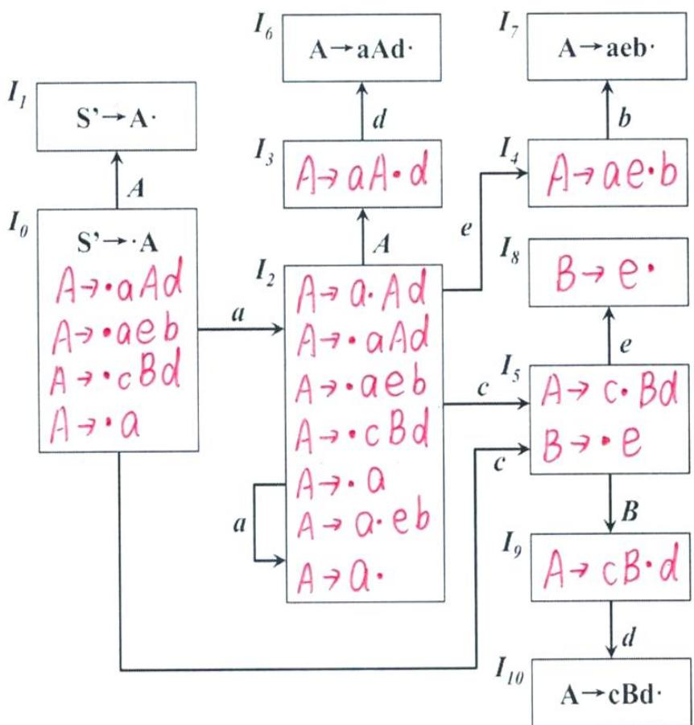

# 《编译原理》第三次作业讲解

原件经识别和整理；“参考解答”是我们补的。

### 计算 1

已知文法 G[S']：

- (0) S'→S
- (1) S→iBtSeS
- (2) S→iBtSe
- (3) S→a
- (4) B→b

1）构造其对应的 LR 状态转换图。

答案：Follow(S) = { #, e }，Follow(B) = { t }，LR 分析表如下。

| 状态 | Action i | Action t | Action e | Action a | Action b | Action # | GoTo S | GoTo B |
|---|---|---|---|---|---|---|---|---|
| 0 | $S_{2}$ | | | $S_{3}$ | | | 1 | |
| 1 | | | | | | acc | | |
| 2 | | | | | $S_{5}$ | | | 4 |
| 3 | $r_{3}$ | $r_{3}$ | $r_{3}$ | $r_{3}$ | $r_{3}$ | $r_{3}$ | | |
| 4 | | $S_{6}$ | | | | | | |
| 5 | $r_{4}$ | $r_{4}$ | $r_{4}$ | $r_{4}$ | $r_{4}$ | $r_{4}$ | | |
| 6 | $S_{2}$ | | | $S_{3}$ | | | 7 | |
| 7 | | | $S_{8}$ | | | | | |
| 8 | $r_{2}S_{2}$ | $r_{2}$ | $r_{2}$ | $r_{2}S_{3}$ | $r_{2}$ | $r_{2}$ | 9 | |
| 9 | $r_{1}$ | $r_{1}$ | $r_{1}$ | $r_{1}$ | $r_{1}$ | $r_{1}$ | | |

| 状态 | Action i | Action t | Action e | Action a | Action b | Action # | GoTo S | GoTo B |
|---|---|---|---|---|---|---|---|---|
| 0 | $S_{2}$ | | | $S_{3}$ | | | 1 | |
| 1 | | | | | | acc | | |
| 2 | | | | | $S_{5}$ | | | 4 |
| 3 | $r_{3}$ | $r_{3}$ | $r_{3}$ | $r_{3}$ | $r_{3}$ | $r_{3}$ | | |
| 4 | | $S_{6}$ | | | | | | |
| 5 | $r_{4}$ | $r_{4}$ | $r_{4}$ | $r_{4}$ | $r_{4}$ | $r_{4}$ | | |
| 6 | $S_{2}$ | | | $S_{3}$ | | | 7 | |
| 7 | | | $S_{8}$ | | | | | |
| 8 | $r_{2}S_{2}$ | $r_{2}$ | $r_{2}$ | $r_{2}S_{3}$ | $r_{2}$ | $r_{2}$ | 9 | |
| 9 | $r_{1}$ | $r_{1}$ | $r_{1}$ | $r_{1}$ | $r_{1}$ | $r_{1}$ | | |

| 状态 | Action i | Action t | Action e | Action a | Action b | Action # | GoTo S | GoTo B |
|---|---|---|---|---|---|---|---|---|
| 0 | $S_{2}$ | | | $S_{3}$ | | | 1 | |
| 1 | | | | | | acc | | |
| 2 | | | | | $S_{5}$ | | | 4 |
| 3 | $r_{3}$ | $r_{3}$ | $r_{3}$ | $r_{3}$ | $r_{3}$ | $r_{3}$ | | |
| 4 | | $S_{6}$ | | | | | | |
| 5 | $r_{4}$ | $r_{4}$ | $r_{4}$ | $r_{4}$ | $r_{4}$ | $r_{4}$ | | |
| 6 | $S_{2}$ | | | $S_{3}$ | | | 7 | |
| 7 | | | $S_{8}$ | | | | | |
| 8 | $r_{2}S_{2}$ | $r_{2}$ | $r_{2}$ | $r_{2}S_{3}$ | $r_{2}$ | $r_{2}$ | 9 | |
| 9 | $r_{1}$ | $r_{1}$ | $r_{1}$ | $r_{1}$ | $r_{1}$ | $r_{1}$ | | |

| 状态 | Action i | Action t | Action e | Action a | Action b | Action # | GoTo S | GoTo B |
|---|---|---|---|---|---|---|---|---|
| 0 | $S_{2}$ | | | $S_{3}$ | | | 1 | |
| 1 | | | | | | acc | | |
| 2 | | | | | $S_{5}$ | | | 4 |
| 3 | $r_{3}$ | $r_{3}$ | $r_{3}$ | $r_{3}$ | $r_{3}$ | $r_{3}$ | | |
| 4 | | $S_{6}$ | | | | | | |
| 5 | $r_{4}$ | $r_{4}$ | $r_{4}$ | $r_{4}$ | $r_{4}$ | $r_{4}$ | | |
| 6 | $S_{2}$ | | | $S_{3}$ | | | 7 | |
| 7 | | | $S_{8}$ | | | | | |
| 8 | $r_{2}S_{2}$ | $r_{2}$ | $r_{2}$ | $r_{2}S_{3}$ | $r_{2}$ | $r_{2}$ | 9 | |
| 9 | $r_{1}$ | $r_{1}$ | $r_{1}$ | $r_{1}$ | $r_{1}$ | $r_{1}$ | | |

1、已知文法`G[S’]` (0) S’→S (1) S→iBtSeS (2) S→iBtSe (3) S→a

(4) B→b

1）构造其对应的LR状态转换图

Follow(S) = { #, e }

<table><tr><td rowspan="2"></td><td colspan="6">Action</td><td colspan="2">GoTo</td></tr><tr><td>i</td><td>t</td><td>e</td><td>a</td><td>b</td><td>#</td><td>S</td><td>B</td></tr><tr><td>0</td><td> $S_{2}$ </td><td></td><td></td><td> $S_{3}$ </td><td></td><td></td><td>1</td><td></td></tr><tr><td>1</td><td></td><td></td><td></td><td></td><td></td><td>acc</td><td></td><td></td></tr><tr><td>2</td><td></td><td></td><td></td><td></td><td> $S_{5}$ </td><td></td><td></td><td>4</td></tr><tr><td>3</td><td> $r_{3}$ </td><td> $r_{3}$ </td><td> $r_{3}$ </td><td> $r_{3}$ </td><td> $r_{3}$ </td><td> $r_{3}$ </td><td></td><td></td></tr><tr><td>4</td><td></td><td> $S_{6}$ </td><td></td><td></td><td></td><td></td><td></td><td></td></tr><tr><td>5</td><td> $r_{4}$ </td><td> $r_{4}$ </td><td> $r_{4}$ </td><td> $r_{4}$ </td><td> $r_{4}$ </td><td> $r_{4}$ </td><td></td><td></td></tr><tr><td>6</td><td> $S_{2}$ </td><td></td><td></td><td> $S_{3}$ </td><td></td><td></td><td>7</td><td></td></tr><tr><td>7</td><td></td><td></td><td> $S_{8}$ </td><td></td><td></td><td></td><td></td><td></td></tr><tr><td>8</td><td> $r_{2}S_{2}$ </td><td> $r_{2}$ </td><td> $r_{2}$ </td><td> $r_{2}S_{3}$ </td><td> $r_{2}$ </td><td> $r_{2}$ </td><td>9</td><td></td></tr><tr><td>9</td><td> $r_{1}$ </td><td> $r_{1}$ </td><td> $r_{1}$ </td><td> $r_{1}$ </td><td> $r_{1}$ </td><td> $r_{1}$ </td><td></td><td></td></tr></table>

2、已知文法G[S’] ⓪ $\mathbf { S } ^ { 9 } { : : : = } \mathbf { A }$ ③ A::=cBd

1）构造识别其活前缀的DFA（把下图填写完整即可）

① $\mathbf { A } { : : = } \mathbf { a } \mathbf { A } \mathbf { d }$ ② $\mathbf { A } { : : } \mathbf { = a e b }$ ④ $\mathbf { A } { \boldsymbol { : } } { \boldsymbol { : } } { = } \mathbf { a }$ ⑤ $\mathbf { B } { : : = } \mathbf { e }$

2）该文法是LR(0)文法，还是SLR(1)文法？写出理由

2状态有“移进-归约”冲突，故不是LR(0)；Follow(A)={#,d}，与 $\{ \mathbf { a } , \mathbf { c } , \mathbf { e }$ 不相交，故是SLR(1)

3）构造该文法的分析表造表

<table><tr><td rowspan="2"></td><td colspan="6">Action</td><td colspan="2">GoTo</td></tr><tr><td>a</td><td>b</td><td>c</td><td>d</td><td>e</td><td>#</td><td>A</td><td>B</td></tr><tr><td>0</td><td> $S_{2}$ </td><td></td><td> $S_{5}$ </td><td></td><td></td><td></td><td>1</td><td></td></tr><tr><td>1</td><td></td><td></td><td></td><td></td><td></td><td>acc</td><td></td><td></td></tr><tr><td>2</td><td> $S_{2}$ </td><td></td><td> $S_{5}$ </td><td> $r_{4}$ </td><td> $S_{4}$ </td><td> $r_{4}$ </td><td>3</td><td></td></tr><tr><td>3</td><td></td><td></td><td></td><td> $S_{6}$ </td><td></td><td></td><td></td><td></td></tr><tr><td>4</td><td></td><td> $S_{7}$ </td><td></td><td></td><td></td><td></td><td></td><td></td></tr><tr><td>5</td><td></td><td></td><td></td><td></td><td> $S_{8}$ </td><td></td><td></td><td>9</td></tr><tr><td>6</td><td></td><td></td><td></td><td> $r_{1}$ </td><td></td><td> $r_{1}$ </td><td></td><td></td></tr><tr><td>7</td><td></td><td></td><td></td><td> $r_{2}$ </td><td></td><td> $r_{2}$ </td><td></td><td></td></tr><tr><td>8</td><td></td><td></td><td></td><td> $r_{5}$ </td><td></td><td></td><td></td><td></td></tr><tr><td>9</td><td></td><td></td><td></td><td> $S_{10}$ </td><td></td><td></td><td></td><td></td></tr><tr><td>10</td><td></td><td></td><td></td><td> $r_{3}$ </td><td></td><td> $r_{3}$ </td><td></td><td></td></tr></table>

3、给定已编号的文法G[S’]如下(0) $\mathbf { S } ^ { \bullet } { \boldsymbol { : } } 3 { = } \mathbf { S }$ (1) S::=AB (2) $\mathbf { A } { \boldsymbol { : } } { \mathbf { : } } { = } \mathbf { B } \mathbf { a }$ (3) $\mathbf { B } { : : = } \mathbf { b } \mathbf { A }$ (4) $\mathbf { B } { : : = } \mathbf { c }$

1）将下图补充完整，构建识别 活前缀的LR(1)项目的DFA

知识点：[语法制导翻译的基本思想与语法制导定义](../../../topics/编译原理/语法制导翻译概述.md)、[布尔表达式的翻译（回填技术）](../../../topics/编译原理/布尔表达式翻译.md)、[控制语句的翻译（if、while、for、goto）](../../../topics/编译原理/控制语句翻译.md)

### 2）根据1）中的图，将下表补充完整

<table><tr><td rowspan="2"></td><td colspan="4">Action</td><td colspan="3">Goto</td></tr><tr><td>a</td><td>b</td><td>c</td><td>#</td><td>S</td><td>A</td><td>B</td></tr><tr><td>0</td><td></td><td> $S_{4}$ </td><td> $S_{5}$ </td><td></td><td>1</td><td>2</td><td>3</td></tr><tr><td>1</td><td></td><td></td><td></td><td>acc</td><td></td><td></td><td></td></tr><tr><td>2</td><td></td><td> $S_{7}$ </td><td> $S_{8}$ </td><td></td><td></td><td></td><td>6</td></tr><tr><td>3</td><td> $S_{9}$ </td><td></td><td></td><td></td><td></td><td></td><td></td></tr><tr><td>4</td><td></td><td> $S_{4}$ </td><td> $S_{5}$ </td><td></td><td></td><td>10</td><td>11</td></tr><tr><td>5</td><td> $r_{4}$ </td><td></td><td></td><td></td><td></td><td></td><td></td></tr><tr><td>6</td><td></td><td></td><td></td><td> $r_{1}$ </td><td></td><td></td><td></td></tr><tr><td>7</td><td></td><td> $S_{4}$ </td><td> $S_{5}$ </td><td></td><td></td><td>12</td><td>13</td></tr><tr><td>8</td><td></td><td></td><td></td><td> $r_{4}$ </td><td></td><td></td><td></td></tr><tr><td>9</td><td></td><td> $r_{2}$ </td><td> $r_{2}$ </td><td></td><td></td><td></td><td></td></tr><tr><td>10</td><td> $r_{3}$ </td><td></td><td></td><td></td><td></td><td></td><td></td></tr><tr><td>11</td><td> $S_{14}$ </td><td></td><td></td><td></td><td></td><td></td><td></td></tr><tr><td>12</td><td></td><td></td><td></td><td> $r_{3}$ </td><td></td><td></td><td></td></tr><tr><td>13</td><td> $S_{15}$ </td><td></td><td></td><td></td><td></td><td></td><td></td></tr><tr><td>14</td><td> $r_{2}$ </td><td></td><td></td><td></td><td></td><td></td><td></td></tr><tr><td>15</td><td></td><td></td><td></td><td> $r_{2}$ </td><td></td><td></td><td></td></tr></table>

# 编译原理第三次作业讲解（第 3 部分）

本资料为《编译原理》第三次作业讲解中关于 LR(1) 分析表构造、LALR(1) 文法判断及条件语句语法制导翻译的习题与补充内容，由识别工具读取并整理。

## 一、LR(1) 分析与 LALR(1) 判断

知识点：[LR(1)分析表构造](../../../topics/编译原理/LR1分析表构造.md)、[LALR分析表构造（同心集合并）](../../../topics/编译原理/LALR分析表构造.md)

### 选择 4

题干：已知文法 G[S'] 如下——
(0) $S' \rightarrow S$
(1) $S \rightarrow aXd$
(2) $S \rightarrow bYd$
(3) $S \rightarrow aYe$
(4) $S \rightarrow bXe$
(5) $X \rightarrow c$
(6) $Y \rightarrow c$

1）构造识别该文法的全部 LR(1) 项目集；
2）构造其 LR(1) 分析表（将下面转换图补充完整 Action）；
3）判断并说明该文法是否是 LALR(1) 文法？说明理由。

**状态 I5 的项目集：**
$$
I_5: \begin{cases} Y \rightarrow c \cdot, d \\ X \rightarrow c \cdot, e \end{cases}
$$

**LR(1) 分析表：**

| State | Action (a) | Action (b) | Action (c) | Action (d) | Action (e) | Action (#) | Goto (S) | Goto (X) | Goto (Y) |
| :---: | :---: | :---: | :---: | :---: | :---: | :---: | :---: | :---: | :---: |
| 0 | $S_2$ | $S_3$ | | | | | 1 | | |
| 1 | | | | | | acc | | | |
| 2 | | | $S_4$ | | | | | 6 | 7 |
| 3 | | | $S_5$ | | | | | 9 | 8 |
| 4 | | | | $r_5$ | $r_6$ | | | | |
| 5 | | | | $r_6$ | $r_5$ | | | | |
| 6 | | | | $S_{10}$ | | | | | |
| 7 | | | | | $S_{11}$ | | | | |
| 8 | | | | $S_{12}$ | | | | | |
| 9 | | | | | $S_{13}$ | | | | |
| 10 | | | | | | $r_1$ | | | |
| 11 | | | | | | $r_3$ | | | |
| 12 | | | | | | $r_2$ | | | |
| 13 | | | | | | $r_4$ | | | |

答案：见上述表格。
知识点：[LR(1)分析表构造](../../../topics/编译原理/LR1分析表构造.md)、[LALR分析表构造（同心集合并）](../../../topics/编译原理/LALR分析表构造.md)

### 简答 1

题干：给出如下文法（图片展示四个文法 G1, G2, G3, G4），请完成以下证明：
1. 证明二义性文法 G1[S] 不是 LR(0) 文法。
2. 证明 G2[S] 是 SLR(1) 文法但不是 LR(0) 文法。
3. 证明 G3[S] 是 LR(1) 文法但不是 SLR(1) 文法。
4. 证明 G4[S] 是 LR(1) 文法但不是 LALR(1) 文法。

答案：略（需根据具体文法进行构造和分析）。
知识点：[LR(0)分析表构造（活前缀、LR(0)项目、项目集规范族）](../../../topics/编译原理/LR0分析表构造.md)、[SLR(1)分析表构造](../../../topics/编译原理/SLR1分析表构造.md)、[LR(1)分析表构造](../../../topics/编译原理/LR1分析表构造.md)、[LALR分析表构造（同心集合并）](../../../topics/编译原理/LALR分析表构造.md)

### 计算 1

题干：给出下述条件语句语法制导翻译过程。
语句：`if a∧b∧c>d then if a<b then f:=1 else f:=0 else g:=2`

补充：给出下述条件语句语法制导翻译过程。
补充：给出下述条件语句语法制导翻译过程。
...（原文多次重复该提示，以下为具体的翻译结果展示）

**翻译结果展示 1（表格形式）：**

| 语句片段 | 代码序列 | 说明 |
| :--- | :--- | :--- |
| `if a∧b∧c>d` | `100 (jnz, a, , 102)`   `101 (j, , , 0)`   `102 (jnz, b, , 104)`   `103 (j, , , 0)`   `104 (j>, c, d, 0)`   `105 (j, , , 0)` | →假出口 | ←... | →假出口 | →真出口 | →假出口 |

**翻译结果展示 2（公式推导形式 A）：**

$$
\begin{array}{l l l} 
\text {if } a\wedge b\wedge c > d & 1 0 0 (\mathrm{jnz}, \mathrm{a},, 1 0 2) \\ 
\text {then} & 1 0 1 (\mathrm{j},,, 0) & \longrightarrow \text {假出口} \\ 
\text {if } a < b & 1 0 2 (\mathrm{jnz}, \mathrm{b},, 1 0 4) & \\ 
\text {then } f:=1 & 1 0 3 (\mathrm{j},,, 0) & \longrightarrow \text {假出口} \\ 
\text {else } f:=0 & 1 0 4 (\mathrm{j},, \mathrm{c}, \mathrm{d}, 0) & \longrightarrow \text {真出口} \\ 
\text {else } g:=2 & 1 0 5 (\mathrm{j},,, 0) & \longrightarrow \text {假出口} 
\end{array}
$$

**翻译结果展示 3（公式推导形式 B - 含子语句出口）：**

$$
\begin{array}{l l l} 
\text {if } a\wedge b\wedge c > d & 1 0 0 (\mathrm{jnz}, \mathrm{a},, 1 0 2) \\ 
\text {then} & 1 0 1 (\mathrm{j},,, 0) & \longrightarrow \text {假出口} \\ 
\text {if } a < b & 1 0 2 (\mathrm{jnz}, \mathrm{b},, 1 0 4) & \\ 
\text {then } f:=1 & 1 0 3 (\mathrm{j},,, 0) & \longrightarrow \text {假出口} \\ 
\text {else } f:=0 & 1 0 4 (\mathrm{j},, \mathrm{c}, \mathrm{d}, 1 0 6) & \\ 
\text {else } g:=2 & 1 0 5 (\mathrm{j},,, 0) & \longrightarrow \text {假出口} 
\end{array}
$$

**翻译结果展示 4（公式推导形式 C - 完善假出口链）：**

$$
\begin{array}{l l l} 
\text {if } a\wedge b\wedge c > d & 1 0 0 (\mathrm{jnz}, \mathrm{a},, 1 0 2) \\ 
\text {then} & 1 0 1 (\mathrm{j},,, 0) \\ 
\text {if } a < b & 1 0 2 (\mathrm{jnz}, \mathrm{b},, 1 0 4) \\ 
\text {then } f:=1 & 1 0 3 (\mathrm{j},,, 0) \\ 
\text {else } f:=0 & 1 0 4 (\mathrm{j} >, \mathrm{c}, \mathrm{d}, 1 0 6) \\ 
\text {else } g:=2 & 1 0 5 (\mathrm{j},,, 0) \\ 
& 1 0 6 (\mathrm{j}<, \mathrm{a}, \mathrm{b}, 0) 
\end{array}
\quad 
\begin{array}{l l l} 
\longrightarrow & \text {假出口} \\ 
\longrightarrow & \text {假出口} \\ 
\longrightarrow & \text {假出口} \\ 
\longrightarrow & \text {子语句真出口} 
\end{array}
$$

**翻译结果展示 5（公式推导形式 D - 完整流程）：**

$$
\begin{array}{l l l} 
\text {if } a\wedge b\wedge c > d & 1 0 0 (\mathrm{jnz}, \mathrm{a},, 1 0 2) \\ 
\text {then} & 1 0 1 (\mathrm{j},,, 0) \\ 
\text {if } a < b & 1 0 2 (\mathrm{jnz}, \mathrm{b},, 1 0 4) \\ 
\text {then } f:=1 & 1 0 3 (\mathrm{j},,, 0) \\ 
\text {else } f:=0 & 1 0 4 (\mathrm{j} >, \mathrm{c}, \mathrm{d}, 1 0 6) \\ 
\text {else } g:=2 & 1 0 5 (\mathrm{j},,, 0) \\ 
& 1 0 6 (\mathrm{j}<, \mathrm{a}, \mathrm{b}, 0) \\ 
& 1 0 7 (\mathrm{j},,, 0) 
\end{array}
\quad 
\begin{array}{l l l} 
\longrightarrow & \text {假出口} \\ 
\longrightarrow & \text {假出口} \\ 
\longrightarrow & \text {假出口} \\ 
\longrightarrow & \text {子语句真出口} \\ 
\longrightarrow & \text {子语句假出口} 
\end{array}
$$

答案：见上述代码序列与流程图。
知识点：[语法制导翻译的基本思想与语法制导定义](../../../topics/编译原理/语法制导翻译概述.md)、[布尔表达式的翻译（回填技术）](../../../topics/编译原理/布尔表达式翻译.md)、[控制语句的翻译（if、while、for、goto）](../../../topics/编译原理/控制语句翻译.md)

### 补充 1

**题目：** 给出下述条件语句语法制导翻译过程。

**原始语句结构：**
$$
\begin{array}{l l} \text {if a\wedge b\wedge c > d} & \\ \text {then} & \\ \text {if a <   b} & \\ \text {then f:=1} & \\ \text {else f:=0} & \\ \text {else g:=2} & \end{array}
$$

**第一步翻译结果：**

$$
\begin{array}{l l l} \text {if a\wedge b\wedge c > d} & 1 0 0 (j n z, a,, 1 0 2) \\ \text {then} & 1 0 1 (j,, 0) \\ \text {if a <   b} & 1 0 2 (j n z, b,, 1 0 4) \\ \text {then f:=1} & 1 0 3 (j,, 0) \\ \text {else f:=0} & 1 0 4 (j >, c, d, 1 0 6) \\ \text {else g:=2} & 1 0 5 (j,, 0) \\ & 1 0 6 (j <  , a, b, 0) \\ & 1 0 7 (j,, 0) \\ & 1 0 8 (: = , 1,, f) \end{array} \quad \begin{array}{l l l} \longrightarrow & \text {假出口} \\ \longrightarrow & \text {假出口} \\ \longrightarrow & \text {假出口} \\ \longrightarrow & \text {子语句真出口} \\ \longrightarrow & \text {子语句假出口} \end{array}
$$

知识点：[控制语句的翻译（if、while、for、goto）](../../../topics/编译原理/控制语句翻译.md)、[布尔表达式的翻译（回填技术）](../../../topics/编译原理/布尔表达式翻译.md)、[中间语言（逆波兰、三元式、树形、四元式）](../../../topics/编译原理/中间语言.md)

### 补充 2

**题目：** 给出下述条件语句语法制导翻译过程。

**第二步翻译结果（修正跳转目标）：**

$$
\begin{array}{l l l} \text {if a\wedge b\wedge c > d} & 1 0 0 (j n z, a,, 1 0 2) \\ \text {then} & 1 0 1 (j,, 0) \\ \text {if a <   b} & 1 0 2 (j n z, b,, 1 0 4) \\ \text {then f:=1} & 1 0 3 (j,, 0) \\ \text {else f:=0} & 1 0 4 (j >, c, d, 1 0 6) \\ \text {else g:=2} & 1 0 5 (j,, 0) \\ & 1 0 6 (j <  , a, b, 1 0 8) \\ & 1 0 7 (j,, 0) \\ & 1 0 8 (: = , 1,, f) \end{array} \quad \begin{array}{l l l} \longrightarrow & \text {假出口} \\ \longrightarrow & \text {假出口} \\ \longrightarrow & \text {假出口} \\ \longrightarrow & \text {子语句假出口} \end{array}
$$

知识点：[语法制导翻译的基本思想与语法制导定义](../../../topics/编译原理/语法制导翻译概述.md)、[控制语句的翻译（if、while、for、goto）](../../../topics/编译原理/控制语句翻译.md)、[布尔表达式的翻译（回填技术）](../../../topics/编译原理/布尔表达式翻译.md)

### 补充 3

**题目：** 给出下述条件语句语法制导翻译过程。

**第三步翻译结果（增加内层 else 跳转）：**

$$
\begin{array}{l l l} \text {if a\wedge b\wedge c > d} & 1 0 0 (j n z, a,, 1 0 2) \\ \text {then} & 1 0 1 (j,, , 0) \\ \text {if a <   b} & 1 0 2 (j n z, b,, 1 0 4) \\ \text {then f:=1} & 1 0 3 (j,, , 0) \\ \text {else f:=0} & 1 0 4 (j >, c, d, 1 0 6) \\ \text {else g:=2} & 1 0 5 (j,, , 0) \\ & 1 0 6 (j <  , a, b, 1 0 8) \\ & 1 0 7 (j,, , 0) \\ & 1 0 8 (: = , 1,, f) \\ & 1 0 9 (j,, , 0) \end{array} \quad \begin{array}{l l l} \longrightarrow & \text {假出口} \\ \longrightarrow & \text {假出口} \\ \longrightarrow & \text {假出口} \\ \longrightarrow & \text {子语句假出口} \end{array}
$$

知识点：[控制语句的翻译（if、while、for、goto）](../../../topics/编译原理/控制语句翻译.md)、[布尔表达式的翻译（回填技术）](../../../topics/编译原理/布尔表达式翻译.md)、[中间语言（逆波兰、三元式、树形、四元式）](../../../topics/编译原理/中间语言.md)

### 补充 4

**题目：** 给出下述条件语句语法制导翻译过程。

**第四步翻译结果（标记跳出与回填）：**

$$
\begin{array}{l l l} \text {if a\wedge b\wedge c>d} & 1 0 0 (j n z, a,, 1 0 2) \\ \text {then} & 1 0 1 (j,, , 0) \\ \text {if a< b} & 1 0 2 (j n z, b,, 1 0 4) \\ \text {then f:=1} & 1 0 3 (j,, , 0) \\ \text {else f:=0} & 1 0 4 (j >, c, d, 1 0 6) \\ \text {else g:=2} & 1 0 5 (j,, , 0) \\ & 1 0 6 (j <  , a, b, 1 0 8) \\ & 1 0 7 (j,, , 0) \\ & 1 0 8 (: = , 1,, f) \\ & 1 0 9 (j,, , 0) \end{array} \quad \begin{array}{l l l} \longrightarrow & \text {假出口} \\ \longrightarrow & \text {假出口} \\ \longrightarrow & \text {假出口} \\ \longrightarrow & \text {跳出条件语句} \\ & \text {未来回填} \end{array}
$$

知识点：[控制语句的翻译（if、while、for、goto）](../../../topics/编译原理/控制语句翻译.md)、[语法制导翻译的基本思想与语法制导定义](../../../topics/编译原理/语法制导翻译概述.md)

### 补充 5

**题目：** 给出下述条件语句语法制导翻译过程。

**第五步翻译结果（完善赋值语句）：**

$$
\begin{array}{l l l} \text {if a\wedge b\wedge c > d} & 1 0 0 (j n z, a,, 1 0 2) \\ \text {then} & 1 0 1 (j,, 0) \\ \text {if a <   b} & 1 0 2 (j n z, b,, 1 0 4) \\ \text {then f:=1} & 1 0 3 (j,, 0) \\ \text {else f:=0} & 1 0 4 (j >, c, d, 1 0 6) \\ \text {else g:=2} & 1 0 5 (j,, 0) \\ & 1 0 6 (j <  , a, b, 1 0 8) \\ & 1 0 7 (j,, 0) \\ & 1 0 8 (: = , 1,, f) \\ & 1 0 9 (j,, 0) \\ & 1 1 0 (: = , 0,, f) \end{array} \quad \begin{array}{l l l} \longrightarrow & \text {假出口} \\ \longrightarrow & \text {假出口} \\ \longrightarrow & \text {假出口} \\ \longrightarrow & \text {子语句假出口} \\ \longrightarrow & \text {跳出条件语句} \\ & \text {未来回填} \end{array}
$$

知识点：[控制语句的翻译（if、while、for、goto）](../../../topics/编译原理/控制语句翻译.md)、[语法制导翻译的基本思想与语法制导定义](../../../topics/编译原理/语法制导翻译概述.md)、[布尔表达式的翻译（回填技术）](../../../topics/编译原理/布尔表达式翻译.md)

### 补充 6

**题目：** 给出下述条件语句语法制导翻译过程。

**第六步翻译结果（调整跳转目标）：**

$$
\begin{array}{l l l} \text {if a\wedge b\wedge c > d} & 1 0 0 (j n z, a,, 1 0 2) \\ \text {then} & 1 0 1 (j,, 0) \\ \text {if a <   b} & 1 0 2 (j n z, b,, 1 0 4) \\ \text {then f:=1} & 1 0 3 (j,, 0) \\ \text {else f:=0} & 1 0 4 (j >, c, d, 1 0 6) \\ \text {else g:=2} & 1 0 5 (j,, 0) \\ & 1 0 6 (j <  , a, b, 1 0 8) \\ & 1 0 7 (j,, 1 1 0) \\ & 1 0 8 (: = , 1,, f) \\ & 1 0 9 (j,, 0) \\ & 1 1 0 (: = , 0,, f) \end{array} \quad \begin{array}{l l l} \longrightarrow & \text {假出口} \\ \longrightarrow & \text {假出口} \\ \longrightarrow & \text {假出口} \\ \longrightarrow & \text {跳出条件语句} \\ & \text {未来回填} \end{array}
$$

知识点：[语法制导翻译的基本思想与语法制导定义](../../../topics/编译原理/语法制导翻译概述.md)、[控制语句的翻译（if、while、for、goto）](../../../topics/编译原理/控制语句翻译.md)

### 补充 7

**题目：** 给出下述条件语句语法制导翻译过程。

**第七步翻译结果（增加外层 else 分支）：**

$$
\begin{array}{l l l} \text {if a\wedge b\wedge c>d} & 1 0 0 (j n z, a,, 1 0 2) \\ \text {then} & 1 0 1 (j,, , 0) \\ \text {if a< b} & 1 0 2 (j n z, b,, 1 0 4) \\ \text {then f:=1} & 1 0 3 (j,, , 0) \\ \text {else f:=0} & 1 0 4 (j >, c, d, 1 0 6) \\ \text {else g:=2} & 1 0 5 (j,, , 0) \\ & 1 0 6 (j <  , a, b, 1 0 8) \\ & 1 0 7 (j,, , 1 1 0) \\ & 1 0 8 (: = , 1,, f) \\ & 1 0 9 (j,, , 0) \\ & 1 1 0 (: = , 0,, f) \\ & 1 1 1 (j,, , 0) \end{array} \quad \begin{array}{l l l} \longrightarrow & \text {假出口} \\ \longrightarrow & \text {假出口} \\ \longrightarrow & \text {假出口} \\ \longrightarrow & \text {跳出条件语句} \\ & \text {未来回填} \end{array}
$$

知识点：[控制语句的翻译（if、while、for、goto）](../../../topics/编译原理/控制语句翻译.md)、[布尔表达式的翻译（回填技术）](../../../topics/编译原理/布尔表达式翻译.md)、[中间语言（逆波兰、三元式、树形、四元式）](../../../topics/编译原理/中间语言.md)

### 补充 8

**题目：** 给出下述条件语句语法制导翻译过程。

**第八步翻译结果（完善回填列表）：**

$$
\begin{array}{l l l} \text {if a\wedge b\wedge c>d} & 1 0 0 (j n z, a,, 1 0 2) \\ \text {then} & 1 0 1 (j,, , 0) \\ \text {if a< b} & 1 0 2 (j n z, b,, 1 0 4) \\ \text {then f:=1} & 1 0 3 (j,, , 0) \\ \text {else f:=0} & 1 0 4 (j >, c, d, 1 0 6) \\ \text {else g:=2} & 1 0 5 (j,, , 0) \\ & 1 0 6 (j <  , a, b, 1 0 8) \\ & 1 0 7 (j,, , 1 1 0) \\ & 1 0 8 (: = , 1,, f) \\ & 1 0 9 (j,, , 0) \\ & 1 1 0 (: = , 0,, f) \\ & 1 1 1 (j,, , 0) \end{array} \quad \begin{array}{l l l} \longrightarrow & \text {假出口} \\ \longrightarrow & \text {假出口} \\ \longrightarrow & \text {假出口} \\ \longrightarrow & \text {跳出条件语句} \\ & \text {未来回填} \\ \longrightarrow & \text {跳出条件语句} \\ & \text {未来回填} \end{array}
$$

知识点：[布尔表达式的翻译（回填技术）](../../../topics/编译原理/布尔表达式翻译.md)、[控制语句的翻译（if、while、for、goto）](../../../topics/编译原理/控制语句翻译.md)、[语法制导翻译的基本思想与语法制导定义](../../../topics/编译原理/语法制导翻译概述.md)

### 补充 9

**题目：** 给出下述条件语句语法制导翻译过程。

**第九步翻译结果（完成 else 分支赋值）：**

$$
\begin{array}{l l l} \text {if a\wedge b\wedge c > d} & 1 0 0 (j n z, a,, 1 0 2) \\ \text {then} & 1 0 1 (j,, 0) \\ \text {if a <   b} & 1 0 2 (j n z, b,, 1 0 4) \\ \text {then f:=1} & 1 0 3 (j,, 0) \\ \text {else f:=0} & 1 0 4 (j >, c, d, 1 0 6) \\ \text {else g:=2} & 1 0 5 (j,, 0) \\ & 1 0 6 (j <  , a, b, 1 0 8) \\ & 1 0 7 (j,, 1 1 0) \\ & 1 0 8 (: = , 1,, f) \\ & 1 0 9 (j,, 0) \\ & 1 1 0 (: = , 0,, f) \\ & 1 1 1 (j,, 0) \\ & 1 1 2 (: = , 2,, g) \end{array} \quad \begin{array}{l l l} \longrightarrow & \text {假出口} \\ \longrightarrow & \text {假出口} \\ \longrightarrow & \text {假出口} \\ \longrightarrow & \text {跳出条件语句} \\ & \text {未来回填} \\ \longrightarrow & \text {跳出条件语句} \\ & \text {未来回填} \end{array}
$$

知识点：[语法制导翻译的基本思想与语法制导定义](../../../topics/编译原理/语法制导翻译概述.md)、[控制语句的翻译（if、while、for、goto）](../../../topics/编译原理/控制语句翻译.md)、[中间语言（逆波兰、三元式、树形、四元式）](../../../topics/编译原理/中间语言.md)

### 补充 10

**题目：** 给出下述条件语句语法制导翻译过程。

**最终翻译结果（包含返回指令与完整回填标注）：**

$$
\begin{array}{l l} \text {if a\wedge b\wedge c > d} & 1 0 0 (\mathrm{jnz}, \mathrm{a},, 1 0 2) \\ \text {then} & 1 0 1 (\mathrm{j},, , 1 1 2) \\ \text {if a <   b} & 1 0 2 (\mathrm{jnz}, \mathrm{b},, 1 0 4) \\ \text {then f:=1} & 1 0 3 (\mathrm{j},, , 1 1 2) \\ \text {else f:=0} & 1 0 4 (\mathrm{j>,c,d,106}) \\ \text {else g:=2} & 1 0 5 (\mathrm{j},, , 1 1 2) \\ & 1 0 6 (\mathrm{j< }, \mathrm{a,b,108}) \\ & 1 0 7 (\mathrm{j},, , 1 1 0) \\ & 1 0 8 (:=, 1, , \mathrm{f}) \\ & 1 0 9 (\mathrm{j},, , 0) \\ & 1 1 0 (:=, 0, , \mathrm{f}) \\ & 1 1 1 (\mathrm{j},, , 0) \\ & 1 1 2 (:=, 2, , \mathrm{g}) \\ & 1 1 3 (\text {return},,) \end{array} \quad \xrightarrow {\text {跳出条件语句}} \begin{array}{l} \text {跳 出 条 件 梁 句} \\ \text {未 来 回 填} \\ \text {跳 出 条 件 梁 句} \\ \text {未 来 回 填} \end{array}
$$

注：原文中“跳出条件梁句”应为“跳出条件语句”，此处保留原文识别文字，但逻辑上指代跳出整个 if-else 结构。

知识点：[控制语句的翻译（if、while、for、goto）](../../../topics/编译原理/控制语句翻译.md)、[布尔表达式的翻译（回填技术）](../../../topics/编译原理/布尔表达式翻译.md)
