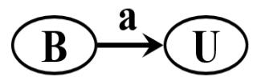
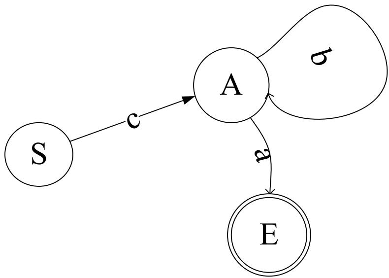
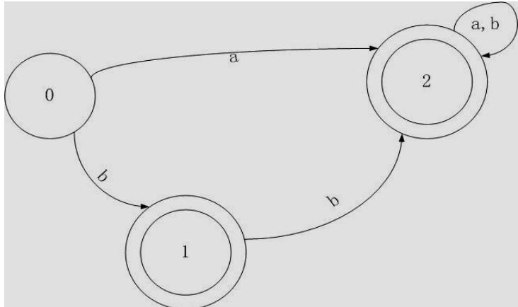
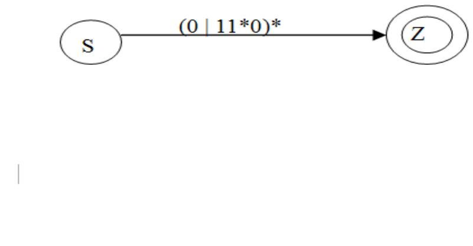
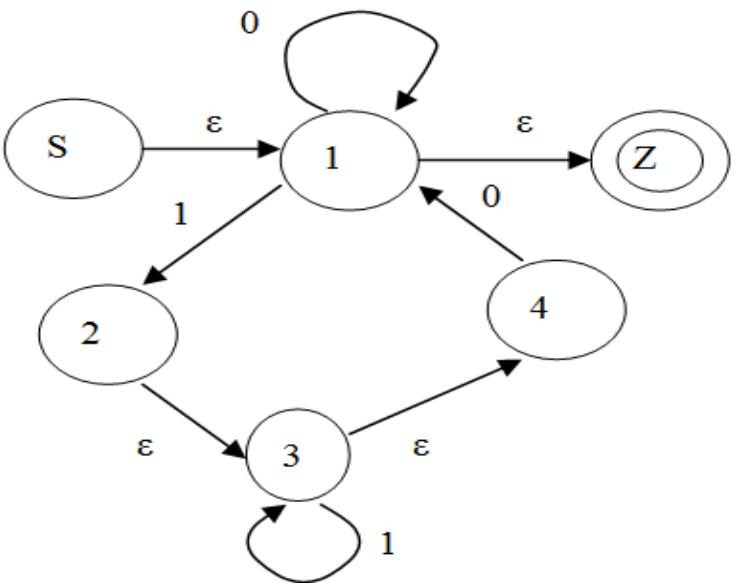
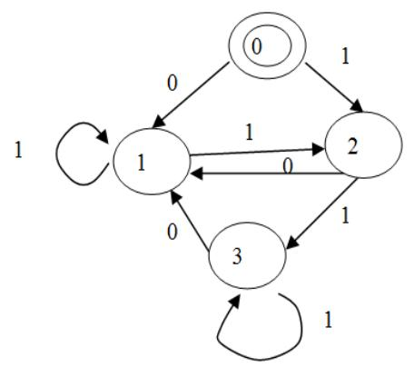
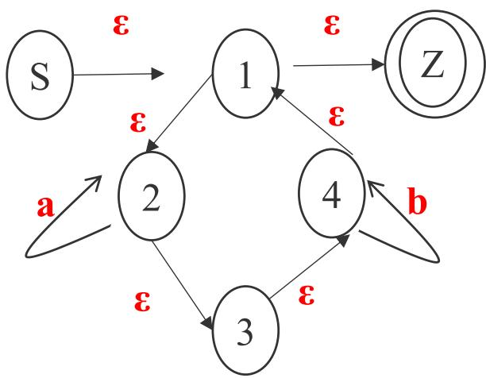

# 《编译原理》第三章 词法分析 课后作业答案

按原件页序整理。原文中的“解”“答”等保留原件答案；“参考解答”为补充。

## 原件第1页

### 第三章 词法分析

3-10 作业答案

## 原件第2页

### 第三章作业答案

1.画出下列文法的状态图：

Z：：=Be

$$
B: := A f
$$

A：：=e|Ae

并使用该状态图检查下列句子是否该文法的合法句子：f, eeff, eefe。

由状态图可知只有eefe是该文法的合法句子。

对于一个左线性文法G[E]：U::=a 或 U::=Ba U,B∈VN，a∈VT

归约的思想

（1）设一个开始状态S

（2）对于每一条规则U::=a，从状态S向状态U画一条箭弧，标记为a

（3）对于每一条规则U::=Ba，从状态B向状态U画一条箭弧，标为a

（4）开始符号为状态转换图的终态由以上规则，我们就可以由左线性文法来构造状态转换图了。

## 原件第3页

### 第三章作业答案

3.写出下列左线性文法的等价右线性文法：

$$
Z: := B e
$$

$$
B: := A f
$$

$$
A: := e | A e
$$

等价右线性文法为：

$$
\mathbf {S}: := \mathbf {e A}
$$

$$
\mathbf {A}: := \mathbf {e A}
$$

$$
\mathbf {A}: := \mathbf {f B}
$$

$$
\mathbf {B}: := \mathbf {e}
$$

## 原件第4页

### 第三章作业答案

2. 设右线性文法 $\mathsf { G } = ( \{ \mathsf { S } , \mathsf { A } , \mathsf { B } \} , \{ \mathsf { a } , \mathsf { b } \} , \mathsf { S } , \mathsf { P } )$ ，其中P组成如下：

$$
S: := b A \quad A: := b B \quad A: := a A \quad A: := b \quad B: := a
$$

画出该文法的状态转换图。

对于一个右线性文法G[E]：

推导的思想

$\mathbf { U } { : } { : } = \mathbf { a }$ 或 $\mathbf { U } { \boldsymbol { : : } } { = } \mathbf { a } \mathbf { B }$ U,B∈VN，a∈VT

（1）设一个终止状态Q

（2）对G中每一条形如U::=aB的文法规则，则从状态U向状态B引一条箭弧线并标记符号a。

(3）对于G中每一条形如U::=a的文法规则，从状态U向 终态Q引一条箭弧线并标记符号a。

（4）文法开始符号是初始状态（左线性文法中开始符号是终态）

## 原件第5页

### 第三章作业答案

4.写出下列右线性文法的等价左线性文法：

S：：=bA A：：=bB A：：=aA A：：=b B：：=a

等价左线性文法为：

$$
\mathbf {Z}: := \mathbf {A b} | \mathbf {B a}
$$

$$
\mathrm{A}: := \mathrm{Aa} | \mathrm{b}
$$

$$
\mathbf {B}: := \mathbf {A b}
$$

## 原件第6页

### 第三章作业答案

5、已知 $| \mathbf { e } 1 = ( \mathbf { a } | \mathbf { b } ) ^ { * }$ ${ \bf e } 2 = ( { \bf a } ^ { * } { \bf b } ^ { * } ) ^ { * }$ ，分别求L(e1) L(e2)

令Σ为有穷字母表，则Σ上的正规式和正规集可递归定义如下：

$$
L (e 1) = \{a, b \} ^ {*}
$$

$$
L (e 2) = \{\{a \} ^ {*} \{b \} ^ {*} \} ^ {*} = ?
$$

1）ε和∅是Σ上的正规式，则它们相应正规集分别为 $\left\{ \mathfrak { E } \right\}$ 和∅;

2）对于每 $- \mathbf { { \hat { a } } } \in \Sigma ,$ a是Σ上一个正规式，则它所表示相应正规集为{a}

3）如果 ${ \bf f } _ { 1 }$ $\vert \mathbf { e } _ { 2 }$ 是Σ上的正规式，相应正规集分别记为 $\mathrm { L } ( \mathbf { e } _ { 1 } )$ 和 $\mathrm { L } \left( \mathbf { e } _ { 2 } \right)$ ，则

$$
L (e 2) = \{\{a \} ^ {*} \{b \} ^ {*} \} ^ {*} = \{a, b \} ^ {*}
$$

(1) $( \mathbf { \boldsymbol { \mathsf { e } } } _ { 1 } )$ 是正规式，其相应的正规集为 $\scriptstyle \bigcup ( ( \mathbf { e } _ { 1 } ) ) = \mathbf { L } ( \mathbf { e } _ { 1 } )$

(2) $\mathbf { e } _ { 1 } | \mathbf { e } _ { 2 }$ 是正规式，其相应正规集为 $\scriptstyle \cdot ( { \mathsf { e } } _ { 1 } | { \mathsf { e } } _ { 2 } ) = \operatorname { L } ( { \mathsf { e } } _ { 1 } ) \cup \operatorname { L } ( { \mathsf { e } } _ { 2 } )$

(3) $\mathrm { \varrho 1 \bullet 2 }$ 是正规式，其相应正规集为I $. ( \mathrm { e l } \bullet \mathrm { e 2 } ) = \mathrm { L } ( \mathrm { e l } ) \mathsf { L } ( \mathrm { e 2 } )$

(4) (e1)\*是正规式，其相应正规集为L $( \mathrm { ( e l ) * ) = ( L ( e l ) ) * }$

## 原件第7页

### 第三章作业答案

6.下面自动机是确定的吗？它相应的语言是什么？将其转换为等价的DFA

其中M：

## 原件第8页

### 第三章作业答案

7.下面自动机是确定的吗？它相应的语言是什么？将其转换为等价的DFA NFA=（{S，A，Z}，{0，1}，M，{S}，{Z}）

其中M：M（S，0）={A} M（S，1）=ø${ \bf M } { \bf \delta } ( { \bf A } , { \bf \omega } _ { 0 } ) = \{ { \bf A } ,$ Z} M（A，1）=øM（Z，0）=ø M（Z，1）={A}{0，1}上所有满足以00开头以0结尾且每个1必有0直接跟在其后的字符串的集合

<table><tr><td></td><td>0</td><td>1</td></tr><tr><td>S</td><td>{A}</td><td>∅</td></tr><tr><td>A</td><td>{A, Z}</td><td>∅</td></tr><tr><td>Z</td><td>∅</td><td>{A}</td></tr></table>

<table><tr><td></td><td>0</td><td>1</td></tr><tr><td>{S}</td><td>{A}</td><td>∅</td></tr><tr><td>{A}</td><td>{A, Z}</td><td>∅</td></tr><tr><td>{Z}</td><td>∅</td><td>{A}</td></tr><tr><td>{A, Z}</td><td>{A, Z}</td><td>{A}</td></tr></table>

<table><tr><td></td><td>0</td><td>1</td></tr><tr><td>S</td><td>A</td><td>∅</td></tr><tr><td>A</td><td>C</td><td>∅</td></tr><tr><td>Z</td><td>∅</td><td>A</td></tr><tr><td>C</td><td>C</td><td>A</td></tr></table>

<table><tr><td></td><td>0</td><td>1</td></tr><tr><td>S</td><td>A</td><td>∅</td></tr><tr><td>A</td><td>C</td><td>∅</td></tr><tr><td></td><td></td><td></td></tr><tr><td>C</td><td>C</td><td>A</td></tr></table>

C 是终止状态

## 原件第9页

### 第三章作业答案

8.下面自动机是确定的吗？它相应的语言是什么？将其转换为等价的DFA NFA=（{S，A，Z}，{0，1}，M，{S}，{Z}）

其中M：

$$
\mathbf {M} (\mathbf {S}, \mathbf {0}) = \{\mathbf {A} \}
$$

$$
\mathbf {M} (\mathbf {S}, 1) = \varnothing
$$

$$
\mathbf {M} (\mathbf {A}, \mathbf {0}) = \{\mathbf {A}, \mathbf {Z} \} \mathbf {M} (\mathbf {A}, \mathbf {1}) = \boldsymbol {\varnothing}
$$

$$
\mathbf {M} (\mathbf {Z}, \mathbf {0}) = \varnothing \quad \mathbf {M} (\mathbf {Z}, \mathbf {1}) = \{\mathbf {A} \}
$$

$$
S \xrightarrow {0} A \xrightarrow {0} C
$$

{0，1}上所有满足以00开头以0结尾且每个1必有0直接跟在其后的字符串的集合

<table><tr><td></td><td>0</td><td>1</td></tr><tr><td>S</td><td>A</td><td>∅</td></tr><tr><td>A</td><td>C</td><td>∅</td></tr><tr><td>Z</td><td>∅</td><td>A</td></tr><tr><td>C</td><td>C</td><td>A</td></tr></table>

<table><tr><td></td><td>0</td><td>1</td></tr><tr><td>S</td><td>A</td><td>∅</td></tr><tr><td>A</td><td>C</td><td>∅</td></tr><tr><td></td><td></td><td></td></tr><tr><td>C</td><td>C</td><td>A</td></tr></table>

C 是终止状态

## 原件第10页

### 第三章作业答案

8.设自动机是确定的吗？它相应的语言是什么？将其转换为等价的DFA NFA=（{S，A，Z}，{0，1}，M，{S}，{Z}）

其中M：

$$
\mathbf {M} (\mathbf {S}, \mathbf {0}) = \{\mathbf {A} \}
$$

$$
\mathbf {M} (\mathbf {S}, 1) = \varnothing
$$

$$
\mathbf {M} (\mathbf {A}, \mathbf {0}) = \{\mathbf {A}, \mathbf {Z} \} \mathbf {M} (\mathbf {A}, \mathbf {1}) = \boldsymbol {\varnothing}
$$

$$
\mathbf {M} (\mathbf {Z}, \mathbf {0}) = \varnothing \quad \mathbf {M} (\mathbf {Z}, \mathbf {1}) = \{\mathbf {A} \}
$$

$$
S \xrightarrow {0} A \xrightarrow {0} C
$$

{0，1}上所有满足以00开头以0结尾且每个1必有0直接跟在其后的字符串的集合

<table><tr><td></td><td>0</td><td>1</td></tr><tr><td>S</td><td>A</td><td>∅</td></tr><tr><td>A</td><td>C</td><td>∅</td></tr><tr><td>Z</td><td>∅</td><td>A</td></tr><tr><td>C</td><td>C</td><td>A</td></tr></table>

<table><tr><td></td><td>0</td><td>1</td></tr><tr><td>S</td><td>A</td><td>∅</td></tr><tr><td>A</td><td>C</td><td>∅</td></tr><tr><td></td><td></td><td></td></tr><tr><td>C</td><td>C</td><td>A</td></tr></table>

C 是终止状态

## 原件第11页

### 第三章作业答案

9.设有穷自动机 $\mathsf { M } = ( \{ \mathsf { S } , \mathsf { A } , \mathsf { E } \} , \{ \mathsf { a } , \mathsf { b } , \mathsf { c } \} , \mathsf { M } , \mathsf { S } , \{ \mathsf { E } \} )$ ，其中M定义为

$\begin{array} { r } { \textsf { M } ( { \mathsf { S } } , { \mathsf { c } } ) = \mathsf { A } \quad \textsf { M } ( { \mathsf { A } } , { \mathsf { b } } ) = \mathsf { A } \quad \textsf { M } ( { \mathsf { A } } , { \mathsf { a } } ) = \mathsf { E } } \end{array}$ 请构造一个左、右线性文法。

解：求右线性文法

S→cA A→bA A→a

左线性文法：

E→Aa A→c A→Ab

## 原件第12页

### 第三章作业答案

10.根据下面正规文法构造等价的正规表达式：

## 原件第13页

### 第三章作业答案

11.设 $( \mathsf { N F A } ) \mathsf { M } = ( \{ \mathsf { A } , \mathsf { B } \} , \{ \mathsf { a } , \mathsf { b } \} , \mathsf { M } , \{ \mathsf { A } \} , \{ \mathsf { B } \} )$ ，其中M定义如下：$\mathrm { ~ M ~ } ( \mathsf { A } , \mathsf { a } ) = \{ \mathsf { A } , \mathsf { B } \} \ \mathrm { ~ M ~ } ( \mathsf { A } , \mathsf { b } ) = \{ \mathsf { B } \} \ \mathsf { M } \ ( \mathsf { B } , \mathsf { a } ) = \emptyset \ \mathsf { M } \ ( \mathsf { B } , \mathsf { b } ) = \{ \mathsf { A } , \mathsf { B } \}$ 请构造相应确定有穷自动机(DFA) M’。

故 $\mathbf { M } ^ { \prime } \left( \left[ \mathbf { A } , \ \mathbf { B } \right] , \ \mathbf { b } \right) \ = \left[ \mathbf { A } , \ \mathbf { B } \right]$

$\scriptstyle \mathbf { S } = [ \mathbf { A } ]$ ，终态集 $. { \bf Z } { = } \{ [ { \bf A } , { \bf B } ] , [ { \bf B } ] \}$

重新定义：令 $\mathbf { \partial \cdot 0 = [ A ] _ { \lambda } 1 = [ B ] _ { \lambda } } 2 \mathbf { = [ A , B ] _ { \lambda } }$ ，则DFA如下所示：

## 原件第14页

### 第三章作业答案

12.已知正规文法 $\mathsf { G } = ( \{ \mathsf { S } , \mathsf { B } , \mathsf { C } \} , \{ \mathsf { a } , \mathsf { b } , \mathsf { c } \} , \mathsf { P } , \mathsf { S } )$ ，其中P内包含如下产生式：

$$
S: := a S \mid a B \quad \dots\dots①
$$

$$
B: := b B \mid b C \quad \dots \dots ②
$$

C::=cC | c ……③ 请构造一个等价的有穷自动机。

解： $\mathsf { M } = ( \{ \mathsf { S } , \mathsf { B } , \mathsf { C } , \mathsf { T } \} , \{ \mathsf { a } , \mathsf { b } , \mathsf { c } \} , \mathsf { M } , \{ \mathsf { S } \} , \{ \mathsf { T } \} )$

$$
a) = \varnothing \quad M (B, b) = B \quad M (B, b) = C \quad M (B, c) = \varnothing
$$

$$
\mathsf {M} (\mathsf {C}, \mathsf {a}) = \varnothing \quad \mathsf {M} (\mathsf {C}, \mathsf {b}) = \varnothing \quad \mathsf {M} (\mathsf {C}, \mathsf {c}) = \mathsf {T} \quad \mathsf {M} (\mathsf {C}, \mathsf {c}) = \mathsf {C}
$$

## 原件第15页

### 第三章作业答案

13.将正规表达式（0|11\*0）\*转换成等价的确定有穷自动机，并进行最小化。

(0 |11\*0)\*

解：先构造该正规式的转换系统如图3-22所示：

由上述转换系统可得状态转换集K={S,1,2,3,4,Z}，状态子集转换矩阵如下表

(0|11\*0)\*对应的状态转换矩阵

<table><tr><td>I</td><td> $I_0$ </td><td> $I_1$ </td><td>K</td><td>0</td><td>1</td></tr><tr><td>{S, 1, Z}</td><td>{1, Z}</td><td>{2, 3, 4}</td><td>0</td><td>1</td><td>2</td></tr><tr><td>{1, Z}</td><td>{1, Z}</td><td>{2, 3, 4}</td><td>1</td><td>1</td><td>2</td></tr><tr><td>{2, 3, 4}</td><td>{1, Z}</td><td>{3, 4}</td><td>2</td><td>1</td><td>3</td></tr><tr><td>{3, 4}</td><td>{1, Z}</td><td>{3, 4}</td><td>3</td><td>1</td><td>3</td></tr></table>

最小化为：

## 原件第16页

### 第三章作业答案

14.将正规表达式 $( \mathsf { a } ^ { \star } \mathsf { b } ^ { \star } )$ \*转换成等价的确定有穷自动机，并进行最小化。

<table><tr><td>I</td><td> $I_a$ </td><td> $I_b$ </td><td>K</td><td>a</td><td>b</td></tr><tr><td>{S, 1, 2, 3, 4, Z}</td><td>{1, 2, 3, 4, Z}</td><td>{1, 2, 3, 4, Z}</td><td>0</td><td>1</td><td>1</td></tr><tr><td>{1, 2, 3, 4, Z}</td><td>{1, 2, 3, 4, Z}</td><td>{1, 2, 3, 4, Z}</td><td>1</td><td>1</td><td>1</td></tr></table>

## 原件第17页

### 第三章作业答案

15.判断题(对下列叙述中正确的说法,在题后括号内打 $" \lor "$ ,错误的打 $\ " \times \ " \subset \mathbb { N }$

(1)单词是具有独立意义的最小语法单位。( )

(2)正规式的运算符“|”读作“或”。( )

(3)若两个正规式所表示的正规集相同,则认为二者是等价的。( )

(4)用l代表字母, $\mathsf { , d }$ 代表数字, $, \Sigma = \{ \vert , \mathsf { d } \} _ { \cdot }$ ,则正规式 $r = \mathsf { d } \mathsf { d } ^ { \ast }$ 定义了无符号整数单词。( )

(5)一张状态转换图只包含有限个状态,其中有一个被认为是初态,最多只有一个终态。( )

(6)终态与非终态是可区别的。( )

(7)对任意一个右线性文法G,都存在一个NFA（M） ,满足 $\mathsf { \Gamma } _ { - } ( \mathsf { G } ) { = } { \mathsf { L } } ( { \mathsf { M } } ) .$ 。( )

(8)对任意一个右线性文法G,都存在一个DFA（M） ,满足 $\lrcorner ( M ) = \mathsf { L } ( \mathsf { R } )$ 。( )

(1) $\vee ~ ( 2 ) \vee ~ ( 3 ) \vee ~ ( 4 ) \vee ~ ( 5 ) \times ~ ( 6 ) \vee ~ ( 7 ) \vee ~ ( 8 ) \vee$

## 原件第18页

### 谢 谢

Thank you

## 补充讲解

### 核对后的解答 1

参考解答：该自动机是 NFA，因为 $M(A,0)=\{A,Z\}$ 有两个后继。它接受的语言可准确写为 $00(0\mid10)^{*}$：先由 $S\xrightarrow{0}A\xrightarrow{0}Z$ 接受 `00`，此后在包含 $A,Z$ 的接受子集中，每读一个 `0` 仍可接受；读 `1` 后必须再读 `0` 才返回接受状态。最短接受串是 `00`，不能写成最短长度为 3 的 $00(0\mid10)^{*}0$。

可达 DFA 为 $\{S\},\{A\},\{A,Z\},\varnothing$，初态 $\{S\}$，唯一终态 $\{A,Z\}$。转换依次为：$\{S\}\xrightarrow{0}\{A\}$、$\{A\}\xrightarrow{0}\{A,Z\}$、$\{A,Z\}\xrightarrow{0}\{A,Z\}$、$\{A,Z\}\xrightarrow{1}\{A\}$；其余转换进入死状态。

