# 《编译原理》第三章 词法分析器的设计（1）（课件）

原件的每一页，下面附识别出的文字。

### 编译原理

原文：

编译原理

南京邮電大學
1842
Nanjing University of Posts and Telecommunications
南京邮電大學
Nanjing University of Posts and Telecommunications

### 第三章 词法分析

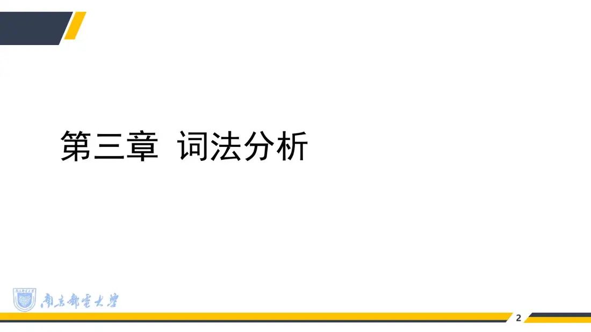

原文：

第三章 词法分析

南京邮电大学

2

### 整个编译过程如下图

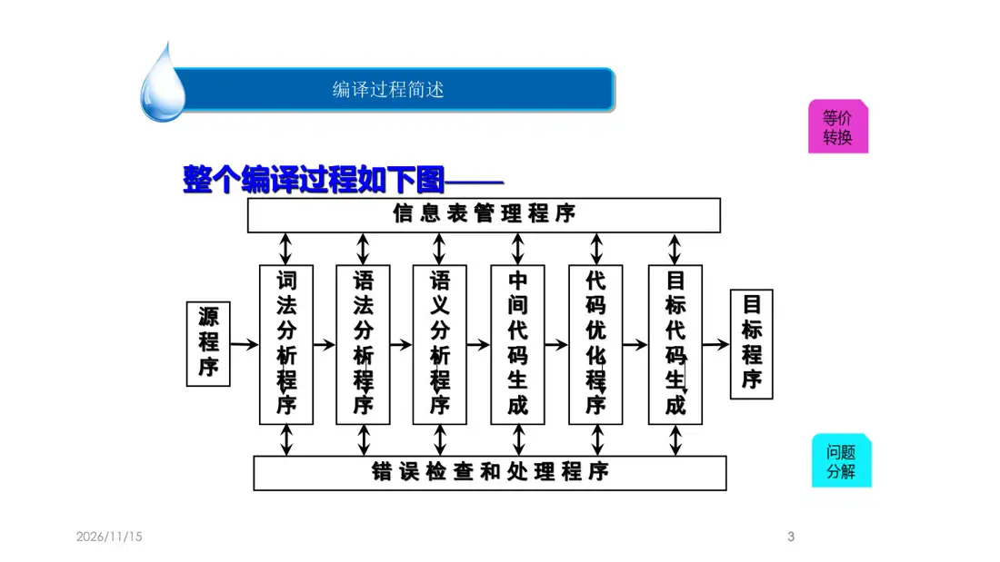

原文：

整个编译过程如下图

编译过程简述

等价转换

2026/11/15

3

### 第三章 词法分析

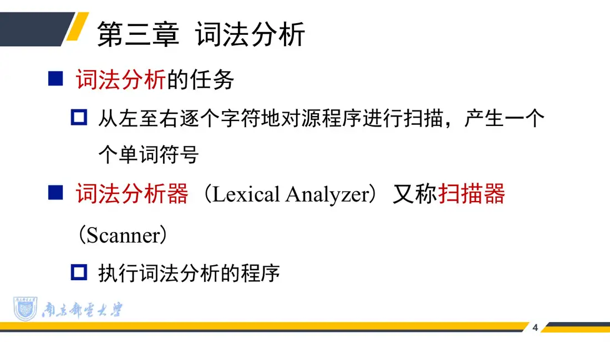

原文：

第三章 词法分析

词法分析的任务

□ 从左至右逐个字符地对源程序进行扫描，产生一个个单词符号

■ 词法分析器（Lexical Analyzer）又称扫描器
(Scanner)

执行词法分析的程序

南京邮电大学

4

### 词法分析器实现方案

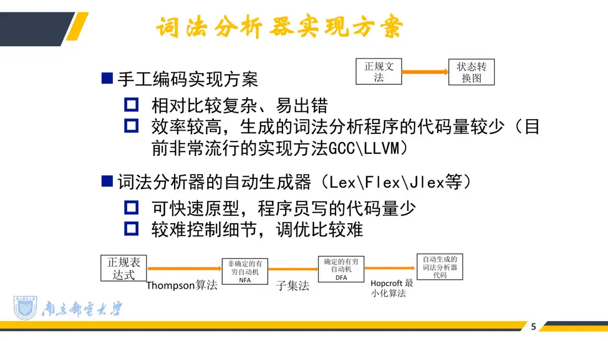

原文：

词法分析器实现方案

■ 手工编码实现方案

□ 相对比较复杂、易出错

☐ 效率较高，生成的词法分析程序的代码量较少（目前非常流行的实现方法GCC\LLVM）

■词法分析器的自动生成器（Lex\Flex\Jlex等）

☐ 可快速原型，程序员写的代码量少

☐ 较难控制细节，调优比较难

南京邮电大学

5

### 等价转换

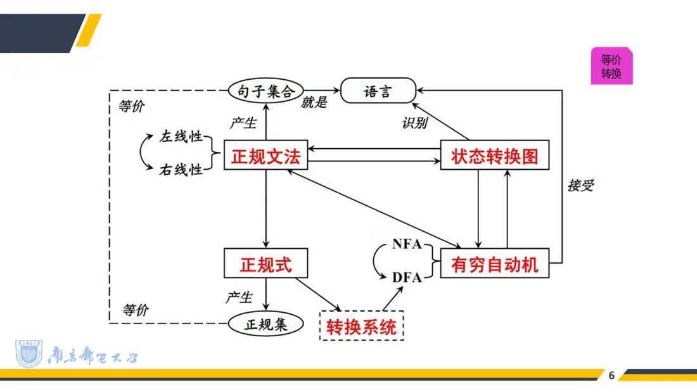

原文：

等价转换

南京邮电大学
南京邮电大学

6

### 3.1 对词法分析器的要求

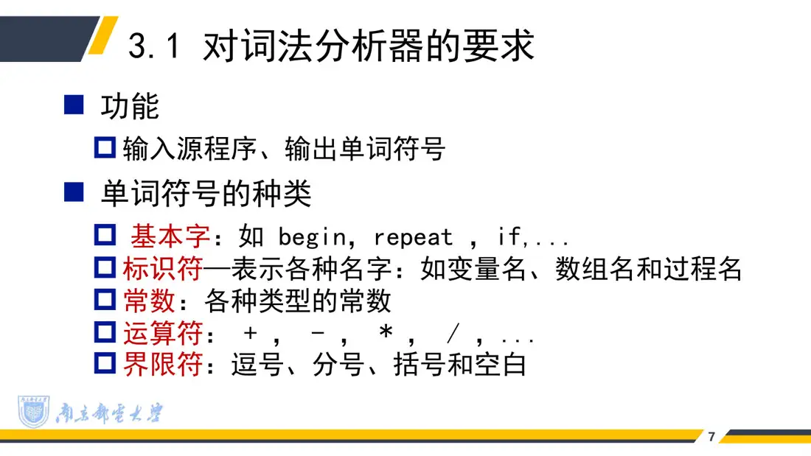

原文：

3.1 对词法分析器的要求

功能

□ 输入源程序、输出单词符号

■ 单词符号的种类

□ 基本字：如 begin, repeat, if,...

☐ 标识符—表示各种名字：如变量名、数组名和过程名

□常数：各种类型的常数

□运算符： + ， - ， \* ， / ， ...

□界限符：逗号、分号、括号和空白- 输出的单词符号的表示形式
- （单词种别，单词自身的值）

南京邮电大学

7

### ■ 单词种别通常用整数编码表示

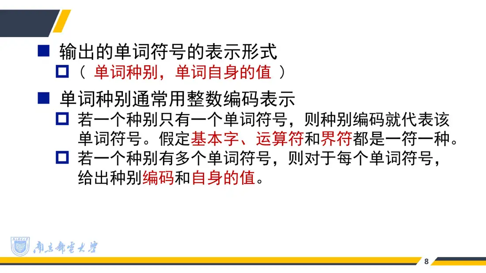

原文：

■ 单词种别通常用整数编码表示

☐ 若一个种别只有一个单词符号，则种别编码就代表该单词符号。假定基本字、运算符和界符都是一符一种。

☐ 若一个种别有多个单词符号，则对于每个单词符号，给出种别编码和自身的值。

南京邮电大学

8

### 单词自身的值编码方案

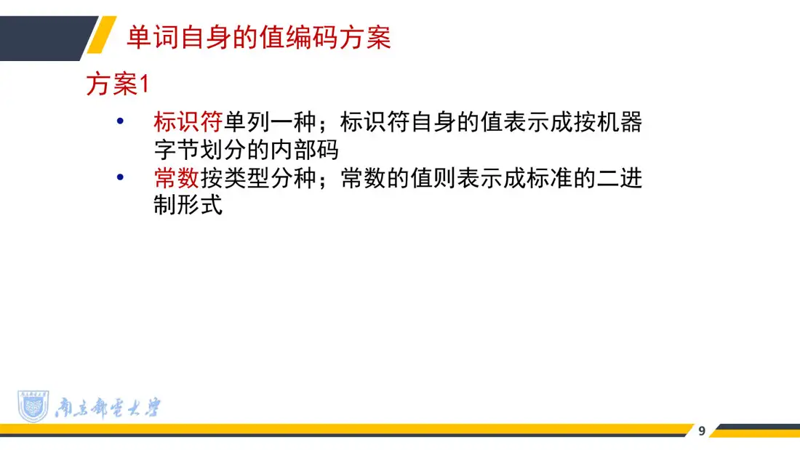

原文：

单词自身的值编码方案

方案1

\- 标识符单列一种；标识符自身的值表示成按机器字节划分的内部码

\- 常数按类型分种；常数的值则表示成标准的二进制形式

南京邮电大学

9

### 单词自身的值编码方案

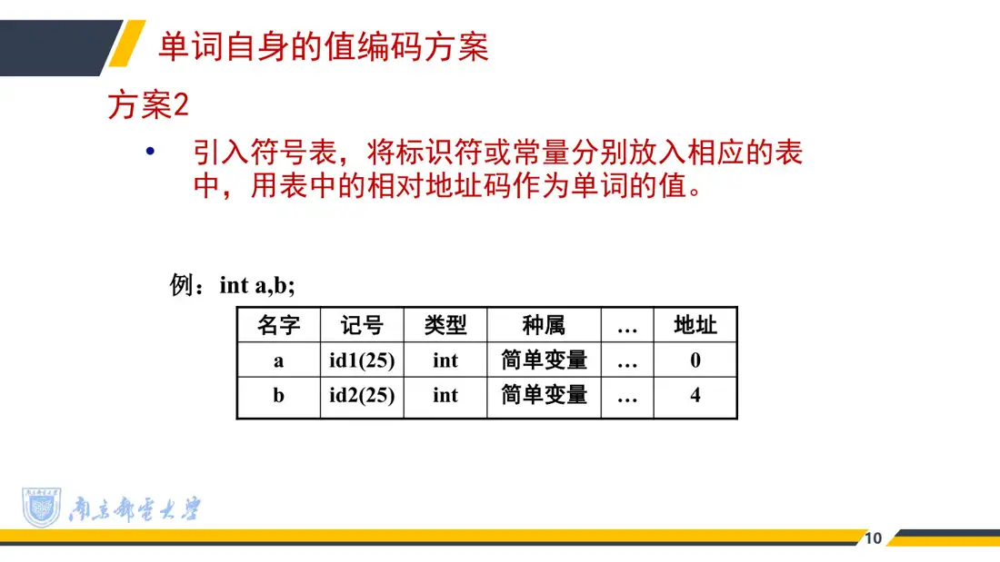

原文：

单词自身的值编码方案

方案2

\- 引入符号表，将标识符或常量分别放入相应的表中，用表中的相对地址码作为单词的值。

例：int a,b;

<table><tr><td>名字</td><td>记号</td><td>类型</td><td>种属</td><td>...</td><td>地址</td></tr><tr><td>a</td><td>id1(25)</td><td>int</td><td>简单变量</td><td>...</td><td>0</td></tr><tr><td>b</td><td>id2(25)</td><td>int</td><td>简单变量</td><td>...</td><td>4</td></tr></table>

南京邮电大学

10

### 例：FORTRAN 程序

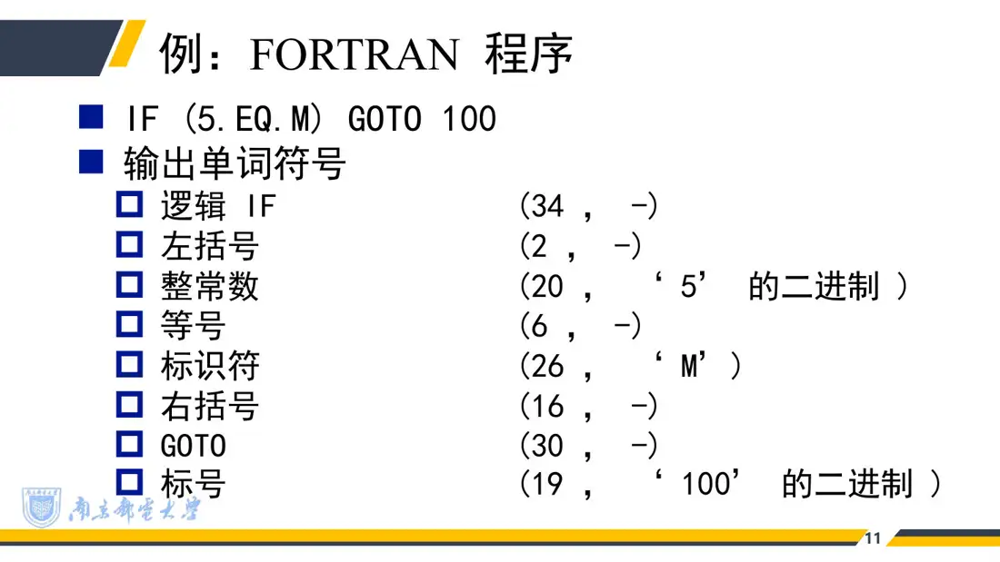

原文：

例：FORTRAN 程序

IF (5. EQ. M) GOTO 100

南京邮电大学
南京邮电大学

11

### 例：C 程序

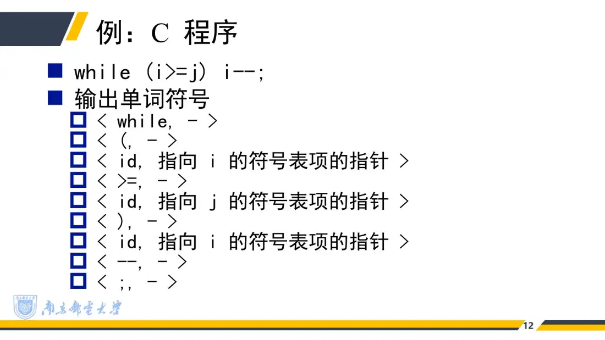

原文：

例：C 程序

■ while (i>=j) i--;

输出单词符号

□ < while, - >

□ < (， - >

□ < id，指向 i 的符号表项的指针 >

□ < >=, - >

□ < id，指向 j 的符号表项的指针 >

□ < ), - >

□ < id，指向 i 的符号表项的指针 >

□ < --, - >

□ < ; , - >

南京邮电大学
南京邮电大学

12

### 词法分析器作为一个独立子程序

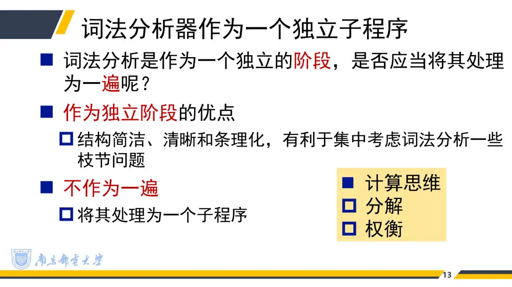

原文：

词法分析器作为一个独立子程序

■ 词法分析是作为一个独立的阶段，是否应当将其处理为一遍呢？

作为独立阶段的优点

□结构简洁、清晰和条理化，有利于集中考虑词法分析一些枝节问题

不作为一遍

□ 将其处理为一个子程序

计算思维

□ 分解

□ 权衡

南京邮电大学
南京邮电大学

13

### 词法分析器在编译器中地位

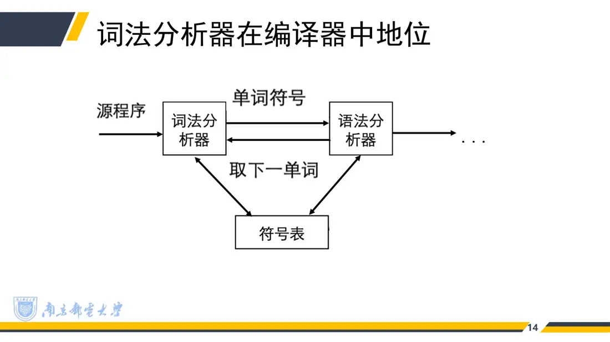

原文：

词法分析器在编译器中地位

源程序词法分析器

南京邮电大学

14

### 第三章 词法分析

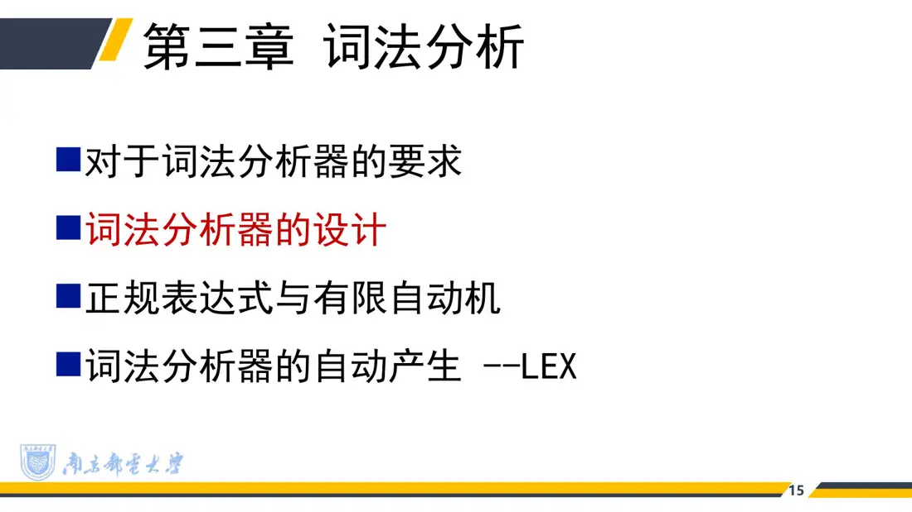

原文：

第三章 词法分析

■对于词法分析器的要求

■词法分析器的设计

■正规表达式与有限自动机

■词法分析器的自动产生 --LEX

南京邮电大学

15

### 3.2 词法分析器的设计

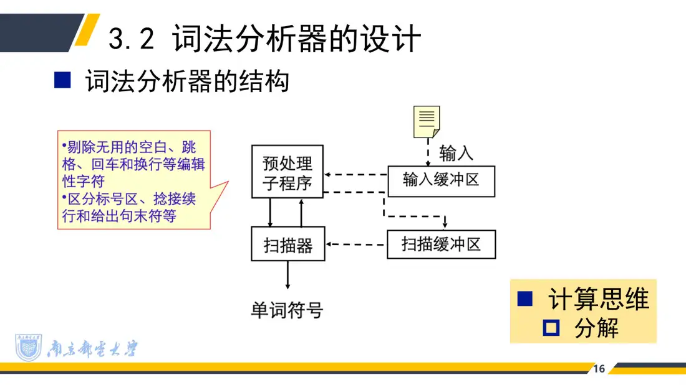

原文：

3.2 词法分析器的设计

词法分析器的结构

\- 剔除无用的空白、跳格、回车和换行等编辑性字符

\- 区分标号区、捻接续行和给出句末符等

计算思维
□ 分解

南京邮电大学

16

### 输入、预处理

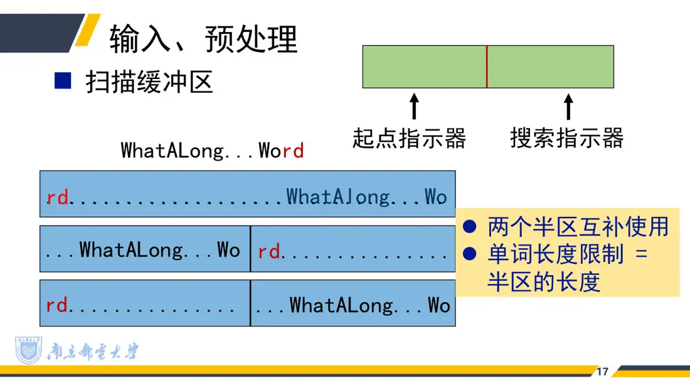

原文：

输入、预处理

■ 扫描缓冲区

WhatALong... Word

rd....WhatAlong...Wo

... WhatALong... Wo | rd....

rd....WhatALong...Wo

\- 两个半区互补使用

\- 单词长度限制 = 半区的长度

南京邮电大学

17

### 单词符号的识别：超前搜索

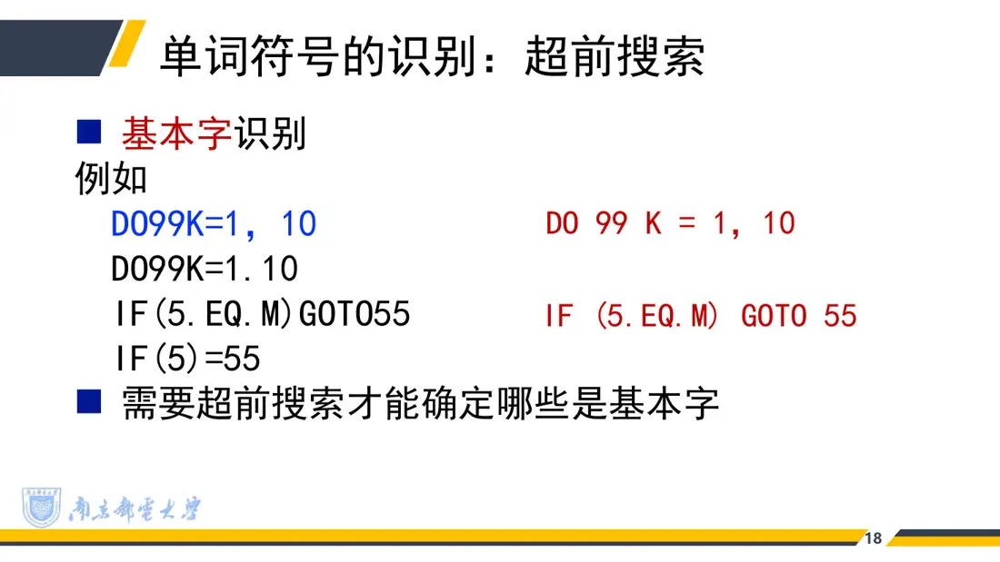

原文：

单词符号的识别：超前搜索

基本字识别

需要超前搜索才能确定哪些是基本字

南京邮电大学

18

### 标识符识别

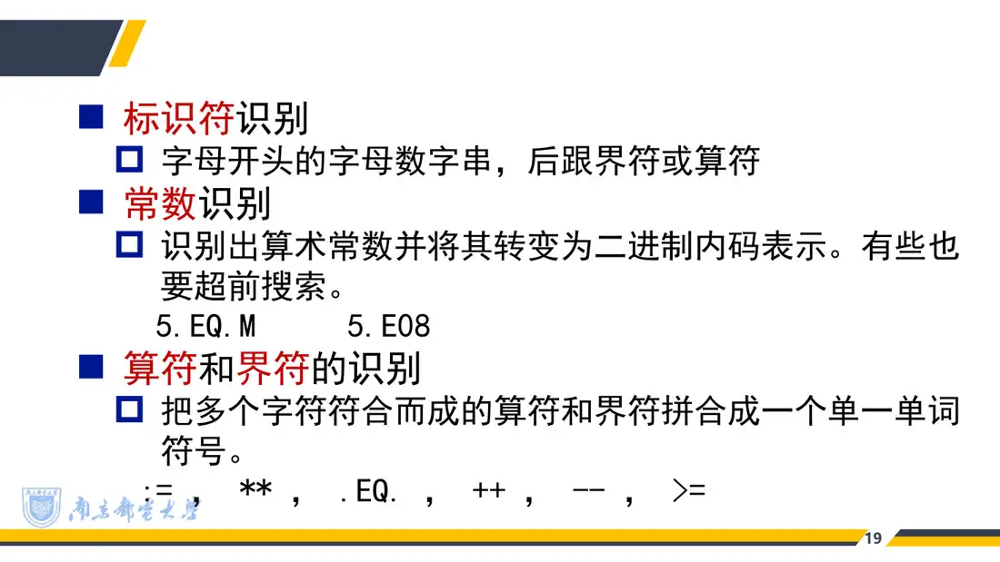

原文：

标识符识别

☐ 字母开头的字母数字串，后跟界符或算符

常数识别

☐ 识别出算术常数并将其转变为二进制内码表示。有些也要超前搜索。
5. EQ. M    5. E08

算符和界符的识别

☐ 把多个字符符合而成的算符和界符拼合成一个单一单词符号。

南京邮电大学
:=，\*\*，.EQ.，++，--，>=

19

### 南京邮电大学

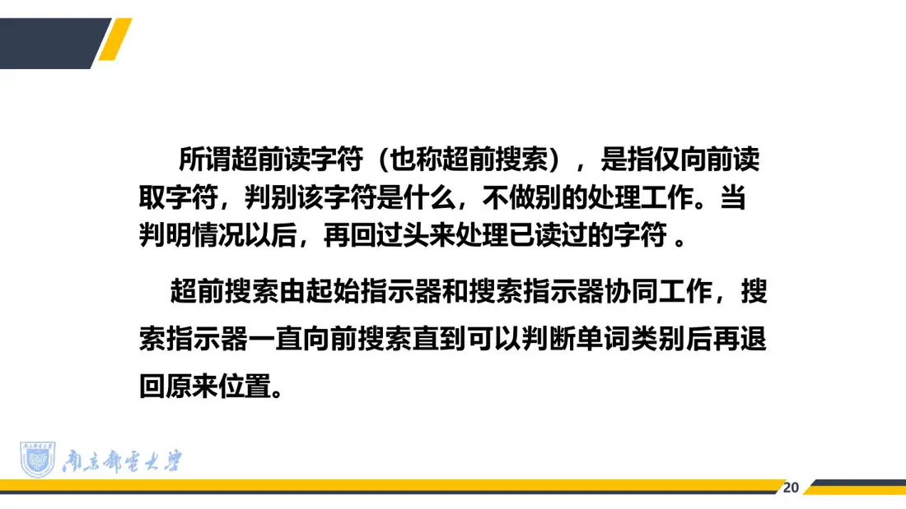

原文：

所谓超前读字符（也称超前搜索），是指仅向前读取字符，判别该字符是什么，不做别的处理工作。当判明情况以后，再回过头来处理已读过的字符。

超前搜索由起始指示器和搜索指示器协同工作，搜索指示器一直向前搜索直到可以判断单词类别后再退回原来位置。

南京邮电大学
南京邮电大学

20

### 几点限制——不必使用超前搜索

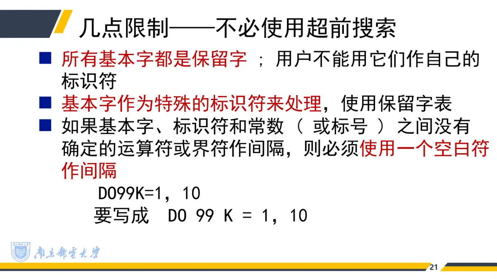

原文：

几点限制——不必使用超前搜索

所有基本字都是保留字；用户不能用它们作自己的标识符

基本字作为特殊的标识符来处理，使用保留字表

■ 如果基本字、标识符和常数（或标号）之间没有确定的运算符或界符作间隔，则必须使用一个空白符作间隔

D099K=1, 10

要写成 DO 99 K = 1, 10

南京邮电大学

21

### 状态转换图

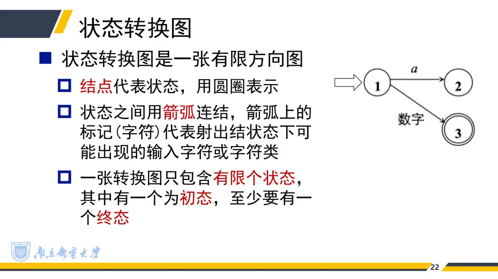

原文：

状态转换图

状态转换图是一张有限方向图

□ 结点代表状态，用圆圈表示

☐ 状态之间用箭弧连结，箭弧上的标记(字符)代表射出结状态下可能出现的输入字符或字符类

☐ 一张转换图只包含有限个状态，其中有一个为初态，至少要有一个终态

南京邮电大学

22

### ■ 状态转换图可用于识别(或接受)一定的字符串

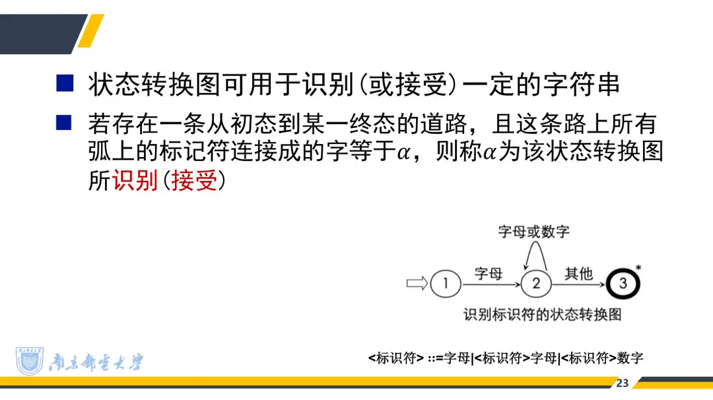

原文：

■ 状态转换图可用于识别(或接受)一定的字符串

若存在一条从初态到某一终态的道路，且这条路上所有弧上的标记符连接成的字等于 $\alpha$ ，则称 $\alpha$ 为该状态转换图所识别（接受）

南京邮电大学

23

### • (1)::=

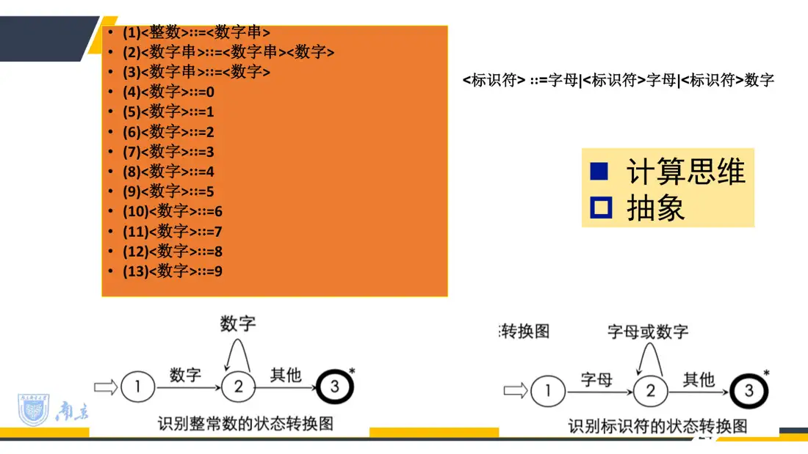

原文：

• (1)<整数>::=<数字串>

• (2)<数字串>::=<数字串><数字>

• (3)<数字串>::=<数字>

• (4)<数字>::=0

• (5)<数字>::=1

• (6)<数字>::=2

• (10)<数字>::=6

• (11)<数字>::=7

• (12)<数字>::=8

• (13)<数字>::=9

<标识符> ::= 字母 | <标识符 > 字母 | <标识符 > 数字

计算思维

□ 抽象

南京邮电大学
New University of Press and Telecommunications
南京

### 1、由左线性文法构造状态转换图

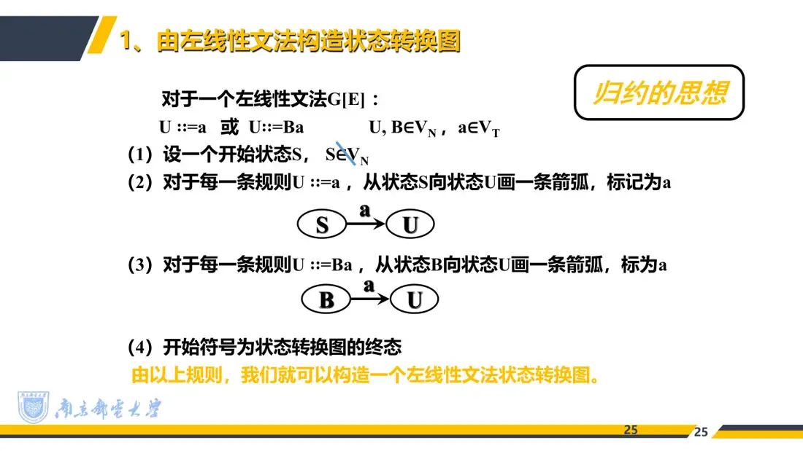

原文：

1、由左线性文法构造状态转换图

对于一个左线性文法G[E]：
U ::= a 或 U ::= Ba U, B ∈ V\_N, a ∈ V\_T

归约的思想

(1) 设一个开始状态S， $S \in V_{N}$

(2) 对于每一条规则U ::= a，从状态S向状态U画一条箭弧，标记为a
① S → a → U

(3) 对于每一条规则U ::=Ba，从状态B向状态U画一条箭弧，标为a
⑧ B → a → U

(4) 开始符号为状态转换图的终态由以上规则，我们就可以构造一个左线性文法状态转换图。

南京邮电大学

25

25

### 1、由左线性文法构造状态转换图

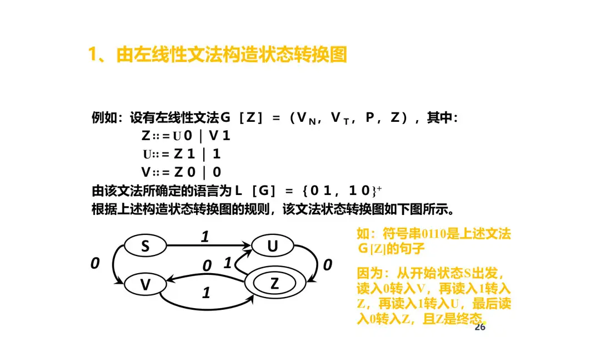

原文：

1、由左线性文法构造状态转换图

例如：设有左线性文法G[Z] = (V\_N, V\_T, P, Z)，其中：

$$
\mathbf {Z}:: = \mathbf {U 0} \mid \mathbf {V 1}
$$

$$
\mathbf {U} \mathrel {\mathop :} = \texttt {Z 1} \mid \texttt {1}
$$

$$
\mathbf {V} \mathrel {\mathop :} = \mathbf {Z} \mathbf {0} \mid \mathbf {0}
$$

由该文法所确定的语言为 L [G] = {0 1, 1 0}+

根据上述构造状态转换图的规则，该文法状态转换图如下图所示。

如：符号串0110是上述文法G[Z]的句子

因为：从开始状态S出发，读入0转入V，再读入1转入Z，再读入1转入U，最后读入0转入Z，且Z是终态。

### 1、由左线性文法构造状态转换图

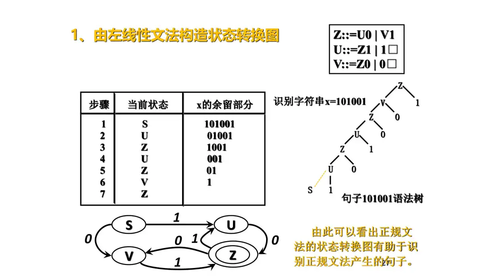

原文：

1、由左线性文法构造状态转换图

<table><tr><td>步骤</td><td>当前状态</td><td>x的余留部分</td></tr><tr><td>1</td><td>S</td><td>101001</td></tr><tr><td>2</td><td>U</td><td>01001</td></tr><tr><td>3</td><td>Z</td><td>1001</td></tr><tr><td>4</td><td>U</td><td>001</td></tr><tr><td>5</td><td>Z</td><td>01</td></tr><tr><td>6</td><td>V</td><td>1</td></tr><tr><td>7</td><td>Z</td><td></td></tr></table>

$$
\boxed { \begin{array}{l} \mathbf {Z}: := \mathbf {U 0} \mid \mathbf {V 1} \\ \mathbf {U}: := \mathbf {Z 1} \mid \mathbf {1} \square \\ \mathbf {V}: := \mathbf {Z 0} \mid \mathbf {0} \square \end{array} }
$$

由此可以看出正规文法的状态转换图有助于识别正规文法产生的句子。

### 1、由左线性文法构造状态转换图

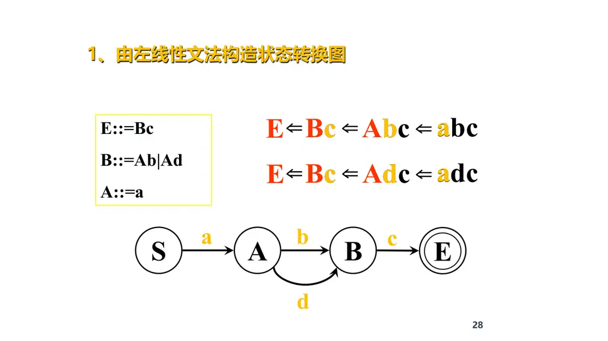

原文：

1、由左线性文法构造状态转换图

$$
\mathbf {E}: := \mathbf {B c}
$$

$$
\mathbf {E} \Leftarrow \mathbf {B c} \Leftarrow \mathbf {A b c} \Leftarrow \mathbf {a b c}
$$

$$
\mathbf {B}: := \mathbf {A b} | \mathbf {A d}
$$

$$
\mathbf {E} \Leftarrow \mathbf {B c} \Leftarrow \mathbf {A d c} \Leftarrow \mathbf {a d c}
$$

$$
\mathbf {A}: := \mathbf {a}
$$

$$
ⓢ \xrightarrow {a} Ⓐ A \xrightarrow {b} Ⓑ B \xrightarrow {c} ⓕ
$$

$$
\mathrm{d}
$$

28

### 2、由右线性文法构造状态转换图

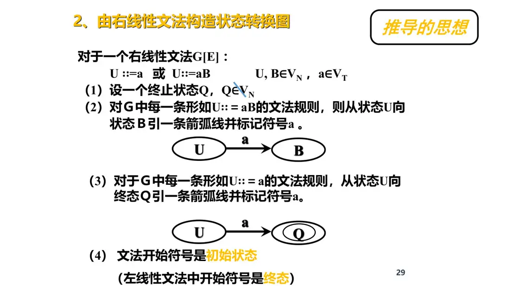

原文：

2、由右线性文法构造状态转换图

推导的思想

对于一个右线性文法G[E]：
U ::= a 或 U ::= aB U, B∈V\_N, a∈V\_T

(1) 设一个终止状态Q， $Q \in V_{N}$

(2) 对 G 中每一条形如 U::= aB 的文法规则，则从状态 U 向状态 B 引一条箭弧线并标记符号 a。

(3) 对于 G 中每一条形如 U::= a 的文法规则，从状态 U 向终态 Q 引一条箭弧线并标记符号 a。

(4) 文法开始符号是初始状态

(左线性文法中开始符号是终态)

29

### 2、由右线性文法构造状态转换图

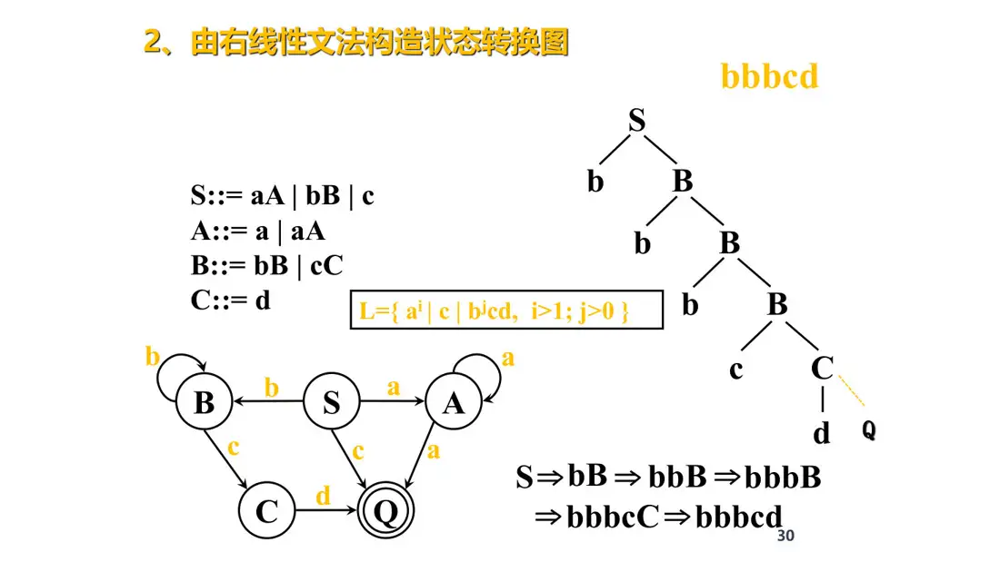

原文：

2、由右线性文法构造状态转换图

bbbcd

$$
\mathbf {S}: := \mathbf {a A} | \mathbf {b B} | \mathbf {c}
$$

$$
\mathbf {A}: := \mathbf {a} \mid \mathbf {a A}
$$

$$
\mathbf {B}: := \mathbf {b B} \mid \mathbf {c C}
$$

$$
\mathbf {C}: := \mathbf {d}
$$

$$
\mathrm{L} = \{\mathrm{a} ^ {\mathrm{i}} | \mathrm{c} | \mathrm{b} ^ {\mathrm{j}} \mathrm{cd}, \mathrm{i} > 1; \mathrm{j} > 0 \}
$$

$$
\begin{array}{r l} & {\mathbf {S} \Rightarrow \mathbf {b B} \Rightarrow \mathbf {b b B} \Rightarrow \mathbf {b b b B}} \\ & {\quad \Rightarrow \mathbf {b b b c C} \Rightarrow \mathbf {b b b c d} _ {3 0}} \end{array}
$$

### 2、由右线性文法构造状态转换图

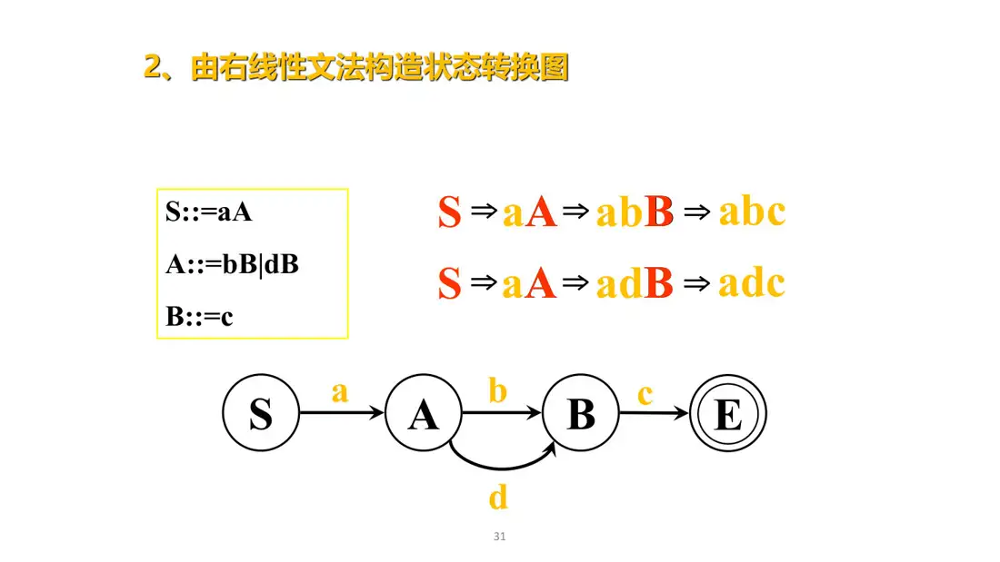

原文：

2、由右线性文法构造状态转换图

$$
\mathbf {S}: := \mathbf {a A}
$$

$$
\mathbf {S} \Rightarrow \mathrm{aA} \Rightarrow \mathrm{abB} \Rightarrow \mathrm{abc}
$$

$$
\mathbf {A}: := \mathbf {b B} | \mathrm{dB}
$$

$$
\mathbf {S} \Rightarrow \mathrm{aA} \Rightarrow \mathrm{adB} \Rightarrow \mathrm{adc}
$$

$$
\mathbf {B}: := \mathbf {c}
$$

$$
ⓢ \xrightarrow {a} Ⓐ A \xrightarrow {b} Ⓑ B \xrightarrow {c} ⓕ
$$

d

31

### 3、左右线性文法之间的关系——等价

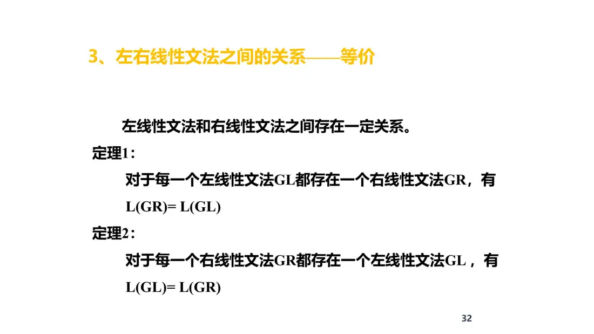

原文：

3、左右线性文法之间的关系——等价

左线性文法和右线性文法之间存在一定关系。

定理1:

对于每一个左线性文法GL都存在一个右线性文法GR，有

定理2:

对于每一个右线性文法GR都存在一个左线性文法GL，有 $\mathrm{L}(\mathrm{GL}) = \mathrm{L}(\mathrm{GR})$

32

### 在此我们不作详细证明，仅给出他们之间的等价关系：

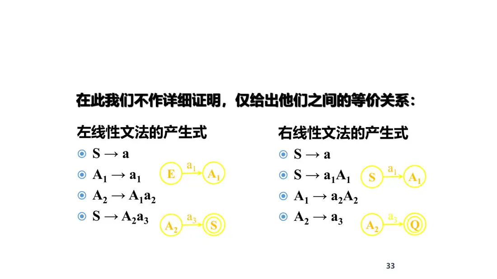

原文：

在此我们不作详细证明，仅给出他们之间的等价关系：

左线性文法的产生式

© S → a

$⑤$ $\mathbf{A}_1\to \mathbf{a}_1$

$$
\mathrm{E} \xrightarrow {a _ {1}} \mathrm{A} _ {1}
$$

$\odot A_{2} \rightarrow A_{1}a_{2}$

$⑤$ $\mathbf{S}\rightarrow \mathbf{A}_2\mathbf{a}_3$

右线性文法的产生式

© S → a

$$
oS \to a _ {1} A _ {1}
$$

$$
ⓞ \mathbf {A} _ {1} \rightarrow \mathbf {a} _ {2} \mathbf {A} _ {2}
$$

$\odot A_{2} \rightarrow a_{3}$

A₂ → Q
a₃

33

### 3、左右线性文法之间的关系——等价

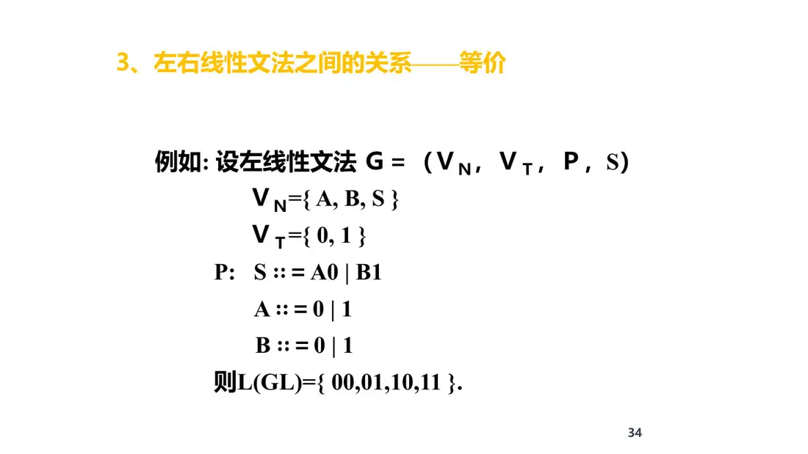

原文：

3、左右线性文法之间的关系——等价

例如: 设左线性文法 $G = (V_{N}, V_{T}, P, S)$ $V_{N} = \{ A, B, S \}$ $V_{T} = \{ 0, 1 \}$ P: S ::= A0 | B1

A ::= 0 | 1

B ::= 0 | 1

则 L(GL) = { 00, 01, 10, 11 } .

34

### 3、左右线性文法之间的关系——等价

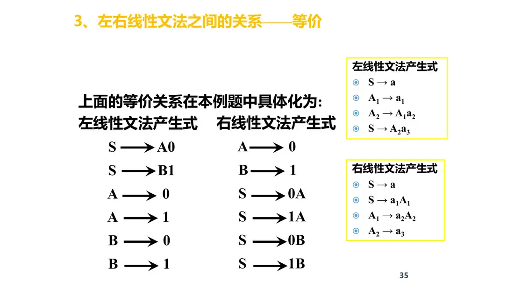

原文：

3、左右线性文法之间的关系——等价

上面的等价关系在本例题中具体化为:

左线性文法产生式 右线性文法产生式

$$
\mathrm{S} \longrightarrow \mathrm{A0}
$$

$$
\mathrm{A} \longrightarrow 0
$$

$$
\mathrm{S} \longrightarrow \mathrm{B1}
$$

$$
\mathrm{B} \longrightarrow 1
$$

$$
\mathrm{A} \longrightarrow 0
$$

$$
\mathrm{S} \longrightarrow 0 \mathrm{A}
$$

$$
\mathrm{A} \longrightarrow 1
$$

$$
\mathrm{S} \longrightarrow 1 \mathrm{A}
$$

$$
\mathbf {B} \longrightarrow \mathbf {0}
$$

$$
\mathrm{S} \longrightarrow 0 \mathrm{B}
$$

$$
\mathrm{B} \longrightarrow 1
$$

$$
\mathrm{S} \longrightarrow 1 \mathrm{B}
$$

左线性文法产生式

$$
Ⓞ \mathbf {S} \rightarrow \mathbf {a}
$$

$\textcircled{O}$ $A_{1} \rightarrow a_{1}$

$\textcircled{O}$ $A_{2} \rightarrow A_{1}a_{2}$

$$
ⓞ \quad \mathbf {S} \rightarrow \mathbf {A _ {2}} \mathbf {a _ {3}}
$$

右线性文法产生式

$$
ⓞ \mathbf {S} \rightarrow \mathbf {a}
$$

$$
ⓞ \quad \mathbf {S} \rightarrow \mathbf {a _ {1}} \mathbf {A _ {1}}
$$

$$
ⓞ \quad \mathbf {A} _ {1} \rightarrow \mathbf {a} _ {2} \mathbf {A} _ {2}
$$

$$
ⓞ \quad \mathbf {A} _ {2} \rightarrow \mathbf {a} _ {3}
$$

35

### 3、左右线性文法之间的关系——等价

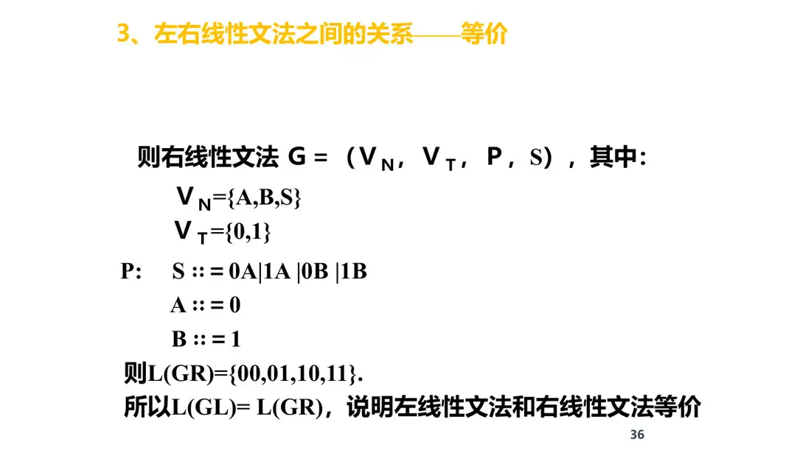

原文：

3、左右线性文法之间的关系——等价

则右线性文法 $G = (V_{N}, V_{T}, P, S)$ ，其中：

$$
\mathbf {V} _ {\textsf {T}} = \{0, 1 \}
$$

则 $L(GR)=\{00,01,10,11\}$ .

所以L(GL)=L(GR)，说明左线性文法和右线性文法等价

36

### 3、左右线性文法之间的关系——等价

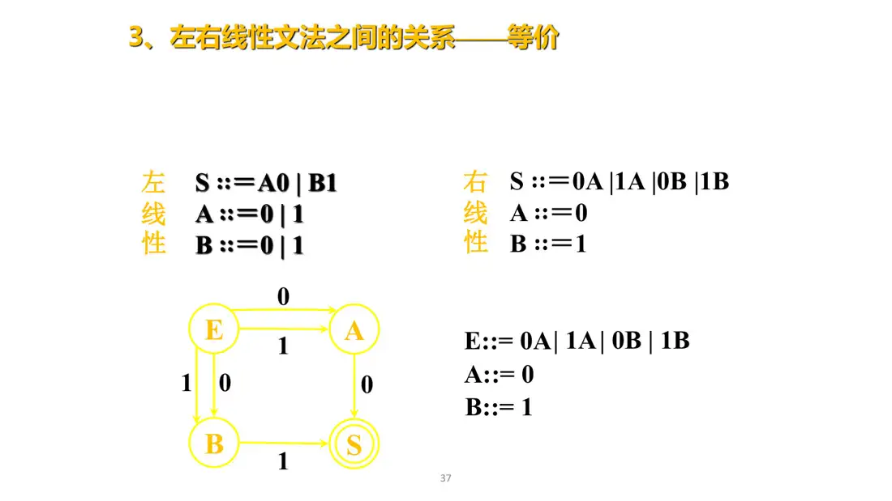

原文：

3、左右线性文法之间的关系——等价

左 S ::= A0 | B1

线 A ::= 0 | 1

性 B ::= 0 | 1

右 S ::=0A |1A |0B |1B

线 A ::= 0

性 B ::=1

$\begin{array}{l}\mathbf{E}:\mathbf{:}:= \mathbf{0A}\mid \mathbf{1A}\mid \mathbf{0B}\mid \mathbf{1B}\\ \mathbf{A}:\mathbf{:}:= \mathbf{0}\\ \mathbf{B}:\mathbf{:}:= \mathbf{1} \end{array}$

37

### 词法分析器的设计示例

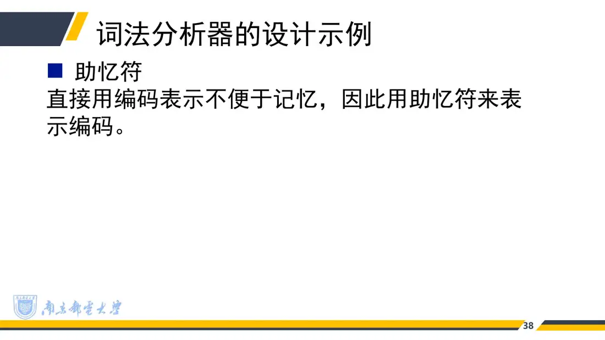

原文：

词法分析器的设计示例

助忆符

直接用编码表示不便于记忆，因此用助忆符来表示编码。

南京邮电大学

38

### 南京邮电大学

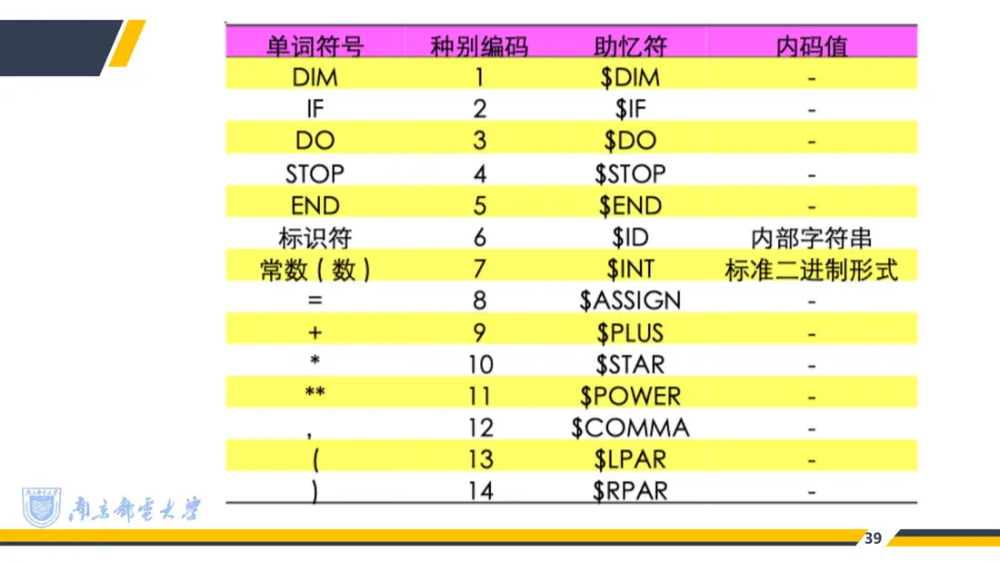

原文：

<table><tr><td>单词符号</td><td>种别编码</td><td>助忆符</td><td>内码值</td></tr><tr><td>DIM</td><td>1</td><td>$DIM</td><td>-</td></tr><tr><td>IF</td><td>2</td><td>$IF</td><td>-</td></tr><tr><td>DO</td><td>3</td><td>$DO</td><td>-</td></tr><tr><td>STOP</td><td>4</td><td>$STOP</td><td>-</td></tr><tr><td>END</td><td>5</td><td>$END</td><td>-</td></tr><tr><td>标识符</td><td>6</td><td>$ID</td><td>内部字符串</td></tr><tr><td>常数(数)</td><td>7</td><td>$INT</td><td>标准二进制形式</td></tr><tr><td>=</td><td>8</td><td>$ASSIGN</td><td>-</td></tr><tr><td>+</td><td>9</td><td>$PLUS</td><td>-</td></tr><tr><td>*</td><td>10</td><td>$STAR</td><td>-</td></tr><tr><td>**</td><td>11</td><td>$POWER</td><td>-</td></tr><tr><td>,</td><td>12</td><td>$COMMA</td><td>-</td></tr><tr><td>(</td><td>13</td><td>$LPAR</td><td>-</td></tr><tr><td>)</td><td>14</td><td>$RPAR</td><td>-</td></tr></table>

南京邮电大学

39

### 南京邮电大学

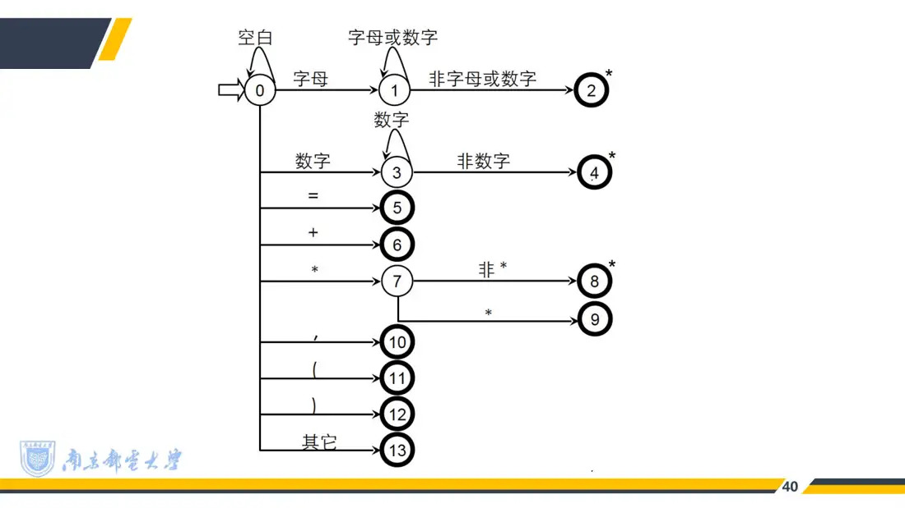

原文：

南京邮电大学

40

### 几点限制——不必使用超前搜索

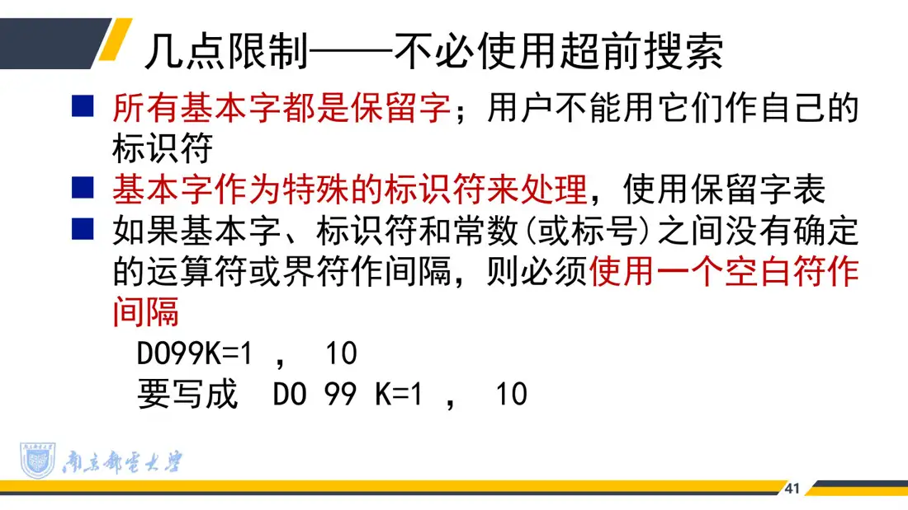

原文：

几点限制——不必使用超前搜索

所有基本字都是保留字；用户不能用它们作自己的标识符

基本字作为特殊的标识符来处理，使用保留字表

■ 如果基本字、标识符和常数(或标号)之间没有确定的运算符或界符作间隔，则必须使用一个空白符作间隔

D099K=1，10
要写成 D0 99 K=1，10- 状态转换图的实现思想：每个状态结点对应一小段程序

南京邮电大学

41

### 南京邮电大学

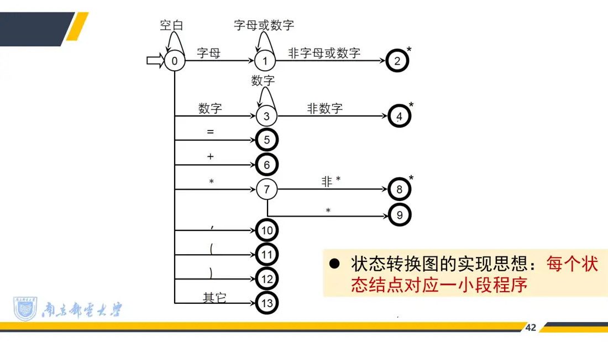

原文：

南京邮电大学

42

### 状态转换图的实现

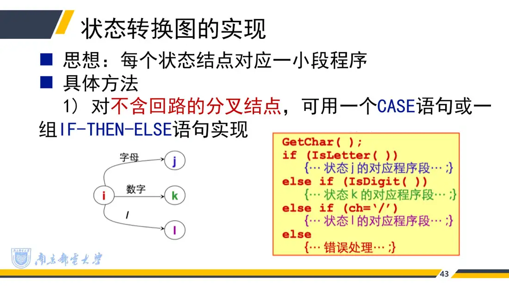

原文：

状态转换图的实现

思想：每个状态结点对应一小段程序

具体方法

1) 对不含回路的分叉结点，可用一个CASE语句或一组IF-THEN-ELSE语句实现

南京邮电大学

43

### 状态转换图的实现

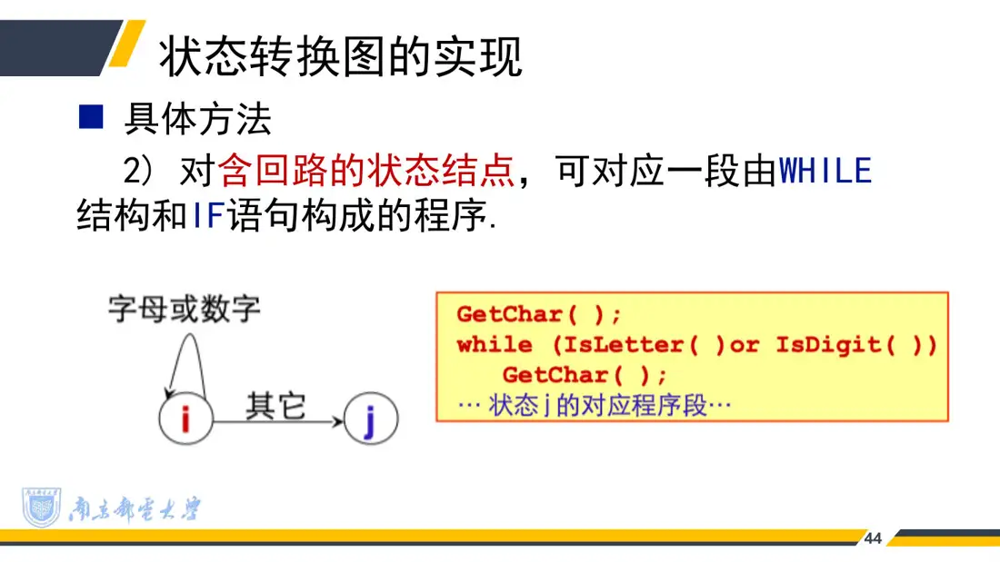

原文：

状态转换图的实现

具体方法

2) 对含回路的状态结点，可对应一段由WHILE结构和IF语句构成的程序.

字母或数字

南京邮电大学

44

### 状态转换图的实现

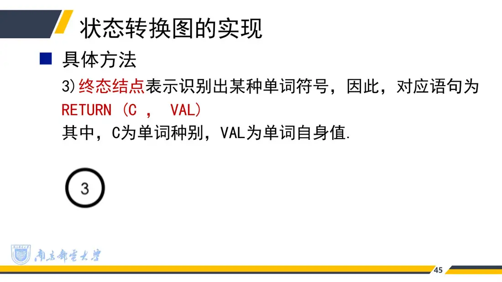

原文：

状态转换图的实现

具体方法

3) 终态结点表示识别出某种单词符号，因此，对应语句为RETURN (C, VAL)
其中，C为单词种别，VAL为单词自身值.

南京邮电大学

45

### 全局变量与过程

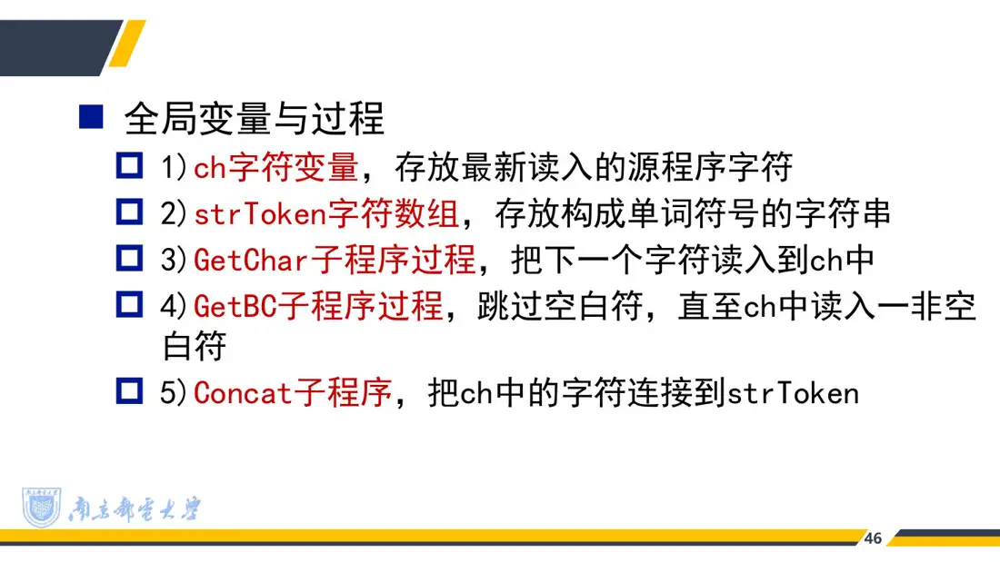

原文：

全局变量与过程

☐ 1) ch字符变量，存放最新读入的源程序字符

2) strToken字符数组，存放构成单词符号的字符串

☐ 3) GetChar子程序过程，把下一个字符读入到ch中

4) GetBC子程序过程，跳过空白符，直至ch中读入一非空白符

☐ 5) Concat子程序，把ch中的字符连接到strToken

南京邮电大学

46

### 8) Retract子程序，把搜索指针回调一个字符位置

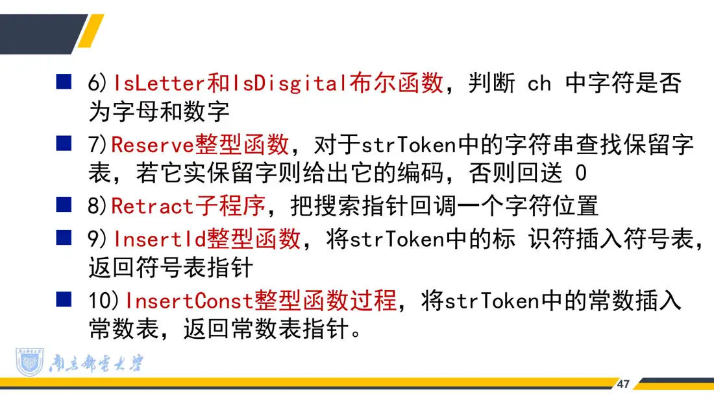

原文：

6) IsLetter和IsDisgital布尔函数，判断 ch 中字符是否为字母和数字

7) Reserve整型函数，对于strToken中的字符串查找保留字表，若它实保留字则给出它的编码，否则回送0

8) Retract子程序，把搜索指针回调一个字符位置

9) InsertId整型函数，将strToken中的标识符插入符号表，返回符号表指针

10) InsertConst整型函数过程，将strToken中的常数插入常数表，返回常数表指针。

南京邮电大学

47

### 南京邮电大学

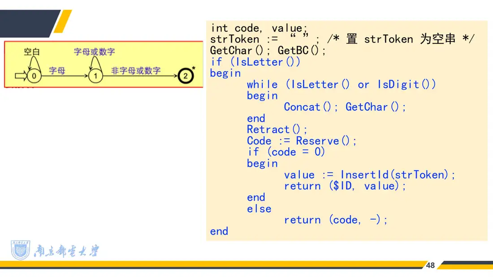

原文：

南京邮电大学

48

### 南京邮电大学

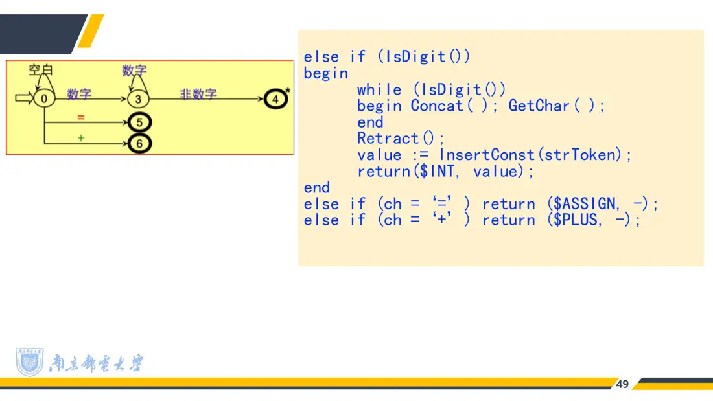

原文：

南京邮电大学

49

### 南京邮电大学

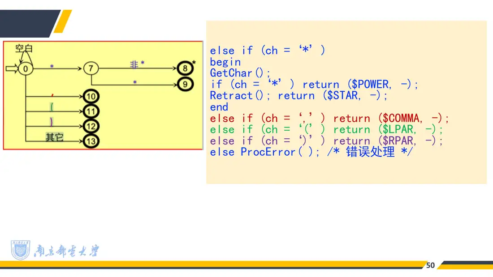

原文：

南京邮电大学

50

### 将状态图的代码一

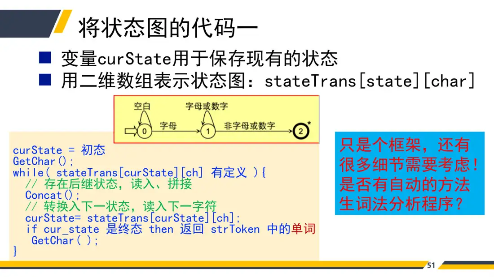

原文：

将状态图的代码一

变量curState用于保存现有的状态

■ 用二维数组表示状态图：stateTrans[state][char]

curState = 初态

GetChar();

while (stateTrans[curState][ch] 有定义) {
    // 存在后继状态，读入、拼接
    Concat();
    // 转换入下一状态，读入下一字符
    curState = stateTrans[curState][ch];
    if cur\_state 是终态 then 返回 strToken 中的单词
    GetChar();

只是个框架，还有很多细节需要考虑！是否有自动的方法生词法分析程序？

51

### 小结

原文：

小结
■词法分析器的功能
■词法分析器的设计
□状态转换图
□状态转换图的实现

南京邮电大学

52
