# 《编译原理》第二次课 程序设计语言简述（课件）

原件的每一页，下面附识别出的文字。

### 编译原理

原文：

编译原理

第二次课

南京郵電大學 Nanjing University of Posts and Telecommunications aand

### 教学目标

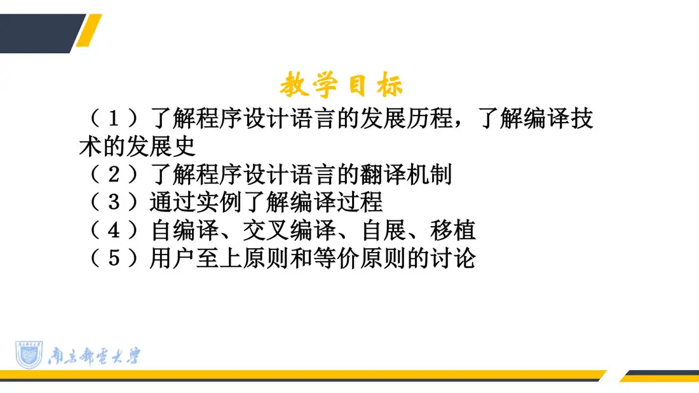

原文：

教学目标

（1）了解程序设计语言的发展历程，了解编译技术的发展史

（2）了解程序设计语言的翻译机制

（3）通过实例了解编译过程

（4）自编译、交叉编译、自展、移植

（5）用户至上原则和等价原则的讨论

### 二、程序设计语言简述

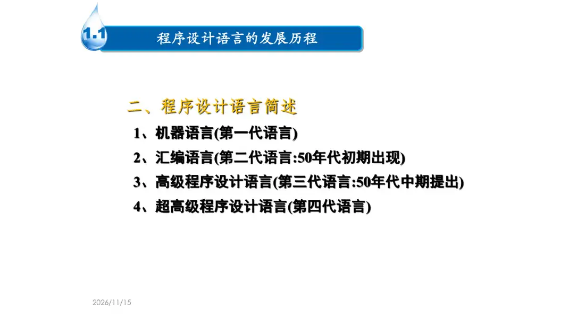

原文：

二、程序设计语言简述

1、机器语言(第一代语言)

2、汇编语言(第二代语言:50年代初期出现)

3、高级程序设计语言(第三代语言:50年代中期提出)

4、超高级程序设计语言(第四代语言)

1.1

程序设计语言的发展历程

2026/11/15

### 第 4 页

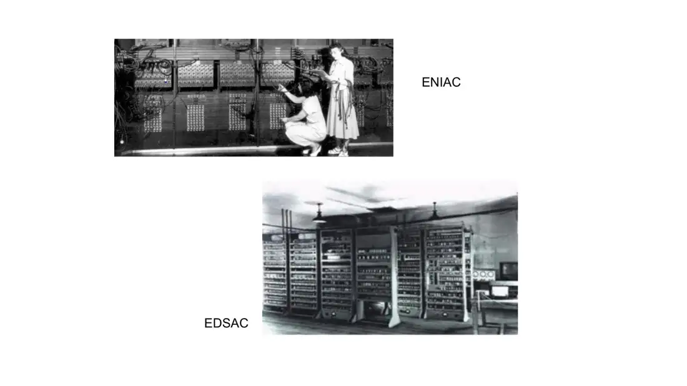

### 电子计算机之父

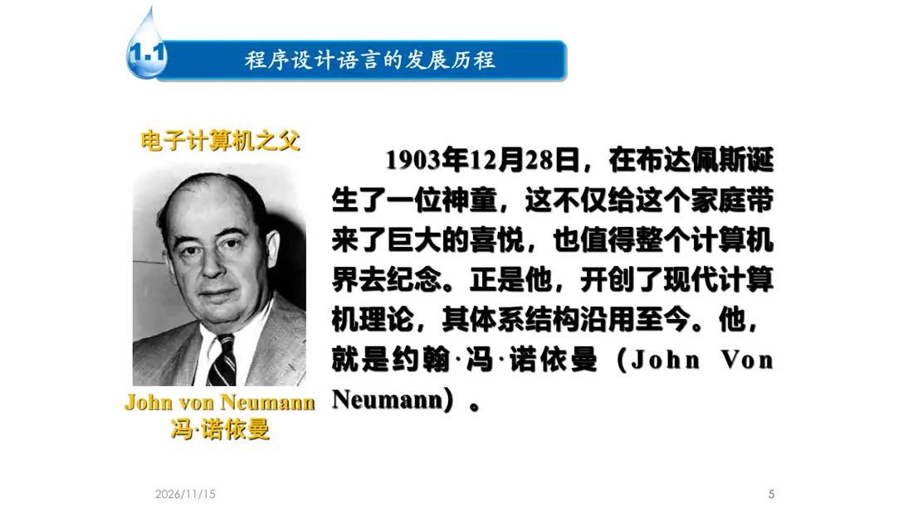

原文：

电子计算机之父

1903年12月28日，在布达佩斯诞生了一位神童，这不仅给这个家庭带来了巨大的喜悦，也值得整个计算机界去纪念。正是他，开创了现代计算机理论，其体系结构沿用至今。他，就是约翰·冯·诺依曼（John Vo nNeumann）。

1.1

程序设计语言的发展历程

2026/11/15

5

### 电子计算机之父

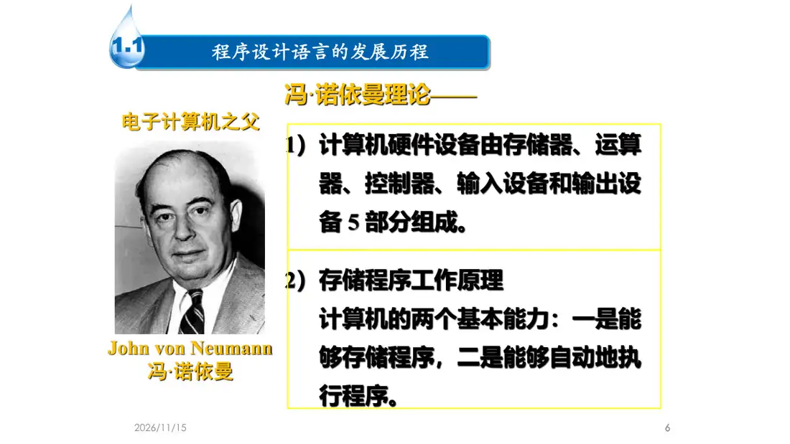

原文：

电子计算机之父

冯·诺依曼理论—

1）计算机硬件设备由存储器、运算器、控制器、输入设备和输出设备 5 部分组成。

2）存储程序工作原理

计算机的两个基本能力：一是能够存储程序，二是能够自动地执行程序。

1.1

程序设计语言的发展历程

2026/11/15

6

### 1、机器语言（第一代语言）

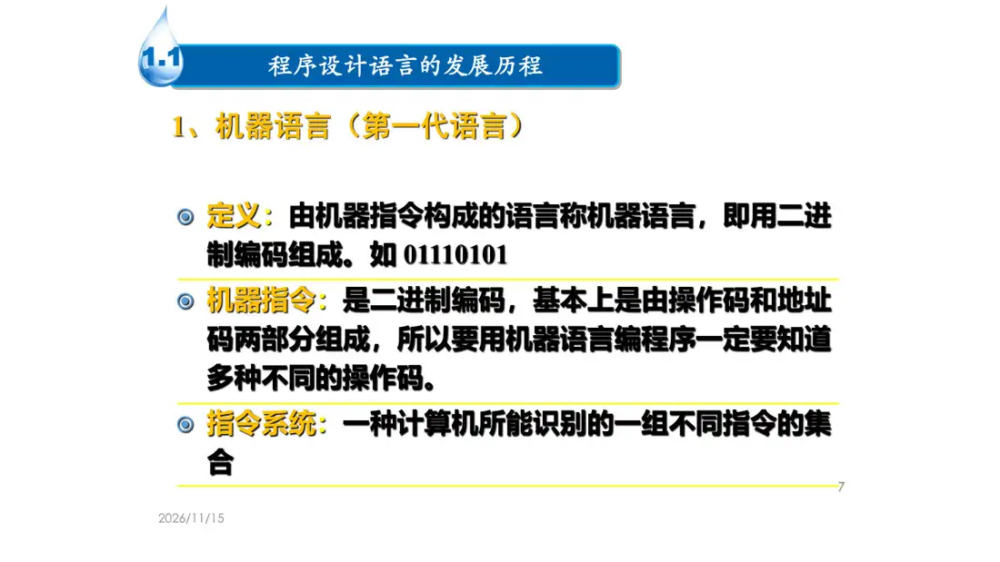

原文：

1、机器语言（第一代语言）

 定义：由机器指令构成的语言称机器语言，即用二进制编码组成。如 01110101

 机器指令：是二进制编码，基本上是由操作码和地址码两部分组成，所以要用机器语言编程序一定要知道多种不同的操作码。

 指令系统：一种计算机所能识别的一组不同指令的集合

1.1

程序设计语言的发展历程

2026/11/15

###  机器语言特点—

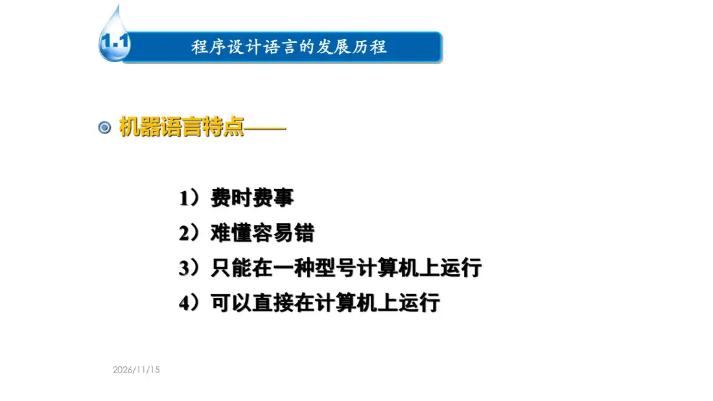

原文：

 机器语言特点—

1）费时费事

2）难懂容易错

3）只能在一种型号计算机上运行

4）可以直接在计算机上运行

1.1

程序设计语言的发展历程

2026/11/15

### 2、汇编语言（第二代语言）

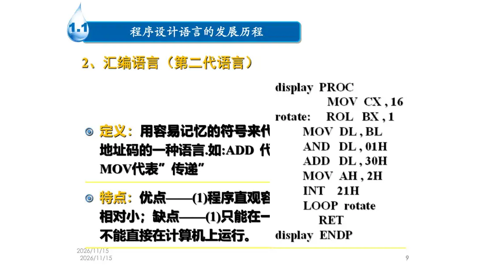

原文：

<table><tr><td></td><td>display PROCMOV CX,16rotate:ROL BX,1</td></tr><tr><td>定义:用容易记忆的符号来代地址码的一种语言.如:ADD 代MOV代表”传递”</td><td>MOV DL,BLAND DL,01HADD DL,30HMOV AH,2H</td></tr><tr><td>特点:优点——(1)程序直观容相对小;缺点——(1)只能在一不能直接在计算机上运行。</td><td>INT 21HLOOP rotateRETdisplay ENDP</td></tr></table>

2、汇编语言（第二代语言）

1.1

程序设计语言的发展历程

2026/11/15 2026/11/15

9

### 以人类进化史来比喻，对编译器来说此时处于开始学会使用各种工具的类人猿

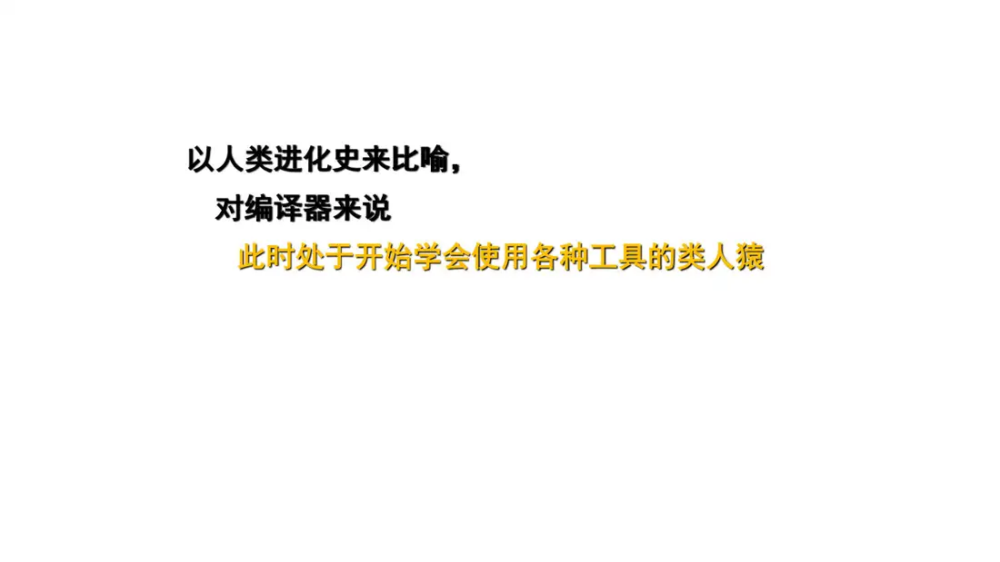

原文：

以人类进化史来比喻，对编译器来说此时处于开始学会使用各种工具的类人猿

### 程序设计语言的发展历程

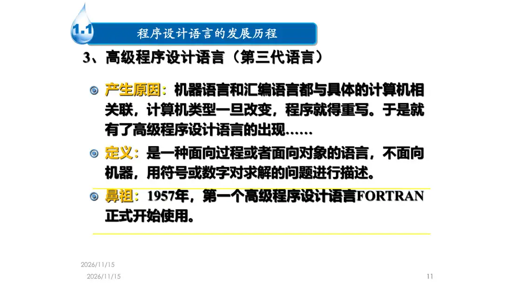

原文：

程序设计语言的发展历程

3、高级程序设计语言（第三代语言）

 产生原因：机器语言和汇编语言都与具体的计算机相关联，计算机类型一旦改变，程序就得重写。于是就有了高级程序设计语言的出现……

 定义：是一种面向过程或者面向对象的语言，不面向机器，用符号或数字对求解的问题进行描述。

 鼻祖：1957年，第一个高级程序设计语言FORTRAN正式开始使用。

2026/11/15 2026/11/15

11

### 1954-1957

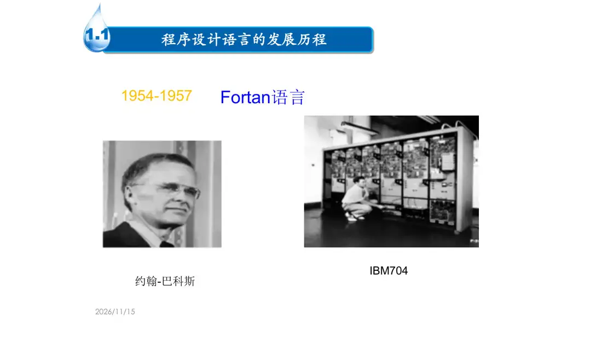

原文：

1954-1957

Fortan语言

1.1

程序设计语言的发展历程

2026/11/15

### 第 13 页

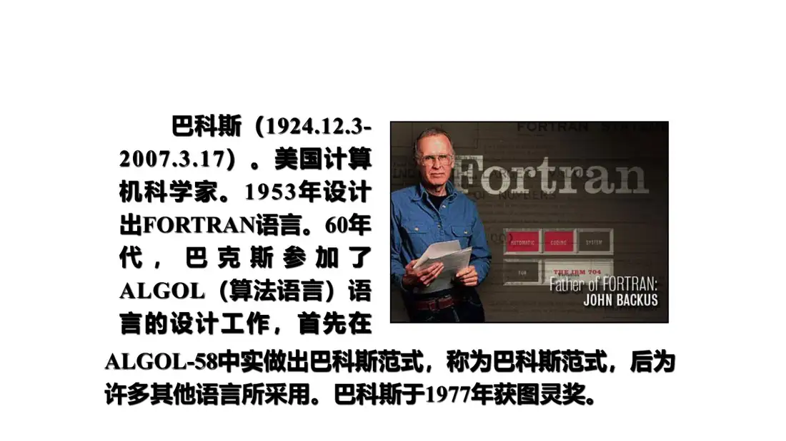

原文：

巴科斯（1924.12.3-2007.3.17）。美国计算机科学家。1953年设计出FORTRAN语言。60年代 ， 巴 克 斯 参 加 了ALGOL（算法语言）语言的设计工作，首先在

ALGOL-58中实做出巴科斯范式，称为巴科斯范式，后为许多其他语言所采用。巴科斯于1977年获图灵奖。

### ALGOL语言 (ALGOrithmic Language 算法语言)

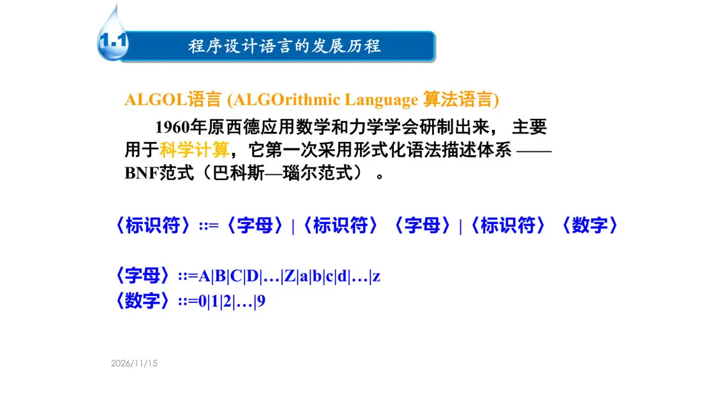

原文：

ALGOL语言 (ALGOrithmic Language 算法语言)

1960年原西德应用数学和力学学会研制出来， 主要用于科学计算，它第一次采用形式化语法描述体系BNF范式（巴科斯—瑙尔范式） 。

标识符〉∷=〈字母〉|〈标识符〉〈字母〉|〈标识符〉〈数字

〈字母〉 $\mathbf { \langle : = A | B | C | D | . . . | Z | a | b | c | d | . . . | Z }$

〈数字〉 $\mathrel { \mathop : } \mathrel { = } \mathbf { 0 } \lvert 1 \rvert 2 \lvert \ldots \rvert 9$

1.1

程序设计语言的发展历程

2026/11/15

### 第 15 页

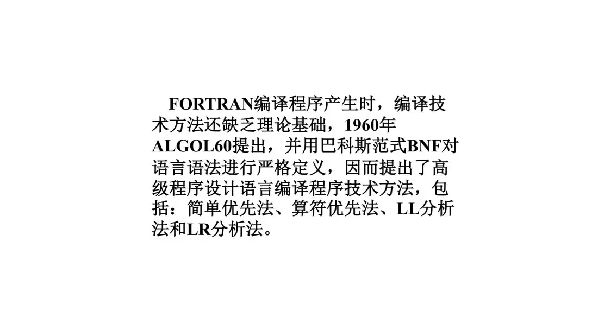

原文：

FORTRAN编译程序产生时，编译技术方法还缺乏理论基础，1960年ALGOL60提出，并用巴科斯范式BNF对语言语法进行严格定义，因而提出了高级程序设计语言编译程序技术方法，包括：简单优先法、算符优先法、LL分析法和LR分析法。

### SIMULA语言 (仿真语言)

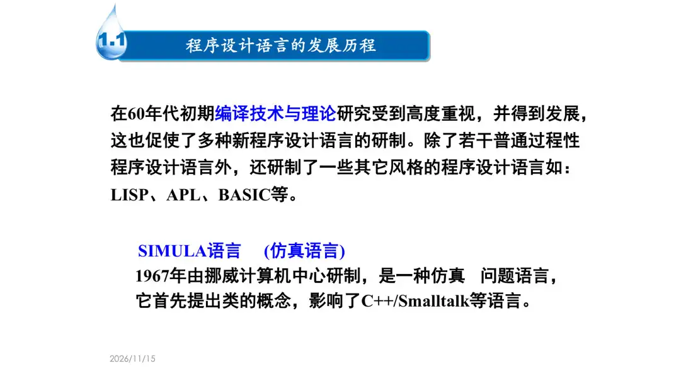

原文：

在60年代初期编译技术与理论研究受到高度重视，并得到发展，这也促使了多种新程序设计语言的研制。除了若干普通过程性程序设计语言外，还研制了一些其它风格的程序设计语言如：LISP、APL、BASIC等。

SIMULA语言 (仿真语言)

1967年由挪威计算机中心研制，是一种仿真 问题语言，它首先提出类的概念，影响了C++/Smalltalk等语言。

1.1

程序设计语言的发展历程

2026/11/15

### 第 17 页

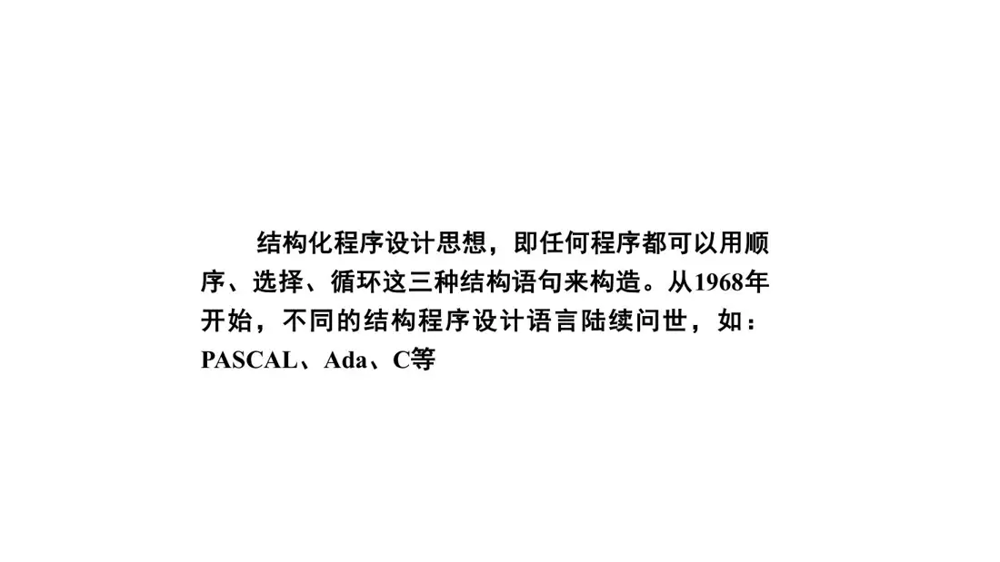

原文：

结构化程序设计思想，即任何程序都可以用顺序、选择、循环这三种结构语句来构造。从1968年开始，不同的结构程序设计语言陆续问世，如：PASCAL、Ada、C等

### PASCAL语言

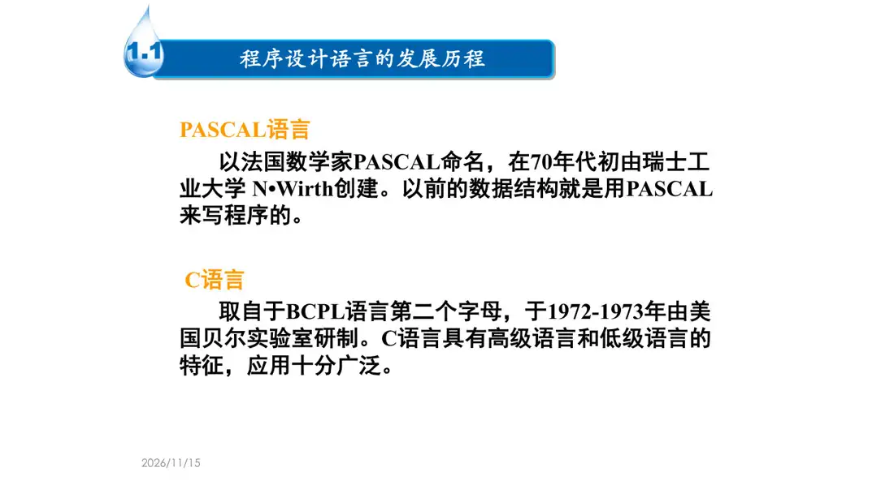

原文：

PASCAL语言

以法国数学家PASCAL命名，在70年代初由瑞士工业大学 N•Wirth创建。以前的数据结构就是用PASCAL来写程序的。

C语言

取自于BCPL语言第二个字母，于1972-1973年由美国贝尔实验室研制。C语言具有高级语言和低级语言的特征，应用十分广泛。

1.1

程序设计语言的发展历程

2026/11/15

### 程序设计语言的发展历程

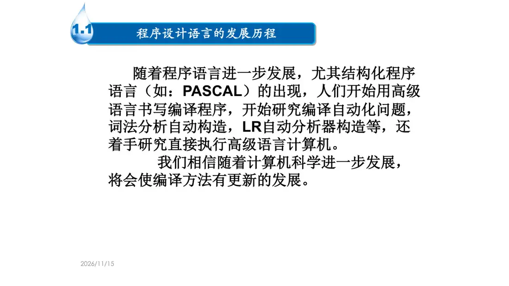

原文：

程序设计语言的发展历程

随着程序语言进一步发展，尤其结构化程序语言（如：PASCAL）的出现，人们开始用高级语言书写编译程序，开始研究编译自动化问题，词法分析自动构造，LR自动分析器构造等，还着手研究直接执行高级语言计算机。

我们相信随着计算机科学进一步发展，将会使编译方法有更新的发展。

2026/11/15

### 用户至上的原则

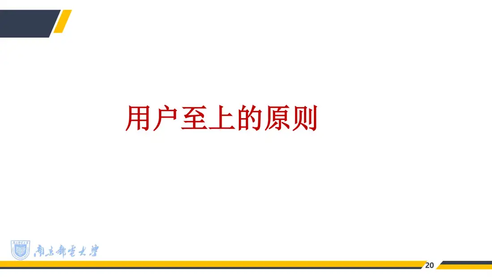

原文：

用户至上的原则

20

### 语言处理器（翻译程序）

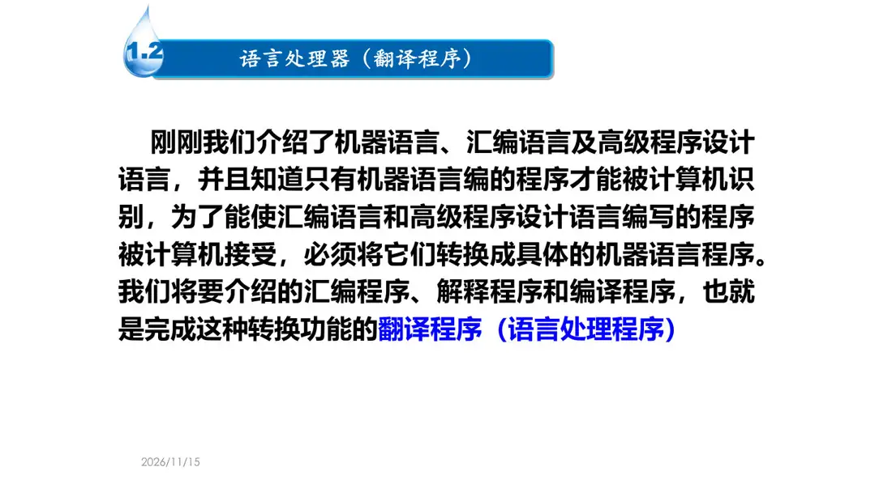

原文：

语言处理器（翻译程序）

刚刚我们介绍了机器语言、汇编语言及高级程序设计语言，并且知道只有机器语言编的程序才能被计算机识别，为了能使汇编语言和高级程序设计语言编写的程序被计算机接受，必须将它们转换成具体的机器语言程序。我们将要介绍的汇编程序、解释程序和编译程序，也就是完成这种转换功能的翻译程序（语言处理程序）

2026/11/15

### 翻译程序（语言处理程序/语言处理器）

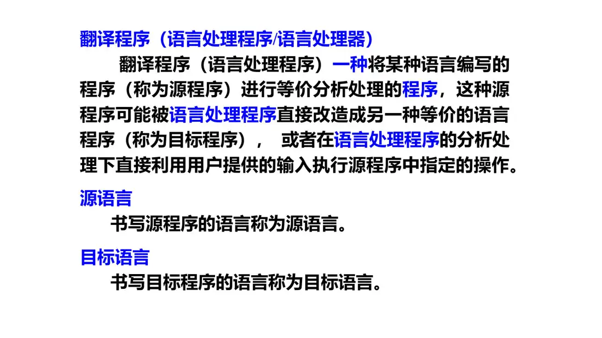

原文：

翻译程序（语言处理程序/语言处理器）

翻译程序（语言处理程序）一种将某种语言编写的程序（称为源程序）进行等价分析处理的程序，这种源程序可能被语言处理程序直接改造成另一种等价的语言程序（称为目标程序）， 或者在语言处理程序的分析处理下直接利用用户提供的输入执行源程序中指定的操作。

源语言

书写源程序的语言称为源语言。

目标语言

书写目标程序的语言称为目标语言。

### 语言处理器（翻译程序）

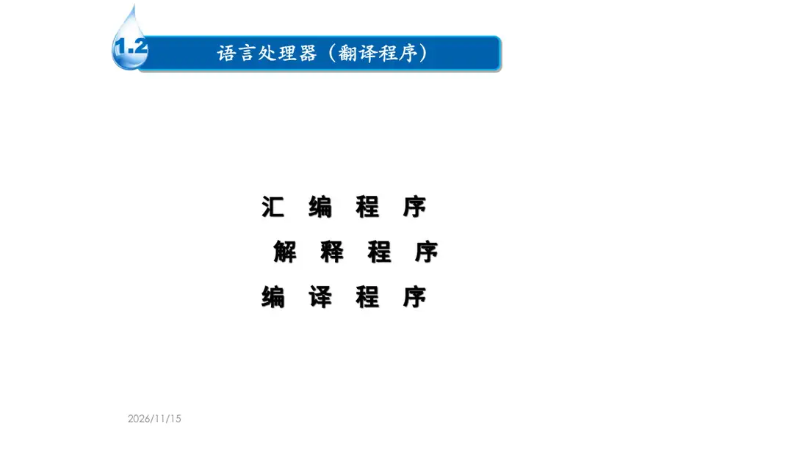

原文：

语言处理器（翻译程序）

汇 编 程 序

解 释 程 序

编 译 程 序

2026/11/15

### 1.2

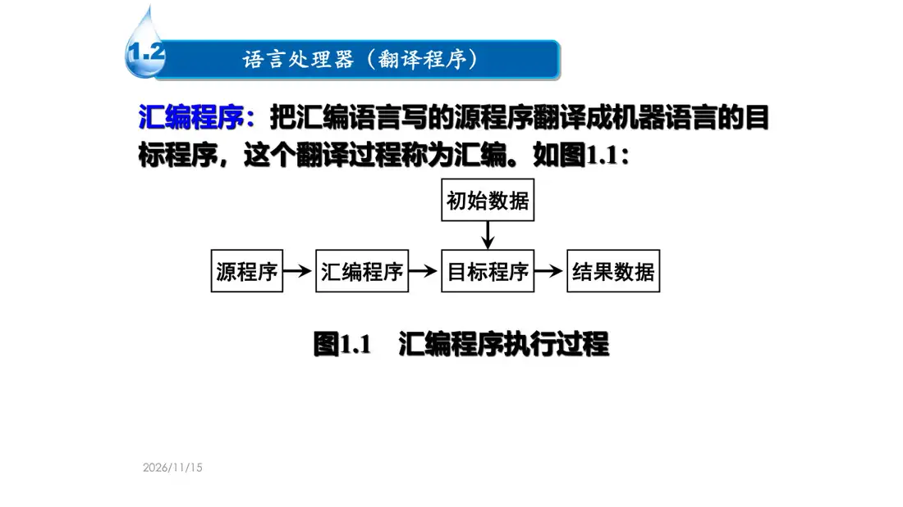

原文：

汇编程序：把汇编语言写的源程序翻译成机器语言的目标程序，这个翻译过程称为汇编。如图1.1：

1.2

语言处理器（翻译程序）

2026/11/15

### 1.2

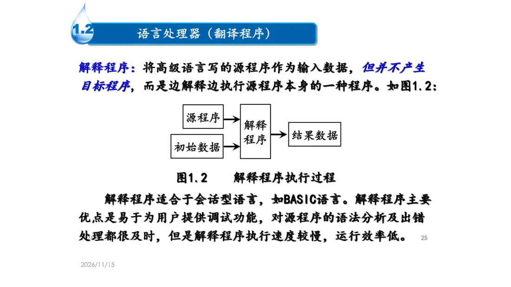

原文：

解释程序：将高级语言写的源程序作为输入数据，但并不产生，而是边解释边执行源程序本身的一种程序。如图1.2：

解释程序适合于会话型语言，如BASIC语言。解释程序主要优点是易于为用户提供调试功能，对源程序的语法分析及出错2026/11/15处理都很及时，但是解释程序执行速度较慢，运行效率低。 25

1.2

语言处理器（翻译程序）

2026/11/15

### 语言处理器（翻译程序）

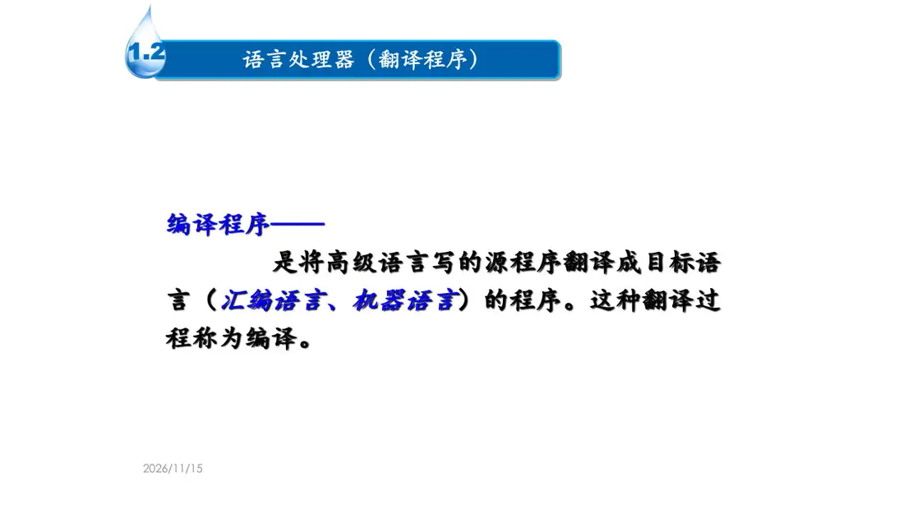

原文：

语言处理器（翻译程序）

编译程序——

是将高级语言写的源程序翻译成目标语言（汇编语言、 机器语言）的程序。这种翻译过程称为编译。

2026/11/15

### 编译程序

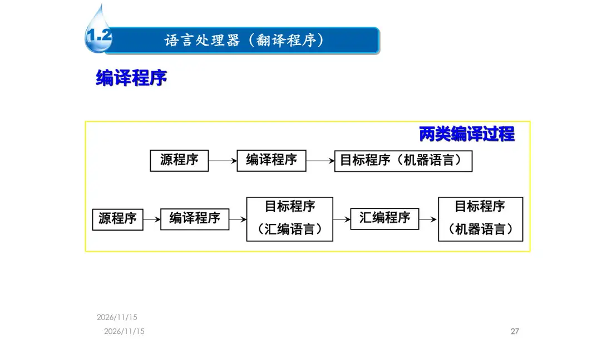

原文：

编译程序

源程序

编译程序

两类编译过程

目标程序（机器语言）

源程序

编译程序目标程序（汇编语言）

汇编程序目标程序（机器语言）

1.2

语言处理器（翻译程序）

2026/11/15 2026/11/15

27

### 编译系统——

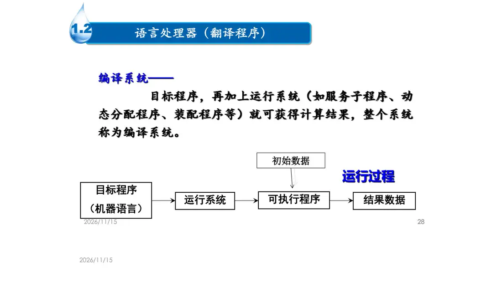

原文：

编译系统——

目标程序，再加上运行系统（如服务子程序、动态分配程序、装配程序等）就可获得计算结果，整个系统称为编译系统。

1.2

语言处理器（翻译程序）

28

2026/11/15

### C/C++处理器对源程序的处理过程解析（非托管）

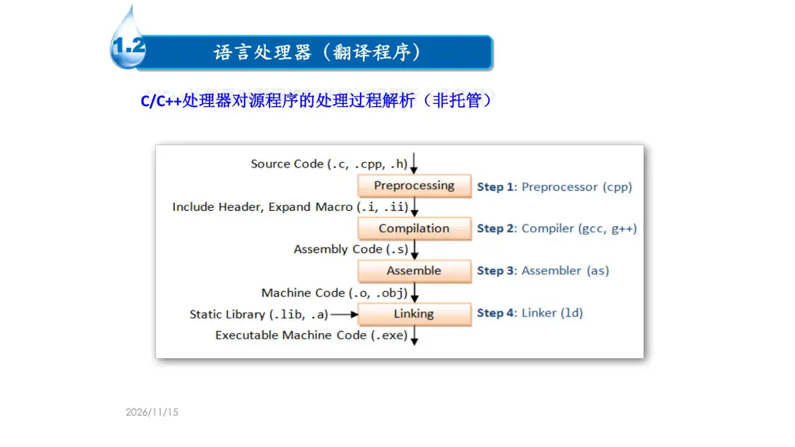

原文：

C/C++处理器对源程序的处理过程解析（非托管）

1.2

语言处理器（翻译程序）

2026/11/15

### Java处理器对源程序的处理过程解析（托管）

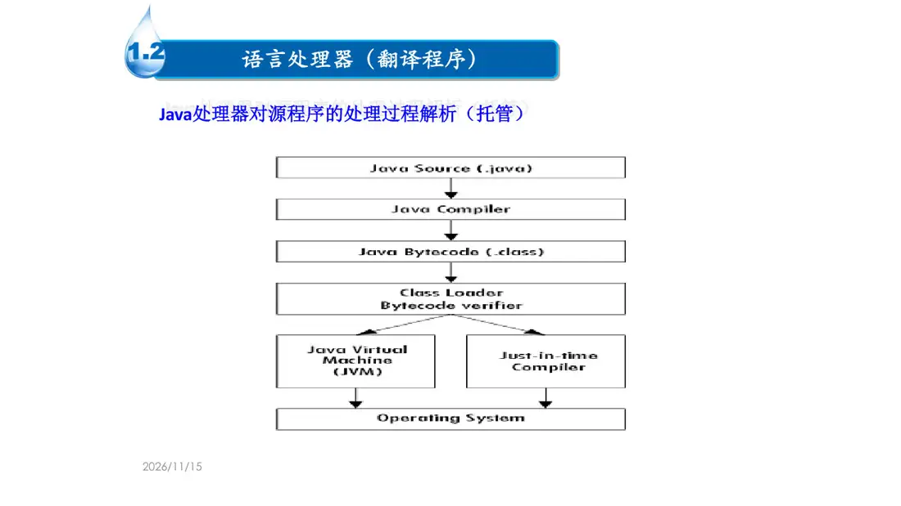

原文：

Java处理器对源程序的处理过程解析（托管）

1.2

语言处理器（翻译程序）

2026/11/15

### 语言处理器（翻译程序）

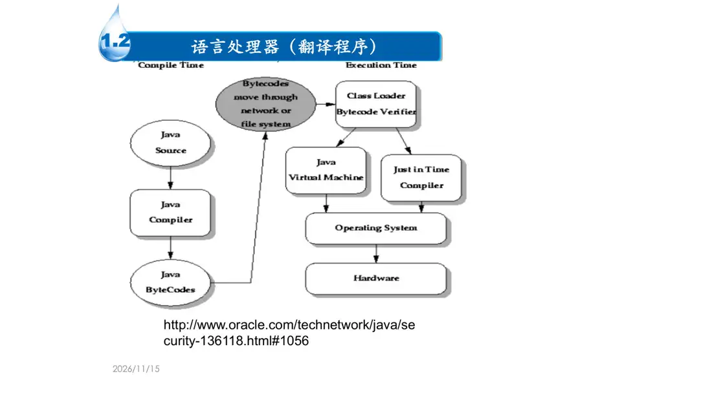

原文：

语言处理器（翻译程序）

2026/11/15

### JVM即时编译器

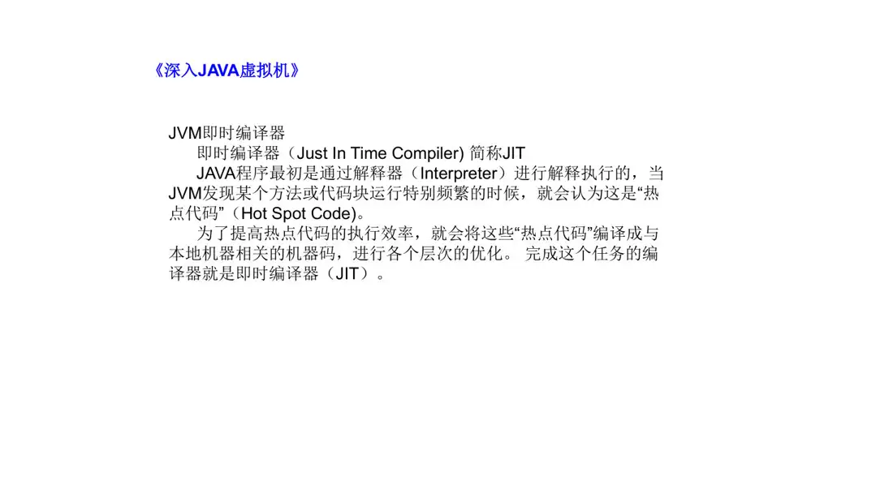

原文：

JVM即时编译器

即时编译器（Just In Time Compiler) 简称JIT

JAVA程序最初是通过解释器（Interpreter）进行解释执行的，当JVM发现某个方法或代码块运行特别频繁的时候，就会认为这是“热点代码”（Hot Spot Code)。

为了提高热点代码的执行效率，就会将这些“热点代码”编译成与本地机器相关的机器码，进行各个层次的优化。 完成这个任务的编译器就是即时编译器（JIT）。

《深入JAVA虚拟机》

### C#处理器对源程序的处理过程解析（托管）

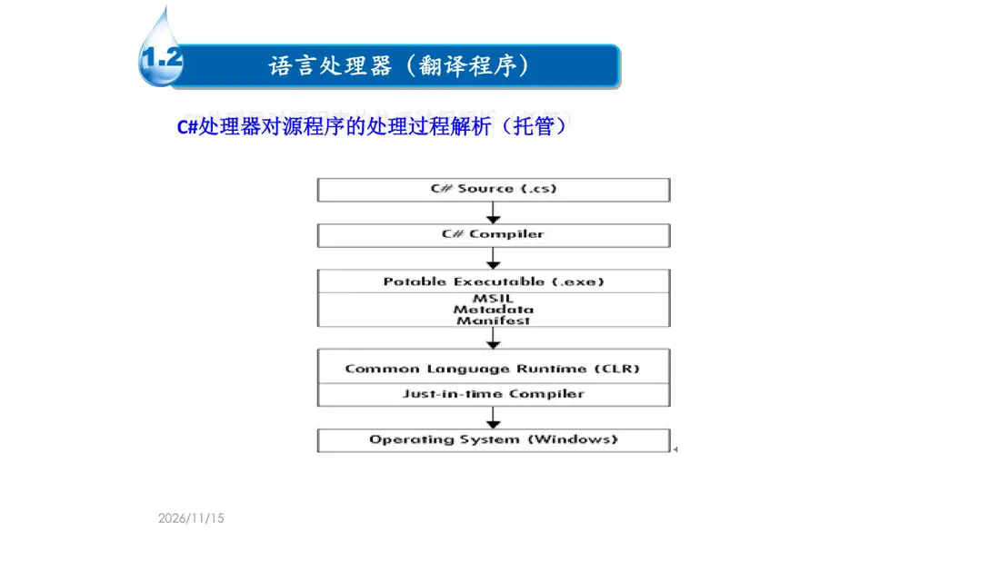

原文：

C#处理器对源程序的处理过程解析（托管）

1.2

语言处理器（翻译程序）

2026/11/15

### 1.2

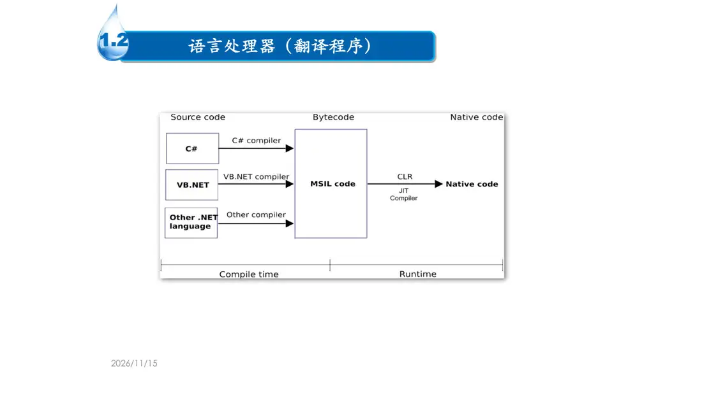

原文：

1.2

语言处理器（翻译程序）

2026/11/15

### Java与C#——开源与垄断

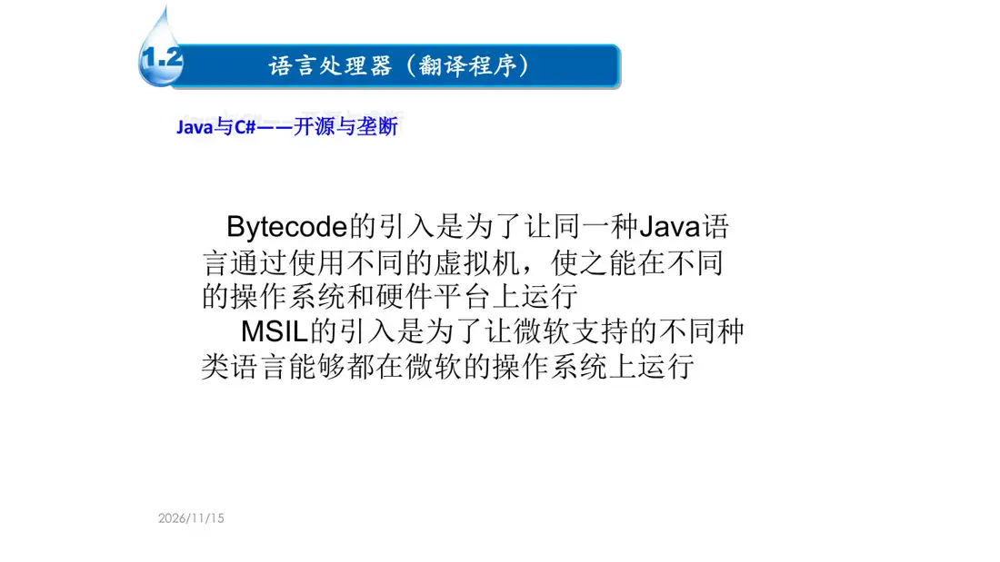

原文：

Java与C#——开源与垄断

Bytecode的引入是为了让同一种Java语言通过使用不同的虚拟机，使之能在不同的操作系统和硬件平台上运行

MSIL的引入是为了让微软支持的不同种类语言能够都在微软的操作系统上运行

1.2

语言处理器（翻译程序）

2026/11/15

### 一个常见的例子：外文资料的翻译过程—

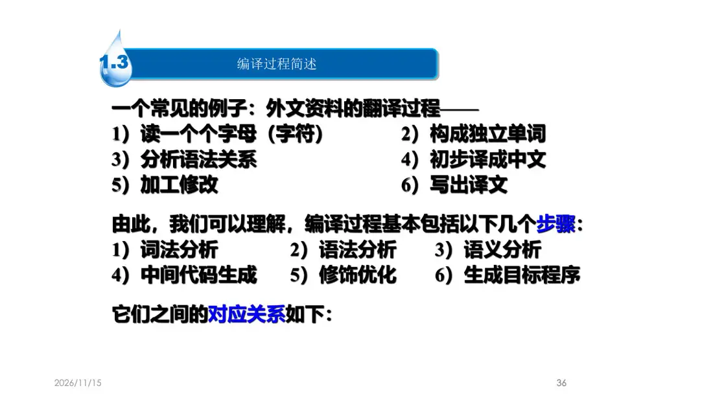

原文：

一个常见的例子：外文资料的翻译过程—

1）读一个个字母（字符）

3）分析语法关系

5）加工修改

2）构成独立单词

4）初步译成中文

6）写出译文

由此，我们可以理解，编译过程基本包括以下几个步骤：

1）词法分析

4）中间代码生成

2）语法分析

5）修饰优化

3）语义分析

6）生成目标程序

它们之间的对应关系如下：

1.3

编译过程简述

2026/11/15

36

### 翻译外文资料

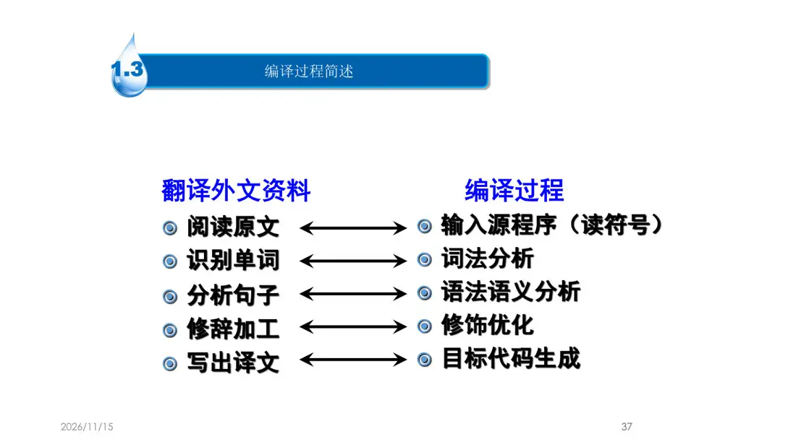

原文：

翻译外文资料

 阅读原文

 识别单词

 分析句子

 修辞加工

 写出译文

编译过程

 输入源程序（读符号）

 词法分析

 语法语义分析

 修饰优化

 目标代码生成

1.3

编译过程简述

2026/11/15

37

### 下面通过一个简单PASCAL源程序实例，说明编译基本过程。

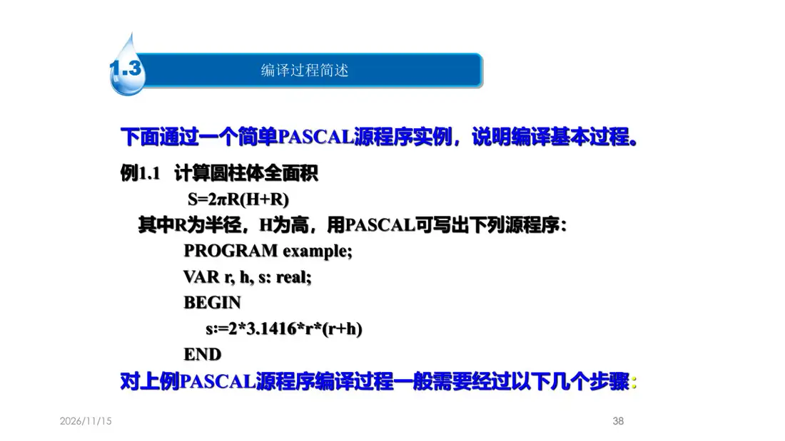

原文：

下面通过一个简单PASCAL源程序实例，说明编译基本过程。

1.3

编译过程简述

2026/11/15

38

### 1、源程序输入

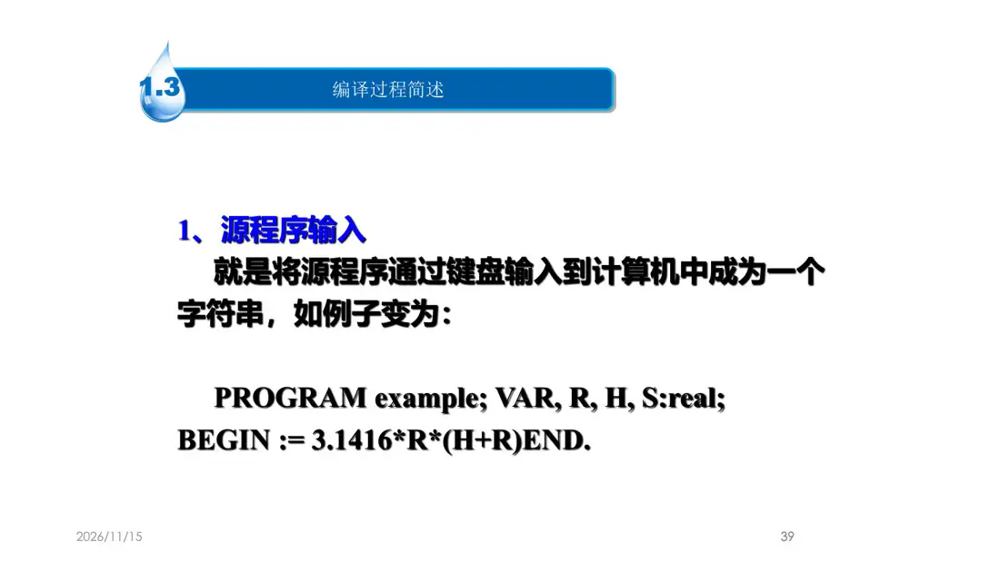

原文：

1、源程序输入

就是将源程序通过键盘输入到计算机中成为一个字符串，如例子变为：

PROGRAM example; VAR, R, H, S:real; BEGIN := 3.1416\*R\*(H+R)END.

1.3

编译过程简述

2026/11/15

39

### 2、词法分析

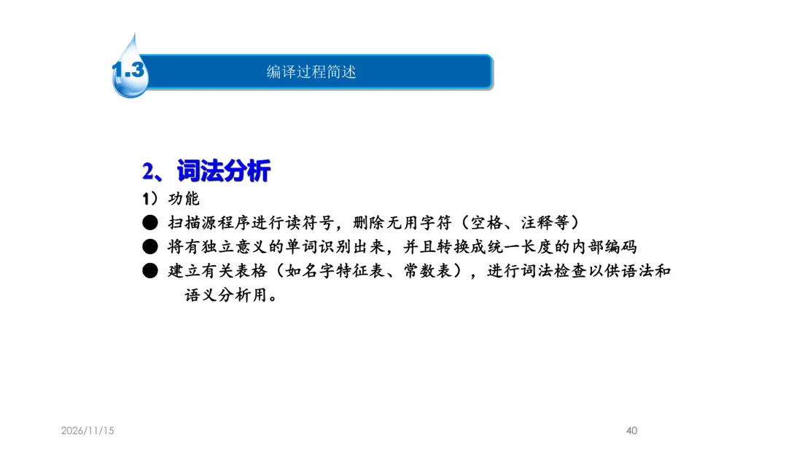

原文：

2、词法分析

1）功能

● 扫描源程序进行读符号，删除无用字符（空格、注释等）

● 将有独立意义的单词识别出来，并且转换成统一长度的内部编码

● 建立有关表格（如名字特征表、常数表），进行词法检查以供语法和语义分析用。

1.3

编译过程简述

2026/11/15

40

### 2、词法分析

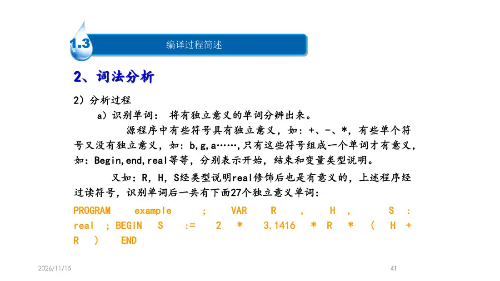

原文：

2、词法分析

2）分析过程

a）识别单词： 将有独立意义的单词分辨出来。

源程序中有些符号具有独立意义，如: +、-、\*，有些单个符号又没有独立意义，如: b,g,a……,只有这些符号组成一个单词才有意义，如：Begin,end,real等等，分别表示开始，结束和变量类型说明。

又如：R，H，S经类型说明real修饰后也是有意义的，上述程序经过读符号，识别单词后一共有下面27个独立意义单词：

1.3

编译过程简述

2026/11/15

41

### 2、词法分析

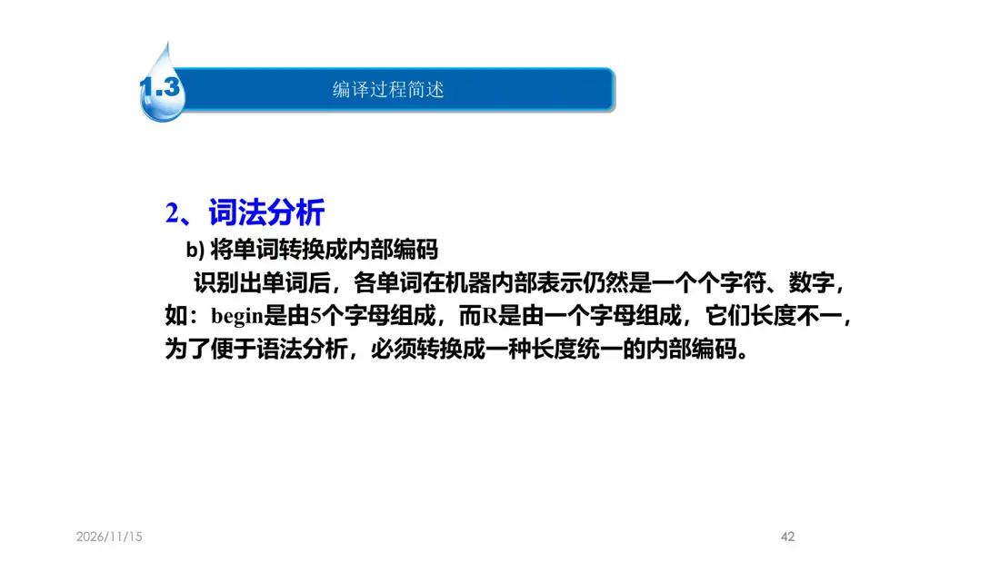

原文：

2、词法分析

b) 将单词转换成内部编码

识别出单词后，各单词在机器内部表示仍然是一个个字符、数字，如：begin是由5个字母组成，而R是由一个字母组成，它们长度不一，为了便于语法分析，必须转换成一种长度统一的内部编码。

1.3

编译过程简述

2026/11/15

42

### 2、词法分析

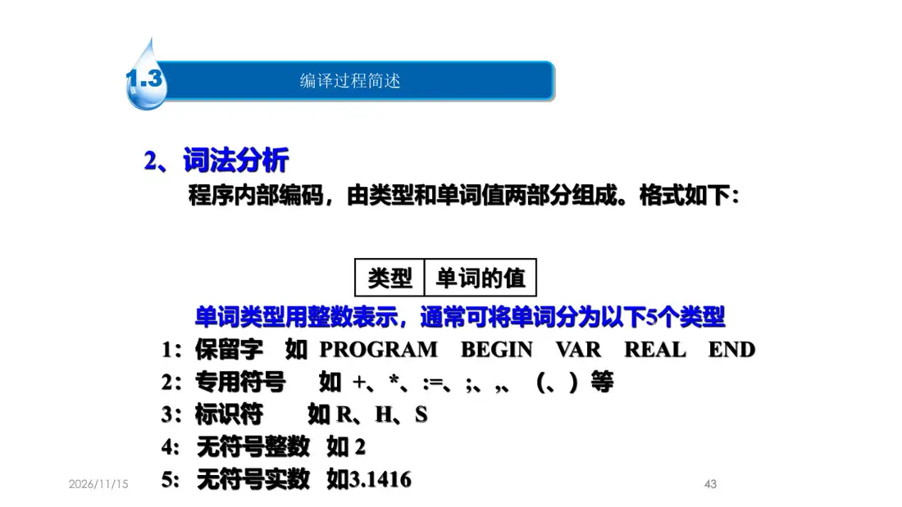

原文：

2、词法分析

程序内部编码，由类型和单词值两部分组成。格式如下：

类型 单词的值

单词类型用整数表示，通常可将单词分为以下5个类型

1：保留字 如 PROGRAM BEGIN VAR REAL END

2：专用符号 如 $+ _ { 0 } \div \cdots +$ （、）等

3：标识符 如 R、H、S

4: 无符号整数 如 2

5: 无符号实数 如3.1416

1.3

编译过程简述

2026/11/15

43

### 2、词法分析

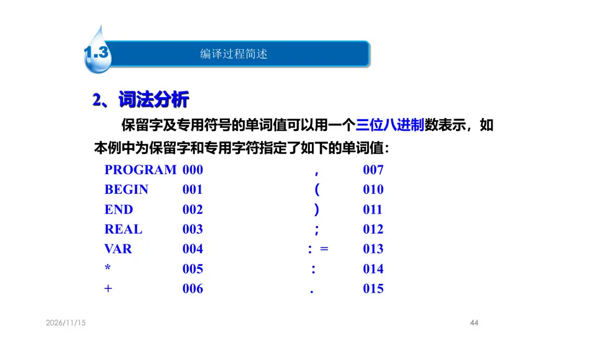

原文：

2、词法分析

保留字及专用符号的单词值可以用一个三位八进制数表示，如本例中为保留字和专用字符指定了如下的单词值：

<table><tr><td>PROGRAM</td><td>000</td><td>,</td><td>007</td></tr><tr><td>BEGIN</td><td>001</td><td>(</td><td>010</td></tr><tr><td>END</td><td>002</td><td>)</td><td>011</td></tr><tr><td>REAL</td><td>003</td><td>;</td><td>012</td></tr><tr><td>VAR</td><td>004</td><td>:=</td><td>013</td></tr><tr><td>*</td><td>005</td><td>:</td><td>014</td></tr><tr><td>+</td><td>006</td><td>.</td><td>015</td></tr></table>

1.3

编译过程简述

2026/11/15

44

### 2、词法分析

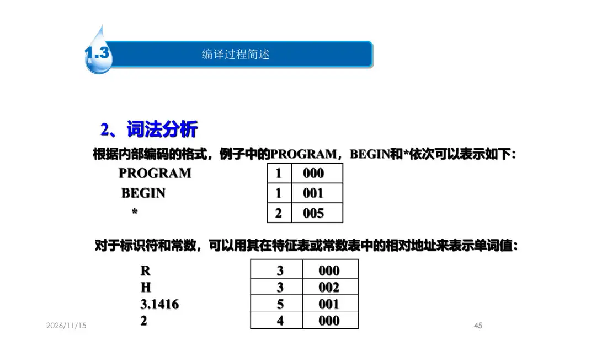

原文：

2、词法分析

根据内部编码的格式，例子中的 PROGRAM，BEGIN和\*依次可以表示如下：

<table><tr><td>1</td><td>000</td></tr><tr><td>1</td><td>001</td></tr><tr><td>2</td><td>005</td></tr></table>

对于标识符和常数，可以用其在特征表或常数表中的相对地址来表示单词值：

<table><tr><td>3</td><td>000</td></tr><tr><td>3</td><td>002</td></tr><tr><td>5</td><td>001</td></tr><tr><td>4</td><td>000</td></tr></table>

1.3

编译过程简述

2026/11/15

45

### 2、词法分析

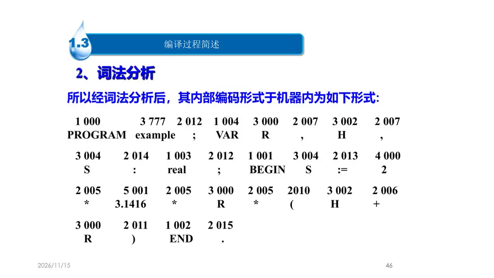

原文：

2、词法分析

所以经词法分析后，其内部编码形式于机器内为如下形式:

<table><tr><td>1 000PROGRAM</td><td>3 777 example</td><td>2 012 ;</td><td>1 004 VAR</td><td>3 000 R</td><td>2 007 ,</td><td>3 002 H</td><td>2 007 ,</td></tr><tr><td>3 004 S</td><td>2 014 :</td><td>1 003 real</td><td>2 012 ;</td><td>1 001 BEGIN</td><td>3 004 S</td><td>2 013 :=</td><td>4 000 2</td></tr><tr><td>2 005 *</td><td>5 001 3.1416</td><td>2 005 *</td><td>3 000 R</td><td>2 005 *</td><td>2010 (</td><td>3 002 H</td><td>2 006 +</td></tr><tr><td>3 000 R</td><td>2 011 )</td><td>1 002 END</td><td>2 015 .</td><td></td><td></td><td></td><td></td></tr></table>

1.3

编译过程简述

2026/11/15

46

### 3、语法分析

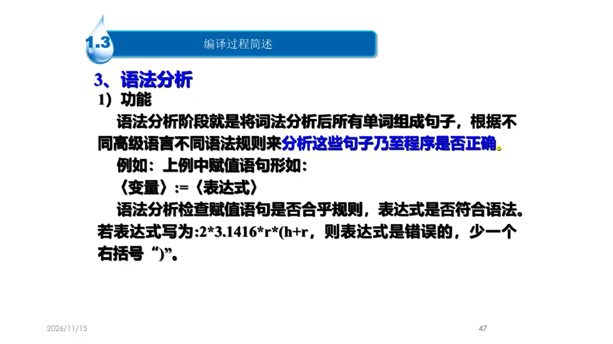

原文：

3、语法分析

1）功能

语法分析阶段就是将词法分析后所有单词组成句子，根据不同高级语言不同语法规则来分析这些句子乃至程序是否正确。

例如：上例中赋值语句形如：

$$
\langle \text {变量} \rangle := \langle \text {表达式} \rangle
$$

语法分析检查赋值语句是否合乎规则，表达式是否符合语法。若表达式写为:2\*3.1416\*r\*(h+r，则表达式是错误的，少一个右括号“)”。

1.3

编译过程简述

2026/11/15

47

### 3、语法分析

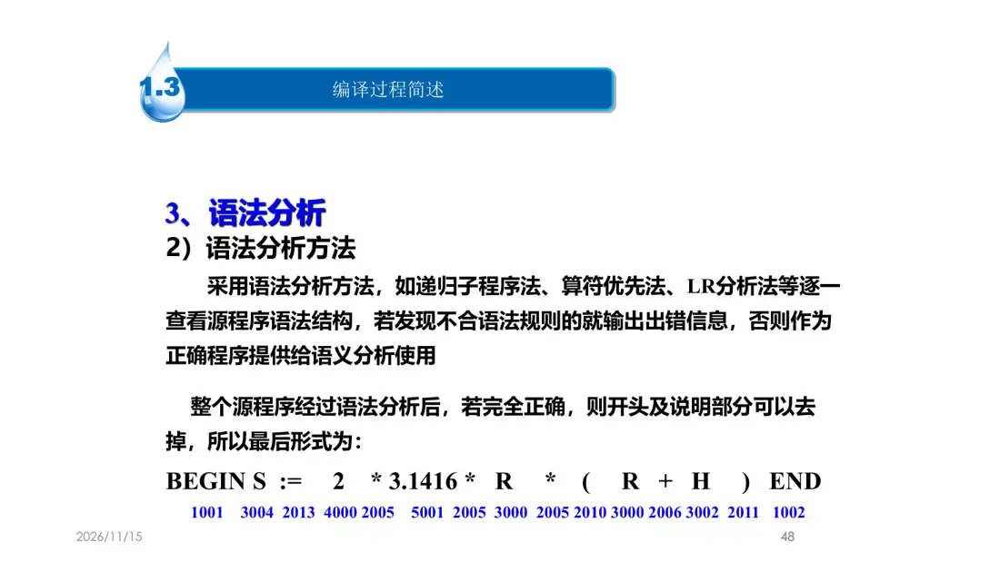

原文：

3、语法分析

2）语法分析方法

采用语法分析方法，如递归子程序法、算符优先法、LR分析法等逐一查看源程序语法结构，若发现不合语法规则的就输出出错信息，否则作为正确程序提供给语义分析使用

整个源程序经过语法分析后，若完全正确，则开头及说明部分可以去掉，所以最后形式为：

BEGIN S := 2 \* 3.1416 \* R \* R + H END 1001 3004 2013 4000 2005 5001 2005 3000 2005 2010 3000 2006 3002 2011 1002

1.3

编译过程简述

2026/11/15

48

### 4、语义分析

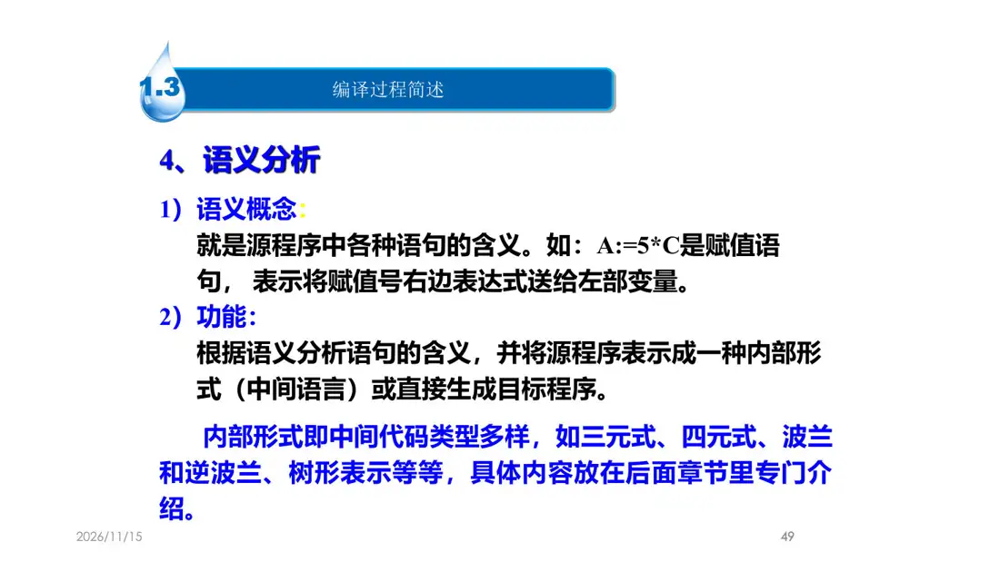

原文：

4、语义分析

1）语义概念：

就是源程序中各种语句的含义。如： $\mathbf { A } { : = } 5 ^ { * } \mathbf { C }$ 是赋值语句，表示将赋值号右边表达式送给左部变量。

2）功能：

根据语义分析语句的含义，并将源程序表示成一种内部形式（中间语言）或直接生成目标程序。

内部形式即中间代码类型多样，如三元式、四元式、波兰和逆波兰、树形表示等等，具体内容放在后面章节里专门介绍。

1.3

编译过程简述

2026/11/15

49

### 4、语义分析

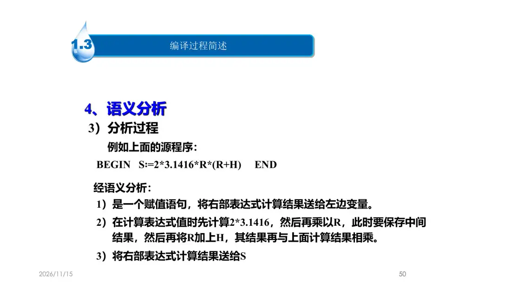

原文：

4、语义分析

3）分析过程

例如上面的源程序：

$$
\text { BEGIN } \quad S := 2 * 3. 1 4 1 6 * R * (R + H) \quad \text { END }
$$

经语义分析：

1）是一个赋值语句，将右部表达式计算结果送给左边变量。

2）在计算表达式值时先计算2\*3.1416，然后再乘以R，此时要保存中间结果，然后再将R加上H，其结果再与上面计算结果相乘。

3）将右部表达式计算结果送给S

1.3

编译过程简述

2026/11/15

50

### 5、修饰优化

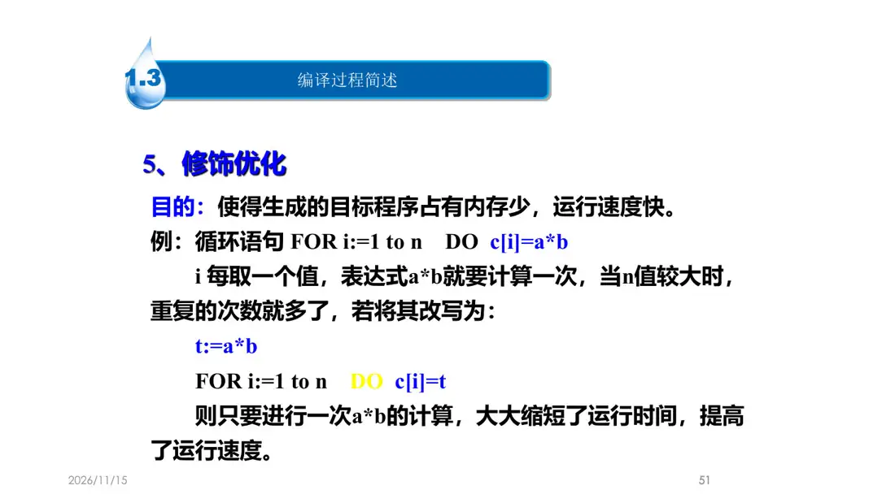

原文：

5、修饰优化

目的：使得生成的目标程序占有内存少，运行速度快。

例：循环语句 $\mathrm { F O R \ i { : } = 1 \ t o \ n \quad \mathrm { D O \ c [ i ] = a ^ { * } b } }$

i每取一个值，表达式a\*b就要计算一次，当n值较大时，重复的次数就多了，若将其改写为：

$$
\mathbf {t} := \mathbf {a} ^ {*} \mathbf {b}
$$

$$
\text { FOR   i: = 1   to   n } \quad \text { DO   c[i] = t }
$$

则只要进行一次a\*b的计算，大大缩短了运行时间，提高了运行速度。

1.3

编译过程简述

2026/11/15

51

### 6、目标代码生成

原文：

6、目标代码生成

目标代码生成就是将中间语言代码转换成机器语言程序或汇编语言程序，最后完成翻译。

1.3

编译过程简述

2026/11/15

52

### 整个编译过程如下图—

原文：

整个编译过程如下图—

问题级分解

1.3

编译过程简述

等价转换

2026/11/15

53

### 源语言：加法表达式语言Sum两种语法形式：整型数字：n加法：e1+e2

原文：

源语言：加法表达式语言Sum两种语法形式：整型数字：n加法：e1+e2

编译过程简述

目标机器：栈式计算机Stack一个操作数栈两条指令：压栈指令：push n加法指令：add

编译器例子

https://mooc.study.163.com/learn/1000002001?tid=1000003000#/learn /content?type=detail&id=1000023011

### 源语言：加法表达式语言Sum两种语法形式：整型数字：n加法：e1+e2

原文：

源语言：加法表达式语言Sum两种语法形式：整型数字：n加法：e1+e2

E∷=n| E+E

抽象

形式化

递归

55

### 56

原文：

目标机器：栈式计算机Stack一个操作数栈两条指令：压栈指令：push n加法指令：addadd(){x=pop();y=pop();z=x+y;push z;}

56

### 三、趟程（遍）

原文：

三、趟程（遍）

1. 定义

从头到尾扫描一遍源程序或等价源程序，并做有关加工处理，称趟程(遍) 。

每经过一趟源程序都要进行等价变换并更接近目标程序。如果通过对源程序一遍扫描直接生成目标代码程序，则说编译程序是单遍的。

把源程序分为几遍来编译，每遍只完成编译程序中的一部分或几个部分工作，称为多遍的。

比如第一遍进行词法、语法分析，检查语法错误；第二遍生成中间语言进行存储分配；第三遍生成可运行的目标程序。如：IBM PC DOSPASCAL就是一个多遍扫描编译程序。

### 多遍扫描的优点弥补了单遍的缺点，单遍却避免了多遍的缺点

原文：

多遍扫描的优点弥补了单遍的缺点，单遍却避免了多遍的缺点

优点：加工充分；出错处理细致；目标程序质量高

缺点：编译时间长，开销大

### 2.决定趟程的因素

原文：

2.决定趟程的因素

（1）计算机存贮容量大小；

（2）编译程序功能强弱；

（3）源语言繁简；

（4）目标程序优化程度；

（5）设计和实现编译程序时使用工具的先进性

（6）参加人员多少和素质等。

### 1.4编译程序的构建方法

原文：

1.4编译程序的构建方法

◆编写编译程序的一般方法

编译程序虽然是一个非常复杂的软件系统，但本质上也是运行在某种计算机上的程序，所以它也是用某种程序设计语言编写的。

根据不同类型的编写语言，将编写编译程序的一般方法分成下面3种类型。

60

### 1.4编译程序的构建方法

原文：

1.4编译程序的构建方法

（1）直接用机器语言编写编译程序

机器语言是早期编写编译程序的唯一工具，但由于机器语言难读难写，现在几乎没有人再用它编写编译程序。

（2）用汇编语言编写编译程序

由于汇编语言太依赖于硬件环境，且程序过于冗长，现在也不常用，不过由于它通过汇编程序产生的目标代码效率比较高，所以在编译程序核心部分常用它编写。

（3）用系统程序设计语言编写

无论从可读性、可靠性、可维护性，还是从编写效率来说，机器语言和汇编语言这些低级程序设计语言都不能满足编译程序的开发需求。从1980以后，几乎所有的编译程序都是用高级语言编写，从而避开了与机器有关许多烦琐细节，大大减轻编写编译程序工作量。

能够编写编译程序或其他系统软件的高级语言称系统程序设计语言。如PASCAL、C、C++，Java…

61

### 1.4编译程序的构建方法

原文：

1.4编译程序的构建方法

◆ 编译程序的开发技术

1.自编译

2.交叉编译

3.自展技术

4.移植

62

### T型图

原文：

T型图

一个编译程序通常会涉及到3种语言：

源语言、目标语言和编译程序“书写语言”。

源语言和目标语言体现了编译程序的功能，

而“书写语言”代表了编译程序所需的运行环境。

三者之间的关系可用T型图来表示，可以读成“W语言编写的S语

言的编译程序，其目标语言是D语言”

是用于描述编译器实现时的一种辅助工具，可以用来表示源语言S、目标语言D、和编译程序书写语言W之间的关系。简记为���\~�

书写语言W

63

### “A机器语言编写的Pascal语言的编译程序，其目标语言是A语言”

原文：

“A机器语言编写的Pascal语言的编译程序，其目标语言是A语言”

在A机器上可以用Pascal语言写任何程序了

64

### 自编译技术

原文：

自编译技术

自编译技术是由瑞士苏黎世理工学院的N.Wirth教授提出来的，并利用该技术成功地构造了Pascal语言的编译程序。

65

### 利用PASCAL语言开发C语言的自编译过程

原文：

利用PASCAL语言开发C语言的自编译过程
<table><tr><td colspan="2">C语言</td><td colspan="2">A机器语言</td><td></td><td colspan="2">C语言</td><td colspan="2">A机器语言</td></tr><tr><td></td><td colspan="2">PASCAL</td><td colspan="2">PASCAL</td><td colspan="2">A机器语言</td><td colspan="2">A机器语言</td></tr><tr><td colspan="4"></td><td colspan="2">A机器语言</td><td colspan="3"></td></tr></table>

66

### C++A机器语言C++A机器语言CCA机器语言A机器语言A机器语言

原文：

1、已知A机器上存在一个C语言的编译器，利用T型图描述在A机器上，利用C语言编写C++语言翻译程序的自编译过程。

<table><tr><td colspan="2">C++</td><td colspan="2">A机器语言</td><td></td><td colspan="2">C++</td><td>A机器语言</td></tr><tr><td rowspan="2"></td><td colspan="2">C</td><td>C</td><td colspan="2">A机器语言</td><td colspan="2">A机器语言</td></tr><tr><td colspan="3"></td><td colspan="2">A机器语言</td><td colspan="2"></td></tr></table>

### 68

原文：

如果一种高级语言与之相应的编译程序也能直接用该语言本身写出来，具有这种性质语言称自编译语言。利用自编译语言开发自身或其他语言的编译程序的方法称为自编译技术。

68

### 自展技术

原文：

自展技术

自展技术是利用自编译技术，将一个功能较小的编译程序，一级一级扩充而变成一个功能较强的编译程序。

假设为一个高级语言L在某机器A上编写一个编译程序，该机器语言为A，则自展技术过程如下：

（1）取 L 语言的一个子集 L1（语言核心部分），选取原则简单，刚够书写其自身的编译程序。首先用机器语言A来建立L1的编译程序，

69

### （3）利用已有的L1编译器进行翻译处理

原文：

（2）为了检验L1是否取得适当，以及构建的L1编译程序是否正确，可用L1重写一次L1的编译程序，

（3）利用已有的L1编译器进行翻译处理

1

70

### 4）然后把语言功能由L1扩展到L2(L2包含L1)，

原文：

4）然后把语言功能由L1扩展到L2(L2包含L1)，

6）类似地对L4、L5、……、Li、……(其中Li+1 包含Li )按上述过程进行多次，直到扩展到所需 L为止, 这就是由核心语言L1开始逐步扩展到 L语言的自展编译过程。

1

71

### 交叉编译技术

原文：

交叉编译技术

如果一个A机器上编译程序能产生B机器的目标代码,则称这种程序为交叉编译程序。

72

### 为什么需要交叉编译？

原文：

为什么需要交叉编译？

• 目的平台上不允许或不能够安装我们所需要的编译器。

• 目的平台上的资源匮乏，无法运行我们所需要的编译器。

• 目的平台还没有建立。

利用电脑上的编译程序，将软件程序编译为手机可以运行的机器码。

73

### 74

原文：

利用T型图描述在A机器上，利用Pascal语言编写Pascal语言翻译程序,产生B机器的目标代码的交叉编译过程。

74

### JavaB机器语言JavaB机器语言CCA机器语言A机器语言A机器语言

原文：

利用T型图描述在A机器上，利用C语言编写Java语言翻译程序产生B机器的目标代码的交叉编译过程。

<table><tr><td colspan="2">Java</td><td colspan="2">B机器语言</td><td></td><td colspan="2">Java</td><td>B机器语言</td></tr><tr><td rowspan="2"></td><td colspan="2">C</td><td>C</td><td colspan="2">A机器语言</td><td colspan="2">A机器语言</td></tr><tr><td colspan="3"></td><td colspan="2">A机器语言</td><td colspan="2"></td></tr></table>

75

### 移植技术

原文：

移植技术

移植是编译程序开发中一项十分重要技术，移植就是把一台计算机上的软件移植到另一台计算机上去。移植方法有多种，下面简单地介绍两种典型的方法。

1）利用交叉编译技术将一台计算机上由自编译语言编写的编译程序移植到另一台计算机上。

76

### 第 77 页

原文：

1

### 利用T型图进行描述，将A机器上的C++语言的编译器移植到B机器上。

原文：

利用T型图进行描述，将A机器上的C++语言的编译器移植到B机器上。

<table><tr><td colspan="2"></td><td>C++</td><td colspan="2">B机器语言</td><td>C++</td><td>B机器语言</td></tr><tr><td>C++</td><td>B机器语言</td><td>C++</td><td>C++</td><td>B机器语言</td><td>B机器语言</td><td></td></tr><tr><td></td><td>C++</td><td>C++</td><td>A机器语言</td><td>A机器语言</td><td></td><td></td></tr><tr><td></td><td></td><td>A机器语言</td><td></td><td></td><td></td><td></td></tr></table>

### 第 79 页

原文：

2）综合几种型号的计算机硬件特性，抽象出一个通用的汇编语言，而每种型号计算机上只要配有一个简单汇编程序，用它来把通用汇编语言书写的程序翻译成机器语言程序，采用这种方法设计一种通用汇编语言较为困难，因为这个通用的汇编语言既要便于书写编译程序，又要能够在各种不同型号计算机上高效地实现。

### 1.4编译程序的构建方法

原文：

1.4编译程序的构建方法

◆ 编译程序的自动生成

把源语言的定义以及机器语言的描述输入到这种软件中去 , 自动生成该语言编译程序, 这就是编译程序的自动生成 , 也称编译程序生成器或编译程序的编译程序, 称 CC(Compiler-Compiler)。

Lex、Yacc、Parser Generator、ANTLR

80

### 作业：

原文：

作业：

1、已知A机器上存在一个C语言的编译器，利用T型图描述在A机器上，利用C语言编写C++语言翻译程序的自编译过程。

2、利用T型图进行描述，将A机器上的C++语言的编译器移植到B机器上。

3、什么叫趟程？影响编译程序分遍的因素有哪些？

4、编译程序由哪些部分组成？

81

### 希望和大家携手完成本课程的学习！

原文：

希望和大家携手完成本课程的学习！

更希望和各位成为可以交流的朋友！

预祝大家顺利通过本课程并取得好成绩！

谢谢！

南志命生大摩 南志都生大学

计算机学院 软件学院网络空间安全学院School of Computer Science
