# 《编译原理》第二章 形式语言基本知识（课件）

原件的每一页，下面附识别出的文字。

### 编译原理

原文：

编译原理

第二章

南京郵電大學 Nanjing ins 南京郵電大学 Nanjing University of Posts and Telecommunications

### 二章 形式语言基本知识

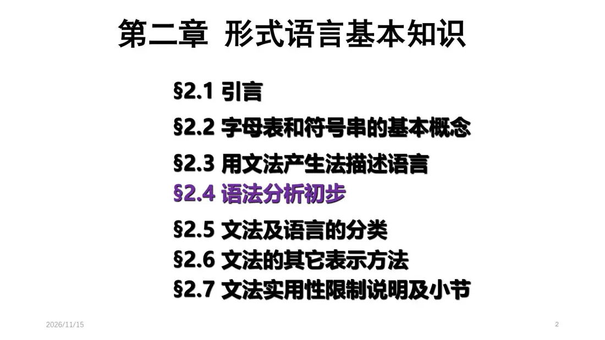

原文：

二章 形式语言基本知识
§2.1 引言
§2.2 字母表和符号串的基本概念
§2.3 用文法产生法描述语言
§2.4 语法分析初步
§2.5 文法及语言的分类
§2.6 文法的其它表示方法
§2.7 文法实用性限制说明及小节

2026/11/15

2

### §2.3用文法产生法描述语言

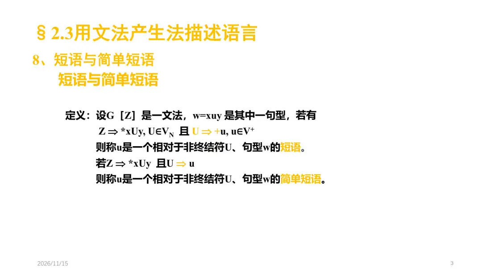

原文：

§2.3用文法产生法描述语言

8、短语与简单短语短语与简单短语

定义：设G［Z］是一文法，w=xuy是其中一句型，若有$\mathbf { Z } \Rightarrow \mathbf { * } _ { \mathbf { X } } \mathbf { U } \mathbf { y } , \mathbf { U } \in \mathbf { V } _ { \mathbf { N } } \textrm { E I U } \Rightarrow \mathbf { + u } , \mathbf { u } \in \mathbf { V } ^ { + }$ 则称u是一个相对于非终结符U、句型w的短语。若 $\mathbf { \ddot { Z } } \Rightarrow \mathbf { \dot { \mu } _ { X } } \mathbf { U } \mathbf { y }$ 且U  u则称u是一个相对于非终结符U、句型w的简单短语。

2026/11/15

3

### §2.3用文法产生法描述语言

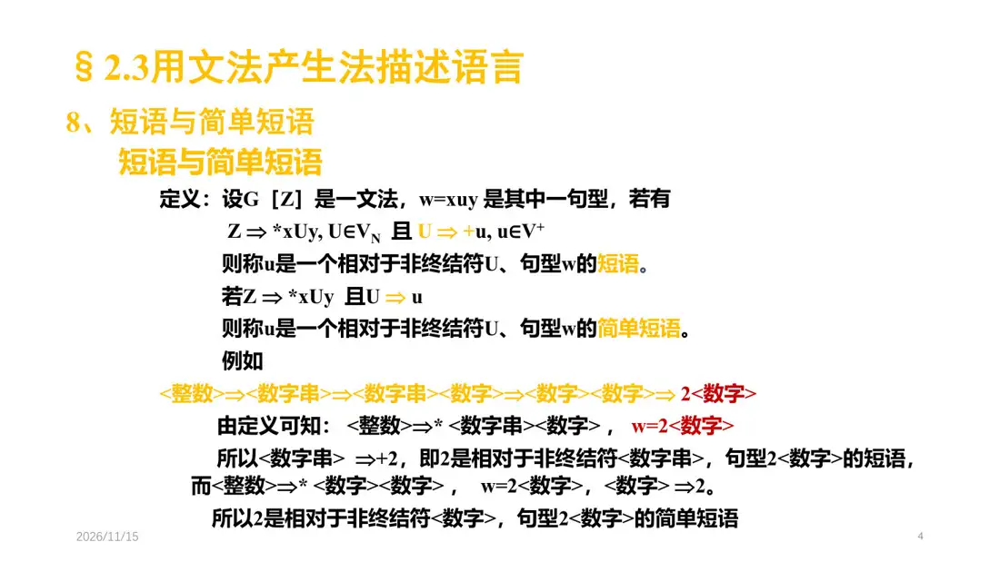

原文：

§2.3用文法产生法描述语言

8、短语与简单短语短语与简单短语

定义：设G［Z］是一文法，w=xuy 是其中一句型，若有

$$
\mathbf {Z} \Rightarrow {} ^ {*} \mathbf {x} \mathbf {U} \mathbf {y}, \mathbf {U} \in \mathbf {V} _ {\mathrm{N}} \text {且} \mathbf {U} \Rightarrow + \mathbf {u}, \mathbf {u} \in \mathbf {V} ^ {+}
$$

则称u是一个相对于非终结符U、句型w的短语。

若 $\mathbf { Z } \Rightarrow \mathbf { * } _ { \mathbf { X } } \mathbf { U } \mathbf { y }$ 且U  u

则称u是一个相对于非终结符U、句型w的简单短语。

例如

<整数>⇒><数字串>⇒><数字串><数字>⇒><数字><数字>⇒>2<数字>

由定义可知： <整数>\* <数字串><数字> ， w=2<数字>

所以<数字串> +2，即2是相对于非终结符<数字串>，句型2<数字>的短语，而<整数>⇒\*<数字><数字>，w=2<数字>，<数字>⇒2。

所以2是相对于非终结符<数字>，句型2<数字>的简单短语

2026/11/15

4

### §2.3用文法产生法描述语言

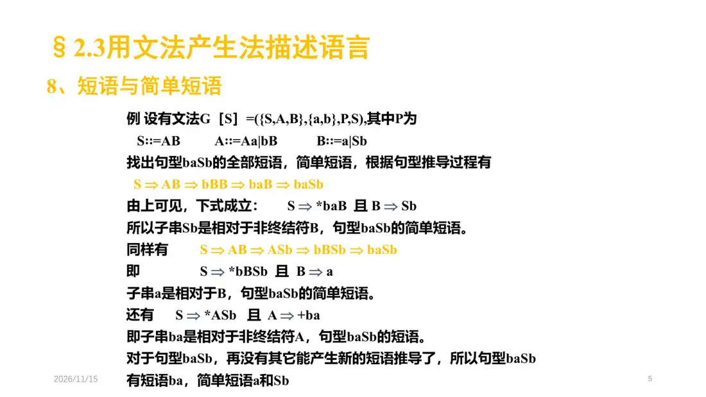

原文：

§2.3用文法产生法描述语言

8、短语与简单短语

例 设有文法G $\mathrm { [ S ] } \ = ( \{ \mathrm { S } , \mathrm { A } , \mathrm { B } \} , \{ \mathrm { a } , \mathrm { b } \} , \mathrm { P } , \mathrm { S } )$ ,其中P为

$$
\mathbf {S}: := \mathbf {A B}
$$

$$
\mathbf {A}: := \mathbf {A} \mathbf {a} | \mathbf {b} \mathbf {B}
$$

$$
\mathbf {B}: := \mathbf {a} | \mathbf {S b}
$$

找出句型baSb的全部短语，简单短语，根据句型推导过程有

$$
\mathrm{S} \Rightarrow \mathrm{AB} \Rightarrow \mathrm{bBB} \Rightarrow \mathrm{baB} \Rightarrow \mathrm{baSb}
$$

由上可见，下式成立： $\mathbf { S } \Rightarrow \mathbf { \tilde { \tilde { \omega } } } \mathbf { b } \mathbf { a } \mathbf { B }$ 且 $\mathbf { B } \Rightarrow \mathbf { S } \mathbf { b }$

所以子串Sb是相对于非终结符B，句型baSb的简单短语。

同样有 $\mathrm { S } \Rightarrow \mathrm { A B } \Rightarrow \mathrm { A S b } \Rightarrow \mathrm { b B S b } \Rightarrow \mathrm { b a S b }$

即 S⇒\*bBSb 且 B⇒a

子串a是相对于B，句型baSb的简单短语。

还有 $\mathbf { S } \Rightarrow \mathbf { \tilde { \tilde { \mathbf { A } } \mathbf { S } \mathbf { b } } }$ 且 $\mathbf { A } \Rightarrow + \mathbf { b } \mathbf { a }$

即子串ba是相对于非终结符A，句型baSb的短语。

对于句型baSb，再没有其它能产生新的短语推导了，所以句型baSb

有短语ba，简单短语a和Sb

2026/11/15

5

### §2.3用文法产生法描述语言

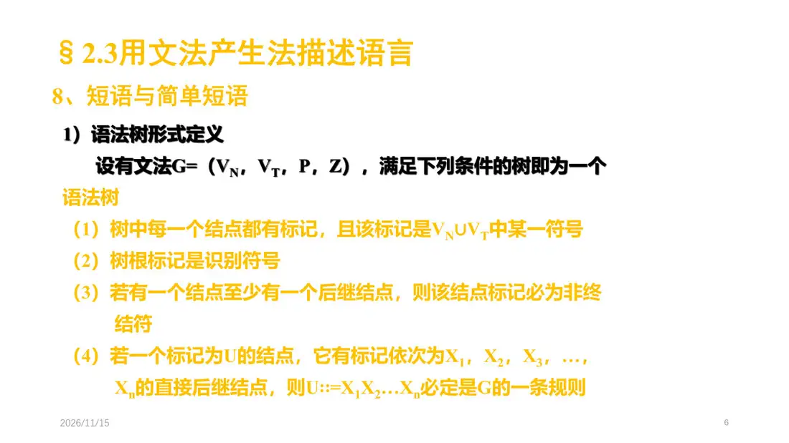

原文：

§2.3用文法产生法描述语言

8、短语与简单短语

1）语法树形式定义

设有文法 $\mathbf { G } { = \begin{array} { l } { ( \mathbf { V } _ { \mathbf { N } } , \ \mathbf { V } _ { \mathbf { T } } , \ \mathbf { P } , \ \mathbf { Z } ) } \end{array} }$ ，满足下列条件的树即为一个 语法树

（1）树中每一个结点都有标记，且该标记是 $\mathbf { V } _ { \mathbf { N } } \mathbf { U } \mathbf { V } _ { \mathrm { T } }$ 中某一符号

（2）树根标记是识别符号

（3）若有一个结点至少有一个后继结点，则该结点标记必为非终结符

（4）若一个标记为U的结点，它有标记依次为 $X _ { 1 } , ~ X _ { 2 } , ~ X _ { 3 } , ~ \dots ,$ $X _ { \mathrm { n } }$ 的直接后继结点，则 $\mathrm { U } { : = } \mathrm { X } _ { 1 } \mathrm { X } _ { 2 } { \ldots } \mathrm { X } _ { \mathrm { n } }$ 必定是G的一条规则

2026/11/15

6

### §2.3用文法产生法描述语言

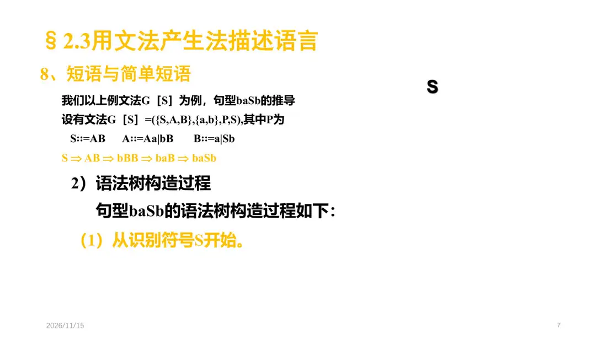

原文：

§2.3用文法产生法描述语言

8、短语与简单短语

我们以上例文法G［S］为例，句型baSb的推导

设有文法G $\mathrm { [ S ] } \ = ( \{ \mathrm { S } , \mathrm { A } , \mathrm { B } \} , \{ \mathrm { a } , \mathrm { b } \} , \mathrm { P } , \mathrm { S } )$ ,其中P为

$$
\mathrm{S}: := \mathrm{AB} \quad \mathrm{A}: := \mathrm{Aa} | \mathrm{bB} \quad \mathrm{B}: := \mathrm{a} | \mathrm{Sb}
$$

$$
\mathrm{S} \Rightarrow \mathrm{AB} \Rightarrow \mathrm{bBB} \Rightarrow \mathrm{baB} \Rightarrow \mathrm{baSb}
$$

2）语法树构造过程

句型 $\mathbf { b a S b }$ 的语法树构造过程如下：

（1）从识别符号S开始。

S

2026/11/15

7

### §2.3用文法产生法描述语言

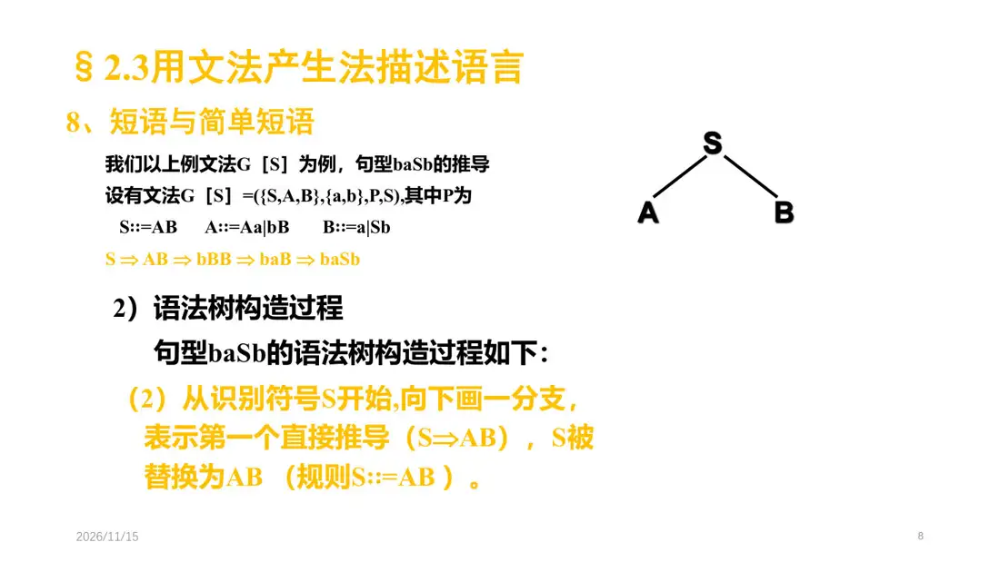

原文：

§2.3用文法产生法描述语言

8、短语与简单短语

我们以上例文法G［S］为例，句型baSb的推导设有文法G $\mathrm { [ S ] } \ = ( \{ \mathrm { S } , \mathrm { A } , \mathrm { B } \} , \{ \mathrm { a } , \mathrm { b } \} , \mathrm { P } , \mathrm { S } )$ ,其中P为$\begin{array} { r l r } { \mathbf { S } { \boldsymbol { : } } { \boldsymbol { : } } = \mathbf { A } \mathbf { B } } & { { } \mathbf { A } { \boldsymbol { : } } { \boldsymbol { : } } = \mathbf { A } \mathbf { a } \| \mathbf { b } \mathbf { B } } & { \quad \mathbf { B } { \boldsymbol { : } } { \boldsymbol { : } } = \mathbf { a } \| \mathbf { S } \mathbf { b } } \end{array}$

$$
\mathrm{S} \Rightarrow \mathrm{AB} \Rightarrow \mathrm{bBB} \Rightarrow \mathrm{baB} \Rightarrow \mathrm{baSb}
$$

2）语法树构造过程

句型baSb的语法树构造过程如下：

（2）从识别符号S开始,向下画一分支，表示第一个直接推导 $( \mathrm { S } \mathrm { \Longrightarrow } \mathrm { A B } )$ ，S被替换为AB （规则 $\mathbf { S } _ { } { : } _ { = } { = } \mathbf { A } \mathbf { B } \mathbf { \Theta } ]$

2026/11/15

8

### §2.3用文法产生法描述语言

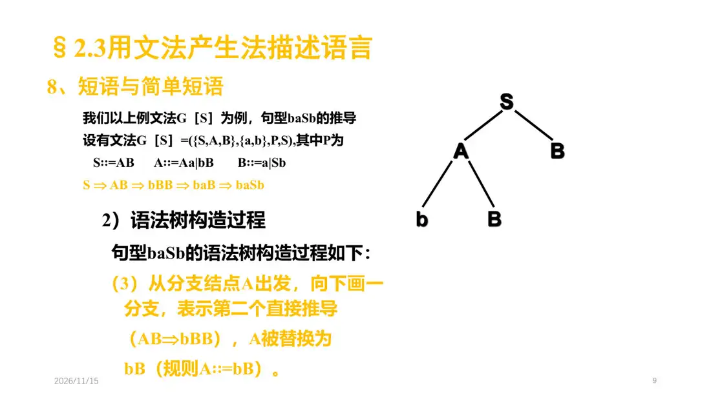

原文：

§2.3用文法产生法描述语言

8、短语与简单短语

我们以上例文法G［S］为例，句型baSb的推导设有文法G $\mathrm { [ S ] } \ = ( \{ \mathrm { S } , \mathrm { A } , \mathrm { B } \} , \{ \mathrm { a } , \mathrm { b } \} , \mathrm { P } , \mathrm { S } )$ ,其中P为$\begin{array} { r l r } { \mathbf { S } { \boldsymbol { : } } { \boldsymbol { : } } = \mathbf { A } \mathbf { B } } & { { } \mathbf { A } { \boldsymbol { : } } { \boldsymbol { : } } = \mathbf { A } \mathbf { a } \| \mathbf { b } \mathbf { B } } & { \quad \mathbf { B } { \boldsymbol { : } } { \boldsymbol { : } } = \mathbf { a } \| \mathbf { S } \mathbf { b } } \end{array}$ $\mathrm { S } \Rightarrow \mathrm { A B } \Rightarrow \mathrm { b B B } \Rightarrow \mathrm { b a B } \Rightarrow \mathrm { b a S b }$

2）语法树构造过程

句型baSb的语法树构造过程如下：

（3）从分支结点A出发，向下画一分支，表示第二个直接推导$\mathbf { \left( A B { \Rightarrow } b B B \right) }$ ，A被替换为bB（规则 $\mathbf { A } { \stackrel { \circ } { \circ } } { = } \mathbf { b } \mathbf { B } )$

2026/11/15

9

### §2.3用文法产生法描述语言

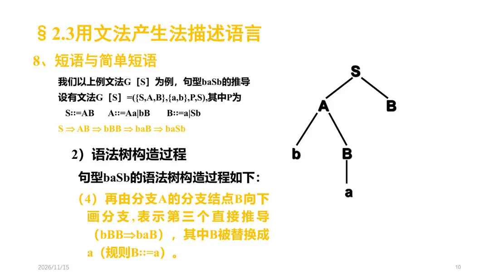

原文：

§2.3用文法产生法描述语言

8、短语与简单短语

我们以上例文法G［S］为例，句型baSb的推导设有文法G $\mathrm { [ S ] } \ = ( \{ \mathrm { S } , \mathrm { A } , \mathrm { B } \} , \{ \mathrm { a } , \mathrm { b } \} , \mathrm { P } , \mathrm { S } )$ ,其中P为$\begin{array} { r l r } { \mathbf { S } { \boldsymbol { : } } { \boldsymbol { : } } = \mathbf { A } \mathbf { B } } & { { } \mathbf { A } { \boldsymbol { : } } { \boldsymbol { : } } = \mathbf { A } \mathbf { a } \| \mathbf { b } \mathbf { B } } & { \quad \mathbf { B } { \boldsymbol { : } } { \boldsymbol { : } } = \mathbf { a } \| \mathbf { S } \mathbf { b } } \end{array}$ $\mathrm { S } \Rightarrow \mathrm { A B } \Rightarrow \mathrm { b B B } \Rightarrow \mathrm { b a B } \Rightarrow \mathrm { b a S b }$

2）语法树构造过程

句型baSb的语法树构造过程如下：

（4）再由分支A的分支结点B向下画分支, 表 示 第 三 个 直 接 推 导$\left( \mathbf { b B B } { \Rightarrow } \mathbf { b a B } \right)$ ，其中B被替换成a（规则B∷=a）。

2026/11/15

10

### §2.3用文法产生法描述语言

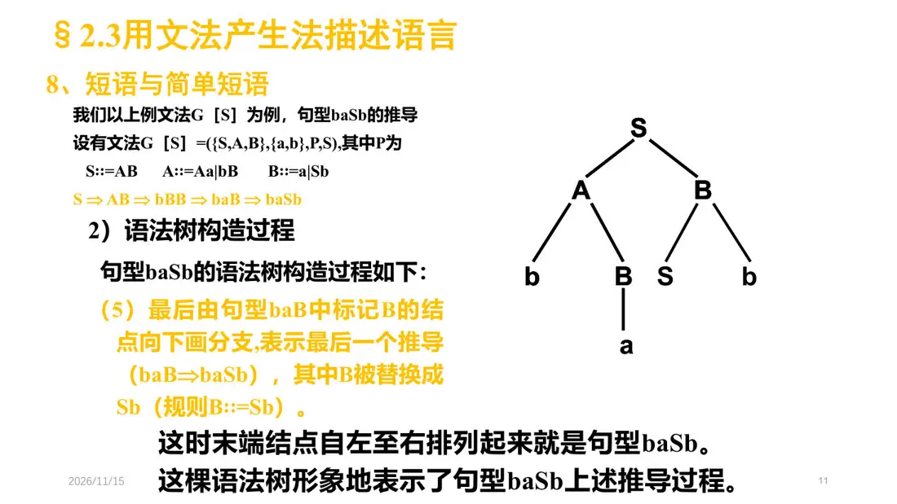

原文：

§2.3用文法产生法描述语言

8、短语与简单短语

我们以上例文法G［S］为例，句型baSb的推导设有文法G $\mathrm { [ S ] } \ = ( \{ \mathrm { S } , \mathrm { A } , \mathrm { B } \} , \{ \mathrm { a } , \mathrm { b } \} , \mathrm { P } , \mathrm { S } )$ ,其中P为$\mathbf { S } { : } { : } = \mathbf { A } \mathbf { B }$ $\mathbf { A } { \boldsymbol { : } } { \boldsymbol { : } } { = } \mathbf { A } \mathbf { a } { | } \mathbf { b } \mathbf { B }$ $\mathbf { B } { \boldsymbol { : } } { \mathbf { : } } = \mathbf { a } | \mathbf { S } \mathbf { b }$ $\mathrm { S } \Rightarrow \mathrm { A B } \Rightarrow \mathrm { b B B } \Rightarrow \mathrm { b a B } \Rightarrow \mathrm { b a S b }$

2）语法树构造过程

句型baSb的语法树构造过程如下：

（5）最后由句型baB中标记B的结点向下画分支,表示最后一个推导$( \mathbf { b a B } { \mathrm { = } } \mathbf { b a S b } )$ ，其中B被替换成

Sb（规则B∷=Sb）

这时末端结点自左至右排列起来就是句型 $\mathbf { b a S b }$ 这棵语法树形象地表示了句型baSb上述推导过程。

2026/11/15

11

### §2.3用文法产生法描述语言

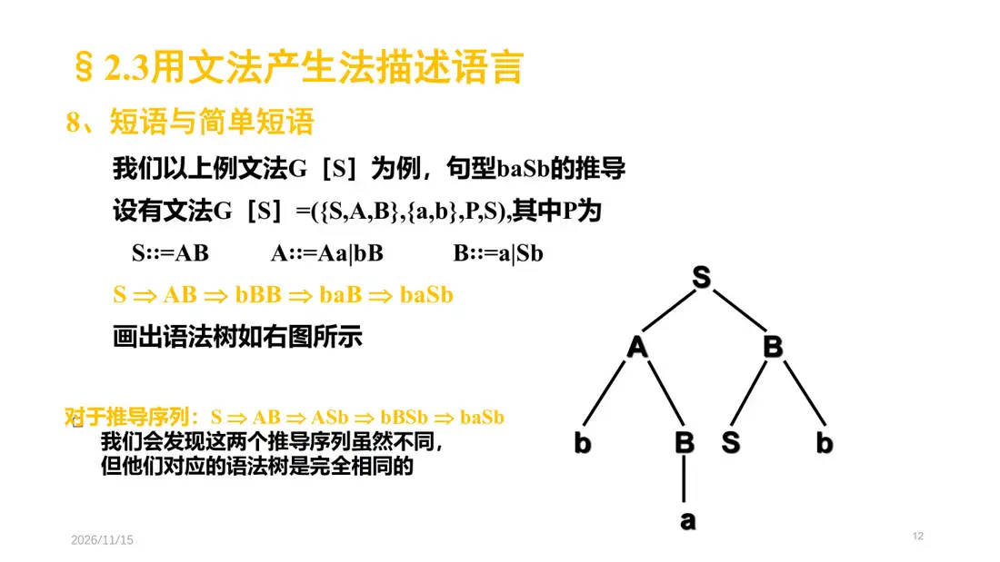

原文：

§2.3用文法产生法描述语言

8、短语与简单短语

我们以上例文法G［S］为例，句型baSb的推导

设有文法G $[ \mathrm { S } ] ~ = ( \{ \mathrm { S } , \mathrm { A } , \mathrm { B } \} , \{ \mathrm { a } , \mathrm { b } \} , \mathrm { P } , \mathrm { S } )$ ,其中P为

$$
\mathbf {S}: := \mathbf {A B}
$$

$$
\mathbf {A}: := \mathbf {A} \mathbf {a} | \mathbf {b B}
$$

$$
\mathbf {B}: := \mathbf {a} | \mathbf {S b}
$$

$$
\mathrm{S} \Rightarrow \mathrm{AB} \Rightarrow \mathrm{bBB} \Rightarrow \mathrm{baB} \Rightarrow \mathrm{baSb}
$$

画出语法树如右图所示

对于推导序列： $\mathrm { S } \Rightarrow \mathrm { A B } \Rightarrow \mathrm { A S b } \Rightarrow \mathrm { b B S b } \Rightarrow \mathrm { b a S b }$ 我们会发现这两个推导序列虽然不同，但他们对应的语法树是完全相同的

2026/11/15

12

### §2.3用文法产生法描述语言

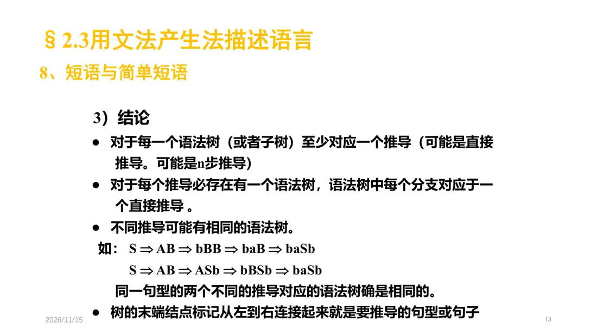

原文：

§2.3用文法产生法描述语言

8、短语与简单短语

3）结论

● 对于每一个语法树（或者子树）至少对应一个推导（可能是直接推导。可能是n步推导）

● 对于每个推导必存在有一个语法树，语法树中每个分支对应于一个直接推导 。

● 不同推导可能有相同的语法树。

如： $\mathbf { S } \Rightarrow \mathbf { A } \mathbf { B } \Rightarrow \mathbf { b } \mathbf { B } \mathbf { B } \Rightarrow \mathbf { b } \mathbf { a } \mathbf { B } \Rightarrow \mathbf { b } \mathbf { a } \mathbf { S } \mathbf { b }$

$$
\mathrm{S} \Rightarrow \mathrm{AB} \Rightarrow \mathrm{ASb} \Rightarrow \mathrm{bBSb} \Rightarrow \mathrm{baSb}
$$

同一句型的两个不同的推导对应的语法树确是相同的。

● 树的末端结点标记从左到右连接起来就是要推导的句型或句子

2026/11/15

13

### §2.3用文法产生法描述语言

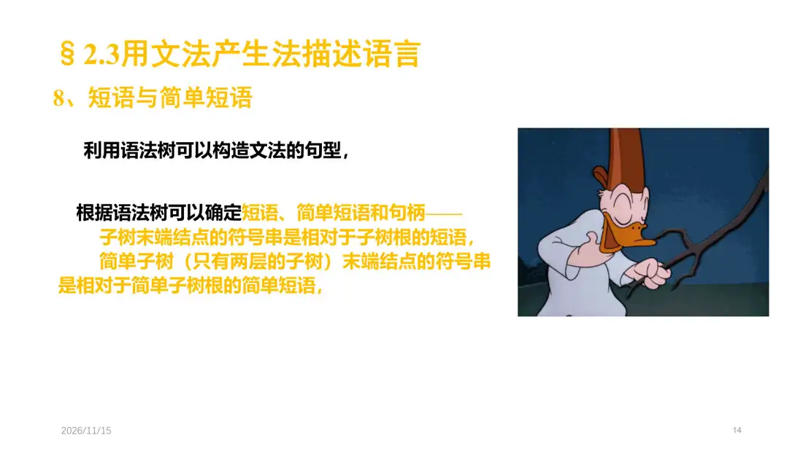

原文：

§2.3用文法产生法描述语言

8、短语与简单短语

利用语法树可以构造文法的句型，

根据语法树可以确定短语、简单短语和句柄—子树末端结点的符号串是相对于子树根的短语，简单子树（只有两层的子树）末端结点的符号串是相对于简单子树根的简单短语，

2026/11/15

14

### §2.3用文法产生法描述语言

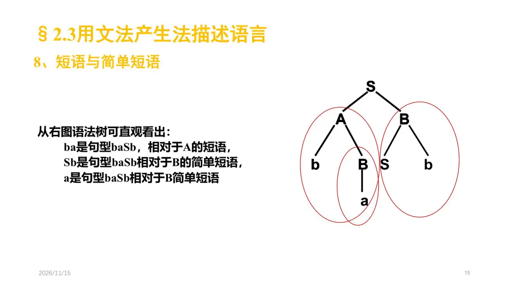

原文：

§2.3用文法产生法描述语言

8、短语与简单短语

从右图语法树可直观看出：

ba是句型baSb，相对于A的短语，

Sb是句型baSb相对于B的简单短语，

a是句型baSb相对于B简单短语

2026/11/15

15

### 句柄

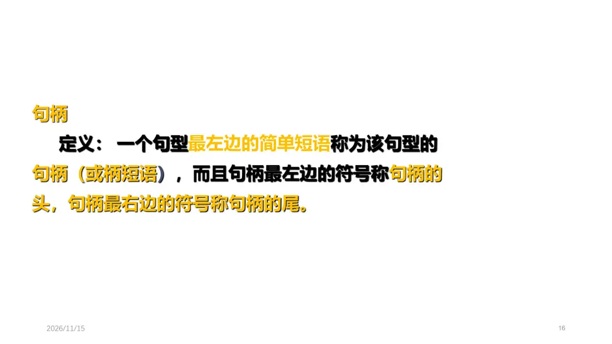

原文：

句柄

定义： 一个句型最左边的简单短语称为该句型的句柄（或柄短语），而且句柄最左边的符号称句柄的头，句柄最右边的符号称句柄的尾。

2026/11/15

16

### §2.3用文法产生法描述语言

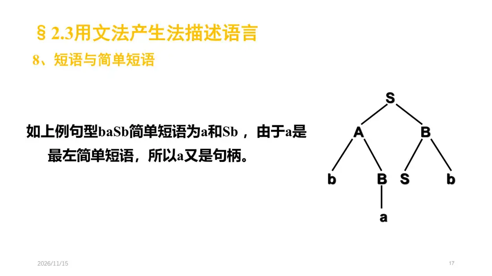

原文：

§2.3用文法产生法描述语言

8、短语与简单短语

如上例句型baSb简单短语为a和Sb ，由于a是最左简单短语，所以a又是句柄。

2026/11/15

17

### §2.3用文法产生法描述语言

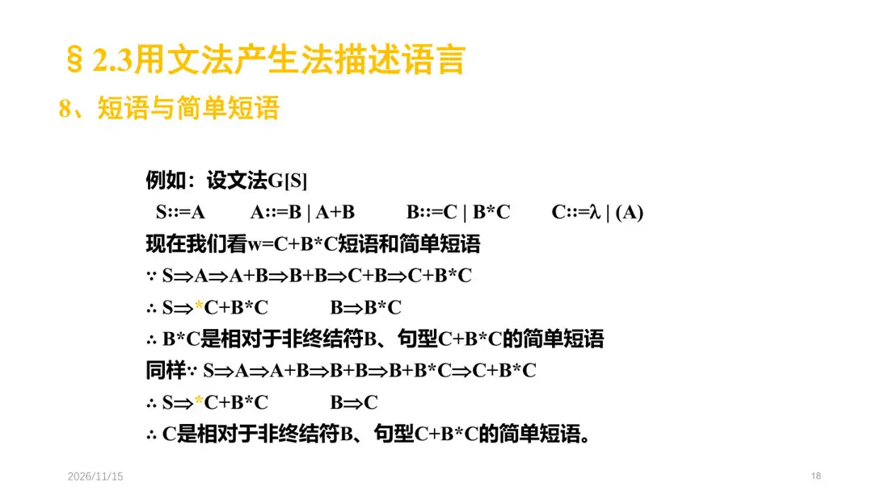

原文：

§2.3用文法产生法描述语言

8、短语与简单短语

例如：设文法G[S]$\mathbf { S } { : : = } \mathbf { A }$ $\mathbf { A } { \boldsymbol { : } } { \boldsymbol { : } } = \mathbf { B } \mid \mathbf { A } { + } \mathbf { B }$ $\mathbf { B } { \boldsymbol { : } } { = } \mathbf { C } \mid \mathbf { B } { ^ { \ast } } \mathbf { C }$ $\mathbf { C } { : : = } \lambda \mid ( \mathbf { A } )$

现在我们看 $\bf { w } { = } \bf { C } { + } \bf { B } ^ { * } \bf { C }$ 短语和简单短语$\because S \Rightarrow \mathrm { A } \Rightarrow \mathrm { A } + \mathrm { B } \Rightarrow \mathrm { B } + \mathrm { B } \Rightarrow \mathrm { C } + \mathrm { B } \Rightarrow \mathrm { C } + \mathrm { B } ^ { \ast } \mathrm { C }$ $\therefore S { \Rightarrow } ^ { * } \mathbf { C } \mathbf { + } \mathbf { B } ^ { * } \mathbf { C }$ B $\mathbf { 3 } { \Longrightarrow } \mathbf { B } ^ { * } \mathbf { C }$

$\therefore \mathbf { B } ^ { * } \mathbf { C }$ 是相对于非终结符B、句型 $\mathrm { { C + B ^ { * } C } }$ 的简单短语

同样∵ $\mathrm { S } \Rightarrow \mathrm { A } \Rightarrow \mathrm { A } + \mathrm { B } \Rightarrow \mathrm { B } + \mathrm { B } \Rightarrow \mathrm { B } + \mathrm { B } ^ { \ast } \mathrm { C } \Rightarrow \mathrm { C } + \mathrm { B } ^ { \ast } \mathrm { C }$ $\therefore S { \Rightarrow } ^ { * } \mathbf { C } \mathbf { + } \mathbf { B } ^ { * } \mathbf { C }$ B $\beta { \Longrightarrow } \mathbf { C }$

∴ C是相对于非终结符B、句型 $\mathbf { C } { + } \mathbf { B } ^ { * } \mathbf { C }$ 的简单短语。

2026/11/15

18

### §2.3用文法产生法描述语言

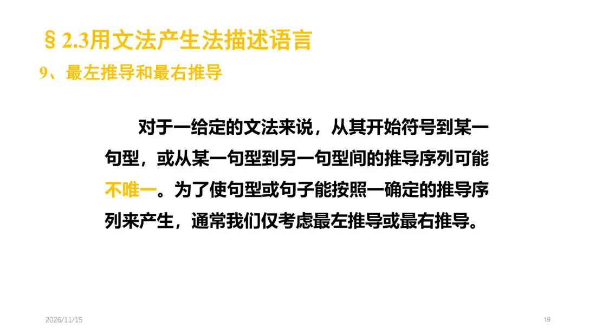

原文：

§2.3用文法产生法描述语言

9、最左推导和最右推导

对于一给定的文法来说，从其开始符号到某一句型，或从某一句型到另一句型间的推导序列可能不唯一。为了使句型或句子能按照一确定的推导序列来产生，通常我们仅考虑最左推导或最右推导。

2026/11/15

19

### §2.3用文法产生法描述语言

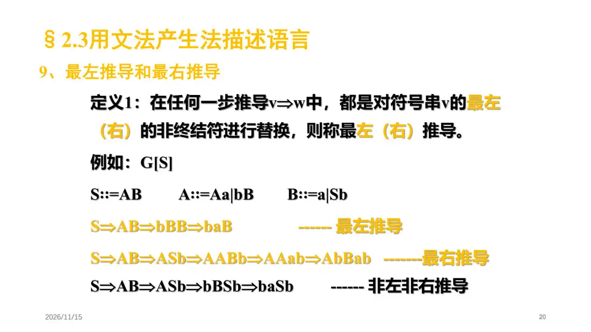

原文：

§2.3用文法产生法描述语言

9、最左推导和最右推导

定义1：在任何一步推导vw中，都是对符号串v的最左（右）的非终结符进行替换，则称最左（右）推导。

例如： $\bf G [ S ]$

$$
\mathbf {S}: := \mathbf {A B}
$$

$$
\mathbf {A}: := \mathbf {A} \mathbf {a} | \mathbf {b} \mathbf {B}
$$

$$
\mathbf {B}: := \mathbf {a} | \mathbf {S b}
$$

$$
\mathrm{S} \Rightarrow \mathrm{AB} \Rightarrow \mathrm{bBB} \Rightarrow \mathrm{baB}
$$

最左推导

$$
\mathrm{S} \Rightarrow \mathrm{AB} \Rightarrow \mathrm{ASb} \Rightarrow \mathrm{AABb} \Rightarrow \mathrm{AAab} \Rightarrow \mathrm{AbBab}
$$

-最右推导

$$
\mathrm{S} \Rightarrow \mathrm{AB} \Rightarrow \mathrm{ASb} \Rightarrow \mathrm{bBSb} \Rightarrow \mathrm{baSb}
$$

------ 非左非右推导

2026/11/15

20

### §2.3用文法产生法描述语言

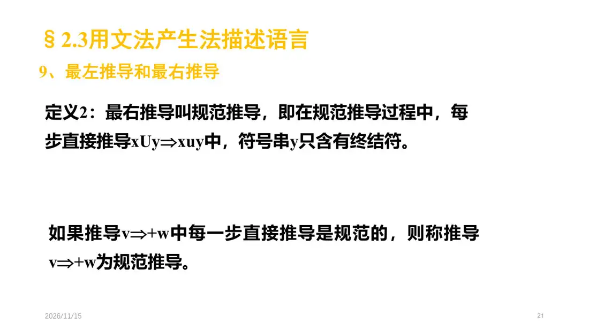

原文：

§2.3用文法产生法描述语言

9、最左推导和最右推导

定义2：最右推导叫规范推导，即在规范推导过程中，每步直接推导 $\mathbf { \partial } _ { \mathbf { X } } \mathbf { U } \mathbf { y } { \Rightarrow } \mathbf { x } \mathbf { u } \mathbf { y }$ 中，符号串 $| \mathbf { y }$ 只含有终结符。

如果推导 $\mathbf { v } \Longrightarrow + \mathbf { w }$ 中每一步直接推导是规范的，则称推导$\mathbf { v } \Longrightarrow + \mathbf { w }$ 为规范推导。

2026/11/15

21

### §2.3用文法产生法描述语言

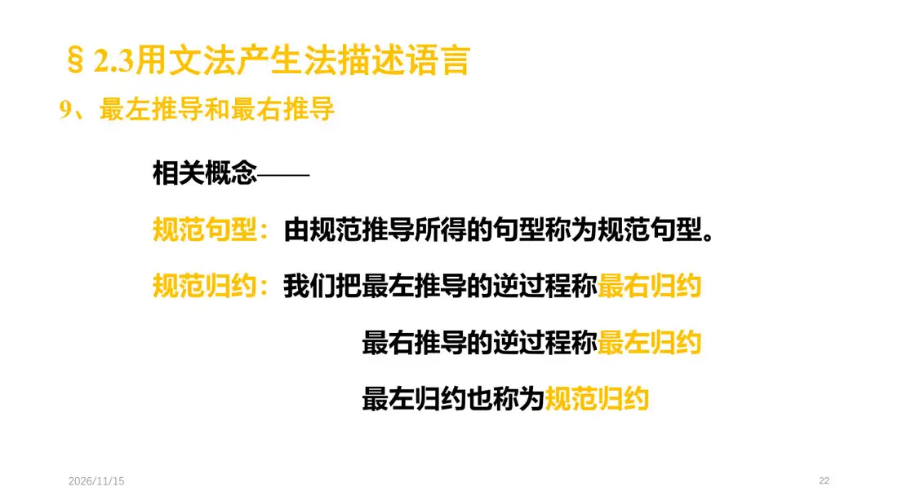

原文：

§2.3用文法产生法描述语言

9、最左推导和最右推导

相关概念—

规范句型：由规范推导所得的句型称为规范句型。

规范归约：我们把最左推导的逆过程称最右归约

最右推导的逆过程称最左归约

最左归约也称为规范归约

2026/11/15

22

### §2.3用文法产生法描述语言

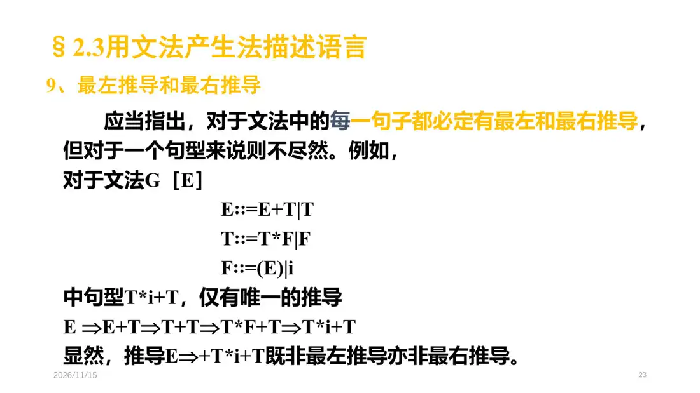

原文：

§2.3用文法产生法描述语言

9、最左推导和最右推导

应当指出，对于文法中的每一句子都必定有最左和最右推导，但对于一个句型来说则不尽然。例如，

对于文法G［E

$$
\begin{array}{l} \mathbf {E}: := \mathbf {E} + \mathbf {T} | \mathbf {T} \\ \mathbf {T}: := \mathbf {T} ^ {*} \mathbf {F} | \mathbf {F} \\ \mathbf {F}: := (\mathbf {E}) | \mathbf {i} \end{array}
$$

中句型 $\mathbf { T } ^ { \ast } \mathbf { i } + \mathbf { T }$ ，仅有唯一的推导

$$
\mathbf {E} \Rightarrow \mathbf {E} + \mathbf {T} \Rightarrow \mathbf {T} + \mathbf {T} \Rightarrow \mathbf {T} ^ {*} \mathbf {F} + \mathbf {T} \Rightarrow \mathbf {T} ^ {*} \mathbf {i} + \mathbf {T}
$$

显然，推导 $\mathrm { E } { \Rightarrow } { + } \mathrm { T } ^ { * } \mathrm { i } { + } \mathrm { T }$ 既非最左推导亦非最右推导。

2026/11/15

23

### §2.3用文法产生法描述语言

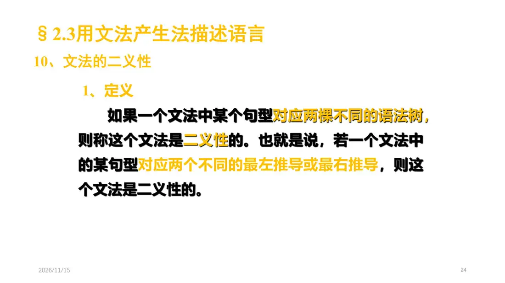

原文：

§2.3用文法产生法描述语言

10、文法的二义性

1、定义

如果一个文法中某个句型对应两棵不同的语法树，则称这个文法是二义性的。也就是说，若一个文法中的某句型对应两个不同的最左推导或最右推导，则这个文法是二义性的。

2026/11/15

24

### §2.3用文法产生法描述语言

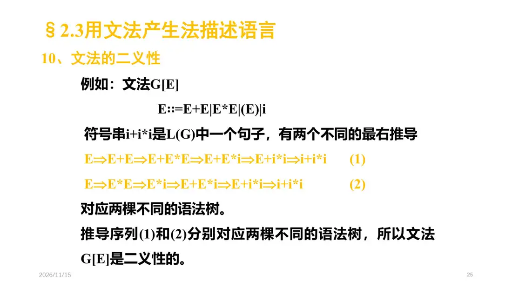

原文：

§2.3用文法产生法描述语言

10、文法的二义性

例如：文法G[E]

$$
\mathbf {E}: := \mathbf {E} + \mathbf {E} | \mathbf {E} ^ {*} \mathbf {E} | (\mathbf {E}) | \mathbf {i}
$$

符号串 $\mathbf { i } + \mathbf { i } ^ { * } \mathbf { i }$ 是L(G)中一个句子，有两个不同的最右推导

$$
\mathrm{E} \Rightarrow \mathrm{E} + \mathrm{E} \Rightarrow \mathrm{E} + \mathrm{E} ^ {*} \mathrm{E} \Rightarrow \mathrm{E} + \mathrm{E} ^ {*} \mathrm{i} \Rightarrow \mathrm{E} + \mathrm{i} ^ {*} \mathrm{i} \Rightarrow \mathrm{i} + \mathrm{i} ^ {*} \mathrm{i}\tag{1}
$$

$$
\mathrm{E} \Rightarrow \mathrm{E} ^ {*} \mathrm{E} \Rightarrow \mathrm{E} ^ {*} \mathrm{i} \Rightarrow \mathrm{E} + \mathrm{E} ^ {*} \mathrm{i} \Rightarrow \mathrm{E} + \mathrm{i} ^ {*} \mathrm{i} \Rightarrow \mathrm{i} + \mathrm{i} ^ {*} \mathrm{i}\tag{2}
$$

对应两棵不同的语法树。

推导序列(1)和(2)分别对应两棵不同的语法树，所以文法G[E]是二义性的。

2026/11/15

25

### §2.3用文法产生法描述语言

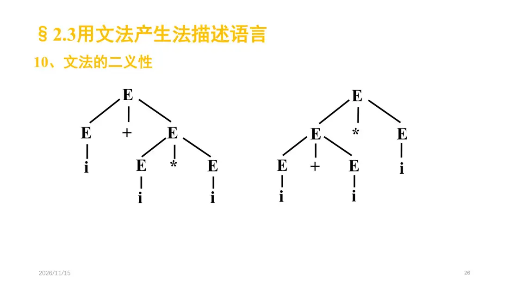

原文：

§2.3用文法产生法描述语言

10、文法的二义性

2026/11/15

26

### §2.3用文法产生法描述语言

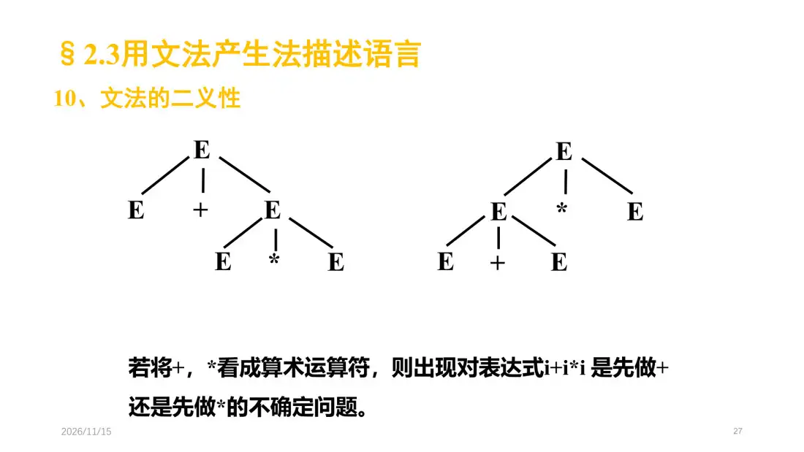

原文：

§2.3用文法产生法描述语言

10、文法的二义性

若将+，\*看成算术运算符，则出现对表达式i $+ \mathbf { i } ^ { * } \mathbf { i }$ 是先做+还是先做\*的不确定问题。

2026/11/15

27

### §2.3用文法产生法描述语言

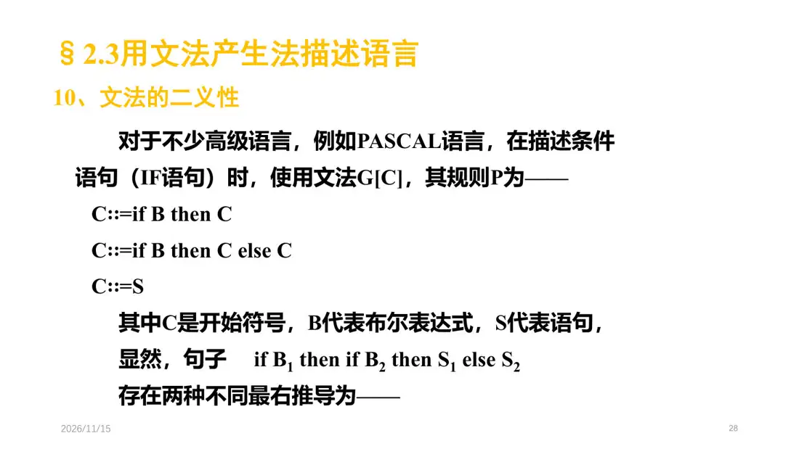

原文：

§2.3用文法产生法描述语言

10、文法的二义性

对于不少高级语言，例如PASCAL语言，在描述条件语句（IF语句）时，使用文法G[C]，其规则P为—

$$
\mathbf {C}: := \text { if   B   then   C }
$$

$$
\mathbf {C}: := \text {if B then C else C}
$$

$$
\mathbf {C}: := \mathbf {S}
$$

其中C是开始符号，B代表布尔表达式，S代表语句，

显然，句子 $\mathbf { i f } \ \mathbf { B } _ { 1 } \ \mathbf { t h e n } \ \mathbf { i f } \ \mathbf { B } _ { 2 } \ \mathbf { t h e n } \ \mathbf { S } _ { 1 } \ \mathbf { e l s e } \ \mathbf { S } _ { 2 }$

存在两种不同最右推导为—

2026/11/15

28

### §2.3用文法产生法描述语言

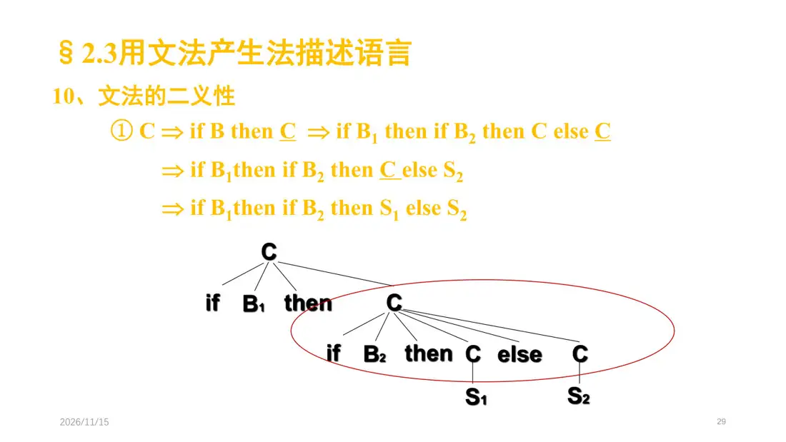

原文：

§2.3用文法产生法描述语言

10、文法的二义性

$$
\begin{array}{r l} & {\text {①} \mathrm{C} \Rightarrow \mathrm{ifBthen} \underline {{\mathrm{C}}} \Rightarrow \mathrm {if B_ {1} then if B_ {2} then C else \underline {{C}}}} \\ & {\qquad \Rightarrow \mathrm {if B_ {1} then if B_ {2} then \underline {{C}} else S_ {2}}} \\ & {\qquad \Rightarrow \mathrm {if B_ {1} then if B_ {2} then S_ {1} else S_ {2}}} \end{array}
$$

2026/11/15

29

### §2.3用文法产生法描述语言

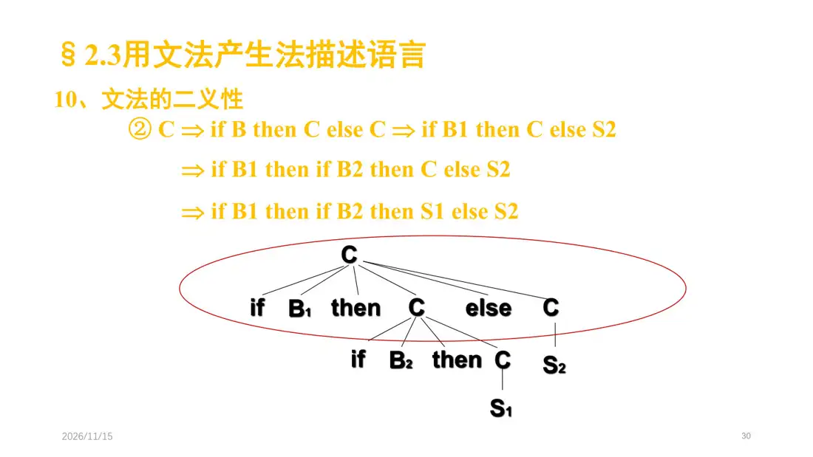

原文：

§2.3用文法产生法描述语言

10、文法的二义性

② C  if B then C else C  if B1 then C else S2  if B1 then if B2 then C else S2

 if B1 then if B2 then S1 else S2

2026/11/15

30

### §2.3用文法产生法描述语言

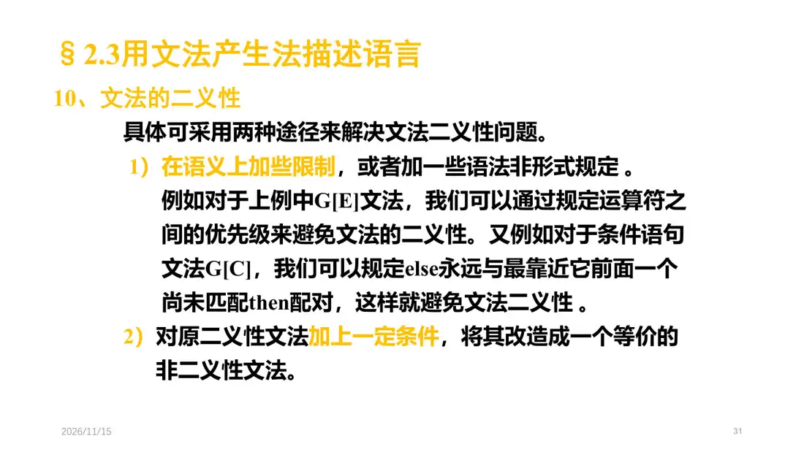

原文：

§2.3用文法产生法描述语言

10、文法的二义性

具体可采用两种途径来解决文法二义性问题。

1）在语义上加些限制，或者加一些语法非形式规定 。例如对于上例中G[E]文法，我们可以通过规定运算符之间的优先级来避免文法的二义性。又例如对于条件语句文法G[C]，我们可以规定else永远与最靠近它前面一个尚未匹配then配对，这样就避免文法二义性 。

2）对原二义性文法加上一定条件，将其改造成一个等价的非二义性文法。

2026/11/15

31

### §2.3用文法产生法描述语言

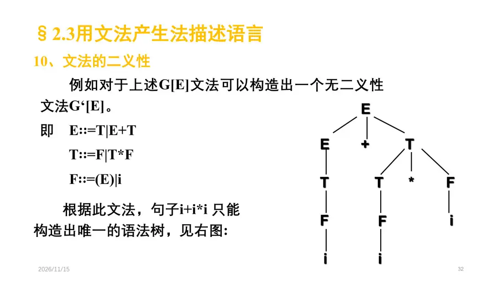

原文：

§2.3用文法产生法描述语言

10、文法的二义性

例如对于上述G[E]文法可以构造出一个无二义性文法 $\mathbf { G } ^ { 6 } [ \mathbf { E } ]$ E

即 E∷=T|E+T

$$
\mathbf {T}: := \mathbf {F} | \mathbf {T} ^ {*} \mathbf {F}
$$

$$
\mathbf {F}: := (\mathbf {E}) | \mathbf {i}
$$

根据此文法，句子i+i\*i 只能构造出唯一的语法树，见右图:

2026/11/15

32

### §2.3用文法产生法描述语言

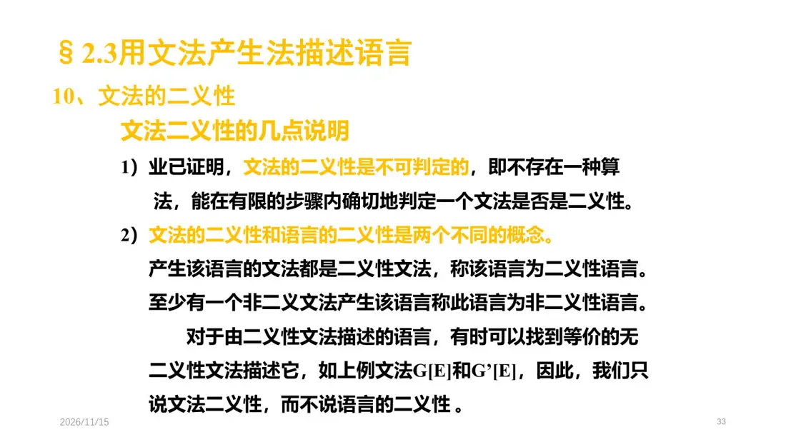

原文：

§2.3用文法产生法描述语言

10、文法的二义性

文法二义性的几点说明

1）业已证明，文法的二义性是不可判定的，即不存在一种算法，能在有限的步骤内确切地判定一个文法是否是二义性。

2）文法的二义性和语言的二义性是两个不同的概念。

产生该语言的文法都是二义性文法，称该语言为二义性语言。至少有一个非二义文法产生该语言称此语言为非二义性语言。

对于由二义性文法描述的语言，有时可以找到等价的无二义性文法描述它，如上例文法G[E]和 $\mathbf { G } ^ { \bullet } [ \mathbf { E } ]$ ，因此，我们只说文法二义性，而不说语言的二义性。

2026/11/15

33

### §2.4 文法和语言的分类

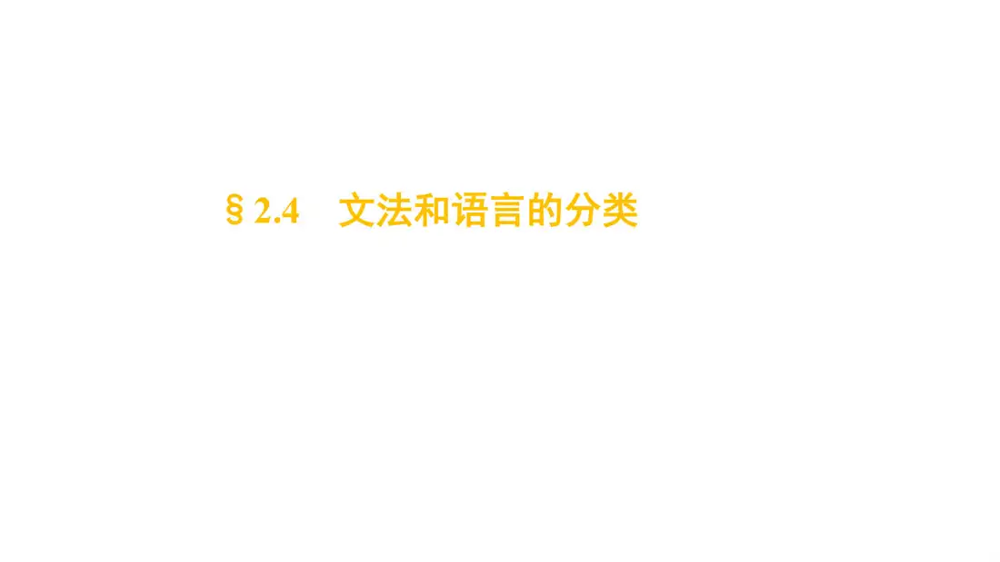

原文：

§2.4 文法和语言的分类

### 前面给出了产生式的定义：

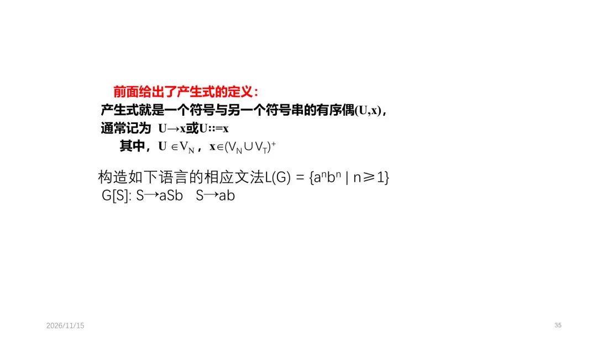

原文：

前面给出了产生式的定义：

产生式就是一个符号与另一个符号串的有序偶 $\mathbf { ( U , x ) }$

通常记为 $\mathbf { U } { \longrightarrow } \mathbf { X }$ 或 $\operatorname { U } { \mathfrak { : : } } { = } \mathbf { X }$

其中， $\mathbf { U } \in \mathrm { V } _ { \mathrm { N } } , ~ \mathbf { x } \in ( \mathrm { V } _ { \mathrm { N } } \cup \mathrm { V } _ { \intercal } ) ^ { + }$

构造如下语言的相应文法L $. ( \mathsf { G } ) = \{ \mathsf { a } ^ { \mathsf { n } } \mathsf { b } ^ { \mathsf { n } } \mid \mathsf { n } \geqslant 1 \}$ G[S]: S→aSb S→ab

2026/11/15

35

### 2026/11/15

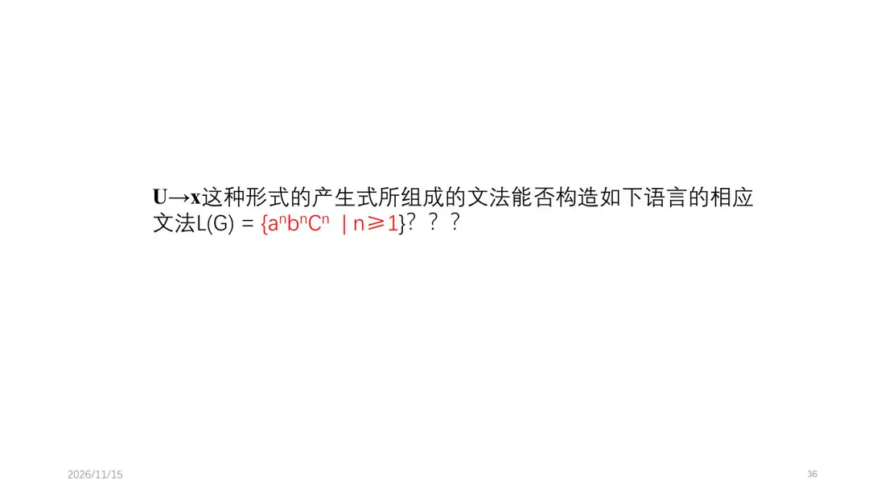

原文：

U→x这种形式的产生式所组成的文法能否构造如下语言的相应文法L $. ( \mathsf { G } ) = \{ \mathsf { a } ^ { \mathsf { n } } \mathsf { b } ^ { \mathsf { n } } \mathsf { C } ^ { \mathsf { n } } | \mathsf { n } \geqslant \mathsf { 1 } \} ?$ ？？

2026/11/15

36

### 2026/11/15

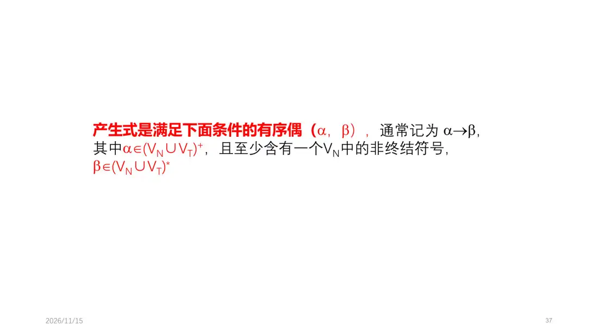

原文：

产生式是满足下面条件的有序偶 $( \alpha , \ \beta )$ ，通常记为 $\alpha  \beta$ 其中 $\alpha { \in } ( \mathsf { V } _ { \nu } \cup \mathsf { V } _ { \tau } ) ^ { + }$ ，且至少含有一个 $V _ { \mathsf { N } }$ 中的非终结符号，$\beta { \in } ( \mathsf { V } _ { \nu } \cup \mathsf { V } _ { \tau } ) ^ { \star }$

2026/11/15

37

### 2026/11/15

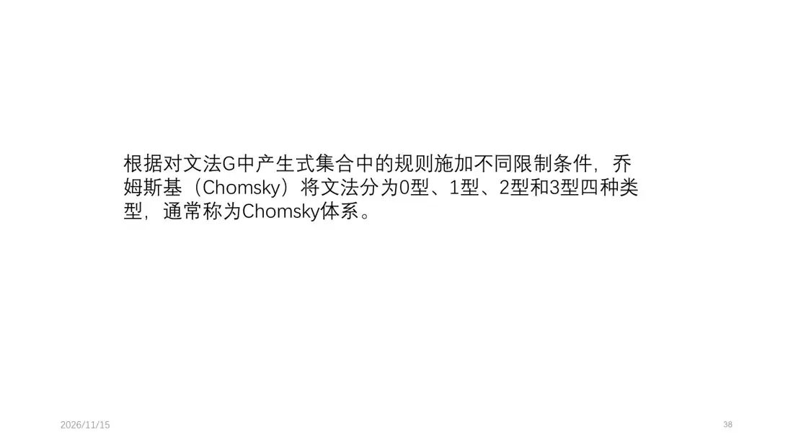

原文：

根据对文法G中产生式集合中的规则施加不同限制条件，乔姆斯基（Chomsky）将文法分为0型、1型、2型和3型四种类型，通常称为Chomsky体系。

2026/11/15

38

### 1、0型文法

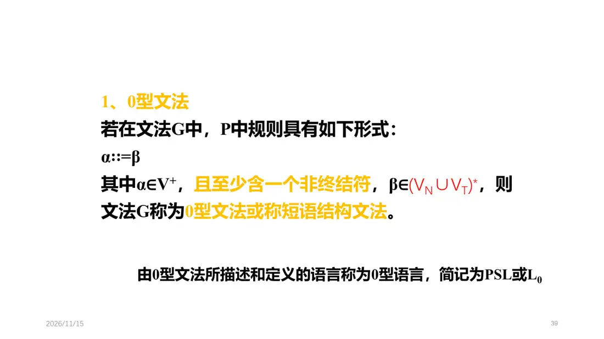

原文：

1、0型文法

若在文法G中，P中规则具有如下形式：

$$
\alpha : := \beta
$$

其中 $\mathbf { 0 } \in \mathbf { V } ^ { + }$ ，且至少含一个非终结符， $\beta { \in } ( \vee _ { \mathsf { N } } \cup \vee _ { \top } ) ^ { * }$ ，则文法G称为0型文法或称短语结构文法。

由0型文法所描述和定义的语言称为0型语言，简记为PSL或 $\bf { L _ { 0 } }$

2026/11/15

39

### 1、0型文法

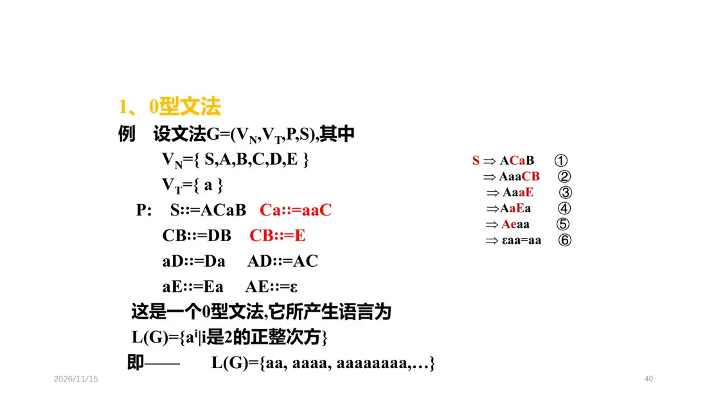

原文：

1、0型文法

例 设文法 $\mathrm { { \bf G } = ( V _ { N } , V _ { I } , P , S ) }$ ,其中

$$
\mathbf {V} _ {\mathbf {N}} = \{\textbf {S}, \mathbf {A}, \mathbf {B}, \mathbf {C}, \mathbf {D}, \mathbf {E} \}
$$

$$
\mathbf {V} _ {\mathrm{T}} = \{\textbf {a} \}
$$

P: $\mathrm { S } { \mathrel { : } = } \mathrm { A C a B } \mathrm { C a } { \mathrel { : } = } \mathrm { a a C }$

$$
\mathbf {C B}: := \mathbf {D B} \quad \mathbf {C B}: := \mathbf {E}
$$

$$
\mathbf {a D}: := \mathbf {D a} \quad \mathbf {A D}: := \mathbf {A C}
$$

$$
\mathbf {a E}: := \mathbf {E a} \quad \mathbf {A E}: := \boldsymbol {\varepsilon}
$$

这是一个0型文法,它所产生语言为

$\mathbf { L } ( \mathbf { G } ) { = } \{ \mathbf { a } ^ { \mathbf { i } }$ i是2的正整次方}

即— $\operatorname { L } ( \mathbf { G } ) { = } \{ { \mathrm { a a } } , { \mathrm { a a a a } } , { \mathrm { a a a a a a a a a } } , { \mathrm { e . e . } } \}$

$\mathbf { S } \Rightarrow \mathbf { A C a B }$ ①

$\implies \mathbf { A a a C B }$ ②

$\begin{array} { r l } { { } } & { { } \Rightarrow { } \mathbf { A a a E } } \end{array}$ ③

$\mathbf { \Gamma } \Rightarrow \mathbf { A a l E a }$ ④

$\ r \Rightarrow \mathbf { A e a a }$ ⑤

$\mathbf { \lambda } \implies \mathbf { \varepsilon } \mathbf { a } \mathbf { a } { = } \mathbf { a } \mathbf { a }$ ⑥

2026/11/15

40

### 2、1型文法

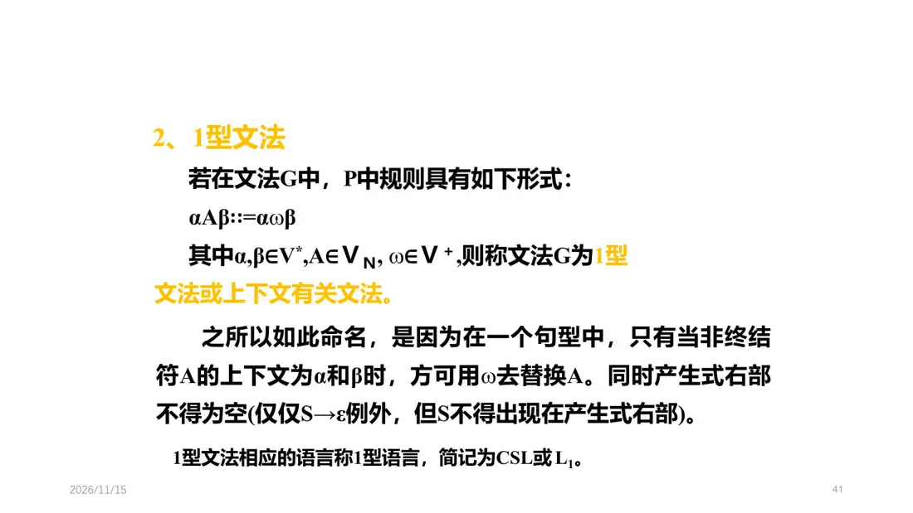

原文：

2、1型文法

若在文法G中，P中规则具有如下形式：

$$
\alpha \mathrm{A} \beta : := \alpha \omega \beta
$$

其中 $\mathbf { \Delta } \mathbf { a } , \mathbf { \beta } \in \mathbf { V } ^ { \ast } , \mathbf { A } \in \mathbf { V } _ { \textrm { N } } , \mathbf { \alpha } \mathbf { 0 } \in \mathbf { V } ^ { + }$ ,则称文法G为1型

文法或上下文有关文法。

之所以如此命名，是因为在一个句型中，只有当非终结符A的上下文为α和β时，方可用去替换A。同时产生式右部不得为空(仅仅S→ε例外，但S不得出现在产生式右部)。

1型文法相应的语言称1型语言，简记为CSL或 $\mathbf { L _ { 1 } } _ { \mathbf { \epsilon } }$

2026/11/15

41

### $$

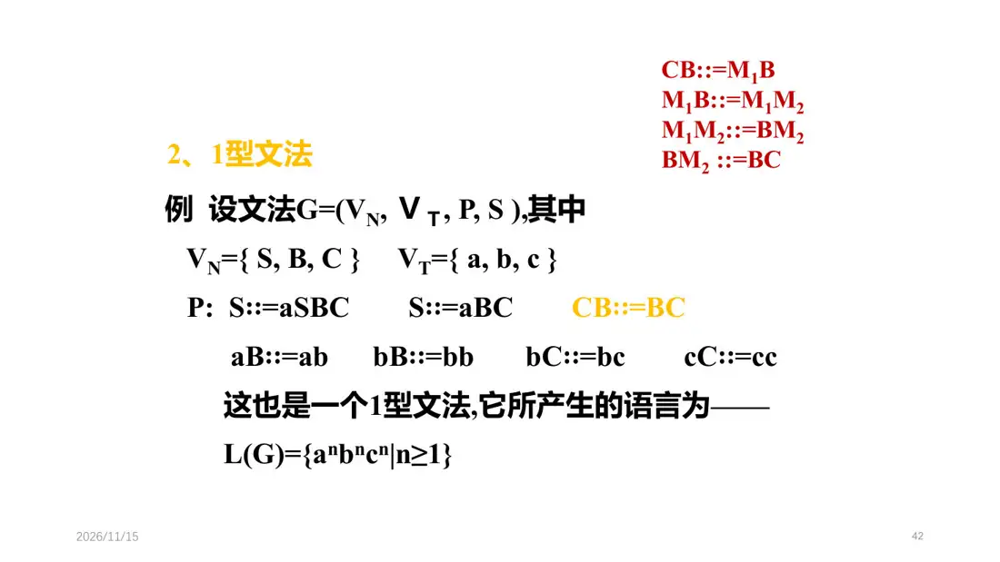

原文：

$$
\mathbf {C B}: := \mathbf {M} _ {1} \mathbf {B}
$$

$$
\mathrm{M} _ {1} \mathrm{B}: := \mathrm{M} _ {1} \mathrm{M} _ {2}
$$

2、1型文法

$$
\mathrm{M} _ {1} \mathrm{M} _ {2}: := \mathrm{BM} _ {2}
$$

$$
\mathrm{BM} _ {2}: := \mathrm{BC}
$$

例 设文法 $\scriptstyle \mathbf { G } = ( \mathbf { V } _ { \mathrm { N } } , \ \mathbf { V } _ { \mathrm { \tiny ~ T } } , \mathbf { P } , \mathbf { S } )$ ,其中${ \bf V _ { N } = } \{ { \bf S } , { \bf B } ,$ C } $\mathbf { V } _ { \mathrm { T } } { = } \{ \ \mathbf { a }  , \mathbf { b } , \mathbf { c } \ \}$ P: $\mathbf { S } { : } { : } = \mathbf { a S B C }$ S∷=aBC CB∷=BCaB∷=ab bB∷=bb bC∷=bc cC∷=cc这也是一个1型文法,它所产生的语言为—L(G)={anbncn|n≥1}

2026/11/15

42

### 3、2型文法

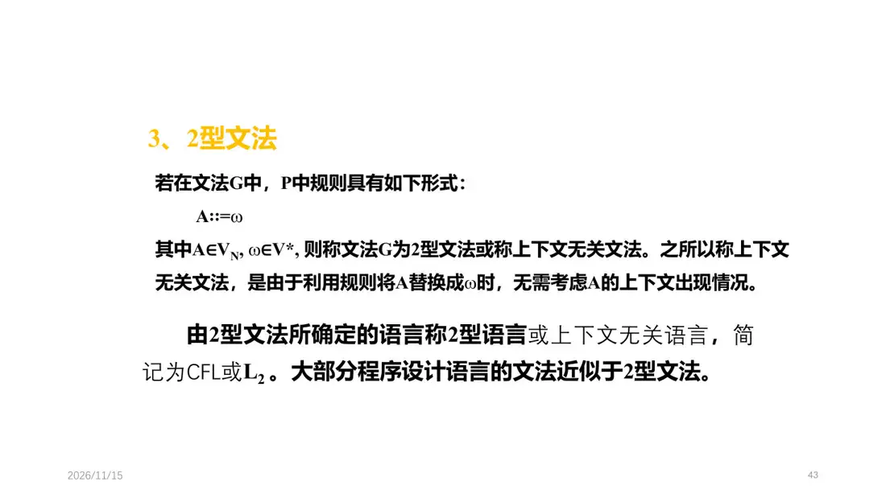

原文：

3、2型文法

若在文法G中，P中规则具有如下形式：

$$
\mathbf {A}: := \omega
$$

其中 $\mathbf { A } \in \mathbf { V } _ { \mathbf { N } } , \omega \in \mathbf { V } ^ { * }$ , 则称文法G为2型文法或称上下文无关文法。之所以称上下文无关文法，是由于利用规则将A替换成时，无需考虑A的上下文出现情况。

由2型文法所确定的语言称2型语言或上下文无关语言，简记为CFL或 $\mathbf { L } _ { 2 }$ 。大部分程序设计语言的文法近似于2型文法。

2026/11/15

43

### 3、2型文法

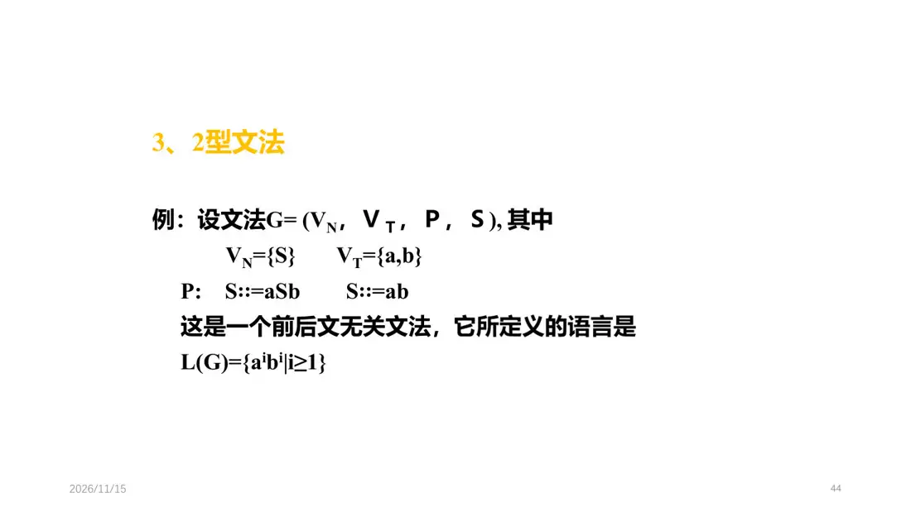

原文：

3、2型文法

例：设文法 $\mathbf { G } { } = ( \mathbf { V } _ { \mathbf { N } } , \ \textbf { V } _ { \textsf { T } } , \ \textbf { P } , \ \textbf { S } )$ , 其中

$$
\mathbf {V} _ {\mathbf {N}} = \{\mathbf {S} \}
$$

$$
\mathbf {V} _ {\mathrm{T}} = \{\mathbf {a}, \mathbf {b} \}
$$

P: $\mathbf { S } { : } { : } = \mathbf { a } \mathbf { S } { \mathbf { b } }$ S∷=ab

这是一个前后文无关文法，它所定义的语言是

$$
\mathrm{L} (\mathrm{G}) = \{\mathrm{a} ^ {\mathrm{i}} \mathrm{b} ^ {\mathrm{i}} | \mathrm{i} \geq 1 \}
$$

2026/11/15

44

### 4、3型文法

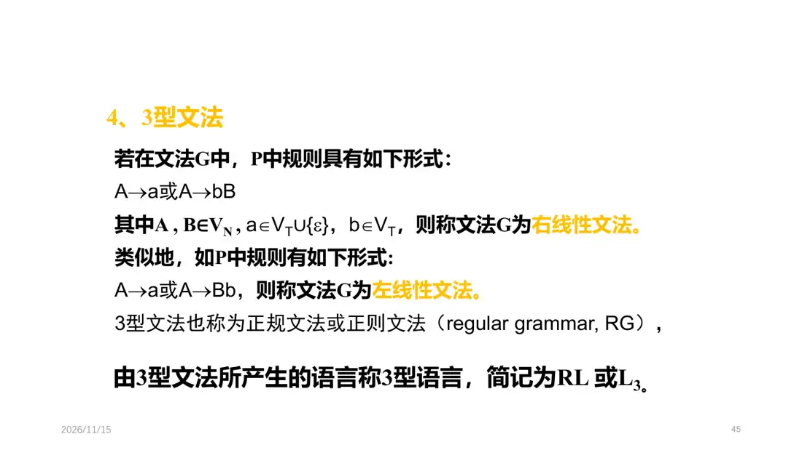

原文：

4、3型文法

若在文法G中，P中规则具有如下形式：

A→a或 $\mathsf { A } \to \mathsf { b } \mathsf { B }$

其中A , $\mathbf { B } { \in } \mathrm { V } _ { \mathrm { N } } , { \mathsf { a } } { \in } \mathsf { V } _ { \mathrm { T } } { \cup } \{ { \varepsilon } \}$ $\mathsf { b } \in \mathsf { V } _ { \intercal }$ ，则称文法G为右线性文法。

类似地，如P中规则有如下形式:

A→a或A→Bb，则称文法G为左线性文法。

3型文法也称为正规文法或正则文法（regular grammar, RG）

由3型文法所产生的语言称3型语言，简记为RL 或 $\mathrm { L } _ { 3 _ { \circ } }$

2026/11/15

45

### 4、3型文法

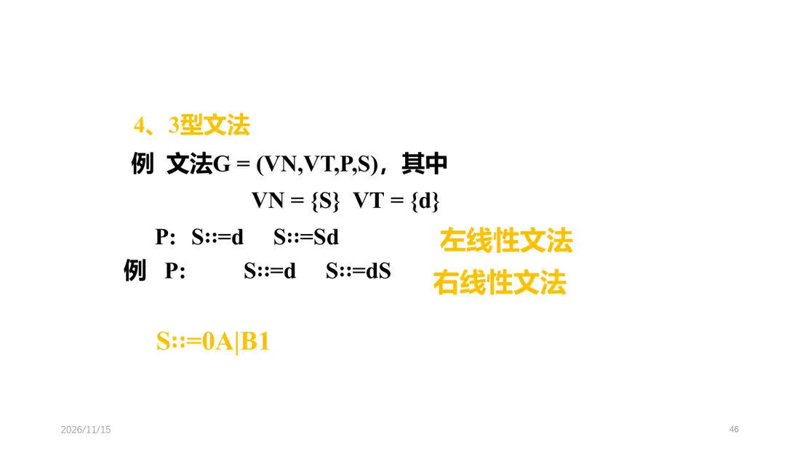

原文：

4、3型文法

例 文法 $\mathbf { G } = ( \mathbf { V } \mathbf { N } , \mathbf { V } \mathbf { T } , \mathbf { P } , \mathbf { S } )$ ，其中

$$
\mathbf {V N} = \{\mathbf {S} \} \mathbf {V T} = \{\mathbf {d} \}
$$

P: $\mathbf { S } { : : = } \mathbf { d }$ S∷=Sd

例 P:

$$
\mathbf {S}: := \mathbf {d} \quad \mathbf {S}: := \mathbf {d S}
$$

左线性文法

右线性文法

$$
\mathrm{S}: := 0 \mathrm{A} | \mathrm{B} 1
$$

2026/11/15

46

### 47

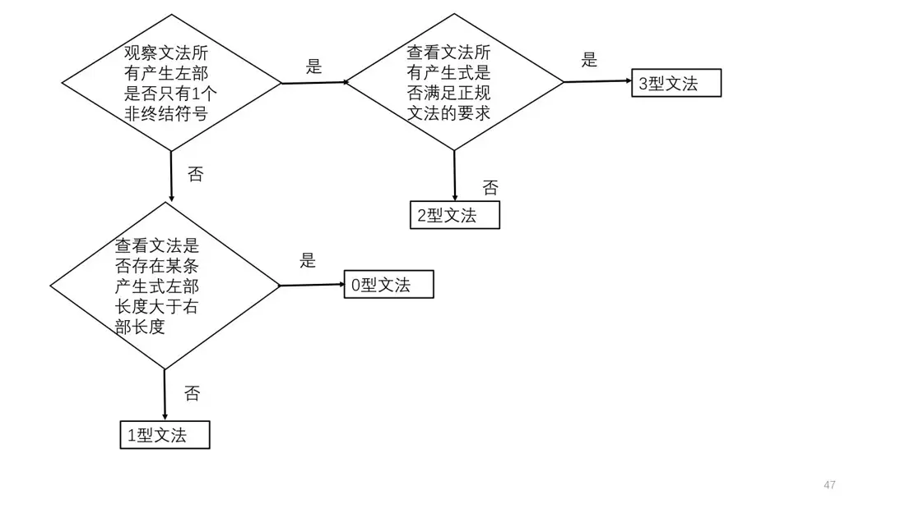

原文：

47

### $$

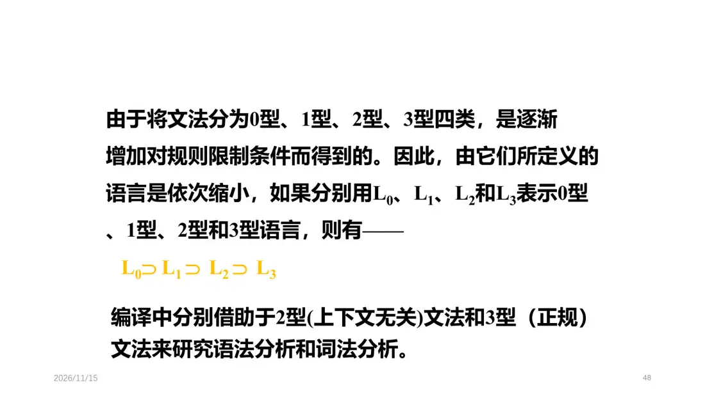

原文：

由于将文法分为0型、1型、2型、3型四类，是逐渐增加对规则限制条件而得到的。因此，由它们所定义的语言是依次缩小，如果分别用 $\bf { L _ { 0 } }$ $\mathbf { L _ { 1 } } .$ $\mathbf { L } _ { 2 }$ 和 $\mathbf { L } _ { 3 }$ 表示0型、1型、2型和3型语言，则有—

$$
\mathrm{L} _ {0} \supset \mathrm{L} _ {1} \supset \mathrm{L} _ {2} \supset \mathrm{L} _ {3}
$$

编译中分别借助于2型(上下文无关)文法和3型（正规）文法来研究语法分析和词法分析。

2026/11/15

48

### 2026/11/15

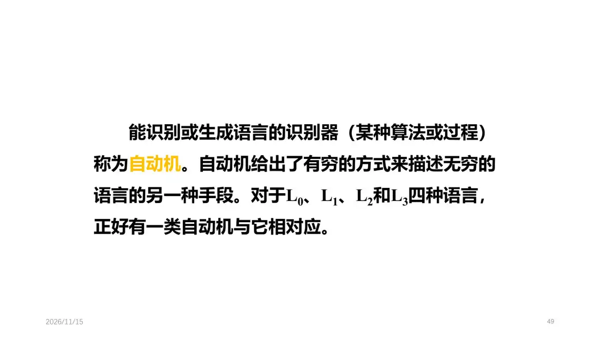

原文：

能识别或生成语言的识别器（某种算法或过程）称为自动机。自动机给出了有穷的方式来描述无穷的语言的另一种手段。对于 $\mathbf { L _ { 0 } } .$ $\mathbf { L _ { 1 } } .$ $\mathbf { L } _ { 2 }$ 和 $\mathbf { L } _ { 3 }$ 四种语言，正好有一类自动机与它相对应。

2026/11/15

49

### 2026/11/15

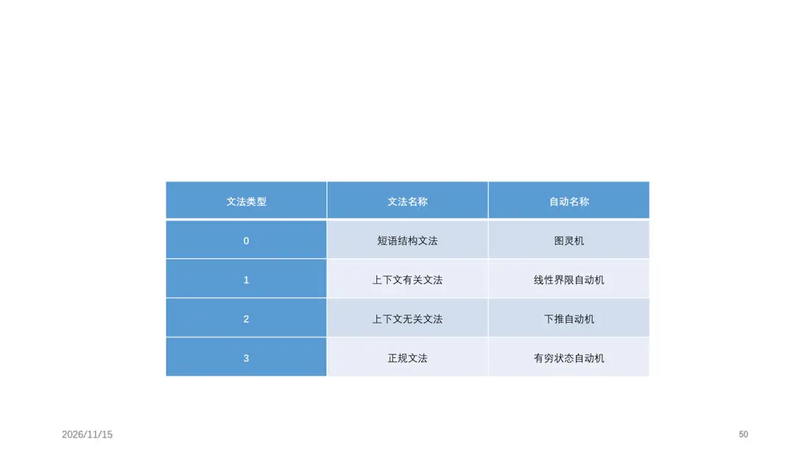

原文：

<table><tr><td>文法类型</td><td>文法名称</td><td>自动名称</td></tr><tr><td>0</td><td>短语结构文法</td><td>图灵机</td></tr><tr><td>1</td><td>上下文有关文法</td><td>线性界限自动机</td></tr><tr><td>2</td><td>上下文无关文法</td><td>下推自动机</td></tr><tr><td>3</td><td>正规文法</td><td>有穷状态自动机</td></tr></table>

2026/11/15

50

### §2.5 文法的其它表示方法

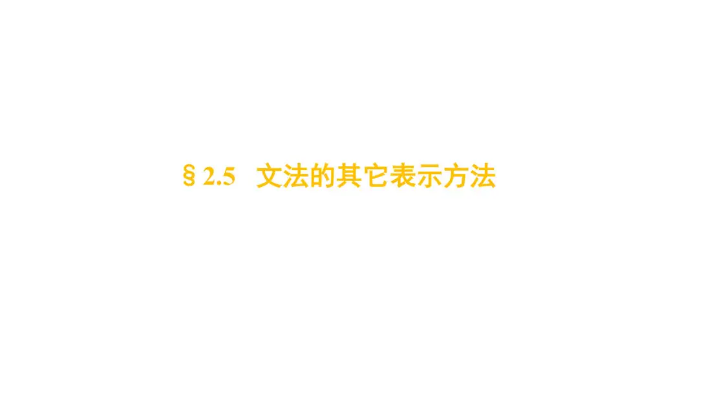

原文：

§2.5 文法的其它表示方法

### 一、扩充的巴科斯范式（BNF）

原文：

一、扩充的巴科斯范式（BNF）

在前面我们介绍了文法的形式定义，对于形式定义中的规则我们用巴科斯范式（BNF）来表示，但是除了用BNF表示来定义文法以外，还可以用其它一些表示方法。

在文法BNF表示中，使用下列4个元语言符号： $< , ~ > , ~ : : = , ~ | ,$ 0在扩充的BNF中，除了使用上述4个元符号外，还引入以下6个元语言符号使用，

这6个符号是 $\{ , \} , \{ , \} ,$ 。和普通括号一样，这6个符号在文法中是两两成对出现。下面简单介绍这些符号的使用。

2026/11/15

52

### 一、扩充的巴科斯范式（BNF）

原文：

一、扩充的巴科斯范式（BNF）

1、花括号 { }

(1) $\{ \mathfrak { t } \} _ { \mathrm { ~ m ~ } } ^ { \mathrm { n } }$ 表示符号串t 可重复出现m次、 $\mathrm { m } { + } 1$ 1次、$\mathrm { m } { + } 2 \mathrm { \Omega }$ 次,…,直到n次(2) $\{ \mathfrak { t } \} ^ { \mathrm { n } }$ 表示符号串t不出现或至多出现n次(3) $\{ \mathfrak { t } \} _ { \mathrm { m } }$ 表示符号串t至少重复m次(4) {t}表示符号串t不出现或出现任意多次

2026/11/15

53

### 例如，用BNF表示下列文法规则：

原文：

例如，用BNF表示下列文法规则：

标识符〉∷=〈字母〉|〈标识符〉〈字母〉|〈标识符〉〈数字引入花括号，用扩展BNF表示上面同样文法规则为

$$
\langle \text {标识符} \rangle : := \langle \text {字母} \rangle \{\langle \text {字母} \rangle | \langle \text {数字} \rangle \}
$$

采用花括号表示文法，除能方便表示重复次数外，还能消除文法中左递归，这在采用自顶向下语法分析时将是十分有用的。

2026/11/15

54

### 2、方括号 [ ]

原文：

2、方括号 [ ]

例如，关于〈语句〉的BNF表示为

2026/11/15

55

### 3、圆括号 （ ）

原文：

3、圆括号 （ ）

引入圆括号以后，可以在规则中提取因子，但是要注意不要把元语言符号圆括号和规则中出现的 ( 和 ) 终结符相混。

例如：

设文法规则 $\mathbf { Z } { \cdot } { : = } \mathbf { A B } | \mathbf { A C }$ ，可以表示成 $\mathbf { Z } { : : = } \mathbf { A } ( \mathbf { B } | \mathbf { C } )$ ，规则含义不变

2026/11/15

56

### 二、语法图

原文：

二、语法图

1、定义

用图形结构来表示语言文法关系，称语法图。

2、语法图表示法

语法图表示法由以下三种符号组成—

矩形：

表示文法的非终结符

圆形：

表示文法的终结符号

流向线： 表示文法产生式的路径

2026/11/15

57

### 2026/11/15

原文：

如： $\mathbf { A } { \boldsymbol { : } } { : = } \mathbf { B } \mathbf { C }$

2026/11/15

58

### 例如：

原文：

例如：

$\mathbf { A } { \mathbf { : : } } { = } \mathbf { a } \mid \mathbf { c B d }$ , 其语法图如下图：

2026/11/15

59

### 又如：

原文：

又如：

<标识符>::=<字母> {<字母>|<数字>},其语法图如下:

2026/11/15

60

### §2.6 文法实用性限制说明

原文：

§2.6 文法实用性限制说明

1、在文法中不含有形如A∷=A的规则

这样的规则显然是没有必要的，并且还会引起文法的二义性。

如：文法G，其产生式P为： $\mathrm { S } { \boldsymbol { \mathbf { \mathit { a } } } } = \ \mathbf { 0 } \mathbf { S } { \boldsymbol { \mathbf { 1 } } } \ \mid \ \mathbf { 0 } { \boldsymbol { \mathbf { 1 } } }$ ，显然它是一个无二义文法，其描述的语言L $\scriptstyle \left. ( \mathbf { G } ) = \{ \mathbf { 0 } ^ { \mathbf { n } } 1 ^ { \mathbf { n } } | \mathbf { n } { \geq } 1 \} \right.$ 若将规则P改为： $\mathbf { S } { \boldsymbol { : } } { \mathbf { : } } { = } \mathbf { S } { \lvert \mathbf { 0 } \mathbf { S } \mathbf { 1 } \rvert } { \bf 0 } 1$ ，对于句子0011可以画出多棵语法树，引起二义性。

2026/11/15

61

### §2.6 文法实用性限制说明

原文：

§2.6 文法实用性限制说明

1、在文法中不含有形如 $\mathrm { A } { \stackrel { \circ } { \circ } } { = } \mathrm { A }$ 的规则

$$
\begin{array}{c} \text {S} \\ \text {0} \quad \text {S} \quad \text {1} \\ \text {S} \\ \text {0} \quad \text {1} \end{array}
$$

$$
\begin{array}{c} \text {S} \\ 0 \quad \text {S} \quad 1 \\ \text {S} \\ \text {S} \\ 0 \quad 1 \end{array}
$$

所以应将 $\mathbf { S } { \boldsymbol { : } } { \mathbf { : } } = \mathbf { S }$ 这样的有害规则删除掉。

2026/11/15

62

### §2.6 文法实用性限制说明

原文：

§2.6 文法实用性限制说明

2、在文法中不包含多余规则

（1）每一个非终结符号A（Z除外）必须在某句型中出现（否则为不可到达的），即$\mathbf { Z } { \Rightarrow } ^ { * } \mathbf { a } \mathbf { A } \mathbf { \beta }$ ，其中 $\mathbf { q } , \mathbf { \beta } { \in } \mathbf { V } ^ { \ast }$

（2）非终结符A必须推出终结符串t来（否则为不可终止的），即 $\mathbf { A } { \implies } \mathbf { + } \mathbf { t } \quad \mathbf { t } { \in } \mathbf { V } _ { \mathrm { T } } { } ^ { * }$

2026/11/15

63

### 压缩过文法的定义：

原文：

压缩过文法的定义：

满足上述两点限制条件的文法称为压缩过文法。

在文法中不含有形如A∷=A的规则

在文法中不包含多余规则

64

### §2.6 文法实用性限制说明

原文：

§2.6 文法实用性限制说明

例如：已知文法G，其产生规则P为：

$$
\mathbf {Z}: := \mathbf {B e} \quad \mathbf {A}: := \mathbf {A e} | \mathbf {e} \quad \mathbf {B}: := \mathbf {C e} | \mathbf {A f} \quad \mathbf {C}: := \mathbf {C f} \quad \mathbf {D}: := \mathbf {f}
$$

由该文法可知，因为规则D∷=f中非终结符D不在其它任何规则右部出现，所以规则D∷=f在推导中不起作用，为多余规则，应将其删除.

另外，规则C∷=Cf也是多余规则，因为一旦使用了这条规则，便会使推导无限制进行下去，最终无法推出终结符号串，所以也是该删除的多余规则；

同理， $\bf { B } { : : = } \bf { C e }$ 也是多余规则，因为它含有非终结符C。

所以，将该文法多余文法删除得到压缩过文

法为 $| \mathbf { G } ^ { \prime }$ ，其规则为：

$$
\mathbf {Z}: := \mathbf {B e}
$$

$$
\mathbf {A}: := \mathbf {A e} | \mathbf {e} \quad \mathbf {B}: := \mathbf {A f}
$$

2026/11/15

65

### 本章是编译原理课程的理论基础，介绍了形式语言的基本概念和理论，主要内容如下：

原文：

本章是编译原理课程的理论基础，介绍了形式语言的基本概念和理论，主要内容如下：

（1）形式语言是指用一组数学符号和规则来描述的语言。任何一种语言，都是由该语言的字母表中的基本符号所组成的满足一定规则的符号串的集合。符号串的基本概念及有关运算（连接运算、幂运算和闭包运算等）是理解形式语言的前提。

（2）文法是描述语言语法结构的规则，可以形式化地表示为一个四元组G =$( \mathrm { V } _ { \mathrm { N } } , \mathrm { V } _ { \mathrm { T } } , \mathrm { P } , \mathrm { S } )$ 。语言是文法所产生的所有句子的集合。给定一个文法，可以通过推导从而确定它所产生的语言。给定一个语言，能确定其文法，但还没有形式化的方法，而且得到的文法可能不是唯一形式，但这些文法都是等价的。如果语言是无穷的，描述该语言的文法一定是递归的。

66

### （5）文法除了BNF范式表示方法外，还可以使用诸如EBNF和语法图等其他表示方法

原文：

（3）对于给定的句型，可以通过自顶向下推导和自底向上的归约对其进行分析，本章给出了在句型分析的过程中会涉及短语、简单短语和句柄的概念，语法树的构造过程，以及二义性文法的定义和消除方法。

（4）乔姆斯基通过对文法产生式左部和右部给予了不同限制，将文法分成四种类型，分别对应四种不同的语言和自动机。

（5）文法除了BNF范式表示方法外，还可以使用诸如EBNF和语法图等其他表示方法

（6）在编写文法时，要注意有害规则和多余规则。

67
