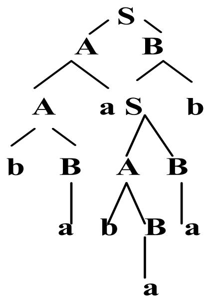
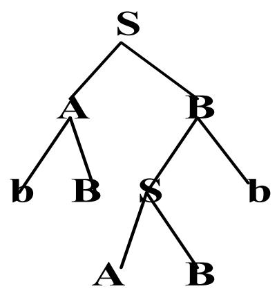
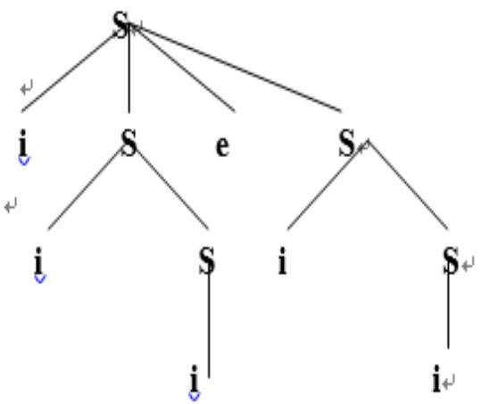
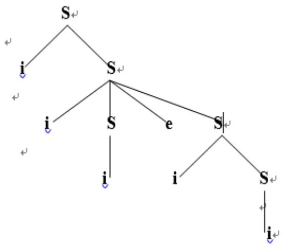
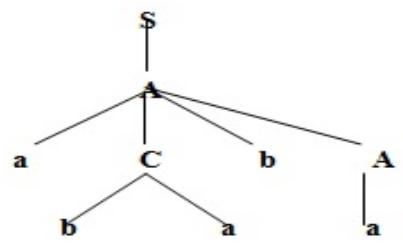
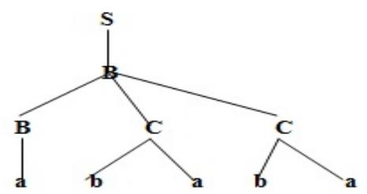

# 《编译原理》第二章 形式语言的基本知识（课后作业答案）

原件经识别和整理；“参考解答”是我们补的。

## 第二章 形式语言的基本知识

## 第二章作业答案

### 简答 7

7．试分别描述下列文法所产生的语言（文法开始符号为 S）：

(2)

$$
S \Rightarrow a a S \mid b c
$$

$$
L(G) = \{(a a)^{n} b c \mid n \geq 1\}
$$

(3)

$$
S ::= a S d \mid a A d
$$

$$
A ::= a A c \mid b c
$$

知识点：[文法产生式、推导与规约](../../../topics/编译原理/文法产生式与推导.md)、[字母表与符号串的基本概念](../../../topics/编译原理/字母表与符号串.md)

### 简答 7

7．试分别构造产生下列语言的文法：

（1）

$$
\{a b^{n} a \mid n = 0, 1, 2, 3, \ldots\}
$$

$$
S ::= a A a
$$

$$
A ::= a A \mid \varepsilon
$$

（2）

$$
\{a b a^{n} \mid n \geq 1\}
$$

$$
G = \{V_{N}, V_{T}, P, S\},\ V_{N} = \{S, A\},\ V_{T} = \{a, b\},
$$

$$
S ::= b A \quad A ::= a A \mid \varepsilon
$$

（3）

$$
S ::= A B C
$$

$$
A ::= a A \mid \varepsilon
$$

$$
B ::= b B \mid \varepsilon
$$

$$
C ::= C C \mid \varepsilon
$$

（4）

$$
A \to B \mid C \quad A \to a A \quad B \to B b \mid \varepsilon \quad C \to C C \mid \varepsilon
$$

（5）

$$
S ::= a S \mid x
$$

$$
x \to b x \mid y
$$

$$
Y \to C Y \mid \varepsilon
$$

（6）推导过程示例：

$$
\begin{array}{r l} {A \Rightarrow a A} \\ {\Rightarrow a B} \\ {\Rightarrow a B b} \\ {\Rightarrow a C b} \\ {\Rightarrow a C c b} \\ {\Rightarrow a b} \end{array}
$$

补充：要使一个文法 G 能正确描述相应语言 L(G) 必须保证：

- 由文法 G 产生的每个句子都在 L(G) 中，
- 在语言 L(G) 中的每个符号串都能由 G 产生。

知识点：[文法产生式、推导与规约](../../../topics/编译原理/文法产生式与推导.md)、[字母表与符号串的基本概念](../../../topics/编译原理/字母表与符号串.md)

### 简答 8

8．设文法 G 规则为：

$$
S ::= A B
$$

$$
B ::= a \mid S b
$$

$$
A ::= A a \mid b B
$$

对下列句型给出推导语法树，并求出其句型短语，简单短语和句柄。

（1）baabaab

答案：句型 baabaab 的短语 a、ba、baa、baab、baabaab；简单短语 a；句柄 a。

（2）bBABb

答案：句型 bBABb 的短语 bB、AB、ABb；简单短语 bB、AB；句柄 bB。

知识点：[短语、简单短语与句柄](../../../topics/编译原理/短语与句柄.md)、[语法树、最左/最右推导与文法的二义性](../../../topics/编译原理/语法树与二义性.md)

### 简答 9

9．证明下面文法二义性

(1)

$$
S ::= i S e S \mid i S \mid \varepsilon
$$

(2)

$$
S ::= A \mid B
$$

$$
A ::= a C b A \mid a
$$

$$
B ::= B C C \mid a
$$

$$
C ::= b a
$$

答案：对于句子 ababa 可构造两棵不同的语法树，如图所示，所以证明该文法是二义的。

知识点：[文法产生式、推导与规约](../../../topics/编译原理/文法产生式与推导.md)、[语法树、最左/最右推导与文法的二义性](../../../topics/编译原理/语法树与二义性.md)

### 简答 10

10．令文法

$$
N ::= D \mid N D
$$

$$
D ::= 0 \mid 1 \mid 2 \mid 3 \mid 4 \mid 5 \mid 6 \mid 7 \mid 8 \mid 9
$$

给出句子 34 最左推导和最右推导。

答案：34 的最左推导

$$
N \Rightarrow N D \Rightarrow D D \Rightarrow 3 D \Rightarrow 3 4
$$

34 的最右推导

$$
N \Rightarrow N D \Rightarrow N 4 \Rightarrow D 4 \Rightarrow 3 4
$$

知识点：[文法产生式、推导与规约](../../../topics/编译原理/文法产生式与推导.md)、[语法树、最左/最右推导与文法的二义性](../../../topics/编译原理/语法树与二义性.md)

### 选择 11

11．下面文法哪些是短语结构文法，上下文有关文法，上下文无关文法，及正规文法？

(1)

$$
S ::= a B \quad B ::= c B \mid b \quad C ::= c
$$

(2)

$$
S ::= a B \quad B ::= b C \quad C ::= c \mid \varepsilon
$$

(3)

$$
S ::= A b \quad A ::= a B \quad A ::= a A \quad B ::= b \quad A ::= a
$$

(4)

$$
S ::= a C d \quad a C ::= B \quad a C ::= a A \quad A B ::= b
$$

(5)

$$
S ::= A B \quad A ::= a \quad B ::= b \quad C B ::= b C \quad C ::= c
$$

(6)

$$
S ::= A B \quad A ::= a \quad B ::= b C \quad C ::= c \mid \varepsilon
$$

(7)

$$
S ::= a A S \mid \varepsilon \quad A ::= a A \quad A ::= a B \quad B ::= b
$$

(8)

$$
S ::= a A \mid \varepsilon \quad A ::= b A b \mid a
$$

答案：正规文法：1、2、7；上下文无关文法：5、6、8；上下文有关文法：3；短语结构文法：4。

补充：若在文法 G 中，P 中规则具有如下形式 $A \to a$ 或 $A \to b B$，其中 $A, B \in V_{N}$，$a \in V_{T} \cup \{\varepsilon\}$，$b \in V_{T}$，则称文法 G 为右线性文法。类似地，若 P 中规则有如下形式：$A \to a$ 或 $A \to B b$，则称文法 G 为左线性文法。

知识点：[乔姆斯基文法分类（0型、1型、2型、3型）](../../../topics/编译原理/文法分类.md)、[正规文法与状态转换图](../../../topics/编译原理/正规文法与状态图.md)、[短语、简单短语与句柄](../../../topics/编译原理/短语与句柄.md)

### 简答 12

12．用扩充的 BNF 表示以下文法规则：

(1)

$$
S ::= A B \mid A C \mid A
$$

(2)

$$
A ::= B C \mid B C D \mid A X Z \mid A X Y
$$

(3)

$$
A ::= a A B b \mid a b
$$

(4)

$$
A ::= A a b \mid \varepsilon
$$

答案：

(1)

$$
S ::= A (B \mid C \mid \varepsilon) \ ::= A [B \mid C]
$$

(2)

$$
A ::= B C (\varepsilon \mid D) \mid A (X (Z \mid Y)) \ ::= B C [D] \mid A X [Z \mid Y]
$$

(3)

$$
A ::= a ((A B \mid \varepsilon) b) \ ::= a [A B] b
$$

(4)

$$
A ::= \{a b \mid \varepsilon\} \ ::= \{a b\}
$$

知识点：[文法的其他表示法（扩充BNF、语法图）](../../../topics/编译原理/文法其他表示法.md)

### 简答 13

13．判断题（对下列叙述中正确的说法，在题后括号内打 $\lor$，错误的打 $\times$）

(1) 空符号串的集合 $\{\varepsilon\} = \{\} = \emptyset$。( )

(2) 设 A 是符号串的集合，则 $A^{0} = \{\varepsilon\}$。( )

(3) 设 G 是一个文法，S 是文法开始符号，如果 $S \Rightarrow^{*} x$ 且 $x \in V_{N}^{*}$，则称 x 为文法 G[S] 的句型。( )

(4) 在形式语言中，最右推导的逆过程也称为规范归约。( )

(5) 一个语言的文法是唯一的。( )

(6) 若一个语言是无穷集合，则定义该语言的文法一定是递归的。( )

(7) 一个句型中出现某一个产生式的右部，则此右部一定是此句型的句柄。( )

(8) 每个简单短语都是某规则的右部。( )

(9) 用二义性文法定义的语言也是二义性的。( )

(10) 文法的二义性和语言的二义性是两个不同的概念。( )

(11) 任何正规文法都是上下文无关文法。( )

(12) 正规文法对规则的限制比上下文无关文法对规则的限制要多一些。( )

答案：

(1)×　(2)×　(3)√　(4)√　(5)×　(6)√　(7)×　(8)√　(9)×　(10)√　(11)√　(12)√

知识点：[字母表与符号串的基本概念](../../../topics/编译原理/字母表与符号串.md)、[文法产生式、推导与规约](../../../topics/编译原理/文法产生式与推导.md)、[短语、简单短语与句柄](../../../topics/编译原理/短语与句柄.md)
