# 《编译原理》第五章 语法制导翻译及中间代码生成（课件）

原件的每一页，下面附识别出的文字。

### 徐佳

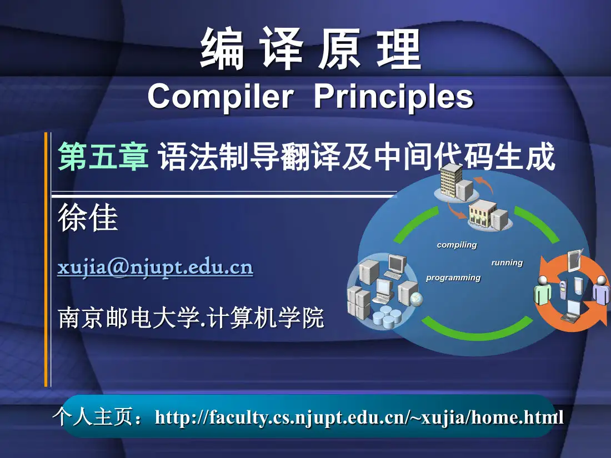

原文：

编译原理 Compiler Principles 第五章 语法制导翻译及中间代码生成

徐佳

xujia@njupt.edu.cn

南京邮电大学.计算机学院

compiling

programming

running

个人主页：http://faculty.cs.njupt.edu.cn/\~xujia/home.html

### 本章内容

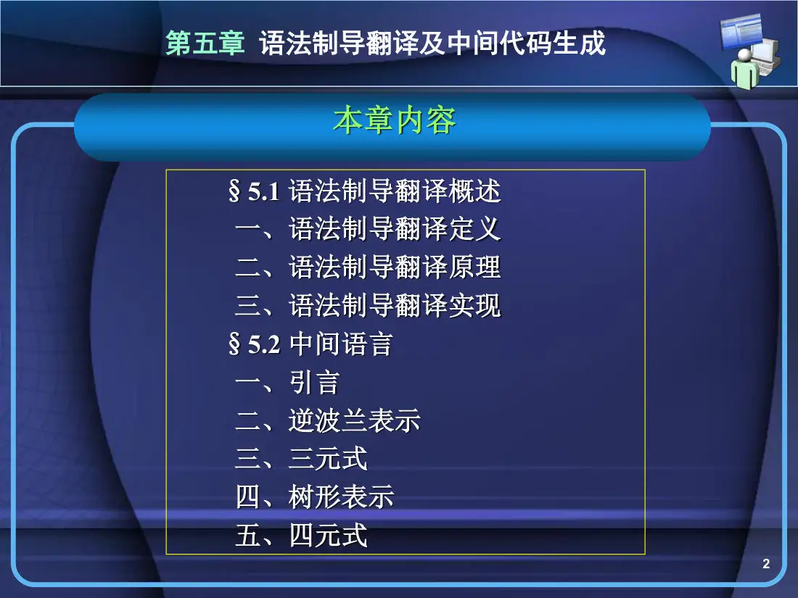

原文：

本章内容

§ 5.1 语法制导翻译概述

一、语法制导翻译定义

二、语法制导翻译原理

三、语法制导翻译实现

§ 5.2 中间语言

一、引言

二、逆波兰表示

三、三元式

四、树形表示

五、四元式

第五章 语法制导翻译及中间代码生成

2

### 本章内容

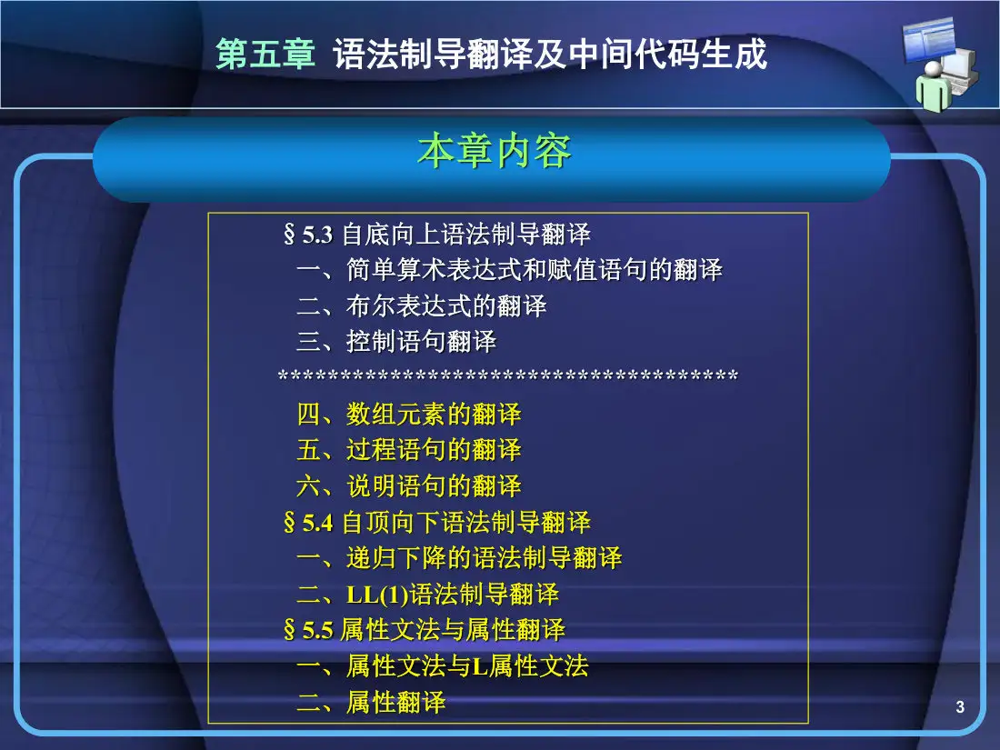

原文：

本章内容

§ 5.3 自底向上语法制导翻译

一、简单算术表达式和赋值语句的翻译

二、布尔表达式的翻译

三、控制语句翻译

\*\*\*\*\*\*\*\*\*\*\*\*\*\*\*\*\*\*\*\*\*\*\*\*\*\*\*\*\*\*\*\*\*\*\*\*\*\*\*\*\*\*\*\*\*\*\*\*\*\*\*\*\*\*\*\*\*\*\*\*\*\*\*\*\*\*\*\*\*\*\*\*\*\*\*\*\*\*\*\*\*\*\*\*\*\*\*\*

四、数组元素的翻译

五、过程语句的翻译

六、说明语句的翻译

§ 5.4 自顶向下语法制导翻译

一、递归下降的语法制导翻译

二、LL(1)语法制导翻译

§ 5.5 属性文法与属性翻译

一、属性文法与L属性文法

二、属性翻译

第五章 语法制导翻译及中间代码生成

3

### 本节内容

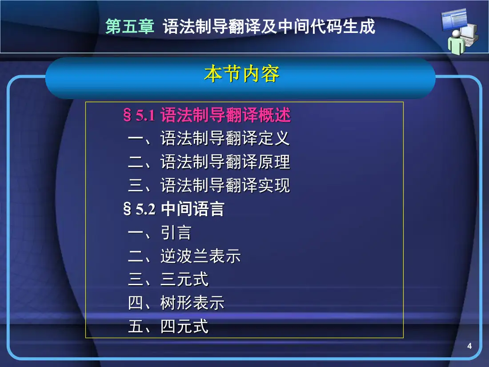

原文：

本节内容

§ 5.1 语法制导翻译概述

一、语法制导翻译定义

二、语法制导翻译原理

三、语法制导翻译实现

§ 5.2 中间语言

一、引言

二、逆波兰表示

三、三元式

四、树形表示

五、四元式

第五章 语法制导翻译及中间代码生成

4

### 本节内容

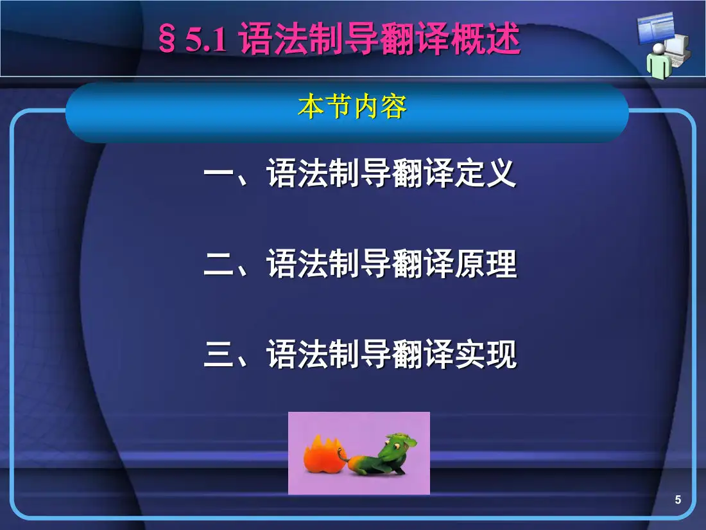

原文：

本节内容

一、语法制导翻译定义

二、语法制导翻译原理

三、语法制导翻译实现

§ 5.1 语法制导翻译概述

5

### 第五章 语法制导翻译及中间代码生成

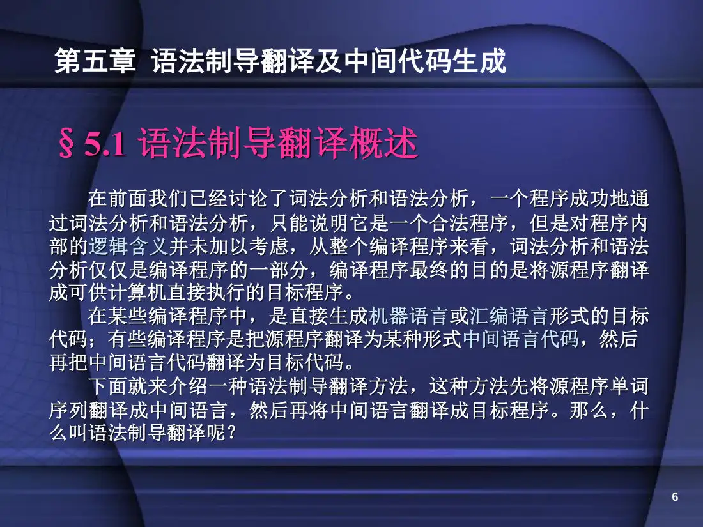

原文：

第五章 语法制导翻译及中间代码生成

§ 5.1 语法制导翻译概述

在前面我们已经讨论了词法分析和语法分析，一个程序成功地通过词法分析和语法分析，只能说明它是一个合法程序，但是对程序内部的逻辑含义并未加以考虑，从整个编译程序来看，词法分析和语法分析仅仅是编译程序的一部分，编译程序最终的目的是将源程序翻译成可供计算机直接执行的目标程序。

在某些编译程序中，是直接生成机器语言或汇编语言形式的目标代码；有些编译程序是把源程序翻译为某种形式中间语言代码，然后再把中间语言代码翻译为目标代码。

下面就来介绍一种语法制导翻译方法，这种方法先将源程序单词序列翻译成中间语言，然后再将中间语言翻译成目标程序。那么，什么叫语法制导翻译呢？

6

### 第五章 语法制导翻译及中间代码

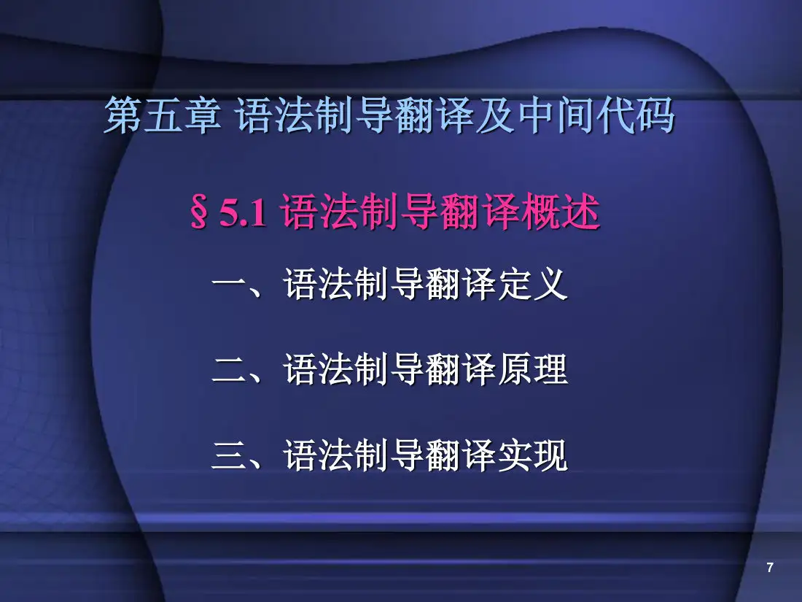

原文：

第五章 语法制导翻译及中间代码
§ 5.1 语法制导翻译概述
一、语法制导翻译定义
二、语法制导翻译原理
三、语法制导翻译实现

7

### 第五章 语法制导翻译及中间代码

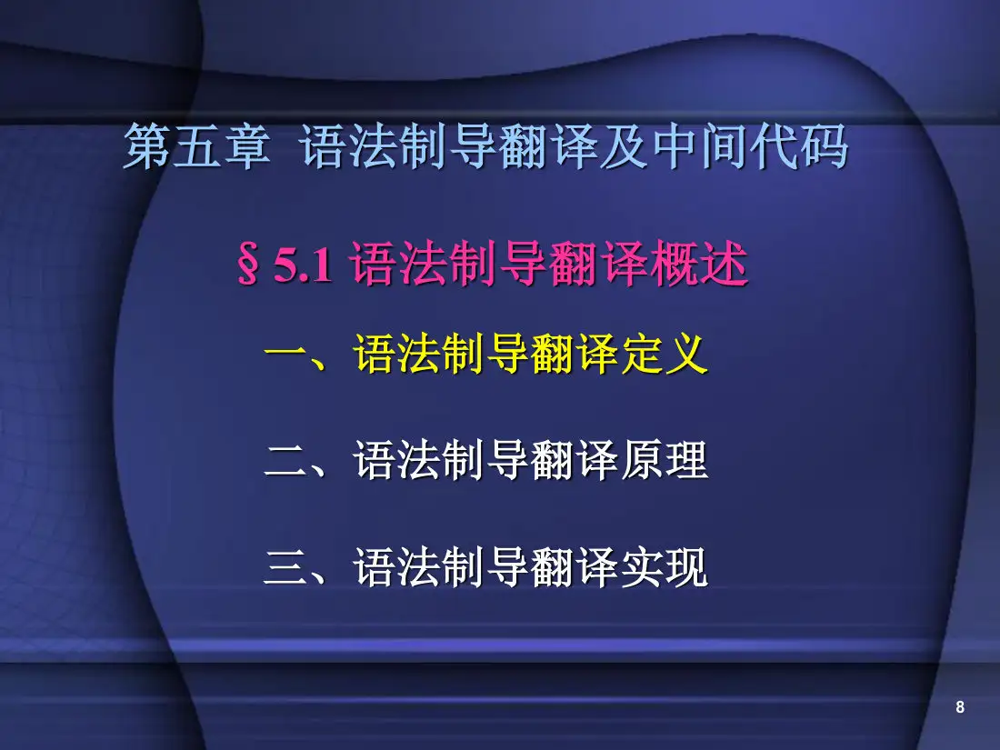

原文：

第五章 语法制导翻译及中间代码
§ 5.1 语法制导翻译概述
一、语法制导翻译定义
二、语法制导翻译原理
三、语法制导翻译实现

8

### § 5.1 语法制导翻译概述

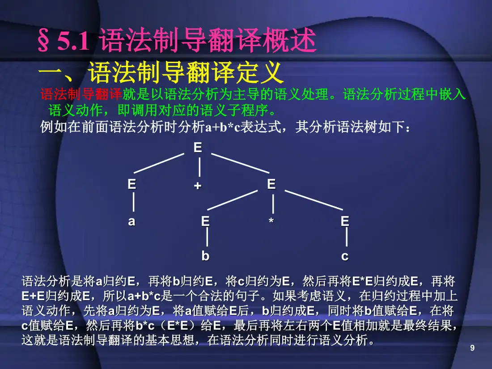

原文：

§ 5.1 语法制导翻译概述

一、语法制导翻译定义

语法制导翻译就是以语法分析为主导的语义处理。语法分析过程中嵌入语义动作，即调用对应的语义子程序。

例如在前面语法分析时分析a+b\*c表达式，其分析语法树如下：

语法分析是将a归约E，再将b归约E，将c归约为E，然后再将E\*E归约成E，再将E+E归约成E，所以a+b\*c是一个合法的句子。如果考虑语义，在归约过程中加上语义动作，先将a归约为E，将a值赋给E后，b归约成E，同时将b值赋给E，在将c值赋给E，然后再将b\*c（E\*E）给E，最后再将左右两个E值相加就是最终结果，这就是语法制导翻译的基本思想，在语法分析同时进行语义分析。

9

### 第五章 语法制导翻译及中间代码

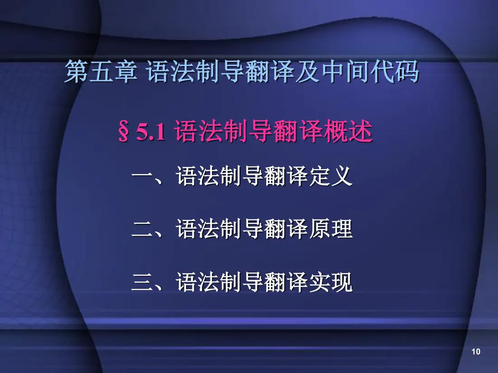

原文：

第五章 语法制导翻译及中间代码
§ 5.1 语法制导翻译概述
一、语法制导翻译定义
二、语法制导翻译原理
三、语法制导翻译实现

10

### 第五章 语法制导翻译及中间代码

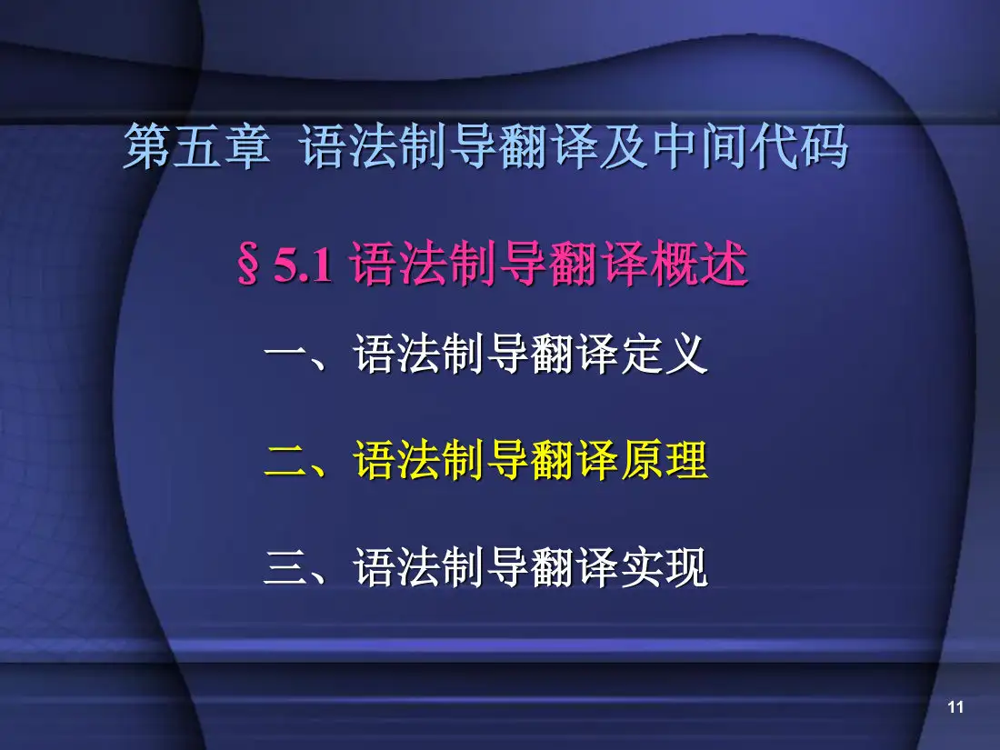

原文：

第五章 语法制导翻译及中间代码
§ 5.1 语法制导翻译概述
一、语法制导翻译定义
二、语法制导翻译原理
三、语法制导翻译实现

11

### § 5.1 语法制导翻译概述

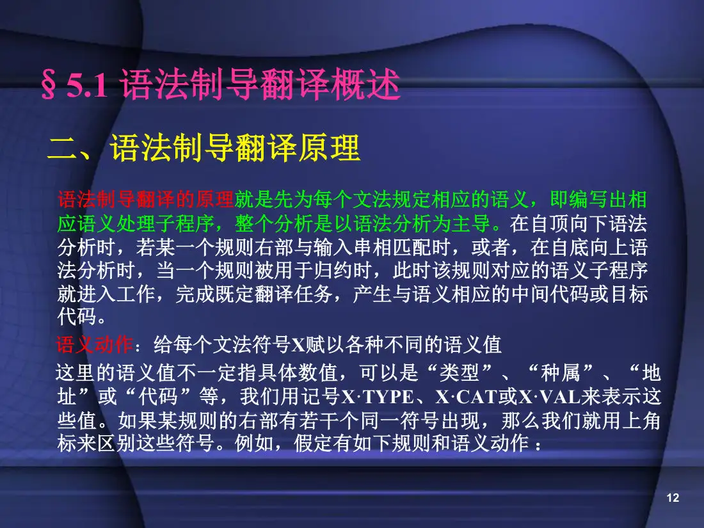

原文：

§ 5.1 语法制导翻译概述

二、语法制导翻译原理

语法制导翻译的原理就是先为每个文法规定相应的语义，即编写出相应语义处理子程序，整个分析是以语法分析为主导。在自顶向下语法分析时，若某一个规则右部与输入串相匹配时，或者，在自底向上语法分析时，当一个规则被用于归约时，此时该规则对应的语义子程序就进入工作，完成既定翻译任务，产生与语义相应的中间代码或目标代码。

语义动作：给每个文法符号X赋以各种不同的语义值

这里的语义值不一定指具体数值，可以是“类型”、“种属”、“地址”或“代码”等，我们用记号X·TYPE、X·CAT或X·VAL来表示这些值。如果某规则的右部有若干个同一符号出现，那么我们就用上角标来区别这些符号。例如，假定有如下规则和语义动作：

12

### 例5.1 设有文法 □E::=E+E □ E::=digit □

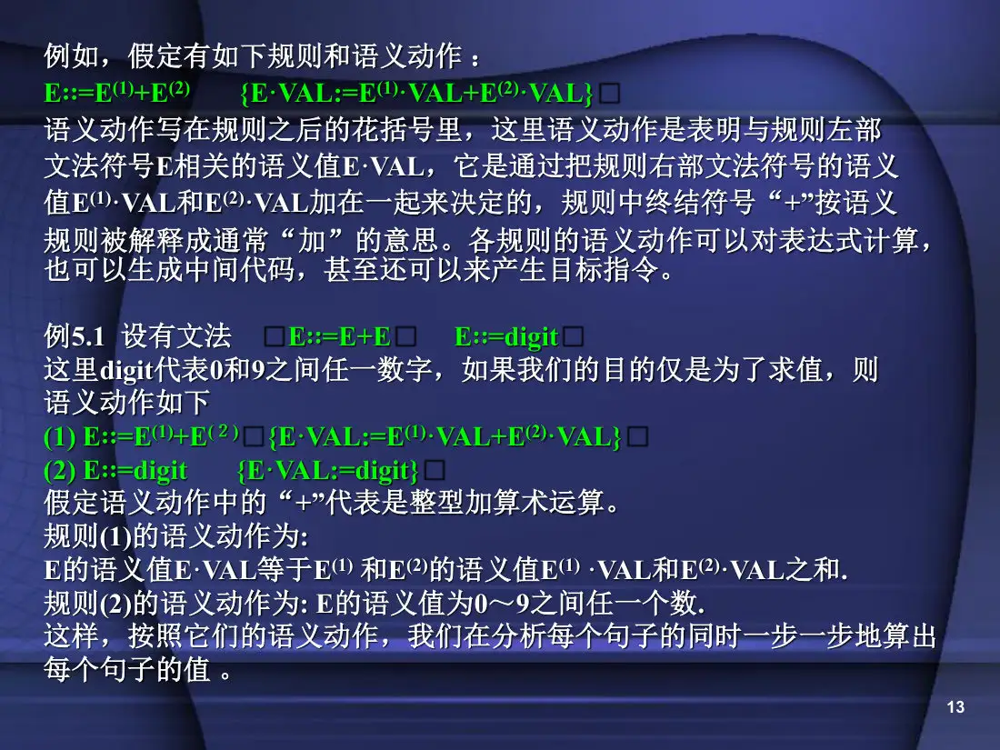

原文：

例如，假定有如下规则和语义动作： $E: := E^{(1)} + E^{(2)}$ $\{E \cdot VAL := E^{(1)} \cdot VAL + E^{(2)} \cdot VAL\}$ ☐

语义动作写在规则之后的花括号里，这里语义动作是表明与规则左部文法符号E相关的语义值E·VAL，它是通过把规则右部文法符号的语义值E $^{(1)}$ ·VAL和E $^{(2)}$ ·VAL加在一起来决定的，规则中终结符号“+”按语义规则被解释成通常“加”的意思。各规则的语义动作可以对表达式计算，也可以生成中间代码，甚至还可以来产生目标指令。

例5.1 设有文法 □E::=E+E □ E::=digit □
这里digit代表0和9之间任一数字，如果我们的目的仅是为了求值，则语义动作如下
(1) E::=E $^{(1)}$ +E $^{(2)}$ □ {E·VAL:=E $^{(1)}$ ·VAL+E $^{(2)}$ ·VAL} □
(2) E::=digit {E·VAL:=digit} □
假定语义动作中的“+”代表是整型加算术运算。
规则(1)的语义动作为：
E的语义值E·VAL等于E $^{(1)}$ 和E $^{(2)}$ 的语义值E $^{(1)}$ ·VAL和E $^{(2)}$ ·VAL之和。
规则(2)的语义动作为：E的语义值为0～9之间任一个数。
这样，按照它们的语义动作，我们在分析每个句子的同时一步一步地算出每个句子的值。

13

### 14

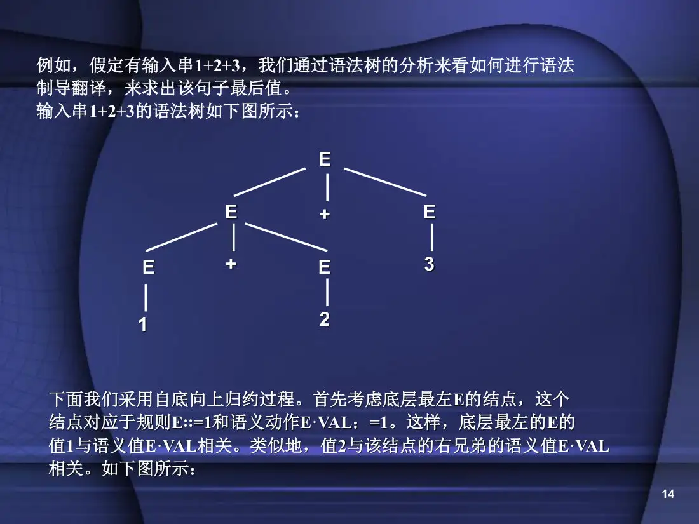

原文：

例如，假定有输入串 $1 + 2 + 3$ ，我们通过语法树的分析来看如何进行语法制导翻译，来求出该句子最后值。输入串 $1 + 2 + 3$ 的语法树如下图所示：

下面我们采用自底向上归约过程。首先考虑底层最左E的结点，这个结点对应于规则E::=1和语义动作E·VAL: =1。这样，底层最左的E的值1与语义值E·VAL相关。类似地，值2与该结点的右兄弟的语义值E·VAL相关。如下图所示：

14

### E E $\cdot$ VAL=1

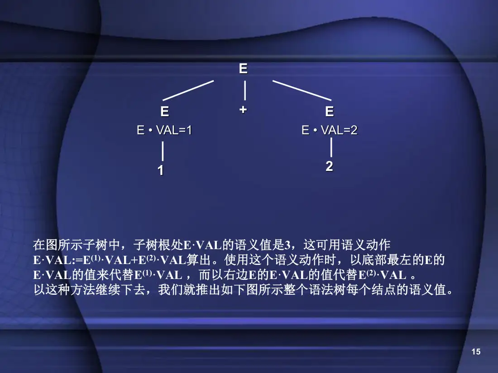

原文：

E E $\cdot$ VAL=1

E E · VAL=2

在图所示子树中，子树根处E·VAL的语义值是3，这可用语义动作E·VAL:=E $^{(1)}$ ·VAL+E $^{(2)}$ ·VAL算出。使用这个语义动作时，以底部最左的E的E·VAL的值来代替E $^{(1)}$ ·VAL，而以右边E的E·VAL的值代替E $^{(2)}$ ·VAL。以这种方法继续下去，我们就推出如下图所示整个语法树每个结点的语义值。

15

### 16

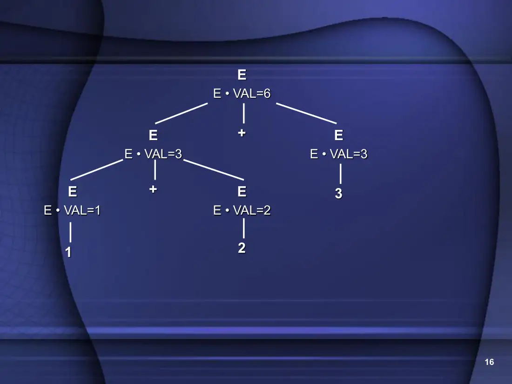

原文：

16

### 第五章 语法制导翻译及中间代码

原文：

第五章 语法制导翻译及中间代码
§ 5.1 语法制导翻译概述
一、语法制导翻译定义
二、语法制导翻译原理
三、语法制导翻译实现

17

### 第五章 语法制导翻译及中间代码

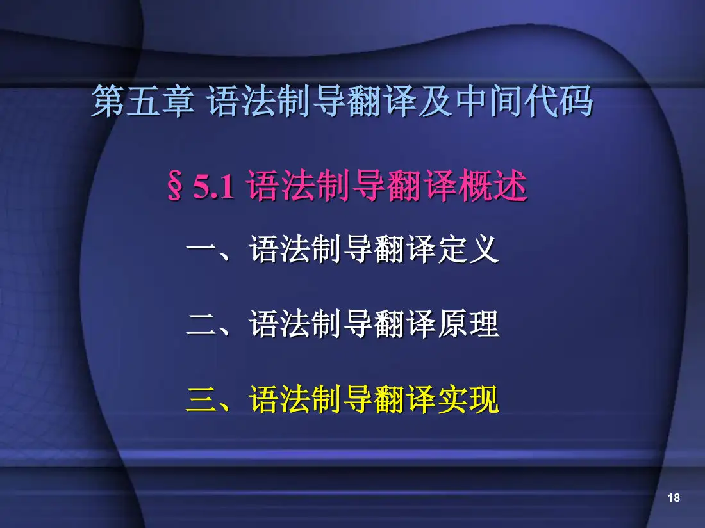

原文：

第五章 语法制导翻译及中间代码

§ 5.1 语法制导翻译概述

一、语法制导翻译定义

二、语法制导翻译原理

三、语法制导翻译实现

18

### § 5.1 语法制导翻译概述

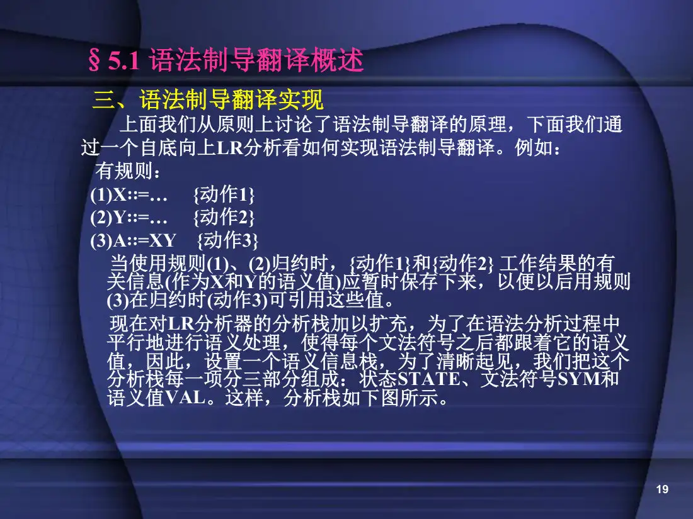

原文：

§ 5.1 语法制导翻译概述

三、语法制导翻译实现

上面我们从原则上讨论了语法制导翻译的原理，下面我们通过一个自底向上LR分析看如何实现语法制导翻译。例如：

有规则：

(1)X::=... {动作1}

(2)Y::=... {动作2}

(3)A::=XY {动作3}

当使用规则(1)、(2)归约时，{动作1}和{动作2}工作结果的有关信息(作为X和Y的语义值)应暂时保存下来，以便以后用规则(3)在归约时(动作3)可引用这些值。

现在对LR分析器的分析栈加以扩充，为了在语法分析过程中平行地进行语义处理，使得每个文法符号之后都跟着它的语义值，因此，设置一个语义信息栈，为了清晰起见，我们把这个分析栈每一项分三部分组成：状态STATE、文法符号SYM和语义值VAL。这样，分析栈如下图所示。

19

### SmY·VALYSm-1X·VALX⋮⋮⋮S0—#STATEVALSYM

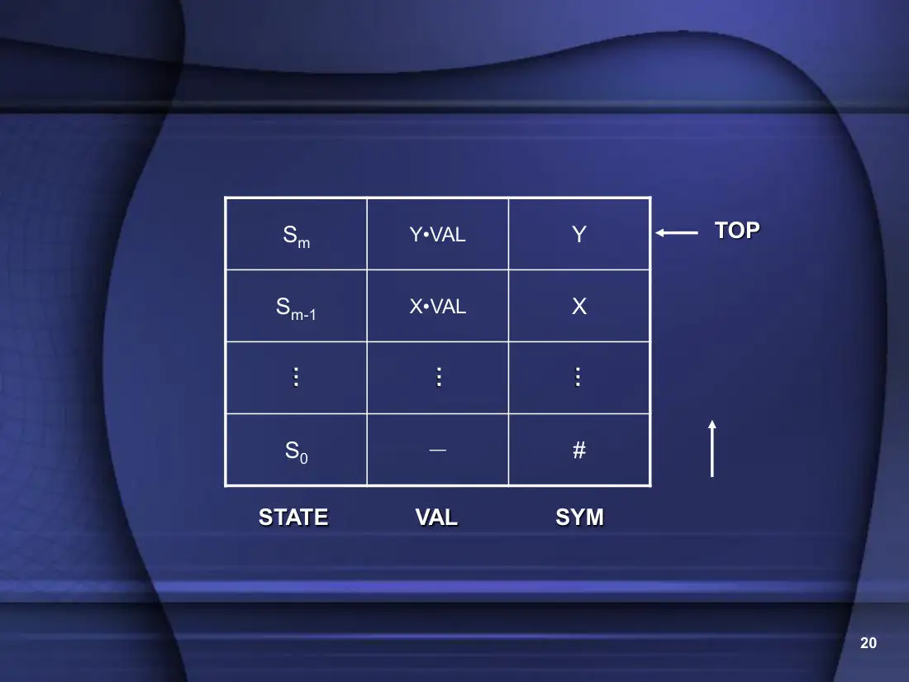

原文：

<table><tr><td>Sm</td><td>Y·VAL</td><td>Y</td></tr><tr><td>Sm-1</td><td>X·VAL</td><td>X</td></tr><tr><td>⋮</td><td>⋮</td><td>⋮</td></tr><tr><td>S0</td><td>—</td><td>#</td></tr><tr><td>STATE</td><td>VAL</td><td>SYM</td></tr></table>

20

### 我们假定先归约后执行语义子程序，所以当X，Y归约为A时，此时栈顶指针下退。

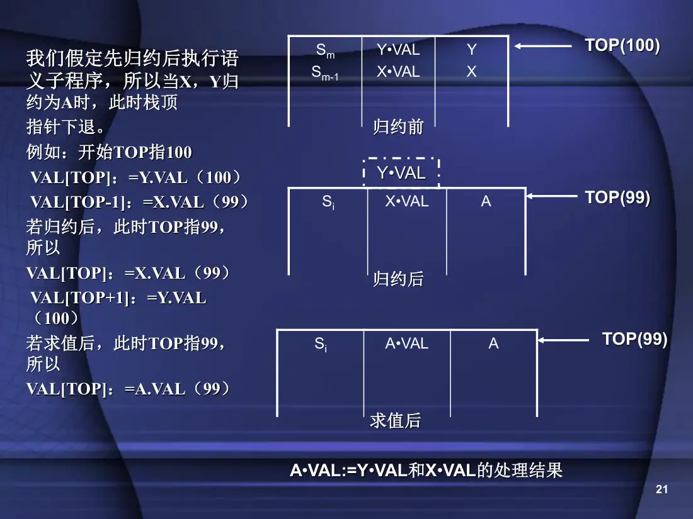

原文：

我们假定先归约后执行语义子程序，所以当X，Y归约为A时，此时栈顶指针下退。
例如：开始TOP指100
VAL[TOP]: =Y.VAL (100)
VAL[TOP-1]: =X.VAL (99)
若归约后，此时TOP指99，
所以
VAL[TOP]: =X.VAL (99)
VAL[TOP+1]: =Y.VAL (100)
若求值后，此时TOP指99，
所以
VAL[TOP]: =A.VAL (99)

A·VAL:=Y·VAL和X·VAL的处理结果

21

### 例5.2 考虑下面文法及其语义描述:

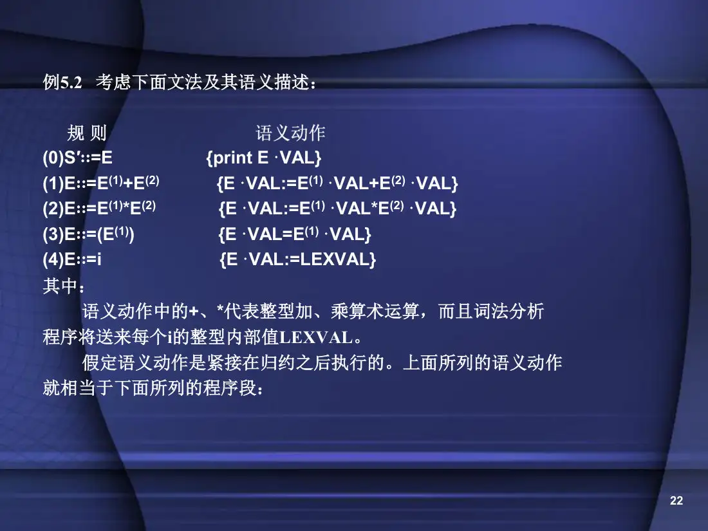

原文：

例5.2 考虑下面文法及其语义描述:

规则

语义动作

$$
(0) S ^ {\prime}:: = E
$$

$$
\{\text {print E} \cdot \text {VAL} \}
$$

$$
(1) E: := E ^ {(1)} + E ^ {(2)}
$$

$$
\{E \cdot V A L := E ^ {(1)} \cdot V A L + E ^ {(2)} \cdot V A L \}
$$

$$
(2) E: := E ^ {(1)} * E ^ {(2)}
$$

$$
\{E \cdot V A L := E ^ {(1)} \cdot V A L * E ^ {(2)} \cdot V A L \}
$$

$$
(3) E: := (E ^ {(1)})
$$

$$
\{E \cdot V A L = E ^ {(1)} \cdot V A L \}
$$

$$
(4) E: := i
$$

$$
\{\mathrm{E} \cdot \text {VAL} := \text {LEXVAL} \}
$$

其中：

语义动作中的+、\*代表整型加、乘算术运算，而且词法分析程序将送来每个i的整型内部值LEXVAL。

假定语义动作是紧接在归约之后执行的。上面所列的语义动作就相当于下面所列的程序段：

22

### 规则

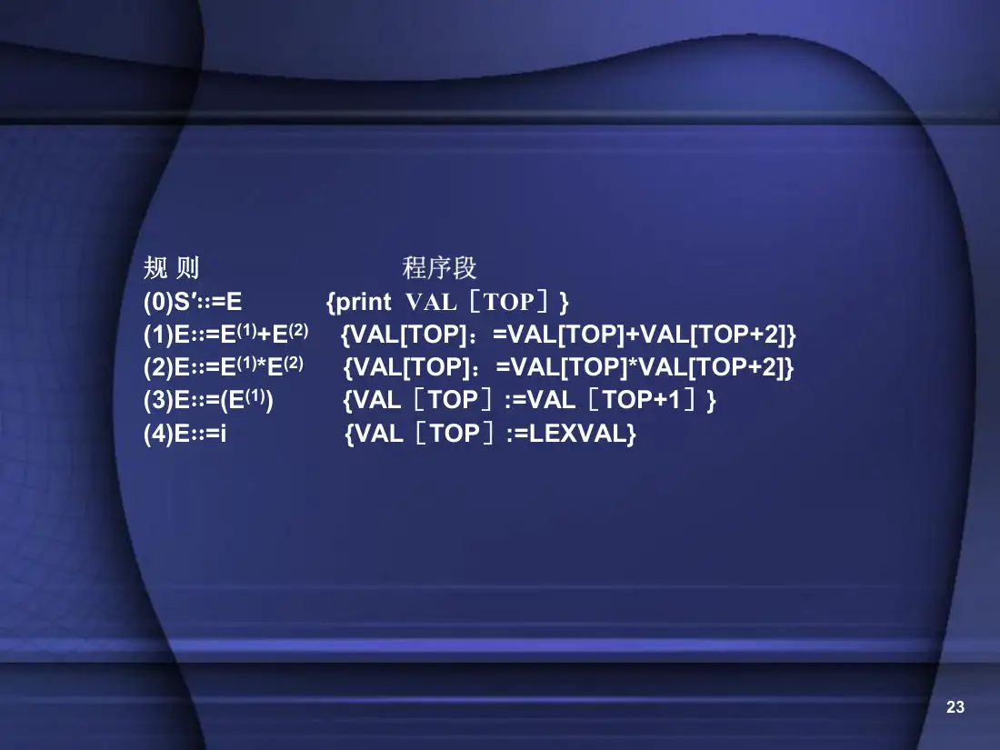

原文：

规则

(0) $S'::=E$

(1) $E::=E^{(1)}+E^{(2)}$

(2) $E::=E^{(1)*}E^{(2)}$

(3) $E::=(E^{(1)})$

(4)E::=i

程序段

{print VAL [TOP]}

{VAL[TOP]: =VAL[TOP]+VAL[TOP+2]}

{VAL[TOP]: =VAL[TOP]\*VAL[TOP+2]}

{VAL [TOP] := VAL [TOP+1]}

{VAL [TOP] := LEXVAL}

23

### 根据上述程序段，若输入2\*3+2，就有如下图所示的语法制导翻译的分析树。

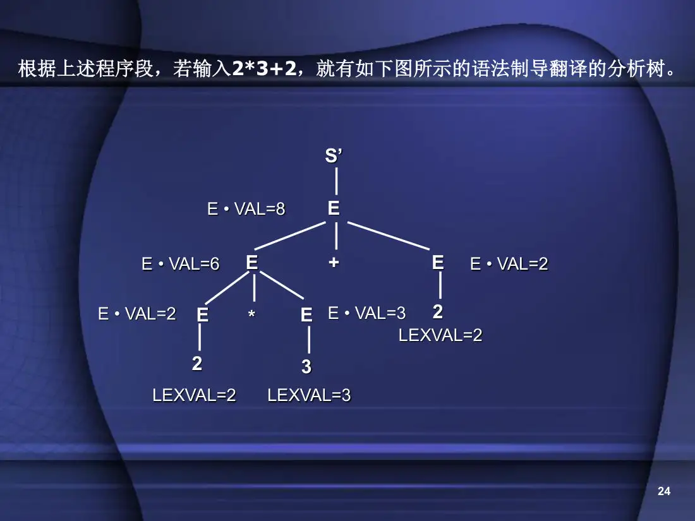

原文：

根据上述程序段，若输入2\*3+2，就有如下图所示的语法制导翻译的分析树。

24

### 25

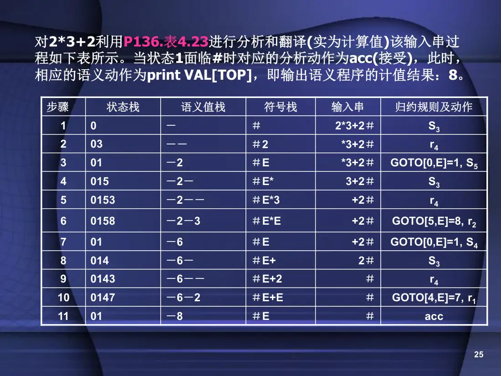

原文：

对2\*3+2利用P136.表4.23进行分析和翻译(实为计算值)该输入串过程如下表所示。当状态1面临#时对应的分析动作为acc(接受)，此时，相应的语义动作为print VAL[TOP]，即输出语义程序的计值结果：8。

<table><tr><td>步骤</td><td>状态栈</td><td>语义值栈</td><td>符号栈</td><td>输入串</td><td>归约规则及动作</td></tr><tr><td>1</td><td>0</td><td>—</td><td>#</td><td>2*3+2#</td><td> $S_3$ </td></tr><tr><td>2</td><td>03</td><td>— —</td><td>#2</td><td>*3+2#</td><td> $r_4$ </td></tr><tr><td>3</td><td>01</td><td>-2</td><td>#E</td><td>*3+2#</td><td>GOTO[0,E]=1,  $S_5$ </td></tr><tr><td>4</td><td>015</td><td>-2—</td><td>#E*</td><td>3+2#</td><td> $S_3$ </td></tr><tr><td>5</td><td>0153</td><td>-2— —</td><td>#E*3</td><td>+2#</td><td> $r_4$ </td></tr><tr><td>6</td><td>0158</td><td>-2—3</td><td>#E*E</td><td>+2#</td><td>GOTO[5,E]=8,  $r_2$ </td></tr><tr><td>7</td><td>01</td><td>-6</td><td>#E</td><td>+2#</td><td>GOTO[0,E]=1,  $S_4$ </td></tr><tr><td>8</td><td>014</td><td>-6—</td><td>#E+</td><td>2#</td><td> $S_3$ </td></tr><tr><td>9</td><td>0143</td><td>-6— —</td><td>#E+2</td><td>#</td><td> $r_4$ </td></tr><tr><td>10</td><td>0147</td><td>-6—2</td><td>#E+E</td><td>#</td><td>GOTO[4,E]=7,  $r_1$ </td></tr><tr><td>11</td><td>01</td><td>-8</td><td>#E</td><td>#</td><td>acc</td></tr></table>

25

### 本节内容

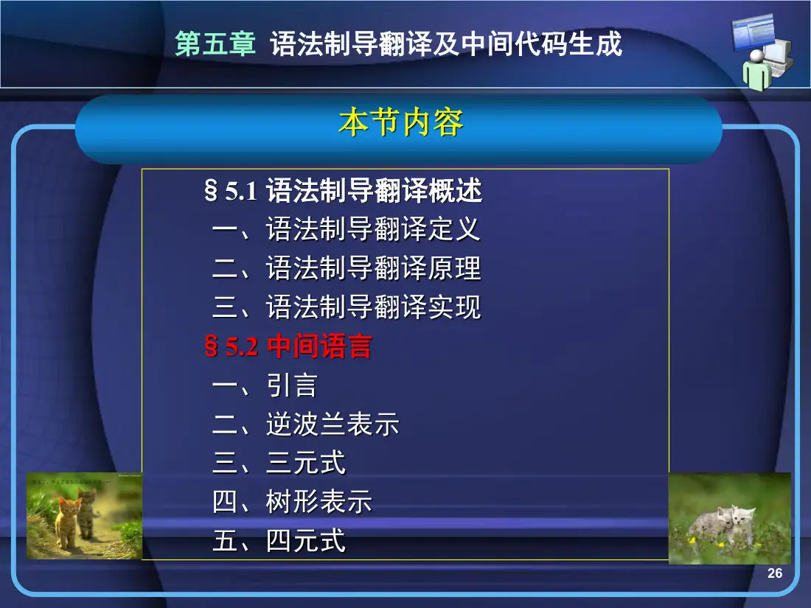

原文：

本节内容

§ 5.1 语法制导翻译概述

一、语法制导翻译定义

二、语法制导翻译原理

三、语法制导翻译实现

§ 5.2 中间语言

一、引言

二、逆波兰表示

三、三元式

四、树形表示

五、四元式

第五章 语法制导翻译及中间代码生成

26

### 第五章 语法制导翻译及中间代码生成

原文：

第五章 语法制导翻译及中间代码生成

§ 5.2 中间语言

一、引言

1. 什么是中间语言

2.为什么要引入中间语言

二、逆波兰表示

1. 表达式逆波兰表示

2. 逆波兰表示的扩充

3.语法制导翻译生成后缀式

三、三元式

1.三元式

2.间接三元式

四、树形表示

1. 表示方法

2. 树表示生成

五、四元式

27

### 第五章 语法制导翻译及中间代码生成

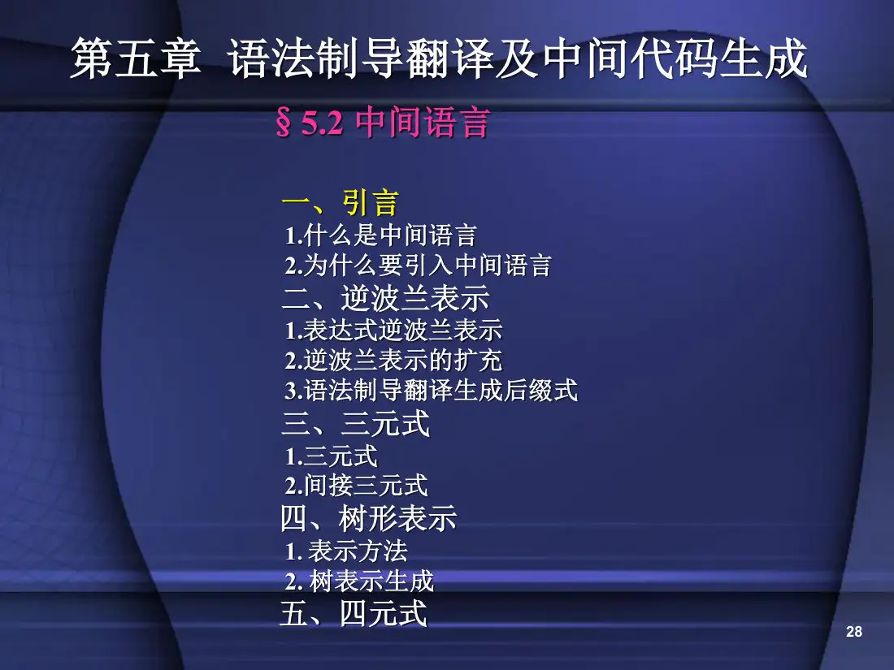

原文：

第五章 语法制导翻译及中间代码生成

§ 5.2 中间语言

一、引言

1. 什么是中间语言

2.为什么要引入中间语言

二、逆波兰表示

1. 表达式逆波兰表示

2. 逆波兰表示的扩充

3.语法制导翻译生成后缀式

三、三元式

1.三元式

2.间接三元式

四、树形表示

1. 表示方法

2. 树表示生成

五、四元式

28

### 第五章 语法制导翻译及中间代码生成

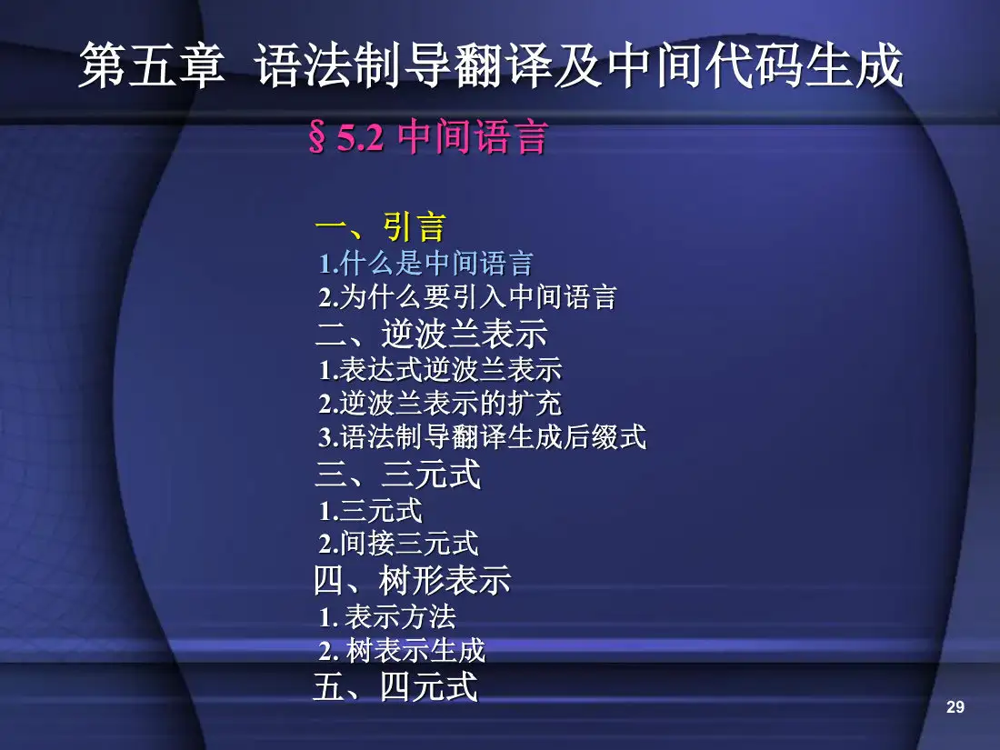

原文：

第五章 语法制导翻译及中间代码生成

§ 5.2 中间语言

一、引言

1. 什么是中间语言

2.为什么要引入中间语言

二、逆波兰表示

1. 表达式逆波兰表示

2. 逆波兰表示的扩充

3.语法制导翻译生成后缀式

三、三元式

1.三元式

2.间接三元式

四、树形表示

1. 表示方法

2. 树表示生成

五、四元式

29

### § 5.2 中间语言

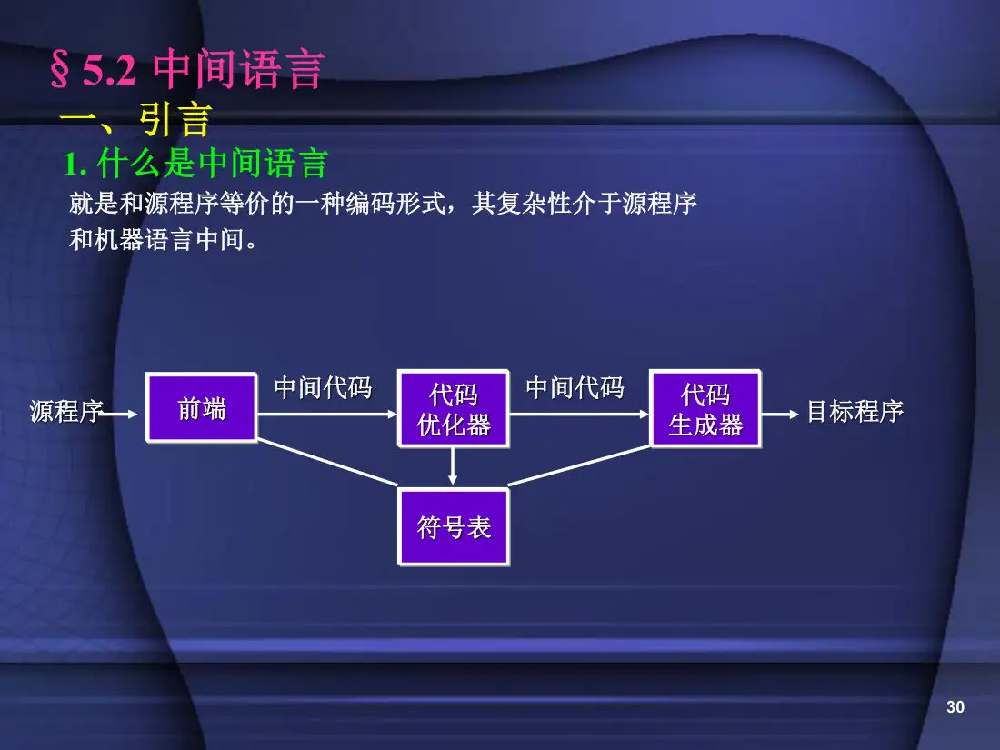

原文：

§ 5.2 中间语言

一、引言

1. 什么是中间语言

就是和源程序等价的一种编码形式，其复杂性介于源程序和机器语言中间。

源程序

前端

中间代码

代码
优化器中间代码

代码
生成器目标程序

符号表

30

### 第五章 语法制导翻译及中间代码生成

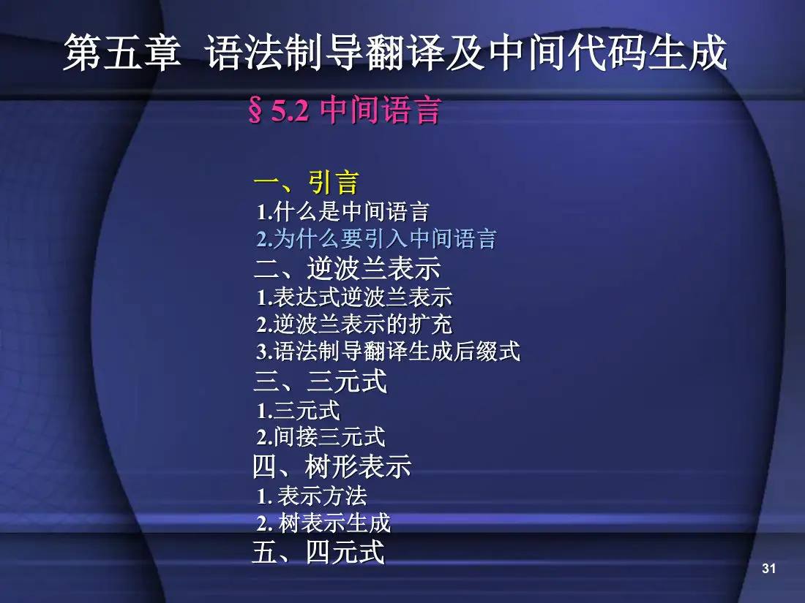

原文：

第五章 语法制导翻译及中间代码生成

§ 5.2 中间语言

一、引言

1. 什么是中间语言

2.为什么要引入中间语言

二、逆波兰表示

1. 表达式逆波兰表示

2. 逆波兰表示的扩充

3.语法制导翻译生成后缀式

三、三元式

1.三元式

2.间接三元式

四、树形表示

1. 表示方法

2. 树表示生成

五、四元式

31

### § 5.2 中间语言

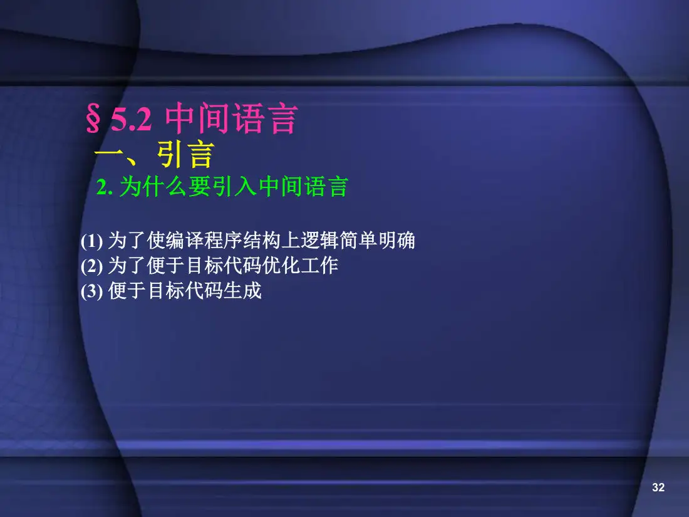

原文：

§ 5.2 中间语言

一、引言

2. 为什么要引入中间语言

(1) 为了使编译程序结构上逻辑简单明确

(2) 为了便于目标代码优化工作

(3) 便于目标代码生成

32

### 第五章 语法制导翻译及中间代码生成

原文：

第五章 语法制导翻译及中间代码生成

§ 5.2 中间语言

一、引言

1. 什么是中间语言

2.为什么要引入中间语言

二、逆波兰表示

1. 表达式逆波兰表示

2. 逆波兰表示的扩充

3.语法制导翻译生成后缀式

三、三元式

1.三元式

2.间接三元式

四、树形表示

1. 表示方法

2. 树表示生成

五、四元式

33

### 第五章 语法制导翻译及中间代码生成

原文：

第五章 语法制导翻译及中间代码生成

§ 5.2 中间语言

一、引言

1. 什么是中间语言

2.为什么要引入中间语言

二、逆波兰表示

1. 表达式逆波兰表示

2. 逆波兰表示的扩充

3.语法制导翻译生成后缀式

三、三元式

1.三元式

2.间接三元式

四、树形表示

1. 表示方法

2. 树表示生成

五、四元式

34

### 第五章 语法制导翻译及中间代码生成

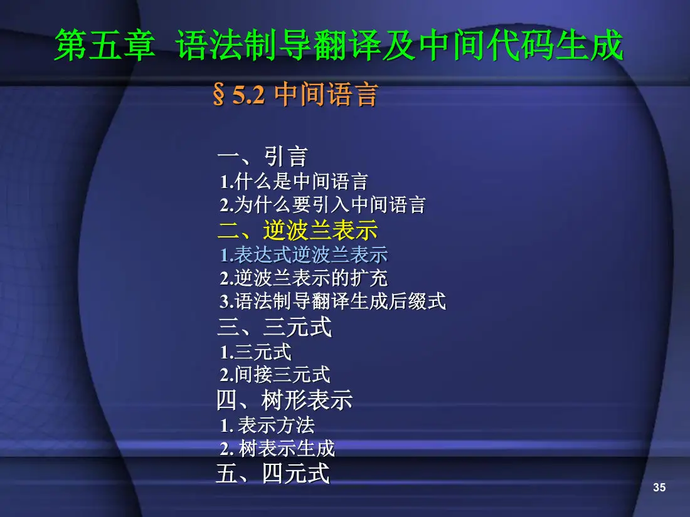

原文：

第五章 语法制导翻译及中间代码生成

§ 5.2 中间语言

一、引言

1. 什么是中间语言

2.为什么要引入中间语言

二、逆波兰表示

1. 表达式逆波兰表示

2. 逆波兰表示的扩充

3.语法制导翻译生成后缀式

三、三元式

1.三元式

2.间接三元式

四、树形表示

1. 表示方法

2. 树表示生成

五、四元式

35

### § 5.2 中间语言 二、逆波兰表示 1. 表达式逆波兰表示

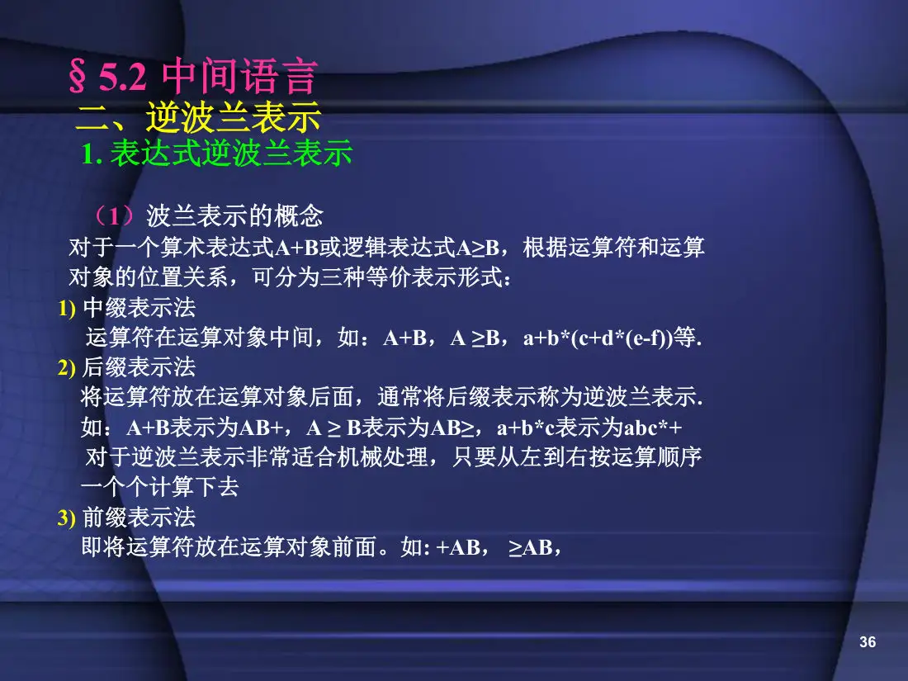

原文：

§ 5.2 中间语言 二、逆波兰表示 1. 表达式逆波兰表示

(1) 波兰表示的概念
对于一个算术表达式A+B或逻辑表达式A≥B，根据运算符和运算对象的位置关系，可分为三种等价表示形式：

1) 中缀表示法
运算符在运算对象中间，如：A+B，A≥B，a+b\*(c+d\*(e-f))等.

2) 后缀表示法
将运算符放在运算对象后面，通常将后缀表示称为逆波兰表示。如：A+B表示为AB+，A≥B表示为AB≥，a+b\*c表示为abc\*+。对于逆波兰表示非常适合机械处理，只要从左到右按运算顺序一个个计算下去

3) 前缀表示法
即将运算符放在运算对象前面。如: +AB, ≥AB,

36

### 例如表达式中缀表示和后缀表示如下表所示(p155表5.2)

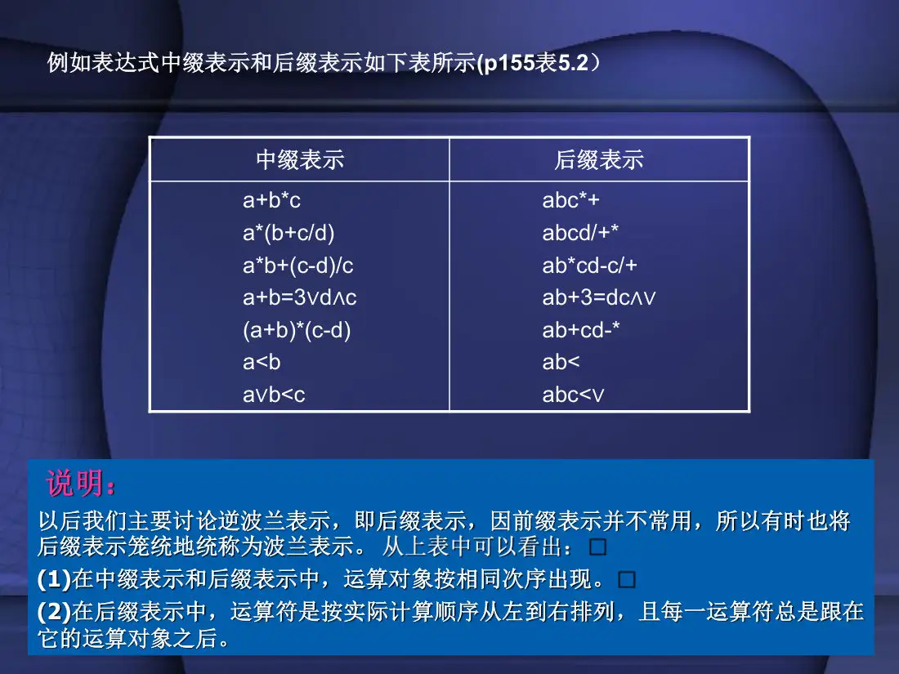

原文：

<table><tr><td>中缀表示</td><td>后缀表示</td></tr><tr><td>a+b*c</td><td>abc*+</td></tr><tr><td>a*(b+c/d)</td><td>abcd/+*</td></tr><tr><td>a*b+(c-d)/c</td><td>ab*cd-c/+</td></tr><tr><td>a+b=3vd^c</td><td>ab+3=dc^V</td></tr><tr><td>(a+b)*(c-d)</td><td>ab+cd-*</td></tr><tr><td>aab&lt;</td><td>ab&lt;</td></tr><tr><td>avbabc</td><td>abc</td></tr></table>

例如表达式中缀表示和后缀表示如下表所示(p155表5.2)

说明:

以后我们主要讨论逆波兰表示，即后缀表示，因前缀表示并不常用，所以有时也将后缀表示笼统地统称为波兰表示。从上表中可以看出：□

(1)在中缀表示和后缀表示中，运算对象按相同次序出现。□

(2)在后缀表示中，运算符是按实际计算顺序从左到右排列，且每一运算符总是跟在它的运算对象之后。

### (2)逆波兰(后缀)表示的优点

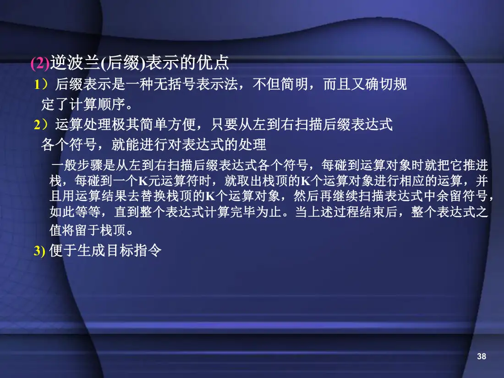

原文：

(2)逆波兰(后缀)表示的优点

1）后缀表示是一种无括号表示法，不但简明，而且又确切规定了计算顺序。

2）运算处理极其简单方便，只要从左到右扫描后缀表达式各个符号，就能进行对表达式的处理

一般步骤是从左到右扫描后缀表达式各个符号，每碰到运算对象时就把它推进栈，每碰到一个K元运算符时，就取出栈顶的K个运算对象进行相应的运算，并且用运算结果去替换栈顶的K个运算对象，然后再继续扫描表达式中余留符号，如此等等，直到整个表达式计算完毕为止。当上述过程结束后，整个表达式之值将留于栈顶。

3) 便于生成目标指令

38

### (3) 逆波兰(后缀)表示的形成

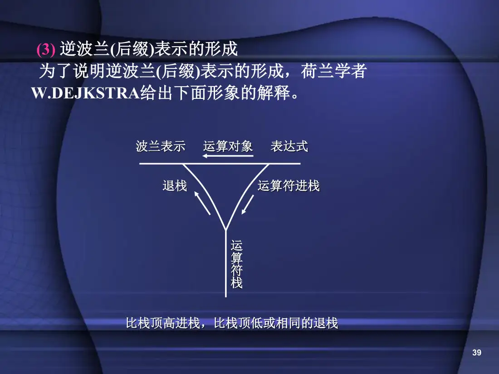

原文：

(3) 逆波兰(后缀)表示的形成
为了说明逆波兰(后缀)表示的形成，荷兰学者W.DEJKSTRA给出下面形象的解释。

波兰表示 运算对象 表达式

退栈

运算符进栈

运算符栈

比栈顶高进栈，比栈顶低或相同的退栈

39

### 下面用图解形式来说明A+B\*C形成的过程。

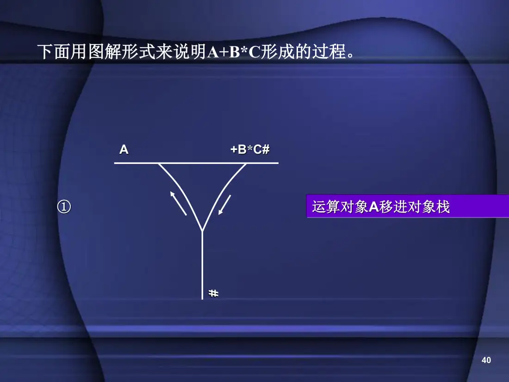

原文：

下面用图解形式来说明A+B\*C形成的过程。

运算对象A移进对象栈

40

### 下面用图解形式来说明A+B\*C形成的过程。

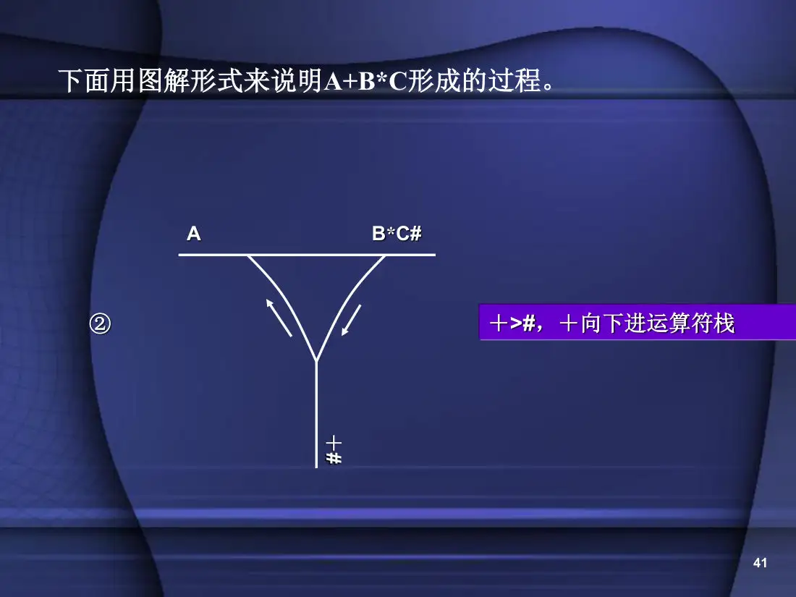

原文：

下面用图解形式来说明A+B\*C形成的过程。

+>#，+向下进运算符栈

41

### 下面用图解形式来说明A+B\*C形成的过程。

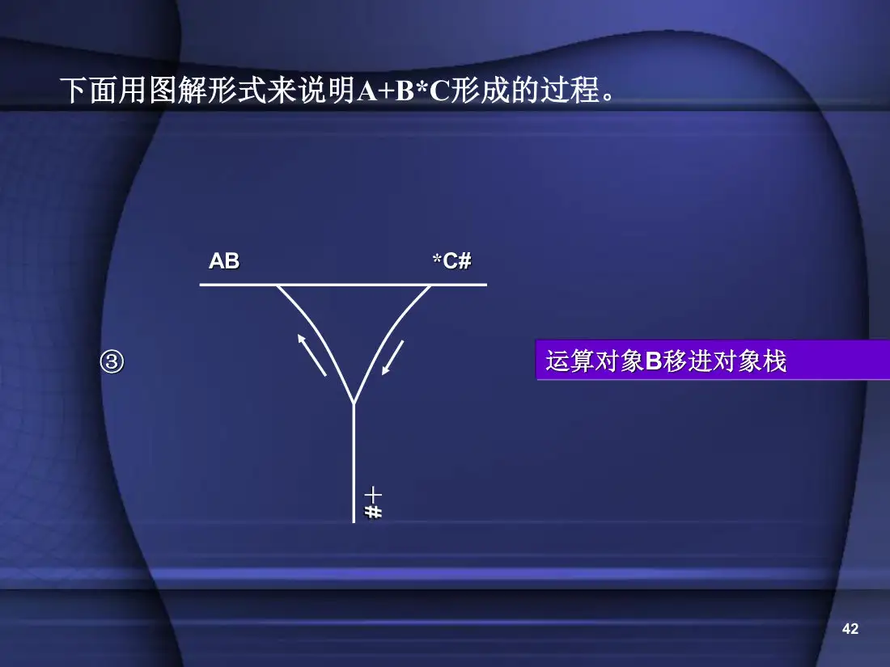

原文：

下面用图解形式来说明A+B\*C形成的过程。

运算对象B移进对象栈

42

### 下面用图解形式来说明A+B\*C形成的过程。

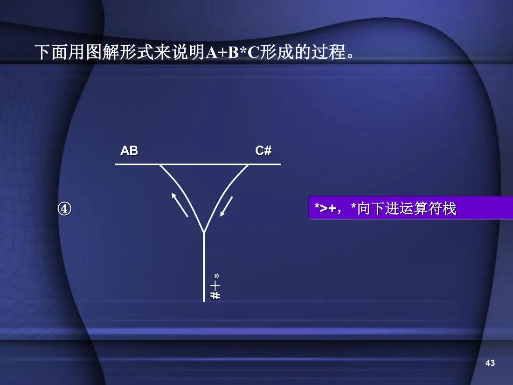

原文：

下面用图解形式来说明A+B\*C形成的过程。

\*>+，\*向下进运算符栈

43

### 下面用图解形式来说明A+B\*C形成的过程。

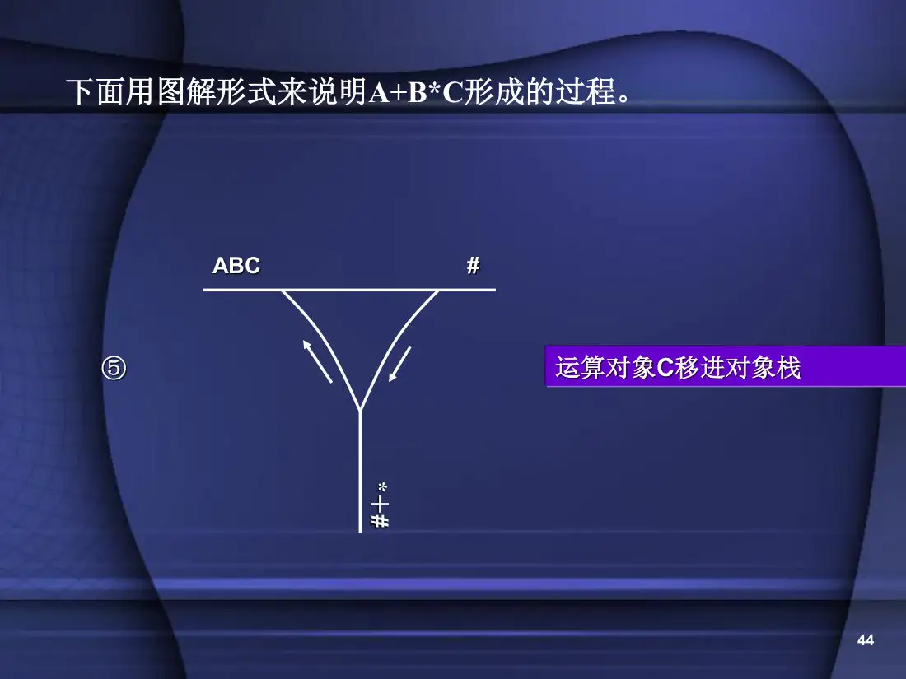

原文：

下面用图解形式来说明A+B\*C形成的过程。

运算对象C移进对象栈

44

### 下面用图解形式来说明A+B\*C形成的过程。

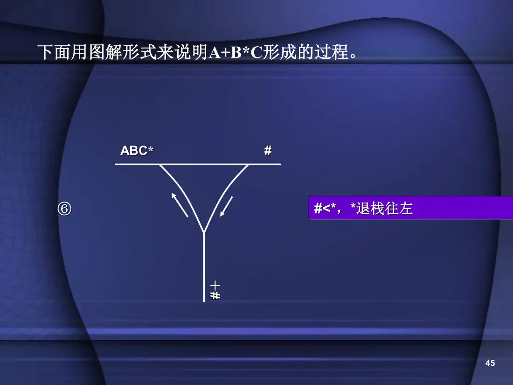

原文：

下面用图解形式来说明A+B\*C形成的过程。

<\*，\*退栈往左

45

### 下面用图解形式来说明A+B\*C形成的过程。

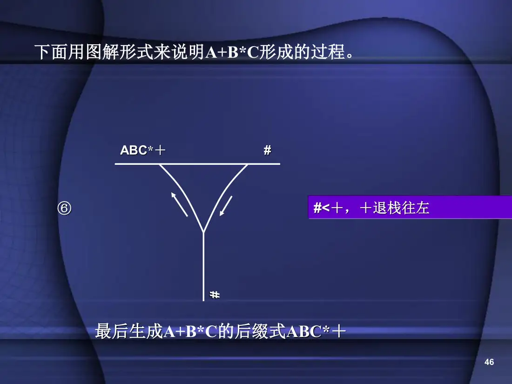

原文：

下面用图解形式来说明A+B\*C形成的过程。

#<十，+退栈往左

最后生成A+B\*C的后缀式ABC\*+

46

### 将 $a+b*(c+d*(e-f))$ 改写为后缀式

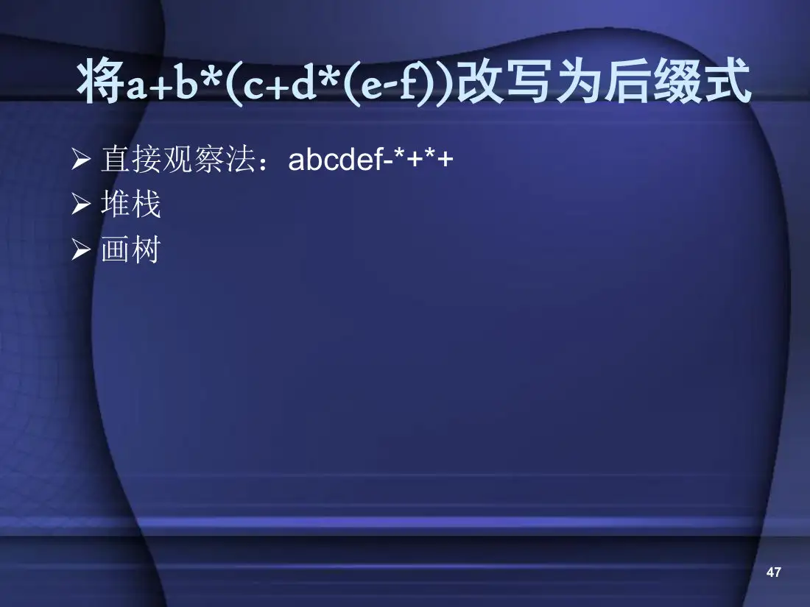

原文：

将 $a+b*(c+d*(e-f))$ 改写为后缀式

直接观察法：abcdef-\*+\*\*+

堆栈

画树

47

### (4)用后缀表式对表达式处理的过程

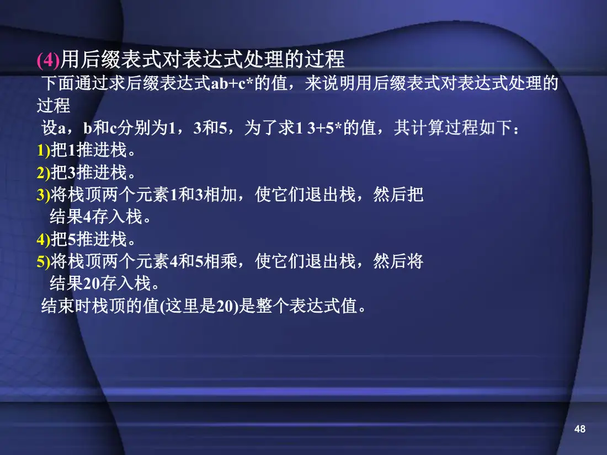

原文：

(4)用后缀表式对表达式处理的过程

下面通过求后缀表达式ab+c\*的值，来说明用后缀表式对表达式处理的过程

设a，b和c分别为1，3和5，为了求 $13+5^{*}$ 的值，其计算过程如下：

1) 把1推进栈。

2)把3推进栈。

3)将栈顶两个元素1和3相加，使它们退出栈，然后把结果4存入栈。

4)把5推进栈。

5)将栈顶两个元素4和5相乘，使它们退出栈，然后将结果20存入栈。

结束时栈顶的值(这里是20)是整个表达式值。

48

### 第五章 语法制导翻译及中间代码生成

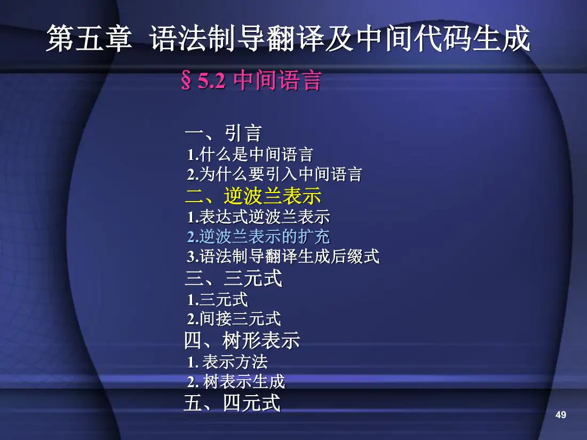

原文：

第五章 语法制导翻译及中间代码生成

§ 5.2 中间语言

一、引言

1. 什么是中间语言

2.为什么要引入中间语言

二、逆波兰表示

1. 表达式逆波兰表示

2. 逆波兰表示的扩充

3.语法制导翻译生成后缀式

三、三元式

1.三元式

2.间接三元式

四、树形表示

1. 表示方法

2. 树表示生成

五、四元式

49

### § 5.2 中间语言

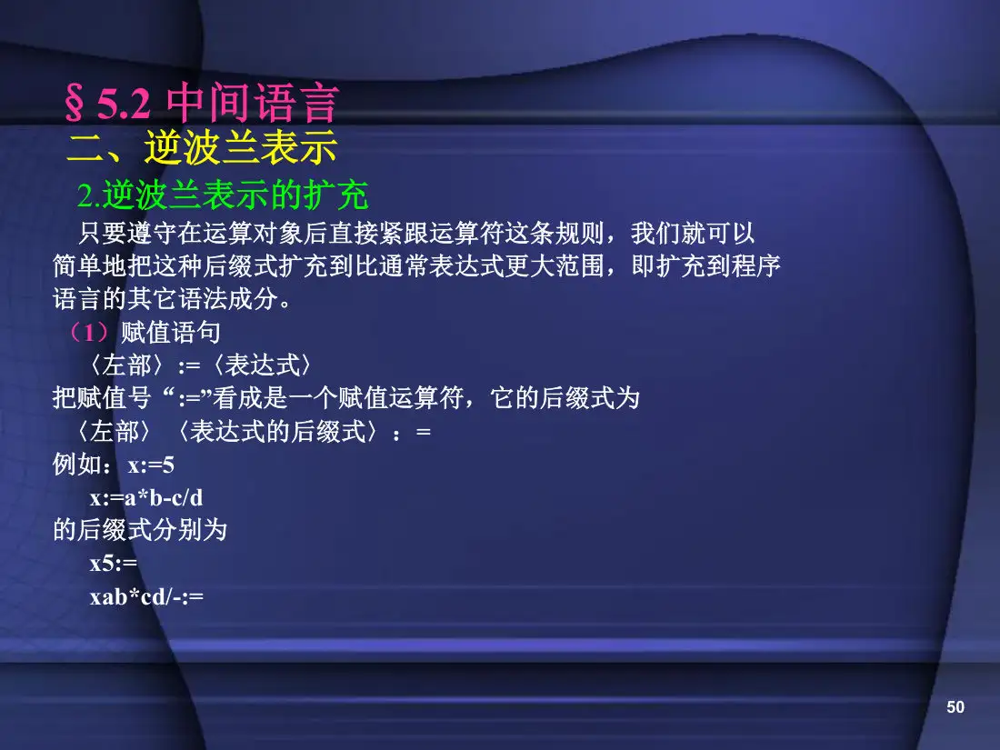

原文：

§ 5.2 中间语言

二、逆波兰表示

2. 逆波兰表示的扩充

只要遵守在运算对象后直接紧跟运算符这条规则，我们就可以简单地把这种后缀式扩充到比通常表达式更大范围，即扩充到程序语言的其它语法成分。

(1) 赋值语句

〈左部〉 := 〈表达式〉

把赋值号 “:=”看成是一个赋值运算符，它的后缀式为〈左部〉〈表达式的后缀式〉：=

例如: $x := 5$

x:=a\*b-c/d

的后缀式分别为

x5:=

$$
\mathrm{xab} ^ {*} \mathrm{cd} / - :=
$$

50

### (2) 条件语句

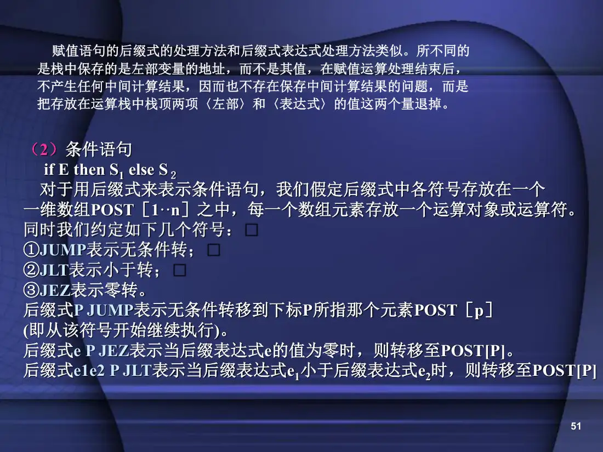

原文：

赋值语句的后缀式的处理方法和后缀式表达式处理方法类似。所不同的是栈中保存的是左部变量的地址，而不是其值，在赋值运算处理结束后，不产生任何中间计算结果，因而也不存在保存中间计算结果的问题，而是把存放在运算栈中栈顶两项〈左部〉和〈表达式〉的值这两个量退掉。

(2) 条件语句

if E then $S_{1}$ else $S_{2}$

对于用后缀式来表示条件语句，我们假定后缀式中各符号存放在一个一维数组POST [1…n] 之中，每一个数组元素存放一个运算对象或运算符。同时我们约定如下几个符号：□

①JUMP表示无条件转；□

②JLT表示小于转；□

③JEZ表示零转。

后缀式P JUMP表示无条件转移到下标P所指那个元素POST [p] (即从该符号开始继续执行)。

后缀式e P JEZ表示当后缀表达式e的值为零时，则转移至POST[P]。

后缀式e1e2 P JLT表示当后缀表达式 $e_{1}$ 小于后缀表达式 $e_{2}$ 时，则转移至POST[P]

51

### 于是，对于形如

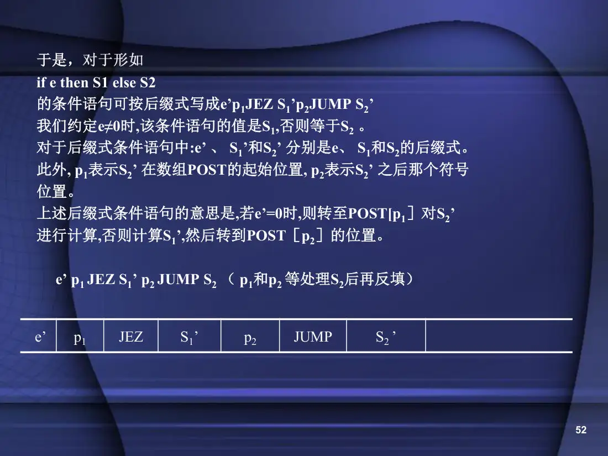

原文：

于是，对于形如

if e then S1 else S2

的条件语句可按后缀式写成e'p₁JEZ S₁'p₂JUMP S₂'
我们约定e≠0时,该条件语句的值是S₁,否则等于S₂。
对于后缀式条件语句中:e'、S₁'和S₂'分别是e、S₁和S₂的后缀式。此外,p₁表示S₂'在数组POST的起始位置,p₂表示S₂'之后那个符号位置。

上述后缀式条件语句的意思是,若e'=0时,则转至POST[p₁] 对S₂'进行计算,否则计算S₁',然后转到POST [p₂] 的位置。

e' p₁ JEZ S₁' p₂ JUMP S₂ （p₁和p₂等处理S₂后再反填）

$$
\mathrm{e} ^ {\prime}
$$

$$
\mathrm{p} _ {1}
$$

JEZ

$$
\mathrm{S} _ {1},
$$

$$
\mathrm{p} _ {2}
$$

JUMP

$$
\mathrm{S} _ {2},
$$

52

### if (a<b) then a=b else b=a

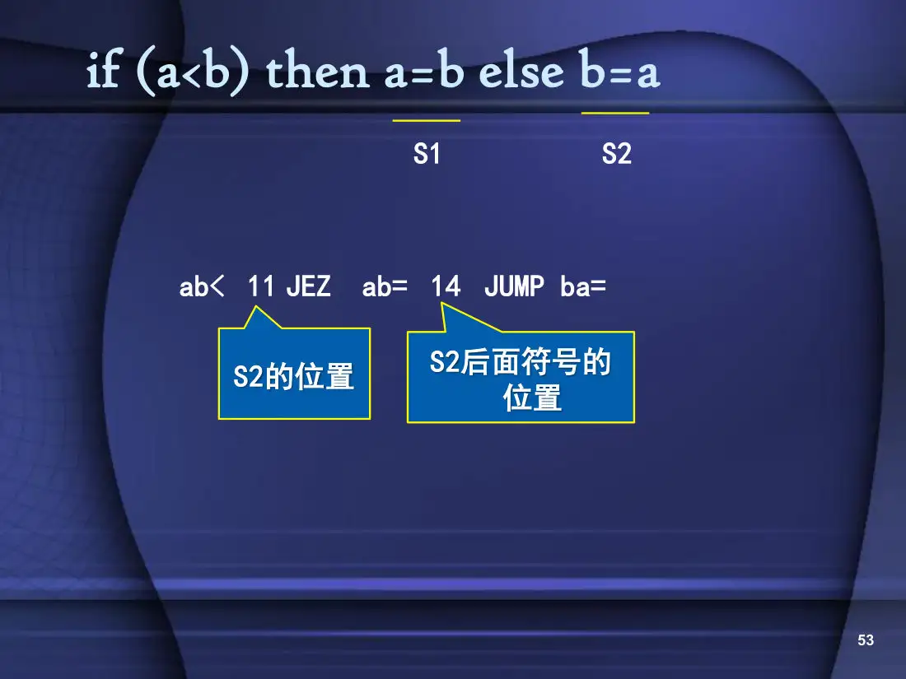

原文：

if (a<b) then a=b else b=a

S1

S2

ab< 11 JEZ ab= 14 JUMP ba=

S2的位置

S2后面符号的位置

53

### 第五章 语法制导翻译及中间代码生成

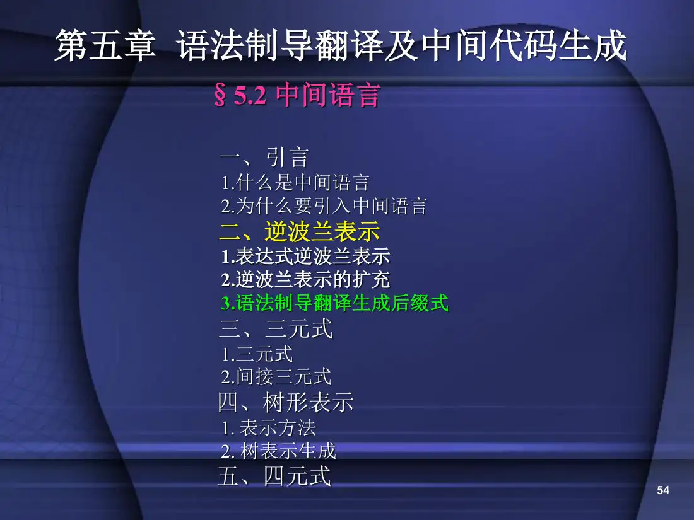

原文：

第五章 语法制导翻译及中间代码生成

§ 5.2 中间语言

一、引言

1. 什么是中间语言

2.为什么要引入中间语言

二、逆波兰表示

1. 表达式逆波兰表示

2. 逆波兰表示的扩充

3. 语法制导翻译生成后缀式

三、三元式

1.三元式

2.间接三元式

四、树形表示

1. 表示方法

2. 树表示生成

五、四元式

54

### § 5.2 中间语言 二、逆波兰表示

原文：

§ 5.2 中间语言 二、逆波兰表示

3. 语法制导翻译生成后缀式

下面我们讨论语法制导翻译生成后缀式的过程。我们以例4.15文法G [E] 为例，说明如何按语法制导翻译方法把一个中缀形式的简单算术表达式翻译成为后缀式。

55

### 后缀式的语义动作

原文：

后缀式的语义动作

规则

语义动作

(1) $\mathbf{E}:\mathbf{:}:=\mathbf{E}^{(1)}+\mathbf{T}$

{E·CODE:=E $^{(1)}$ .CODE||T.CODE||+}

(2) E::=T

{E·CODE:=T·CODE}

(3) $\mathrm{T}::= \mathrm{T}^{(1)} * \mathrm{F}$

{T·CODE:=T $^{(1)}$ CODE|F·CODE|\*}

(4) $\mathrm{T}::= \mathrm{F}$

{T·CODE:=F·CODE}

(5) F::=(E)

{F·CODE:=E·CODE}

(6) F::=i

{F·CODE:=i}

几点说明:

E.CODE,T.CODE,F.CODE表示构成后缀式的符号串

符号 “|”表示两个串的 “捻接” 运算，即并置运算。显然，

E $^{(1)}$ .CODE||T.CODE||+ 是E.CODE,因为符号在后,其它类似.

下面将上述语义动作具体化成语义子程序:

56

### 自底向上分析要归约时先调用相应子程序生成后缀式

原文：

自底向上分析要归约时先调用相应子程序生成后缀式

假定后缀式存放在数组POST中

假设要归约的句柄为

$\mathrm{E}^{(1)} + \mathrm{T}$ (在语法分析栈中), 则首先要求调用相应于 $\mathrm{E}^{(1)} + \mathrm{T}$ 的语义子程序, 此时 $\mathrm{E}^{(1)}$ 和 $\mathrm{T}$ 已调用过相应的语义子程序, 因此, 它们的后缀式已被生成, 对应于 $\mathrm{E}^{(1)} + \mathrm{T}$ 的语义子程序所要完成的工作是把已生成的两后缀式捻接起来, 然后再添上符号 “+”。

如果我们设置一个数组存放后缀式，那么语义动作就可以不涉及捻接运算。令这个数组为POST，p为下标，初值为1。

POST(P)

57

### 对于上述文法G [E] 的语义动作，可以改写为如下相应的语义子程序：

原文：

对于上述文法G [E] 的语义动作，可以改写为如下相应的语义子程序：

(1) E::=E $^{(1)}$ +T {POST[p]:=‘+’;p:=p+1}

(2) E::=T {}

(3) T::=T $^{(1)}$ \*F {POST[p]:=‘\*’;p:=p+1}

(4) T::=F {}

(5) F::=(E) {}

(6) F::=i {POST[p]:=i;p:=p+1} 表示读入操作数最后，我们以表达式a+b\*c为例按照P118.表4.15文法G [E] LR分析表给出语法制导翻译产生后缀式过程，其中SUBK表示第K个规则相对应的语义子程序。分析过程如下表：

58

### 59

原文：

<table><tr><td>步骤</td><td>状态栈</td><td>符号栈</td><td>输入串</td><td>归约规则</td><td>调用子程序</td><td>后缀式</td></tr><tr><td>1</td><td>0</td><td>#</td><td>a+b*c#</td><td></td><td></td><td></td></tr><tr><td>2</td><td>05</td><td>#a</td><td>+b*c#</td><td>F::=i</td><td>SUB6</td><td>a</td></tr><tr><td>3</td><td>03</td><td>#F</td><td>+b*c#</td><td>T::=F</td><td>SUB4</td><td>a</td></tr><tr><td>4</td><td>02</td><td>#T</td><td>+b*c#</td><td>E(1)::=T</td><td>SUB2</td><td>a</td></tr><tr><td>5</td><td>01</td><td>#E(1)</td><td>+b*c#</td><td></td><td></td><td>a</td></tr><tr><td>6</td><td>016</td><td>#E(1)+</td><td>b*c#</td><td></td><td></td><td>a</td></tr><tr><td>7</td><td>0165</td><td>#E(1)+b</td><td>*c#</td><td>F::=i</td><td>SUB6</td><td>ab</td></tr><tr><td>8</td><td>0163</td><td>#E(1)+F</td><td>*c#</td><td>T(1)::=F</td><td>SUB4</td><td>ab</td></tr><tr><td>9</td><td>0169</td><td>#E(1)+T(1)</td><td>*c#</td><td></td><td></td><td>ab</td></tr><tr><td>10</td><td>01697</td><td>#E(1)+T(1)*</td><td>c#</td><td></td><td></td><td>ab</td></tr><tr><td>11</td><td>016975</td><td>#E(1)+T*c</td><td>#</td><td>F::=i</td><td>SUB6</td><td>abc</td></tr><tr><td>12</td><td>016970-</td><td>#E(1)+T(1)*F</td><td>#</td><td>T::=T(1)*F</td><td>SUB3</td><td>abc*</td></tr><tr><td>13</td><td>0169</td><td>#E(1)+T</td><td>#</td><td>E::=E(1)+T</td><td>SUB1</td><td>abc*+</td></tr><tr><td>14</td><td>01</td><td>#E</td><td>#</td><td></td><td></td><td>abc*+</td></tr></table>

59

### 第五章 语法制导翻译及中间代码生成

原文：

第五章 语法制导翻译及中间代码生成

§ 5.2 中间语言

一、引言

1. 什么是中间语言

2.为什么要引入中间语言

二、逆波兰表示

1. 表达式逆波兰表示

2. 逆波兰表示的扩充

3.语法制导翻译生成后缀式

三、三元式

1.三元式

2.间接三元式

四、树形表示

1. 表示方法

2. 树表示生成

五、四元式

60

### 第五章 语法制导翻译及中间代码生成

原文：

第五章 语法制导翻译及中间代码生成

§ 5.2 中间语言

一、引言

1. 什么是中间语言

2.为什么要引入中间语言

二、逆波兰表示

1. 表达式逆波兰表示

2. 逆波兰表示的扩充

3.语法制导翻译生成后缀式

三、三元式

1. 三元式

2.间接三元式

四、树形表示

1. 表示方法

2. 树表示生成

五、四元式

61

### § 5.2 中间语言 三、三元式表示

原文：

§ 5.2 中间语言 三、三元式表示

1. 三元式

(1) 定义三元式的一般形式为

(i) (OP, ARG1, ARG2)

其中：(i)为三元式的编号，不同三元式不能有相同的编号

OP是运算符部分

ARG1和ARG2是运算对象部分，它们或者指向符号表登记项指示器(对于运算对象是常数或标识符的情况)，或者是一个指向三元式序列(或三元式表)中某一个三元式位置的指示器(对于运算对象是中间结果的情况)。

如: $\mathrm{A} + \mathrm{B}^{*} \mathrm{C}$ 对应的三元式表示为:

(1) (\*, B, C)

(2) (+, A, (1))

62

### 用三元式来表示，则可写成

原文：

注：运算符OP通常用一个整数码表示，它除了标识运算符的种属之外，还附带地表示其它一些语义特性。例如若OP表示一个加法运算符，则相应的整数码除了标识加法运算本身外，还兼有表示数据类型(如整型、实型等)、运算方式(定点、浮点)和运算精度等信息，且不同语义属性使用不同的运算符代码。

用三元式来表示，则可写成

$$
\mathrm{x} := - \mathrm{b} ^ {*} (\mathrm{c} + \mathrm{d})
$$

(1) (⊖,b,)

(2) (+, c, d)

(3)(\*, (1), (2))

(4)(:=,x,(3))

三元式出现先后顺序和表达式各部分计算顺序相一致！

其中，三元式(3)就引用三元式(1)和(2)的结果作为它的两个运算对象(2) 三元式的生成
同样可以用语法制导翻译来产生三元式:
下面给出文法G [E] 的语义动作来描述这种翻译的算法:
(1)E::=E $^{(1)}$ +T {E·VAL:=TRIP(+,E $^{(1)}$ ·VAL,T·VAL)}
(2)E::=T {E·VAL:=T·VAL}
(3)T::=T $^{(1)}$ \*F {T·VAL:=TRIP(\*,T $^{(1)}$ ·VAL,F·VAL)}
(4)T::=F {T·VAL:=F·VAL}
(5)F::=(E) {F·VAL:=E·VAL}
(6)F::=i {F·VAL:=ENTRY(i)}

63

### 64

原文：

其中语义值E·VAL、T·VAL和F·VAL，是一个指示器，或指向有关符号表某一项，或指向三元式表自身某一项，TRIP(OP, ARG1, ARG2)是一个语义子程序，回送新产生的三元式存放在三元式表位置。ENTRY(i)是一个语义子程序，通过ENTRY查i在符号表中位置，即对应地址，若查不到，认为有错误。

64

### 第五章 语法制导翻译及中间代码生成

原文：

第五章 语法制导翻译及中间代码生成

§ 5.2 中间语言

一、引言

1. 什么是中间语言

2.为什么要引入中间语言

二、逆波兰表示

1. 表达式逆波兰表示

2. 逆波兰表示的扩充

3.语法制导翻译生成后缀式

三、三元式

1.三元式

2. 间接三元式

四、树形表示

1. 表示方法

2. 树表示生成

五、四元式

65

### § 5.2 中间语言 三、三元式表示

原文：

§ 5.2 中间语言 三、三元式表示

2. 间接三元式

为了便于代码优化，常常采用间接三元式。这由两张表组成：

(1) 三元式表, 用来存放各三元式本身;

(2) 执行表(间接码表), 它按执行三元式顺序, 依次列出相应各三元式在三元式表中位置。

例如，对于如下赋值语句□

x:=a\*b+c+a\*b

若按三元式表示，可写成□

(1) $(^{*},a,b)$ □

(2) $(+, (1), c)$ □

(3) (\*,a,b) □

(4) $(+,(2),(3))$ □

(5) (:=,x,(4))

其中，三元式(1)和(3)完全一样，

但是不能将(3)省去。

按间接三元式表示，则可写成

执行表 三元式表

(1)

(1) $(^{*},a,b)$

(2)

(2) $(+,(1),c)$

(1)

(3) $(+,(2),(1))$

(3)

(4) (:=,x,(3))

(4)

66

### 间接三元式的优点:

原文：

间接三元式的优点:

(1) 便于代码优化

在进行代码优化时，常常要从中间代码删去一些运算，或者把某些运算移到另外位置上，若采用一般三元式，则由于三元式之间引用太多，很难做到这一点。

(2) 节省空间

由于在间接三元式执行表中已经依次列出每次要执行的那个三元式，所以，若有若干个相同三元式，则仅须在三元式表中保存其中之一。如上面赋值语句右部表达式中有两个a\*b子表达式，而三元式表中只出现一次(\*, a, b)。

对于间接三元式表示，语义子程序应增添产生执行表的动作。在填写三元式表时，应首先看一下此三元式是否在其中，如已在其中，则无需填入。

67

### 第五章 语法制导翻译及中间代码生成

原文：

第五章 语法制导翻译及中间代码生成

§ 5.2 中间语言

一、引言

1. 什么是中间语言

2.为什么要引入中间语言

二、逆波兰表示

1. 表达式逆波兰表示

2. 逆波兰表示的扩充

3.语法制导翻译生成后缀式

三、三元式

1.三元式

2.间接三元式

四、树形表示

1. 表示方法

2. 树表示生成

五、四元式

68

### 第五章 语法制导翻译及中间代码生成

原文：

第五章 语法制导翻译及中间代码生成

§ 5.2 中间语言

一、引言

1. 什么是中间语言

2.为什么要引入中间语言

二、逆波兰表示

1. 表达式逆波兰表示

2. 逆波兰表示的扩充

3. 语法制导翻译生成后缀式

三、三元式

1. 三元式

2.间接三元式

四、树形表示

1. 表示方法

2. 树表示生成

五、四元式

69

### § 5.2 中间语言 四、树形表示

原文：

§ 5.2 中间语言 四、树形表示

1. 表示方法

我们可以用树形数据结构来表示一个表达式或语句。在树表示中，叶子结点表示运算对象，即常量或变量，其它结点表示运算符，如表达式

a+b, a-b, -a

的树表示分别定义为:

70

### 后序遍历上述二叉树便得到该表达式的逆波兰表示为 ab\*cd+ef-/-

原文：

双目运算对应二叉树，多目运算对应多叉树，单目运算对应单叉树。如表达式 $a * b - (c + d) / (e - f)$ 的二叉树如下图：

后序遍历上述二叉树便得到该表达式的逆波兰表示为 ab\*cd+ef-/-

71

### 表达式的三元式可以看作是树的直接表示，图5.7所对应的三元式为

原文：

表达式的三元式可以看作是树的直接表示，图5.7所对应的三元式为
(1) (\*,a,b)
(2) (+,c,d)
(3) (-,e,f)
(4) (/,(2),(3))
(5) (-,(1),(4))
显然，每一个三元式对应一棵子树，子树的根便是三元式的运算符，三元式的运算对象是子树两个分枝。

72

### 第五章 语法制导翻译及中间代码生成

原文：

第五章 语法制导翻译及中间代码生成

§ 5.2 中间语言

一、引言

1. 什么是中间语言

2.为什么要引入中间语言

二、逆波兰表示

1. 表达式逆波兰表示

2. 逆波兰表示的扩充

3.语法制导翻译生成后缀式

三、三元式

1. 三元式

2.间接三元式

四、树形表示

1. 表示方法

2. 树表示生成

五、四元式

73

### § 5.2 中间语言 四、树形表示

原文：

§ 5.2 中间语言 四、树形表示

2. 树表示生成

对文法G[E]翻译成树形表示语义动作描述如下:

(1) $\mathrm{E}::= \mathrm{E}^{(1)} + \mathrm{T}$

$\{E\cdot VAL:=NODE(+,E^{(1)}\cdot VAL,T\cdot VAL)\}$

(2)E::=T

{E·VAL:=T·VAL}

(3)T::=T $^{(1)*}$ F

{T·VAL:=NODE(\*,T(1)·VAL,F·VAL)}

(4)T:::=F

{T·VAL:=F·VAL}

(5)F::=(E)

$\{F \cdot VAL := E \cdot VAL\}$

(6)F::=i

{F·VAL:=LEAF(i)}

其中：语义值E·VAL、T·VAL和F·VAL是一个指示器，指向树一个结点。

NODE (OP, LEFT, RIGHT)是一个函数子程序，

OP是一个二元运算符，LEFT，RIGHT为指示器，每调用此函数一次,就建立一个新结点，其标记为OP，

LEFT和RIGHT分别指向左右子树根结点指针，从NODE回送

的值是一个指示器，指向这棵新树的根。

LEAF(i)是建立一个末端结点(叶结点)

74

### 第五章 语法制导翻译及中间代码生成

原文：

第五章 语法制导翻译及中间代码生成

§ 5.2 中间语言

一、引言

1. 什么是中间语言

2.为什么要引入中间语言

二、逆波兰表示

1. 表达式逆波兰表示

2. 逆波兰表示的扩充

3.语法制导翻译生成后缀式

三、三元式

1.三元式

2.间接三元式

四、树形表示

1. 表示方法

2. 树表示生成

五、四元式

75

### 第五章 语法制导翻译及中间代码生成

原文：

第五章 语法制导翻译及中间代码生成

§ 5.2 中间语言

一、引言

1. 什么是中间语言

2.为什么要引入中间语言

二、逆波兰表示

1. 表达式逆波兰表示

2. 逆波兰表示的扩充

3. 语法制导翻译生成后缀式

三、三元式

1.三元式

2.间接三元式

四、树形表示

1. 表示方法

2. 树表示生成

五、四元式

76

### § 5.2 中间语言 五、四元式表示

原文：

§ 5.2 中间语言 五、四元式表示

四元式是一种用得比较多的一种中间语言代码形式，四元式一般形式是

(OP, ARG1, ARG2, RESULT)

其中：OP是运算符，其含义与三元式中OP类似；

ARG1和ARG2是运算对象，

RESULT是运算结果

例如：赋值语句 a:=-b\*(c+d)
用四元式表示，则可写成

(1) $(\textcircled{-},\text{b},,\text{T}_{1})$

(2) $(+,c,d,T_{2})$

(3) $(^{*},\mathrm{T}_{1},\mathrm{T}_{2},\mathrm{T}_{3})$

(4) $(:= ,\mathrm{T}_{3},,a)$

四元式之间联系是通过临时变量实现的，调整四元式之间相对位置并不意味着一定要改变一系列指示器值。因此，对中间代码进行优化处理时，四元式比三元式方便得多。

下面主要讨论如何用四元式表示各种语句，并产生四元式语义子程序。

77

### 本节内容

原文：

本节内容

§ 5.3 自底向上语法制导翻译

一、简单算术表达式和赋值语句的翻译

二、布尔表达式的翻译

三、控制语句翻译

四、数组元素的翻译

五、过程语句的翻译

六、说明语句的翻译

§ 5.4 自顶向下语法制导翻译

一、递归下降的语法制导翻译

二、LL(1)语法制导翻译

§ 5.5 属性文法与属性翻译

一、属性文法与L属性文法

二、属性翻译

第五章 语法制导翻译及中间代码生成

78

### 第五章 语法制导翻译及中间代码生成 § 5.3 自底向上语法制导翻译

原文：

第五章 语法制导翻译及中间代码生成 § 5.3 自底向上语法制导翻译

一、简单算术表达式和赋值语句的翻译

1. 翻译成四元式

2. 类型检查与类型转换

二、布尔表达式的翻译

1. 概述

2.布尔表达式的翻译方法

3. 翻译成四元式的实现

三、控制语句翻译

1. 语句标号和goto语句的翻译

2. 条件语句的翻译

3.布尔表达式的翻译方法

4. while 循环语句翻译

5. for循环语句的翻译

四、数组元素的翻译

1. 下标变量地址的计算

2. 数组元素的翻译

五、过程语句的翻译

1. 参数传递方式

2. 过程语句的翻译

六、说明语句的翻译

1. 变量说明的翻译

2. 数组说明的翻译

3. 过程说明的翻译

79

### 第五章 语法制导翻译及中间代码生成 § 5.3 自底向上语法制导翻译

原文：

第五章 语法制导翻译及中间代码生成 § 5.3 自底向上语法制导翻译

一、简单算术表达式和赋值语句的翻译

1. 翻译成四元式

2. 类型检查与类型转换

二、布尔表达式的翻译

1. 概述

2.布尔表达式的翻译方法

3. 翻译成四元式的实现

三、控制语句翻译

1. 语句标号和goto语句的翻译

2. 条件语句的翻译

3.布尔表达式的翻译方法

4. while 循环语句翻译

5. for循环语句的翻译

四、数组元素的翻译

1. 下标变量地址的计算

2. 数组元素的翻译

五、过程语句的翻译

1. 参数传递方式

2. 过程语句的翻译

六、说明语句的翻译

1. 变量说明的翻译

2. 数组说明的翻译

3. 过程说明的翻译

80

### 第五章 语法制导翻译及中间代码生成 § 5.3 自底向上语法制导翻译

原文：

第五章 语法制导翻译及中间代码生成 § 5.3 自底向上语法制导翻译

一、简单算术表达式和赋值语句的翻译

1. 翻译成四元式

2. 类型检查与类型转换

二、布尔表达式的翻译

1. 概述

2.布尔表达式的翻译方法

3. 翻译成四元式的实现

三、控制语句翻译

1. 语句标号和goto语句的翻译

2. 条件语句的翻译

3.布尔表达式的翻译方法

4. while 循环语句翻译

5. for循环语句的翻译

四、数组元素的翻译

1. 下标变量地址的计算

2. 数组元素的翻译

五、过程语句的翻译

1. 参数传递方式

2. 过程语句的翻译

六、说明语句的翻译

1. 变量说明的翻译

2. 数组说明的翻译

3. 过程说明的翻译

81

### § 5.3 自底向上语法制导翻译

原文：

§ 5.3 自底向上语法制导翻译

一、简单算术表达式和赋值语句的翻译

1. 翻译成四元式

我们首先讨论仅含有简单变量的表达式和赋值语句到四元式的翻译，对于复杂的表达式和赋值语句的翻译将在以后讨论。

为简便起见，假定赋值语句中所含的全部变量是同一类型整型变量，此外在翻译过程中也不作语义检查。

(1) 赋值语句的文法

1) A::=V:=E 5)T::=F

2) E::=E $^{(1)}$ +T 6) F::=(E)

3) E::=T 7) F::=i

4) $\mathrm{T}::= \mathrm{T}^{(1)} * \mathrm{F}$ 8) $\mathrm{V}::= \mathrm{i}$

为了实现到四元式的翻译，需要引进一系列语义变量和语义子程序。

82

### (2)语义变量和语义子程序

原文：

(2)语义变量和语义子程序

① NEWTEMP是一个函数，每次调用时，都定义一个新临时变量，回送一个代表新临时变量名的整数码作为函数值。为直观起见，我们将NEWTEMP产生的临时变量依次记为 $T_{1}$ ， $T_{2}$ …等等。

② ENTRY(i)是一个函数过程，查找符号名i在表中的入口地址。

③ X·PLACE是和非终结符X相联系的语义变量，表示存放X值的变量名在符号表的入口或整数码(若此变量是一个临时变量)。

如：F::=i {F·PLACE:=ENTRY(i)} 表示存放F值的变量名i在符号表中的入口地址。即从变量F.PLACE值可知i在符号表中的位置。

④ GEN (OP, ARG1, ARG2, RESULT)是一个语义过程，该过程把四元式(OP, ARG1, ARG2, RESULT)填入四元式表中。

因此，上面定义文法G[A]语义子程序的描述如下：

83

### (3)语义子程序的描述

原文：

(3)语义子程序的描述

(1) A::=V:=E {GEN(:=,E·PLACE, ,V·PLACE)}

(2) $E::=E^{(1)}+T$   \( \{E\cdot PLACE:=NEWTEMP;\]

GEN(+,E $^{(1)}$ ·PLACE,T·PLACE,E·PLACE)}

(3) E::=T {E·PLACE:=T·PLACE}

(4) $\mathrm{T}::= \mathrm{T}^{(1)} * \mathrm{F}$ {T·PLACE:=NEWTEMP;}

GEN(\*,T(1)·PLACE,F·PLACE,T·PLACE)}

(5) T::=F {T·PLACE:=F·PLACE}

(6) F::=(E) {F·PLACE:=E·PLACE}

(7) F::=i {F·PLACE:=ENTRY(i)}

(8) V::=i {V·PLACE:=ENTRY(i)}

在进行自底向上语法制导翻译时，还需一张LR分析表，上述文法G [A] 是一个SLR(1)文法，其分析表如下：

84

### (4) 文法G[A]SLR(1)分析表

原文：

(4) 文法G[A]SLR(1)分析表

<table><tr><td rowspan="2">状态</td><td colspan="7">ACTION</td><td colspan="5">GOTO</td></tr><tr><td>i</td><td>+</td><td>*</td><td>(</td><td>)</td><td>:=</td><td>#</td><td>A</td><td>V</td><td>E</td><td>T</td><td>F</td></tr><tr><td>0</td><td> $S_{2}$ </td><td></td><td></td><td></td><td></td><td></td><td></td><td>1</td><td>3</td><td></td><td></td><td></td></tr><tr><td>1</td><td></td><td></td><td></td><td></td><td></td><td></td><td>acc</td><td></td><td></td><td></td><td></td><td></td></tr><tr><td>2</td><td></td><td></td><td></td><td></td><td></td><td>r8</td><td></td><td></td><td></td><td></td><td></td><td></td></tr><tr><td>3</td><td></td><td></td><td></td><td></td><td></td><td> $S_{4}$ </td><td></td><td></td><td></td><td></td><td></td><td></td></tr><tr><td>4</td><td> $S_{9}$ </td><td></td><td></td><td> $S_{8}$ </td><td></td><td></td><td></td><td></td><td></td><td>5</td><td>6</td><td>7</td></tr><tr><td>5</td><td></td><td> $S_{10}$ </td><td></td><td></td><td></td><td></td><td>r1</td><td></td><td></td><td></td><td></td><td></td></tr><tr><td>6</td><td></td><td>r3</td><td> $S_{11}$ </td><td></td><td>r3</td><td></td><td>r3</td><td></td><td></td><td></td><td></td><td></td></tr><tr><td>7</td><td></td><td>r5</td><td>r5</td><td></td><td>r5</td><td></td><td>r5</td><td></td><td></td><td></td><td></td><td></td></tr><tr><td>8</td><td> $S_{9}$ </td><td></td><td></td><td> $S_{8}$ </td><td></td><td></td><td></td><td></td><td></td><td>12</td><td>6</td><td>7</td></tr><tr><td>9</td><td></td><td>r7</td><td>r7</td><td></td><td>r7</td><td></td><td>r7</td><td></td><td></td><td></td><td></td><td></td></tr><tr><td>10</td><td> $S_{9}$ </td><td></td><td></td><td> $S_{8}$ </td><td></td><td></td><td></td><td></td><td></td><td></td><td>13</td><td>7</td></tr><tr><td>11</td><td> $S_{9}$ </td><td></td><td></td><td> $S_{8}$ </td><td></td><td></td><td></td><td></td><td></td><td></td><td></td><td>14</td></tr><tr><td>12</td><td></td><td> $S_{10}$ </td><td></td><td></td><td> $S_{15}$ </td><td></td><td></td><td></td><td></td><td></td><td></td><td></td></tr><tr><td>13</td><td></td><td>r2</td><td> $S_{11}$ </td><td></td><td>r2</td><td></td><td>r2</td><td></td><td></td><td></td><td></td><td></td></tr><tr><td>14</td><td></td><td>r4</td><td>r4</td><td></td><td>r4</td><td></td><td>r4</td><td></td><td></td><td></td><td></td><td></td></tr><tr><td>15</td><td></td><td>r6</td><td>r6</td><td></td><td>r6</td><td></td><td>r6</td><td></td><td></td><td></td><td></td><td></td></tr></table>

05

### 86

原文：

(5) 对 $x := a + b * c$ 语法制导翻译产生四元式过程（以赋值语句 $x := a + b * c$ 为例）

<table><tr><td>步骤</td><td>状态栈</td><td>符号栈</td><td>PLACE</td><td>输入串</td><td>归约规则</td><td>调用子程序</td><td>四元式</td></tr><tr><td>1</td><td>0</td><td>#</td><td>—</td><td>X:=a+b*c#</td><td></td><td></td><td></td></tr><tr><td>2</td><td>02</td><td># x</td><td>— Vx</td><td>:=a+b*c#</td><td>V::=i</td><td>SUB8</td><td></td></tr><tr><td>3</td><td>03</td><td># V</td><td>— Vx</td><td>:=a+b*c#</td><td></td><td></td><td></td></tr><tr><td>4</td><td>034</td><td># V:=</td><td>— Vx-</td><td>a+b*c#</td><td></td><td></td><td></td></tr><tr><td>5</td><td>0349</td><td># V:=a</td><td>— Vx-Fa</td><td>+b*c#</td><td>F::=i</td><td>SUB7</td><td></td></tr><tr><td>6</td><td>0347</td><td># V:=F</td><td>— Vx-Ta</td><td>+b*c#</td><td>T::=F</td><td>SUB5</td><td></td></tr><tr><td>7</td><td>0346</td><td># V:=T</td><td>— Vx-Ea</td><td>+b*c#</td><td>E::=T</td><td>SUB3</td><td></td></tr><tr><td>8</td><td>0345</td><td># V:=E</td><td>— Vx-Ea</td><td>+b*c#</td><td></td><td></td><td></td></tr><tr><td>9</td><td>03450</td><td># V:=E+</td><td>— Vx-Ea-</td><td>b*c#</td><td></td><td></td><td></td></tr><tr><td>10</td><td>034509</td><td># V:=E+b</td><td>— Vx-Ea-Fb</td><td>*c#</td><td>F::=i</td><td>SUB7</td><td></td></tr><tr><td>11</td><td>034507</td><td># V:=E+F</td><td>— Vx-Ea-Tb</td><td>*c#</td><td>T::=F</td><td>SUB5</td><td></td></tr><tr><td>12</td><td>034503</td><td># V:=E+T</td><td>— Vx-Ea-Tb</td><td>*c#</td><td></td><td></td><td></td></tr><tr><td>13</td><td>0345031</td><td># V:=E+T*</td><td>— Vx-Ea-Tb-</td><td>c#</td><td></td><td></td><td></td></tr><tr><td>14</td><td>03450319</td><td># V:=E+T*c</td><td>— Vx-Ea-Tb-FC</td><td>#</td><td>F::=i</td><td>SUB7</td><td></td></tr><tr><td>15</td><td>03450314</td><td># V:=E+T*F</td><td>— Vx-Ea-T1</td><td>#</td><td>T::=T(1)*F</td><td>SUB4</td><td>(*,b,c,T1)</td></tr><tr><td>16</td><td>034503</td><td># V:=E+T</td><td>— Vx-T2</td><td>#</td><td>E::=E(1)+T</td><td>SUB2</td><td>(+,a,T1,T2)</td></tr><tr><td>17</td><td>0345</td><td># V:=E</td><td>— Vx-T2</td><td>#</td><td>A::=V:=E</td><td>SUB1</td><td>(:=,T2,,x)</td></tr><tr><td>18</td><td>01</td><td># A</td><td></td><td>#</td><td></td><td></td><td></td></tr></table>

86

### 分析表几点说明:

原文：

分析表几点说明:

在分析表中 $V^{x}, E^{a}, T^{b}, F^{c}$ 之类记号，表示与非终结符V,E,T,F相关联的V·PLACE,E.PLACE,T.PLACE,F.PLACE中存放着ENTRY(x), ENTRY(a), ENTRY(b), ENTRY(c)符号指针，指向符号表。

在四元式中，如（\*，b,c,T₁），\*实际上是某种整数编码，反映运算符本身及其信息特征，如类型等。

b, c实际上也是指示器，指示符号表入口； $T_{1}$ 是临时变量，实际上也是整数码.

87

### 第五章 语法制导翻译及中间代码生成 § 5.3 自底向上语法制导翻译

原文：

第五章 语法制导翻译及中间代码生成 § 5.3 自底向上语法制导翻译

一、简单算术表达式和赋值语句的翻译

1. 翻译成四元式

2. 类型检查与类型转换

二、布尔表达式的翻译

1. 概述

2.布尔表达式的翻译方法

3. 翻译成四元式的实现

三、控制语句翻译

1. 语句标号和goto语句的翻译

2. 条件语句的翻译

3.布尔表达式的翻译方法

4. while 循环语句翻译

5. for循环语句的翻译

四、数组元素的翻译

1. 下标变量地址的计算

2. 数组元素的翻译

五、过程语句的翻译

1. 参数传递方式

2. 过程语句的翻译

六、说明语句的翻译

1. 变量说明的翻译

2. 数组说明的翻译

3. 过程说明的翻译

88

### § 5.3 自底向上语法制导翻译 一、简单算术表达式和赋值语句的翻译

原文：

§ 5.3 自底向上语法制导翻译 一、简单算术表达式和赋值语句的翻译

2. 类型检查与类型转换

(1) 目的

1) 类型检查是编译程序语义检查不可缺少的一部分。

类型检查就是对访问数据的操作和被访问数据的类型进行检查检查操作的合法性和数据类型的相容性。例如，在PASCAL语言中，若算术运算符的操作数为布尔量，或者赋给实型变量值是个指针，则编译程序报告“类型不相容”的诊断信息。

2)允许类型混合，但在处理时要统一，所以必须进行类型转换。

例如，加法运算“+”允许运算对象是整型数或实型数,如果一个运算对象是实型，另一个运算对象是整型，其运算结果的类型是实型，由于实型数和整型数的内部表示不相同，因此为了使整型数能参加实型数运算，必须事先将整型数转换成实型数。

89

### (2)类型检查

原文：

(2)类型检查

类型检查可在生成中间代码时进行，也可在生成目标代码时进行，但最好是在生成中间代码时进行，因为语法和语义检查最好尽早进行，这样能尽早避免徒劳的工作。

在上面对简单算术表达式和赋值语句翻译到四元式的讨论中，我们假定各个变量是同一类型整型变量，并且规定在四元式的op代码中，本身就会有类型信息。所以，在上例各语义子程序中，我们并未考虑有关类型方面语义处理。

90

### (3) 类型转换方法

原文：

(3) 类型转换方法

为了简单起见，我们仅考虑整型和实型的情况。

① 这种混合运算中，给每个非终结符的语义值增添类型信息X.MODE X·MODE的值或为r(实型)或为int(整型)。原来X的信息除X.PLACE,还有X.MODE。

② 对表达式的每一规则的语义子程序进行修改，增加关于类型信息的语义规则。

③ 必要时应产生对运算量进行类型转换的四元式，

$$
(\mathrm{itr}, \mathrm{A},, \mathrm{T})
$$

把整型变量A转换成实型变量，结果存在T中。

此外，在书写语义子程序时，为阅读上的直观性，我们用+i,\*i等表示整型运算符，用+r,\*r等表示实型运算符。现以规则E::=E $^{(1)}$ OPE $^{(2)}$ 为例，给出语义子程序的具体描述如下：

91

### T:=NEWTEMP;

原文：

现以规则 $\mathrm{E}::= \mathrm{E}^{(1)}\mathrm{OP}\mathrm{E}^{(2)}$ 为例，给出语义子程序的具体描述如下：

T:=NEWTEMP;
IF $E^{(1)}\cdot MODE=int$ AND $E^{(2)}\cdot MODE=int$ THEN
BEGIN GEN $(op^{i},E^{(1)}\cdot PLACE,E^{(2)}\cdot PLACE,T)$ ;
E·MODE:=int

END

ELSE IF $E^{(1)}\cdot MODE=r$ AND $E^{(2)}\cdot MODE=r$ THEN BEGIN GEN ( $op^{r},E^{(1)}\cdot PLACE,E^{(2)}\cdot PLACE,T$ ); E·MODE:=r
END

ELSE IF $E^{(1)}\cdot MODE=int/*and E^{(2)}\cdot MODE=r*/THEN$ BEGIN U:=NEWTEMP;
GEN (itr, $E^{(1)}\cdot PLACE,-,U$ );
GEN ( $op^{r},U,E^{(2)}\cdot PLACE,T$ );
E·MODE:=r

END

ELSE / \* E $^{(1)}$ · MODE=r and E $^{(2)}$ · MODE=int \*/
BEGIN    U:=NEWTEMP;
GEN (itr, E $^{(2)}$ · PLACE,-,U);
GEN (op $^{r}$ ,E $^{(1)}$ · PLACE,U,T);
E·MODE:=r

END; E·PLACE:=T;

92

### 这样,对于输入串为

原文：

这样,对于输入串为
X\*2+A\*(I+1)
其中I为整型量，X、A为实型量,则产生四元式序列为
(itr,2,-,T₁)
(\*r,X,T₁,T₂)
(+i,I,1,T₃)
(itr,T₃,-,T₄)
(\*r,A,T₄,T₅)
(+r,T₂,T₅,T₆)

93

### 第五章 语法制导翻译及中间代码生成 § 5.3 自底向上语法制导翻译

原文：

第五章 语法制导翻译及中间代码生成 § 5.3 自底向上语法制导翻译

一、简单算术表达式和赋值语句的翻译

1. 翻译成四元式

2. 类型检查与类型转换

二、布尔表达式的翻译

1. 概述

2.布尔表达式的翻译方法

3. 翻译成四元式的实现

三、控制语句翻译

1. 语句标号和goto语句的翻译

2. 条件语句的翻译

3.布尔表达式的翻译方法

4. while 循环语句翻译

5. for循环语句的翻译

四、数组元素的翻译

1. 下标变量地址的计算

2. 数组元素的翻译

五、过程语句的翻译

1. 参数传递方式

2. 过程语句的翻译

六、说明语句的翻译

1. 变量说明的翻译

2. 数组说明的翻译

3. 过程说明的翻译

94

### 第五章 语法制导翻译及中间代码生成 § 5.3 自底向上语法制导翻译

原文：

第五章 语法制导翻译及中间代码生成 § 5.3 自底向上语法制导翻译

一、简单算术表达式和赋值语句的翻译

1. 翻译成四元式

2. 类型检查与类型转换

二、布尔表达式的翻译

1. 概述

2.布尔表达式的翻译方法

3. 翻译成四元式的实现

三、控制语句翻译

1. 语句标号和goto语句的翻译

2. 条件语句的翻译

3.布尔表达式的翻译方法

4. while 循环语句翻译

5. for循环语句的翻译

四、数组元素的翻译

1. 下标变量地址的计算

2. 数组元素的翻译

五、过程语句的翻译

1. 参数传递方式

2. 过程语句的翻译

六、说明语句的翻译

1. 变量说明的翻译

2. 数组说明的翻译

3. 过程说明的翻译

95

### § 5.3 自底向上语法制导翻译

原文：

§ 5.3 自底向上语法制导翻译

二、布尔表达式的翻译

1. 概述

布尔表达式由布尔运算符Λ(与)、V(或)和 $\overline{1}$ (非)等作用于布尔量或关系表达式构成,关系表达式的形式是E $_{1}$ rop E $_{2}$ ,其中rop是关系运算符(如<、<=、=、>、>=及<> )。而E $_{1}$ 和E $_{2}$ 是算术表达式。

(1)布尔表达式的用途
在程序设计语言中，布尔表达式有两个基本用途：

1）一个是求逻辑值，逻辑值的结果是真或假。

2）另一个用得最多的是在控制语句中用作条件表达式，例如，在if-then、if-then-else和while-do语句里表示控制条件。

96

### (2)布尔表达式的文法

原文：

(2)布尔表达式的文法

布尔表达式文法G [E] 如下：
E::=E∧E|EV|E|E|(E)|i|i rop i
说明：

1）布尔表达式的文法是一个二义文法例如：该文法的一个句子a∧b∨c有两棵不同的语法树与之对应，所以该文法是一个二义文法。

97

### 2）规定布尔运算符的优先顺序是：

原文：

2）规定布尔运算符的优先顺序是：

1、Λ、V。并假定Λ和V为左结合。所有关系运算符优先级相同,且高于任何布尔运算符,低于算术运算符。

3）i可认为是布尔表达式也可视为数值（1为真true,0为假false）。

4）i rop i 中rop是关系运算符，i是布尔变量或算术值

98

### (3)布尔表达式求值方法

原文：

(3)布尔表达式求值方法

1）把真和假数值化，使布尔表达式计算类似于算术表达式的计算，常用1表示真，0表示假，或者用非零整数表示真。
如： $1\vee(70\wedge0)\vee0=1\vee(1\wedge0)\vee0=1\vee0\vee0=1$

2）采取某种优化措施，有时并不需要将一个布尔表达式从头算到尾，而只须计算它的一个子表达式，便能确定整个布尔表达式真和假。例如，对于AVB，只要计算出A为真，则不管B值如何，AVB之值一定为真。又如对A∧B，只要计算出A为假，则A∧B必然为假，等等。对于三种逻辑运算，可作如下等价的解释：□AVB: if A then true else B □A∧B: if A then B else false □A: if A then false else true □用这种方式实现控制语句的布尔表达式尤其方便。对应上述两种计算方法，其布尔表达式有两种不同的翻译方法。□

99

### 第五章 语法制导翻译及中间代码生成 § 5.3 自底向上语法制导翻译

原文：

第五章 语法制导翻译及中间代码生成 § 5.3 自底向上语法制导翻译

一、简单算术表达式和赋值语句的翻译

1. 翻译成四元式

2. 类型检查与类型转换

二、布尔表达式的翻译

1. 概述

2.布尔表达式的翻译方法

3. 翻译成四元式的实现

三、控制语句翻译

1. 语句标号和goto语句的翻译

2. 条件语句的翻译

3.布尔表达式的翻译方法

4. while 循环语句翻译

5. for循环语句的翻译

四、数组元素的翻译

1. 下标变量地址的计算

2. 数组元素的翻译

五、过程语句的翻译

1. 参数传递方式

2. 过程语句的翻译

六、说明语句的翻译

1. 变量说明的翻译

2. 数组说明的翻译

3. 过程说明的翻译

100

### § 5.3 自底向上语法制导翻译 二、布尔表达式的翻译 2.布尔表达式的翻译方法

原文：

§ 5.3 自底向上语法制导翻译 二、布尔表达式的翻译 2.布尔表达式的翻译方法

(1) 如同翻译算术表达式一样, 用于求值
例如, 布尔表达式 $\lceil a \wedge (b \vee c = d)$ 将被翻译成如下四元式:
1) $(\lceil, a, -, T_1)$ 2) $(=, c, d, T_2)$ 3) $(\vee, b, T_2, T_3)$ 4) $(\wedge, T_1, T_3, T_4)$ □

101

### (5) E::=i {E·PLACE:=ENTRY (i)}

原文：

仿照翻译算术表达式的方法，很容易写出布尔表达式文法G [E] 的每个规则用于求值的语义动作。

(1) $E: := E^{(1)} \wedge E^{(2)}$ $\{E \cdot PLACE := NEWTEMP;$ $GEN(\wedge, E^{(1)} \cdot PLACE, E^{(2)} \circ PLACE, E \cdot PLACE)\}$

(2) $\mathrm{E}::= \mathrm{E}^{(1)}\lor \mathrm{E}^{(2)}$ {E·PLACE:=NEWTEMP; GEN(v,E $^{(1)}$ ·PLACE, E $^{(2)}$ ·PLACE ,E·PLACE)}

(3) $\mathbf{E}::= \lceil \mathbf{E}^{(1)} & \{\mathbf{E} \cdot \text{PLACE} := \text{NEWTEMP}; \\ \text{GEN} (\lceil, \mathbf{E}^{(1)} \cdot \text{PLACE}, ,\mathbf{E} \cdot \text{PLACE})\}$

(4) E::=(E $^{(1)}$ ) {E·PLACE:=NEWTEMP; E·PLACE:=E $^{(1)}$ ·PLACE}

(5) E::=i {E·PLACE:=ENTRY (i)}

(6) E::=i rop i {GEN(rop,ENTRY(i $^{(1)}$ ),ENTRY(i $^{(2)}$ ),E.PLACE)}(2)作为条件控制的布尔表达式的翻译
1)布尔表达式E作为条件控制的代码结构
对于条件语句
if E then S₁ else S₂

102

### E的代码

原文：

中布尔表达式E，它的作用就是控制 $S_{1}$ 和 $S_{2}$ 的选择，我们赋予E代码两种出口，其一为“真出口”，另一个是“假出口”，它们分别指出当E值为true和false时，控制转向的目标(即某一四元式所在位置或序号)。条件语句可翻译成如下图：

E的代码

true

$\mathbf{S}_1$ 的代码

false

$\mathrm{S}_2$ 的代码

103

### 2)三种形式的四元式

原文：

2)三种形式的四元式

作为条件控制的布尔表达式E的翻译归纳起来只有三种形式的四元式

(jnz, a₁, ,p) 若a₁为真时,则转向第p个四元式。

(jrop, $a_{1}$ , $a_{2}$ , p) 若关系 $a_{1}$ rop $a_{2}$ 成立时,转向第p个四元式。

(j, , , p) 无条件转向第p个四元式。

除上述两种真转外，可用无条件表示假转例如,对于条件语句
if aVb < c then S1 else S2
经翻译后，可得如下四元式序列：

104

### (1) (jnz,a,,5)

原文：

(1) (jnz,a,,5)

(2) (j, ,, 3)

(3) (j<,b,c,5)

(4) (j, , ,p+1)

(5) (关于S1的四元式序列)

(P) (j, , , q)

(p+1) (关于S2的四元式序列)

(q)

(1) a为真，aVb<c就为真，转5执行 (2) a为假, aVb<c的值取决于b<c的值,所以转3执行

(3) a为假, 且b<c, 则aVb<c为真, 转5执行

(4) a为假, 且b<c也是假, 则aVb<c为假,执行S2语句, 即应转p+1执行

(p) 执行完S1（对应四元式为（5））则应转到条件语句的下一条语句执行，所以无条件跳转到（q）执行。
四元式(1)～(4)中显然含有多余的四元式，如(2)显然是不需要。

105

### 第五章 语法制导翻译及中间代码生成 § 5.3 自底向上语法制导翻译

原文：

第五章 语法制导翻译及中间代码生成 § 5.3 自底向上语法制导翻译

一、简单算术表达式和赋值语句的翻译

1. 翻译成四元式

2. 类型检查与类型转换

二、布尔表达式的翻译

1. 概述

2.布尔表达式的翻译方法

3. 翻译成四元式的实现

三、控制语句翻译

1. 语句标号和goto语句的翻译

2. 条件语句的翻译

3.布尔表达式的翻译方法

4. while 循环语句翻译

5. for循环语句的翻译

四、数组元素的翻译

1. 下标变量地址的计算

2. 数组元素的翻译

五、过程语句的翻译

1. 参数传递方式

2. 过程语句的翻译

六、说明语句的翻译

1. 变量说明的翻译

2. 数组说明的翻译

3. 过程说明的翻译

106

### § 5.3 自底向上语法制导翻译 二、布尔表达式的翻译

原文：

§ 5.3 自底向上语法制导翻译 二、布尔表达式的翻译

3. 翻译成四元式的实现

(1) 回填

在自底向上的语法制导翻译过程中，在产生一个条件或无条件转移四元式时，它所要转移到的那个四元式尚未产生，故无法立即产生一个完全控制转移四元式。例如，对于上例，在产生第一个四元式时，因为语句S1的中间代码尚未产生，故此时只得产生一个空缺转移目标的四元式(jnz,a,,0)，且将此四元式的序号作为语义信息存起来，待开始翻译语句S1时，再将S1的第一个四元式序号(即5)填入这个不完全条件转移四元式中。我们把这种事后再填转移目标叫做回填。

107

### § 5.3 自底向上语法制导翻译 二、布尔表达式的翻译 3. 翻译成四元式的实现

原文：

§ 5.3 自底向上语法制导翻译 二、布尔表达式的翻译 3. 翻译成四元式的实现

(2) 真链T和假链F

在翻译过程中，有时会存在着若干个转移四元式，如例中的1和3两个四元式，它们有同一个转移目标5，但此目标的具体位置在形成四元式时还不知道，此时，我们将这些四元式链接起来，并且用一个指示器指示这条链的链头，以后，便可以从链头开始，沿着这条链逐个为其中各四元式填入转移目标。

(1) (jnz,a,,5) □

(2) (j, , ,3) □

(3) (j<,b,c,5) □

(4) (j, , ,p+1) □

(5) (关于S1的四元式序列) □

(P) (j, , , q) □

(p+1) (关于S2的四元式序列) □

(q) □

108

### 在实际操作时，

原文：

在实际操作时，

1）将要填真出口的各四元式链接起来，组成一个链称真链T，记为TC
2）将要填假出口的各四元式链接起来，组成一个链称假链F，记为FC
首先定义两个语义变量E.TC和E.FC分别指示T链和F链的链头。
如下图：

(1)

(2)

(jnz, a, , 0)

E·TC → (3)

E·FC → (4)

$$
(j \quad , \quad , \quad , 3)
$$

(j<, b, c, 1)

(j , , , 0)

(5)

链中各个四元式RESULT字段为相应结点指针字段，当其不为零时，它是链中后继四元式的序号如（3）中的1，否则，相应四元式是链尾结点，如（1）中的0

109

### (3)改写布尔表达式文法G[E]

原文：

(3)改写布尔表达式文法G[E]

为了使用语法制导翻译做回填工作，便于编制相应的语义子程序，我们对上面布尔表达式文法G [E] 改写为

$\mathbf{E}:\mathbf{:}:= \mathbf{E}^{\wedge}\mathbf{E}|\mathbf{E}^{\vee}\mathbf{E}| \lceil \mathbf{E}|(\mathbf{E})|\mathbf{i}|\mathbf{i}$ rop i

$\mathbf{E}^{\wedge}:::= \mathbf{E}\wedge$

$$
\mathbf {E} ^ {\vee}: := \mathbf {E V}
$$

这样，当扫描到E∧和EV并归约到E^和EV时就可以及时回填,知道真假出口，如果不是这样改写，当扫描到E∧和EV时，还不能归约，因此就不能及时回填。

110

### (4) 文法G[E]各规则语义子程序

原文：

(4) 文法G[E]各规则语义子程序

1）语义变量和语义过程

为了构造语义子程序，我们引入下面语义变量和语义过程：

① NXQ是指示器，用来指示所要产生下一个四元式的序号，NXQ的初值为1，每当执行一次GEN之后，NXQ之值增1。

如：

100 (×, ×, ×, ×)

101 (×, ×, ×, ×)

$$
1 0 2 \quad (\times , \times , \times , \times)
$$

NXQ → 103

② GEN功能同前，每被调用一次，NXQ值增加一,形成一个四元式，送入四元式表。

111

### Q:=p; ☐ WHILE Q<>0 DO ☐ BEGIN ☐

原文：

Q:=p; ☐ WHILE Q<>0 DO ☐ BEGIN ☐

q:=四元式Q的第四区段的内容; 把t填进四元式Q的第四区段;

Q:=q □
END □

将四元式链头序号P送到工作单元Q

Q<>0表示没到链尾，执行循环体。

即将下一个四元式序号保存到q中

让Q指向下一个四元式

112

### 113

原文：

执行算法BACKPATCH示意图假定要填入四元式序号t=31，四元式10，20，30形成一个链，其链头是30，链尾是10，现在执行算法BACKPATCH进行回填

113

### IF p2=0 THEN MERG:=p1 ELSE

原文：

④ MERG(p1, p2)是一个函数过程，合并，并返回合并以后的链头。过程描述: POINTER PROCEDURE MERGE(p1,p2);

IF p2=0 THEN MERG:=p1 ELSE
BEGIN p:=p2;

WHILE 四元式p第四区段的内容<->0
p:=四元式p第四区段的内容;

MERGE:=p2

p2=0意味着p2空，所以合并后p1为链头

循环目的是找到p2的链尾

将p1链头和p2后链尾链在一起，即p1和p2两个链合并

返回链头p2，p2链头是合并后链头

END

114

### 执行算法MERG示意图

原文：

执行算法MERG示意图
假定P1为四元式10，20，30一个链，其链头P1=30，P2为四元式40，50，60另一个链，其链头P2=60，现在执行算法MERG，将P1和P2两个链进行合并，使得合并后的链头就是60，即P2的链头
算法MERG示意图

115

### 2)语义子程序

原文：

2)语义子程序

下面我们给出布尔表达式修改后文法G [E] 每个规则相应语义子程序

(1)E::=i {E·TC:=NXQ;E·FC:=NXQ+1; GEN(jnz,ENTRY(i), ,0); GEN(j, , ,0)}

(2)E::=i $^{(1)}$ rop i $^{(2)}$ {E·TC:=NXQ;E·FC:=NXQ+1; GEN(jrop, ENTRY(i $^{(1)}$ ), ENTRY(i $^{(2)}$ ),0); GEN(j, , ,0)}

(3) $E::=(E^{(1)})$

$$
\{\mathbf {E} \cdot \mathbf {T C} := \mathbf {E} ^ {(1)} \cdot \mathbf {T C}; \mathbf {E} \cdot \mathbf {F C} := \mathbf {E} ^ {(1)} \cdot \mathbf {F C} \}
$$

$$
\{\mathrm{E} \cdot \mathrm{TC} := \mathrm{E} ^ {(1)} \cdot \mathrm{FC}; \mathrm{E} \cdot \mathrm{FC} := \mathrm{E} ^ {(1)} \cdot \mathrm{TC} \}
$$

(5) $E^{\wedge}:=E^{(1)}\wedge$ {BACKPATCH( $E^{(1)}\cdot TC,NXQ$ ); $E^{\wedge}\cdot FC:=E^{(1)}\cdot FC$ }

(6) $E: := E^{\wedge}E^{(2)}$ $\{E \cdot TC := E^{(2)} \cdot TC; E \cdot FC := MERG(E^{\wedge} \cdot FC, E^{(2)} \cdot FC)\}$

(7) $E^{V}::=E^{(1)}v$ {BACKPATCH( $E^{(1)}\cdot FC,NXQ$ ); $E^{V}\cdot TC:=E^{(1)}\cdot TC$ }

(8) $E::=E^{V}E^{(2)}$ $\{E\cdot FC:=E^{(2)}\cdot FC;E\cdot TC:=MERG(E^{V}\cdot TC,E^{(2)}\cdot TC)\}$ 可见，当一个布尔表达式由上述语义子程序翻译完毕以后，其真链(T链)和假链(F链)就分别由语义变量E·TC和E·FC指示。若E是IF-THEN-ELSE语句中的控制条件，则当扫描到THEN时，根据当前NXQ之值对真链进行回填。至于F链回填，则在扫视到ELSE之后进行。

116

### 例如：aVb<c的语法制导翻译过程和对应产生的四元式如下：

原文：

例如：aVb<c的语法制导翻译过程和对应产生的四元式如下：

①E $^{(1)}$ Vb<c
{E $^{(1)}$ .TC:=1;E $^{(1)}$ .FC:=2}
②E $^{V}$ b<c
{BACKPATCH(E $^{(1)}$ .FC=2,NXQ=3);
E $^{V}$ .TC:=E $^{(1)}$ .TC=1}
③ E $^{V}$ E $^{(2)}$ {E $^{(2)}$ .TC:=3;E $^{(2)}$ .FC:=4}
④E
{E.FC:=E $^{(2)}$ .FC=4;

1 (jnz, a, , 0)
□
2 (j, , , 3) 3
0

3 (j<, b, c, 0) 1 □
4 (j, , , 0)

非终结符下方加“-”者表示用某一产生式归约的结果.

117

### 所以，经语法制导翻译得到布尔表达式

原文：

所以，经语法制导翻译得到布尔表达式
aVb<c
的四元式序列为：
1 (jnz,a, ,0)
2 (j, , ,3)
3 (j<,b,c,1)
4 (j, , ,0)
真链（3，1），链头E.TC=3
假链（4），链头E.FC=4

118

### 语法制导翻译过程

原文：

例5.7根据上述文法语义子程序，给出布尔表达式aV(b∧¬(cVd))语法制导翻译过程。(见书P169)

语法制导翻译过程
<table><tr><td>av(b∧¬(cvd))</td><td></td></tr><tr><td>(1)Ev(b∧¬(cvd))</td><td>100 (jnz, a, ,0)</td></tr><tr><td>{E•TC:=100;E•FC:=101}</td><td>101 (j, , 102)</td></tr><tr><td>(2)Ev(b∧¬(cvd))</td><td>0</td></tr><tr><td>{BP(E (1) •FC=101, NXQ=102);</td><td></td></tr><tr><td>Ev•TC:=E (1) •TC=100}</td><td></td></tr><tr><td>(3)Ev(E∧¬(cvd))</td><td>102 (jnz,b,,104)</td></tr><tr><td></td><td>0</td></tr><tr><td>{E•TC:=102;E•FC:=103}</td><td>103 (j, , ,0)</td></tr><tr><td>(4)Ev(E∧¬(cvd))</td><td></td></tr><tr><td>{BP(E (1) •TC=102,NXQ=104);</td><td></td></tr><tr><td>(5)Ev(E∧¬(Evd))</td><td>104 (jnz,c, ,103)</td></tr><tr><td></td><td>0</td></tr><tr><td>{E•TC:=104;E•FC:=105}</td><td>105 (j, , , 106)</td></tr></table>

119

### 语法制导翻译过程

原文：

例5.7根据上述文法语义子程序，给出布尔表达式 $a \vee (b \wedge \neg (c \vee d))$ 语法制导翻译过程。

语法制导翻译过程

(6)Ev(E∧¬(Ev'd))
{BP(E (1) •FC:=105;NXQ=106;
Ev'•TC:=E (1) •TC=104}
(7)Ev(E∧¬(Ev'∈(2))

{E (2) • TC:=106; E (2) • FC:=107}
(8)Ev(E∧¬(E(1)))
{E (1) • FC:=E (2) • FC=107;
E (1)•TC:=MERG(Ev'•TC=104,
E (2)•TC=106)=106}
(9)Ev(E∧¬E)
{E•TC:=E (1) • TC=106;
E•FC:=E (1) • FC=107}

四元式

106 (jnz,d, , 104
107 (j , d, , 100
0)

120

### 语法制导翻译过程

原文：

例5.7根据上述文法语义子程序，给出布尔表达式aV(b∧¬(cVd))语法制导翻译过程。

语法制导翻译过程

(10)Ev(E∧E(2))
{E (2) • TC:=E (1) • FC=107;
E (2) • FC:=E (1) • TC=106}
(11)Ev(E (1))
{E(1) • TC:=E(2) • TC=107;
E(1) • FC:=MERG(E∧•FC=103,
E(2) • FC=106)=106}
(12)EvE(2)
{E(2) • TC:=E(1) • TC=107;
E(2) • FC:=E(1) • FC=106}
(13)E
{E•FC:=E(2) • FC=106;
E•TC:=MERG(Ev•TC=100,
E(2) • TC=107)=107}

四元式

121

### 非终结符下方加“-”者表示用某一产生式归约的结果。

原文：

例5.7根据上述文法语义子程序，给出布尔表达式aV(b∧¬(cVd))语法制导翻译过程。

非终结符下方加“-”者表示用某一产生式归约的结果。
BP=BACKPATCH。□
经语法制导翻译得到布尔表达式□
av(b∧¬(c∨d))□

的四元式序列为□

100 (jnz,a, ,0) 104 (jnz,c, ,103) □

101 (j, ,, 102)

105 (j, , , 106) □

102 (jnz,b, ,104) 106 (jnz,d, ,104) □

103 (j, , , 0) 107 (j, , , 100) □其中,真链为{107,100}, 链头E·TC=107,假链为{106,104,103}, 链头E·FC=106。□

122

### 第五章 语法制导翻译及中间代码生成

原文：

第五章 语法制导翻译及中间代码生成

§ 5.3 自底向上语法制导翻译

一、简单算术表达式和赋值语句的翻译

二、布尔表达式的翻译

三、控制语句翻译

四、数组元素的翻译

五、过程语句的翻译

六、说明语句的翻译

123

### 第五章 语法制导翻译及中间代码生成

原文：

第五章 语法制导翻译及中间代码生成

§ 5.3 自底向上语法制导翻译

一、简单算术表达式和赋值语句的翻译

二、布尔表达式的翻译

三、控制语句翻译

四、数组元素的翻译

五、过程语句的翻译

六、说明语句的翻译

124

### § 5.3 自底向上语法制导翻译

原文：

§ 5.3 自底向上语法制导翻译

三、控制语句的翻译

控制语句是高级程序设计语言的重要语句，一般包括无条件转语句、条件语句、当语句和循环语句等。下面，我们将对一些常用的控制语句翻译进行讨论，仍然是翻译成四元式中间代码。

125

### § 5.3 自底向上语法制导翻译

原文：

§ 5.3 自底向上语法制导翻译

三、控制语句的翻译

1. 语句标号和goto语句的翻译

(1) 翻译的基本思想

语句标号和goto语句是紧密相联系的，语句标号是用来标识程序中一个语句，分为：

定义标号（如：FORTRAN中 L: S；PASCAL中 LABEL L）

➢ 使用标号（如：GOTO L是把控制无条件转移到由标号L所标识语句）如：

126

### 1）对定义标号L的处理

原文：

1）对定义标号L的处理

①定义标号L：S的语义值就是语句S的四元式序列第一个四元式的地址(编号)也就是GOTO L转入语句的入口

如：

L : S

GOTO L

S的四元式

100 (×, ×, ×, ×)
101 (×, ×, ×, ×)
110 (×, ×, ×, ×)
(j, -, -, 100)

127

### ②将标号L 的信息记入符号表

原文：

②将标号L 的信息记入符号表

符号表的形式如下:

<table><tr><td>名字</td><td>类型</td><td>...</td><td>定义否</td><td>地址</td></tr><tr><td>⋮</td><td></td><td></td><td></td><td></td></tr><tr><td>L</td><td>标号</td><td></td><td>已</td><td>100</td></tr></table>

128

### 2）对GOTO L的处理

原文：

2）对GOTO L的处理

① 对于GOTO L 产生一个四元式(j, , , P)
P代表转向S语句第一个四元式的序号（对应符号表标号L地址栏的值）
如上例(j, -, -, 100)

② 若先定义后使用, 当出现GOTO L时, 查符号表L为已定义, 将对应的地址值 (如: 100) 取出, 并产生四元式(j, , , 100)

③ 若是先使用后定义，采用“拉链”技术，即把那些转向同一目标的转向语句的各个四元式链接起来，且把链头记录在符号表L地址栏上，如下图所示。待以后处理相应标号L的定义性出现时再进行回填。

<table><tr><td>名字</td><td>类型</td><td>...</td><td>定义否</td><td>地址</td></tr><tr><td>⋮</td><td></td><td></td><td></td><td></td></tr><tr><td>L</td><td>标号</td><td></td><td>未</td><td>r</td></tr></table>

129

### (2) 语义处理子程序的描述

原文：

(2) 语义处理子程序的描述

1）定义性标号L语义处理子程序
规则 LABEL::=L: 或 L: S当进行归约是，应做如下的语义动作：

①若L不在符号表中，则把它填入，可置类型为标号，并在“定义否”栏上登记“已”，“地址”填NXQ。

②若L在符号表中，但类型不为“标号”或“定义否”为“已”则报告出错。③若L在符号表中，则将“定义否”栏中“未”改成“已”，再从“地址”栏中取出链头(例如r)，同时把NXQ填入其中，最后回填，即执行BACKPATCH(r, NXQ)。

<table><tr><td>名字</td><td>类型</td><td>...</td><td>定义否</td><td>地址</td></tr><tr><td>⋮</td><td></td><td></td><td></td><td></td></tr><tr><td>L</td><td>标号</td><td></td><td>未</td><td>r</td></tr></table>

130

### 2）对使用性标号L语义子程序的描述规则 S::=GOTO L

原文：

2）对使用性标号L语义子程序的描述规则 S::=GOTO L

若遇到转移语句goto L时，应做如下语义动作：

①查找符号表，若L已不在符号表中，则将其类型置标号，并在“定义否”栏中填入“未”，在“地址”栏中填入NXQ，同时产生一个四元式为（j，，，0）

②若标号L已在符号表中, 同时在 “定义否” 栏中是 “已”, 此时若 “地址” 栏中值是p, 则可直接生成对应四元式为 (j, , , p)

其中P是标号L语句对应第一个四元式编号。

③若L在符号表中，在“定义否”栏中为“未”，则应把相应四元式接到未定义标号链中，同时将该四元式编号填入“地址栏”中。

在构造上述语义子程序时，我们并未考虑标号作用域问题。实际上，不论在FORTRAN语言还是PASCAL语言中，都不允许利用转向语句从外层分程序、循环体外转向它的内层，但却允许作相反方向转移。另外，PASCAL语言中，还允许在不同层次的分程序中出现同名的标号。对于以上这些情况，根据以上的原则再分别进行不同处理。□

131

### § 5.3 自底向上语法制 导翻译

原文：

§ 5.3 自底向上语法制 导翻译

三、控制语句的翻译

2. 条件语句的翻译

(1)从下向上对IF语句翻译过程
1) 条件语句形式及其代码结构
通常条件语句有下面形式
if E then S₁ else S₂

其中E是布尔表达式， $S_{1}$ 和 $S_{2}$ 分别是E的值为“真”、“假”时应执行的语句。其代码结构如下图：

E的代码

true

$\mathbf{S}_1$ 的代码

false

$\mathrm{S}_2$ 的代码

132

### 2) 条件语句翻译过程

原文：

2) 条件语句翻译过程

① 完成E布尔表达式翻译，获得一组四元式留下两个待填的语义值E.TC和E.FC，即真链头和假链头。

② 当扫描了then以后，可获得布尔表达式真出口，即可用BACKPATCH（E. TC，NXQ）过程来回填，但假出口E. FC尚不知道。

③ 当遇else表示 $S_{1}$ 语句已翻译结束，应生成一条无条件转移四元式(j, , , 0)，转移目标等处理 $S_{2}$ 语句时才可回填。

④ 当开始处理 $S_{2}$ 时，此时可获得假出口，即即可用BACKPATCH（E. FC, NXQ）来回填。

133

### 134

原文：

⑤ 对于嵌套条件语句可以有若干层嵌套，如：if $E_{1}$ then if $E_{2}$ then $S_{1}$ else $S_{2}$ else $S_{3}$

由于条件语句中S1、S2语句又可以是条件语句，因此在没有处理完第一层条件语句时又进入第二层条件语句，同样，在没有处理完第二层条件语句时又可进入第三层条件语句，……。所以，在翻译完内嵌if-then-else语句中S1之后，要立即产生一个完全无条件转移四元式常常是不可能的。即使内嵌if-then-else被翻译完之后，此转移目标也未必能确定，这是因为此时对嵌套它的外层语句情况尚不明确，而在内层语句中的控制转移，有时不但要使控制离开内层语句，而且还要跳出外层语句。因此，我们象处理布尔表达式E那样，把所有将控制转出内层语句S的各个四元式用一条链连接起来，我们用语义变量S·CHAIN来指示这条链的链头，以便在处理S的外层语句的适当时机回填相应转移目标。□

134

### (2) 条件语句文法规则

原文：

(2) 条件语句文法规则
描述条件语句的文法如下所示:
1) S::=if E then S
2)    | if E then S else S
3)    | begin L end
4)    | A
5) L::=L;S
6)    | S
其中, 非终结符号S、A及L分别代表语句、赋值语句及语句串, E则代表通常表达式。

135

### (3) 语义子程序的描述

原文：

(3) 语义子程序的描述

为了能及时地进行归约并回填有关四元式串转移目标，如同处理布尔表达式一样，我们需要对上述条件语句的文法进行改写，可改成如下的文法：

① S::=CS
② |TS
③ |begin L end
④ |A
⑤ L::=L^S S
⑥ |S
⑦ C::=if E then
⑧ T::=CS else
⑨ L^S::=L;

136

### 2) 文法各个规则相应的语义子程序

原文：

2) 文法各个规则相应的语义子程序
为了记录与有关文法符号相关的四元式或四元式的位置，除前面提到的语义变量S·CHAIN外，还需引入语义变量T·CHAIN、L·CHAIN和

① S::= CS $^{(1)}$

② S::=TS $^{(2)}$

③ S::=begin L end

④ S::=A

⑤ L::=L $^{SS(1)}$

⑥ L::=S

⑦ C::=if E then

⑧ T::=CS $^{(1)}$ else

$\{\mathrm{S}\cdot \mathrm{CHAIN}:= \mathrm{MERG}(\mathrm{C}\cdot \mathrm{CHAIN},\mathrm{S}^{(1)}\cdot \mathrm{CHAIN})\}$

$$
\{\mathrm{S} \cdot \text {CHAIN} := \text {MERG(T} \cdot \text {CHAIN,S} ^ {(2)} \cdot \text {CHAIN)} \}
$$

{S · CHAIN := 0}

$$
\{\mathrm{L} \cdot \mathrm{CHAIN} := \mathrm{S} \cdot \mathrm{CHAIN} \}
$$

$$
\{\text { BACKPATCH } (E \cdot T C, N X Q); C \cdot C H A I N := E \cdot F C \}
$$

$$
\mathrm{T} \cdot \text { CHAIN } := \text { MERG } \left(\mathrm{S} ^ {(1)} \cdot \text { CHAIN }, \mathrm{q}\right) \}
$$

最后，应当提及，若不考虑程序中说明部分，则可将一个过程视为上述文法的单个语句，此时应考虑补充如下规则及相应语义子程序：

10 P::=S {BACKPATCH(S·CHIAN, NXQ); GEN(return, , ,)} 其中(return, , ,)是将控制返回主程序，如果这个过程是“主程序”，则此四元式return应改为“中止程序运行”的系统调用所代替。

137

### 对语义子程序的几点说明:

原文：

对语义子程序的几点说明:
① C::=if E then {BACKPATCH(E·TC, NXQ);C·CHAIN:=E·FC}
当将if E then归约为C时，显然then后第一个四元式位置就已知，
此时为NXQ，所以将此序号回填E.TC链上。但此时假出口无法确定，
所以将E.FC传给C.CHAIN，以后在归约时依然这样传下去。
② S::=CS $^{(1)}$ {S·CHAIN:=MERG(C·CHAIN, S $^{(1)}$ ·CHAIN)}
此时翻译if-then-语句，这时E假出口是由C.CHAIN指示的，也就是执行S $^{(1)}$ 后所应转向目标，所以应把C.CHAIN和S $^{(1)}$ .CHAIN合并，合并后某链头由S.CHAIN指示链头，待处理S后在回填。

③ T::=CS $^{(1)}$ else {q:=NXQ;GEN(j, , , 0); BACKPATCH(C·CHAIN, NXQ)
T·CHAIN:=MERG(S $^{(1)}$ ·CHAIN, q)}

此时归约if-then-else语句真部， $S^{(1)}$ 四元式已产生，所以， $S^{(1)}$ 四元式后紧跟一个无条件转移四元式，但转移目标还需以后回填，因此要记下此位置作为q值 $\{q := \text{NXQ}, \text{GEN}(j, , , 0)\}$ . 另外，当执行 $S^{(1)}$ 后，同样要将控制转移出整个if-then-else语句，由于 $S^{(1)}$ 有可能是控制语句，所以将 $S^{(1)}$ . CHAIN指示链和q指示四元式并链，链头由T. CHAIN指示，等待回填。

138

### ⑤ S::=A {S·CHAIN:=0}

原文：

④ S::=TS $^{(2)}$ {S · CHAIN:=MERG (T · CHAIN, S $^{(2)}$ · CHAIN)}

用此规则归约时，if-then-else语句相应四元式已全部产生，将控制转出，本语句各四元式转移目标尚待回填，所以将有T.CHAIN及S $^{(2)}$ .CHAIN所指示的两条链合并，用S.CHAIN指示合并后的链头，待处理S外层语句时再回填。

⑤ S::=A {S·CHAIN:=0}
由于执行赋值语句不产生控制转移，故对S代码产生空链
⑥ L::=S {L·CHAIN:=S·CHAIN}
按此规则进行归约时，语句S的四元式已产生，此时把由S.CHAIN指示的四元式链头传递给L.CHAIN以便在适当时候回填。
⑦ L^S::=L {BACKPATCH(L·CHAIN, NXQ)}
按此规则归约时，语句S四元式尚未产生，而且当扫描到S语句结束符；执行S之后应将控制转移到排列在此分号后的语句，而在产生次语句代码时，它的第一个四元式地址（序号）必然是NXQ当前值，因此可用NXQ值回填由L.CHAIN指示四元式链。（L.CHAIN指示链即为S.CHAIN指示链。）

139

### 若不考虑程序说明部分，则可将一个过程视为文法单个语句，此时应考虑补充此规则。

原文：

⑧ L::=L $^{S}$ S $^{(1)}$ {L · CHAIN: =S $^{(1)}$ · CHAIN}

按此规则归约时，语句 $S^{(1)}$ 四元式已产生，但执行完 $S^{(1)}$ 后，控制应转向的目标尚待回填，故将 $S^{(1)}$ . CHAIN所指示四元式链头传递给L. CHAIN，以便以后回填。

⑨ S::=begin L end {S · CHAIN := L · CHAIN}

按此规则进行归约时，一个复合语句代码已产生，此时该复合语句应转向的目标尚待回填，故将相应四元式链头借S.CHAIN传递下去。

⑩ P::=S {BAKPATCH(S · CHIAN, NXQ); GEN(return, , ,) }

若不考虑程序说明部分，则可将一个过程视为文法单个语句，此时应考虑补充此规则。

140

### 例5.8 根据条件语句的语义子程序，给出下述条件语句语法制导翻译过程。

原文：

例5.8 根据条件语句的语义子程序，给出下述条件语句语法制导翻译过程。
if a^b^c>d then
    if a < b then f:=1 else f:=0
    else g:=2

语法制导翻译过程
if a∧b∧c>d then if a<b then
(1) if $\underline{E^{(1)}}\wedge b\wedge c>d$ then ... $\{E^{(1)}\cdot TC:=100;E^{(1)}\cdot FC:=101\}$ (2) if $\underline{E^{\wedge}}b\wedge c>d$ then ... $\{BP(E^{(1)}\cdot TC=100,NXQ=102);E^{\wedge}\cdot FC:=E^{(1)}\cdot FC=101\}$ (3) if $E^{\wedge}E^{(2)}\wedge c>d$ then ... $\{E^{(2)}\cdot TC:=102;E^{(2)}\cdot FC:=103\}$ (4) if $\underline{E^{(3)}}\wedge c>d$ then ... $\{E^{(3)}\cdot TC:=E^{(2)}\cdot TC=102;E^{(3)}\cdot FC:=MERG(E^{\wedge}\cdot FC=101,E^{(2)}\cdot FC=103)=103\}$ (5) if $E^{\wedge}'c>d$ then ... $\{BP(E^{(3)}\cdot TC=102,NXQ=104);E^{\wedge}'\cdot FC:=E^{(3)}\cdot FC=103\}$

102 (jnz, b, , 0) 104
103 (j, , , 0) 101 112 (6) if $E^{\wedge'} \underline{E}^{(4)}$ then ... $\{E^{(4)} \cdot TC := 104; E^{(4)} \cdot FC := 105\}$ (7) if $\underline{E}^{(5)}$ then ... $\{E^{(5)} \cdot TC := E^{(4)} \cdot TC := 104$ $E^{(5)} \cdot FC := MERG(E^{\wedge'} \cdot FC = 103, E^{(4)} \cdot FC = 105) = 105\}$ (8) $C^{(1)}$ if a <b then ... $\{BP(E^{(5)} \cdot TC = 104, NXQ = 106); C^{(1)} \cdot CHAIN := E^{(5)} \cdot FC = 105\}$ (9) $C^{(1)}$ if $\underline{E}^{(6)}$ then ... $\{E^{(6)} \cdot TC := 106; E^{(6)} \cdot FC := 107\}$ (10) $C^{(1)}C^{(2)} f := 1 \text{ else } f := 0...$ $\{BP(E^{(6)} \cdot TC := 106; NXQ = 108); C^{(2)} \cdot CHAIN := E^{(6)} \cdot FC = 107\}$

141

### 104 (j>, c, d, 0) 106

原文：

104 (j>, c, d, 0) 106
105 (j, , , 0) 103 112

106 (j<, a, b, 0) 108
107(j, , , 0) 110

142

### {S $^{(1)}$ ·CHAIN:=0}

原文：

(11) C $^{(1)}$ C $^{(2)}$ A else f:=0 ... 108 (:=,1,,f)
(12) C $^{(1)}$ C $^{(2)}$ S $^{(1)}$ else f:=0 ...
{S $^{(1)}$ ·CHAIN:=0}
(13) C $^{(1)}$ T $^{(1)}$ f:=0 else g:=2 109 (j,,,0)113
{q=NXQ=109;
BP(C $^{(2)}$ ·CHAIN=107,NXQ=110);
T $^{(1)}$ ·CHAIN:=MERG(S $^{(1)}$ ·CHAIN=0,q=109)=109}
(14) C $^{(1)}$ T $^{(1)}$ A else g:=2 110 (:=,0,,f)
(15) C $^{(1)}$ T $^{(1)}$ S $^{(2)}$ else g:=2
{S $^{(2)}$ ·CHAIN:=0}
(16) C $^{(1)}$ S $^{(3)}$ else g:=2
{S $^{(3)}$ ·CHAIN:=MERG(T $^{(1)}$ ·CHAIN=109,
S $^{(2)}$ ·CHAIN=0)=109}

143

### {q:=111;

原文：

(17) $\underline{\mathsf{T}}^{(2)}$ g:=2 111(j, , , $\underline{0}$ ) 109
{q:=111;
BP (C $^{(1)}$ · CHAIN=105, NXQ=112)
T $^{(2)}$ · CHAIN:=MERG (S $^{(3)}$ · CHAIN=109, q=111)=111}
(18) T $^{(2)}$ $\underline{\mathsf{A}}$ 112 (:=, 2, , g)
(19) T $^{(2)}$ $\underline{\mathsf{S}}$ $^{(4)}$ {S $^{(4)}$ · CHAIN:=0}
(20) $\underline{\mathsf{S}}$ {S · CHAIN:=MERG (T $^{(2)}$ · CHAIN=111, S $^{(4)}$ · CHAIN=0)=111}
(21) $\underline{\mathsf{P}}$ {BP (S · CHAIN=111, NXQ=113)} 113 (return, , , )
(或结束程序运行)

144

### 经语法制导翻译得到该条件语句的四元式序列为：

原文：

经语法制导翻译得到该条件语句的四元式序列为：

100 (jnz, a, , 102)
101 (z, , , 112)
102 (jnz, , , 104)
103 (j, , , 112)
104 (j>, c, d, 106)
105 (j, , , 112)
106 (j<, a, b, 108)
107 (j, , , 110)
108 (:=, 1, , f)
109 (j, , , 113)
110 (:=, 0, , f)
111 (j, , , 113)
112 (:=, 2, , g)
113 (return, , , )
(或结束程序运行)

145

### § 5.3 自底向上语法制导翻译

原文：

§ 5.3 自底向上语法制导翻译

三、控制语句翻译

3. while语句的翻译

(1) while语句形式及其代码结构
while E do S

其中：E是布尔表达式；S是E值为“真”时应执行的语句。它的代码结构如下图所示。

146

### (2)while语句的文法□

原文：

由代码结构可以看出，布尔表达式E的“真”出口将转向S代码段的第一个四元式。紧接S的代码段之后应产生一条转向测试E的无条件转移指令。E的“假”出口将导致程序控制离开整个while语句，但在确定此假出口时，我们也同样面临与if-then-else相类似的问题，因此，也需将回填转移目标的各四元式链接起来，并以语义变量S·CHAIN来指示其链头，待处理while语句的外层语句时再进行回填。

(2)while语句的文法□

S::=while E do S □

147

### (3) while语句语义子程序

原文：

(3) while语句语义子程序

如同条件语句一样，为了及时归约并回填有关四元式串转移目标，对while语句文法进行改写成如下文法：

① W::=while

② Wd::=W E do

③ S::=WdS
对于S其它规则和条件语句一样。
2) while语句语义子程序
下面我们给出这个文法各个规则语义子程序，同样语义变量W·QUAD和Wd·QUAD，用来指示相应四元式位置。

① W::= while $\{W\cdot QUAD:=NXQ\}$

② $W^{d} \mathrel{\mathop{:}} \mathrel{\mathop{:}} = W E d o$

{BACKPATCH (E · TC, NXQ)

$W^{d} \cdot QUAD := W \cdot QUAD \}$ 按此规则归约时，
while语句中关键字do
已被扫描到，所以可对
真链进行回填；假链头
以及第一个四元式序号
尚需分别作为语义变量
Wd.CHAIN和Wd.QUAD
传递下去以供后用。

148

### ③ S::= WdS(1)

原文：

③ S::= WdS(1)
{BACKPATCH(S(1) · CHAIN, Wd · QUAD);
GEN(j, , , Wd · QUAD); S · CHAIN := Wd · CHAIN}

用此规则归约时，语句S $^{(1)}$ 的四元式业已产生，故紧接着S $^{(1)}$ 代码后产生一个无条件转移四元式，它将控制转移到while语句第一个四元式W $^{d}$ ·QUAD即（j，，，W $^{d}$ ·QUAD），此外，若S $^{(1)}$ 执行完毕以后，也得将控制转移到到while第一个四元式，因此要用W $^{d}$ ·QUAD对S $^{(1)}$ .CHAIN进行回填，同时将假出口传递下去S·CHAIN:=W $^{d}$ ·CHAIN。

149

### 例5.9 将语句

原文：

例5.9 将语句

while (a<b) do if (c<d) then x:=y+z 翻译成四元式序列。
翻译过程如下：（根据条件语句和while语句各规则对应语义子程序，假定所产生四元式序列从编号100开始）r

1. W a<b do ...
{W • QUAD=NXQ=100}

2. W $E^{(1)}$ do if ...
{E • TC:=NXQ=100 E • FC:=NXQ+1=101}

100 (j<,a,b, 0) 102 □

101 (j, ,, 0) 107

3. $\underline{\mathsf{W}^{\mathsf{d}}}$ if (c<d) ...
{BP (E • TC=100, NXQ=102), $\mathsf{W}^{\mathsf{d}}$ •CHAIN:=E •FC=101 $\mathsf{W}^{\mathsf{d}}$ •QUAD:=W •QUAD=100}

4. $W^{d}$ if $\underline{E^{(2)}}$ then $X:=\ldots$ $\{E \cdot TC:=102, E \cdot FC=103\}$

102 (j<,c,d,0)104

103 (j,,,0) 100

5. $W^{d} \underline{C} x:=y+z$

{BP (E • TC=102 NXQ=104)

C •CHAIN:=E •FC=103}

150

### 11. P

原文：

9. $W^{d}$ $S^{(2)}$ $\{S^{(2)}\cdot CHAIN:=MERGE(C\cdot CHAIN=103, S^{(1)}CHAIN=0)=103\}$

11. P
{BP(S•CHAIN=101, NXQ=107)}
GEN (return, , , )

将被翻译成如下一串四元式:

100 (j<, a, b, 102)

101 (j, , , 107)

102 (j<, c, d, 104)

103 (j, , , 100)

104 (+, y, z, T)

105 (:=, T, , x)

106 (j, , , 100)

106 (j, ,, 100)

107(return, , , )

6. $W^{d} \subset x:=T$ (将y+z归约成T)

104 (+,y,z,T)
105 (:=,T,,x)

(或结束程序运行

P195/(2)

151

### § 5.3 自底向上语法制导翻译

原文：

§ 5.3 自底向上语法制导翻译

三、控制语句翻译

4. for循环语句的翻译

(1) for语句及其代码结构
for i:=E $^{(1)}$ to E $^{(2)}$ do S $^{(1)}$

for循环语句在不同语言中形式和语义有较大差别。下面我们以PASCAL语言中FOR循环语句的形式进行讨论。

循环步长为1, E(1)和 E(2)分别是初值和终值表达式, 必须在进入循环体之前先定值, S是循环执行语句。它的代码结构如下图所示。

152

### 153

原文：

从代码结构图可知, $T=E^{(2)}$ 是i的终值, 四元式(j, , , OVER)中的转移方向OVER的地址是可知的, 即比该四元式编号大2, 因此OVER的地址(四元式编号)可直接写元是重新循环的地址的AGAIN需要记忆, 以便在S $^{(1)}$ 代码之后能够回填那个无条件转移四元式的转移目标

153

### (2) for语句的文法规则

原文：

(2) for语句的文法规则
S::=for i:=E $^{(1)}$ to E $^{(2)}$ do S $^{(1)}$

(3) for语句的语义子程序
1) 改写文法规则
如同条件语句一样，为了及时归约并回填有关四元式串转移目标，对for语句文法进行改写成如下文法：

① F::=for i:=E $^{(1)}$ to E $^{(2)}$ do

② S::=FS $^{(1)}$

154

### {F·PLACE:=ENTRY(i); //\*将i的入口地址保留，以供以后查表

原文：

① F::=for i:= E $^{(1)}$ to E $^{(2)}$ do
{F·PLACE:=ENTRY(i); //\*将i的入口地址保留，以供以后查表
GEN(:=, E $^{(1)}$ ·PLACE, , F·PLACE); //\*生成一个四元式, 将初值送i
T:=NEWTEMP;    //\*产生一个中间变量，以后存储终值
GEN(:=, E $^{(2)}$ ·PLACE, , T);    //\*生成一个四元式, 将终值送中间变量
q:=NXQ;    //\*记下无条件转移四元式的编号, 即goto OVER位置
GEN(j, , , q+2); //\*生成一个四元式, 无条件转移到OVER位置
F·QUAD:=q+1; //\*记下AGEN位置，即i :=i+1位置
GEN(+, F·PLACE, 1, F·PLACE); //\*i :=i+1
F·CHAIN:=NXQ; //\*将NXQ的位置传递下去，以供以后回填
GEN(j>, F·PLACE, T, O)}    //\*条件四元式, 判断是否达到达终值

② S := FS $^{(1)}$ {BACKPATCH (S $^{(1)}$ · CHAIN, F · QUAD); //\*用i := i+1位置回填
GEN(j, , , F·QUAD); //\*无条件转移到AGEN位置，即i := i+1位置
S·CHAIN:=F·CHAIN}    //\*将OVER位置传递下去，以供以后回填

155

### 例5.10 写出循环语句

原文：

例5.10 写出循环语句
for i:=1 to 100 do m:=m+i的翻译过程。

$\underline{\text{F}}$ m :=m+1 $\{\mathbf{q} \colon = \mathrm{NXQ} = 102$ $\mathbf{F} \cdot \mathbf{QUAD} \colon = \mathbf{q} + 1 = 102 + 1 = 103$ $\mathbf{F} \cdot \mathbf{CHAIN} \colon = \mathrm{NXQ} = 104\}$

F m := T (表达式m+1归约)

F\_A（赋值语句归约）

F S $^{(1)}$ （见前条件语句归约）

$\{\mathrm{S}^{(1)}\cdot \mathrm{CHAIN}:= 0\}$

$\underline{\text{S}}$ $\{\text{BACKPATCH (S}^{(1)} \cdot \text{CHAIN} = 0, \text{F} \cdot \text{QUAD} = 103)$ $\text{S} \cdot \text{CHAIN} := \text{F} \cdot \text{CHAIN} = 104\}$

P（见前条件语句归约）
{BACKPATCH(S·CHAIN=104, NXQ=108)

100 (:=, 1, - , i)
101 (:=, 100, , T)
102 (j, -, - , 104)
103 (+, i, 1 , i)
104 (j>, i , T , 0) 108

$$
\begin{array}{l} 1 0 5 (+, \mathrm{m}, \mathrm{i}, \mathrm{T} _ {1}) \\ 1 0 6 (:= , \mathrm{T} _ {1}, -, \mathrm{m}) \end{array}
$$

107 (j, -, - , 103)

108 (return, -, - , - )

156

### 循环语句

原文：

循环语句

for i:=1 to 100 do m:=m+i将被翻译成如下四元式序列:
100 (:=,1,-,i)
101 (:=,100,,T)
102 (j,-,-,104)
103 (+,i,1,i)
104 (j>,i,T,108)
105 (+,m,i,T₁)
106 (:=, T₁,-,m)
107 (j,-,-,103)
108 (return, -, - , - )

157

### 第五章 语法制导翻译及中间代码生成

原文：

第五章 语法制导翻译及中间代码生成

§ 5.3 自底向上语法制导翻译

一、简单算术表达式和赋值语句的翻译

二、布尔表达式的翻译

三、控制语句翻译

四、数组元素的翻译

五、过程语句的翻译

六、说明语句的翻译

158

### 第五章 语法制导翻译及中间代码生成

原文：

第五章 语法制导翻译及中间代码生成

§ 5.3 自底向上语法制导翻译

一、简单算术表达式和赋值语句的翻译

二、布尔表达式的翻译

三、控制语句翻译

四、数组元素的翻译

五、过程语句的翻译

六、说明语句的翻译

159

### § 5.3 自底向上语法制导翻译 四、数组元素的翻译

原文：

§ 5.3 自底向上语法制导翻译 四、数组元素的翻译

对于数组元素(又称下标变量)的翻译其核心是计算它们地址, 下面我们首先介绍数组元素地址的计算方法及数组元素引用的中间代码形式, 然后再介绍含有数组元素的赋值语句语法制导翻译方法

160

### § 5.3 自底向上语法制导翻译 四、数组元素的翻译

原文：

§ 5.3 自底向上语法制导翻译 四、数组元素的翻译

1. 下标变量地址的计算

现假定数组是按行存放, 每一数组元素占用一个机器字, 同时假定计算机是按字编址的, 那么, 已知数组A是一个 $10 \times 20$ 的二维数组,各维下限为1, 其数组的首地址A [1,1] 为a, 则下标变量A [i,j]的地址为

$a+(i-1)\times20+(j-1)$ 或等价地表示成 $(a-21)+(20*i+j)$

161

### 在PASCAL中：

原文：

在PASCAL中：
VAR A:ARRAY $\left[I_{1}\cdots u_{1}, I_{2}\cdots u_{2}, \ldots, I_{n}\cdots u_{n}\right]$ OF real
定义了一个n维数组，令 $d_{i}=u_{i}-I_{i}+1, i=1,2,\ldots,n$ ，a表示了元素
A $\left[I_{1}, I_{2}, \ldots, I_{n}\right]$ 的地址, 这样, 对A数组中任一下标变量A $\left[i_{1}, i_{2}, \ldots, i_{n}\right]$ ,
其地址D为 $D=a+(i_{1}-I_{1})d_{2}d_{3}\ldots d_{n}+(i_{2}-I_{2})d_{3}d_{4}\ldots d_{n}+\ldots+(i_{n-1}-I_{n-1})d_{n}+(i_{n}-I_{n})$ 对静态数组， $I_{i}$ , $u_{i}$ 及 $d_{i}$ 均为常量, 上式经因子分解后可得
D=CONSPART+VARPART
其中CONSPART=a-C, C= $(\ldots((I_{1}d_{2}+I_{2})d_{3}+I_{3})d_{4}+\ldots+I_{n-1})d_{n}+I_{n}$ VARPART= $(\ldots((i_{1}d_{2}+i_{2})d_{3}+i_{3})d_{4}+\ldots+i_{n-1})d_{n}+i_{n}$ 为了方便计算数组元素的地址, 当编译程序扫视到数组说明时, 就必须把一数组有关信息, 如数组的数据类型TYPE, 数组的维数n, 各维下标上、下界 $I_{i}$ 和 $u_{i}$ 记录下来, 同时还要算出各维下标界差 $d_{i}$ 以及常量C值, 以供在处理数组元素时使用。通常是把一个数组上述信息填
入它的相应的“内情向量”之中, 如下表所示。

162

### 数据内情向量表

原文：

数据内情向量表
<table><tr><td> $I_1$ </td><td> $u_1$ </td><td> $d_1$ </td></tr><tr><td> $I_2$ </td><td> $u_2$ </td><td> $d_2$ </td></tr><tr><td>⋮</td><td>⋮</td><td>⋮</td></tr><tr><td> $I_n$ </td><td> $u_n$ </td><td> $d_n$ </td></tr><tr><td>n</td><td colspan="2">C</td></tr><tr><td>type</td><td colspan="2">n</td></tr></table>

为简单起见，我们假定数组各维下标的下界均为1，此时，计算下标变量
A [i₁, i₂, ..., iₙ] 的地址可写为
a = A [1, 1, 1, ..., 1]
dᵢ = uᵢ
C = C = (...((d₂ + 1)d₃ + 1)d₄ + ... + 1)dₙ + 1
VARPART = (...((i₁d₁ + i₂)d₂ + ... + Iₙ - 1)dₙ + iₙ

163

### § 5.3 自底向上语法制导翻译 四、数组元素的翻译

原文：

§ 5.3 自底向上语法制导翻译 四、数组元素的翻译

2. 数组元素的翻译

在处理数组元素在赋值语句制导翻译时，首先考虑的是“数组元素的引用”和“对数组元素赋值”的四元式表示。由于我们假定是静态数组，因此CONSPART=a-C中的C在处理数组说明时就已计算出存入数组内情向量表之中，CONSPART计算结果赋给临时变量T1而产生一个四元式组，计算VARPART并将结果赋给另一个临时变量T而产生另外四元式组，我们以T₁ [T] 来表示数组元素的地址, 而产生按变址操作T₁ [T] 访问数组元素的四元式。

164

### 其含义为X:=T₁ [T]

原文：

(1) 引用数组元素的四元式 $(= [ ], T_1 [T], , X)$ 其中“= [ ]”为操作符，
其含义为X:=T₁ [T]
T1为接受CONSPART值的临时变量
T为接受VARPART值的临时变量

(2) 对数组元素赋值四元式为
([ ] = ,X, ,T₁ [T])
“ [ ] = ”也是操作符，
其含义为T₁ [T] := X
T1为接受CONSPART值的临时变量
T为接受VARPART值的临时变量

165

### 1) A::=V:=E □

原文：

(3) 含有数组元素简单算术表达式的文法G [A]下面我们讨论一个含有数组元素简单算术表达式的文法G [A]：

1) A::=V:=E □

2) V::=i [elist] | i □

3) elist::=elist, E|E □

4) E::=E+E | (E) | V □

说明：

① 赋值语句A是一个V(指变量)后跟赋值号:=和一个算术表达式E。每个变量V或是一个简单变量名i或是一个数组元素名(下标变量)i [elist]。

② 用方括号括起来的elist是一串用逗号分开的表达式，每个表达式是一个下标，每个下标中可能含有别的数组元素。因此，数组元素定义是嵌套的。

③ 文法中的表达式E只含一个二元算符+，我们可以把它们看成是所有算术运算符的代表

166

### (4) 数组元素的翻译的语义子程序

原文：

(4) 数组元素的翻译的语义子程序

1) 改写文法规则

如同条件语句一样，为了及时归约并回填有关四元式串转移目标，对数组元素文法进行改写成如下文法：

① A::=V:=E □

② V::=elist] | i □

③ elist::=elist, E|i[E□

④ E::=E+E | (E) | V □

2) 语义变量和过程

为了产生计算VARPART的四元式序列，我们引入如下语义变量和过程：

①elist·ARRAY数组名在符号表入口。

②)elist·DIM数组维数记数器。

③elist·PLACE在计算VARPART时，记录存放中间结果临时变量名。

④ LIMIT (elist·ARRAY, K) 这是一个函数过程，它给出数组ARRAY第K维上界差 $d^{K}$ 。□

167

### 说明:

原文：

说明:

对于变量V，都对应地有两个语义值V·PLACE和V·OFFSET。如果V是一个简单变量名i时，V·PLACE就是用来记录i的符号表登记项入口，而V·OFFSET之值为null。如果V是一个下标变量名时，则V·PLACE就是保存CONSPART临时变量名，而V·OFFSET则保存VARPART临时变量名。

3) 数组元素的翻译的语义子程序
下面给出关于数组元素的赋值语句文法每个规则相应语义子程序(略去语义检查)

① A::=V:=E □
{if(V·OFFSET=null) then □
GEN(:=, E·PLACE,, V·PLACE) else □
GEN( [ ] =, E·PLACE,, V·PLACE [V·OFFSET]) } □
② E::=E $^{(1)}$ □ +E $^{(2)}$ □ □
{T:=NEWTEMP;GEN(+, E $^{(1)}$ ·PLACE, E $^{(2)}$ ·PLACE, T); □
E·PLACE:=T}
③ E::= (E $^{(1)}$ ) □
{E·PLACE:= E $^{(1)}$ ·PLACE} □ □

168

### ④ E::=V

原文：

④ E::=V
{if(V·OFFSET=null) then
E·PLACE:=V·PLACE else
begin T:=NEWTEMP;
GEN(=[], V·PLACE [V·OFFSET] ,, T);
E·PLACE:=T}
end
⑤ V::=elist
{T:=NEWTEMP
GEN(-,elist·ARRAY,C,T);
V·PLACE:=T}
此处C是常数,根据内情向量表中记录a和C,执行T:=a-C。

⑥ V::=i □
{V · PLACE:=ENTRY(i);V · OFFSET:=null}

169

### ⑧ elist::=i [E □

原文：

⑦ $\text{elist}::=\text{elist}^{(1)}, E$ $\{T:=NEWTEMP;K:=\text{elist}^{(1)}\cdot\text{DIM}+1$ （记录下标维序数） $d^{k}:=LIMIT(\text{elist}^{(1)}\cdot\text{ARRAY}, K)$ ;

GEN (\*, $\text{elist}^{(1)}\cdot\text{PLACE}, d^{k}, T)$ ;

GEN(+E·PLACE, T, T); $\text{elist}\cdot\text{ARRAY}:=\text{elist}^{(1)}\cdot\text{ARRAY}; (\text{传递ENTRY}(i))$ $\text{elist}\cdot\text{PLACE}:=T; (\text{传递存放VARPART中间结果}T)$ $\text{elist}\cdot\text{DIM}:=K$ 这里所产生的两个四元式相当于执行 $\text{elist}^{(1)}\cdot\text{PLACE}*\text{d}^{k}+\text{i}^{k}$ 其中 $i^{k}$ 为E·PLACE，结果值保存在T中。这是用乘、加运算累计VARPART的过程。

⑧ elist::=i [E □
{elist·PALCE:=E·PLACE;(相应于VARPART:=1) □
    alist·DIM:=1; □
    alist·ARRAY:=ENTRY(i)} □
这里, elist·ARRAY指向数组名i符号表入口,作为指示VARPART初值的
elist·PLACE, 指向第
一个下标式E的结果值单元

170

### 存放在内情表中，可以直接使用

原文：

例1. A是一个10\*20的二维数组，各维下标下界为1, 且 $d_{1}=10$ , $d_{2}=20$ ，则赋值语句X: =A[i, j]经上述语义子程序翻译后所得四元式序列为：

(二维数组地址计算公式(a-21)+(20\*i+j)即CONSPART+VARPART)

(1) (\*, i, 20, $\mathrm{T}_{1}$ ) //\* 20\*i送 $\mathrm{T}_{1}$

(2) (+, $\mathrm{T}_{1}$ , j, $\mathrm{T}_{1}$ ) //\* $20*\mathrm{I} + \mathrm{j}$ 送 $\mathrm{T}_{1,}$ , 即VARPART的值 $(\mathrm{id}_{2} + \mathrm{j})$ , $\mathrm{d}_{2} = 20$

(3) (-, a, 21, $\mathrm{T}_{2}$ ) //\* a-21送 $\mathrm{T}_{2}$ 即CONSPART的值 (a-C), $\mathrm{C} = \mathrm{d}_{2} + 1 = 21$

存放在内情表中，可以直接使用

(4) $(= [ ], T_{2}[T_{1}], \quad , T_{3})$ //\*为引用数组元素的四元式， $T_{2}[T_{1}]$ 是数组元

素A[I, j]的地址送 $\mathrm{T}_{3}$

(5) (:=, $\mathrm{T}_{3}$ , , X) //\* 为赋值语句的四元式例2. A是一个10\*20的二维数组，各维下标下界为1, 且 $d_{1}=10$ , $d_{2}=20$ ，则赋值语句A $[i+2, j+1] := m+n$ 经上述语义子程序翻译后所得四元式序列为：

171

### $C=d_{2}+1=21$ 存放在内情表中，可以直接使用

原文：

(1) $(+, i, 2, T_{1})$ //\* $i + 2$ 送 $T_{1}$

(2) $(+, j, 1, T_{2})$ //\* $j + 1$ 送 $T_{2}$

(3) $(*,\mathrm{T}_{1},20,\mathrm{T}_{3})$ //\* $20*\mathrm{T}_{1}$ 送 $\mathrm{T}_{3}$

(4) $(+, T_{2}, T_{3}, T_{3}) / / * T_{2} + T_{3}$ 送 $T_{3}$ 即VARPART的值 $(T_{1}d_{2} + T_{2})$ ， $d_{2} = 20$

(5) $(-, a, 21, T_{4})$ //\* $a - 21$ 送 $T_{2}$ 即CONSPART的值（ $a - C$ )，

$C=d_{2}+1=21$ 存放在内情表中，可以直接使用

(6) $(+, m, n, T_{5})$ //\* $m + n$ 送 $T_{5}$

(7) ( [ ] =, $T_{5}$ , , $T_{4}$ $[T_{3}]$ ) //\* 对数组元素赋值语句的四元式,

$\mathrm{T_4}\left[\mathrm{T}_3\right]$ 是数组元素A $[\mathrm{i} + 2,\mathrm{j} + 1]$ 的地址

172

### 第五章 语法制导翻译及中间代码生成

原文：

第五章 语法制导翻译及中间代码生成

§ 5.3 自底向上语法制导翻译

一、简单算术表达式和赋值语句的翻译

二、布尔表达式的翻译

三、控制语句翻译

四、数组元素的翻译

五、过程语句的翻译

六、说明语句的翻译

173

### 第五章 语法制导翻译及中间代码生成

原文：

第五章 语法制导翻译及中间代码生成

§ 5.3 自底向上语法制导翻译

一、简单算术表达式和赋值语句的翻译

二、布尔表达式的翻译

三、控制语句翻译

四、数组元素的翻译

五、过程语句的翻译

六、说明语句的翻译

174

### § 5.3 自底向上语法制导翻译 五、过程语句的翻译

原文：

§ 5.3 自底向上语法制导翻译 五、过程语句的翻译

过程或函数是程序中常用的并且是很重要的结构，而且过程或函数运行时间往往占程序运行时间的近半，因此过程语句翻译是很重要的。过程翻译处理往往同具体参数传递有关，下面就来介绍以下参数的传递方式。过程的目标代码, 我们将以第二种结构来讨论过程语句的翻译。

175

### § 5.3 自底向上语法制导翻译 五、过程语句的翻译

原文：

§ 5.3 自底向上语法制导翻译 五、过程语句的翻译

1. 参数传递方式

一个过程或函数一经定义，就可以调用它，调用和被调用者之间的信息交换是通过全局量或经由参数传递方式进行。下面主要介绍参数传递方式。

在控制转入被调过程之前，将各实参的信息送入相应形参的形式单元，如下图所示

将实参信息送入相应形式单元的代码

转子 过程入口

176

### 第1实参的信息

原文：

把实在参数的信息依次排列在转子指令之前，代码结构如下图所示，当执行转子指令进入过程之后，被调过程将根据本次调用返回地址(即紧跟转子指令的那条指令地址)，找到存放信息的单元位置。并把实参信息送入相应形参形式单元，然后再执行过程的目标代码，我们将以第二种结构来讨论过程语句的翻译。

第1实参的信息

第2实参的信息

第n实参的信息

转子 过程入口

177

### ① procedure p(x,y,z)

原文：

下面将分别简要说明几种不同的参数传递方式，它们是：换名、传值、传地址和传结果。采用不同的参数传递方法会得到不同的结果。为便于说明，以下面程序段为例。

① procedure p(x,y,z)
② begin
③ y:=y+1;
④ z:=z+x
⑤ end
⑥ begin
⑦ a:=2;
⑧ b:=3;
⑨ p(a+b,a,a);
⑩ write(a)
11 end

178

### (1) 换名

原文：

(1) 换名

换名是ALGOL60定义的一种特殊形式参数传递方式。作用相当于把被调用的过程体复制到调用处，而将过程体的形式参数在文字上替换成相应的实在参数，即形、实参数名字的替换。若在替换时发现过程体中的局部量与实参同名，则改用不同的标识符来表示这些局部量。为了表示实在参数的整体性，必要时，在替换前将实参用括号括起来。换名实际上是换地址。

在程序段中，若以换名调用方式，则将实参a+b、a、a的参数子程序入口传递给x、y、z。执行过程体时，第③行变为a:=a+1=2+1。第④行相仿，得a:=a+(a+b)=3+(3+3)=9。即第⑩行输出的值是9

① procedure p(x,y,z)

② begin □

③ $y:=y+1$ ; □

④ $Z:=Z+X$ □

⑤ end □

⑥ begin □

⑧ b:=3; □

⑨ p(a+b,a,a); □

⑩ write(a) □

11 □ end

179

### (2) 传值

原文：

(2) 传值

这是一种常用而又简单的参数传递方式, 在执行过程体时, 除了实参的值作为形参的初值进行运算之外, 将不再与实参发生任何联系。因此, 过程执行结果决不会改变实参之值。

在程序段中第⑨行过程调用时，若是传值调用，则将实参表达式a+b、a、a的值5、2、2传递到被调用过程P的x、y、z形式单元中，执行过程体后，它们不可能改变实参a的值，因此，第⑩行输出为2。

① procedure p(x,y,z)

② begin □

③ $y:=y+1;$ □

④ $z:=z+x$ □

⑤ end □

⑥ begin □

⑦ a:=2; □

⑧ b:=3; □

⑨ p(a+b,a,a); □

⑩ write(a) □

11 □ end

180

### (3) 传地址

原文：

(3) 传地址

这也是一种常用参数传递方式，有很多语言采用这种方式，也称引用调用.

·如果实参是一个变量，则直接传送它的地址；

· 如果实参是数或表达式，则先计算出它的值，并把它存入一个临时单元中，然后传递这个临时单元地址。

在执行过程体时，对形式参数的任何引用或赋值，都按对形式单元

间接访问的寻址方式为其产生代码。显然，按此种方式实现形实结合，在执行过程时，对形参的赋值将会相应的影响实在参数之值。

由程序段第⑨行过程调用，如果采用传地址调用方式，则先计算表达式a+b的值为5，存

于t中, 然后将t、a、a的地址传递给x、y、z的形式单元中, 过程体第③、④行对x、y、z的引用都是间接引用, 由③行y所指a中值加1, 结果是3, 存入y所指a中。由④行z所指a的值为

3与x所指t的值为5相加, 结果为8, 存入z所指的

a中,所以第第⑩行输出为8。

① procedure p(x,y,z)

② begin □

③ $y:=y+1$ ; □

④ $Z:=Z+X$ □

⑤ end □

⑥ begin □

⑩ write(a) □

11 □ end

181

### (4)传结果

原文：

(4)传结果

这是一种综合了传值调用和传地址调用特点混合形式的参数传递，也称复写恢复。

编译时让每个形参对应两个相邻形式单元，第一个存放实参的地址，第二个存放实参之值，当执行过程体时，对过程体中形参任何引用都处理成是对它的第二个单元的直接引用。当过程调用结束返回前，再把第二个单元的内容存放到第一个单元中的实参地址之中。FORTRAN语言既采用传结果，也采用传地址调用。

在程序段中，如果用传结果传递参数，则过程调用时先计算表达式a+b的值存于t中，然后将实参t,a,a地址传递给过程参数第一形式单元 $x_{1},y_{1},z_{1}$ ，再将实参5,2,2传递给过程参数第二形式单元 $x_{2},y_{2},z_{2}$ 中。过程体中第③、④行就引用过程参数第二形式单元：

$$
y _ {2} := y _ {2} + 1
$$

$$
z _ {2} := z _ {2} + x _ {2}
$$

返回时将 $x_{2}$ ， $y_{2}$ ， $z_{2}$ 的值5,3,7按过程参数第一单元依次传递给t,a,a,故输出为7。

① procedure p(x,y,z)

② begin □

$$
y := y + 1; \square
$$

⑤ end □

⑥ begin □

a:=2; □

b:=3; □

p(a+b,a,a); □
write(a) □

由此可以看出，对例子中的实参a初值为2，经过过程的换名、传值、传地址、传结果调用后，值分别为9，2，8，7

182

### § 5.3 自底向上语法制导翻译 五、过程语句的翻译

原文：

§ 5.3 自底向上语法制导翻译 五、过程语句的翻译

2. 过程语句的翻译

上面我们叙述了过程调用时参数传递的几种形式，下面我们以传地址方式来讨论过程语句的翻译。

假定用四元式(call，，，p)表示转入过程p的转子指令。用四元式

(par, , , a)表示实参a的地址。在语义翻译时，把过程p的各实参地址放到转子指令的上面。例如，对于过程调用

call p (a+b, x, c+d)

将被翻译成如下四元式序列:

(+, a, b, $T_{1}$ )

(+, c, d, T $_{2}$ )

(par, , , T $_{1}$ )

(par, , , x)

(par, , , T $_{2}$ )

(call, , , P) /\* 转子指令 \*/

183

### 184

原文：

计算实参表达式的四元式必须排放在参数四元式的前面，这意味着在翻译过程调用语句时，必须设置队列之类装置，用于暂存各实参的地址，以便最后生成过程调用四元式。设转子指令地址为K，则参数 $T_{1}$ ，x， $T_{2}$ 的地址依次为K-3，K-2和K-1，被调程序就根据转子指令的地址K，依次取得各实参的地址。

关于过程调用语句的文法和过程语句语法制导翻译各语义子程序我们不再详细叙述，过程语句语法制导翻译还是比较复杂，上面我们仅侧重讨论了形参是简单变量而实参是变量或表达式的参数传递问题。

事实上，在通常情况下，形参和实参还有其它类别，如数组、过程、标号、开关等，对于这些类型式的参数处理就更复杂。

184

### 第五章 语法制导翻译及中间代码生成

原文：

第五章 语法制导翻译及中间代码生成

§ 5.3 自底向上语法制导翻译

一、简单算术表达式和赋值语句的翻译

二、布尔表达式的翻译

三、控制语句翻译

四、数组元素的翻译

五、过程语句的翻译

六、说明语句的翻译

185

### 第五章 语法制导翻译及中间代码生成

原文：

第五章 语法制导翻译及中间代码生成

§ 5.3 自底向上语法制导翻译

一、简单算术表达式和赋值语句的翻译

二、布尔表达式的翻译

三、控制语句翻译

四、数组元素的翻译

五、过程语句的翻译

六、说明语句的翻译

186

### § 5.3 自底向上语法制导翻译 六、说明语句的翻译

原文：

§ 5.3 自底向上语法制导翻译 六、说明语句的翻译

1. 变量说明的翻译

(1) 变量说明的文法

在许多程序语言中，最简单说明语句是变量说明，即用一个基本字来定义一串名字的性质，如下列形式

t, $V_{1}$ , $V_{2}$ , ..., $V_{n}$

其中t是用来指明变量名字 $V_{1}, V_{2}, ..., V_{n}$ 的类型说明符, 语言种类不同, 其类型说明符t也不同, t可以是integer, real, char, boolean...等等, 而 $V_{i}$ 可以是简单变量名、数组名等等。下面我们讨论 $V_{i}$ 是简单变量情形, 仅考虑t为integer和real。这种说明语句的文法一般可描述如下:

D::=integer namelist

real namelist

namelist::= namelist, i

这里integer和real是类型标识符，分别表示整型和实型。用这个文法来制导翻译存在着这样一个问题，我们只能在把所有名字都归约成namelist后才能把它们的性质登记进符号表，因此，要到上述文法进行改写。

187

### (2) 文法规则的改写把上述文法改写成:

原文：

(2) 文法规则的改写把上述文法改写成:

1) D::=D, i

2) | integer i

3) | real i 这样，每当读进一个标识符i时，就可把它的类型登记在符号表中，用不着把它们集中起来再成批登记了

(3)变量说明文法的语义子程序

1) 语义变量和语义过程

①对于非终结符D，语义变量D·ATT记录了说明语句所规定的类型。

②过程FILL(P, A)其功能是把代码A所标志类型(int-整型, real-实型)填写到由P所指的符号表登记项“类型”的子栏中。

③ ENTRY意义和前面所表示的含义相同。

188

### 2) 语义子程序的描述

原文：

2) 语义子程序的描述

① D::=integer i
{FILL (ENTRY(i), int);D·ATT:=int}

② D::=real i
{FILL(ENTRY(i), real);D·ATT:=real}

③ D::=D $^{(1)}$ , i
{FILL (ENTRY(i), D $^{(1)}$ · ATT); D · ATT := D $^{(1)}$ · ATT}

189

### § 5.3 自底向上语法制导翻译 六、说明语句的翻译

原文：

§ 5.3 自底向上语法制导翻译 六、说明语句的翻译

2. 数组说明的翻译

不同的程序语言对数组说明的形式不完全一样，例如，对于PASCAL语言的数组说明为
VAR A:ARRAY [I 1...u 1,I 2...u 2,...,I n...u n] OF real

如前所述，当处理数组说明时，我们需要把数组的有关信息汇集在一个叫做“内情向量”的表格之中，以便后来计算数组元素地址时查询。每个数组对应一个内情向量表，如P179表5.6所示的数组内情向量表。数组A的有关信息除记入内情向量表之中，同时其内情向量表的首址还记入A的符号表登记项内，以便从A的符号表登记项中能查到相应内情向量表。

190

### 191

原文：

如果A是一个确定的数组，其内情向量表中各项信息在编译阶段就可计算出来，所以在编译时就能填入所有全部信息。假定A是一个可变数组，由于它的某些维上下界动态可变，因此内情向量的一些信息将无法在编译时填入。

此外，由于在编译时不能确定变界数组的体积，故也无法为其分配存贮空间，可见，对于变界数组内情向量填写工作，只能在运行时动态地进行。因此在编译时，能够为各变界数组分配内情向量表区，同时产生在运行时动态地填内情向量和分配数组空间的目标指令。

191

### § 5.3 自底向上语法制导翻译 六、说明语句的翻译

原文：

§ 5.3 自底向上语法制导翻译 六、说明语句的翻译

3. 过程说明的翻译
下面，我们简要介绍一下翻译过程说明时，编译程序应做的工作。

(1) 过程说明是属于闭说明。所谓闭说明是指在程序中不被执行的。过程说明所对应的程序段仅在过程语句调用时才执行，因此，在过程说明的代码结构中，在过程体代码之前，应有一条跳过过程体的无条件转移指令。但是，在产生此无条件转移指令时，过程体的代码尚未生成，故转移的目标尚不知道，因而只能产生一条不完全的转移指令，并把此指令所在位置记录下来待以后回填

192

### 符号表

原文：

(2) 当编译程序扫视到过程说明的关键字如procedure或function等以及过程标识符(过程名)、形式参数表部分时, 首先建立一个过程符号表和过程内情向量表, 以登记过程名、种属和类型以及过程入口地址、形参个数及属性等, 如下图所示。同时对每一形参,都分配相应形式单元, 供形实结合时传递信息之用。

符号表

过程名

种属

类型

过程符号表和内情向量表情况

过程内情向量表

过程入口地址

形参个数

第1形参属性

第2形参属性

第n形参属性

193

### 194

原文：

(3)对于具有嵌套结构的语言，符号表是按嵌套层次建立的，各量的数据空间也是按层次进行分配的，以确保程序中全局量和局部量能得到正确引用。

(4) 当编译程序扫视到过程说明中过程体时, 要产生形实结合代码,即将实参的信息分别送入对应形参形式单元的代码, 接着再产生执行过程体代码。

(5) 最后生成从过程返回的代码。此外，如果允许过程递归，那么应该按递归过程来构造过程说明的代码结构，即要设置返回地址栈和生成相应的代码指令来做保留返回地址工作。

194

### Thank You...

原文：

Thank You...

Thank you for your attention!
编译原理课程组
xujia@njupt.edu.cn

195
