# 《编译原理》第四章 LR分析法（课件）

原件的每一页，下面附识别出的文字。

### 编译原理

原文：

编译原理

第四章

南京郵電大學 Nanjing University of Posts and Telecommunications aand

### 已经学过的语法分析方法

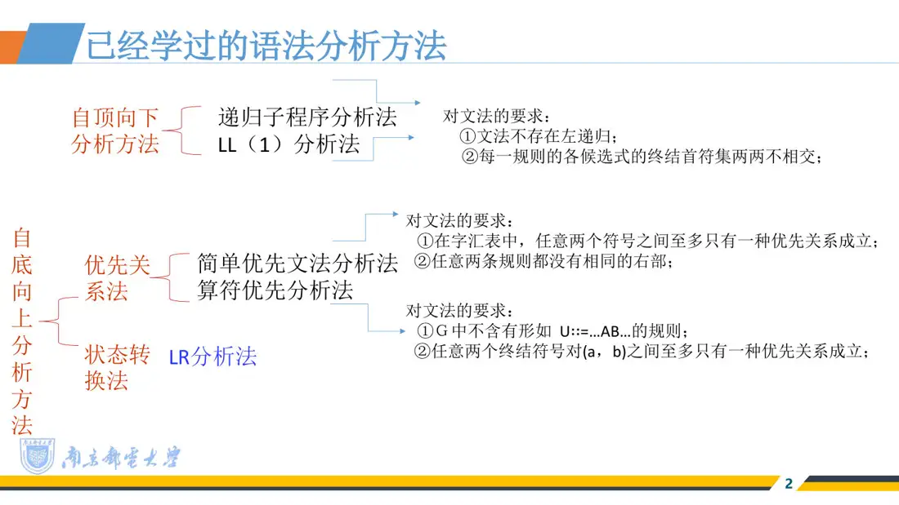

原文：

已经学过的语法分析方法

2

### LR分析法

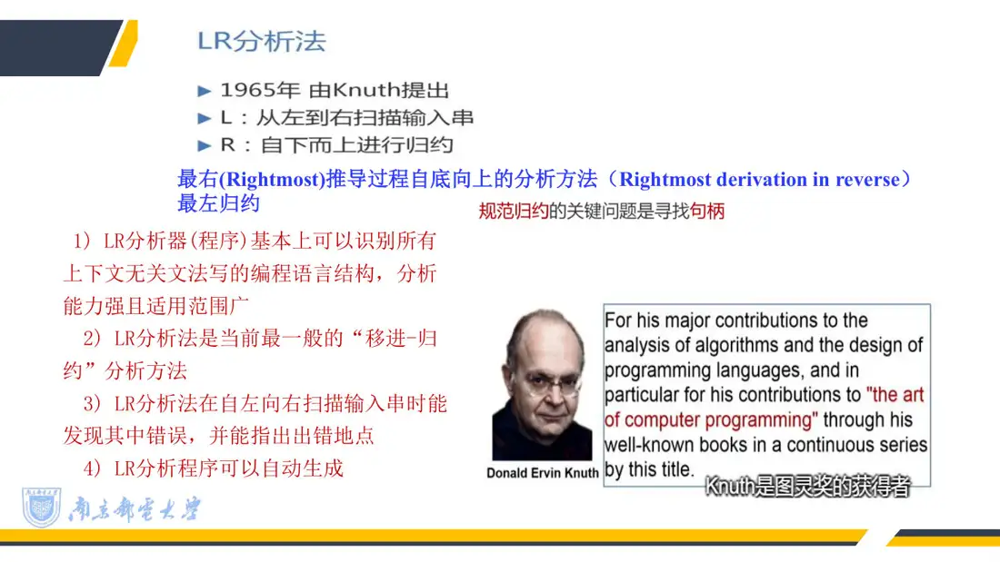

原文：

LR分析法

1965年由Knuth提出

L:从左到右扫描输入串

R：自下而上进行归约

最右(Rightmost)推导过程自底向上的分析方法（Rightmost derivation in reverse）最左归约 规范归约的关键问题是寻找句柄

1) LR分析器(程序)基本上可以识别所有上下文无关文法写的编程语言结构，分析能力强且适用范围广

2) LR分析法是当前最一般的“移进-归约”分析方法

3) LR分析法在自左向右扫描输入串时能发现其中错误，并能指出出错地点

4) LR分析程序可以自动生成

For his major contributions to the analysis of algorithms and the design of programming languages, and in particular for his contributions to "the art of computer programming" through his well-known books in a continuous series by this title.

Knuth是图灵奖的获得者

### LR分析法

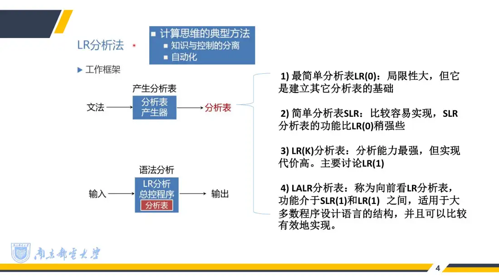

原文：

LR分析法

工作框架

计算思维的典型方法知识与控制的分离自动化

1) 最简单分析表LR(0)：局限性大，但它是建立其它分析表的基础

2) 简单分析表SLR：比较容易实现，SLR分析表的功能比LR(0)稍强些

3) LR(K)分析表：分析能力最强，但实现代价高。主要讨论LR(1)

4) LALR分析表：称为向前看LR分析表，功能介于SLR(1)和LR(1) 之间，适用于大多数程序设计语言的结构，并且可以比较有效地实现。

4

### LR分析法的基本思想

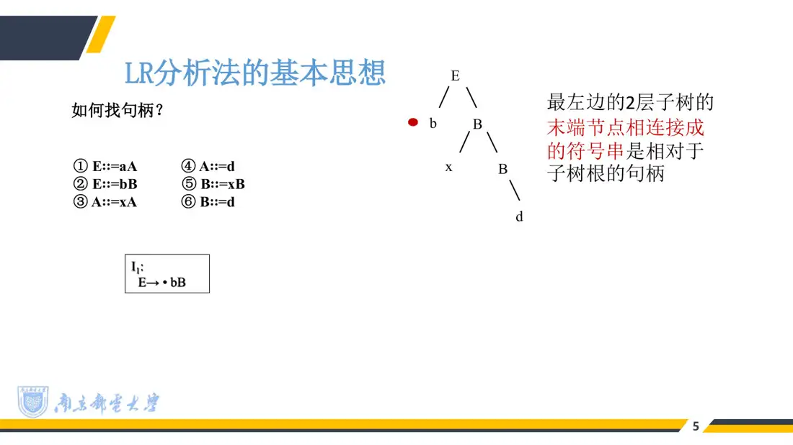

原文：

LR分析法的基本思想

如何找句柄？

① $\mathbf { E } { : } { : } = \mathbf { a } \mathbf { A }$

④ $\mathbf { A } { : : } \mathbf { = d }$

② $\mathbf { E } { : : = } \mathbf { b } \mathbf { B }$

③ $\mathbf { A } { : } { : } = \mathbf { x } \mathbf { A }$

⑤ $\mathbf { B } { : } { : } = \mathbf { x } \mathbf { B }$

⑥ $\mathbf { B } { : : = } \mathbf { d }$

$$
\begin{array}{c}\hline \mathrm{I} _ {1}:\\\mathrm{E} \rightarrow \bullet \mathrm{bB}\end{array}
$$

最左边的2层子树的末端节点相连接成的符号串是相对于子树根的句柄

5

### LR分析法的基本思想

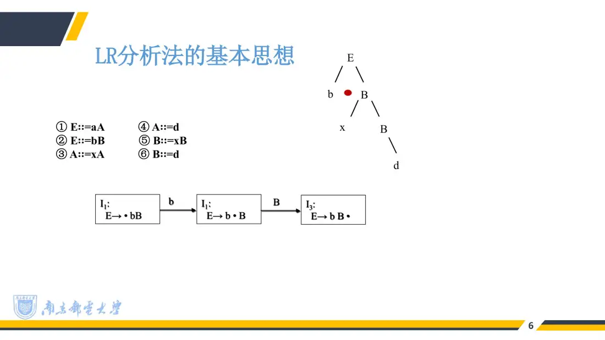

原文：

LR分析法的基本思想

① $\mathbf { E } { : } { : } = \mathbf { a } \mathbf { A }$

④ $\mathbf { A } { : : } \mathbf { = d }$

② $\mathbf { E } { : : = } \mathbf { b } \mathbf { B }$

⑤ $\mathbf { B } { : } { : } = \mathbf { x } \mathbf { B }$

③ $\mathbf { A } { : } { : } = \mathbf { x } \mathbf { A }$

⑥ $\mathbf { B } { : : = } \mathbf { d }$

6

### LR分析法的基本思想

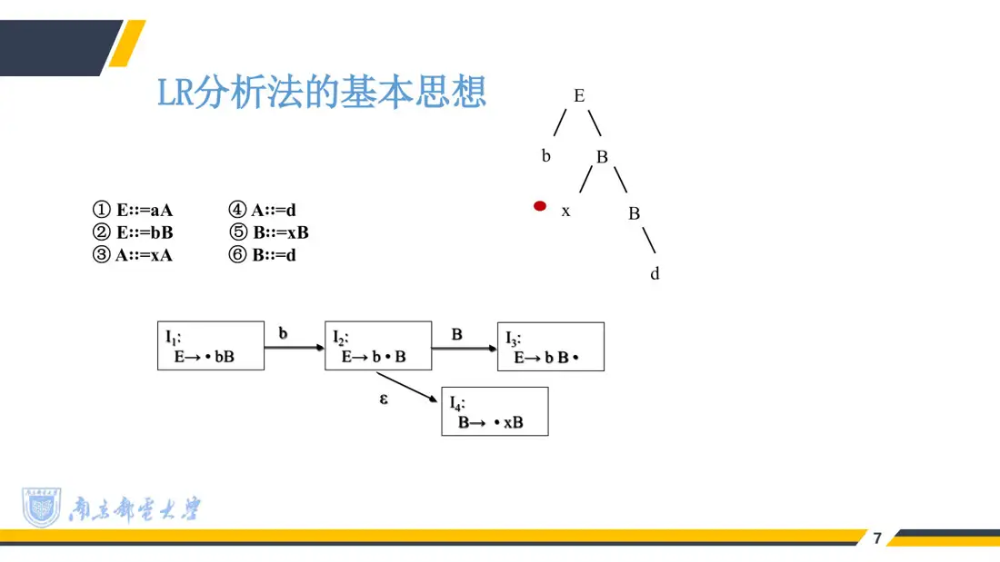

原文：

LR分析法的基本思想

① $\mathbf { E } { : } { : } = \mathbf { a } \mathbf { A }$

② $\mathbf { E } { : : = } \mathbf { b } \mathbf { B }$

③ $\mathbf { A } { : } { : } = \mathbf { x } \mathbf { A }$

④ $\mathbf { A } { : : } \mathbf { = d }$

⑤ $\mathbf { B } { : } { : } = \mathbf { x } \mathbf { B }$

⑥ $\mathbf { B } { : : = } \mathbf { d }$

7

### LR分析法的基本思想

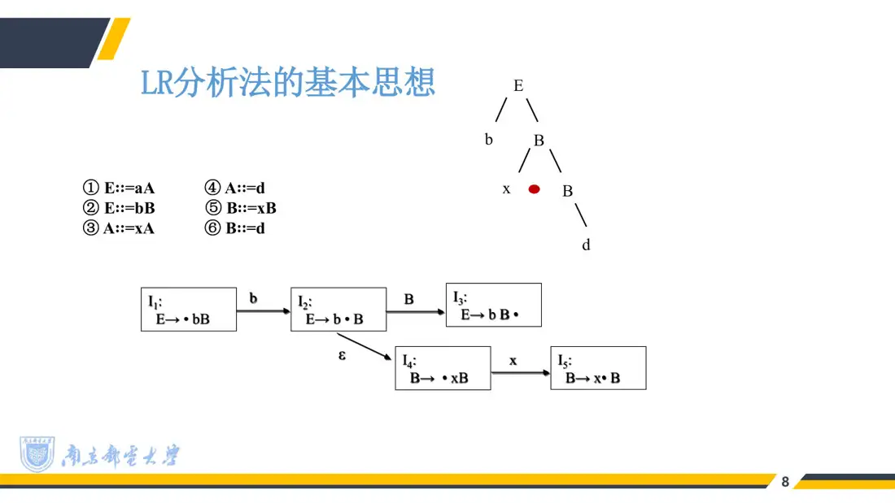

原文：

LR分析法的基本思想

① $\mathbf { E } { : } { : } = \mathbf { a } \mathbf { A }$

② E∷=bB

④ $\mathbf { A } { : : } \mathbf { = d }$

③ $\mathbf { A } { : } { : } = \mathbf { x } \mathbf { A }$

⑤ $\mathbf { B } { : } { : } = \mathbf { x } \mathbf { B }$

⑥ $\mathbf { B } { : : = } \mathbf { d }$

8

### LR分析法的基本思想

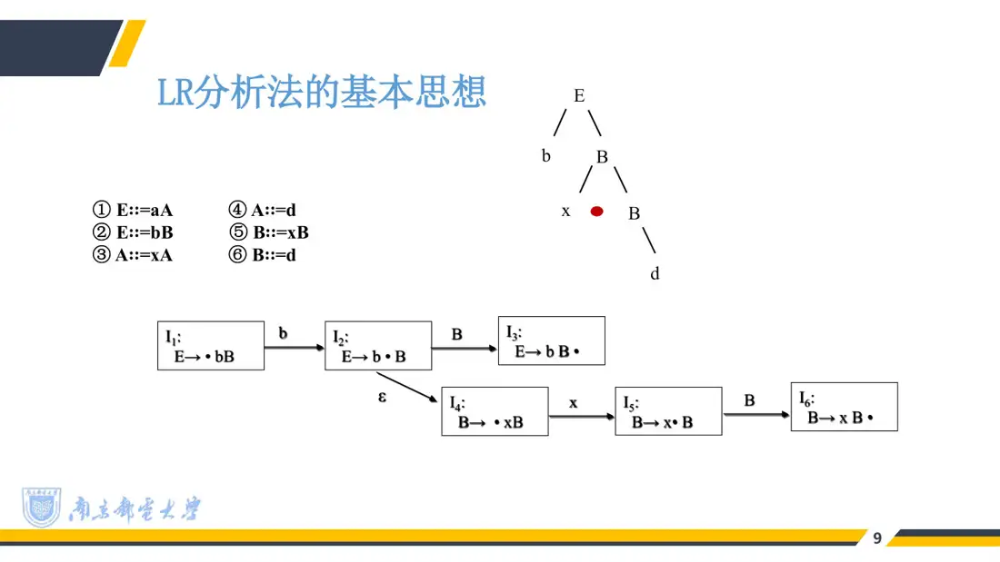

原文：

LR分析法的基本思想

① $\mathbf { E } { : } { : } = \mathbf { a } \mathbf { A }$

② E∷=bB

③ A∷=xA

④ $\mathbf { A } { : : } \mathbf { = d }$

⑤ $\mathbf { B } { : } { : } = \mathbf { x } \mathbf { B }$

⑥ B∷=d

9

### LR分析法的基本思想

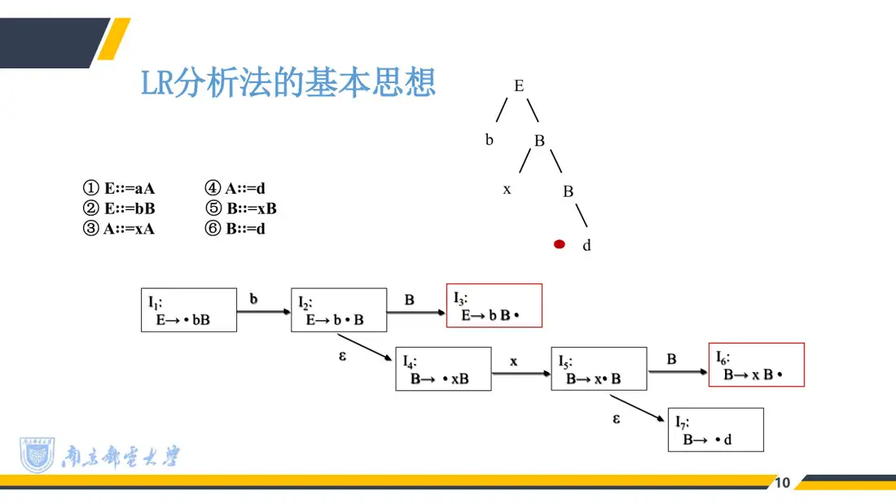

原文：

LR分析法的基本思想

① $\mathbf { E } { : } { : } = \mathbf { a } \mathbf { A }$

② $\mathbf { E } { : : = } \mathbf { b } \mathbf { B }$

③ $\mathbf { A } { : } { : } = \mathbf { x } \mathbf { A }$

④ $\mathbf { A } { : : } \mathbf { = d }$

⑤ $\mathbf { B } { : } { : } = \mathbf { x } \mathbf { B }$

⑥ $\mathbf { B } { : : = } \mathbf { d }$

10

### LR分析法的基本思想

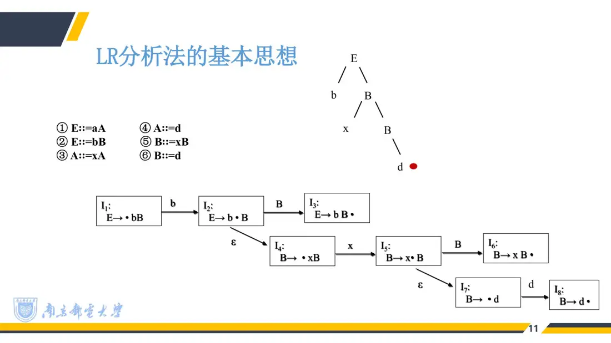

原文：

LR分析法的基本思想

① $\mathbf { E } { : } { : } = \mathbf { a } \mathbf { A }$

④ $\mathbf { A } { : : } \mathbf { = d }$

② $\mathbf { E } { : : = } \mathbf { b } \mathbf { B }$

⑤ $\mathbf { B } { : } { : } = \mathbf { x } \mathbf { B }$

③ $\mathbf { A } { : } { : } = \mathbf { x } \mathbf { A }$

⑥ $\mathbf { B } { : : = } \mathbf { d }$

11

### LR分析法的基本思想

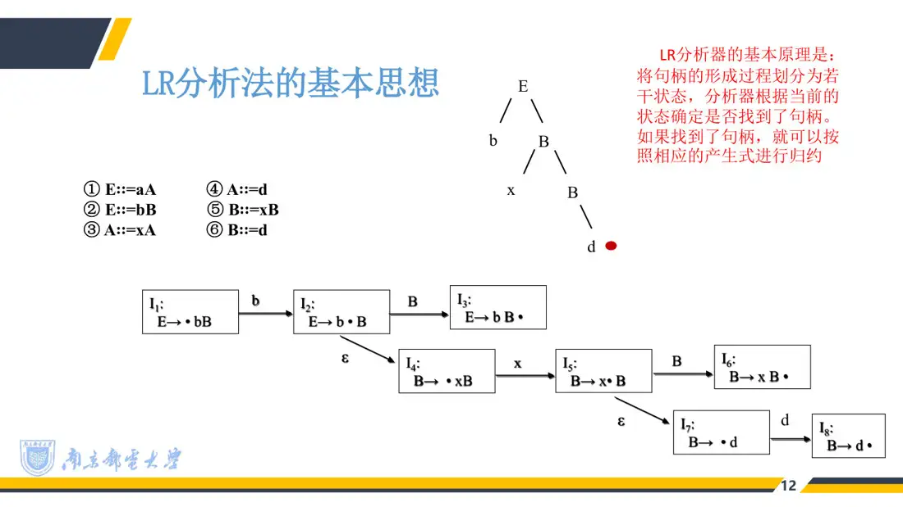

原文：

LR分析法的基本思想

① E∷=aA ② E∷=bB ③ A∷=xA

④ A∷=d ⑤ $\mathbf { B } { : } { : } = \mathbf { x } \mathbf { B }$ ⑥ B∷=d

LR分析器的基本原理是：将句柄的形成过程划分为若干状态，分析器根据当前的状态确定是否找到了句柄。如果找到了句柄，就可以按照相应的产生式进行归约

12

### $$

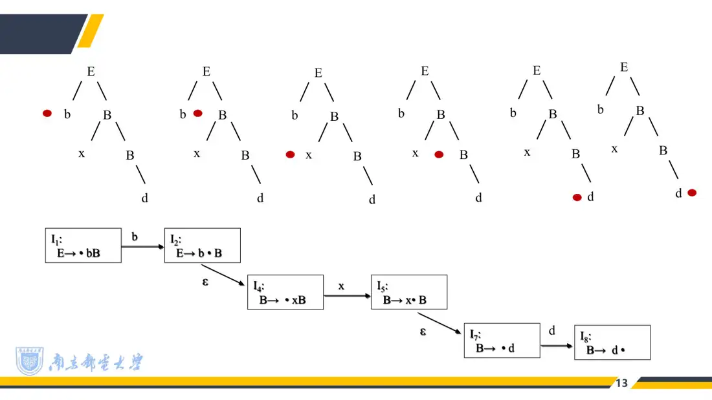

原文：

$$
\begin{array}{c c c c c c c c c} \text {E} & \text {E} & \text {E} & \text {E} & \text {E} & \text {E} & \text {E} \\ \hline / & \hline \\ \bullet & b & B & & / & \hline \\ & & x & B & & d \end{array} \quad \begin{array}{c c c c c c c c c} \text {b} & \text {b} & B & & b & B \\ & & x & B & & d \end{array} \quad \begin{array}{c c c c c c c c c} \text {x} & & & \text {x} & B \\ & & d \end{array} \quad \begin{array}{c c c c c c c c c} \text {x} & & & b & B \\ & & d \end{array} \quad \begin{array}{c c c c c c c c c} \text {x} & & & b & B \\ & & d \end{array} \quad \begin{array}{c c c c c c c c c} \text {x} & B & & b & B \\ & & d \end{array} \quad \begin{array}{c c c c c c c c c} \text {d} & & d \end{array}
$$

13

### 14

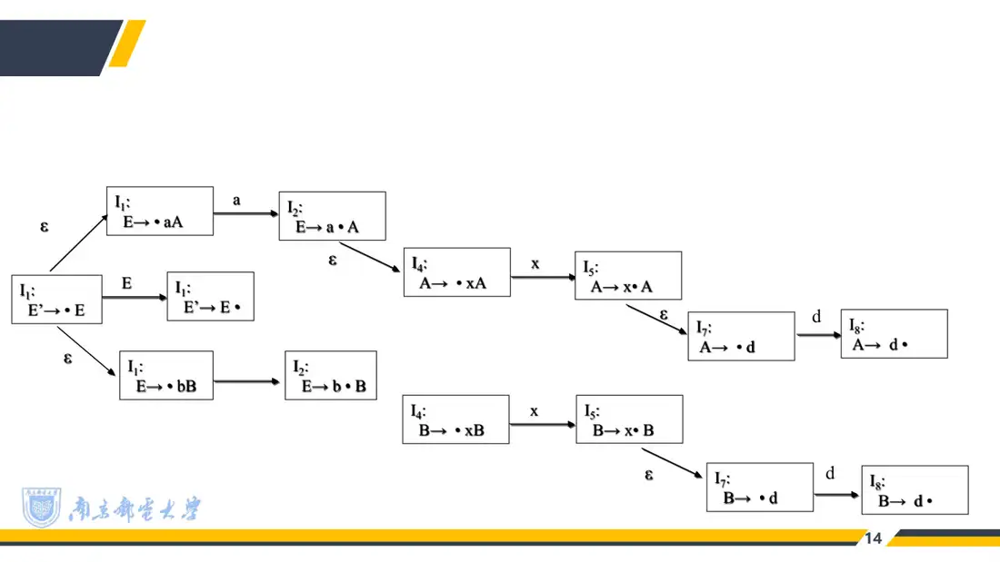

原文：

14

### （1）LR分析器的逻辑结构

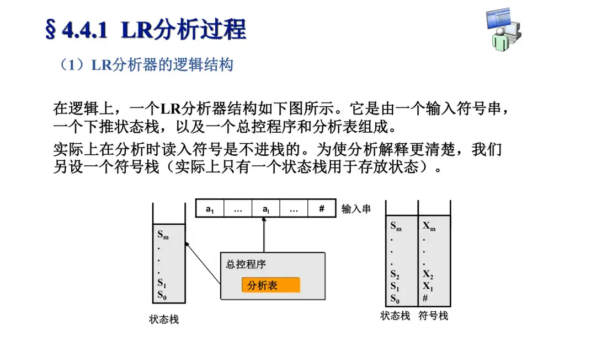

原文：

（1）LR分析器的逻辑结构

在逻辑上，一个LR分析器结构如下图所示。它是由一个输入符号串，一个下推状态栈，以及一个总控程序和分析表组成。

实际上在分析时读入符号是不进栈的。为使分析解释更清楚，我们另设一个符号栈（实际上只有一个状态栈用于存放状态）。

§4.4.1 LR分析过程

### 1)分析动作表

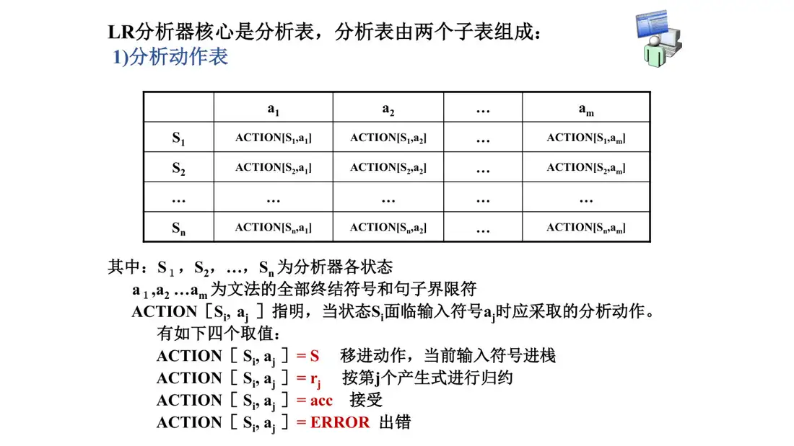

原文：

1)分析动作表

<table><tr><td></td><td> $a_1$ </td><td> $a_2$ </td><td>...</td><td> $a_m$ </td></tr><tr><td> $S_1$ </td><td>ACTION[ $S_1,a_1$ ]</td><td>ACTION[ $S_1,a_2$ ]</td><td>...</td><td>ACTION[ $S_1,a_m$ ]</td></tr><tr><td> $S_2$ </td><td>ACTION[ $S_2,a_1$ ]</td><td>ACTION[ $S_2,a_2$ ]</td><td>...</td><td>ACTION[ $S_2,a_m$ ]</td></tr><tr><td>...</td><td>...</td><td>...</td><td>...</td><td>...</td></tr><tr><td> $S_n$ </td><td>ACTION[ $S_n,a_1$ ]</td><td>ACTION[ $S_n,a_2$ ]</td><td>...</td><td>ACTION[ $S_n,a_m$ ]</td></tr></table>

其中： $\mathbf { S } _ { 1 } , \mathbf { S } _ { 2 } , . . . , \mathbf { S _ { n } }$ 为分析器各状态

$\mathbf { a } _ { 1 } , \mathbf { a } _ { 2 } \ldots \mathbf { a } _ { \mathbf { m } }$ 为文法的全部终结符号和句子界限符

$\mathbf { A C T I O N \ [ S _ { i } , a _ { j } \ ] }$ 指明，当状态 $\mathbf { S _ { i } }$ 面临输入符号 $\mathbf { a _ { j } }$ 时应采取的分析动作。

有如下四个取值：

ACTION $[ \bf { \sigma } S _ { i } , a _ { j } ] = \bf { S }$ 移进动作，当前输入符号进桟

ACTION $\left[ \mathrm { \bf ~ S _ { i } } , \mathrm { a _ { j } } \right] = \mathrm { \bf r _ { j } }$ 按第j个产生式进行归约

ACTION $[ \mathbf { \ S _ { i } } , \mathbf { a _ { j } } ] = \mathbf { a c c }$ 接受

ACTION $\ [ \mathrm { \bf ~ S _ { i } } , \mathrm { \bf ~ a _ { j } } ] = \mathrm { E } \mathrm { \bf R } \mathrm { \bf R } \mathrm { \bf O } \mathrm { \bf R }$ 出错其中： $\mathrm { ~ X ~ } _ { 1 } , \mathrm { ~ X ~ } _ { 2 } , . . . , \mathrm { ~ X ~ } _ { \mathrm { p } }$ 是文法字汇表中全部非终结符号和终结符号$\mathsf { \pmb { S } } _ { 1 } \parallel , \mathsf { \pmb { S } } _ { 2 } \parallel , \ldots , \mathsf { \pmb { S } } _ { \mathsf { n } } .$ 为分析器各状态

LR分析器核心是分析表，分析表由两个子表组成：

### 2）状态转换表

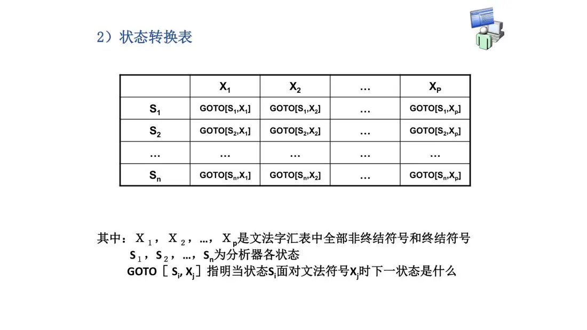

原文：

<table><tr><td></td><td> $X_1$ </td><td> $X_2$ </td><td>...</td><td> $X_P$ </td></tr><tr><td> $S_1$ </td><td>GOTO $[S_1,X_1]$ </td><td>GOTO $[S_1,X_2]$ </td><td>...</td><td>GOTO $[S_1,X_p]$ </td></tr><tr><td> $S_2$ </td><td>GOTO $[S_2,X_1]$ </td><td>GOTO $[S_2,X_2]$ </td><td>...</td><td>GOTO $[S_2,X_p]$ </td></tr><tr><td>...</td><td>...</td><td>...</td><td>...</td><td>...</td></tr><tr><td> $S_n$ </td><td>GOTO $[S_n,X_1]$ </td><td>GOTO $[S_n,X_2]$ </td><td>...</td><td>GOTO $[S_n,X_p]$ </td></tr></table>

GOTO $[ \mathsf { S } _ { \mathsf { i } } , \mathsf { X } _ { \mathsf { j } } ]$ 指明当状态 $| \mathsf { S } _ { \mathsf { i } } \rangle$ 面对文法符号 $\mathbf { \nabla } \times _ { \mathbf { j } }$ 时下一状态是什么

2）状态转换表

### 举例—

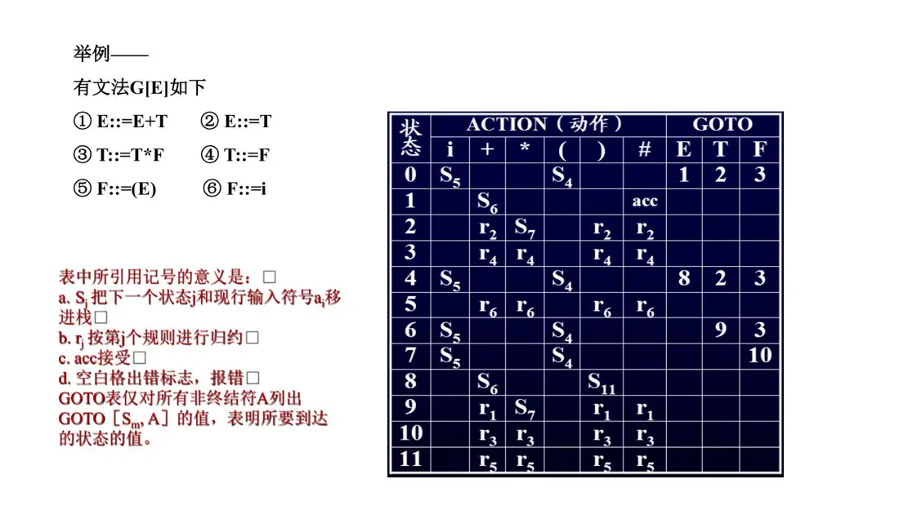

原文：

举例—

有文法G[E]如下

① $\mathbf { E } { : } { : } = \mathbf { E } { + } \mathbf { T }$

② $\mathbf { E } { : : = } \mathbf { T }$

③ $\mathbf { T } { : } { : } = \mathbf { T } ^ { * } \mathbf { F }$

④ $\mathbf { T } { \boldsymbol { \cdot } } { \boldsymbol { \cdot } } = \mathbf { F }$

⑤ $\mathbf { F } { : } { : = } ( \mathbf { E } )$

⑥ $\mathbf { F } { \boldsymbol { \cdot } } { \boldsymbol { \cdot } } { = } \mathbf { i }$

表中所引用记号的意义是：

a. $\mathbf { S _ { j } }$ 把下一个状态j和现行输入符号 $\mathbf { a } _ { \mathrm { i } }$ 移进栈

b. ${ \mathfrak { r } } _ { \mathrm { j } }$ 按第j个规则进行归约

c. acc接受

d.空白格出错标志，报错

GOTO表仅对所有非终结符A列出GOTO $[ \mathsf { S } _ { \mathsf { m } } , \mathsf { A } ]$ 的值，表明所要到达的状态的值。

### 二、LR方法的分析过程

原文：

二、LR方法的分析过程

$$
\mathbf {E}: := \mathbf {E} + \mathbf {T}
$$

$$
\mathbf {E}: := \mathbf {T}
$$

$$
\mathbf {T}: := \mathbf {F}
$$

$$
\mathbf {T}: := \mathbf {T} ^ {*} \mathbf {F}
$$

### 二、LR方法的分析过程

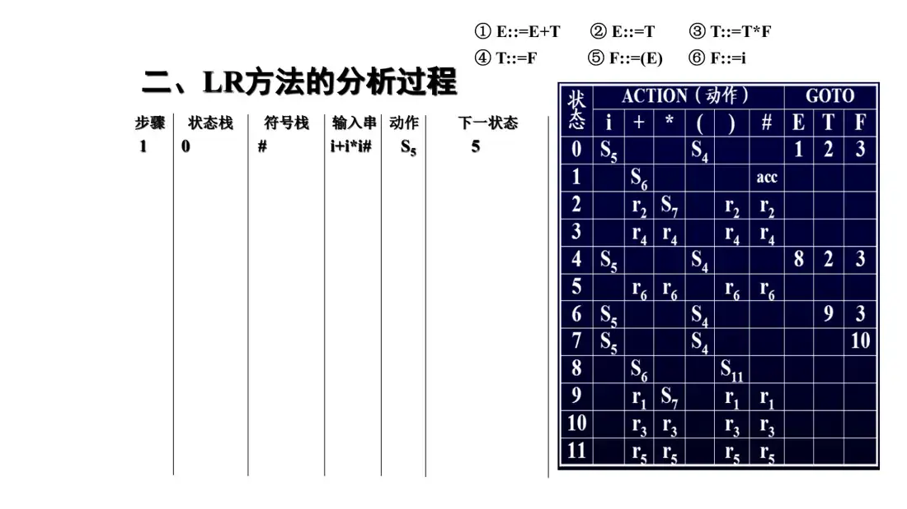

原文：

二、LR方法的分析过程

$$
\mathbf {E}: := \mathbf {E} + \mathbf {T}
$$

$$
\mathbf {T}: := \mathbf {F}
$$

下一状态5

$$
\mathbf {E}: := \mathbf {T}
$$

$$
\mathbf {T}: := \mathbf {T} ^ {*} \mathbf {F}
$$

### $$

原文：

$$
\mathbf {E}: := \mathbf {E} + \mathbf {T}
$$

二、LR方法的分析过程

$$
\mathbf {T}: := \mathbf {F}
$$

下一状态5

$$
\mathbf {E}: := \mathbf {T}
$$

$$
\mathbf {T}: := \mathbf {T} ^ {*} \mathbf {F}
$$

### $$

原文：

<table><tr><td>步骤</td><td>状态栈</td><td>符号栈</td><td>输入串</td><td>动作</td><td>下一状态</td></tr><tr><td>1</td><td>0</td><td>#</td><td>i+i*i#</td><td> $S_5$ </td><td>5</td></tr><tr><td>2</td><td>05</td><td>#i</td><td>+i*i#</td><td> $r_6$ </td><td></td></tr></table>

$$
\mathbf {E}: := \mathbf {E} + \mathbf {T}
$$

二、LR方法的分析过程

$$
\mathbf {T}: := \mathbf {F}
$$

$$
\mathbf {E}: := \mathbf {T}
$$

$$
\mathbf {T}: := \mathbf {T} ^ {*} \mathbf {F}
$$

### $$

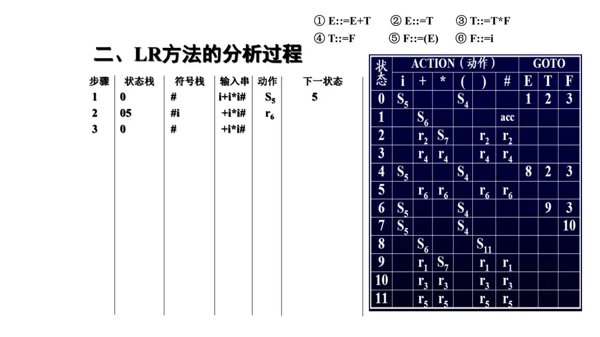

原文：

$$
\mathbf {E}: := \mathbf {E} + \mathbf {T}
$$

二、LR方法的分析过程

$$
\mathbf {T}: := \mathbf {F}
$$

下一状态5

$$
\mathbf {E}: := \mathbf {T}
$$

$$
\mathbf {T}: := \mathbf {T} ^ {*} \mathbf {F}
$$

### $$

原文：

$$
\mathbf {E}: := \mathbf {E} + \mathbf {T}
$$

二、LR方法的分析过程

$$
\mathbf {T}: := \mathbf {F}
$$

下一状态5

$$
\mathbf {E}: := \mathbf {T}
$$

$$
\mathbf {T}: := \mathbf {T} ^ {*} \mathbf {F}
$$

### 二、LR方法的分析过程

原文：

二、LR方法的分析过程

$$
\mathbf {E}: := \mathbf {E} + \mathbf {T}
$$

$$
\mathbf {E}: := \mathbf {T}
$$

$$
\mathbf {T}: := \mathbf {T} ^ {*} \mathbf {F}
$$

④ $\mathbf { T } { \boldsymbol { \cdot } } { \boldsymbol { \cdot } } = \mathbf { F }$ ⑤ F::=(E) ⑥ $\mathbf { F } { : } { : } = \mathbf { i }$

<table><tr><td>步骤</td><td>状态栈</td><td>符号栈</td><td>输入串</td><td>动作</td><td>下一状态</td></tr><tr><td>1</td><td>0</td><td>#</td><td>i+i*i#</td><td> $S_{5}$ </td><td>5</td></tr><tr><td>2</td><td>05</td><td>#i</td><td>+i*i#</td><td> $r_{6}$ </td><td>GOTO[0,F]=3</td></tr><tr><td>3</td><td>0</td><td>#F</td><td>+i*i#</td><td></td><td></td></tr></table>

### 二、LR方法的分析过程

原文：

二、LR方法的分析过程

$$
\mathbf {E}: := \mathbf {E} + \mathbf {T}
$$

$$
\mathbf {E}: := \mathbf {T}
$$

$$
\mathbf {T}: := \mathbf {T} ^ {*} \mathbf {F}
$$

④ $\mathbf { T } { \boldsymbol { \cdot } } { \boldsymbol { \cdot } } = \mathbf { F }$ ⑤ F::=(E) ⑥ $\mathbf { F } { : } { : } = \mathbf { i }$

<table><tr><td>步骤</td><td>状态栈</td><td>符号栈</td><td>输入串</td><td>动作</td><td>下一状态</td></tr><tr><td>1</td><td>0</td><td>#</td><td>i+i*i#</td><td> $S_{5}$ </td><td>5</td></tr><tr><td>2</td><td>05</td><td>#i</td><td>+i*i#</td><td> $r_{6}$ </td><td>GOTO[0,F]=3</td></tr><tr><td>3</td><td>03</td><td>#F</td><td>+i*i#</td><td></td><td></td></tr></table>

### 二、LR方法的分析过程

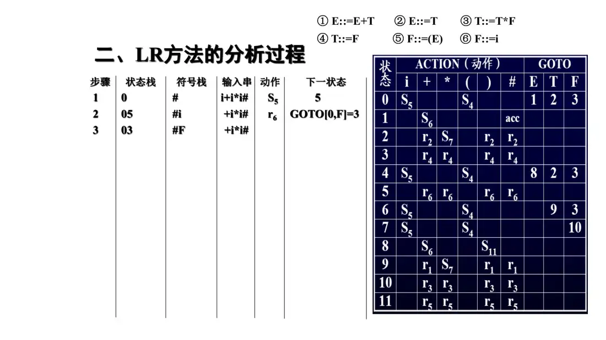

原文：

二、LR方法的分析过程

$$
\mathbf {E}: := \mathbf {E} + \mathbf {T}
$$

$$
\mathbf {E}: := \mathbf {T}
$$

$$
\mathbf {T}: := \mathbf {T} ^ {*} \mathbf {F}
$$

④ $\mathbf { T } { \boldsymbol { \cdot } } { \boldsymbol { \cdot } } = \mathbf { F }$ ⑤ F::=(E) ⑥ $\mathbf { F } { : } { : } = \mathbf { i }$

<table><tr><td>步骤</td><td>状态栈</td><td>符号栈</td><td>输入串</td><td>动作</td><td>下一状态</td></tr><tr><td>1</td><td>0</td><td>#</td><td>i+i*i#</td><td> $S_{5}$ </td><td>5</td></tr><tr><td>2</td><td>05</td><td>#i</td><td>+i*i#</td><td> $r_{6}$ </td><td>GOTO[0,F]=3</td></tr><tr><td>3</td><td>03</td><td>#F</td><td>+i*i#</td><td></td><td></td></tr></table>

### 二、LR方法的分析过程

原文：

二、LR方法的分析过程

<table><tr><td>步骤</td><td>状态栈</td><td>符号栈</td><td>输入串</td><td>动作</td><td>下一状态</td></tr><tr><td>1</td><td>0</td><td>#</td><td>i+i*i#</td><td> $S_{5}$ </td><td>5</td></tr><tr><td>2</td><td>05</td><td>#i</td><td>+i*i#</td><td> $r_{6}$ </td><td>GOTO[0,F]=3</td></tr><tr><td>3</td><td>03</td><td>#F</td><td>+i*i#</td><td> $r_{4}$ </td><td></td></tr></table>

① $\mathbf { E } { : : = } \mathbf { E } { + } \mathbf { T }$ ② $\mathbf { E } { : : = } \mathbf { T }$ ③ $\mathbf { T } { \boldsymbol { : } } { = } \mathbf { T } ^ { * } \mathbf { F }$ ④ $\mathbf { T } { \boldsymbol { \cdot } } { \boldsymbol { \cdot } } = \mathbf { F }$ ⑤ F::=(E) ⑥ $\mathbf { F } { : } { : } = \mathbf { i }$

### 二、LR方法的分析过程

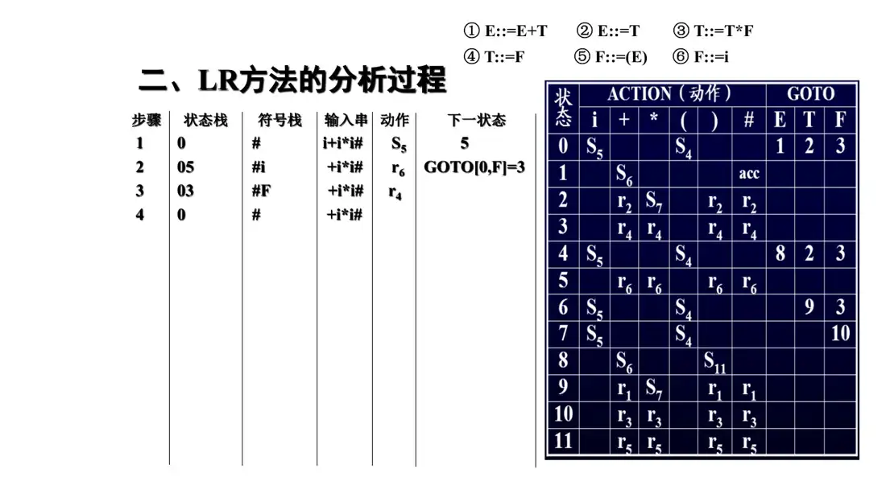

原文：

二、LR方法的分析过程

① $\mathbf { E } { : : = } \mathbf { E } { + } \mathbf { T }$ ② $\mathbf { E } { : : = } \mathbf { T }$ ③ $\mathbf { T } { \boldsymbol { : } } { = } \mathbf { T } ^ { * } \mathbf { F }$ ④ $\mathbf { T } { \boldsymbol { \cdot } } { \boldsymbol { \cdot } } = \mathbf { F }$ ⑤ F::=(E) ⑥ $\mathbf { F } { : } { : } = \mathbf { i }$

<table><tr><td>步骤</td><td>状态栈</td><td>符号栈</td><td>输入串</td><td>动作</td><td>下一状态</td></tr><tr><td>1</td><td>0</td><td>#</td><td>i+i*i#</td><td> $S_5$ </td><td>5</td></tr><tr><td>2</td><td>05</td><td>#i</td><td>+i*i#</td><td> $r_6$ </td><td>GOTO[0,F]=3</td></tr><tr><td>3</td><td>03</td><td>#F</td><td>+i*i#</td><td> $r_4$ </td><td></td></tr><tr><td>4</td><td>0</td><td>#</td><td>+i*i#</td><td></td><td></td></tr></table>

### 二、LR方法的分析过程

原文：

二、LR方法的分析过程

$$
\mathbf {E}: := \mathbf {E} + \mathbf {T}
$$

$$
\mathbf {E}: := \mathbf {T}
$$

$$
\mathbf {T}: := \mathbf {F}
$$

$$
\mathbf {T}: := \mathbf {T} ^ {*} \mathbf {F}
$$

$$
\mathbf {F}: := \mathbf {i}
$$

<table><tr><td>步骤</td><td>状态栈</td><td>符号栈</td><td>输入串</td><td>动作</td><td>下一状态</td></tr><tr><td>1</td><td>0</td><td>#</td><td>i+i*i#</td><td> $S_5$ </td><td>5</td></tr><tr><td>2</td><td>05</td><td>#i</td><td>+i*i#</td><td> $r_6$ </td><td>GOTO[0,F]=3</td></tr><tr><td>3</td><td>03</td><td>#F</td><td>+i*i#</td><td> $r_4$ </td><td></td></tr><tr><td>4</td><td>0</td><td>#T</td><td>+i*i#</td><td></td><td></td></tr></table>

### 二、LR方法的分析过程

原文：

二、LR方法的分析过程

① $\mathbf { E } { : : = } \mathbf { E } { + } \mathbf { T }$ ② $\mathbf { E } { : : = } \mathbf { T }$ ③ $\mathbf { T } { \boldsymbol { : } } { = } \mathbf { T } ^ { * } \mathbf { F }$ ④ $\mathbf { T } { \boldsymbol { \cdot } } { \boldsymbol { \cdot } } = \mathbf { F }$ ⑤ F::=(E) ⑥ $\mathbf { F } { : } { : } = \mathbf { i }$

<table><tr><td>步骤</td><td>状态栈</td><td>符号栈</td><td>输入串</td><td>动作</td><td>下一状态</td></tr><tr><td>1</td><td>0</td><td>#</td><td>i+i*i#</td><td> $S_5$ </td><td>5</td></tr><tr><td>2</td><td>05</td><td>#i</td><td>+i*i#</td><td> $r_6$ </td><td>GOTO[0,F]=3</td></tr><tr><td>3</td><td>03</td><td>#F</td><td>+i*i#</td><td> $r_4$ </td><td>GOTO[0,T]=2</td></tr><tr><td>4</td><td>0</td><td>#T</td><td>+i*i#</td><td></td><td></td></tr></table>

### 二、LR方法的分析过程

原文：

二、LR方法的分析过程

① $\mathbf { E } { : : = } \mathbf { E } { + } \mathbf { T }$ ② $\mathbf { E } { : : = } \mathbf { T }$ ③ $\mathbf { T } { \boldsymbol { : } } { = } \mathbf { T } ^ { * } \mathbf { F }$ ④ $\mathbf { T } { \boldsymbol { \cdot } } { \boldsymbol { \cdot } } = \mathbf { F }$ ⑤ F::=(E) ⑥ $\mathbf { F } { : } { : } = \mathbf { i }$

<table><tr><td>步骤</td><td>状态栈</td><td>符号栈</td><td>输入串</td><td>动作</td><td>下一状态</td></tr><tr><td>1</td><td>0</td><td>#</td><td>i+i*i#</td><td> $S_5$ </td><td>5</td></tr><tr><td>2</td><td>05</td><td>#i</td><td>+i*i#</td><td> $r_6$ </td><td>GOTO[0,F]=3</td></tr><tr><td>3</td><td>03</td><td>#F</td><td>+i*i#</td><td> $r_4$ </td><td>GOTO[0,T]=2</td></tr><tr><td>4</td><td>02</td><td>#T</td><td>+i*i#</td><td></td><td></td></tr></table>

### 二、LR方法的分析过程

原文：

二、LR方法的分析过程

① $\mathbf { E } { : : = } \mathbf { E } { + } \mathbf { T }$ ② $\mathbf { E } { : : = } \mathbf { T }$ ③ $\mathbf { T } { \boldsymbol { : } } { = } \mathbf { T } ^ { * } \mathbf { F }$ ④ $\mathbf { T } { \boldsymbol { \cdot } } { \boldsymbol { \cdot } } = \mathbf { F }$ ⑤ F::=(E) ⑥ $\mathbf { F } { : } { : } = \mathbf { i }$

<table><tr><td>步骤</td><td>状态栈</td><td>符号栈</td><td>输入串</td><td>动作</td><td>下一状态</td></tr><tr><td>1</td><td>0</td><td>#</td><td>i+i*i#</td><td> $S_5$ </td><td>5</td></tr><tr><td>2</td><td>05</td><td>#i</td><td>+i*i#</td><td> $r_6$ </td><td>GOTO[0,F]=3</td></tr><tr><td>3</td><td>03</td><td>#F</td><td>+i*i#</td><td> $r_4$ </td><td>GOTO[0,T]=2</td></tr><tr><td>4</td><td>02</td><td>#T</td><td>+i*i#</td><td></td><td></td></tr></table>

### 二、LR方法的分析过程

原文：

二、LR方法的分析过程

<table><tr><td>步骤</td><td>状态栈</td><td>符号栈</td><td>输入串</td><td>动作</td><td>下一状态</td></tr><tr><td>1</td><td>0</td><td>#</td><td>i+i*i#</td><td> $S_5$ </td><td>5</td></tr><tr><td>2</td><td>05</td><td>#i</td><td>+i*i#</td><td> $r_6$ </td><td>GOTO[0,F]=3</td></tr><tr><td>3</td><td>03</td><td>#F</td><td>+i*i#</td><td> $r_4$ </td><td>GOTO[0,T]=2</td></tr><tr><td>4</td><td>02</td><td>#T</td><td>+i*i#</td><td> $r_2$ </td><td></td></tr></table>

① $\mathbf { E } { : : = } \mathbf { E } { + } \mathbf { T }$ ② $\mathbf { E } { : : = } \mathbf { T }$ ③ $\mathbf { T } { \boldsymbol { : } } { = } \mathbf { T } ^ { * } \mathbf { F }$ ④ $\mathbf { T } { \boldsymbol { \cdot } } { \boldsymbol { \cdot } } = \mathbf { F }$ ⑤ F::=(E) ⑥ $\mathbf { F } { : } { : } = \mathbf { i }$

### 二、LR方法的分析过程

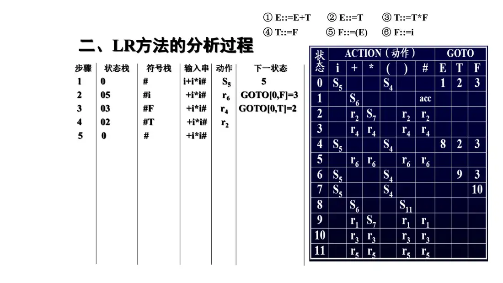

原文：

二、LR方法的分析过程

$$
\mathbf {E}: := \mathbf {E} + \mathbf {T}
$$

$$
\mathbf {T}: := \mathbf {F}
$$

$$
\mathbf {E}: := \mathbf {T}
$$

<table><tr><td>步骤</td><td>状态栈</td><td>符号栈</td><td>输入串</td><td>动作</td><td>下一状态</td></tr><tr><td>1</td><td>0</td><td>#</td><td>i+i*i#</td><td> $S_5$ </td><td>5</td></tr><tr><td>2</td><td>05</td><td>#i</td><td>+i*i#</td><td> $r_6$ </td><td>GOTO[0,F]=3</td></tr><tr><td>3</td><td>03</td><td>#F</td><td>+i*i#</td><td> $r_4$ </td><td>GOTO[0,T]=2</td></tr><tr><td>4</td><td>02</td><td>#T</td><td>+i*i#</td><td> $r_2$ </td><td></td></tr><tr><td>5</td><td>0</td><td>#</td><td>+i*i#</td><td></td><td></td></tr></table>

$$
\mathbf {T}: := \mathbf {T} ^ {*} \mathbf {F}
$$

$$
\mathbf {F}: := \mathbf {i}
$$

### 二、LR方法的分析过程

原文：

二、LR方法的分析过程

$$
\mathbf {E}: := \mathbf {E} + \mathbf {T}
$$

$$
\mathbf {E}: := \mathbf {T}
$$

$$
\mathbf {T}: := \mathbf {F}
$$

$$
\mathbf {T}: := \mathbf {T} ^ {*} \mathbf {F}
$$

$$
\mathbf {F}: := \mathbf {i}
$$

<table><tr><td>步骤</td><td>状态栈</td><td>符号栈</td><td>输入串</td><td>动作</td><td>下一状态</td></tr><tr><td>1</td><td>0</td><td>#</td><td>i+i*i#</td><td> $S_5$ </td><td>5</td></tr><tr><td>2</td><td>05</td><td>#i</td><td>+i*i#</td><td> $r_6$ </td><td>GOTO[0,F]=3</td></tr><tr><td>3</td><td>03</td><td>#F</td><td>+i*i#</td><td> $r_4$ </td><td>GOTO[0,T]=2</td></tr><tr><td>4</td><td>02</td><td>#T</td><td>+i*i#</td><td> $r_2$ </td><td></td></tr><tr><td>5</td><td>0</td><td>#E</td><td>+i*i#</td><td></td><td></td></tr></table>

### 二、LR方法的分析过程

原文：

二、LR方法的分析过程

$$
\mathbf {E}: := \mathbf {E} + \mathbf {T}
$$

$$
\mathbf {E}: := \mathbf {T}
$$

$$
\mathbf {T}: := \mathbf {F}
$$

$$
\mathbf {T}: := \mathbf {T} ^ {*} \mathbf {F}
$$

$$
\mathbf {F}: := \mathbf {i}
$$

<table><tr><td>步骤</td><td>状态栈</td><td>符号栈</td><td>输入串</td><td>动作</td><td>下一状态</td></tr><tr><td>1</td><td>0</td><td>#</td><td>i+i*i#</td><td> $S_5$ </td><td>5</td></tr><tr><td>2</td><td>05</td><td>#i</td><td>+i*i#</td><td> $r_6$ </td><td>GOTO[0,F]=3</td></tr><tr><td>3</td><td>03</td><td>#F</td><td>+i*i#</td><td> $r_4$ </td><td>GOTO[0,T]=2</td></tr><tr><td>4</td><td>02</td><td>#T</td><td>+i*i#</td><td> $r_2$ </td><td>GOTO[0,E]=1</td></tr><tr><td>5</td><td>0</td><td>#E</td><td>+i*i#</td><td></td><td></td></tr></table>

### 二、LR方法的分析过程

原文：

二、LR方法的分析过程

$$
\mathbf {E}: := \mathbf {E} + \mathbf {T}
$$

$$
\mathbf {E}: := \mathbf {T}
$$

$$
\mathbf {T}: := \mathbf {F}
$$

$$
\mathbf {T}: := \mathbf {T} ^ {*} \mathbf {F}
$$

$$
\mathbf {F}: := \mathbf {i}
$$

<table><tr><td>步骤</td><td>状态栈</td><td>符号栈</td><td>输入串</td><td>动作</td><td>下一状态</td></tr><tr><td>1</td><td>0</td><td>#</td><td>i+i*i#</td><td> $S_5$ </td><td>5</td></tr><tr><td>2</td><td>05</td><td>#i</td><td>+i*i#</td><td> $r_6$ </td><td>GOTO[0,F]=3</td></tr><tr><td>3</td><td>03</td><td>#F</td><td>+i*i#</td><td> $r_4$ </td><td>GOTO[0,T]=2</td></tr><tr><td>4</td><td>02</td><td>#T</td><td>+i*i#</td><td> $r_2$ </td><td>GOTO[0,E]=1</td></tr><tr><td>5</td><td>01</td><td>#E</td><td>+i*i#</td><td></td><td></td></tr></table>

### 二、LR方法的分析过程

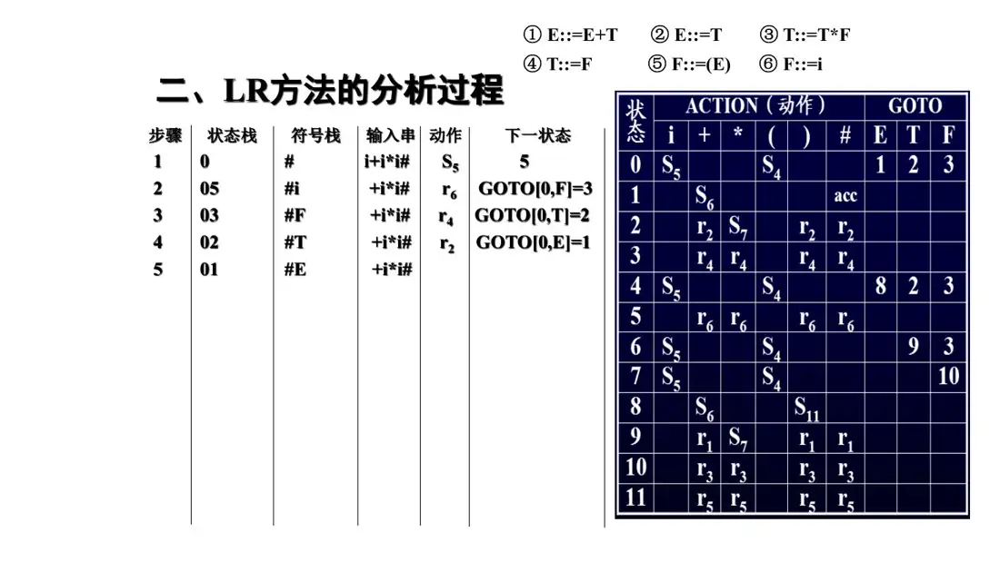

原文：

二、LR方法的分析过程

$$
\mathbf {E}: := \mathbf {E} + \mathbf {T}
$$

$$
\mathbf {E}: := \mathbf {T}
$$

$$
\mathbf {T}: := \mathbf {F}
$$

$$
\mathbf {T}: := \mathbf {T} ^ {*} \mathbf {F}
$$

$$
\mathbf {F}: := \mathbf {i}
$$

<table><tr><td>步骤</td><td>状态栈</td><td>符号栈</td><td>输入串</td><td>动作</td><td>下一状态</td></tr><tr><td>1</td><td>0</td><td>#</td><td>i+i*i#</td><td> $S_5$ </td><td>5</td></tr><tr><td>2</td><td>05</td><td>#i</td><td>+i*i#</td><td> $r_6$ </td><td>GOTO[0,F]=3</td></tr><tr><td>3</td><td>03</td><td>#F</td><td>+i*i#</td><td> $r_4$ </td><td>GOTO[0,T]=2</td></tr><tr><td>4</td><td>02</td><td>#T</td><td>+i*i#</td><td> $r_2$ </td><td>GOTO[0,E]=1</td></tr><tr><td>5</td><td>01</td><td>#E</td><td>+i*i#</td><td></td><td></td></tr></table>

### 二、LR方法的分析过程

原文：

二、LR方法的分析过程

$$
\mathbf {E}: := \mathbf {E} + \mathbf {T}
$$

$$
\mathbf {E}: := \mathbf {T}
$$

$$
\mathbf {T}: := \mathbf {F}
$$

$$
\mathbf {T}: := \mathbf {T} ^ {*} \mathbf {F}
$$

$$
\mathbf {F}: := \mathbf {i}
$$

<table><tr><td>步骤</td><td>状态栈</td><td>符号栈</td><td>输入串</td><td>动作</td><td>下一状态</td></tr><tr><td>1</td><td>0</td><td>#</td><td>i+i*i#</td><td> $S_5$ </td><td>5</td></tr><tr><td>2</td><td>05</td><td>#i</td><td>+i*i#</td><td> $r_6$ </td><td>GOTO[0,F]=3</td></tr><tr><td>3</td><td>03</td><td>#F</td><td>+i*i#</td><td> $r_4$ </td><td>GOTO[0,T]=2</td></tr><tr><td>4</td><td>02</td><td>#T</td><td>+i*i#</td><td> $r_2$ </td><td>GOTO[0,E]=1</td></tr><tr><td>5</td><td>01</td><td>#E</td><td>+i*i#</td><td> $S_6$ </td><td>6</td></tr></table>

### 二、LR方法的分析过程

原文：

二、LR方法的分析过程

$$
\mathbf {E}: := \mathbf {E} + \mathbf {T}
$$

② $\mathbf { E } { : : = } \mathbf { T }$

$$
\mathbf {T}: := \mathbf {F}
$$

<table><tr><td>步骤</td><td>状态栈</td><td>符号栈</td><td>输入串</td><td>动作</td><td>下一状态</td></tr><tr><td>1</td><td>0</td><td>#</td><td>i+i*i#</td><td> $S_5$ </td><td>5</td></tr><tr><td>2</td><td>05</td><td>#i</td><td>+i*i#</td><td> $r_6$ </td><td>GOTO[0,F]=3</td></tr><tr><td>3</td><td>03</td><td>#F</td><td>+i*i#</td><td> $r_4$ </td><td>GOTO[0,T]=2</td></tr><tr><td>4</td><td>02</td><td>#T</td><td>+i*i#</td><td> $r_2$ </td><td>GOTO[0,E]=1</td></tr><tr><td>5</td><td>01</td><td>#E</td><td>+i*i#</td><td> $S_6$ </td><td>6</td></tr><tr><td>6</td><td>016</td><td>#E+</td><td>i*i#</td><td></td><td></td></tr></table>

$$
\mathbf {T}: := \mathbf {T} ^ {*} \mathbf {F}
$$

$$
\mathbf {F}: := \mathbf {i}
$$

### 二、LR方法的分析过程

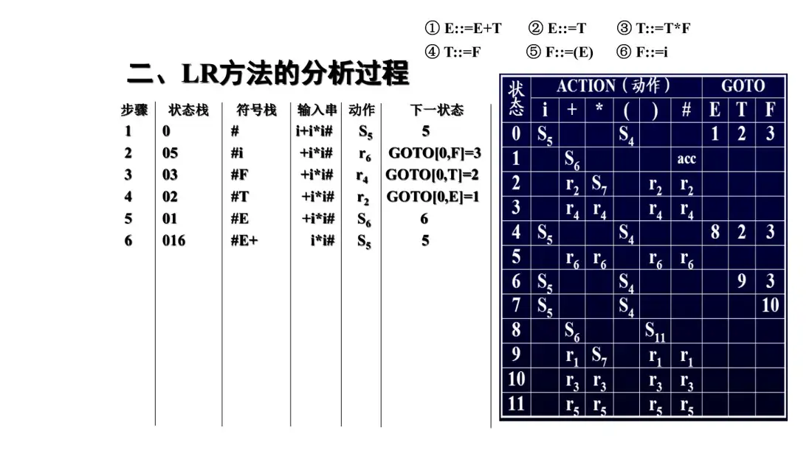

原文：

二、LR方法的分析过程

$$
\mathbf {E}: := \mathbf {E} + \mathbf {T}
$$

$$
\mathbf {T}: := \mathbf {F}
$$

② $\mathbf { E } { : : = } \mathbf { T }$

$$
\mathbf {T}: := \mathbf {T} ^ {*} \mathbf {F}
$$

$$
\mathbf {F}: := \mathbf {i}
$$

<table><tr><td>步骤</td><td>状态栈</td><td>符号栈</td><td>输入串</td><td>动作</td><td>下一状态</td></tr><tr><td>1</td><td>0</td><td>#</td><td>i+i*i#</td><td> $S_5$ </td><td>5</td></tr><tr><td>2</td><td>05</td><td>#i</td><td>+i*i#</td><td> $r_6$ </td><td>GOTO[0,F]=3</td></tr><tr><td>3</td><td>03</td><td>#F</td><td>+i*i#</td><td> $r_4$ </td><td>GOTO[0,T]=2</td></tr><tr><td>4</td><td>02</td><td>#T</td><td>+i*i#</td><td> $r_2$ </td><td>GOTO[0,E]=1</td></tr><tr><td>5</td><td>01</td><td>#E</td><td>+i*i#</td><td> $S_6$ </td><td>6</td></tr><tr><td>6</td><td>016</td><td>#E+</td><td>i*i#</td><td> $S_5$ </td><td>5</td></tr></table>

### 二、LR方法的分析过程

原文：

二、LR方法的分析过程

$$
\mathbf {E}: := \mathbf {E} + \mathbf {T}
$$

$$
\mathbf {T}: := \mathbf {F}
$$

② $\mathbf { E } { : : = } \mathbf { T }$

$$
\mathbf {T}: := \mathbf {T} ^ {*} \mathbf {F}
$$

⑤ F::=(E)

<table><tr><td>步骤</td><td>状态栈</td><td>符号栈</td><td>输入串</td><td>动作</td><td>下一状态</td></tr><tr><td>1</td><td>0</td><td>#</td><td>i+i*i#</td><td> $S_5$ </td><td>5</td></tr><tr><td>2</td><td>05</td><td>#i</td><td>+i*i#</td><td> $r_6$ </td><td>GOTO[0,F]=3</td></tr><tr><td>3</td><td>03</td><td>#F</td><td>+i*i#</td><td> $r_4$ </td><td>GOTO[0,T]=2</td></tr><tr><td>4</td><td>02</td><td>#T</td><td>+i*i#</td><td> $r_2$ </td><td>GOTO[0,E]=1</td></tr><tr><td>5</td><td>01</td><td>#E</td><td>+i*i#</td><td> $S_6$ </td><td>6</td></tr><tr><td>6</td><td>016</td><td>#E+</td><td>i*i#</td><td> $S_5$ </td><td>5</td></tr><tr><td>7</td><td>0165</td><td>#E+i</td><td>*i#</td><td></td><td></td></tr></table>

### 二、LR方法的分析过程

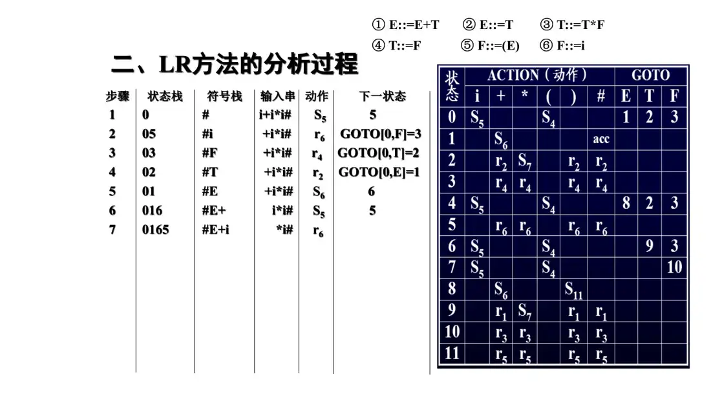

原文：

二、LR方法的分析过程

$$
\mathbf {E}: := \mathbf {E} + \mathbf {T}
$$

$$
\mathbf {T}: := \mathbf {F}
$$

② $\mathbf { E } { : : = } \mathbf { T }$

$$
\mathbf {T}: := \mathbf {T} ^ {*} \mathbf {F}
$$

⑤ F::=(E)

<table><tr><td>步骤</td><td>状态栈</td><td>符号栈</td><td>输入串</td><td>动作</td><td>下一状态</td></tr><tr><td>1</td><td>0</td><td>#</td><td>i+i*i#</td><td> $S_5$ </td><td>5</td></tr><tr><td>2</td><td>05</td><td>#i</td><td>+i*i#</td><td> $r_6$ </td><td>GOTO[0,F]=3</td></tr><tr><td>3</td><td>03</td><td>#F</td><td>+i*i#</td><td> $r_4$ </td><td>GOTO[0,T]=2</td></tr><tr><td>4</td><td>02</td><td>#T</td><td>+i*i#</td><td> $r_2$ </td><td>GOTO[0,E]=1</td></tr><tr><td>5</td><td>01</td><td>#E</td><td>+i*i#</td><td> $S_6$ </td><td>6</td></tr><tr><td>6</td><td>016</td><td>#E+</td><td>i*i#</td><td> $S_5$ </td><td>5</td></tr><tr><td>7</td><td>0165</td><td>#E+i</td><td>*i#</td><td> $r_6$ </td><td></td></tr></table>

$$
\mathbf {F}: := \mathbf {i}
$$

### 二、LR方法的分析过程

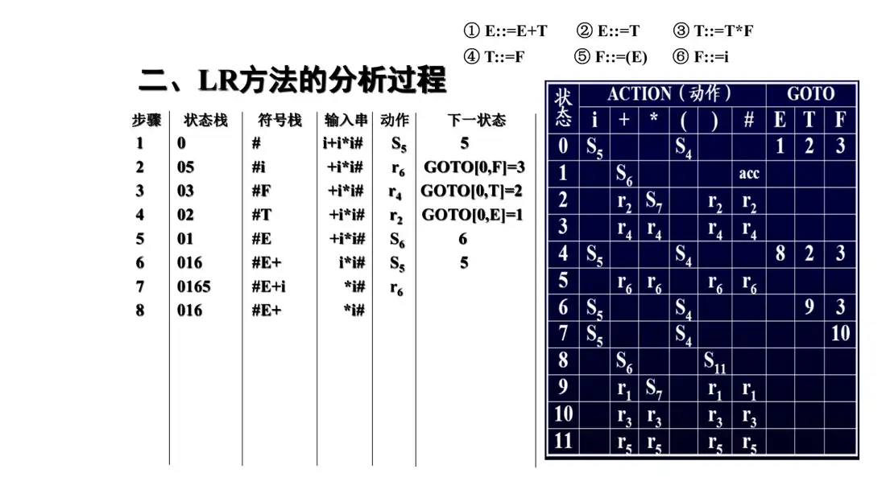

原文：

二、LR方法的分析过程

$$
\mathbf {E}: := \mathbf {E} + \mathbf {T}
$$

② $\mathbf { E } { : : = } \mathbf { T }$

$$
\mathbf {T}: := \mathbf {F}
$$

$$
\mathbf {T}: := \mathbf {T} ^ {*} \mathbf {F}
$$

<table><tr><td>步骤</td><td>状态栈</td><td>符号栈</td><td>输入串</td><td>动作</td><td>下一状态</td></tr><tr><td>1</td><td>0</td><td>#</td><td>i+i*i#</td><td> $S_5$ </td><td>5</td></tr><tr><td>2</td><td>05</td><td>#i</td><td>+i*i#</td><td> $r_6$ </td><td>GOTO[0,F]=3</td></tr><tr><td>3</td><td>03</td><td>#F</td><td>+i*i#</td><td> $r_4$ </td><td>GOTO[0,T]=2</td></tr><tr><td>4</td><td>02</td><td>#T</td><td>+i*i#</td><td> $r_2$ </td><td>GOTO[0,E]=1</td></tr><tr><td>5</td><td>01</td><td>#E</td><td>+i*i#</td><td> $S_6$ </td><td>6</td></tr><tr><td>6</td><td>016</td><td>#E+</td><td>i*i#</td><td> $S_5$ </td><td>5</td></tr><tr><td>7</td><td>0165</td><td>#E+i</td><td>*i#</td><td> $r_6$ </td><td></td></tr><tr><td>8</td><td>016</td><td>#E+</td><td>*i#</td><td></td><td></td></tr></table>

### 二、LR方法的分析过程

原文：

二、LR方法的分析过程

$$
\mathbf {E}: := \mathbf {E} + \mathbf {T}
$$

$$
\mathbf {T}: := \mathbf {F}
$$

② $\mathbf { E } { : : = } \mathbf { T }$

$$
\mathbf {T}: := \mathbf {T} ^ {*} \mathbf {F}
$$

<table><tr><td>步骤</td><td>状态栈</td><td>符号栈</td><td>输入串</td><td>动作</td><td>下一状态</td></tr><tr><td>1</td><td>0</td><td>#</td><td>i+i*i#</td><td> $S_5$ </td><td>5</td></tr><tr><td>2</td><td>05</td><td>#i</td><td>+i*i#</td><td> $r_6$ </td><td>GOTO[0,F]=3</td></tr><tr><td>3</td><td>03</td><td>#F</td><td>+i*i#</td><td> $r_4$ </td><td>GOTO[0,T]=2</td></tr><tr><td>4</td><td>02</td><td>#T</td><td>+i*i#</td><td> $r_2$ </td><td>GOTO[0,E]=1</td></tr><tr><td>5</td><td>01</td><td>#E</td><td>+i*i#</td><td> $S_6$ </td><td>6</td></tr><tr><td>6</td><td>016</td><td>#E+</td><td>i*i#</td><td> $S_5$ </td><td>5</td></tr><tr><td>7</td><td>0165</td><td>#E+i</td><td>*i#</td><td> $r_6$ </td><td></td></tr><tr><td>8</td><td>016</td><td>#E+F</td><td>*i#</td><td></td><td></td></tr></table>

⑤ F::=(E)

### 二、LR方法的分析过程

原文：

二、LR方法的分析过程

$$
\mathbf {E}: := \mathbf {E} + \mathbf {T}
$$

② $\mathbf { E } { : : = } \mathbf { T }$

$$
\mathbf {T}: := \mathbf {F}
$$

$$
\mathbf {T}: := \mathbf {T} ^ {*} \mathbf {F}
$$

⑤ F::=(E)

<table><tr><td>步骤</td><td>状态栈</td><td>符号栈</td><td>输入串</td><td>动作</td><td>下一状态</td></tr><tr><td>1</td><td>0</td><td>#</td><td>i+i*i#</td><td> $S_{5}$ </td><td>5</td></tr><tr><td>2</td><td>05</td><td>#i</td><td>+i*i#</td><td> $r_{6}$ </td><td>GOTO[0,F]=3</td></tr><tr><td>3</td><td>03</td><td>#F</td><td>+i*i#</td><td> $r_{4}$ </td><td>GOTO[0,T]=2</td></tr><tr><td>4</td><td>02</td><td>#T</td><td>+i*i#</td><td> $r_{2}$ </td><td>GOTO[0,E]=1</td></tr><tr><td>5</td><td>01</td><td>#E</td><td>+i*i#</td><td> $S_{6}$ </td><td>6</td></tr><tr><td>6</td><td>016</td><td>#E+</td><td>i*i#</td><td> $S_{5}$ </td><td>5</td></tr><tr><td>7</td><td>0165</td><td>#E+i</td><td>*i#</td><td> $r_{6}$ </td><td>GOTO[6,F]=3</td></tr><tr><td>8</td><td>016</td><td>#E+F</td><td>*i#</td><td></td><td></td></tr></table>

### 二、LR方法的分析过程

原文：

二、LR方法的分析过程

$$
\mathbf {E}: := \mathbf {E} + \mathbf {T}
$$

② $\mathbf { E } { : : = } \mathbf { T }$

$$
\mathbf {T}: := \mathbf {F}
$$

$$
\mathbf {T}: := \mathbf {T} ^ {*} \mathbf {F}
$$

⑤ F::=(E)

<table><tr><td>步骤</td><td>状态栈</td><td>符号栈</td><td>输入串</td><td>动作</td><td>下一状态</td></tr><tr><td>1</td><td>0</td><td>#</td><td>i+i*i#</td><td> $S_{5}$ </td><td>5</td></tr><tr><td>2</td><td>05</td><td>#i</td><td>+i*i#</td><td> $r_{6}$ </td><td>GOTO[0,F]=3</td></tr><tr><td>3</td><td>03</td><td>#F</td><td>+i*i#</td><td> $r_{4}$ </td><td>GOTO[0,T]=2</td></tr><tr><td>4</td><td>02</td><td>#T</td><td>+i*i#</td><td> $r_{2}$ </td><td>GOTO[0,E]=1</td></tr><tr><td>5</td><td>01</td><td>#E</td><td>+i*i#</td><td> $S_{6}$ </td><td>6</td></tr><tr><td>6</td><td>016</td><td>#E+</td><td>i*i#</td><td> $S_{5}$ </td><td>5</td></tr><tr><td>7</td><td>0165</td><td>#E+i</td><td>*i#</td><td> $r_{6}$ </td><td>GOTO[6,F]=3</td></tr><tr><td>8</td><td>0163</td><td>#E+F</td><td>*i#</td><td></td><td></td></tr></table>

### 二、LR方法的分析过程

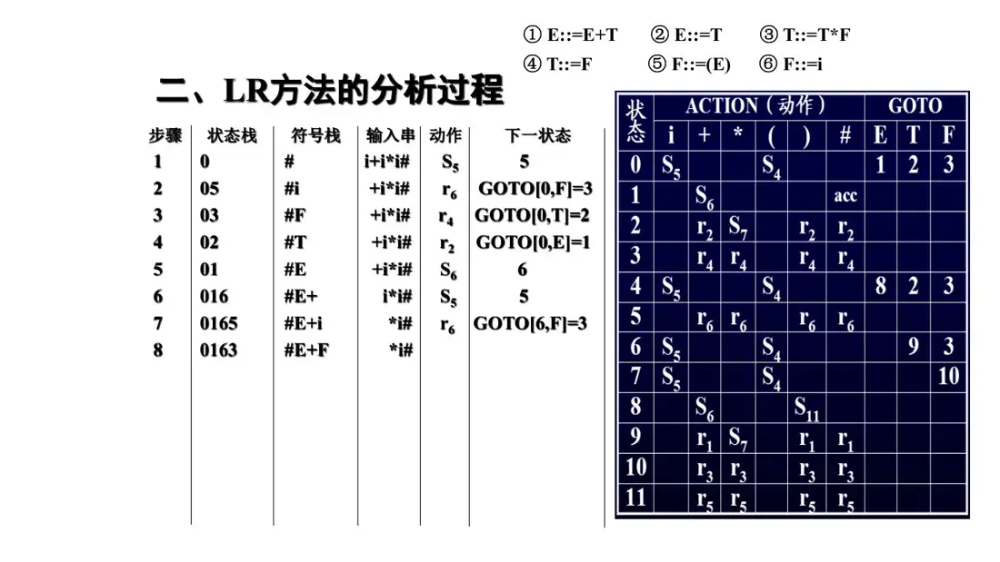

原文：

二、LR方法的分析过程

$$
\mathbf {E}: := \mathbf {E} + \mathbf {T}
$$

② $\mathbf { E } { : : = } \mathbf { T }$

$$
\mathbf {T}: := \mathbf {F}
$$

$$
\mathbf {T}: := \mathbf {T} ^ {*} \mathbf {F}
$$

⑤ F::=(E)

<table><tr><td>步骤</td><td>状态栈</td><td>符号栈</td><td>输入串</td><td>动作</td><td>下一状态</td></tr><tr><td>1</td><td>0</td><td>#</td><td>i+i*i#</td><td> $S_{5}$ </td><td>5</td></tr><tr><td>2</td><td>05</td><td>#i</td><td>+i*i#</td><td> $r_{6}$ </td><td>GOTO[0,F]=3</td></tr><tr><td>3</td><td>03</td><td>#F</td><td>+i*i#</td><td> $r_{4}$ </td><td>GOTO[0,T]=2</td></tr><tr><td>4</td><td>02</td><td>#T</td><td>+i*i#</td><td> $r_{2}$ </td><td>GOTO[0,E]=1</td></tr><tr><td>5</td><td>01</td><td>#E</td><td>+i*i#</td><td> $S_{6}$ </td><td>6</td></tr><tr><td>6</td><td>016</td><td>#E+</td><td>i*i#</td><td> $S_{5}$ </td><td>5</td></tr><tr><td>7</td><td>0165</td><td>#E+i</td><td>*i#</td><td> $r_{6}$ </td><td>GOTO[6,F]=3</td></tr><tr><td>8</td><td>0163</td><td>#E+F</td><td>*i#</td><td></td><td></td></tr></table>

### 二、LR方法的分析过程

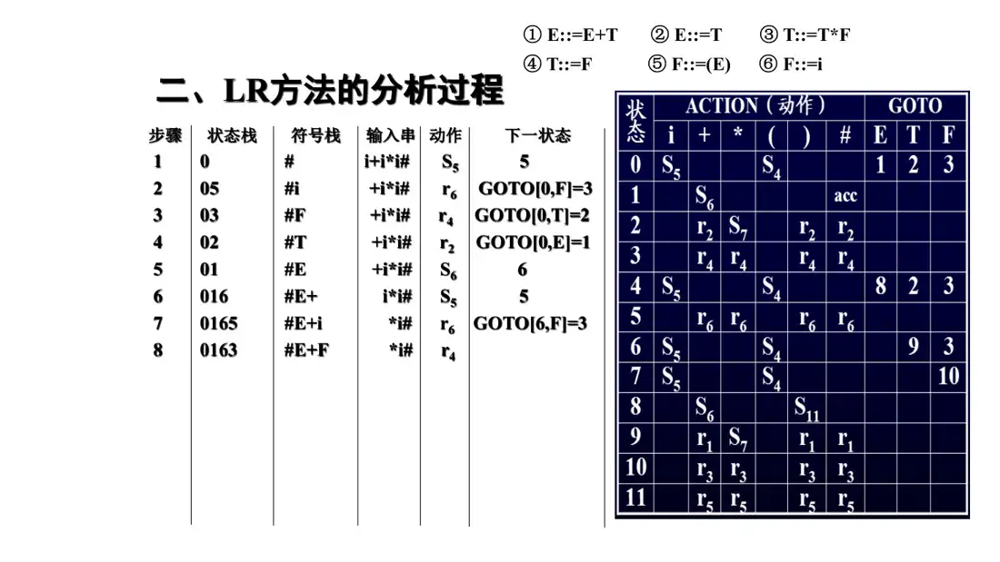

原文：

二、LR方法的分析过程

$$
\mathbf {E}: := \mathbf {E} + \mathbf {T}
$$

② $\mathbf { E } { : : = } \mathbf { T }$

$$
\mathbf {T}: := \mathbf {F}
$$

$$
\mathbf {T}: := \mathbf {T} ^ {*} \mathbf {F}
$$

⑤ F::=(E)

$$
\mathbf {F}: := \mathbf {i}
$$

<table><tr><td>步骤</td><td>状态栈</td><td>符号栈</td><td>输入串</td><td>动作</td><td>下一状态</td></tr><tr><td>1</td><td>0</td><td>#</td><td>i+i*i#</td><td> $S_{5}$ </td><td>5</td></tr><tr><td>2</td><td>05</td><td>#i</td><td>+i*i#</td><td> $r_{6}$ </td><td>GOTO[0,F]=3</td></tr><tr><td>3</td><td>03</td><td>#F</td><td>+i*i#</td><td> $r_{4}$ </td><td>GOTO[0,T]=2</td></tr><tr><td>4</td><td>02</td><td>#T</td><td>+i*i#</td><td> $r_{2}$ </td><td>GOTO[0,E]=1</td></tr><tr><td>5</td><td>01</td><td>#E</td><td>+i*i#</td><td> $S_{6}$ </td><td>6</td></tr><tr><td>6</td><td>016</td><td>#E+</td><td>i*i#</td><td> $S_{5}$ </td><td>5</td></tr><tr><td>7</td><td>0165</td><td>#E+i</td><td>*i#</td><td> $r_{6}$ </td><td>GOTO[6,F]=3</td></tr><tr><td>8</td><td>0163</td><td>#E+F</td><td>*i#</td><td> $r_{4}$ </td><td></td></tr></table>

### 二、LR方法的分析过程

原文：

二、LR方法的分析过程

$$
\mathbf {E}: := \mathbf {E} + \mathbf {T}
$$

$$
\mathbf {T}: := \mathbf {F}
$$

② $\mathbf { E } { : : = } \mathbf { T }$

⑤ F::=(E)

$$
\mathbf {T}: := \mathbf {T} ^ {*} \mathbf {F}
$$

<table><tr><td>步骤</td><td>状态栈</td><td>符号栈</td><td>输入串</td><td>动作</td><td>下一状态</td></tr><tr><td>1</td><td>0</td><td>#</td><td>i+i*i#</td><td> $S_5$ </td><td>5</td></tr><tr><td>2</td><td>05</td><td>#i</td><td>+i*i#</td><td> $r_6$ </td><td>GOTO[0,F]=3</td></tr><tr><td>3</td><td>03</td><td>#F</td><td>+i*i#</td><td> $r_4$ </td><td>GOTO[0,T]=2</td></tr><tr><td>4</td><td>02</td><td>#T</td><td>+i*i#</td><td> $r_2$ </td><td>GOTO[0,E]=1</td></tr><tr><td>5</td><td>01</td><td>#E</td><td>+i*i#</td><td> $S_6$ </td><td>6</td></tr><tr><td>6</td><td>016</td><td>#E+</td><td>i*i#</td><td> $S_5$ </td><td>5</td></tr><tr><td>7</td><td>0165</td><td>#E+i</td><td>*i#</td><td> $r_6$ </td><td>GOTO[6,F]=3</td></tr><tr><td>8</td><td>0163</td><td>#E+F</td><td>*i#</td><td> $r_4$ </td><td></td></tr><tr><td>9</td><td>016</td><td>#E+</td><td>*i#</td><td></td><td></td></tr></table>

### 二、LR方法的分析过程

原文：

二、LR方法的分析过程

$$
\mathbf {E}: := \mathbf {E} + \mathbf {T}
$$

$$
\mathbf {T}: := \mathbf {F}
$$

② $\mathbf { E } { : : = } \mathbf { T }$

$$
\mathbf {T}: := \mathbf {T} ^ {*} \mathbf {F}
$$

<table><tr><td>步骤</td><td>状态栈</td><td>符号栈</td><td>输入串</td><td>动作</td><td>下一状态</td></tr><tr><td>1</td><td>0</td><td>#</td><td>i+i*i#</td><td> $S_5$ </td><td>5</td></tr><tr><td>2</td><td>05</td><td>#i</td><td>+i*i#</td><td> $r_6$ </td><td>GOTO[0,F]=3</td></tr><tr><td>3</td><td>03</td><td>#F</td><td>+i*i#</td><td> $r_4$ </td><td>GOTO[0,T]=2</td></tr><tr><td>4</td><td>02</td><td>#T</td><td>+i*i#</td><td> $r_2$ </td><td>GOTO[0,E]=1</td></tr><tr><td>5</td><td>01</td><td>#E</td><td>+i*i#</td><td> $S_6$ </td><td>6</td></tr><tr><td>6</td><td>016</td><td>#E+</td><td>i*i#</td><td> $S_5$ </td><td>5</td></tr><tr><td>7</td><td>0165</td><td>#E+i</td><td>*i#</td><td> $r_6$ </td><td>GOTO[6,F]=3</td></tr><tr><td>8</td><td>0163</td><td>#E+F</td><td>*i#</td><td> $r_4$ </td><td></td></tr><tr><td>9</td><td>01</td><td>#E+T</td><td>*i#</td><td></td><td></td></tr></table>

### 二、LR方法的分析过程

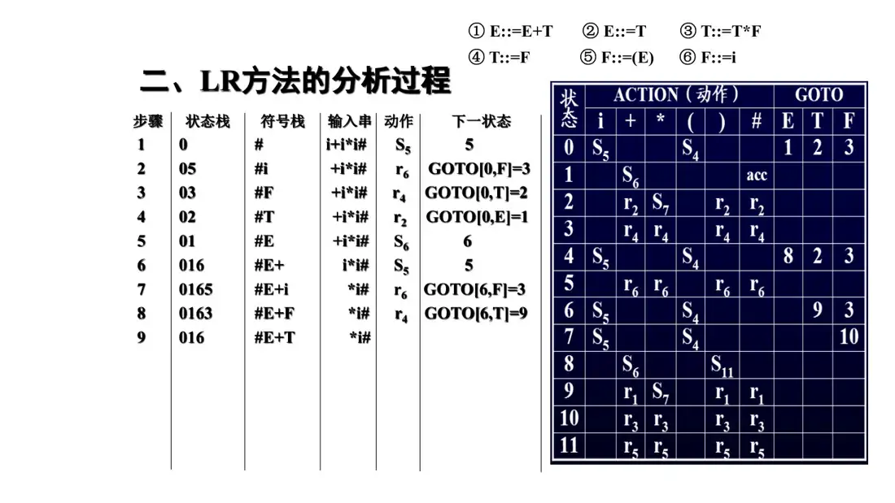

原文：

二、LR方法的分析过程

$$
\mathbf {E}: := \mathbf {E} + \mathbf {T}
$$

② $\mathbf { E } { : : = } \mathbf { T }$

$$
\mathbf {T}: := \mathbf {F}
$$

$$
\mathbf {T}: := \mathbf {T} ^ {*} \mathbf {F}
$$

⑤ F::=(E)

<table><tr><td>步骤</td><td>状态栈</td><td>符号栈</td><td>输入串</td><td>动作</td><td>下一状态</td></tr><tr><td>1</td><td>0</td><td>#</td><td>i+i*i#</td><td> $S_5$ </td><td>5</td></tr><tr><td>2</td><td>05</td><td>#i</td><td>+i*i#</td><td> $r_6$ </td><td>GOTO[0,F]=3</td></tr><tr><td>3</td><td>03</td><td>#F</td><td>+i*i#</td><td> $r_4$ </td><td>GOTO[0,T]=2</td></tr><tr><td>4</td><td>02</td><td>#T</td><td>+i*i#</td><td> $r_2$ </td><td>GOTO[0,E]=1</td></tr><tr><td>5</td><td>01</td><td>#E</td><td>+i*i#</td><td> $S_6$ </td><td>6</td></tr><tr><td>6</td><td>016</td><td>#E+</td><td>i*i#</td><td> $S_5$ </td><td>5</td></tr><tr><td>7</td><td>0165</td><td>#E+i</td><td>*i#</td><td> $r_6$ </td><td>GOTO[6,F]=3</td></tr><tr><td>8</td><td>0163</td><td>#E+F</td><td>*i#</td><td> $r_4$ </td><td>GOTO[6,T]=9</td></tr><tr><td>9</td><td>016</td><td>#E+T</td><td>*i#</td><td></td><td></td></tr></table>

### 二、LR方法的分析过程

原文：

二、LR方法的分析过程

$$
\mathbf {E}: := \mathbf {E} + \mathbf {T}
$$

② $\mathbf { E } { : : = } \mathbf { T }$

$$
\mathbf {T}: := \mathbf {F}
$$

$$
\mathbf {T}: := \mathbf {T} ^ {*} \mathbf {F}
$$

⑤ F::=(E)

<table><tr><td>步骤</td><td>状态栈</td><td>符号栈</td><td>输入串</td><td>动作</td><td>下一状态</td></tr><tr><td>1</td><td>0</td><td>#</td><td>i+i*i#</td><td> $S_5$ </td><td>5</td></tr><tr><td>2</td><td>05</td><td>#i</td><td>+i*i#</td><td> $r_6$ </td><td>GOTO[0,F]=3</td></tr><tr><td>3</td><td>03</td><td>#F</td><td>+i*i#</td><td> $r_4$ </td><td>GOTO[0,T]=2</td></tr><tr><td>4</td><td>02</td><td>#T</td><td>+i*i#</td><td> $r_2$ </td><td>GOTO[0,E]=1</td></tr><tr><td>5</td><td>01</td><td>#E</td><td>+i*i#</td><td> $S_6$ </td><td>6</td></tr><tr><td>6</td><td>016</td><td>#E+</td><td>i*i#</td><td> $S_5$ </td><td>5</td></tr><tr><td>7</td><td>0165</td><td>#E+i</td><td>*i#</td><td> $r_6$ </td><td>GOTO[6,F]=3</td></tr><tr><td>8</td><td>0163</td><td>#E+F</td><td>*i#</td><td> $r_4$ </td><td>GOTO[6,T]=9</td></tr><tr><td>9</td><td>0169</td><td>#E+T</td><td>*i#</td><td></td><td></td></tr></table>

### 二、LR方法的分析过程

原文：

二、LR方法的分析过程

$$
\mathbf {E}: := \mathbf {E} + \mathbf {T}
$$

② $\mathbf { E } { : : = } \mathbf { T }$

$$
\mathbf {T}: := \mathbf {F}
$$

$$
\mathbf {T}: := \mathbf {T} ^ {*} \mathbf {F}
$$

⑤ F::=(E)

<table><tr><td>步骤</td><td>状态栈</td><td>符号栈</td><td>输入串</td><td>动作</td><td>下一状态</td></tr><tr><td>1</td><td>0</td><td>#</td><td>i+i*i#</td><td> $S_5$ </td><td>5</td></tr><tr><td>2</td><td>05</td><td>#i</td><td>+i*i#</td><td> $r_6$ </td><td>GOTO[0,F]=3</td></tr><tr><td>3</td><td>03</td><td>#F</td><td>+i*i#</td><td> $r_4$ </td><td>GOTO[0,T]=2</td></tr><tr><td>4</td><td>02</td><td>#T</td><td>+i*i#</td><td> $r_2$ </td><td>GOTO[0,E]=1</td></tr><tr><td>5</td><td>01</td><td>#E</td><td>+i*i#</td><td> $S_6$ </td><td>6</td></tr><tr><td>6</td><td>016</td><td>#E+</td><td>i*i#</td><td> $S_5$ </td><td>5</td></tr><tr><td>7</td><td>0165</td><td>#E+i</td><td>*i#</td><td> $r_6$ </td><td>GOTO[6,F]=3</td></tr><tr><td>8</td><td>0163</td><td>#E+F</td><td>*i#</td><td> $r_4$ </td><td>GOTO[6,T]=9</td></tr><tr><td>9</td><td>0169</td><td>#E+T</td><td>*i#</td><td></td><td></td></tr></table>

### 二、LR方法的分析过程

原文：

二、LR方法的分析过程

$$
\mathbf {E}: := \mathbf {E} + \mathbf {T}
$$

$$
\mathbf {T}: := \mathbf {F}
$$

② $\mathbf { E } { : : = } \mathbf { T }$

$$
\mathbf {T}: := \mathbf {T} ^ {*} \mathbf {F}
$$

⑤ F::=(E)

<table><tr><td>步骤</td><td>状态栈</td><td>符号栈</td><td>输入串</td><td>动作</td><td>下一状态</td></tr><tr><td>1</td><td>0</td><td>#</td><td>i+i*i#</td><td> $S_5$ </td><td>5</td></tr><tr><td>2</td><td>05</td><td>#i</td><td>+i*i#</td><td> $r_6$ </td><td>GOTO[0,F]=3</td></tr><tr><td>3</td><td>03</td><td>#F</td><td>+i*i#</td><td> $r_4$ </td><td>GOTO[0,T]=2</td></tr><tr><td>4</td><td>02</td><td>#T</td><td>+i*i#</td><td> $r_2$ </td><td>GOTO[0,E]=1</td></tr><tr><td>5</td><td>01</td><td>#E</td><td>+i*i#</td><td> $S_6$ </td><td>6</td></tr><tr><td>6</td><td>016</td><td>#E+</td><td>i*i#</td><td> $S_5$ </td><td>5</td></tr><tr><td>7</td><td>0165</td><td>#E+i</td><td>*i#</td><td> $r_6$ </td><td>GOTO[6,F]=3</td></tr><tr><td>8</td><td>0163</td><td>#E+F</td><td>*i#</td><td> $r_4$ </td><td>GOTO[6,T]=9</td></tr><tr><td>9</td><td>0169</td><td>#E+T</td><td>*i#</td><td> $S_7$ </td><td>7</td></tr></table>

### 二、LR方法的分析过程

原文：

二、LR方法的分析过程

$$
\mathbf {E}: := \mathbf {E} + \mathbf {T}
$$

$$
\mathbf {T}: := \mathbf {F}
$$

<table><tr><td>步骤</td><td>状态栈</td><td>符号栈</td><td>输入串</td><td>动作</td><td>下一状态</td></tr><tr><td>1</td><td>0</td><td>#</td><td>i+i*i#</td><td> $S_5$ </td><td>5</td></tr><tr><td>2</td><td>05</td><td>#i</td><td>+i*i#</td><td> $r_6$ </td><td>GOTO[0,F]=3</td></tr><tr><td>3</td><td>03</td><td>#F</td><td>+i*i#</td><td> $r_4$ </td><td>GOTO[0,T]=2</td></tr><tr><td>4</td><td>02</td><td>#T</td><td>+i*i#</td><td> $r_2$ </td><td>GOTO[0,E]=1</td></tr><tr><td>5</td><td>01</td><td>#E</td><td>+i*i#</td><td> $S_6$ </td><td>6</td></tr><tr><td>6</td><td>016</td><td>#E+</td><td>i*i#</td><td> $S_5$ </td><td>5</td></tr><tr><td>7</td><td>0165</td><td>#E+i</td><td>*i#</td><td> $r_6$ </td><td>GOTO[6,F]=3</td></tr><tr><td>8</td><td>0163</td><td>#E+F</td><td>*i#</td><td> $r_4$ </td><td>GOTO[6,T]=9</td></tr><tr><td>9</td><td>0169</td><td>#E+T</td><td>*i#</td><td> $S_7$ </td><td>7</td></tr><tr><td>10</td><td>01697</td><td>#E+T*</td><td>i#</td><td></td><td></td></tr></table>

② $\mathbf { E } { : : = } \mathbf { T }$

$$
\mathbf {T}: := \mathbf {T} ^ {*} \mathbf {F}
$$

### 二、LR方法的分析过程

原文：

二、LR方法的分析过程

$$
\mathbf {E}: := \mathbf {E} + \mathbf {T}
$$

$$
\mathbf {T}: := \mathbf {F}
$$

② $\mathbf { E } { : : = } \mathbf { T }$

⑤ F::=(E)

$$
\mathbf {T}: := \mathbf {T} ^ {*} \mathbf {F}
$$

<table><tr><td>步骤</td><td>状态栈</td><td>符号栈</td><td>输入串</td><td>动作</td><td>下一状态</td></tr><tr><td>1</td><td>0</td><td>#</td><td>i+i*i#</td><td> $S_5$ </td><td>5</td></tr><tr><td>2</td><td>05</td><td>#i</td><td>+i*i#</td><td> $r_6$ </td><td>GOTO[0,F]=3</td></tr><tr><td>3</td><td>03</td><td>#F</td><td>+i*i#</td><td> $r_4$ </td><td>GOTO[0,T]=2</td></tr><tr><td>4</td><td>02</td><td>#T</td><td>+i*i#</td><td> $r_2$ </td><td>GOTO[0,E]=1</td></tr><tr><td>5</td><td>01</td><td>#E</td><td>+i*i#</td><td> $S_6$ </td><td>6</td></tr><tr><td>6</td><td>016</td><td>#E+</td><td>i*i#</td><td> $S_5$ </td><td>5</td></tr><tr><td>7</td><td>0165</td><td>#E+i</td><td>*i#</td><td> $r_6$ </td><td>GOTO[6,F]=3</td></tr><tr><td>8</td><td>0163</td><td>#E+F</td><td>*i#</td><td> $r_4$ </td><td>GOTO[6,T]=9</td></tr><tr><td>9</td><td>0169</td><td>#E+T</td><td>*i#</td><td> $S_7$ </td><td>7</td></tr><tr><td>10</td><td>01697</td><td>#E+T*</td><td>i#</td><td> $S_5$ </td><td>5</td></tr></table>

### $$

原文：

$$
\mathbf {E}: := \mathbf {E} + \mathbf {T}
$$

二、LR方法的分析过程

$$
\mathbf {T}: := \mathbf {F}
$$

② $\mathbf { E } { : : = } \mathbf { T }$

⑤ F::=(E)

$$
\mathbf {T}: := \mathbf {T} ^ {*} \mathbf {F}
$$

<table><tr><td>步骤</td><td>状态栈</td><td>符号栈</td><td>输入串</td><td>动作</td><td>下一状态</td></tr><tr><td>1</td><td>0</td><td>#</td><td>i+i*i#</td><td> $S_5$ </td><td>5</td></tr><tr><td>2</td><td>05</td><td>#i</td><td>+i*i#</td><td> $r_6$ </td><td>GOTO[0,F]=3</td></tr><tr><td>3</td><td>03</td><td>#F</td><td>+i*i#</td><td> $r_4$ </td><td>GOTO[0,T]=2</td></tr><tr><td>4</td><td>02</td><td>#T</td><td>+i*i#</td><td> $r_2$ </td><td>GOTO[0,E]=1</td></tr><tr><td>5</td><td>01</td><td>#E</td><td>+i*i#</td><td> $S_6$ </td><td>6</td></tr><tr><td>6</td><td>016</td><td>#E+</td><td>i*i#</td><td> $S_5$ </td><td>5</td></tr><tr><td>7</td><td>0165</td><td>#E+i</td><td>*i#</td><td> $r_6$ </td><td>GOTO[6,F]=3</td></tr><tr><td>8</td><td>0163</td><td>#E+F</td><td>*i#</td><td> $r_4$ </td><td>GOTO[6,T]=9</td></tr><tr><td>9</td><td>0169</td><td>#E+T</td><td>*i#</td><td> $S_7$ </td><td>7</td></tr><tr><td>10</td><td>01697</td><td>#E+T*</td><td>i#</td><td> $S_5$ </td><td>5</td></tr><tr><td>11</td><td>016975</td><td>#E+T*i</td><td>#</td><td></td><td></td></tr></table>

### $$

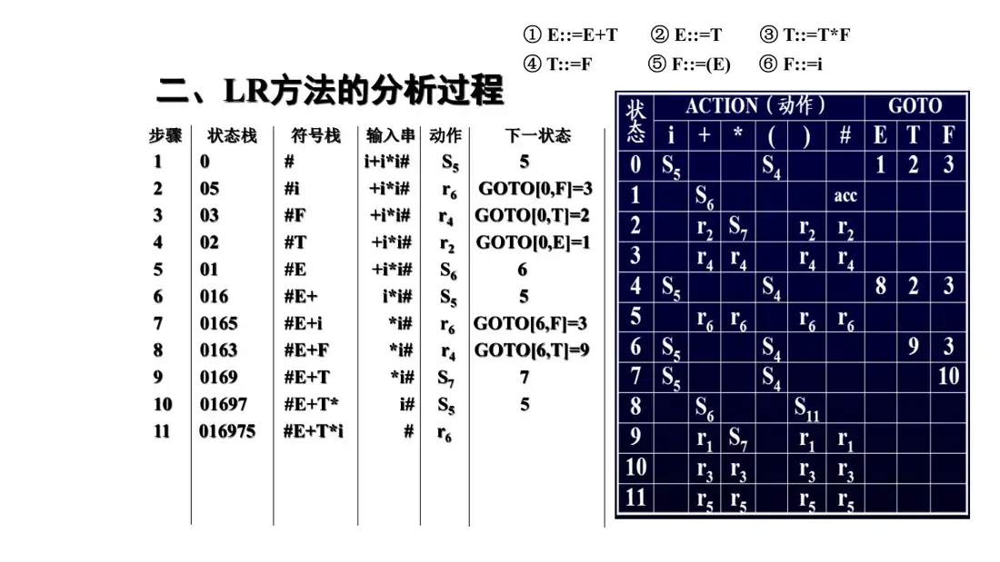

原文：

$$
\mathbf {E}: := \mathbf {E} + \mathbf {T}
$$

二、LR方法的分析过程

$$
\mathbf {T}: := \mathbf {F}
$$

<table><tr><td>步骤</td><td>状态栈</td><td>符号栈</td><td>输入串</td><td>动作</td><td>下一状态</td></tr><tr><td>1</td><td>0</td><td>#</td><td>i+i*i#</td><td> $S_5$ </td><td>5</td></tr><tr><td>2</td><td>05</td><td>#i</td><td>+i*i#</td><td> $r_6$ </td><td>GOTO[0,F]=3</td></tr><tr><td>3</td><td>03</td><td>#F</td><td>+i*i#</td><td> $r_4$ </td><td>GOTO[0,T]=2</td></tr><tr><td>4</td><td>02</td><td>#T</td><td>+i*i#</td><td> $r_2$ </td><td>GOTO[0,E]=1</td></tr><tr><td>5</td><td>01</td><td>#E</td><td>+i*i#</td><td> $S_6$ </td><td>6</td></tr><tr><td>6</td><td>016</td><td>#E+</td><td>i*i#</td><td> $S_5$ </td><td>5</td></tr><tr><td>7</td><td>0165</td><td>#E+i</td><td>*i#</td><td> $r_6$ </td><td>GOTO[6,F]=3</td></tr><tr><td>8</td><td>0163</td><td>#E+F</td><td>*i#</td><td> $r_4$ </td><td>GOTO[6,T]=9</td></tr><tr><td>9</td><td>0169</td><td>#E+T</td><td>*i#</td><td> $S_7$ </td><td>7</td></tr><tr><td>10</td><td>01697</td><td>#E+T*</td><td>i#</td><td> $S_5$ </td><td>5</td></tr><tr><td>11</td><td>016975</td><td>#E+T*i</td><td>#</td><td> $r_6$ </td><td></td></tr></table>

② $\mathbf { E } { : : = } \mathbf { T }$

⑤ F::=(E)

$$
\mathbf {T}: := \mathbf {T} ^ {*} \mathbf {F}
$$

### $$

原文：

$$
\mathbf {E}: := \mathbf {E} + \mathbf {T}
$$

二、LR方法的分析过程

$$
\mathbf {T}: := \mathbf {F}
$$

<table><tr><td>步骤</td><td>状态栈</td><td>符号栈</td><td>输入串</td><td>动作</td><td>下一状态</td></tr><tr><td>1</td><td>0</td><td>#</td><td>i+i*i#</td><td> $S_5$ </td><td>5</td></tr><tr><td>2</td><td>05</td><td>#i</td><td>+i*i#</td><td> $r_6$ </td><td>GOTO[0,F]=3</td></tr><tr><td>3</td><td>03</td><td>#F</td><td>+i*i#</td><td> $r_4$ </td><td>GOTO[0,T]=2</td></tr><tr><td>4</td><td>02</td><td>#T</td><td>+i*i#</td><td> $r_2$ </td><td>GOTO[0,E]=1</td></tr><tr><td>5</td><td>01</td><td>#E</td><td>+i*i#</td><td> $S_6$ </td><td>6</td></tr><tr><td>6</td><td>016</td><td>#E+</td><td>i*i#</td><td> $S_5$ </td><td>5</td></tr><tr><td>7</td><td>0165</td><td>#E+i</td><td>*i#</td><td> $r_6$ </td><td>GOTO[6,F]=3</td></tr><tr><td>8</td><td>0163</td><td>#E+F</td><td>*i#</td><td> $r_4$ </td><td>GOTO[6,T]=9</td></tr><tr><td>9</td><td>0169</td><td>#E+T</td><td>*i#</td><td> $S_7$ </td><td>7</td></tr><tr><td>10</td><td>01697</td><td>#E+T*</td><td>i#</td><td> $S_5$ </td><td>5</td></tr><tr><td>11</td><td>016975</td><td>#E+T*i</td><td>#</td><td> $r_6$ </td><td></td></tr><tr><td>12</td><td>01697</td><td>#E+T*</td><td>#</td><td></td><td></td></tr></table>

② $\mathbf { E } { : : = } \mathbf { T }$

$$
\mathbf {T}: := \mathbf {T} ^ {*} \mathbf {F}
$$

### $$

原文：

$$
\mathbf {E}: := \mathbf {E} + \mathbf {T}
$$

二、LR方法的分析过程

$$
\mathbf {T}: := \mathbf {F}
$$

<table><tr><td>步骤</td><td>状态栈</td><td>符号栈</td><td>输入串</td><td>动作</td><td>下一状态</td></tr><tr><td>1</td><td>0</td><td>#</td><td>i+i*i#</td><td> $S_5$ </td><td>5</td></tr><tr><td>2</td><td>05</td><td>#i</td><td>+i*i#</td><td> $r_6$ </td><td>GOTO[0,F]=3</td></tr><tr><td>3</td><td>03</td><td>#F</td><td>+i*i#</td><td> $r_4$ </td><td>GOTO[0,T]=2</td></tr><tr><td>4</td><td>02</td><td>#T</td><td>+i*i#</td><td> $r_2$ </td><td>GOTO[0,E]=1</td></tr><tr><td>5</td><td>01</td><td>#E</td><td>+i*i#</td><td> $S_6$ </td><td>6</td></tr><tr><td>6</td><td>016</td><td>#E+</td><td>i*i#</td><td> $S_5$ </td><td>5</td></tr><tr><td>7</td><td>0165</td><td>#E+i</td><td>*i#</td><td> $r_6$ </td><td>GOTO[6,F]=3</td></tr><tr><td>8</td><td>0163</td><td>#E+F</td><td>*i#</td><td> $r_4$ </td><td>GOTO[6,T]=9</td></tr><tr><td>9</td><td>0169</td><td>#E+T</td><td>*i#</td><td> $S_7$ </td><td>7</td></tr><tr><td>10</td><td>01697</td><td>#E+T*</td><td>i#</td><td> $S_5$ </td><td>5</td></tr><tr><td>11</td><td>016975</td><td>#E+T*i</td><td>#</td><td> $r_6$ </td><td></td></tr><tr><td>12</td><td>01697</td><td>#E+T*F</td><td>#</td><td></td><td></td></tr></table>

② $\mathbf { E } { : : = } \mathbf { T }$

$$
\mathbf {T}: := \mathbf {T} ^ {*} \mathbf {F}
$$

### $$

原文：

$$
\mathbf {E}: := \mathbf {E} + \mathbf {T}
$$

二、LR方法的分析过程

$$
\mathbf {T}: := \mathbf {F}
$$

<table><tr><td>步骤</td><td>状态栈</td><td>符号栈</td><td>输入串</td><td>动作</td><td>下一状态</td></tr><tr><td>1</td><td>0</td><td>#</td><td>i+i*i#</td><td> $S_{5}$ </td><td>5</td></tr><tr><td>2</td><td>05</td><td>#i</td><td>+i*i#</td><td> $r_{6}$ </td><td>GOTO[0,F]=3</td></tr><tr><td>3</td><td>03</td><td>#F</td><td>+i*i#</td><td> $r_{4}$ </td><td>GOTO[0,T]=2</td></tr><tr><td>4</td><td>02</td><td>#T</td><td>+i*i#</td><td> $r_{2}$ </td><td>GOTO[0,E]=1</td></tr><tr><td>5</td><td>01</td><td>#E</td><td>+i*i#</td><td> $S_{6}$ </td><td>6</td></tr><tr><td>6</td><td>016</td><td>#E+</td><td>i*i#</td><td> $S_{5}$ </td><td>5</td></tr><tr><td>7</td><td>0165</td><td>#E+i</td><td>*i#</td><td> $r_{6}$ </td><td>GOTO[6,F]=3</td></tr><tr><td>8</td><td>0163</td><td>#E+F</td><td>*i#</td><td> $r_{4}$ </td><td>GOTO[6,T]=9</td></tr><tr><td>9</td><td>0169</td><td>#E+T</td><td>*i#</td><td> $S_{7}$ </td><td>7</td></tr><tr><td>10</td><td>01697</td><td>#E+T*</td><td>i#</td><td> $S_{5}$ </td><td>5</td></tr><tr><td>11</td><td>016975</td><td>#E+T*i</td><td>#</td><td> $r_{6}$ </td><td>GOTO[7,F]=10</td></tr><tr><td>12</td><td>01697</td><td>#E+T*F</td><td>#</td><td></td><td></td></tr></table>

② $\mathbf { E } { : : = } \mathbf { T }$

⑤ F::=(E)

$$
\mathbf {T}: := \mathbf {T} ^ {*} \mathbf {F}
$$

### $$

原文：

$$
\mathbf {E}: := \mathbf {E} + \mathbf {T}
$$

二、LR方法的分析过程

$$
\mathbf {T}: := \mathbf {F}
$$

<table><tr><td>步骤</td><td>状态栈</td><td>符号栈</td><td>输入串</td><td>动作</td><td>下一状态</td></tr><tr><td>1</td><td>0</td><td>#</td><td>i+i*i#</td><td> $S_5$ </td><td>5</td></tr><tr><td>2</td><td>05</td><td>#i</td><td>+i*i#</td><td> $r_6$ </td><td>GOTO[0,F]=3</td></tr><tr><td>3</td><td>03</td><td>#F</td><td>+i*i#</td><td> $r_4$ </td><td>GOTO[0,T]=2</td></tr><tr><td>4</td><td>02</td><td>#T</td><td>+i*i#</td><td> $r_2$ </td><td>GOTO[0,E]=1</td></tr><tr><td>5</td><td>01</td><td>#E</td><td>+i*i#</td><td> $S_6$ </td><td>6</td></tr><tr><td>6</td><td>016</td><td>#E+</td><td>i*i#</td><td> $S_5$ </td><td>5</td></tr><tr><td>7</td><td>0165</td><td>#E+i</td><td>*i#</td><td> $r_6$ </td><td>GOTO[6,F]=3</td></tr><tr><td>8</td><td>0163</td><td>#E+F</td><td>*i#</td><td> $r_4$ </td><td>GOTO[6,T]=9</td></tr><tr><td>9</td><td>0169</td><td>#E+T</td><td>*i#</td><td> $S_7$ </td><td>7</td></tr><tr><td>10</td><td>01697</td><td>#E+T*</td><td>i#</td><td> $S_5$ </td><td>5</td></tr><tr><td>11</td><td>016975</td><td>#E+T*i</td><td>#</td><td> $r_6$ </td><td>GOTO[7,F]=10</td></tr><tr><td>12</td><td>0169710</td><td>#E+T*F</td><td>#</td><td></td><td></td></tr></table>

② $\mathbf { E } { : : = } \mathbf { T }$

⑤ F::=(E)

$$
\mathbf {T}: := \mathbf {T} ^ {*} \mathbf {F}
$$

### $$

原文：

$$
\mathbf {E}: := \mathbf {E} + \mathbf {T}
$$

二、LR方法的分析过程

$$
\mathbf {T}: := \mathbf {F}
$$

<table><tr><td>步骤</td><td>状态栈</td><td>符号栈</td><td>输入串</td><td>动作</td><td>下一状态</td></tr><tr><td>1</td><td>0</td><td>#</td><td>i+i*i#</td><td> $S_5$ </td><td>5</td></tr><tr><td>2</td><td>05</td><td>#i</td><td>+i*i#</td><td> $r_6$ </td><td>GOTO[0,F]=3</td></tr><tr><td>3</td><td>03</td><td>#F</td><td>+i*i#</td><td> $r_4$ </td><td>GOTO[0,T]=2</td></tr><tr><td>4</td><td>02</td><td>#T</td><td>+i*i#</td><td> $r_2$ </td><td>GOTO[0,E]=1</td></tr><tr><td>5</td><td>01</td><td>#E</td><td>+i*i#</td><td> $S_6$ </td><td>6</td></tr><tr><td>6</td><td>016</td><td>#E+</td><td>i*i#</td><td> $S_5$ </td><td>5</td></tr><tr><td>7</td><td>0165</td><td>#E+i</td><td>*i#</td><td> $r_6$ </td><td>GOTO[6,F]=3</td></tr><tr><td>8</td><td>0163</td><td>#E+F</td><td>*i#</td><td> $r_4$ </td><td>GOTO[6,T]=9</td></tr><tr><td>9</td><td>0169</td><td>#E+T</td><td>*i#</td><td> $S_7$ </td><td>7</td></tr><tr><td>10</td><td>01697</td><td>#E+T*</td><td>i#</td><td> $S_5$ </td><td>5</td></tr><tr><td>11</td><td>016975</td><td>#E+T*i</td><td>#</td><td> $r_6$ </td><td>GOTO[7,F]=10</td></tr><tr><td>12</td><td>0169710</td><td>#E+T*F</td><td>#</td><td></td><td></td></tr></table>

② $\mathbf { E } { : : = } \mathbf { T }$

⑤ F::=(E)

$$
\mathbf {T}: := \mathbf {T} ^ {*} \mathbf {F}
$$

### 二、LR方法的分析过程

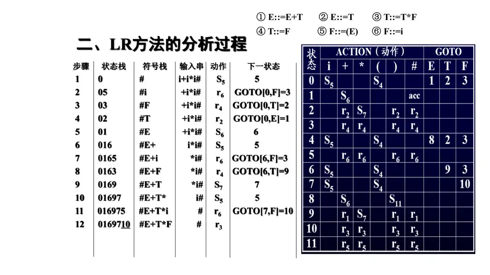

原文：

二、LR方法的分析过程

$$
\mathbf {E}: := \mathbf {E} + \mathbf {T}
$$

$$
\mathbf {T}: := \mathbf {F}
$$

② $\mathbf { E } { : : = } \mathbf { T }$

⑤ F::=(E)

$$
\mathbf {T}: := \mathbf {T} ^ {*} \mathbf {F}
$$

⑥ F::=i

<table><tr><td>步骤</td><td>状态栈</td><td>符号栈</td><td>输入串</td><td>动作</td><td>下一状态</td></tr><tr><td>1</td><td>0</td><td>#</td><td>i+i*i#</td><td> $S_{5}$ </td><td>5</td></tr><tr><td>2</td><td>05</td><td>#i</td><td>+i*i#</td><td> $r_{6}$ </td><td>GOTO[0,F]=3</td></tr><tr><td>3</td><td>03</td><td>#F</td><td>+i*i#</td><td> $r_{4}$ </td><td>GOTO[0,T]=2</td></tr><tr><td>4</td><td>02</td><td>#T</td><td>+i*i#</td><td> $r_{2}$ </td><td>GOTO[0,E]=1</td></tr><tr><td>5</td><td>01</td><td>#E</td><td>+i*i#</td><td> $S_{6}$ </td><td>6</td></tr><tr><td>6</td><td>016</td><td>#E+</td><td>i*i#</td><td> $S_{5}$ </td><td>5</td></tr><tr><td>7</td><td>0165</td><td>#E+i</td><td>*i#</td><td> $r_{6}$ </td><td>GOTO[6,F]=3</td></tr><tr><td>8</td><td>0163</td><td>#E+F</td><td>*i#</td><td> $r_{4}$ </td><td>GOTO[6,T]=9</td></tr><tr><td>9</td><td>0169</td><td>#E+T</td><td>*i#</td><td> $S_{7}$ </td><td>7</td></tr><tr><td>10</td><td>01697</td><td>#E+T*</td><td>i#</td><td> $S_{5}$ </td><td>5</td></tr><tr><td>11</td><td>016975</td><td>#E+T*i</td><td>#</td><td> $r_{6}$ </td><td>GOTO[7,F]=10</td></tr><tr><td>12</td><td>0169710</td><td>#E+T*F</td><td>#</td><td> $r_{3}$ </td><td></td></tr></table>

### $$

原文：

$$
\mathbf {E}: := \mathbf {E} + \mathbf {T}
$$

二、LR方法的分析过程

$$
\mathbf {T}: := \mathbf {F}
$$

<table><tr><td>步骤</td><td>状态栈</td><td>符号栈</td><td>输入串</td><td>动作</td><td>下一状态</td></tr><tr><td>1</td><td>0</td><td>#</td><td>i+i*i#</td><td> $S_5$ </td><td>5</td></tr><tr><td>2</td><td>05</td><td>#i</td><td>+i*i#</td><td> $r_6$ </td><td>GOTO[0,F]=3</td></tr><tr><td>3</td><td>03</td><td>#F</td><td>+i*i#</td><td> $r_4$ </td><td>GOTO[0,T]=2</td></tr><tr><td>4</td><td>02</td><td>#T</td><td>+i*i#</td><td> $r_2$ </td><td>GOTO[0,E]=1</td></tr><tr><td>5</td><td>01</td><td>#E</td><td>+i*i#</td><td> $S_6$ </td><td>6</td></tr><tr><td>6</td><td>016</td><td>#E+</td><td>i*i#</td><td> $S_5$ </td><td>5</td></tr><tr><td>7</td><td>0165</td><td>#E+i</td><td>*i#</td><td> $r_6$ </td><td>GOTO[6,F]=3</td></tr><tr><td>8</td><td>0163</td><td>#E+F</td><td>*i#</td><td> $r_4$ </td><td>GOTO[6,T]=9</td></tr><tr><td>9</td><td>0169</td><td>#E+T</td><td>*i#</td><td> $S_7$ </td><td>7</td></tr><tr><td>10</td><td>01697</td><td>#E+T*</td><td>i#</td><td> $S_5$ </td><td>5</td></tr><tr><td>11</td><td>016975</td><td>#E+T*i</td><td>#</td><td> $r_6$ </td><td>GOTO[7,F]=10</td></tr><tr><td>12</td><td>0169710</td><td>#E+T*F</td><td>#</td><td> $r_3$ </td><td></td></tr><tr><td>13</td><td>016</td><td>#E+</td><td>#</td><td></td><td></td></tr></table>

② $\mathbf { E } { : : = } \mathbf { T }$

⑤ F::=(E)

$$
\mathbf {T}: := \mathbf {T} ^ {*} \mathbf {F}
$$

### $$

原文：

$$
\mathbf {E}: := \mathbf {E} + \mathbf {T}
$$

二、LR方法的分析过程

$$
\mathbf {T}: := \mathbf {F}
$$

<table><tr><td>步骤</td><td>状态栈</td><td>符号栈</td><td>输入串</td><td>动作</td><td>下一状态</td></tr><tr><td>1</td><td>0</td><td>#</td><td>i+i*i#</td><td> $S_5$ </td><td>5</td></tr><tr><td>2</td><td>05</td><td>#i</td><td>+i*i#</td><td> $r_6$ </td><td>GOTO[0,F]=3</td></tr><tr><td>3</td><td>03</td><td>#F</td><td>+i*i#</td><td> $r_4$ </td><td>GOTO[0,T]=2</td></tr><tr><td>4</td><td>02</td><td>#T</td><td>+i*i#</td><td> $r_2$ </td><td>GOTO[0,E]=1</td></tr><tr><td>5</td><td>01</td><td>#E</td><td>+i*i#</td><td> $S_6$ </td><td>6</td></tr><tr><td>6</td><td>016</td><td>#E+</td><td>i*i#</td><td> $S_5$ </td><td>5</td></tr><tr><td>7</td><td>0165</td><td>#E+i</td><td>*i#</td><td> $r_6$ </td><td>GOTO[6,F]=3</td></tr><tr><td>8</td><td>0163</td><td>#E+F</td><td>*i#</td><td> $r_4$ </td><td>GOTO[6,T]=9</td></tr><tr><td>9</td><td>0169</td><td>#E+T</td><td>*i#</td><td> $S_7$ </td><td>7</td></tr><tr><td>10</td><td>01697</td><td>#E+T*</td><td>i#</td><td> $S_5$ </td><td>5</td></tr><tr><td>11</td><td>016975</td><td>#E+T*i</td><td>#</td><td> $r_6$ </td><td>GOTO[7,F]=10</td></tr><tr><td>12</td><td>0169710</td><td>#E+T*F</td><td>#</td><td> $r_3$ </td><td></td></tr><tr><td>13</td><td>016</td><td>#E+T</td><td>#</td><td></td><td></td></tr></table>

② $\mathbf { E } { : : = } \mathbf { T }$

⑤ F::=(E)

$$
\mathbf {T}: := \mathbf {T} ^ {*} \mathbf {F}
$$

### $$

原文：

$$
\mathbf {E}: := \mathbf {E} + \mathbf {T}
$$

二、LR方法的分析过程

$$
\mathbf {T}: := \mathbf {F}
$$

② $\mathbf { E } { : : = } \mathbf { T }$

<table><tr><td>步骤</td><td>状态栈</td><td>符号栈</td><td>输入串</td><td>动作</td><td>下一状态</td></tr><tr><td>1</td><td>0</td><td>#</td><td>i+i*i#</td><td> $S_{5}$ </td><td>5</td></tr><tr><td>2</td><td>05</td><td>#i</td><td>+i*i#</td><td> $r_{6}$ </td><td>GOTO[0,F]=3</td></tr><tr><td>3</td><td>03</td><td>#F</td><td>+i*i#</td><td> $r_{4}$ </td><td>GOTO[0,T]=2</td></tr><tr><td>4</td><td>02</td><td>#T</td><td>+i*i#</td><td> $r_{2}$ </td><td>GOTO[0,E]=1</td></tr><tr><td>5</td><td>01</td><td>#E</td><td>+i*i#</td><td> $S_{6}$ </td><td>6</td></tr><tr><td>6</td><td>016</td><td>#E+</td><td>i*i#</td><td> $S_{5}$ </td><td>5</td></tr><tr><td>7</td><td>0165</td><td>#E+i</td><td>*i#</td><td> $r_{6}$ </td><td>GOTO[6,F]=3</td></tr><tr><td>8</td><td>0163</td><td>#E+F</td><td>*i#</td><td> $r_{4}$ </td><td>GOTO[6,T]=9</td></tr><tr><td>9</td><td>0169</td><td>#E+T</td><td>*i#</td><td> $S_{7}$ </td><td>7</td></tr><tr><td>10</td><td>01697</td><td>#E+T*</td><td>i#</td><td> $S_{5}$ </td><td>5</td></tr><tr><td>11</td><td>016975</td><td>#E+T*i</td><td>#</td><td> $r_{6}$ </td><td>GOTO[7,F]=10</td></tr><tr><td>12</td><td>0169710</td><td>#E+T*F</td><td>#</td><td> $r_{3}$ </td><td>GOTO[6,T]=9</td></tr><tr><td>13</td><td>016</td><td>#E+T</td><td>#</td><td></td><td></td></tr></table>

⑤ F::=(E)

$$
\mathbf {T}: := \mathbf {T} ^ {*} \mathbf {F}
$$

### $$

原文：

$$
\mathbf {E}: := \mathbf {E} + \mathbf {T}
$$

二、LR方法的分析过程

$$
\mathbf {T}: := \mathbf {F}
$$

② $\mathbf { E } { : : = } \mathbf { T }$

<table><tr><td>步骤</td><td>状态栈</td><td>符号栈</td><td>输入串</td><td>动作</td><td>下一状态</td></tr><tr><td>1</td><td>0</td><td>#</td><td>i+i*i#</td><td> $S_5$ </td><td>5</td></tr><tr><td>2</td><td>05</td><td>#i</td><td>+i*i#</td><td> $r_6$ </td><td>GOTO[0,F]=3</td></tr><tr><td>3</td><td>03</td><td>#F</td><td>+i*i#</td><td> $r_4$ </td><td>GOTO[0,T]=2</td></tr><tr><td>4</td><td>02</td><td>#T</td><td>+i*i#</td><td> $r_2$ </td><td>GOTO[0,E]=1</td></tr><tr><td>5</td><td>01</td><td>#E</td><td>+i*i#</td><td> $S_6$ </td><td>6</td></tr><tr><td>6</td><td>016</td><td>#E+</td><td>i*i#</td><td> $S_5$ </td><td>5</td></tr><tr><td>7</td><td>0165</td><td>#E+i</td><td>*i#</td><td> $r_6$ </td><td>GOTO[6,F]=3</td></tr><tr><td>8</td><td>0163</td><td>#E+F</td><td>*i#</td><td> $r_4$ </td><td>GOTO[6,T]=9</td></tr><tr><td>9</td><td>0169</td><td>#E+T</td><td>*i#</td><td> $S_7$ </td><td>7</td></tr><tr><td>10</td><td>01697</td><td>#E+T*</td><td>i#</td><td> $S_5$ </td><td>5</td></tr><tr><td>11</td><td>016975</td><td>#E+T*i</td><td>#</td><td> $r_6$ </td><td>GOTO[7,F]=10</td></tr><tr><td>12</td><td>0169710</td><td>#E+T*F</td><td>#</td><td> $r_3$ </td><td>GOTO[6,T]=9</td></tr><tr><td>13</td><td>0169</td><td>#E+T</td><td>#</td><td></td><td></td></tr></table>

⑤ F::=(E)

$$
\mathbf {T}: := \mathbf {T} ^ {*} \mathbf {F}
$$

⑥ F::=i

### $$

原文：

$$
\mathbf {E}: := \mathbf {E} + \mathbf {T}
$$

二、LR方法的分析过程

$$
\mathbf {T}: := \mathbf {F}
$$

② $\mathbf { E } { : : = } \mathbf { T }$

<table><tr><td>步骤</td><td>状态栈</td><td>符号栈</td><td>输入串</td><td>动作</td><td>下一状态</td></tr><tr><td>1</td><td>0</td><td>#</td><td>i+i*i#</td><td> $S_{5}$ </td><td>5</td></tr><tr><td>2</td><td>05</td><td>#i</td><td>+i*i#</td><td> $r_{6}$ </td><td>GOTO[0,F]=3</td></tr><tr><td>3</td><td>03</td><td>#F</td><td>+i*i#</td><td> $r_{4}$ </td><td>GOTO[0,T]=2</td></tr><tr><td>4</td><td>02</td><td>#T</td><td>+i*i#</td><td> $r_{2}$ </td><td>GOTO[0,E]=1</td></tr><tr><td>5</td><td>01</td><td>#E</td><td>+i*i#</td><td> $S_{6}$ </td><td>6</td></tr><tr><td>6</td><td>016</td><td>#E+</td><td>i*i#</td><td> $S_{5}$ </td><td>5</td></tr><tr><td>7</td><td>0165</td><td>#E+i</td><td>*i#</td><td> $r_{6}$ </td><td>GOTO[6,F]=3</td></tr><tr><td>8</td><td>0163</td><td>#E+F</td><td>*i#</td><td> $r_{4}$ </td><td>GOTO[6,T]=9</td></tr><tr><td>9</td><td>0169</td><td>#E+T</td><td>*i#</td><td> $S_{7}$ </td><td>7</td></tr><tr><td>10</td><td>01697</td><td>#E+T*</td><td>i#</td><td> $S_{5}$ </td><td>5</td></tr><tr><td>11</td><td>016975</td><td>#E+T*i</td><td>#</td><td> $r_{6}$ </td><td>GOTO[7,F]=10</td></tr><tr><td>12</td><td>0169710</td><td>#E+T*F</td><td>#</td><td> $r_{3}$ </td><td>GOTO[6,T]=9</td></tr><tr><td>13</td><td>0169</td><td>#E+T</td><td>#</td><td></td><td></td></tr></table>

⑤ F::=(E)

$$
\mathbf {T}: := \mathbf {T} ^ {*} \mathbf {F}
$$

⑥ F::=i

### 二、LR方法的分析过程

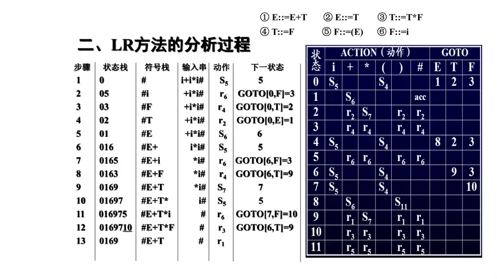

原文：

二、LR方法的分析过程

$$
\mathbf {E}: := \mathbf {E} + \mathbf {T}
$$

$$
\mathbf {T}: := \mathbf {F}
$$

② $\mathbf { E } { : : = } \mathbf { T }$

⑤ F::=(E)

$$
\mathbf {T}: := \mathbf {T} ^ {*} \mathbf {F}
$$

⑥ F::=i

<table><tr><td>步骤</td><td>状态栈</td><td>符号栈</td><td>输入串</td><td>动作</td><td>下一状态</td></tr><tr><td>1</td><td>0</td><td>#</td><td>i+i*i#</td><td> $S_5$ </td><td>5</td></tr><tr><td>2</td><td>05</td><td>#i</td><td>+i*i#</td><td> $r_6$ </td><td>GOTO[0,F]=3</td></tr><tr><td>3</td><td>03</td><td>#F</td><td>+i*i#</td><td> $r_4$ </td><td>GOTO[0,T]=2</td></tr><tr><td>4</td><td>02</td><td>#T</td><td>+i*i#</td><td> $r_2$ </td><td>GOTO[0,E]=1</td></tr><tr><td>5</td><td>01</td><td>#E</td><td>+i*i#</td><td> $S_6$ </td><td>6</td></tr><tr><td>6</td><td>016</td><td>#E+</td><td>i*i#</td><td> $S_5$ </td><td>5</td></tr><tr><td>7</td><td>0165</td><td>#E+i</td><td>*i#</td><td> $r_6$ </td><td>GOTO[6,F]=3</td></tr><tr><td>8</td><td>0163</td><td>#E+F</td><td>*i#</td><td> $r_4$ </td><td>GOTO[6,T]=9</td></tr><tr><td>9</td><td>0169</td><td>#E+T</td><td>*i#</td><td> $S_7$ </td><td>7</td></tr><tr><td>10</td><td>01697</td><td>#E+T*</td><td>i#</td><td> $S_5$ </td><td>5</td></tr><tr><td>11</td><td>016975</td><td>#E+T*i</td><td>#</td><td> $r_6$ </td><td>GOTO[7,F]=10</td></tr><tr><td>12</td><td>0169710</td><td>#E+T*F</td><td>#</td><td> $r_3$ </td><td>GOTO[6,T]=9</td></tr><tr><td>13</td><td>0169</td><td>#E+T</td><td>#</td><td> $r_1$ </td><td></td></tr></table>

### $$

原文：

$$
\mathbf {E}: := \mathbf {E} + \mathbf {T}
$$

二、LR方法的分析过程

$$
\mathbf {T}: := \mathbf {F}
$$

② $\mathbf { E } { : : = } \mathbf { T }$

<table><tr><td>步骤</td><td>状态栈</td><td>符号栈</td><td>输入串</td><td>动作</td><td>下一状态</td></tr><tr><td>1</td><td>0</td><td>#</td><td>i+i*i#</td><td> $S_{5}$ </td><td>5</td></tr><tr><td>2</td><td>05</td><td>#i</td><td>+i*i#</td><td> $r_{6}$ </td><td>GOTO[0,F]=3</td></tr><tr><td>3</td><td>03</td><td>#F</td><td>+i*i#</td><td> $r_{4}$ </td><td>GOTO[0,T]=2</td></tr><tr><td>4</td><td>02</td><td>#T</td><td>+i*i#</td><td> $r_{2}$ </td><td>GOTO[0,E]=1</td></tr><tr><td>5</td><td>01</td><td>#E</td><td>+i*i#</td><td> $S_{6}$ </td><td>6</td></tr><tr><td>6</td><td>016</td><td>#E+</td><td>i*i#</td><td> $S_{5}$ </td><td>5</td></tr><tr><td>7</td><td>0165</td><td>#E+i</td><td>*i#</td><td> $r_{6}$ </td><td>GOTO[6,F]=3</td></tr><tr><td>8</td><td>0163</td><td>#E+F</td><td>*i#</td><td> $r_{4}$ </td><td>GOTO[6,T]=9</td></tr><tr><td>9</td><td>0169</td><td>#E+T</td><td>*i#</td><td> $S_{7}$ </td><td>7</td></tr><tr><td>10</td><td>01697</td><td>#E+T*</td><td>i#</td><td> $S_{5}$ </td><td>5</td></tr><tr><td>11</td><td>016975</td><td>#E+T*i</td><td>#</td><td> $r_{6}$ </td><td>GOTO[7,F]=10</td></tr><tr><td>12</td><td>0169710</td><td>#E+T*F</td><td>#</td><td> $r_{3}$ </td><td>GOTO[6,T]=9</td></tr><tr><td>13</td><td>0169</td><td>#E+T</td><td>#</td><td> $r_{1}$ </td><td></td></tr><tr><td>14</td><td>0</td><td>#</td><td>#</td><td></td><td></td></tr></table>

⑤ F::=(E)

$$
\mathbf {T}: := \mathbf {T} ^ {*} \mathbf {F}
$$

⑥ F::=i

### $$

原文：

$$
\mathbf {E}: := \mathbf {E} + \mathbf {T}
$$

二、LR方法的分析过程

$$
\mathbf {T}: := \mathbf {F}
$$

② $\mathbf { E } { : : = } \mathbf { T }$

<table><tr><td>步骤</td><td>状态栈</td><td>符号栈</td><td>输入串</td><td>动作</td><td>下一状态</td></tr><tr><td>1</td><td>0</td><td>#</td><td>i+i*i#</td><td> $S_5$ </td><td>5</td></tr><tr><td>2</td><td>05</td><td>#i</td><td>+i*i#</td><td> $r_6$ </td><td>GOTO[0,F]=3</td></tr><tr><td>3</td><td>03</td><td>#F</td><td>+i*i#</td><td> $r_4$ </td><td>GOTO[0,T]=2</td></tr><tr><td>4</td><td>02</td><td>#T</td><td>+i*i#</td><td> $r_2$ </td><td>GOTO[0,E]=1</td></tr><tr><td>5</td><td>01</td><td>#E</td><td>+i*i#</td><td> $S_6$ </td><td>6</td></tr><tr><td>6</td><td>016</td><td>#E+</td><td>i*i#</td><td> $S_5$ </td><td>5</td></tr><tr><td>7</td><td>0165</td><td>#E+i</td><td>*i#</td><td> $r_6$ </td><td>GOTO[6,F]=3</td></tr><tr><td>8</td><td>0163</td><td>#E+F</td><td>*i#</td><td> $r_4$ </td><td>GOTO[6,T]=9</td></tr><tr><td>9</td><td>0169</td><td>#E+T</td><td>*i#</td><td> $S_7$ </td><td>7</td></tr><tr><td>10</td><td>01697</td><td>#E+T*</td><td>i#</td><td> $S_5$ </td><td>5</td></tr><tr><td>11</td><td>016975</td><td>#E+T*i</td><td>#</td><td> $r_6$ </td><td>GOTO[7,F]=10</td></tr><tr><td>12</td><td>0169710</td><td>#E+T*F</td><td>#</td><td> $r_3$ </td><td>GOTO[6,T]=9</td></tr><tr><td>13</td><td>0169</td><td>#E+T</td><td>#</td><td> $r_1$ </td><td></td></tr><tr><td>14</td><td>0</td><td>#E</td><td>#</td><td></td><td></td></tr></table>

⑤ F::=(E)

$$
\mathbf {T}: := \mathbf {T} ^ {*} \mathbf {F}
$$

⑥ F::=i

### $$

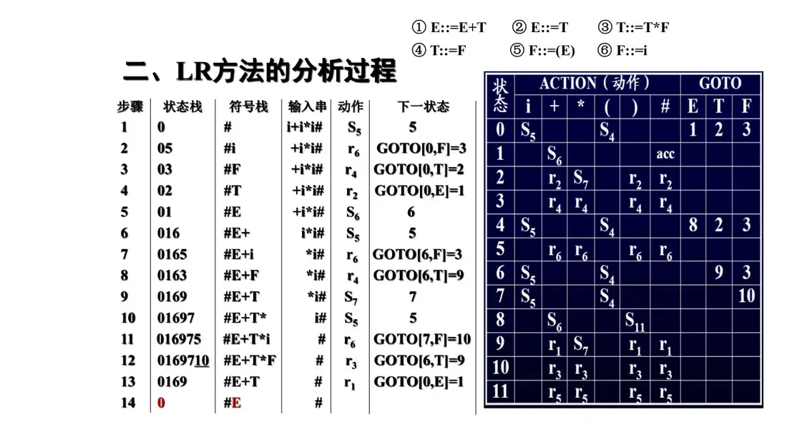

原文：

$$
\mathbf {E}: := \mathbf {E} + \mathbf {T}
$$

二、LR方法的分析过程

$$
\mathbf {T}: := \mathbf {F}
$$

② $\mathbf { E } { : : = } \mathbf { T }$

⑤ F::=(E)

$$
\mathbf {T}: := \mathbf {T} ^ {*} \mathbf {F}
$$

⑥ F::=i

<table><tr><td>步骤</td><td>状态栈</td><td>符号栈</td><td>输入串</td><td>动作</td><td>下一状态</td></tr><tr><td>1</td><td>0</td><td>#</td><td>i+i*i#</td><td> $S_5$ </td><td>5</td></tr><tr><td>2</td><td>05</td><td>#i</td><td>+i*i#</td><td> $r_6$ </td><td>GOTO[0,F]=3</td></tr><tr><td>3</td><td>03</td><td>#F</td><td>+i*i#</td><td> $r_4$ </td><td>GOTO[0,T]=2</td></tr><tr><td>4</td><td>02</td><td>#T</td><td>+i*i#</td><td> $r_2$ </td><td>GOTO[0,E]=1</td></tr><tr><td>5</td><td>01</td><td>#E</td><td>+i*i#</td><td> $S_6$ </td><td>6</td></tr><tr><td>6</td><td>016</td><td>#E+</td><td>i*i#</td><td> $S_5$ </td><td>5</td></tr><tr><td>7</td><td>0165</td><td>#E+i</td><td>*i#</td><td> $r_6$ </td><td>GOTO[6,F]=3</td></tr><tr><td>8</td><td>0163</td><td>#E+F</td><td>*i#</td><td> $r_4$ </td><td>GOTO[6,T]=9</td></tr><tr><td>9</td><td>0169</td><td>#E+T</td><td>*i#</td><td> $S_7$ </td><td>7</td></tr><tr><td>10</td><td>01697</td><td>#E+T*</td><td>i#</td><td> $S_5$ </td><td>5</td></tr><tr><td>11</td><td>016975</td><td>#E+T*i</td><td>#</td><td> $r_6$ </td><td>GOTO[7,F]=10</td></tr><tr><td>12</td><td>0169710</td><td>#E+T*F</td><td>#</td><td> $r_3$ </td><td>GOTO[6,T]=9</td></tr><tr><td>13</td><td>0169</td><td>#E+T</td><td>#</td><td> $r_1$ </td><td>GOTO[0,E]=1</td></tr><tr><td>14</td><td>0</td><td>#E</td><td>#</td><td></td><td></td></tr></table>

### $$

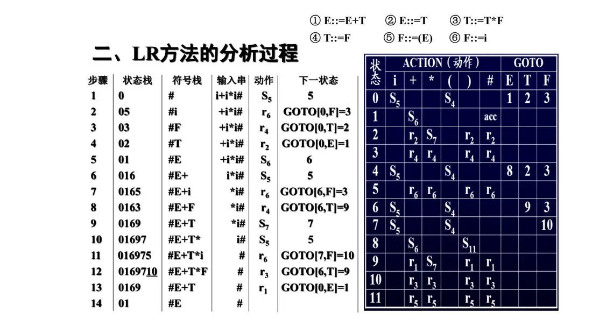

原文：

$$
\mathbf {E}: := \mathbf {E} + \mathbf {T}
$$

二、LR方法的分析过程

$$
\mathbf {T}: := \mathbf {F}
$$

② $\mathbf { E } { : : = } \mathbf { T }$

<table><tr><td>步骤</td><td>状态栈</td><td>符号栈</td><td>输入串</td><td>动作</td><td>下一状态</td></tr><tr><td>1</td><td>0</td><td>#</td><td>i+i*i#</td><td> $S_5$ </td><td>5</td></tr><tr><td>2</td><td>05</td><td>#i</td><td>+i*i#</td><td> $r_6$ </td><td>GOTO[0,F]=3</td></tr><tr><td>3</td><td>03</td><td>#F</td><td>+i*i#</td><td> $r_4$ </td><td>GOTO[0,T]=2</td></tr><tr><td>4</td><td>02</td><td>#T</td><td>+i*i#</td><td> $r_2$ </td><td>GOTO[0,E]=1</td></tr><tr><td>5</td><td>01</td><td>#E</td><td>+i*i#</td><td> $S_6$ </td><td>6</td></tr><tr><td>6</td><td>016</td><td>#E+</td><td>i*i#</td><td> $S_5$ </td><td>5</td></tr><tr><td>7</td><td>0165</td><td>#E+i</td><td>*i#</td><td> $r_6$ </td><td>GOTO[6,F]=3</td></tr><tr><td>8</td><td>0163</td><td>#E+F</td><td>*i#</td><td> $r_4$ </td><td>GOTO[6,T]=9</td></tr><tr><td>9</td><td>0169</td><td>#E+T</td><td>*i#</td><td> $S_7$ </td><td>7</td></tr><tr><td>10</td><td>01697</td><td>#E+T*</td><td>i#</td><td> $S_5$ </td><td>5</td></tr><tr><td>11</td><td>016975</td><td>#E+T*i</td><td>#</td><td> $r_6$ </td><td>GOTO[7,F]=10</td></tr><tr><td>12</td><td>0169710</td><td>#E+T*F</td><td>#</td><td> $r_3$ </td><td>GOTO[6,T]=9</td></tr><tr><td>13</td><td>0169</td><td>#E+T</td><td>#</td><td> $r_1$ </td><td>GOTO[0,E]=1</td></tr><tr><td>14</td><td>01</td><td>#E</td><td>#</td><td></td><td></td></tr></table>

⑤ F::=(E)

$$
\mathbf {T}: := \mathbf {T} ^ {*} \mathbf {F}
$$

⑥ $\mathbf { F } { : } { : } = \mathbf { i }$

### 二、LR方法的分析过程

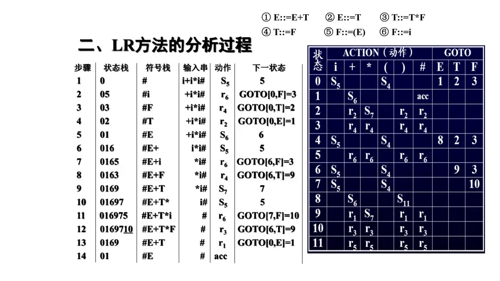

原文：

二、LR方法的分析过程

$$
\mathbf {E}: := \mathbf {E} + \mathbf {T}
$$

$$
\mathbf {T}: := \mathbf {F}
$$

② $\mathbf { E } { : : = } \mathbf { T }$

$$
\mathbf {T}: := \mathbf {T} ^ {*} \mathbf {F}
$$

⑤ F::=(E)

⑥ F::=i

<table><tr><td>步骤</td><td>状态栈</td><td>符号栈</td><td>输入串</td><td>动作</td><td>下一状态</td></tr><tr><td>1</td><td>0</td><td>#</td><td>i+i*i#</td><td> $S_5$ </td><td>5</td></tr><tr><td>2</td><td>05</td><td>#i</td><td>+i*i#</td><td> $r_6$ </td><td>GOTO[0,F]=3</td></tr><tr><td>3</td><td>03</td><td>#F</td><td>+i*i#</td><td> $r_4$ </td><td>GOTO[0,T]=2</td></tr><tr><td>4</td><td>02</td><td>#T</td><td>+i*i#</td><td> $r_2$ </td><td>GOTO[0,E]=1</td></tr><tr><td>5</td><td>01</td><td>#E</td><td>+i*i#</td><td> $S_6$ </td><td>6</td></tr><tr><td>6</td><td>016</td><td>#E+</td><td>i*i#</td><td> $S_5$ </td><td>5</td></tr><tr><td>7</td><td>0165</td><td>#E+i</td><td>*i#</td><td> $r_6$ </td><td>GOTO[6,F]=3</td></tr><tr><td>8</td><td>0163</td><td>#E+F</td><td>*i#</td><td> $r_4$ </td><td>GOTO[6,T]=9</td></tr><tr><td>9</td><td>0169</td><td>#E+T</td><td>*i#</td><td> $S_7$ </td><td>7</td></tr><tr><td>10</td><td>01697</td><td>#E+T*</td><td>i#</td><td> $S_5$ </td><td>5</td></tr><tr><td>11</td><td>016975</td><td>#E+T*i</td><td>#</td><td> $r_6$ </td><td>GOTO[7,F]=10</td></tr><tr><td>12</td><td>0169710</td><td>#E+T*F</td><td>#</td><td> $r_3$ </td><td>GOTO[6,T]=9</td></tr><tr><td>13</td><td>0169</td><td>#E+T</td><td>#</td><td> $r_1$ </td><td>GOTO[0,E]=1</td></tr><tr><td>14</td><td>01</td><td>#E</td><td>#</td><td>acc</td><td></td></tr></table>

### 二、LR方法的分析过程

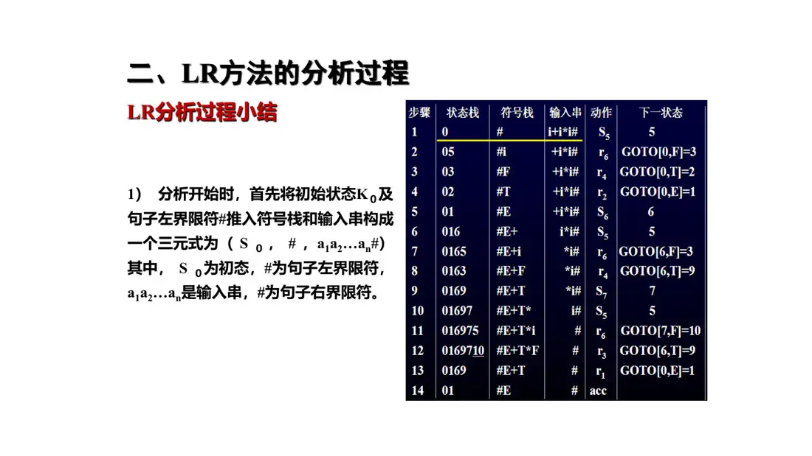

原文：

二、LR方法的分析过程

LR分析过程小结

1） 分析开始时，首先将初始状态 $\mathbf { K _ { 0 } } \mathbf { \mathbb { A } }$ 句子左界限符#推入符号栈和输入串构成一个三元式为 $( \mathrm { ~ S ~ } _ { 0 } \mathrm { ~ , ~ } \# \mathrm { ~ , ~ } \mathrm { a } _ { 1 } \mathrm { a } _ { 2 } . . . \mathrm { a } _ { \mathrm { n } } \# )$ 其中， $\mathrm { ~ \bf ~ S ~ } _ { 0 }$ 为初态，#为句子左界限符，$\mathbf { a _ { 1 } a _ { 2 } . . . . } \mathbf { a _ { n } }$ 是输入串，#为句子右界限符。

<table><tr><td>步骤</td><td>状态栈</td><td>符号栈</td><td>输入串</td><td>动作</td><td>下一状态</td></tr><tr><td>1</td><td>0</td><td>#</td><td>i+i*i#</td><td> $S_5$ </td><td>5</td></tr><tr><td>2</td><td>05</td><td>#i</td><td>+i*i#</td><td> $r_6$ </td><td>GOTO[0,F]=3</td></tr><tr><td>3</td><td>03</td><td>#F</td><td>+i*i#</td><td> $r_4$ </td><td>GOTO[0,T]=2</td></tr><tr><td>4</td><td>02</td><td>#T</td><td>+i*i#</td><td> $r_2$ </td><td>GOTO[0,E]=1</td></tr><tr><td>5</td><td>01</td><td>#E</td><td>+i*i#</td><td> $S_6$ </td><td>6</td></tr><tr><td>6</td><td>016</td><td>#E+</td><td>i*i#</td><td> $S_5$ </td><td>5</td></tr><tr><td>7</td><td>0165</td><td>#E+i</td><td>*i#</td><td> $r_6$ </td><td>GOTO[6,F]=3</td></tr><tr><td>8</td><td>0163</td><td>#E+F</td><td>*i#</td><td> $r_4$ </td><td>GOTO[6,T]=9</td></tr><tr><td>9</td><td>0169</td><td>#E+T</td><td>*i#</td><td> $S_7$ </td><td>7</td></tr><tr><td>10</td><td>01697</td><td>#E+T*</td><td>i#</td><td> $S_5$ </td><td>5</td></tr><tr><td>11</td><td>016975</td><td>#E+T*i</td><td>#</td><td> $r_6$ </td><td>GOTO[7,F]=10</td></tr><tr><td>12</td><td>0169710</td><td>#E+T*F</td><td>#</td><td> $r_3$ </td><td>GOTO[6,T]=9</td></tr><tr><td>13</td><td>0169</td><td>#E+T</td><td>#</td><td> $r_1$ </td><td>GOTO[0,E]=1</td></tr><tr><td>14</td><td>01</td><td>#E</td><td>#</td><td>acc</td><td></td></tr></table>

### 二、LR方法的分析过程

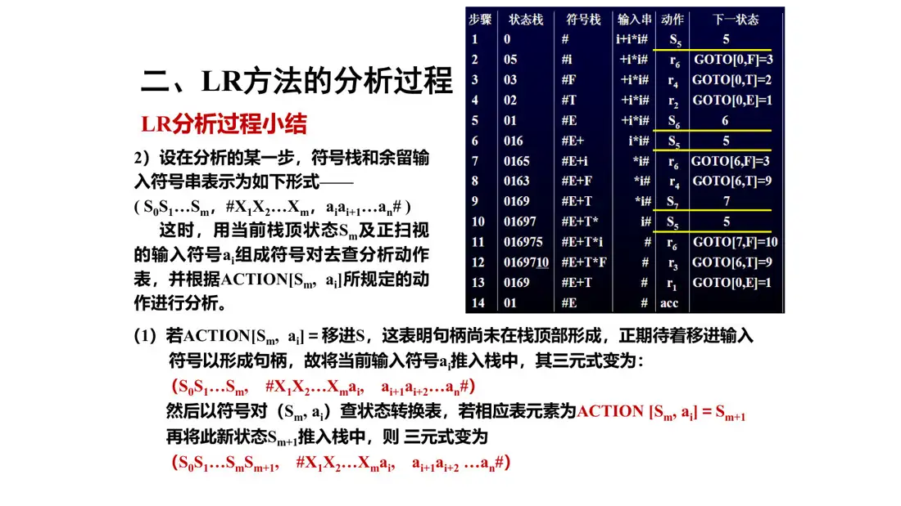

原文：

二、LR方法的分析过程

LR分析过程小结

2）设在分析的某一步，符号栈和余留输入符号串表示为如下形式—

$$
(\mathrm{S} _ {0} \mathrm{S} _ {1}... \mathrm{S} _ {\mathrm{m}}, \# \mathrm{X} _ {1} \mathrm{X} _ {2}... \mathrm{X} _ {\mathrm{m}}, \mathrm{a} _ {\mathrm{i}} \mathrm{a} _ {\mathrm{i+1}}... \mathrm{a} _ {\mathrm{n}} \#)
$$

这时，用当前栈顶状态 $\mathbf { \delta S _ { m } }$ 及正扫视的输入符号 ${ \bf \delta a } _ { \bf i }$ 组成符号对去查分析动作表，并根据 $\mathbf { A C T I O N } [ \mathbf { S _ { m } } , \ \mathbf { a _ { i } } ]$ 所规定的动作进行分析。

<table><tr><td>步骤</td><td>状态栈</td><td>符号栈</td><td>输入串</td><td>动作</td><td>下一状态</td></tr><tr><td>1</td><td>0</td><td>#</td><td>i+i*i#</td><td> $S_5$ </td><td>5</td></tr><tr><td>2</td><td>05</td><td>#i</td><td>+i*i#</td><td> $r_6$ </td><td>GOTO[0,F]=3</td></tr><tr><td>3</td><td>03</td><td>#F</td><td>+i*i#</td><td> $r_4$ </td><td>GOTO[0,T]=2</td></tr><tr><td>4</td><td>02</td><td>#T</td><td>+i*i#</td><td> $r_2$ </td><td>GOTO[0,E]=1</td></tr><tr><td>5</td><td>01</td><td>#E</td><td>+i*i#</td><td> $S_6$ </td><td>6</td></tr><tr><td>6</td><td>016</td><td>#E+</td><td>i*i#</td><td> $S_5$ </td><td>5</td></tr><tr><td>7</td><td>0165</td><td>#E+i</td><td>*i#</td><td> $r_6$ </td><td>GOTO[6,F]=3</td></tr><tr><td>8</td><td>0163</td><td>#E+F</td><td>*i#</td><td> $r_4$ </td><td>GOTO[6,T]=9</td></tr><tr><td>9</td><td>0169</td><td>#E+T</td><td>*i#</td><td> $S_7$ </td><td>7</td></tr><tr><td>10</td><td>01697</td><td>#E+T*</td><td>i#</td><td> $S_5$ </td><td>5</td></tr><tr><td>11</td><td>016975</td><td>#E+T*i</td><td>#</td><td> $r_6$ </td><td>GOTO[7,F]=10</td></tr><tr><td>12</td><td>0169710</td><td>#E+T*F</td><td>#</td><td> $r_3$ </td><td>GOTO[6,T]=9</td></tr><tr><td>13</td><td>0169</td><td>#E+T</td><td>#</td><td> $r_1$ </td><td>GOTO[0,E]=1</td></tr><tr><td>14</td><td>01</td><td>#E</td><td>#</td><td>acc</td><td></td></tr></table>

（1）若 $\mathbf { A C T I O N } [ \mathbf { S _ { m } } , \ \mathbf { a _ { i } } ] =$ 移进S，这表明句柄尚未在栈顶部形成，正期待着移进输入符号以形成句柄，故将当前输入符号 $\mathbf { \dot { a } _ { i } }$ 推入栈中，其三元式变为：

$$
\left(\mathrm{S} _ {0} \mathrm{S} _ {1} \dots \mathrm{S} _ {\mathrm{m}}, \quad \# \mathrm{X} _ {1} \mathrm{X} _ {2} \dots \mathrm{X} _ {\mathrm{m}} \mathrm{a} _ {\mathrm{i}}, \quad \mathrm{a} _ {\mathrm{i} + 1} \mathrm{a} _ {\mathrm{i} + 2} \dots \mathrm{a} _ {\mathrm{n}} \#\right)
$$

然后以符号对 $( \mathbf { S _ { m } } , \mathbf { a _ { i } } )$ 查状态转换表，若相应表元素为 $\mathrm { A C T I O N } \ \mathrm { [ S _ { m } , a _ { i } ] = S _ { m + 1 } }$ 再将此新状态 $\mathbf { S _ { m + 1 } }$ 推入栈中，则 三元式变为

$$
(\mathrm{S} _ {0} \mathrm{S} _ {1} \dots \mathrm{S} _ {\mathrm{m}} \mathrm{S} _ {\mathrm{m+1}}, \quad \# \mathrm{X} _ {1} \mathrm{X} _ {2} \dots \mathrm{X} _ {\mathrm{m}} \mathrm{a} _ {\mathrm{i}}, \quad \mathrm{a} _ {\mathrm{i+1}} \mathrm{a} _ {\mathrm{i+2}} \dots \mathrm{a} _ {\mathrm{n}} \#)
$$

### 二、LR方法的分析过程

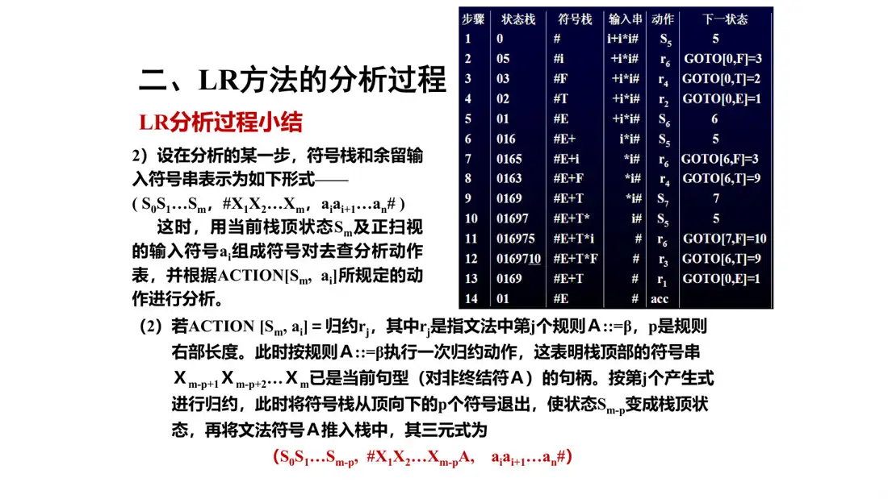

原文：

二、LR方法的分析过程

LR分析过程小结

2）设在分析的某一步，符号栈和余留输入符号串表示为如下形式—

$$
(\mathbf {S} _ {0} \mathbf {S} _ {1}... \mathbf {S} _ {\mathbf {m}}, \# \mathbf {X} _ {1} \mathbf {X} _ {2}... \mathbf {X} _ {\mathbf {m}}, \mathbf {a} _ {\mathbf {i}} \mathbf {a} _ {\mathbf {i + 1}}... \mathbf {a} _ {\mathbf {n}} \#)
$$

这时，用当前栈顶状态 $\mathbf { S _ { m } }$ 及正扫视的输入符号 ${ \bf \delta a } _ { \bf i }$ 组成符号对去查分析动作表，并根据 $\mathbf { A C T I O N } [ \mathbf { S _ { m } } , \ \mathbf { a _ { i } } ]$ 所规定的动作进行分析。

<table><tr><td>步骤</td><td>状态栈</td><td>符号栈</td><td>输入串</td><td>动作</td><td>下一状态</td></tr><tr><td>1</td><td>0</td><td>#</td><td>i+i*i#</td><td> $S_5$ </td><td>5</td></tr><tr><td>2</td><td>05</td><td>#i</td><td>+i*i#</td><td> $r_6$ </td><td>GOTO[0,F]=3</td></tr><tr><td>3</td><td>03</td><td>#F</td><td>+i*i#</td><td> $r_4$ </td><td>GOTO[0,T]=2</td></tr><tr><td>4</td><td>02</td><td>#T</td><td>+i*i#</td><td> $r_2$ </td><td>GOTO[0,E]=1</td></tr><tr><td>5</td><td>01</td><td>#E</td><td>+i*i#</td><td> $S_6$ </td><td>6</td></tr><tr><td>6</td><td>016</td><td>#E+</td><td>i*i#</td><td> $S_5$ </td><td>5</td></tr><tr><td>7</td><td>0165</td><td>#E+i</td><td>*i#</td><td> $r_6$ </td><td>GOTO[6,F]=3</td></tr><tr><td>8</td><td>0163</td><td>#E+F</td><td>*i#</td><td> $r_4$ </td><td>GOTO[6,T]=9</td></tr><tr><td>9</td><td>0169</td><td>#E+T</td><td>*i#</td><td> $S_7$ </td><td>7</td></tr><tr><td>10</td><td>01697</td><td>#E+T*</td><td>i#</td><td> $S_5$ </td><td>5</td></tr><tr><td>11</td><td>016975</td><td>#E+T*i</td><td>#</td><td> $r_6$ </td><td>GOTO[7,F]=10</td></tr><tr><td>12</td><td>0169710</td><td>#E+T*F</td><td>#</td><td> $r_3$ </td><td>GOTO[6,T]=9</td></tr><tr><td>13</td><td>0169</td><td>#E+T</td><td>#</td><td> $r_1$ </td><td>GOTO[0,E]=1</td></tr><tr><td>14</td><td>01</td><td>#E</td><td>#</td><td>acc</td><td></td></tr></table>

（2）若 $\mathbf { A C T I O N } \ [ \mathbf { S _ { m } } , \mathbf { a _ { i } } ] =$ 归约r，其中 $\mathbf { r _ { j } } ,$ $\mathbf { r _ { j } }$ 是指文法中第j个规则 $\mathbf { A } { : : = } \mathbf { \beta }$ ，p是规则右部长度。此时按规则 $\pmb { \Delta }$ ::=β执行一次归约动作，这表明栈顶部的符号串$\mathsf { X } _ { \mathrm { m - p + 1 } } \mathsf { X } _ { \mathrm { m - p + 2 } } . . . \mathsf { X } _ { \mathrm { m } }$ 已是当前句型（对非终结符A）的句柄。按第j个产生式进行归约，此时将符号栈从顶向下的 $\mathbf { p } ^ { \mathcal { \epsilon } }$ 个符号退出，使状态 $\mathbf { S _ { m - p } }$ 变成栈顶状态，再将文法符号A推入栈中，其三元式为

$$
\left(\mathrm{S} _ {0} \mathrm{S} _ {1} \dots \mathrm{S} _ {\mathrm{m-p}}, \# \mathrm{X} _ {1} \mathrm{X} _ {2} \dots \mathrm{X} _ {\mathrm{m-p}} \mathrm{A}, \quad \mathrm{a} _ {\mathrm{i}} \mathrm{a} _ {\mathrm{i+1}} \dots \mathrm{a} _ {\mathrm{n}} \#\right)
$$

### 二、LR方法的分析过程

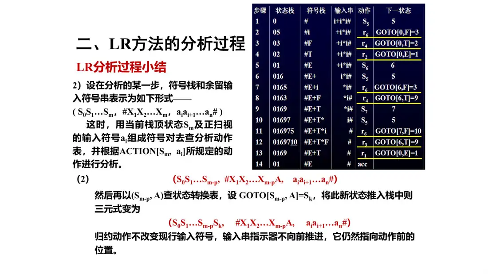

原文：

二、LR方法的分析过程

LR分析过程小结

2）设在分析的某一步，符号栈和余留输入符号串表示为如下形式—

$$
(\mathbf {S} _ {0} \mathbf {S} _ {1}... \mathbf {S} _ {\mathrm{m}}, \# \mathbf {X} _ {1} \mathbf {X} _ {2}... \mathbf {X} _ {\mathrm{m}}, \mathbf {a} _ {\mathrm{i}} \mathbf {a} _ {\mathrm{i+1}}... \mathbf {a} _ {\mathrm{n}} \#)
$$

这时，用当前栈顶状态 $\mathbf { S _ { m } }$ 及正扫视的输入符号 $\mathbf { \lambda _ { \lambda } } \mathbf { a } _ { \mathbf { i } }$ 组成符号对去查分析动作表，并根据 $\mathbf { A C T I O N } [ \mathbf { S _ { m } } , \ \mathbf { a _ { i } } ]$ 所规定的动作进行分析。

<table><tr><td>步骤</td><td>状态栈</td><td>符号栈</td><td>输入串</td><td>动作</td><td>下一状态</td></tr><tr><td>1</td><td>0</td><td>#</td><td>i+i*i#</td><td> $S_5$ </td><td>5</td></tr><tr><td>2</td><td>05</td><td>#i</td><td>+i*i#</td><td> $r_6$ </td><td>GOTO[0,F]=3</td></tr><tr><td>3</td><td>03</td><td>#F</td><td>+i*i#</td><td> $r_4$ </td><td>GOTO[0,T]=2</td></tr><tr><td>4</td><td>02</td><td>#T</td><td>+i*i#</td><td> $r_2$ </td><td>GOTO[0,E]=1</td></tr><tr><td>5</td><td>01</td><td>#E</td><td>+i*i#</td><td> $S_6$ </td><td>6</td></tr><tr><td>6</td><td>016</td><td>#E+</td><td>i*i#</td><td> $S_5$ </td><td>5</td></tr><tr><td>7</td><td>0165</td><td>#E+i</td><td>*i#</td><td> $r_6$ </td><td>GOTO[6,F]=3</td></tr><tr><td>8</td><td>0163</td><td>#E+F</td><td>*i#</td><td> $r_4$ </td><td>GOTO[6,T]=9</td></tr><tr><td>9</td><td>0169</td><td>#E+T</td><td>*i#</td><td> $S_7$ </td><td>7</td></tr><tr><td>10</td><td>01697</td><td>#E+T*</td><td>i#</td><td> $S_5$ </td><td>5</td></tr><tr><td>11</td><td>016975</td><td>#E+T*i</td><td>#</td><td> $r_6$ </td><td>GOTO[7,F]=10</td></tr><tr><td>12</td><td>0169710</td><td>#E+T*F</td><td>#</td><td> $r_3$ </td><td>GOTO[6,T]=9</td></tr><tr><td>13</td><td>0169</td><td>#E+T</td><td>#</td><td> $r_1$ </td><td>GOTO[0,E]=1</td></tr><tr><td>14</td><td>01</td><td>#E</td><td>#</td><td>acc</td><td></td></tr></table>

$$
\left(\mathrm{S} _ {0} \mathrm{S} _ {1} \dots \mathrm{S} _ {\mathrm{m-p}}, \# \mathrm{X} _ {1} \mathrm{X} _ {2} \dots \mathrm{X} _ {\mathrm{m-p}} \mathrm{A}, \quad \mathrm{a} _ {\mathrm{i}} \mathrm{a} _ {\mathrm{i+1}} \dots \mathrm{a} _ {\mathrm{n}} \#\right)\tag{2}
$$

然后再以 $( \mathbf { S _ { m - p } } , \mathbf { A } )$ )查状态转换表，设 $\mathbf { G O T O } [ \mathrm { S } _ { \mathrm { m - p } } , \mathrm { A } ] { = } \mathrm { S } _ { \mathrm { k } } ,$ ，将此新状态推入栈中则 三元式变为

$$
\left(\mathrm{S} _ {0} \mathrm{S} _ {1} \dots \mathrm{S} _ {\mathrm{m-p}} \mathrm{S} _ {\mathrm{k}}, \quad \# \mathrm{X} _ {1} \mathrm{X} _ {2} \dots \mathrm{X} _ {\mathrm{m-p}} \mathrm{A}, \quad \mathrm{a} _ {\mathrm{i}} \mathrm{a} _ {\mathrm{i+1}} \dots \mathrm{a} _ {\mathrm{n}} \#\right)
$$

归约动作不改变现行输入符号，输入串指示器不向前推进，它仍然指向动作前的位置。

### 二、LR方法的分析过程

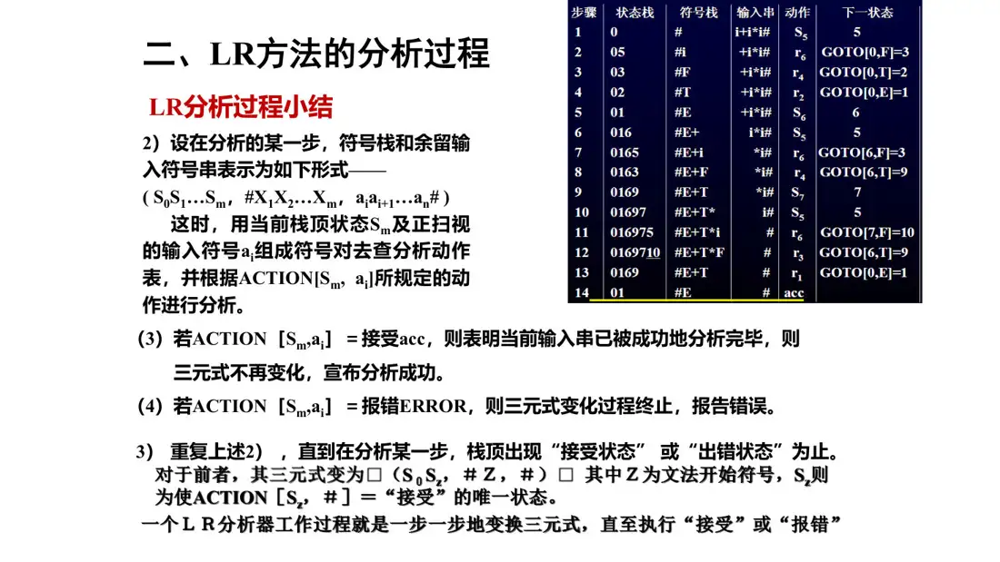

原文：

二、LR方法的分析过程

LR分析过程小结

2）设在分析的某一步，符号栈和余留输入符号串表示为如下形式—

$$
(\mathbf {S} _ {0} \mathbf {S} _ {1} \dots \mathbf {S} _ {\mathrm{m}}, \# \mathbf {X} _ {1} \mathbf {X} _ {2} \dots \mathbf {X} _ {\mathrm{m}}, \mathbf {a} _ {\mathrm{i}} \mathbf {a} _ {\mathrm{i+1}} \dots \mathbf {a} _ {\mathrm{n}} \#)
$$

这时，用当前栈顶状态 $\mathbf { S _ { m } }$ 及正扫视的输入符号 ${ \bf { a } } _ { \mathrm { { i } } }$ 组成符号对去查分析动作表，并根据 $\mathbf { A C T I O N } [ \mathbf { S _ { m } } , \ \mathbf { a _ { i } } ]$ 所规定的动作进行分析。

<table><tr><td>步骤</td><td>状态栈</td><td>符号栈</td><td>输入串</td><td>动作</td><td>下一状态</td></tr><tr><td>1</td><td>0</td><td>#</td><td>i+i*i#</td><td> $S_5$ </td><td>5</td></tr><tr><td>2</td><td>05</td><td>#i</td><td>+i*i#</td><td> $r_6$ </td><td>GOTO[0,F]=3</td></tr><tr><td>3</td><td>03</td><td>#F</td><td>+i*i#</td><td> $r_4$ </td><td>GOTO[0,T]=2</td></tr><tr><td>4</td><td>02</td><td>#T</td><td>+i*i#</td><td> $r_2$ </td><td>GOTO[0,E]=1</td></tr><tr><td>5</td><td>01</td><td>#E</td><td>+i*i#</td><td> $S_6$ </td><td>6</td></tr><tr><td>6</td><td>016</td><td>#E+</td><td>i*i#</td><td> $S_5$ </td><td>5</td></tr><tr><td>7</td><td>0165</td><td>#E+i</td><td>*i#</td><td> $r_6$ </td><td>GOTO[6,F]=3</td></tr><tr><td>8</td><td>0163</td><td>#E+F</td><td>*i#</td><td> $r_4$ </td><td>GOTO[6,T]=9</td></tr><tr><td>9</td><td>0169</td><td>#E+T</td><td>*i#</td><td> $S_7$ </td><td>7</td></tr><tr><td>10</td><td>01697</td><td>#E+T*</td><td>i#</td><td> $S_5$ </td><td>5</td></tr><tr><td>11</td><td>016975</td><td>#E+T*i</td><td>#</td><td> $r_6$ </td><td>GOTO[7,F]=10</td></tr><tr><td>12</td><td>0169710</td><td>#E+T*F</td><td>#</td><td> $r_3$ </td><td>GOTO[6,T]=9</td></tr><tr><td>13</td><td>0169</td><td>#E+T</td><td>#</td><td> $r_1$ </td><td>GOTO[0,E]=1</td></tr><tr><td>14</td><td>01</td><td>#E</td><td>#</td><td>acc</td><td></td></tr></table>

（3）若 $\begin{array} { r l } { \mathbf { A C T I O N } } & { [ \mathrm { S } _ { \mathbf { m } } , \mathbf { a } _ { \mathrm { i } } ] } & { = \mathbf { j } _ { \mathbf { \overline { { x } } } \mathbf { \overline { { x } } } } ^ { \mathbf { i } } \mathbf { a c c } } \end{array}$ ，则表明当前输入串已被成功地分析完毕，则三元式不再变化，宣布分析成功。

（4）若ACTION $[ \mathbf { S _ { m } } , \mathbf { a _ { i } } ]$ ＝报错ERROR，则三元式变化过程终止，报告错误。

3） 重复上述2） ，直到在分析某一步，栈顶出现“接受状态” 或“出错状态”为止。对于前者，其三元式变为 $( \mathbf { S } _ { 0 } \mathbf { S } _ { \mathbf { z } } ,$ ＃ $\mathbf { z }$ ，＃） 其中Z为文法开始符号， $\mathbf { S _ { z } }$ 则为使 $\mathbf { A C T I O N \Gamma } [ \mathbf { S } _ { \mathbf { z } } ,$ ＃ $] = ^ { \prime \prime }$ “接受”的唯一状态。

一个LR分析器工作过程就是一步一步地变换三元式，直至执行“接受”或“报错”

### 希望和大家携手完成本课程的学习！

原文：

希望和大家携手完成本课程的学习！

更希望和各位成为可以交流的朋友！

预祝大家顺利通过本课程并取得好成绩！

谢谢！

南志命生大摩 南志都生大学

计算机学院 软件学院网络空间安全学院School of Computer Science
