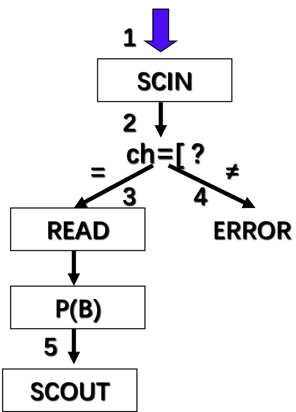
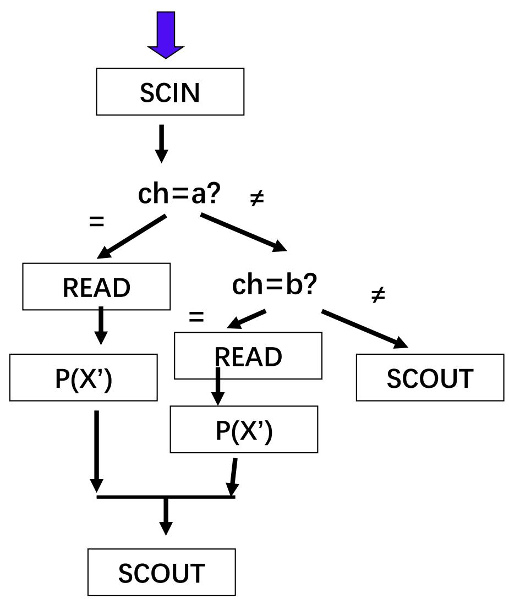
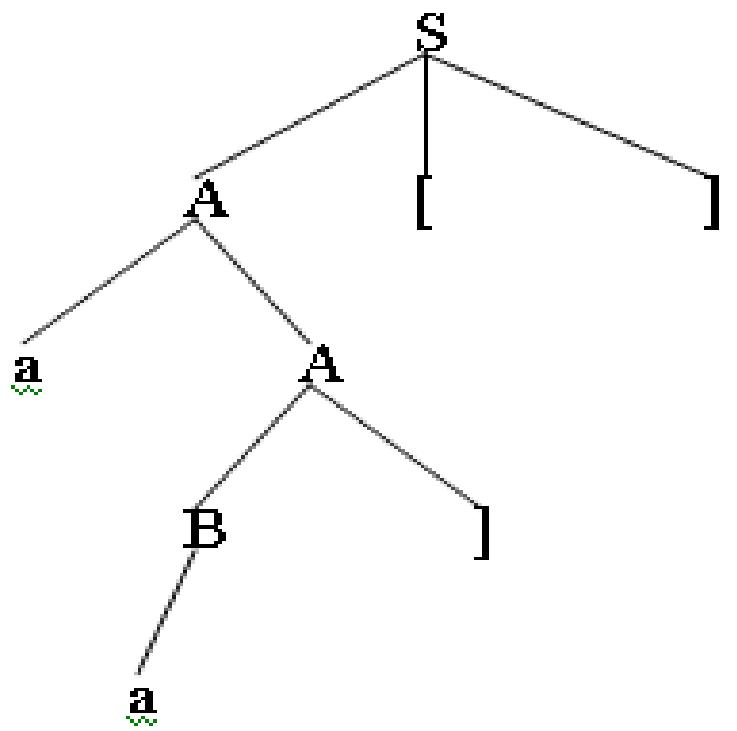
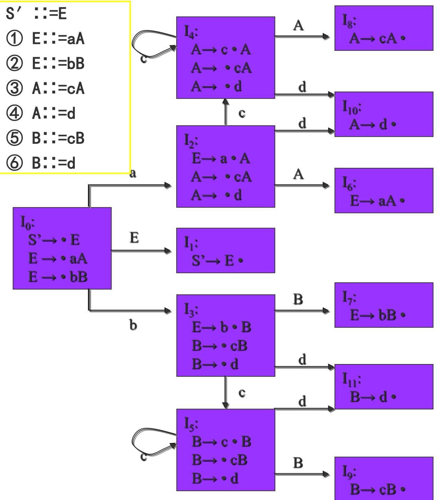
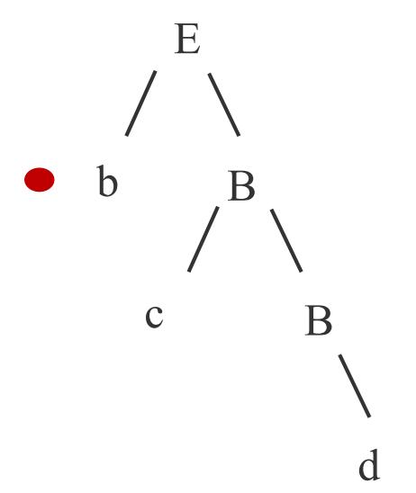
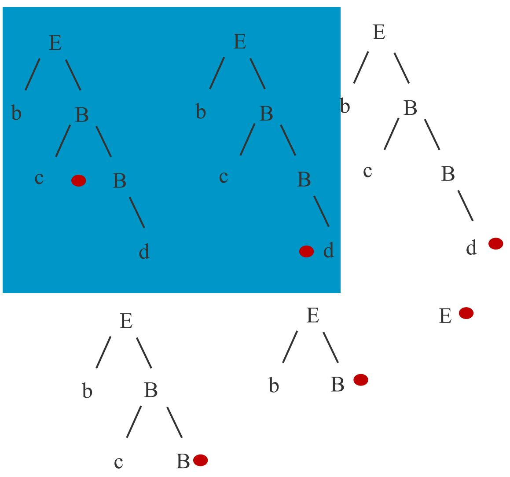
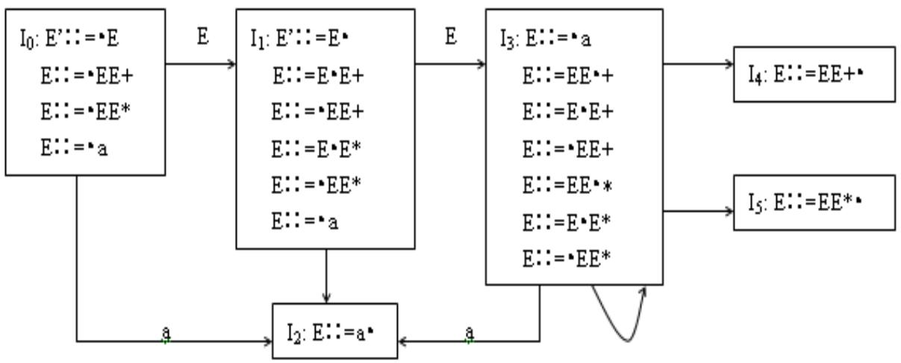
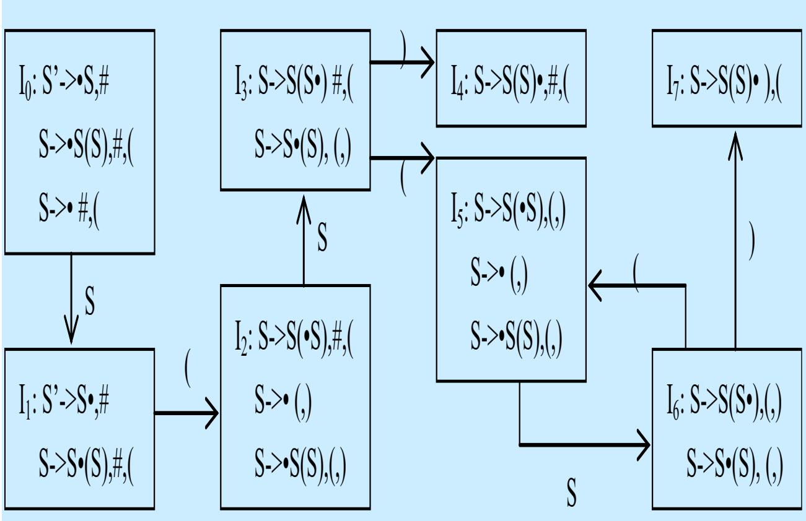
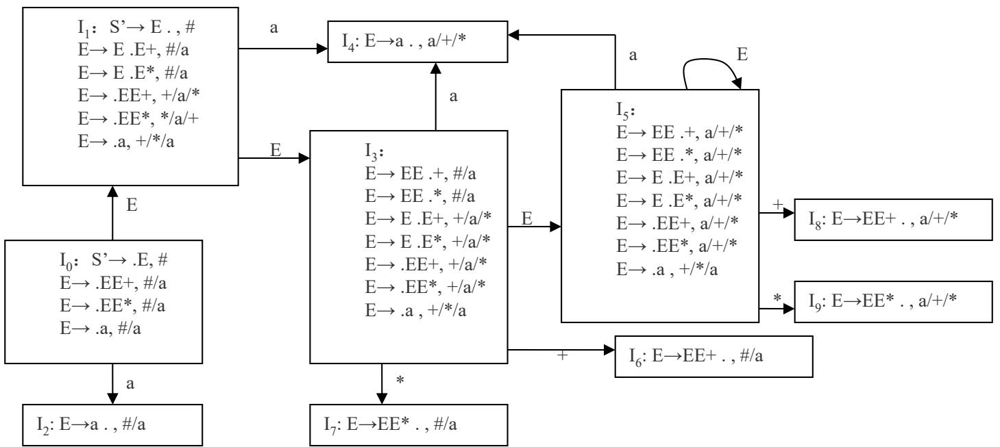

# 《编译原理》第四章 语法分析 课后作业答案

按原件页序整理。原文中的“解”“答”等保留原件答案；“参考解答”为补充。

## 原件第1页

### 第四章 语法分析

4-9 作业答案

## 原件第2页

### 第四章作业答案

1.消除下面文法的左递归 。

（1） $\mathrm { G } [ Z ]$

$$
Z: := V _ {1}
$$

$$
\mathrm{V} _ {1}: := \mathrm{V} _ {2} \mid \mathrm{V} _ {1} \mathrm{i} \mathrm{V} _ {2} \quad \dots \dots ②
$$

$$
\mathrm{V} _ {2}: := \mathrm{V} _ {3} \mid \mathrm{V} _ {2} + \mathrm{V} _ {3} \quad \dots \dots ③
$$

$$
\mathrm{V} _ {3}: :=) \mathrm{V} _ {1} * | (\quad \dots \dots ④
$$

$$
Z: := V _ {1}
$$

$$
\mathrm{V} _ {1} \mathrel {\mathop :} = \mathrm{V} _ {2} \mathrm{V} _ {1} ^ {\prime}
$$

$$
\mathrm{V} _ {1} ^ {\prime} \quad : := \mathrm{iV} _ {2} \mathrm{V} _ {1} ^ {\prime} \quad | \varepsilon
$$

$$
\mathrm{V} _ {2} \mathrel {\mathop :} = \mathrm{V} _ {3} \mathrm{V} _ {2} ^ {\prime}
$$

$$
\mathrm{V} _ {2} ^ {\prime} \quad := = + \mathrm{V} _ {3} \mathrm{V} _ {2} ^ {\prime} \quad | \varepsilon
$$

(2) $\mathrm { G } [ \mathrm { Z } ]$

$$
\begin{array}{l} \text {Z:: = AZ|b}\dots\dots① \\ \text {A:: = Z A|a}\dots\dots② \end{array}
$$

将②式代入①式可得，

$\mathrm { Z } { : = } \mathrm { Z A Z } \mid \mathrm { a } \mathrm { Z } \mid \mathrm { b }$ 消除左递归后得到：

$$
Z: := (a Z \mid b) Z ^ {\prime}
$$

$$
\mathrm{Z} ^ {\prime}: := \mathrm{AZZ} ^ {\prime}
$$

$$
\mathrm{A}: := \mathrm{ZA} \mid a
$$

## 原件第3页

### 第四章作业答案

2.利用下面分析表分析符号串(i+)是否为文法所定义的句子

有文法G[E]:E→TE’T’→\*FT’ |ε

E’→+TE’|ε

F→(E) | i

T→FT’

LL(1)分析表如下——

<table><tr><td></td><td>i</td><td>+</td><td>*</td><td>(</td><td>)</td><td>#</td></tr><tr><td>E</td><td> $E \rightarrow TE'$ </td><td></td><td></td><td> $E \rightarrow TE'$ </td><td></td><td></td></tr><tr><td> $E'$ </td><td></td><td> $E' \rightarrow +TE'$ </td><td></td><td></td><td> $E' \rightarrow \varepsilon$ </td><td> $E' \rightarrow \varepsilon$ </td></tr><tr><td>T</td><td> $T \rightarrow FT'$ </td><td></td><td></td><td> $T \rightarrow FT'$ </td><td></td><td></td></tr><tr><td> $T'$ </td><td></td><td> $T' \rightarrow \varepsilon$ </td><td> $T' \rightarrow *FT'$ </td><td></td><td> $T' \rightarrow \varepsilon$ </td><td> $T' \rightarrow \varepsilon$ </td></tr><tr><td>F</td><td> $F \rightarrow i$ </td><td></td><td></td><td> $F \rightarrow (E)$ </td><td></td><td></td></tr></table>

## 原件第4页

### 第四章作业答案

<table><tr><td colspan="2">步骤</td><td colspan="2">分析栈</td><td colspan="2">余留输入串</td><td colspan="2">所用产生式</td></tr><tr><td colspan="2">(1)</td><td colspan="2">#E</td><td colspan="2">(i+) #</td><td colspan="2">E→TE&#x27;</td></tr><tr><td colspan="2">(2)</td><td colspan="2">#E&#x27;T</td><td colspan="2">(i+) #</td><td colspan="2">T→FT&#x27;</td></tr><tr><td colspan="2">(3)</td><td colspan="2">#E&#x27;T&#x27;F</td><td colspan="2">(i+) #</td><td colspan="2">F→(E)</td></tr><tr><td colspan="2">(4)</td><td colspan="2">#E&#x27;T&#x27;)E(</td><td colspan="2">(i+) #</td><td colspan="2"></td></tr><tr><td colspan="2">(5)</td><td colspan="2">#E&#x27;T&#x27;)E</td><td colspan="2">i+) #</td><td colspan="2">E→TE&#x27;</td></tr><tr><td colspan="2">(6)</td><td colspan="2"># E&#x27;T&#x27;) E&#x27;T</td><td colspan="2">i+) #</td><td colspan="2">T→FT&#x27;</td></tr><tr><td colspan="2">(7)</td><td colspan="2"># E&#x27;T&#x27;) E&#x27;T&#x27;F</td><td colspan="2">i+) #</td><td colspan="2">F→i</td></tr><tr><td colspan="2">(8)</td><td colspan="2"># E&#x27;T&#x27;) E&#x27;T&#x27;i</td><td colspan="2">i+) #</td><td colspan="2"></td></tr><tr><td colspan="2">(9)</td><td colspan="2"># E&#x27;T&#x27;) E&#x27;T&#x27;</td><td colspan="2">+) #</td><td colspan="2">T&#x27;→ Ε</td></tr><tr><td colspan="2">(10)</td><td colspan="2"># E&#x27;T&#x27;) E&#x27;</td><td colspan="2">+) #</td><td colspan="2">E&#x27;→+T E&#x27;</td></tr><tr><td colspan="2">(11)</td><td colspan="2"># E&#x27;T&#x27;) E&#x27;T+</td><td colspan="2">+) #</td><td colspan="2"></td></tr><tr><td colspan="2">(12)</td><td colspan="2"># E&#x27;T&#x27;) E&#x27;T</td><td colspan="2">) #</td><td colspan="2">失败</td></tr><tr><td></td><td colspan="2">i</td><td>+</td><td>*</td><td>(</td><td>)</td><td>#</td></tr><tr><td>E</td><td colspan="2">E→TE&#x27;</td><td></td><td></td><td>E→TE&#x27;</td><td></td><td></td></tr><tr><td>E&#x27;</td><td colspan="2"></td><td>E&#x27;→+TE&#x27;</td><td></td><td></td><td>E&#x27;→ε</td><td>E&#x27;→ε</td></tr><tr><td>T</td><td colspan="2">T→FT&#x27;</td><td></td><td></td><td>T→FT&#x27;</td><td></td><td></td></tr><tr><td>T&#x27;</td><td colspan="2"></td><td>T&#x27;→ε</td><td>T&#x27;→*FT&#x27;</td><td></td><td>T&#x27;→ε</td><td>T&#x27;→ε</td></tr><tr><td>F</td><td colspan="2">F→i</td><td></td><td></td><td>F→(E)</td><td></td><td></td></tr></table>

## 原件第5页

### 第四章作业答案

## 原件第6页

### 第四章作业答案

3.求下面文法每个非终结符号的FIRST集和FOLLOW集，并构造下面文法的LL(1)分析表(表结构已给出)

<table><tr><td></td><td>a</td><td>b</td><td>c</td><td>d</td><td>f</td><td>g</td><td>#</td></tr><tr><td>A</td><td>A::=BCc</td><td>A::=BCc</td><td>A::=BCc</td><td>A::=BCc</td><td></td><td>A::=gDB</td><td></td></tr><tr><td>B</td><td>B::=ε</td><td>B:- bCDE</td><td>B::=ε</td><td>B::=ε</td><td>B::=ε</td><td>B::=ε</td><td>B::=ε</td></tr><tr><td>C</td><td>C::=DaB</td><td></td><td>C::=ca</td><td>C::=DaB</td><td></td><td></td><td></td></tr><tr><td>D</td><td>D::=ε</td><td>D::=ε</td><td>D::=ε</td><td>D::=dD</td><td>D::=ε</td><td>D::=ε</td><td>D::=ε</td></tr><tr><td>E</td><td></td><td></td><td>E::=c</td><td></td><td></td><td>E::=gAf</td><td></td></tr></table>

## 原件第7页

### 第四章作业答案

3.求下面文法每个非终结符号的FIRST集和FOLLOW集，并构造下面文法的LL(1)分析表(表结构已给出)

（2）

$$
S: := a A d
$$

$$
A: := B C
$$

$$
B: := b \mid \varepsilon
$$

$$
C: := c \mid \varepsilon
$$

$\mathsf { F l R S T } ( \mathsf { S } ) = \{ \mathsf { a } \}$

$\mathsf { F l R S T } ( \mathsf { A } ) = \{ \mathsf { b } , \mathsf { c } , \mathsf { \varepsilon } \}$

$\mathsf { F } | \mathsf { R S T } ( \mathsf { B } ) = \{ \mathsf { b } , \ \varepsilon \}$

${ \mathsf { F } } { \mathsf { I } } { \mathsf { R S } } { \mathsf { T } } ( { \mathsf { C } } ) = \{ { \mathsf { c } } , \ { \mathsf { \pm } } \}$

$\mathsf { F O L L O W } ( { \mathsf { S } } ) = \{ \# \}$

$\mathsf { F O L l O W } ( \mathsf { A } ) = \{ \mathsf { d } \}$

• FOLLOW(B)={d，c}

$\mathsf { F O L l O W } ( { \mathsf { C } } ) = \{ { \mathsf { d } } \}$

<table><tr><td></td><td>a</td><td>b</td><td>c</td><td>d</td><td>#</td></tr><tr><td>S</td><td>S::=aAd</td><td></td><td></td><td></td><td></td></tr><tr><td>A</td><td></td><td>A::=BC</td><td>A::=BC</td><td>A::=BC</td><td></td></tr><tr><td>B</td><td></td><td>B::=b</td><td>B::=ε</td><td>B::=ε</td><td></td></tr><tr><td>C</td><td></td><td></td><td>C::=c</td><td>C::=ε</td><td></td></tr></table>

## 原件第8页

### 第四章作业答案

4.框图法描述识别下面文法句子的递归子程序

文法G[A]:

解：消除该文法的左递归和回溯，得到文法如下：

此文法共有五个非终结符，并且在规则中都是递归出现，故应该编写四个相应的递归子程序：P（A）、P（B）、P（B’）、P（X）、P（X’） 。在第一次执行前，ch中已存有输入串中首字符。

## 原件第9页

### 第四章作业答案

构造递归子程序P(A)

A::=[B 

## 原件第10页

### 第四章作业答案

构造递归子程序P(B)

$$
\mathsf {B : : = X ] B ^ {\prime}}
$$

## 原件第11页

### 第四章作业答案

### 构造递归子程序P(X)

$$
X: := a X ^ {\prime} \mid b X ^ {\prime}
$$

## 原件第12页

### 第四章作业答案

### 构造递归子程序P(B’)

$$
\mathsf {B ^ {\prime} : : = A B ^ {\prime}} \mid \varepsilon
$$



求解FIRST(AB’)

A::=[B B::=X]B’ B’::=AB’ |ε X::=aX’ | bX’ X’::= aX’ | bX’ |ε

当输入符号遇选择项为ε时，就自动认为获得了匹配。

## 原件第13页

### 第四章作业答案

构造递归子程序P(X’)

$$
X ^ {\prime} \because = a X ^ {\prime} | b X ^ {\prime} | \varepsilon
$$

## 原件第14页

### 第四章作业答案

5.证明下述文法不是简单优先文法：

$$
S: := b E b
$$

$$
E: := E + T \mid T
$$

b E 之间存在等于和大于关系

### S b E \_ E 十 T

(2） $\begin{array} { c } { { \mathsf { S } : : = \mathsf { b } \mathsf { E } \mathsf { b } } } \\ { { \mathsf { E } : : = \mathsf { F } \mid \mathsf { F } + \mathsf { T } \mid \mathsf { T } \mid \mathsf { i } } } \\ { { \mathsf { T } : : = \mathsf { i } \mid ( \mathsf { E } ) } } \end{array}$

因该文法中含E∷=iT∷=i

两个产生式右部相同，故该文法不是简单优先文法

## 原件第15页

### 第四章作业答案

6.已知文法Z::= bMb M::= (L｜a L::= Ma)利用简单优先分析法分析符号串((aa)a)#

<table><tr><td>步骤</td><td>符号栈</td><td>关系</td><td>输入串</td><td>规则</td></tr><tr><td>1</td><td>#</td><td>&lt;</td><td>((aa)a)#</td><td></td></tr><tr><td>2</td><td>#(</td><td>&lt;</td><td>(aa)a)#</td><td></td></tr><tr><td>3</td><td>#((</td><td>&lt;</td><td>aa)a)#</td><td></td></tr><tr><td>4</td><td>#((a</td><td>&gt;</td><td>a)a)#</td><td></td></tr><tr><td>5</td><td>#((M</td><td>=</td><td>a)a)#</td><td>M::=a</td></tr><tr><td>6</td><td>#((Ma</td><td>=</td><td>)a)#</td><td></td></tr><tr><td>7</td><td>#((Ma)</td><td>&gt;</td><td>a)#</td><td></td></tr><tr><td>8</td><td>#((L</td><td>&gt;</td><td>a)#</td><td>L::=Ma)</td></tr><tr><td>9</td><td>#(M</td><td>=</td><td>a)#</td><td>M::=(L</td></tr><tr><td>10</td><td>#(Ma</td><td>=</td><td>)#</td><td></td></tr><tr><td>11</td><td>#(Ma)</td><td>&gt;</td><td>#</td><td></td></tr><tr><td>12</td><td>#(L</td><td>&gt;</td><td>#</td><td>L::=Ma)</td></tr><tr><td>13</td><td>#M</td><td>&gt;</td><td>#</td><td>M::=(L</td></tr></table>

<table><tr><td></td><td>Z</td><td>b</td><td>M</td><td>L</td><td>a</td><td>(</td><td>)</td></tr><tr><td>Z</td><td></td><td></td><td></td><td></td><td></td><td></td><td></td></tr><tr><td>b</td><td></td><td></td><td>I</td><td></td><td>&lt;</td><td>&lt;</td><td></td></tr><tr><td>M</td><td></td><td>I</td><td></td><td></td><td>I</td><td></td><td></td></tr><tr><td>L</td><td></td><td>&gt;</td><td></td><td></td><td>&gt;</td><td></td><td></td></tr><tr><td>a</td><td></td><td>&gt;</td><td></td><td></td><td>&gt;</td><td></td><td>I</td></tr><tr><td>(</td><td></td><td></td><td>&lt;</td><td>I</td><td>&lt;</td><td>&lt;</td><td></td></tr><tr><td>)</td><td></td><td>&gt;</td><td></td><td></td><td>&gt;</td><td></td><td></td></tr></table>

所以，

符号串#((aa)a)#

不是文法G[E]的句子

## 原件第16页

### 第四章作业答案

7.证明下面文法不是算符优先文法:${ \bar { \mathsf { S } } } { : : } = \mathsf { A } [ ]$ | [ $\dot { \mathsf { A } } : : = \mathsf { a } \dot { \mathsf { A } }$ | B] B $: = \mathsf { a } \mathsf { S }$

证明：S→A[ ] $\mathbf { A } { \longrightarrow } \mathbf { a } \mathbf { A }$

$\begin{array} { c } { \mathbf { A { \longrightarrow } B ] } } \\ { \cdots \mathbf { a } \cdot < ] } \\ { \cdots \mathbf { A { \longrightarrow } B ] } } \\ { \mathbf { B { \longrightarrow } a } } \end{array}$ $\begin{array} { c } { \cdots 1 } \\ { \mathbf { a } > \cdot \mathbf { \sigma } ] \subsetneq } \end{array}$ a ·< ]矛盾，所以该文法非算符优先文法

## 原件第17页

### 第四章作业答案

8、已知文法

E::=E+T | T T::=T\*F | F F::=(E) | i

利用算符优先分析法分析（i+）是不是文法G[E]的句子。

<table><tr><td>符号栈</td><td>关系</td><td>输入串</td><td>最左素短语</td></tr><tr><td>#</td><td>&lt;</td><td>(i+)#</td><td></td></tr><tr><td>#(</td><td>&lt;</td><td>i+)#</td><td></td></tr><tr><td>#(i</td><td>&gt;·</td><td>+)#</td><td>i</td></tr><tr><td>#(∨</td><td>&lt;</td><td>+)#</td><td></td></tr><tr><td>#(∨+</td><td>&gt;·</td><td>)#</td><td>V+</td></tr><tr><td>#(∨</td><td></td><td>)#</td><td></td></tr><tr><td>#(∨)</td><td>&gt;·</td><td>#</td><td>(V)</td></tr><tr><td>#V</td><td></td><td>#</td><td></td></tr><tr><td></td><td></td><td></td><td></td></tr><tr><td></td><td></td><td></td><td></td></tr><tr><td></td><td></td><td></td><td></td></tr><tr><td></td><td></td><td></td><td></td></tr><tr><td></td><td></td><td></td><td></td></tr><tr><td></td><td></td><td></td><td></td></tr></table>

<table><tr><td></td><td>+</td><td>*</td><td>(</td><td>)</td><td>i</td></tr><tr><td>+</td><td>&gt;·</td><td>&lt;</td><td>&lt;</td><td>&gt;·</td><td>&lt;</td></tr><tr><td>*</td><td>&gt;·</td><td>&gt;·</td><td>&lt;</td><td>&gt;·</td><td>&lt;</td></tr><tr><td>(</td><td>&lt;</td><td>&lt;</td><td>&lt;</td><td>=</td><td>&lt;</td></tr><tr><td>)</td><td>&gt;·</td><td>&gt;·</td><td></td><td>&gt;·</td><td></td></tr><tr><td>i</td><td>&gt;·</td><td>&gt;·</td><td></td><td>&gt;·</td><td></td></tr></table>

（i+）不是文法G[E]的句子，但却分析成功了。原因是只比较终结符号对之间的优先关系，V+VV++被看成相同的可归约串。

## 原件第18页

③ A∷=cA

④ A∷=d

⑤ B∷=cB

2、利用分析表分析bcd是否是文法所定义的句子
<table><tr><td rowspan="2">状态</td><td colspan="5">ACTION</td><td colspan="3">GOTO</td></tr><tr><td>a</td><td>b</td><td>c</td><td>d</td><td>#</td><td>E</td><td>A</td><td>B</td></tr><tr><td>0</td><td> $S_{2}$ </td><td> $S_{3}$ </td><td></td><td></td><td></td><td>1</td><td></td><td></td></tr><tr><td>1</td><td></td><td></td><td></td><td></td><td>acc</td><td></td><td></td><td></td></tr><tr><td>2</td><td></td><td></td><td> $S_{4}$ </td><td> $S_{10}$ </td><td></td><td></td><td>6</td><td></td></tr><tr><td>3</td><td></td><td></td><td> $S_{5}$ </td><td> $S_{11}$ </td><td></td><td></td><td></td><td>7</td></tr><tr><td>4</td><td></td><td></td><td> $S_{4}$ </td><td> $S_{10}$ </td><td></td><td></td><td>8</td><td></td></tr><tr><td>5</td><td></td><td></td><td> $S_{5}$ </td><td> $S_{11}$ </td><td></td><td></td><td></td><td>9</td></tr><tr><td>6</td><td> $r_{1}$ </td><td> $r_{1}$ </td><td> $r_{1}$ </td><td> $r_{1}$ </td><td> $r_{1}$ </td><td></td><td></td><td></td></tr><tr><td>7</td><td> $r_{2}$ </td><td> $r_{2}$ </td><td> $r_{2}$ </td><td> $r_{2}$ </td><td> $r_{2}$ </td><td></td><td></td><td></td></tr><tr><td>8</td><td> $r_{3}$ </td><td> $r_{3}$ </td><td> $r_{3}$ </td><td> $r_{3}$ </td><td> $r_{3}$ </td><td></td><td></td><td></td></tr><tr><td>9</td><td> $r_{5}$ </td><td> $r_{5}$ </td><td> $r_{5}$ </td><td> $r_{5}$ </td><td> $r_{5}$ </td><td></td><td></td><td></td></tr><tr><td>10</td><td> $r_{4}$ </td><td> $r_{4}$ </td><td> $r_{4}$ </td><td> $r_{4}$ </td><td> $r_{4}$ </td><td></td><td></td><td></td></tr><tr><td>11</td><td> $r_{6}$ </td><td> $r_{6}$ </td><td> $r_{6}$ </td><td> $r_{6}$ </td><td> $r_{6}$ </td><td></td><td></td><td></td></tr></table>

## 原件第19页

<table><tr><td>步骤</td><td>状态栈</td><td>符号栈</td><td>输入串</td><td>动作</td><td>下一状态</td></tr><tr><td>1</td><td>0</td><td>#</td><td>bcd#</td><td>S3</td><td>3</td></tr><tr><td>2</td><td>03</td><td>#b</td><td>cd#</td><td>S5</td><td>5</td></tr><tr><td>3</td><td>035</td><td>#bc</td><td>d#</td><td>S11</td><td>11</td></tr><tr><td>4</td><td>03511</td><td>#bcd</td><td>#</td><td>r6</td><td>GOTO(5,B)=9</td></tr><tr><td>5</td><td>0359</td><td>#bcB</td><td>#</td><td>r5</td><td>GOTO(3,B)=7</td></tr><tr><td>6</td><td>037</td><td>#bB</td><td>#</td><td>r2</td><td>GOTO(0,E)=1</td></tr><tr><td>7</td><td>01</td><td>#E</td><td>#</td><td>acc</td><td></td></tr></table>

<table><tr><td rowspan="2">状态</td><td colspan="5">ACTION</td><td colspan="3">GOTO</td></tr><tr><td>a</td><td>b</td><td>c</td><td>d</td><td>#</td><td>E</td><td>A</td><td>B</td></tr><tr><td>0</td><td> $S_{2}$ </td><td> $S_{3}$ </td><td></td><td></td><td></td><td>1</td><td></td><td></td></tr><tr><td>1</td><td></td><td></td><td></td><td></td><td>acc</td><td></td><td></td><td></td></tr><tr><td>2</td><td></td><td></td><td> $S_{4}$ </td><td> $S_{10}$ </td><td></td><td></td><td>6</td><td></td></tr><tr><td>3</td><td></td><td></td><td> $S_{5}$ </td><td> $S_{11}$ </td><td></td><td></td><td></td><td>7</td></tr><tr><td>4</td><td></td><td></td><td> $S_{4}$ </td><td> $S_{10}$ </td><td></td><td></td><td>8</td><td></td></tr><tr><td>5</td><td></td><td></td><td> $S_{5}$ </td><td> $S_{11}$ </td><td></td><td></td><td></td><td>9</td></tr><tr><td>6</td><td> $r_{1}$ </td><td> $r_{1}$ </td><td> $r_{1}$ </td><td> $r_{1}$ </td><td> $r_{1}$ </td><td></td><td></td><td></td></tr><tr><td>7</td><td> $r_{2}$ </td><td> $r_{2}$ </td><td> $r_{2}$ </td><td> $r_{2}$ </td><td> $r_{2}$ </td><td></td><td></td><td></td></tr><tr><td>8</td><td> $r_{3}$ </td><td> $r_{3}$ </td><td> $r_{3}$ </td><td> $r_{3}$ </td><td> $r_{3}$ </td><td></td><td></td><td></td></tr><tr><td>9</td><td> $r_{5}$ </td><td> $r_{5}$ </td><td> $r_{5}$ </td><td> $r_{5}$ </td><td> $r_{5}$ </td><td></td><td></td><td></td></tr><tr><td>10</td><td> $r_{4}$ </td><td> $r_{4}$ </td><td> $r_{4}$ </td><td> $r_{4}$ </td><td> $r_{4}$ </td><td></td><td></td><td></td></tr><tr><td>11</td><td> $r_{6}$ </td><td> $r_{6}$ </td><td> $r_{6}$ </td><td> $r_{6}$ </td><td> $r_{6}$ </td><td></td><td></td><td></td></tr></table>

## 原件第20页

<table><tr><td>步骤</td><td>状态栈</td><td>符号栈</td><td>输入串</td><td>动作</td><td>下一状态</td></tr><tr><td>1</td><td>0</td><td>#</td><td>bcd#</td><td>S3</td><td>3</td></tr><tr><td>2</td><td>03</td><td>#b</td><td>cd#</td><td>S5</td><td>5</td></tr><tr><td>3</td><td>035</td><td>#bc</td><td>d#</td><td>S11</td><td>11</td></tr><tr><td>4</td><td>03511</td><td>#bcd</td><td>#</td><td>r6</td><td>GOTO(5,B)=9</td></tr><tr><td>5</td><td>0359</td><td>#bcB</td><td>#</td><td>r5</td><td>GOTO(3,B)=7</td></tr><tr><td>6</td><td>037</td><td>#bB</td><td>#</td><td>r2</td><td>GOTO(0,E)=1</td></tr><tr><td>7</td><td>01</td><td>#E</td><td>#</td><td>acc</td><td></td></tr></table>

## 原件第21页

### 作业：

• 分析bcd是否是文法所定义的句子

<table><tr><td>步骤</td><td>状态栈</td><td>符号栈</td><td>输入串</td><td>动作</td><td>下一状态</td></tr><tr><td>1</td><td>0</td><td>#</td><td>bcd#</td><td>S3</td><td>3</td></tr><tr><td>2</td><td>03</td><td>#b</td><td>cd#</td><td>S5</td><td>5</td></tr><tr><td>3</td><td>035</td><td>#bc</td><td>d#</td><td>S11</td><td>11</td></tr><tr><td>4</td><td>03511</td><td>#bcd</td><td>#</td><td>r6</td><td>GOTO(5,B)=9</td></tr><tr><td>5</td><td>0359</td><td>#bcB</td><td>#</td><td>r5</td><td>GOTO(3,B)=7</td></tr><tr><td>6</td><td>037</td><td>#bB</td><td>#</td><td>r2</td><td>GOTO(0,E)=1</td></tr><tr><td>7</td><td>01</td><td>#E</td><td>#</td><td>acc</td><td></td></tr></table>

## 原件第22页

### 第四章作业答案

9.设有文法G[Z]:

$$
\begin{array}{l} Z:: := A \mid B \\ A:: := a A b \mid c \\ B:: := a B b \mid d \end{array}
$$

(1)试构造能识别此文法的全部活前缀DFA；

(2)试构造LR(0)分析表；

规则顺序：

r1：Z→A

在上述文法中引入新的开始符号Z’，并将Z’::=Z作为第0个规则

r2：Z→B

$$
\mathrm{r4:} \mathsf {A} \rightarrow \mathsf {C}
$$

## 原件第23页

### 第四章作业答案

## 原件第24页

### 第四章作业答案

<table><tr><td rowspan="2">状态</td><td colspan="5">ACTION</td><td colspan="3">GOTO</td></tr><tr><td>a</td><td>b</td><td>c</td><td>d</td><td>#</td><td>Z</td><td>A</td><td>B</td></tr><tr><td>0</td><td>S4</td><td></td><td>S5</td><td>S6</td><td></td><td>1</td><td>2</td><td>3</td></tr><tr><td>1</td><td></td><td></td><td></td><td></td><td>acc</td><td rowspan="9">7</td><td rowspan="9">8</td><td rowspan="9"></td></tr><tr><td>2</td><td>r1</td><td>r1</td><td>r1</td><td>r1</td><td>r1</td></tr><tr><td>3</td><td>r2</td><td>r2</td><td>r2</td><td>r2</td><td>r2</td></tr><tr><td>4</td><td>S4</td><td></td><td>S5</td><td>S6</td><td></td></tr><tr><td>5</td><td>r4</td><td>r4</td><td>r4</td><td>r4</td><td>r4</td></tr><tr><td>6</td><td>r6</td><td>r6</td><td>r6</td><td>r6</td><td>r6</td></tr><tr><td>7</td><td></td><td>S9</td><td></td><td></td><td></td></tr><tr><td>8</td><td></td><td>S10</td><td></td><td></td><td></td></tr><tr><td>9</td><td>r3</td><td>r3</td><td>r3</td><td>r3</td><td>r3</td></tr><tr><td>10</td><td>r5</td><td>r5</td><td>r5</td><td>r5</td><td>r5</td><td></td><td></td><td></td></tr></table>

规则顺序：

r1：Z→A r2：Z→B

r3: A→aAb r4: A→C

r5: B→aBb r6: B→d

## 原件第25页

### 第四章作业答案

10.给定文法： $\mathsf { E } \colon : = \mathsf { E } \mathsf { E } + \mid \mathsf { E } \mathsf { E } ^ { \star } \mid \mathsf { a }$

（1）构造它的LR(0)识别活前缀的DFA；

（2）它是SLR(1)文法吗？若是，构造它的SLR(1)分析表；

在上述文法中引入新的开始符号E’,并将E’作为第0个规则

## 原件第26页

### 第四章作业答案

在I1中存在“移进E- $\mathrm { \Sigma } _ { - > \bullet \bf { \Sigma } _ { \bf { \hat { a } } } } { } ^ { \bf { \tilde { \mu } } }$ 和“归约： $\mathrm { E ^ { \prime } } \mathrm { - } \mathrm { > } \mathrm { E } ^ { \bullet ^ { \mathfrak { I } } }$ 冲突，因此该文法不是LR(0)文法，但有FOLLOW(E’)={#}∩{a}=Ф，而该动作冲突可用SLR(1)方法解决，该文法是SLR(1)文法，其分析表如下：

<table><tr><td rowspan="2">状态</td><td colspan="4">ACTION</td><td>GOTO</td></tr><tr><td>+</td><td>*</td><td>a</td><td>#</td><td>E</td></tr><tr><td>0</td><td></td><td></td><td>S2</td><td></td><td>1</td></tr><tr><td>1</td><td></td><td></td><td>S2</td><td>acc</td><td>3</td></tr><tr><td>2</td><td>r3</td><td>r3</td><td>r3</td><td>r3</td><td></td></tr><tr><td>3</td><td>S4</td><td>S5</td><td>S2</td><td></td><td>3</td></tr><tr><td>4</td><td>r1</td><td>r1</td><td>r1</td><td>r1</td><td></td></tr><tr><td>5</td><td>r2</td><td>r2</td><td>r2</td><td>r2</td><td></td></tr></table>

## 原件第27页

### 第四章作业答案

11.对如下文法G： ${ \mathsf { S } } { \mathrm { : : } } = { \mathsf { S } } ( { \mathsf { S } } ) \quad { \mathsf { S } } { \mathrm { : : } } = { \mathsf { \varepsilon } }$

构造LR(1)项目规范集以及LR(1)分析表，并用分析器给出(())的分析过程。

引入开始符号S’。则拓广文法： $\mathsf { S } ^ { \prime } \to \mathsf { S } , \mathsf { S } \to \mathsf { S } ( \mathsf { S } ) , \mathsf { S } \to \mathsf { E } _ { \mathsf { c } }$ 。其中r1: S->S(S) r2: S->ε

## 原件第28页

### 第四章作业答案

11.对如下文法G： ${ \mathsf { S } } { \mathrm { : : } } = { \mathsf { S } } ( { \mathsf { S } } ) \quad { \mathsf { S } } { \mathrm { : : } } = { \mathsf { \varepsilon } }$

构造LR(1)项目规范集以及LR(1)分析表，并用分析器给出(())的分析过程。

引入开始符号S’。则拓广文法： $\mathsf { S } ^ { \prime } \to \mathsf { S } , \mathsf { S } \to \mathsf { S } ( \mathsf { S } ) , \mathsf { S } \to \mathsf { E } _ { \mathsf { c } }$ 。其中r1: S->S(S) r2: S->ε

<table><tr><td rowspan="2">状态</td><td colspan="3">ACTION</td><td>GOTO</td></tr><tr><td>(</td><td>)</td><td>#</td><td>S</td></tr><tr><td>0</td><td>r2</td><td></td><td>r2</td><td>1</td></tr><tr><td>1</td><td>S2</td><td></td><td>acc</td><td></td></tr><tr><td>2</td><td>r2</td><td>r2</td><td></td><td>3</td></tr><tr><td>3</td><td>S5</td><td>S4</td><td></td><td></td></tr><tr><td>4</td><td>r1</td><td></td><td>r1</td><td></td></tr><tr><td>5</td><td>r2</td><td>r2</td><td></td><td>6</td></tr><tr><td>6</td><td>S5</td><td>S7</td><td></td><td></td></tr><tr><td>7</td><td>r1</td><td>r1</td><td></td><td></td></tr></table>

## 原件第29页

### 第四章作业答案

11.对如下文法G： ${ \mathsf { S } } { \mathrm { : : } } = { \mathsf { S } } ( { \mathsf { S } } ) \quad { \mathsf { S } } { \mathrm { : : } } = { \mathsf { \varepsilon } }$

构造LR(1)项目规范集以及LR(1)分析表，并用分析器给出(())的分析过程。

引入开始符号S’。则拓广文法： $S ^ { \prime }  S , S - > S ( S ) , S - > \varepsilon _ { \circ }$ 。其中r1: S->S(S) r2: S->ε

<table><tr><td>步骤</td><td>状态栈</td><td>符号栈</td><td>输入串</td><td>分析动作</td><td>下一状态</td></tr><tr><td>0</td><td>0</td><td>#</td><td>(())#</td><td>r2</td><td>GOTO[0,S]=1</td></tr><tr><td>1</td><td>01</td><td>#S</td><td>(())#</td><td>S2</td><td>2</td></tr><tr><td>2</td><td>012</td><td>#S(</td><td>())#</td><td>r2</td><td>GOTO[2,S]=3</td></tr><tr><td>3</td><td>0123</td><td>#S(S</td><td>())#</td><td>S5</td><td>5</td></tr><tr><td>4</td><td>01235</td><td>#S(S(</td><td>))#</td><td>r2</td><td>GOTO[5,S]=6</td></tr><tr><td>5</td><td>012356</td><td>#S(S(S</td><td>))#</td><td>S7</td><td>7</td></tr><tr><td>6</td><td>0123567</td><td>#S(S(S)</td><td>)#</td><td>r1</td><td>GOTO[2,S]=3</td></tr><tr><td>7</td><td>0123</td><td>#S(S</td><td>)#</td><td>S4</td><td>4</td></tr><tr><td>8</td><td>01234</td><td>#S(S)</td><td>#</td><td>r1</td><td>GOTO[0,S]=1</td></tr><tr><td>9</td><td>01</td><td>#S</td><td>#</td><td>acc</td><td>成功</td></tr></table>

<table><tr><td rowspan="2">状态</td><td colspan="3">ACTION</td><td>GOTO</td></tr><tr><td>(</td><td>)</td><td>#</td><td>S</td></tr><tr><td>0</td><td>r2</td><td></td><td>r2</td><td>1</td></tr><tr><td>1</td><td>S2</td><td></td><td>acc</td><td></td></tr><tr><td>2</td><td>r2</td><td>r2</td><td></td><td>3</td></tr><tr><td>3</td><td>S5</td><td>S4</td><td></td><td></td></tr><tr><td>4</td><td>r1</td><td></td><td>r1</td><td></td></tr><tr><td>5</td><td>r2</td><td>r2</td><td></td><td>6</td></tr><tr><td>6</td><td>S5</td><td>S7</td><td></td><td></td></tr><tr><td>7</td><td>r1</td><td>r1</td><td></td><td></td></tr></table>

## 原件第30页

给定文法： $\mathsf { E } \colon : = \mathsf { E } \mathsf { E } + \mid \mathsf { E } \mathsf { E } ^ { \star } \mid \mathsf { a }$

在上述文法中引入新的开始符号E’,并将E’作为第0个规则

$$
r 2: E:: := E E +
$$

$$
r 3: E: := E E ^ {*}
$$

$$
r 4: E: := a
$$

构造LR(1)项目规范集以及LR(1)分析表

## 原件第31页

给定文法： $\mathsf { E } \colon : = \mathsf { E } \mathsf { E } + \mid \mathsf { E } \mathsf { E } ^ { \star } \mid \mathsf { a }$

在上述文法中引入新的开始符号E’,并将E’作为第0个规则

$$
r 2: E:: = E E +
$$

$$
r 3: E: := E E ^ {*}
$$

$$
r 4: E: := a
$$

## 原件第32页

给定文法： $\mathsf { E } \colon : = \mathsf { E } \mathsf { E } + \mid \mathsf { E } \mathsf { E } ^ { \star } \mid \mathsf { a }$

在上述文法中引入新的开始符号E’,并将E’作为第0个规则

$$
r 2: E:: := E E +
$$

$$
r 3: E: := E E ^ {*}
$$

$$
r 4: E: := a
$$

<table><tr><td rowspan="2">状态</td><td colspan="4">Action</td><td>goto</td></tr><tr><td>+</td><td>*</td><td>a</td><td>#</td><td>E</td></tr><tr><td>0</td><td></td><td></td><td> $S_{2}$ </td><td></td><td>1</td></tr><tr><td>1</td><td></td><td></td><td> $S_{4}$ </td><td>acc</td><td>3</td></tr><tr><td>2</td><td></td><td></td><td>r4</td><td>r4</td><td></td></tr><tr><td>3</td><td> $S_{6}$ </td><td> $S_{7}$ </td><td> $S_{4}$ </td><td></td><td>5</td></tr><tr><td>4</td><td>r4</td><td>r4</td><td>r4</td><td></td><td></td></tr><tr><td>5</td><td> $S_{8}$ </td><td> $S_{9}$ </td><td> $S_{4}$ </td><td></td><td>5</td></tr><tr><td>6</td><td></td><td></td><td>r2</td><td>r2</td><td></td></tr><tr><td>7</td><td></td><td></td><td>r3</td><td>r3</td><td></td></tr><tr><td>8</td><td>r2</td><td>r2</td><td>r2</td><td></td><td></td></tr><tr><td>9</td><td>r3</td><td>r3</td><td>r3</td><td></td><td></td></tr></table>

## 原件第33页

### 第四章作业答案

12.给出如下文法：

G1[S]: S∷＝aSbS | aS | c

$$
G 2 [ S ]: S:: = a A a \mid a B b \quad A:: = x \quad B:: = x
$$

$$
G 3 [ S ]: S:: := a A a \mid a B b \mid b A b \quad A:: := x \quad B:: := x
$$

G4[S]: S∷＝aAa | aBb| bAb| bBa A∷＝x B∷＝x

1)证明二义性文法G1[S]不是LR(0)文法；

证明：构造其LR(0)项目集：

$$
\mathrm{I0:} \mathrm{S} ^ {\prime} \quad - > \bullet \mathrm{S}
$$

$$
\mathrm{S-} > \bullet_ {\mathrm{a}} \mathrm{SbS}
$$

$$
\mathrm{S-} > \bullet_ {\mathrm{a}} \mathrm{S} \quad \mathrm{S-} > \bullet_ {\mathrm{c}}
$$

$$
\mathrm{I1:S-} > \mathrm {a\cdot SbS}
$$

$$
\mathrm{S-} > _ {a} \bullet \mathrm{S}
$$

$$
\mathrm{S} - > \bullet \mathrm{c} \quad \mathrm{S} - > \bullet \mathrm{aSbS}
$$

$$
S - > \bullet_ {a} S
$$

$$
\mathrm{I2}: \mathrm{S} - > \mathrm{aS} \cdot \mathrm{bS}
$$

$$
S - > a S \bullet
$$

因为I2中出现了“移进-归约”冲突，因此不是LR(0)文法；

## 原件第34页

### 第四章作业答案

12.给出如下文法：

$$
G 1 [ S ]: S:: := a S b S \mid a S \mid c
$$

$$
G 3 [ S ]: S:: := a A a \mid a B b \mid b A b \quad A:: := x \quad B:: := x
$$

$$
G 4 [ S ]: S:: := a A a \mid a B b \mid b A b \mid b B a \quad A:: := x \quad B:: := x
$$

2)证明G2[S]是SLR(1)文法但不是LR(0)文法；

构造其LR(0)项目集：

$$
\mathrm{I0:} \mathrm{S} ^ {\prime} \quad - > \bullet \mathrm{S}
$$

$$
\mathrm{S-} > \bullet_ {a} \mathrm{Aa}
$$

$$
\mathrm{S-} > \bullet_ {\mathrm{aBb}}
$$

$$
\mathrm{I1:} \mathrm{S} ^ {\prime} \quad - > \mathrm{S} \bullet
$$

$$
\mathrm{I2:} \mathrm{S-} > a \bullet \mathrm{Aa}
$$

$$
\mathrm{S-} > \mathrm{a} \bullet \mathrm{Bb}
$$

$$
\mathrm{A-} > \bullet_ {\mathrm{x}} \quad \mathrm{B-} > \bullet_ {\mathrm{x}}
$$

$$
\mathrm{I3:} \mathrm {S - > aA\bulleta}
$$

$$
\mathrm{I} 4: \mathrm{S-} > \mathrm{aB} \bullet \mathrm{b}
$$

$$
\mathrm{I5:} \mathrm {A- > x^ {\bullet}}
$$

$$
\mathrm{B-} > _ {\mathbf {x}} \bullet
$$

$$
\mathrm{I6:S-} > \mathrm{aAa} ^ {\bullet}
$$

$$
\mathrm{I} 7: \mathrm{S-} > a \mathrm{Bb} \bullet
$$

∴ACTION[i, a]=“用产生式A->x进行归约”；

$$
\mathrm{ACTION} [ \mathrm{i}, \mathrm{b} ] = “ \text {用产生式B- > x进行归约”};
$$

## 原件第35页

### 第四章作业答案

## 原件第36页

### 第四章作业答案

12.给出如下文法：

G4[S]: ${ \mathsf { S } } { : : = } \mathsf { a } { \mathsf { A } } \mathsf { a }$ | aBb| bAb| bBa $\mathsf { A } \colon : : = \mathsf { x }$ $\mathtt { B } \because = \mathtt { x }$

4)证明G4[S]是LR(1)文法但不是LALR文法。

I0: $\begin{array} { r l } { \mathsf { S } ^ { \prime } } & { { } \to \bullet \mathsf { S } , } \end{array}$ # $\mathsf { S } _ { - } { > } \bullet _ { \mathsf { a A } } _ { \mathsf { a } , }$ # $\mathsf { S } _ { - } { > } \bullet \mathsf { a B b } ,$ # S- $\mathopen { } \mathclose \bgroup \left. - \mathrm { > } \bullet { \mathrm { b } } { \mathrm { A b } } , \aftergroup \egroup \right.$ # $\mathsf { S } _ { - } { > } \bullet \mathsf { b } \mathbb { B } \mathsf { a } ,$ #

I1: $\mathrm { \bf S ^ { \prime } } \mathrm { \bf \Sigma } - \mathrm { \bf > } \mathrm { \bf S ^ { \bullet } } ;$ , #

I2: $\mathsf { S } _ { - } { > } \mathsf { a } ^ { \bullet } \mathbf { A } \mathsf { a } ,$ # $\mathsf { S } _ { - } { > } \mathsf { a } ^ { \bullet } \mathsf { B } \mathsf { b } ,$ # $\mathbf { A } { - } > \mathbf { 0 } _ { \mathbf { X } , \mathbf { \lambda } } { \mathbf { a } }$ B->•x, b

I3: $\mathbf { S } _ { - } > \mathbf { b } ^ { \bullet } \mathbf { A } \mathbf { b } ,$ # $\mathsf { S } _ { - } { \mathrm { > b } } ^ { \bullet } \mathbb { B } \mathsf { a } ,$ # $\mathbf { A } \mathbf { - } > \mathbf { - } \mathbf { x } , \mathbf { b }$ B->•x, a

I4: $\mathbf { S } _ { - } { > } { \mathbf { a } } \mathbf { A } ^ { \bullet } \mathbf { a } ,$ #

I5: $\mathbf { S } _ { - } > \mathbf { a B } ^ { \bullet } \mathbf { b } ,$ #

I6: $\mathbf { A } \mathbf { - } \mathbf { > } \mathbf { x } ^ { \bullet } , \mathbf { a }$ $\mathbf { B } \mathbf { - } \mathbf { > } \mathbf { x } ^ { \bullet } ,$ b

I7: $\mathrm { \bf S - } > \mathrm { \bf b } \mathrm { \bf A ^ { \bullet } } \mathrm { \bf b } ,$ #

I8: $\mathbf { S } _ { - } { > } \mathbf { b } \mathbf { B } ^ { \bullet } \mathbf { a } ,$ #

I9: $\mathbf { A } \mathbf { - } \mathbf { > } \mathbf { x } ^ { \bullet } , \mathbf { b }$ $\mathbf { B } \mathbf { - } \mathbf { > } \mathbf { x } ^ { \bullet } ,$ a

I10: S->aAa•, #

I11: S->aBb•, #

$\mathrm { I 1 2 : S - > b A b ^ { \bullet } , }$ #

$\mathrm { I } 1 3 \colon \mathrm { S } \ – > \mathrm { b B a ^ { \circ } } ;$ , #

对于I6与I9并不存在“归约-归约”冲突，于LR(1)文法相符；

然合并同心集I6和I9，得： $_ { \mathbf { A } - > _ { \mathbf { X } , \mathbf { \lambda } } \mathbf { a } / \mathbf { b } }$ $\mathbf { B } \mathbf { - } > \mathbf { x } , \mathbf { a } / \mathbf { b }$

出现了“归约-归约”冲突，故该文法并非LALR文法。

## 原件第37页

### 谢 谢

Thank you

