# 《编译原理》第四章 语法分析——算符优先分析法（课件）

原件的每一页，下面附识别出的文字。

### 编译原理

原文：

编译原理

第四章

南京郵電大學 Nanjing University of Posts and Telecommunications aand

### 第四章 语法分析

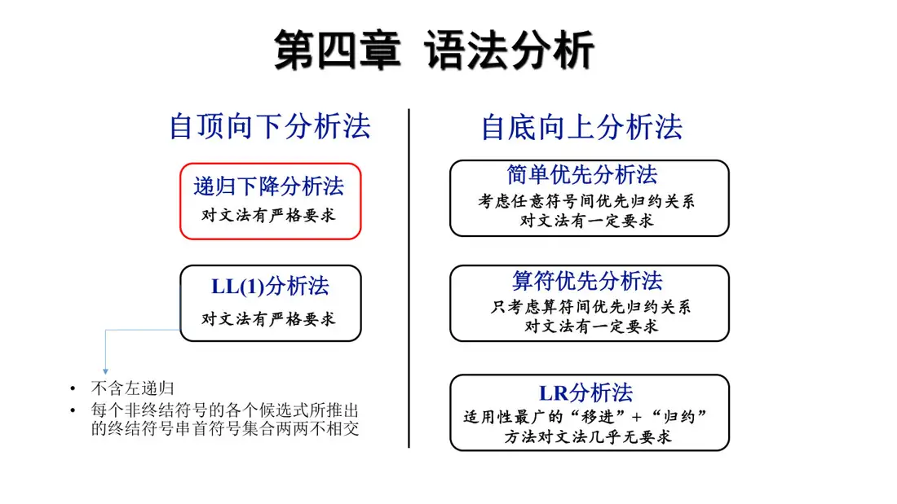

原文：

第四章 语法分析

自顶向下分析法

递归下降分析法对文法有严格要求

LL(1)分析法对文法有严格要求

自底向上分析法

简单优先分析法

考虑任意符号间优先归约关系对文法有一定要求

只考虑算符间优先归约关系对文法有一定要求

• 不含左递归

• 每个非终结符号的各个候选式所推出的终结符号串首符号集合两两不相交

LR分析法

适用性最广的“移进”+ “归约”方法对文法几乎无要求

### §4.3.2 算符优先分析法

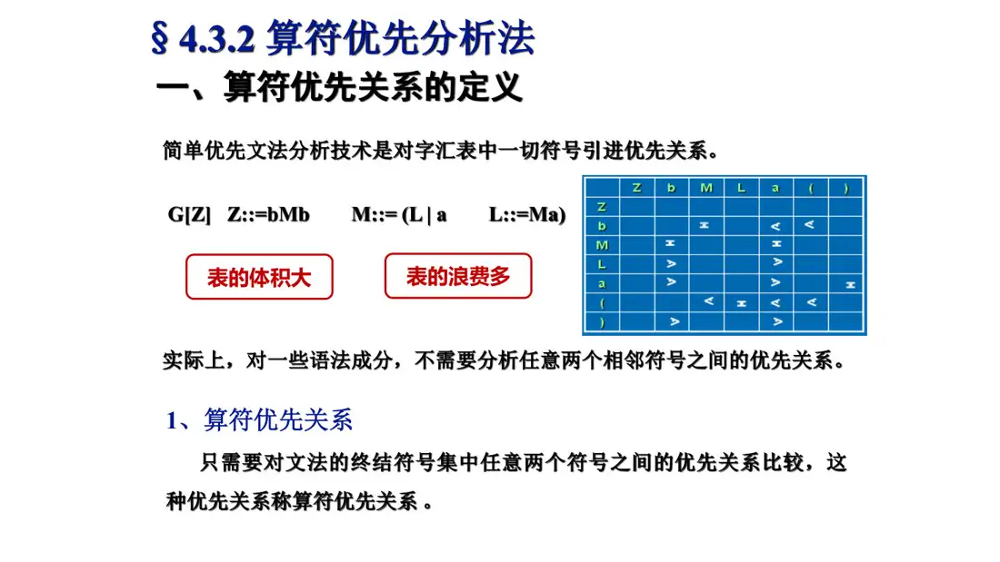

原文：

§4.3.2 算符优先分析法

一、算符优先关系的定义

简单优先文法分析技术是对字汇表中一切符号引进优先关系。

G[Z]

$$
\mathbf {Z}: := \mathbf {b M b}
$$

$$
\mathbf {M}: := (\mathbf {L} \mid \mathbf {a}
$$

$$
\mathbf {L}: := \mathbf {M} \mathbf {a})
$$

表的体积大

表的浪费多

$$
\begin{array}{c c c c c c c c} & Z & b & M & L & a & ( & ) \\ \hline Z & & & & & & \\ \hline b & & & \text {   I   } & & <   & <   \\ \hline M & & \text {   I   } & & & \text {   I   } & \\ \hline L & & > & & & > & \\ \hline a & & > & & & > & \\ \hline ( & & & <   & \text {   I   } & <   & <   \\ \hline ) & & > & & & > & \\ \hline \end{array}
$$

实际上，对一些语法成分，不需要分析任意两个相邻符号之间的优先关系。

1、算符优先关系

只需要对文法的终结符号集中任意两个符号之间的优先关系比较，这种优先关系称算符优先关系。

### §4.3.2 算符优先分析法一、算符优先关系的定义

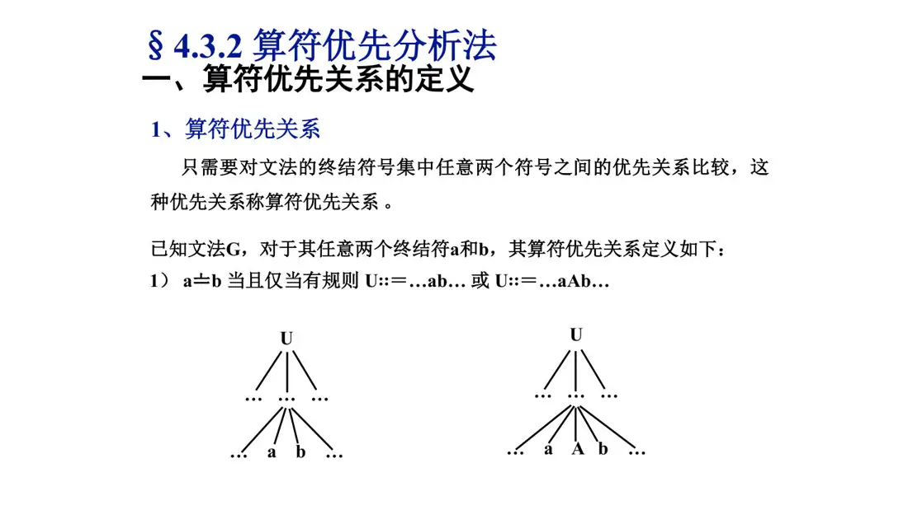

原文：

§4.3.2 算符优先分析法一、算符优先关系的定义

1、算符优先关系

只需要对文法的终结符号集中任意两个符号之间的优先关系比较，这种优先关系称算符优先关系。

已知文法G，对于其任意两个终结符a和b，其算符优先关系定义如下：

1） $\mathbf { a } { \stackrel { \mathbf { \mu } } { = } } \mathbf { b }$ 当且仅当有规则 $\mathbf { U } { : : = } \ldots \mathbf { a b } .$ … 或 $\mathbf { U } { : } { : } = \ldots { \mathbf { a } } \mathbf { A } \mathbf { b }$

### §4.3.2 算符优先分析法

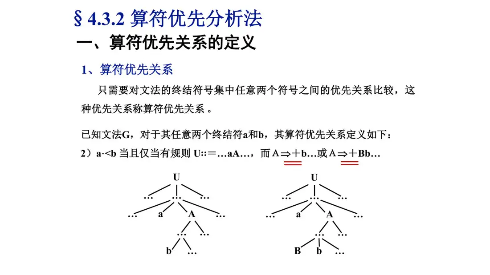

原文：

§4.3.2 算符优先分析法

一、算符优先关系的定义

1、算符优先关系

只需要对文法的终结符号集中任意两个符号之间的优先关系比较，这种优先关系称算符优先关系。

已知文法G，对于其任意两个终结符a和b，其算符优先关系定义如下：

2） $\mathbf { a } \cdot { < } \mathbf { b }$ 当且仅当有规则 $\mathbf { U } { : : = } \ldots { \mathbf { a A } } . \ldots ,$ ，而 $\mathbf { A } \Rightarrow + \mathbf { b }$ …或 $\mathbf { A } { \Rightarrow } \mathbf { + B } \mathbf { b } .$

### §4.3.2 算符优先分析法

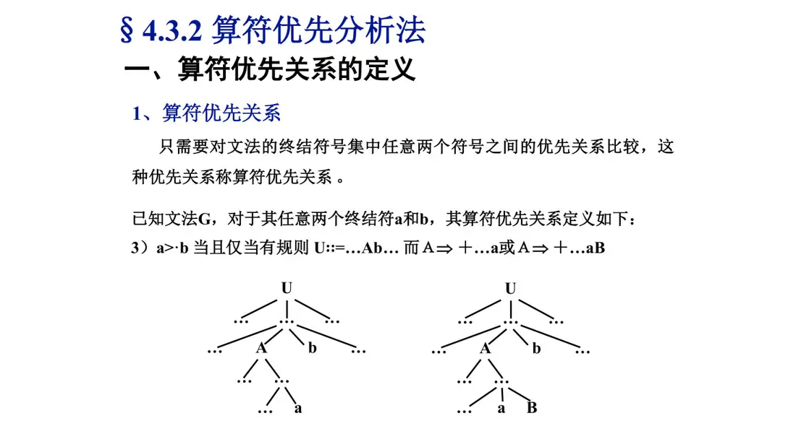

原文：

§4.3.2 算符优先分析法

一、算符优先关系的定义

1、算符优先关系

只需要对文法的终结符号集中任意两个符号之间的优先关系比较，这种优先关系称算符优先关系。

已知文法G，对于其任意两个终结符a和b，其算符优先关系定义如下：

3） $\mathbf { a } { > } \mathbf { \cdot } \mathbf { b }$ 当且仅当有规则 $\mathbf { U } { : } { : } = \ldots \mathbf { A } \mathbf { b } .$ … 而 $\mathbf { A } { \Rightarrow } + \ldots \mathbf { a }$ 或 $\mathbf { A } { \Rightarrow } + . . . \mathbf { a } \mathbf { B }$

### §4.3.2 算符优先分析法

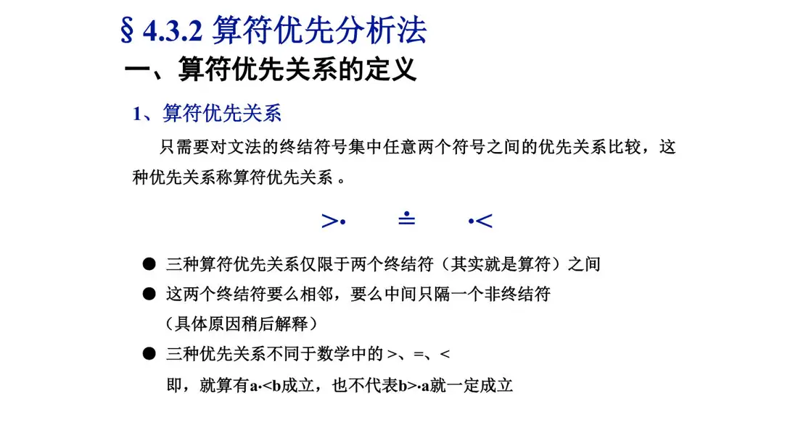

原文：

§4.3.2 算符优先分析法

一、算符优先关系的定义

1、算符优先关系

只需要对文法的终结符号集中任意两个符号之间的优先关系比较，这种优先关系称算符优先关系。

$$
> \bullet \quad \doteq \quad \bullet <
$$

● 三种算符优先关系仅限于两个终结符（其实就是算符）之间

● 这两个终结符要么相邻，要么中间只隔一个非终结符（具体原因稍后解释）

● 三种优先关系不同于数学中的 $> , = , <$

即，就算有 $\mathbf { \hat { a } } { \mathbf { \cdot } } { < } \mathbf { b }$ 成立，也不代表b>.a就一定成立

### §4.3.2 算符优先分析法

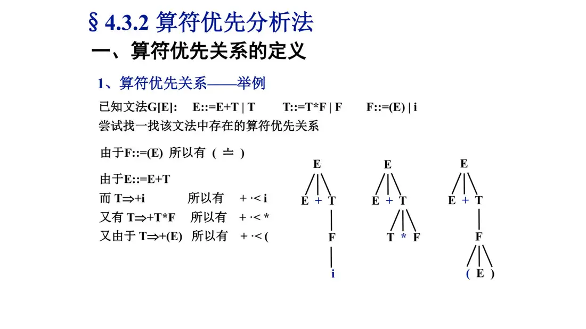

原文：

§4.3.2 算符优先分析法

一、算符优先关系的定义

1、算符优先关系——举例

已知文法G[E]: $\mathbf { E } { : = } \mathbf { E } { + } \mathbf { T } \mid \mathbf { T }$ T::=T\*F | F F::=(E) | i

尝试找一找该文法中存在的算符优先关系

由于F::=(E) 所以有 ( 〧 )

$$
\begin{array}{l l l l} \text {由于E::= E+T} & \mathrm{E} & \mathrm{E} & \mathrm{E} \\ \text {而 T⇒+i} & \mathrm{E+T} & \mathrm{E+T} & \mathrm{E+T} \\ \text {又有 T⇒+T*F} & \text {所以有} + \cdot <   * & \mathrm{T*F} & \mathrm{F} \\ \text {又由于 T⇒+(E)} & \text {所以有} + \cdot <   (\mathrm{i}) & & (\mathrm{E}) \end{array}
$$

### §4.3.2 算符优先分析法

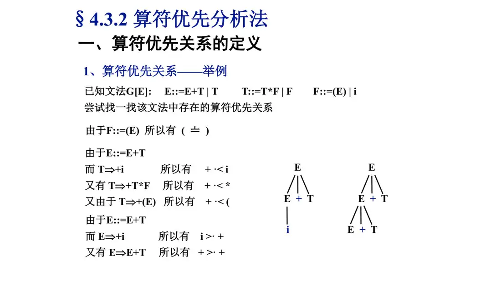

原文：

§4.3.2 算符优先分析法

一、算符优先关系的定义

1、算符优先关系——举例

已知文法G[E]: $\mathbf { E } { : = } \mathbf { E } { + } \mathbf { T } \mid \mathbf { T }$ T::=T\*F | F F::=(E) | i

尝试找一找该文法中存在的算符优先关系

由于F::=(E) 所以有 ( 〧 )

由于E::=E+T

$$
\text {而} \mathbf {T} \Rightarrow + \mathbf {i} \quad \text {所以有} \quad + \cdot <   \mathbf {i}
$$

$$
\text {又有} \mathrm{T} \Rightarrow + \mathrm{T} ^ {*} \mathrm{F} \quad \text {所以有} \quad + \cdot <   *
$$

$$
\text {   又由于   } \mathrm{T} \Rightarrow + (\mathrm{E}) \text {   所以有   } + \cdot <   (
$$

$$
\begin{array}{c c} \mathbf {E} & \\ \hline \mathbf {E} + \mathbf {T} \\ | _ {\mathbf {i}} & \end{array} \qquad \begin{array}{c c} \mathbf {E} & \\ \hline \mathbf {E} + \mathbf {T} \\ \hline \mathbf {E} + \mathbf {T} \\ | _ {\mathbf {i}} & \end{array}
$$

$$
\mathbf {\mathrm{由于} E : : = E + T}
$$

$$
\text {而} \mathbf {E} \Rightarrow + \mathbf {i} \quad \text {所以有} \quad \mathbf {i} > \cdot +
$$

又有 EE+T 所以有 + >·+

### §4.3.2 算符优先分析法

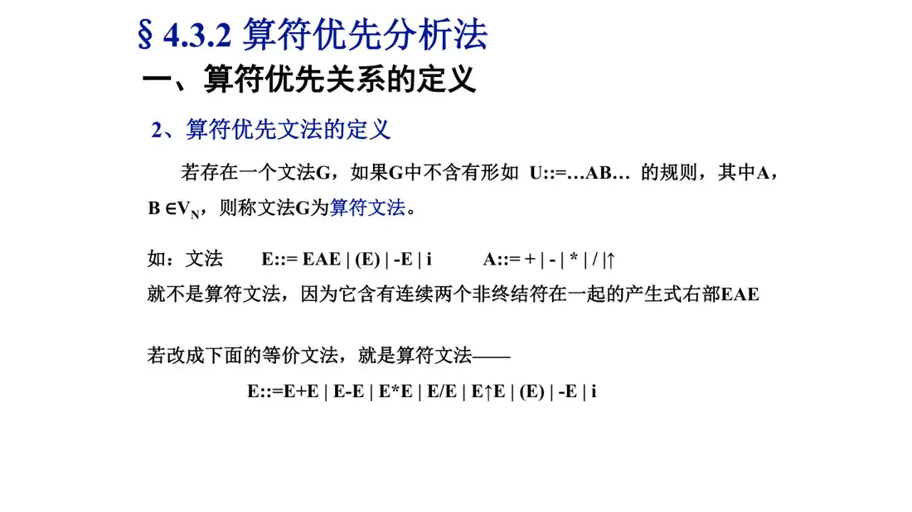

原文：

§4.3.2 算符优先分析法

一、算符优先关系的定义

2、算符优先文法的定义

若存在一个文法G，如果G中不含有形如 $\mathbf { U } { : : = } \ldots \mathbf { A } \mathbf { B } .$ … 的规则，其中A，$\mathbf { B } \in \mathbf { V } _ { \mathbf { N } } ,$ ，则称文法G为算符文法。

$$
\text {如：文法} \quad \mathbf {E}: := \mathbf {E A E} \mid (\mathbf {E}) \mid - \mathbf {E} \mid \mathbf {i} \quad \mathbf {A}: := + | - | ^ {*} | / | \uparrow
$$

就不是算符文法，因为它含有连续两个非终结符在一起的产生式右部EAE

若改成下面的等价文法，就是算符文法—

$$
\mathbf {E}: := \mathbf {E} + \mathbf {E} \mid \mathbf {E} - \mathbf {E} \mid \mathbf {E} ^ {*} \mathbf {E} \mid \mathbf {E} / \mathbf {E} \mid \mathbf {E} \uparrow \mathbf {E} \mid (\mathbf {E}) \mid - \mathbf {E} \mid \mathbf {i}
$$

### §4.3.2 算符优先分析法

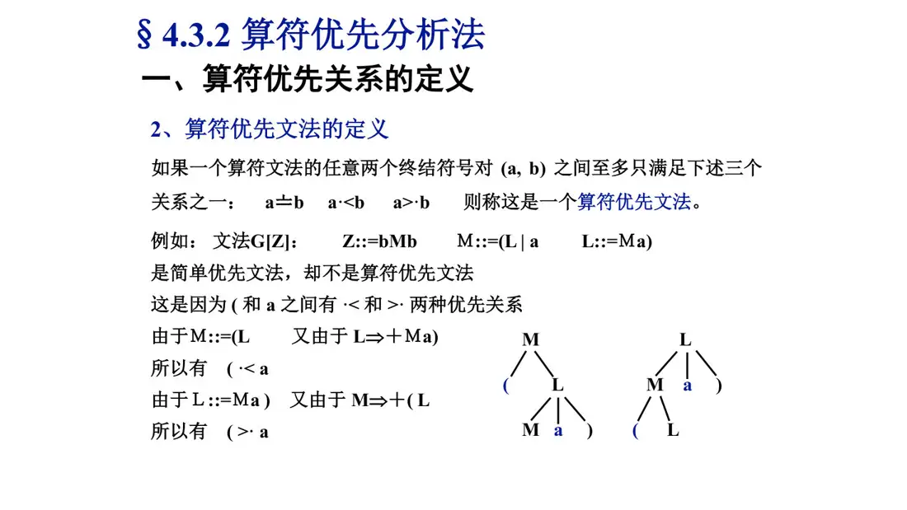

原文：

§4.3.2 算符优先分析法

一、算符优先关系的定义

2、算符优先文法的定义

如果一个算符文法的任意两个终结符号对 (a, b) 之间至多只满足下述三个关系之一： $\mathbf { a } { \pm } \mathbf { b } \quad \mathbf { a } { \cdot } { < } \mathbf { b } \quad \mathbf { a } { > } { \cdot } \mathbf { b }$ 则称这是一个算符优先文法。

例如： 文法 $\mathbf { G } [ \mathbf { Z } ]$ $\mathbf { Z } { \boldsymbol { : } } { \mathrm { = } } \mathbf { b } \mathbf { M } \mathbf { b } \qquad \mathbf { M } { \boldsymbol { : } } { \boldsymbol { : } } = ( \mathbf { L } \mid \mathbf { a } \qquad \mathbf { L } { \boldsymbol { : } } { \boldsymbol { : } } = \mathbf { M } \mathbf { a } )$

是简单优先文法，却不是算符优先文法

这是因为 ( 和 a 之间有 ·< 和 >·两种优先关系

由于 $\mathbf { M } { : : = } ( \mathbf { L }$ 又由于 $\mathbf { L } { \Rightarrow } { + } \mathbf { M } \mathbf { a } )$

所以有 ( ·< a

由于 $\mathbf { L } : : = \mathbf { M } \mathbf { a } \ )$ 又由于 $\mathbf { M } { \Rightarrow } { + } ( \mathbf { \Omega } \mathbf { L }$

所以有 ( >·a

### §4.3.2 算符优先分析法

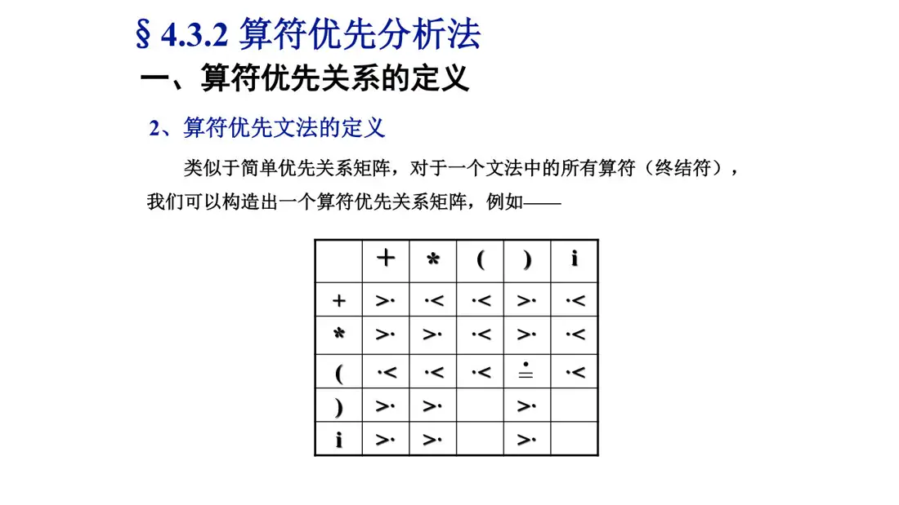

原文：

§4.3.2 算符优先分析法

一、算符优先关系的定义

2、算符优先文法的定义

类似于简单优先关系矩阵，对于一个文法中的所有算符（终结符），我们可以构造出一个算符优先关系矩阵，例如

<table><tr><td></td><td>+</td><td>*</td><td>(</td><td>)</td><td>i</td></tr><tr><td>+</td><td>&gt;·</td><td>&lt;</td><td>&lt;</td><td>&gt;·</td><td>&lt;</td></tr><tr><td>*</td><td>&gt;·</td><td>&gt;·</td><td>&lt;</td><td>&gt;·</td><td>&lt;</td></tr><tr><td>(</td><td>&lt;</td><td>&lt;</td><td>&lt;</td><td> $\doteq$ </td><td>&lt;</td></tr><tr><td>)</td><td>&gt;·</td><td>&gt;·</td><td></td><td>&gt;·</td><td></td></tr><tr><td>i</td><td>&gt;·</td><td>&gt;·</td><td></td><td>&gt;·</td><td></td></tr></table>

### §4.3.2 算符优先分析法

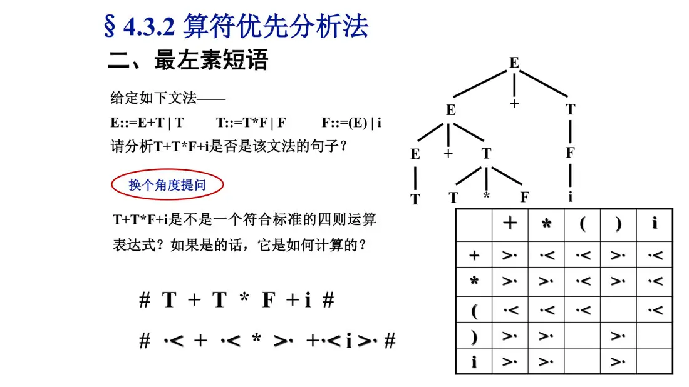

原文：

§4.3.2 算符优先分析法

二、最左素短语

给定如下文法—

E::=E+T | T

T::=T\*F | F

F::=(E) | i

请分析T+T\*F+i是否是该文法的句子？

换个角度提问

T+T\*F+i是不是一个符合标准的四则运算表达式？如果是的话，它是如何计算的？

\# T + T \* F + i #

\# ·< + ·< \* >·+·< i >·#

<table><tr><td></td><td>+</td><td>*</td><td>(</td><td>)</td><td>i</td></tr><tr><td>+</td><td>&gt;.</td><td>&lt;</td><td>&lt;</td><td>&gt;.</td><td>&lt;</td></tr><tr><td>*</td><td>&gt;.</td><td>&gt;.</td><td>&lt;</td><td>&gt;.</td><td>&lt;</td></tr><tr><td>(</td><td>&lt;</td><td>&lt;</td><td>&lt;</td><td></td><td>&lt;</td></tr><tr><td>)</td><td>&gt;.</td><td>&gt;.</td><td></td><td>&gt;.</td><td></td></tr><tr><td>i</td><td>&gt;.</td><td>&gt;.</td><td></td><td>&gt;.</td><td></td></tr></table>

### §4.3.2 算符优先分析法

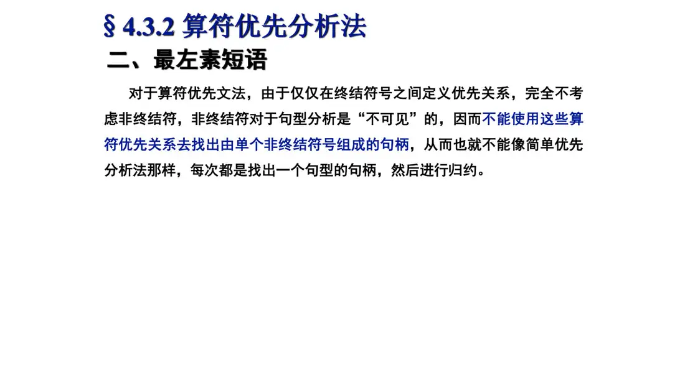

原文：

§4.3.2 算符优先分析法

二、最左素短语

对于算符优先文法，由于仅仅在终结符号之间定义优先关系，完全不考虑非终结符，非终结符对于句型分析是“不可见”的，因而不能使用这些算符优先关系去找出由单个非终结符号组成的句柄，从而也就不能像简单优先分析法那样，每次都是找出一个句型的句柄，然后进行归约。

### 第 15 页

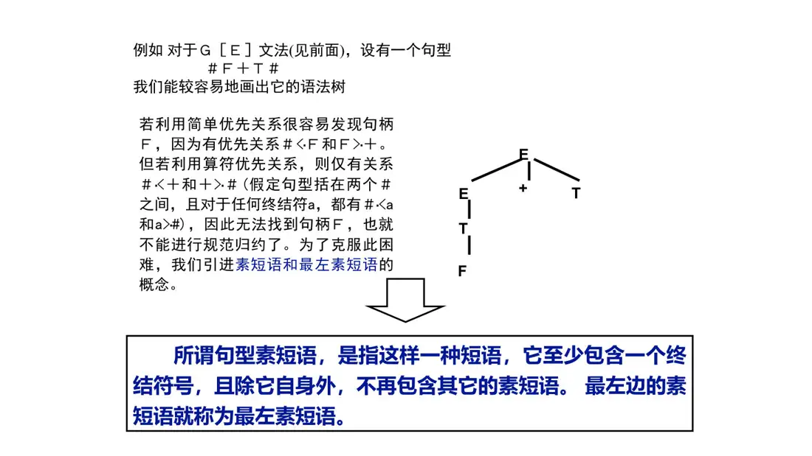

原文：

例如对于G［E］文法(见前面)，设有一个句型＃F＋T＃我们能较容易地画出它的语法树

若利用简单优先关系很容易发现句柄F，因为有优先关系＃<·F和F>·＋。但若利用算符优先关系，则仅有关系＃·<＋和＋>·＃(假定句型括在两个＃之间，且对于任何终结符a，都有＃·<a和a>·#)，因此无法找到句柄F，也就不能进行规范归约了。为了克服此困难，我们引进素短语和最左素短语的概念。 厂

所谓句型素短语，是指这样一种短语，它至少包含一个终结符号，且除它自身外，不再包含其它的素短语。 最左边的素短语就称为最左素短语。

### §4.3.2 算符优先分析法二、最左素短语

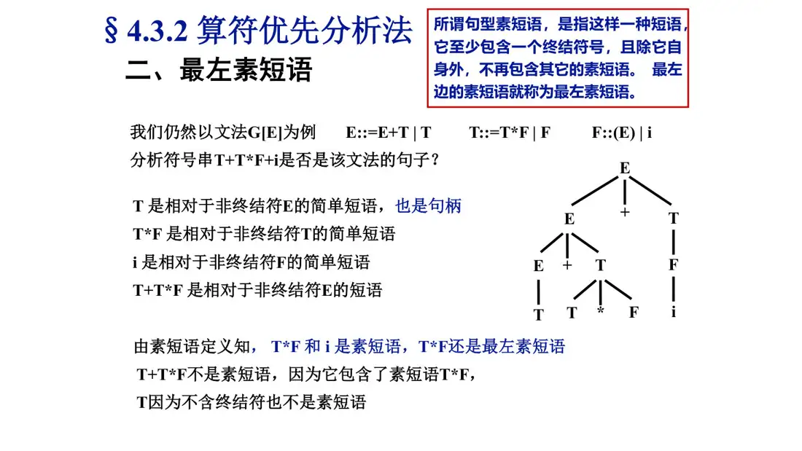

原文：

§4.3.2 算符优先分析法二、最左素短语

我们仍然以文法 $\bf G [ E ]$ 为例

E::=E+T | T

分析符号串 $\mathbf { T } { + } \mathbf { T } ^ { * } \mathbf { F } { + } \mathbf { i }$ 是否是该文法的句子？

T是相对于非终结符E的简单短语，也是句柄

$\mathbf { T } ^ { \ast } \mathbf { F }$ 是相对于非终结符T的简单短语

i是相对于非终结符F的简单短语

$\mathbf { T } { + } \mathbf { T } ^ { * } \mathbf { F }$ 是相对于非终结符E的短语

由素短语定义知， $\mathbf { T } ^ { \ast } \mathbf { F }$ 和 i是素短语，T\*F还是最左素短语

$\mathbf { T } { + } \mathbf { T } ^ { * } \mathbf { F }$ 不是素短语，因为它包含了素短语T\*F，

T因为不含终结符也不是素短语所谓句型素短语，是指这样一种短语，它至少包含一个终结符号，且除它自身外，不再包含其它的素短语。 最左边的素短语就称为最左素短语。

$$
\mathbf {T}: := \mathbf {T} ^ {*} \mathbf {F} \mid \mathbf {F}
$$

F::(E) | i

### §4.3.2 算符优先分析法二、最左素短语

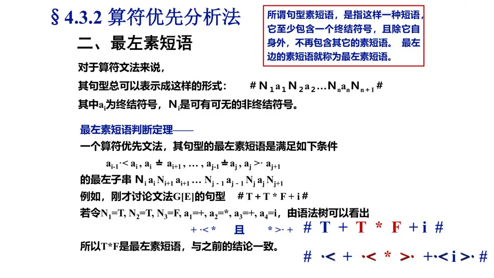

原文：

§4.3.2 算符优先分析法二、最左素短语

所谓句型素短语，是指这样一种短语，它至少包含一个终结符号，且除它自身外，不再包含其它的素短语。 最左边的素短语就称为最左素短语。

对于算符文法来说，

其句型总可以表示成这样的形式： ＃ $\mathbf { N _ { 1 } } \mathbf { a _ { 1 } } \mathbf { N _ { 2 } } \mathbf { a _ { 2 } } \dots \mathbf { N _ { n } } \mathbf { a _ { n } } \mathbf { N _ { n + 1 } }$ ＃

其中 $\lvert \mathbf { a } _ { \mathrm { i } } \rvert$ 为终结符号， $\mathsf { N } _ { \mathrm { i } }$ 是可有可无的非终结符号。

最左素短语判断定理

一个算符优先文法，其句型的最左素短语是满足如下条件

$$
\mathbf {a} _ {\mathrm{i-1}} \cdot <   \mathbf {a} _ {\mathrm{i}}, \mathbf {a} _ {\mathrm{i}} \doteq \mathbf {a} _ {\mathrm{i+1}}, \ldots , \mathbf {a} _ {\mathrm{j-1}} \doteq \mathbf {a} _ {\mathrm{j}}, \mathbf {a} _ {\mathrm{j}} > \cdot \mathbf {a} _ {\mathrm{j+1}}
$$

的最左子串 $\mathrm { N _ { i } a _ { i } N _ { i + 1 } a _ { i + 1 } \dots N _ { j \ell - 1 } a _ { j \ell - 1 } N _ { j } a _ { j } N _ { j + 1 } }$

例如，刚才讨论文法G[E]的句型 ＃ $\mathbf { T } + \mathbf { T } \times \mathbf { F } + \mathbf { i }$ ＃

若令 $\mathrm { N _ { 1 } } \mathrm { = T , N _ { 2 } } \mathrm { = T , N _ { 3 } } \mathrm { = F , a _ { 1 } = + , a _ { 2 } = + , a _ { 3 } = + , a _ { 4 } = i }$ ，由语法树可以看出

$$
+ \cdot <   * \quad \text {且} \quad * > \cdot + \# \mathbf {T} + \mathbf {T} * \mathbf {F} + \mathbf {i} \#
$$

所以 $\mathbf { T } ^ { * } \mathbf { F }$ 是最左素短语，与之前的结论一致。

$$
\# \cdot <   + \cdot <   * > \cdot + \cdot <   i > \cdot \#
$$

### §4.3.2 算符优先分析法

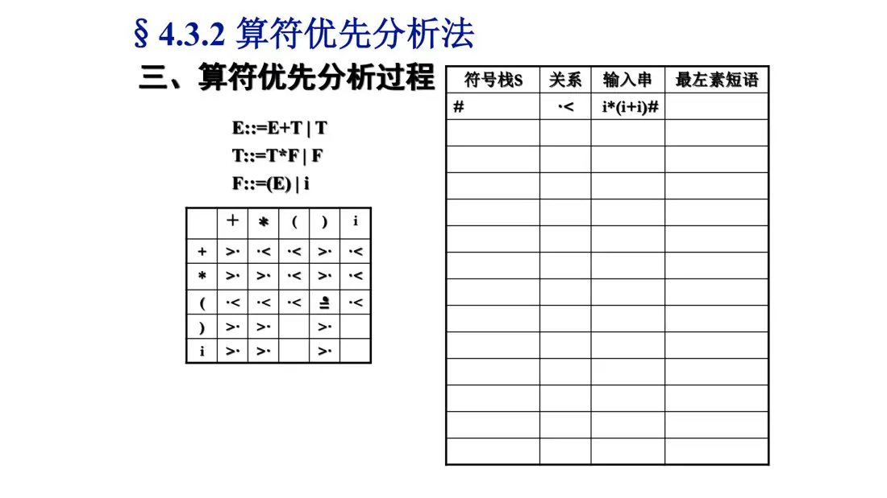

原文：

§4.3.2 算符优先分析法

三、算符优先分析过程

E::=E+T | T

T::=T\*F | F

F::=(E) | i

<table><tr><td></td><td>+</td><td>*</td><td>(</td><td>)</td><td>i</td></tr><tr><td>+</td><td>&gt;·</td><td>·&lt;</td><td>·&lt;</td><td>&gt;·</td><td>·&lt;</td></tr><tr><td>*</td><td>&gt;·</td><td>&gt;·</td><td>·&lt;</td><td>&gt;·</td><td>·&lt;</td></tr><tr><td>(</td><td>·&lt;</td><td>·&lt;</td><td>·&lt;</td><td>≡</td><td>·&lt;</td></tr><tr><td>)</td><td>&gt;·</td><td>&gt;·</td><td></td><td>&gt;·</td><td></td></tr><tr><td>i</td><td>&gt;·</td><td>&gt;·</td><td></td><td>&gt;·</td><td></td></tr></table>

<table><tr><td>符号栈S</td><td>关系</td><td>输入串</td><td>最左素短语</td></tr><tr><td>#</td><td>•&lt;</td><td>i*(i+i)#</td><td></td></tr><tr><td></td><td></td><td></td><td></td></tr><tr><td></td><td></td><td></td><td></td></tr><tr><td></td><td></td><td></td><td></td></tr><tr><td></td><td></td><td></td><td></td></tr><tr><td></td><td></td><td></td><td></td></tr><tr><td></td><td></td><td></td><td></td></tr><tr><td></td><td></td><td></td><td></td></tr><tr><td></td><td></td><td></td><td></td></tr><tr><td></td><td></td><td></td><td></td></tr><tr><td></td><td></td><td></td><td></td></tr><tr><td></td><td></td><td></td><td></td></tr><tr><td></td><td></td><td></td><td></td></tr><tr><td></td><td></td><td></td><td></td></tr></table>

### §4.3.2 算符优先分析法

原文：

§4.3.2 算符优先分析法

三、算符优先分析过程

E::=E+T | T

T::=T\*F | F

F::=(E) | i

<table><tr><td></td><td>+</td><td>*</td><td>(</td><td>)</td><td>i</td></tr><tr><td>+</td><td>&gt;·</td><td>·&lt;</td><td>·&lt;</td><td>&gt;·</td><td>·&lt;</td></tr><tr><td>*</td><td>&gt;·</td><td>&gt;·</td><td>·&lt;</td><td>&gt;·</td><td>·&lt;</td></tr><tr><td>(</td><td>·&lt;</td><td>·&lt;</td><td>·&lt;</td><td>≡</td><td>·&lt;</td></tr><tr><td>)</td><td>&gt;·</td><td>&gt;·</td><td></td><td>&gt;·</td><td></td></tr><tr><td>i</td><td>&gt;·</td><td>&gt;·</td><td></td><td>&gt;·</td><td></td></tr></table>

<table><tr><td>符号栈S</td><td>关系</td><td>输入串</td><td>最左素短语</td></tr><tr><td>#</td><td>•&lt;</td><td>i*(i+i)#</td><td></td></tr><tr><td>#i</td><td></td><td>*(i+i)#</td><td></td></tr><tr><td></td><td></td><td></td><td></td></tr><tr><td></td><td></td><td></td><td></td></tr><tr><td></td><td></td><td></td><td></td></tr><tr><td></td><td></td><td></td><td></td></tr><tr><td></td><td></td><td></td><td></td></tr><tr><td></td><td></td><td></td><td></td></tr><tr><td></td><td></td><td></td><td></td></tr><tr><td></td><td></td><td></td><td></td></tr><tr><td></td><td></td><td></td><td></td></tr><tr><td></td><td></td><td></td><td></td></tr><tr><td></td><td></td><td></td><td></td></tr><tr><td></td><td></td><td></td><td></td></tr></table>

### §4.3.2 算符优先分析法

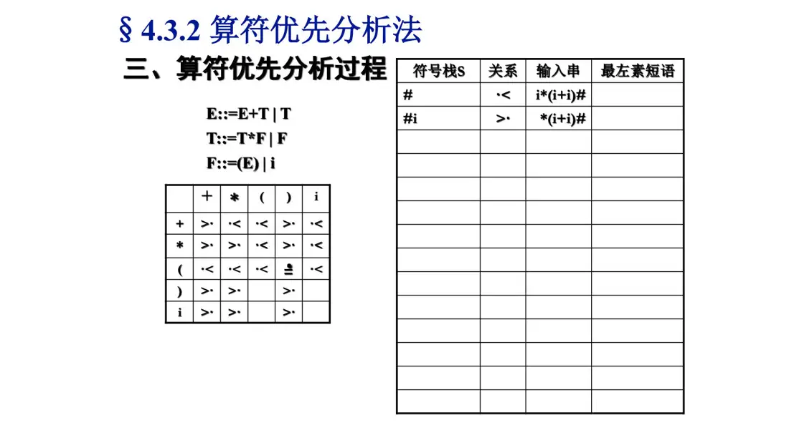

原文：

§4.3.2 算符优先分析法

三、算符优先分析过程

E::=E+T | T

T::=T\*F | F

F::=(E) | i

<table><tr><td></td><td>+</td><td>*</td><td>(</td><td>)</td><td>i</td></tr><tr><td>+</td><td>&gt;·</td><td>·&lt;</td><td>·&lt;</td><td>&gt;·</td><td>·&lt;</td></tr><tr><td>*</td><td>&gt;·</td><td>&gt;·</td><td>·&lt;</td><td>&gt;·</td><td>·&lt;</td></tr><tr><td>(</td><td>·&lt;</td><td>·&lt;</td><td>·&lt;</td><td>≡</td><td>·&lt;</td></tr><tr><td>)</td><td>&gt;·</td><td>&gt;·</td><td></td><td>&gt;·</td><td></td></tr><tr><td>i</td><td>&gt;·</td><td>&gt;·</td><td></td><td>&gt;·</td><td></td></tr></table>

<table><tr><td>符号栈S</td><td>关系</td><td>输入串</td><td>最左素短语</td></tr><tr><td>#</td><td>•&lt;</td><td>i*(i+i)#</td><td></td></tr><tr><td>#i</td><td>&gt;•</td><td>*(i+i)#</td><td></td></tr><tr><td></td><td></td><td></td><td></td></tr><tr><td></td><td></td><td></td><td></td></tr><tr><td></td><td></td><td></td><td></td></tr><tr><td></td><td></td><td></td><td></td></tr><tr><td></td><td></td><td></td><td></td></tr><tr><td></td><td></td><td></td><td></td></tr><tr><td></td><td></td><td></td><td></td></tr><tr><td></td><td></td><td></td><td></td></tr><tr><td></td><td></td><td></td><td></td></tr><tr><td></td><td></td><td></td><td></td></tr><tr><td></td><td></td><td></td><td></td></tr><tr><td></td><td></td><td></td><td></td></tr></table>

### §4.3.2 算符优先分析法

原文：

§4.3.2 算符优先分析法

三、算符优先分析过程

E::=E+T | T

T::=T\*F | F

F::=(E) | i

<table><tr><td></td><td>+</td><td>*</td><td>(</td><td>)</td><td>i</td></tr><tr><td>+</td><td>&gt;·</td><td>·&lt;</td><td>·&lt;</td><td>&gt;·</td><td>·&lt;</td></tr><tr><td>*</td><td>&gt;·</td><td>&gt;·</td><td>·&lt;</td><td>&gt;·</td><td>·&lt;</td></tr><tr><td>(</td><td>·&lt;</td><td>·&lt;</td><td>·&lt;</td><td>≡</td><td>·&lt;</td></tr><tr><td>)</td><td>&gt;·</td><td>&gt;·</td><td></td><td>&gt;·</td><td></td></tr><tr><td>i</td><td>&gt;·</td><td>&gt;·</td><td></td><td>&gt;·</td><td></td></tr></table>

<table><tr><td>符号栈S</td><td>关系</td><td>输入串</td><td>最左素短语</td></tr><tr><td>#</td><td>•&lt;</td><td>i*(i+i)#</td><td></td></tr><tr><td>#i</td><td>&gt;•</td><td>*(i+i)#</td><td></td></tr><tr><td></td><td></td><td></td><td></td></tr><tr><td></td><td></td><td></td><td></td></tr><tr><td></td><td></td><td></td><td></td></tr><tr><td></td><td></td><td></td><td></td></tr><tr><td></td><td></td><td></td><td></td></tr><tr><td></td><td></td><td></td><td></td></tr><tr><td></td><td></td><td></td><td></td></tr><tr><td></td><td></td><td></td><td></td></tr><tr><td></td><td></td><td></td><td></td></tr><tr><td></td><td></td><td></td><td></td></tr><tr><td></td><td></td><td></td><td></td></tr><tr><td></td><td></td><td></td><td></td></tr></table>

### §4.3.2 算符优先分析法

原文：

§4.3.2 算符优先分析法

三、算符优先分析过程

E::=E+T | T

T::=T\*F | F

F::=(E) | i

<table><tr><td></td><td>+</td><td>*</td><td>(</td><td>)</td><td>i</td></tr><tr><td>+</td><td>&gt;·</td><td>·&lt;</td><td>·&lt;</td><td>&gt;·</td><td>·&lt;</td></tr><tr><td>*</td><td>&gt;·</td><td>&gt;·</td><td>·&lt;</td><td>&gt;·</td><td>·&lt;</td></tr><tr><td>(</td><td>·&lt;</td><td>·&lt;</td><td>·&lt;</td><td>≡</td><td>·&lt;</td></tr><tr><td>)</td><td>&gt;·</td><td>&gt;·</td><td></td><td>&gt;·</td><td></td></tr><tr><td>i</td><td>&gt;·</td><td>&gt;·</td><td></td><td>&gt;·</td><td></td></tr></table>

<table><tr><td>符号栈S</td><td>关系</td><td>输入串</td><td>最左素短语</td></tr><tr><td>#</td><td>•&lt;</td><td>i*(i+i)#</td><td></td></tr><tr><td>#i</td><td>&gt;•</td><td>*(i+i)#</td><td>i</td></tr><tr><td></td><td></td><td></td><td></td></tr><tr><td></td><td></td><td></td><td></td></tr><tr><td></td><td></td><td></td><td></td></tr><tr><td></td><td></td><td></td><td></td></tr><tr><td></td><td></td><td></td><td></td></tr><tr><td></td><td></td><td></td><td></td></tr><tr><td></td><td></td><td></td><td></td></tr><tr><td></td><td></td><td></td><td></td></tr><tr><td></td><td></td><td></td><td></td></tr><tr><td></td><td></td><td></td><td></td></tr><tr><td></td><td></td><td></td><td></td></tr><tr><td></td><td></td><td></td><td></td></tr></table>

### §4.3.2 算符优先分析法

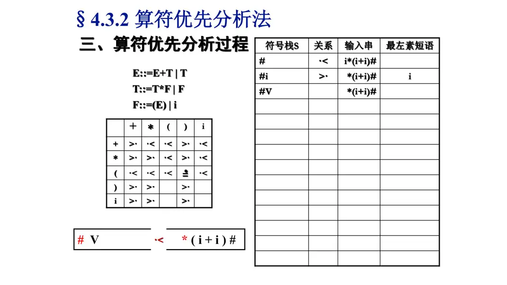

原文：

§4.3.2 算符优先分析法

三、算符优先分析过程

E::=E+T | T

T::=T\*F | F

F::=(E) | i

<table><tr><td></td><td>+</td><td>*</td><td>(</td><td>)</td><td>i</td></tr><tr><td>+</td><td>&gt;·</td><td>&lt;</td><td>&lt;</td><td>&gt;·</td><td>&lt;</td></tr><tr><td>*</td><td>&gt;·</td><td>&gt;·</td><td>&lt;</td><td>&gt;·</td><td>&lt;</td></tr><tr><td>(</td><td>&lt;</td><td>&lt;</td><td>&lt;</td><td>=</td><td>&lt;</td></tr><tr><td>)</td><td>&gt;·</td><td>&gt;·</td><td></td><td>&gt;·</td><td></td></tr><tr><td>i</td><td>&gt;·</td><td>&gt;·</td><td></td><td>&gt;·</td><td></td></tr></table>

\* ( i + i ) #

<table><tr><td>符号栈S</td><td>关系</td><td>输入串</td><td>最左素短语</td></tr><tr><td>#</td><td>•&lt;</td><td>i*(i+i)#</td><td></td></tr><tr><td>#i</td><td>&gt;•</td><td>*(i+i)#</td><td>i</td></tr><tr><td>#V</td><td></td><td>*(i+i)#</td><td></td></tr><tr><td></td><td></td><td></td><td></td></tr><tr><td></td><td></td><td></td><td></td></tr><tr><td></td><td></td><td></td><td></td></tr><tr><td></td><td></td><td></td><td></td></tr><tr><td></td><td></td><td></td><td></td></tr><tr><td></td><td></td><td></td><td></td></tr><tr><td></td><td></td><td></td><td></td></tr><tr><td></td><td></td><td></td><td></td></tr><tr><td></td><td></td><td></td><td></td></tr><tr><td></td><td></td><td></td><td></td></tr><tr><td></td><td></td><td></td><td></td></tr></table>

### §4.3.2 算符优先分析法

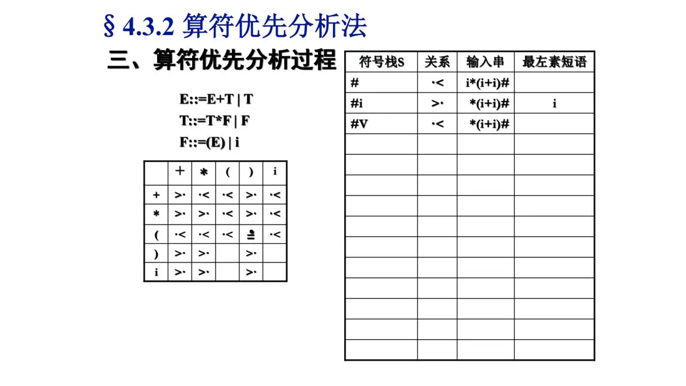

原文：

§4.3.2 算符优先分析法

三、算符优先分析过程

E::=E+T | T

T::=T\*F | F

F::=(E) | i

<table><tr><td></td><td>+</td><td>*</td><td>(</td><td>)</td><td>i</td></tr><tr><td>+</td><td>&gt;·</td><td>·&lt;</td><td>·&lt;</td><td>&gt;·</td><td>·&lt;</td></tr><tr><td>*</td><td>&gt;·</td><td>&gt;·</td><td>·&lt;</td><td>&gt;·</td><td>·&lt;</td></tr><tr><td>(</td><td>·&lt;</td><td>·&lt;</td><td>·&lt;</td><td>≡</td><td>·&lt;</td></tr><tr><td>)</td><td>&gt;·</td><td>&gt;·</td><td></td><td>&gt;·</td><td></td></tr><tr><td>i</td><td>&gt;·</td><td>&gt;·</td><td></td><td>&gt;·</td><td></td></tr></table>

<table><tr><td>符号栈S</td><td>关系</td><td>输入串</td><td>最左素短语</td></tr><tr><td>#</td><td>•&lt;</td><td>i*(i+i)#</td><td></td></tr><tr><td>#i</td><td>&gt;•</td><td>*(i+i)#</td><td>i</td></tr><tr><td>#V</td><td>•&lt;</td><td>*(i+i)#</td><td></td></tr><tr><td></td><td></td><td></td><td></td></tr><tr><td></td><td></td><td></td><td></td></tr><tr><td></td><td></td><td></td><td></td></tr><tr><td></td><td></td><td></td><td></td></tr><tr><td></td><td></td><td></td><td></td></tr><tr><td></td><td></td><td></td><td></td></tr><tr><td></td><td></td><td></td><td></td></tr><tr><td></td><td></td><td></td><td></td></tr><tr><td></td><td></td><td></td><td></td></tr><tr><td></td><td></td><td></td><td></td></tr><tr><td></td><td></td><td></td><td></td></tr></table>

### §4.3.2 算符优先分析法

原文：

§4.3.2 算符优先分析法

三、算符优先分析过程

E::=E+T | T

T::=T\*F | F

F::=(E) | i

<table><tr><td></td><td>+</td><td>*</td><td>(</td><td>)</td><td>i</td></tr><tr><td>+</td><td>&gt;·</td><td>·&lt;</td><td>·&lt;</td><td>&gt;·</td><td>·&lt;</td></tr><tr><td>*</td><td>&gt;·</td><td>&gt;·</td><td>·&lt;</td><td>&gt;·</td><td>·&lt;</td></tr><tr><td>(</td><td>·&lt;</td><td>·&lt;</td><td>·&lt;</td><td>≡</td><td>·&lt;</td></tr><tr><td>)</td><td>&gt;·</td><td>&gt;·</td><td></td><td>&gt;·</td><td></td></tr><tr><td>i</td><td>&gt;·</td><td>&gt;·</td><td></td><td>&gt;·</td><td></td></tr></table>

<table><tr><td>符号栈S</td><td>关系</td><td>输入串</td><td>最左素短语</td></tr><tr><td>#</td><td>•&lt;</td><td>i*(i+i)#</td><td></td></tr><tr><td>#i</td><td>&gt;•</td><td>*(i+i)#</td><td>i</td></tr><tr><td>#V</td><td>•&lt;</td><td>*(i+i)#</td><td></td></tr><tr><td>#V*</td><td></td><td>(i+i)#</td><td></td></tr><tr><td></td><td></td><td></td><td></td></tr><tr><td></td><td></td><td></td><td></td></tr><tr><td></td><td></td><td></td><td></td></tr><tr><td></td><td></td><td></td><td></td></tr><tr><td></td><td></td><td></td><td></td></tr><tr><td></td><td></td><td></td><td></td></tr><tr><td></td><td></td><td></td><td></td></tr><tr><td></td><td></td><td></td><td></td></tr><tr><td></td><td></td><td></td><td></td></tr><tr><td></td><td></td><td></td><td></td></tr></table>

### §4.3.2 算符优先分析法

原文：

§4.3.2 算符优先分析法

三、算符优先分析过程

E::=E+T | T

T::=T\*F | F

F::=(E) | i

<table><tr><td></td><td>+</td><td>*</td><td>(</td><td>)</td><td>i</td></tr><tr><td>+</td><td>&gt;·</td><td>·&lt;</td><td>·&lt;</td><td>&gt;·</td><td>·&lt;</td></tr><tr><td>*</td><td>&gt;·</td><td>&gt;·</td><td>·&lt;</td><td>&gt;·</td><td>·&lt;</td></tr><tr><td>(</td><td>·&lt;</td><td>·&lt;</td><td>·&lt;</td><td>≡</td><td>·&lt;</td></tr><tr><td>)</td><td>&gt;·</td><td>&gt;·</td><td></td><td>&gt;·</td><td></td></tr><tr><td>i</td><td>&gt;·</td><td>&gt;·</td><td></td><td>&gt;·</td><td></td></tr></table>

<table><tr><td>符号栈S</td><td>关系</td><td>输入串</td><td>最左素短语</td></tr><tr><td>#</td><td>•&lt;</td><td>i*(i+i)#</td><td></td></tr><tr><td>#i</td><td>&gt;•</td><td>*(i+i)#</td><td>i</td></tr><tr><td>#V</td><td>•&lt;</td><td>*(i+i)#</td><td></td></tr><tr><td>#V*</td><td>•&lt;</td><td>(i+i)#</td><td></td></tr><tr><td></td><td></td><td></td><td></td></tr><tr><td></td><td></td><td></td><td></td></tr><tr><td></td><td></td><td></td><td></td></tr><tr><td></td><td></td><td></td><td></td></tr><tr><td></td><td></td><td></td><td></td></tr><tr><td></td><td></td><td></td><td></td></tr><tr><td></td><td></td><td></td><td></td></tr><tr><td></td><td></td><td></td><td></td></tr><tr><td></td><td></td><td></td><td></td></tr><tr><td></td><td></td><td></td><td></td></tr></table>

### §4.3.2 算符优先分析法

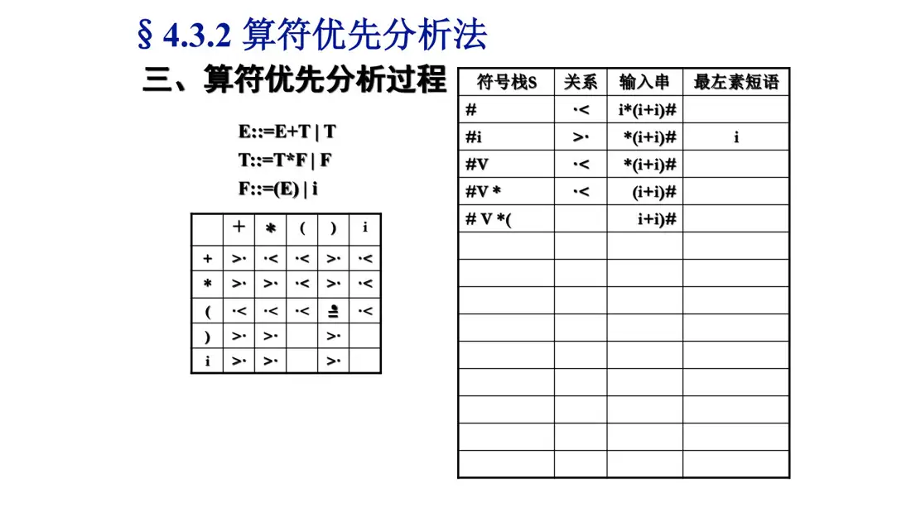

原文：

§4.3.2 算符优先分析法

三、算符优先分析过程

E::=E+T | T

T::=T\*F | F

F::=(E) | i

<table><tr><td></td><td>+</td><td>*</td><td>(</td><td>)</td><td>i</td></tr><tr><td>+</td><td>&gt;·</td><td>·&lt;</td><td>·&lt;</td><td>&gt;·</td><td>·&lt;</td></tr><tr><td>*</td><td>&gt;·</td><td>&gt;·</td><td>·&lt;</td><td>&gt;·</td><td>·&lt;</td></tr><tr><td>(</td><td>·&lt;</td><td>·&lt;</td><td>·&lt;</td><td>≡</td><td>·&lt;</td></tr><tr><td>)</td><td>&gt;·</td><td>&gt;·</td><td></td><td>&gt;·</td><td></td></tr><tr><td>i</td><td>&gt;·</td><td>&gt;·</td><td></td><td>&gt;·</td><td></td></tr></table>

<table><tr><td>符号栈S</td><td>关系</td><td>输入串</td><td>最左素短语</td></tr><tr><td>#</td><td>•&lt;</td><td>i*(i+i)#</td><td></td></tr><tr><td>#i</td><td>&gt;•</td><td>*(i+i)#</td><td>i</td></tr><tr><td>#V</td><td>•&lt;</td><td>*(i+i)#</td><td></td></tr><tr><td>#V*</td><td>•&lt;</td><td>(i+i)#</td><td></td></tr><tr><td>#V*(</td><td></td><td>i+i)#</td><td></td></tr><tr><td></td><td></td><td></td><td></td></tr><tr><td></td><td></td><td></td><td></td></tr><tr><td></td><td></td><td></td><td></td></tr><tr><td></td><td></td><td></td><td></td></tr><tr><td></td><td></td><td></td><td></td></tr><tr><td></td><td></td><td></td><td></td></tr><tr><td></td><td></td><td></td><td></td></tr><tr><td></td><td></td><td></td><td></td></tr><tr><td></td><td></td><td></td><td></td></tr></table>

### §4.3.2 算符优先分析法

原文：

§4.3.2 算符优先分析法

三、算符优先分析过程

E::=E+T | T

T::=T\*F | F

F::=(E) | i

<table><tr><td></td><td>+</td><td>*</td><td>(</td><td>)</td><td>i</td></tr><tr><td>+</td><td>&gt;·</td><td>·&lt;</td><td>·&lt;</td><td>&gt;·</td><td>·&lt;</td></tr><tr><td>*</td><td>&gt;·</td><td>&gt;·</td><td>·&lt;</td><td>&gt;·</td><td>·&lt;</td></tr><tr><td>(</td><td>·&lt;</td><td>·&lt;</td><td>·&lt;</td><td>≡</td><td>·&lt;</td></tr><tr><td>)</td><td>&gt;·</td><td>&gt;·</td><td></td><td>&gt;·</td><td></td></tr><tr><td>i</td><td>&gt;·</td><td>&gt;·</td><td></td><td>&gt;·</td><td></td></tr></table>

<table><tr><td>符号栈S</td><td>关系</td><td>输入串</td><td>最左素短语</td></tr><tr><td>#</td><td>•&lt;</td><td>i*(i+i)#</td><td></td></tr><tr><td>#i</td><td>&gt;•</td><td>*(i+i)#</td><td>i</td></tr><tr><td>#V</td><td>•&lt;</td><td>*(i+i)#</td><td></td></tr><tr><td>#V*</td><td>•&lt;</td><td>(i+i)#</td><td></td></tr><tr><td>#V*(</td><td>•&lt;</td><td>i+i)#</td><td></td></tr><tr><td></td><td></td><td></td><td></td></tr><tr><td></td><td></td><td></td><td></td></tr><tr><td></td><td></td><td></td><td></td></tr><tr><td></td><td></td><td></td><td></td></tr><tr><td></td><td></td><td></td><td></td></tr><tr><td></td><td></td><td></td><td></td></tr><tr><td></td><td></td><td></td><td></td></tr><tr><td></td><td></td><td></td><td></td></tr><tr><td></td><td></td><td></td><td></td></tr></table>

### §4.3.2 算符优先分析法

原文：

§4.3.2 算符优先分析法

三、算符优先分析过程

E::=E+T | T

T::=T\*F | F

F::=(E) | i

<table><tr><td></td><td>+</td><td>*</td><td>(</td><td>)</td><td>i</td></tr><tr><td>+</td><td>&gt;·</td><td>·&lt;</td><td>·&lt;</td><td>&gt;·</td><td>·&lt;</td></tr><tr><td>*</td><td>&gt;·</td><td>&gt;·</td><td>·&lt;</td><td>&gt;·</td><td>·&lt;</td></tr><tr><td>(</td><td>·&lt;</td><td>·&lt;</td><td>·&lt;</td><td>≡</td><td>·&lt;</td></tr><tr><td>)</td><td>&gt;·</td><td>&gt;·</td><td></td><td>&gt;·</td><td></td></tr><tr><td>i</td><td>&gt;·</td><td>&gt;·</td><td></td><td>&gt;·</td><td></td></tr></table>

<table><tr><td>符号栈S</td><td>关系</td><td>输入串</td><td>最左素短语</td></tr><tr><td>#</td><td>•&lt;</td><td>i*(i+i)#</td><td></td></tr><tr><td>#i</td><td>&gt;•</td><td>*(i+i)#</td><td>i</td></tr><tr><td>#V</td><td>•&lt;</td><td>*(i+i)#</td><td></td></tr><tr><td>#V*</td><td>•&lt;</td><td>(i+i)#</td><td></td></tr><tr><td>#V*(</td><td>•&lt;</td><td>i+i)#</td><td></td></tr><tr><td>#V*(i</td><td></td><td>+i)#</td><td></td></tr><tr><td></td><td></td><td></td><td></td></tr><tr><td></td><td></td><td></td><td></td></tr><tr><td></td><td></td><td></td><td></td></tr><tr><td></td><td></td><td></td><td></td></tr><tr><td></td><td></td><td></td><td></td></tr><tr><td></td><td></td><td></td><td></td></tr><tr><td></td><td></td><td></td><td></td></tr><tr><td></td><td></td><td></td><td></td></tr></table>

### §4.3.2 算符优先分析法

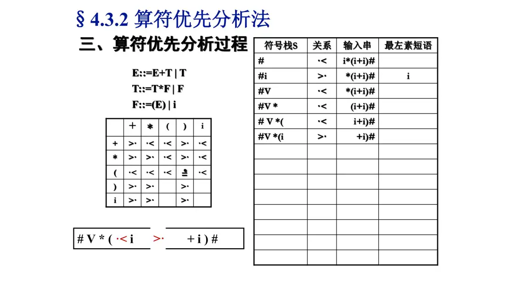

原文：

§4.3.2 算符优先分析法

三、算符优先分析过程

E::=E+T | T

T::=T\*F | F

F::=(E) | i

<table><tr><td></td><td>+</td><td>*</td><td>(</td><td>)</td><td>i</td></tr><tr><td>+</td><td>&gt;·</td><td>·&lt;</td><td>·&lt;</td><td>&gt;·</td><td>·&lt;</td></tr><tr><td>*</td><td>&gt;·</td><td>&gt;·</td><td>·&lt;</td><td>&gt;·</td><td>·&lt;</td></tr><tr><td>(</td><td>·&lt;</td><td>·&lt;</td><td>·&lt;</td><td>≡</td><td>·&lt;</td></tr><tr><td>)</td><td>&gt;·</td><td>&gt;·</td><td></td><td>&gt;·</td><td></td></tr><tr><td>i</td><td>&gt;·</td><td>&gt;·</td><td></td><td>&gt;·</td><td></td></tr></table>

\# V \* ( ·< i > + i ) #

<table><tr><td>符号栈S</td><td>关系</td><td>输入串</td><td>最左素短语</td></tr><tr><td>#</td><td>•&lt;</td><td>i*(i+i)#</td><td></td></tr><tr><td>#i</td><td>&gt;•</td><td>*(i+i)#</td><td>i</td></tr><tr><td>#V</td><td>•&lt;</td><td>*(i+i)#</td><td></td></tr><tr><td>#V*</td><td>•&lt;</td><td>(i+i)#</td><td></td></tr><tr><td>#V*(</td><td>•&lt;</td><td>i+i)#</td><td></td></tr><tr><td>#V*(i</td><td>&gt;•</td><td>+i)#</td><td></td></tr><tr><td></td><td></td><td></td><td></td></tr><tr><td></td><td></td><td></td><td></td></tr><tr><td></td><td></td><td></td><td></td></tr><tr><td></td><td></td><td></td><td></td></tr><tr><td></td><td></td><td></td><td></td></tr><tr><td></td><td></td><td></td><td></td></tr><tr><td></td><td></td><td></td><td></td></tr><tr><td></td><td></td><td></td><td></td></tr></table>

### §4.3.2 算符优先分析法

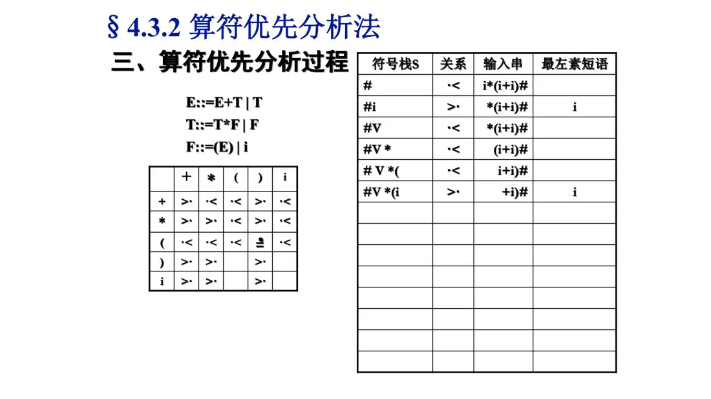

原文：

§4.3.2 算符优先分析法

三、算符优先分析过程

E::=E+T | T

T::=T\*F | F

F::=(E) | i

<table><tr><td></td><td>+</td><td>*</td><td>(</td><td>)</td><td>i</td></tr><tr><td>+</td><td>&gt;·</td><td>·&lt;</td><td>·&lt;</td><td>&gt;·</td><td>·&lt;</td></tr><tr><td>*</td><td>&gt;·</td><td>&gt;·</td><td>·&lt;</td><td>&gt;·</td><td>·&lt;</td></tr><tr><td>(</td><td>·&lt;</td><td>·&lt;</td><td>·&lt;</td><td>≡</td><td>·&lt;</td></tr><tr><td>)</td><td>&gt;·</td><td>&gt;·</td><td></td><td>&gt;·</td><td></td></tr><tr><td>i</td><td>&gt;·</td><td>&gt;·</td><td></td><td>&gt;·</td><td></td></tr></table>

<table><tr><td>符号栈S</td><td>关系</td><td>输入串</td><td>最左素短语</td></tr><tr><td>#</td><td>&lt;</td><td>i*(i+i)#</td><td></td></tr><tr><td>#i</td><td>&gt;</td><td>*(i+i)#</td><td>i</td></tr><tr><td>#V</td><td>&lt;</td><td>*(i+i)#</td><td></td></tr><tr><td>#V*</td><td>&lt;</td><td>(i+i)#</td><td></td></tr><tr><td>#V*(</td><td>&lt;</td><td>i+i)#</td><td></td></tr><tr><td>#V*(i</td><td>&gt;</td><td>+i)#</td><td>i</td></tr><tr><td></td><td></td><td></td><td></td></tr><tr><td></td><td></td><td></td><td></td></tr><tr><td></td><td></td><td></td><td></td></tr><tr><td></td><td></td><td></td><td></td></tr><tr><td></td><td></td><td></td><td></td></tr><tr><td></td><td></td><td></td><td></td></tr><tr><td></td><td></td><td></td><td></td></tr><tr><td></td><td></td><td></td><td></td></tr></table>

### §4.3.2 算符优先分析法

原文：

§4.3.2 算符优先分析法

三、算符优先分析过程

E::=E+T | T

T::=T\*F | F

F::=(E) | i

<table><tr><td></td><td>+</td><td>*</td><td>(</td><td>)</td><td>i</td></tr><tr><td>+</td><td>&gt;·</td><td>·&lt;</td><td>·&lt;</td><td>&gt;·</td><td>·&lt;</td></tr><tr><td>*</td><td>&gt;·</td><td>&gt;·</td><td>·&lt;</td><td>&gt;·</td><td>·&lt;</td></tr><tr><td>(</td><td>·&lt;</td><td>·&lt;</td><td>·&lt;</td><td>≡</td><td>·&lt;</td></tr><tr><td>)</td><td>&gt;·</td><td>&gt;·</td><td></td><td>&gt;·</td><td></td></tr><tr><td>i</td><td>&gt;·</td><td>&gt;·</td><td></td><td>&gt;·</td><td></td></tr></table>

\# V \* ( V ·< + i ) #

<table><tr><td>符号栈S</td><td>关系</td><td>输入串</td><td>最左素短语</td></tr><tr><td>#</td><td>•&lt;</td><td>i*(i+i)#</td><td></td></tr><tr><td>#i</td><td>&gt;•</td><td>*(i+i)#</td><td>i</td></tr><tr><td>#V</td><td>•&lt;</td><td>*(i+i)#</td><td></td></tr><tr><td>#V*</td><td>•&lt;</td><td>(i+i)#</td><td></td></tr><tr><td>#V*(</td><td>•&lt;</td><td>i+i)#</td><td></td></tr><tr><td>#V*(i</td><td>&gt;•</td><td>+i)#</td><td>i</td></tr><tr><td>#V*(V</td><td></td><td>+i)#</td><td></td></tr><tr><td></td><td></td><td></td><td></td></tr><tr><td></td><td></td><td></td><td></td></tr><tr><td></td><td></td><td></td><td></td></tr><tr><td></td><td></td><td></td><td></td></tr><tr><td></td><td></td><td></td><td></td></tr><tr><td></td><td></td><td></td><td></td></tr><tr><td></td><td></td><td></td><td></td></tr></table>

### §4.3.2 算符优先分析法

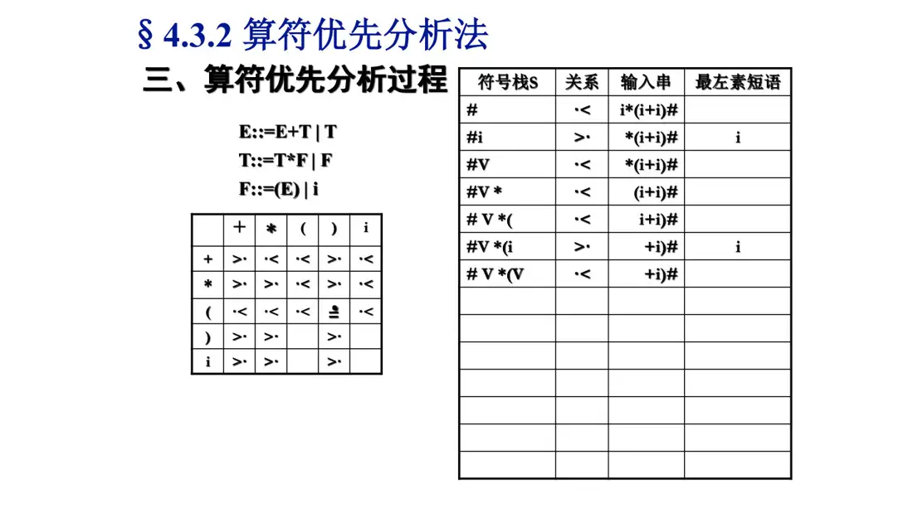

原文：

§4.3.2 算符优先分析法

三、算符优先分析过程

E::=E+T | T

T::=T\*F | F

F::=(E) | i

<table><tr><td></td><td>+</td><td>*</td><td>(</td><td>)</td><td>i</td></tr><tr><td>+</td><td>&gt;</td><td>&lt;</td><td>&lt;</td><td>&gt;</td><td>&lt;</td></tr><tr><td>*</td><td>&gt;</td><td>&gt;</td><td>&lt;</td><td>&gt;</td><td>&lt;</td></tr><tr><td>(</td><td>&lt;</td><td>&lt;</td><td>&lt;</td><td>=</td><td>&lt;</td></tr><tr><td>)</td><td>&gt;</td><td>&gt;</td><td></td><td>&gt;</td><td></td></tr><tr><td>i</td><td>&gt;</td><td>&gt;</td><td></td><td>&gt;</td><td></td></tr></table>

<table><tr><td>符号栈S</td><td>关系</td><td>输入串</td><td>最左素短语</td></tr><tr><td>#</td><td>•&lt;</td><td>i*(i+i)#</td><td></td></tr><tr><td>#i</td><td>&gt;•</td><td>*(i+i)#</td><td>i</td></tr><tr><td>#V</td><td>•&lt;</td><td>*(i+i)#</td><td></td></tr><tr><td>#V*</td><td>•&lt;</td><td>(i+i)#</td><td></td></tr><tr><td>#V*(</td><td>•&lt;</td><td>i+i)#</td><td></td></tr><tr><td>#V*(i</td><td>&gt;•</td><td>+i)#</td><td>i</td></tr><tr><td>#V*(V</td><td>•&lt;</td><td>+i)#</td><td></td></tr><tr><td></td><td></td><td></td><td></td></tr><tr><td></td><td></td><td></td><td></td></tr><tr><td></td><td></td><td></td><td></td></tr><tr><td></td><td></td><td></td><td></td></tr><tr><td></td><td></td><td></td><td></td></tr><tr><td></td><td></td><td></td><td></td></tr><tr><td></td><td></td><td></td><td></td></tr></table>

### §4.3.2 算符优先分析法

原文：

§4.3.2 算符优先分析法

三、算符优先分析过程

E::=E+T | T

T::=T\*F | F

F::=(E) | i

<table><tr><td></td><td>+</td><td>*</td><td>(</td><td>)</td><td>i</td></tr><tr><td>+</td><td>&gt;</td><td>&lt;</td><td>&lt;</td><td>&gt;</td><td>&lt;</td></tr><tr><td>*</td><td>&gt;</td><td>&gt;</td><td>&lt;</td><td>&gt;</td><td>&lt;</td></tr><tr><td>(</td><td>&lt;</td><td>&lt;</td><td>&lt;</td><td>=</td><td>&lt;</td></tr><tr><td>)</td><td>&gt;</td><td>&gt;</td><td></td><td>&gt;</td><td></td></tr><tr><td>i</td><td>&gt;</td><td>&gt;</td><td></td><td>&gt;</td><td></td></tr></table>

<table><tr><td>符号栈S</td><td>关系</td><td>输入串</td><td>最左素短语</td></tr><tr><td>#</td><td>•&lt;</td><td>i*(i+i)#</td><td></td></tr><tr><td>#i</td><td>&gt;•</td><td>*(i+i)#</td><td>i</td></tr><tr><td>#V</td><td>•&lt;</td><td>*(i+i)#</td><td></td></tr><tr><td>#V*</td><td>•&lt;</td><td>(i+i)#</td><td></td></tr><tr><td>#V*(</td><td>•&lt;</td><td>i+i)#</td><td></td></tr><tr><td>#V*(i</td><td>&gt;•</td><td>+i)#</td><td>i</td></tr><tr><td>#V*(V</td><td>•&lt;</td><td>+i)#</td><td></td></tr><tr><td>#V*(V+</td><td></td><td>i)#</td><td></td></tr><tr><td></td><td></td><td></td><td></td></tr><tr><td></td><td></td><td></td><td></td></tr><tr><td></td><td></td><td></td><td></td></tr><tr><td></td><td></td><td></td><td></td></tr><tr><td></td><td></td><td></td><td></td></tr><tr><td></td><td></td><td></td><td></td></tr></table>

### §4.3.2 算符优先分析法

原文：

§4.3.2 算符优先分析法

三、算符优先分析过程

E::=E+T | T

T::=T\*F | F

F::=(E) | i

<table><tr><td></td><td>+</td><td>*</td><td>(</td><td>)</td><td>i</td></tr><tr><td>+</td><td>&gt;</td><td>&lt;</td><td>&lt;</td><td>&gt;</td><td>&lt;</td></tr><tr><td>*</td><td>&gt;</td><td>&gt;</td><td>&lt;</td><td>&gt;</td><td>&lt;</td></tr><tr><td>(</td><td>&lt;</td><td>&lt;</td><td>&lt;</td><td>=</td><td>&lt;</td></tr><tr><td>)</td><td>&gt;</td><td>&gt;</td><td></td><td>&gt;</td><td></td></tr><tr><td>i</td><td>&gt;</td><td>&gt;</td><td></td><td>&gt;</td><td></td></tr></table>

<table><tr><td>符号栈S</td><td>关系</td><td>输入串</td><td>最左素短语</td></tr><tr><td>#</td><td>•&lt;</td><td>i*(i+i)#</td><td></td></tr><tr><td>#i</td><td>&gt;•</td><td>*(i+i)#</td><td>i</td></tr><tr><td>#V</td><td>•&lt;</td><td>*(i+i)#</td><td></td></tr><tr><td>#V*</td><td>•&lt;</td><td>(i+i)#</td><td></td></tr><tr><td>#V*(</td><td>•&lt;</td><td>i+i)#</td><td></td></tr><tr><td>#V*(i</td><td>&gt;•</td><td>+i)#</td><td>i</td></tr><tr><td>#V*(V</td><td>•&lt;</td><td>+i)#</td><td></td></tr><tr><td>#V*(V+</td><td>•&lt;</td><td>i)#</td><td></td></tr><tr><td></td><td></td><td></td><td></td></tr><tr><td></td><td></td><td></td><td></td></tr><tr><td></td><td></td><td></td><td></td></tr><tr><td></td><td></td><td></td><td></td></tr><tr><td></td><td></td><td></td><td></td></tr><tr><td></td><td></td><td></td><td></td></tr></table>

### §4.3.2 算符优先分析法

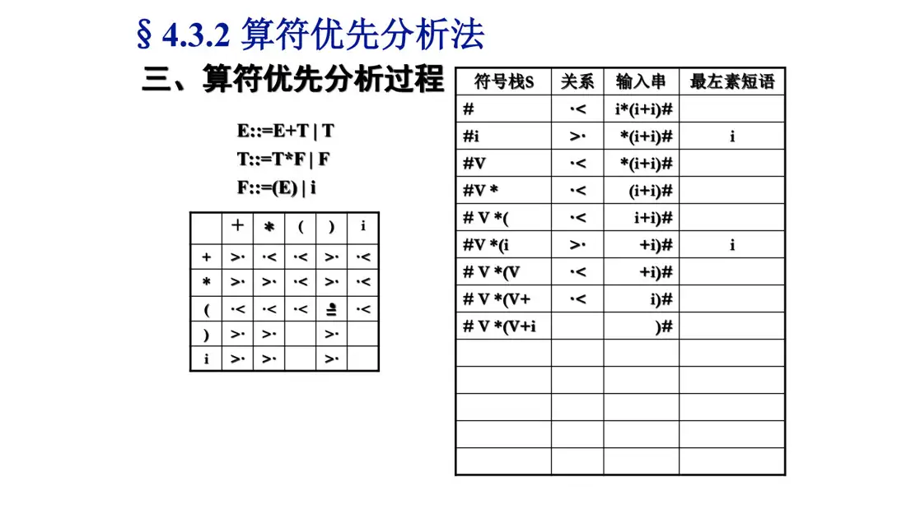

原文：

§4.3.2 算符优先分析法

三、算符优先分析过程

E::=E+T | T

T::=T\*F | F

F::=(E) | i

<table><tr><td></td><td>+</td><td>*</td><td>(</td><td>)</td><td>i</td></tr><tr><td>+</td><td>&gt;</td><td>&lt;</td><td>&lt;</td><td>&gt;</td><td>&lt;</td></tr><tr><td>*</td><td>&gt;</td><td>&gt;</td><td>&lt;</td><td>&gt;</td><td>&lt;</td></tr><tr><td>(</td><td>&lt;</td><td>&lt;</td><td>&lt;</td><td>=</td><td>&lt;</td></tr><tr><td>)</td><td>&gt;</td><td>&gt;</td><td></td><td>&gt;</td><td></td></tr><tr><td>i</td><td>&gt;</td><td>&gt;</td><td></td><td>&gt;</td><td></td></tr></table>

<table><tr><td>符号栈S</td><td>关系</td><td>输入串</td><td>最左素短语</td></tr><tr><td>#</td><td>•&lt;</td><td>i*(i+i)#</td><td></td></tr><tr><td>#i</td><td>&gt;•</td><td>*(i+i)#</td><td>i</td></tr><tr><td>#V</td><td>•&lt;</td><td>*(i+i)#</td><td></td></tr><tr><td>#V*</td><td>•&lt;</td><td>(i+i)#</td><td></td></tr><tr><td>#V*(</td><td>•&lt;</td><td>i+i)#</td><td></td></tr><tr><td>#V*(i</td><td>&gt;•</td><td>+i)#</td><td>i</td></tr><tr><td>#V*(V</td><td>•&lt;</td><td>+i)#</td><td></td></tr><tr><td>#V*(V+</td><td>•&lt;</td><td>i)#</td><td></td></tr><tr><td>#V*(V+i</td><td></td><td>)#</td><td></td></tr><tr><td></td><td></td><td></td><td></td></tr><tr><td></td><td></td><td></td><td></td></tr><tr><td></td><td></td><td></td><td></td></tr><tr><td></td><td></td><td></td><td></td></tr><tr><td></td><td></td><td></td><td></td></tr></table>

### §4.3.2 算符优先分析法

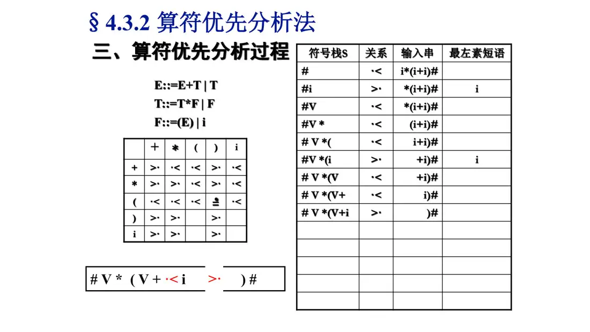

原文：

§4.3.2 算符优先分析法

三、算符优先分析过程

E::=E+T | T

T::=T\*F | F

F::=(E) | i

<table><tr><td></td><td>+</td><td>*</td><td>(</td><td>)</td><td>i</td></tr><tr><td>+</td><td>&gt;</td><td>&lt;</td><td>&lt;</td><td>&gt;</td><td>&lt;</td></tr><tr><td>*</td><td>&gt;</td><td>&gt;</td><td>&lt;</td><td>&gt;</td><td>&lt;</td></tr><tr><td>(</td><td>&lt;</td><td>&lt;</td><td>&lt;</td><td>=</td><td>&lt;</td></tr><tr><td>)</td><td>&gt;</td><td>&gt;</td><td></td><td>&gt;</td><td></td></tr><tr><td>i</td><td>&gt;</td><td>&gt;</td><td></td><td>&gt;</td><td></td></tr></table>

\# V \* ( V + ·< i >· ) #

<table><tr><td>符号栈S</td><td>关系</td><td>输入串</td><td>最左素短语</td></tr><tr><td>#</td><td>•&lt;</td><td>i*(i+i)#</td><td></td></tr><tr><td>#i</td><td>&gt;•</td><td>*(i+i)#</td><td>i</td></tr><tr><td>#V</td><td>•&lt;</td><td>*(i+i)#</td><td></td></tr><tr><td>#V*</td><td>•&lt;</td><td>(i+i)#</td><td></td></tr><tr><td>#V*(</td><td>•&lt;</td><td>i+i)#</td><td></td></tr><tr><td>#V*(i</td><td>&gt;•</td><td>+i)#</td><td>i</td></tr><tr><td>#V*(V</td><td>•&lt;</td><td>+i)#</td><td></td></tr><tr><td>#V*(V+</td><td>•&lt;</td><td>i)#</td><td></td></tr><tr><td>#V*(V+i</td><td>&gt;•</td><td>)#</td><td></td></tr><tr><td></td><td></td><td></td><td></td></tr><tr><td></td><td></td><td></td><td></td></tr><tr><td></td><td></td><td></td><td></td></tr><tr><td></td><td></td><td></td><td></td></tr><tr><td></td><td></td><td></td><td></td></tr></table>

### §4.3.2 算符优先分析法

原文：

§4.3.2 算符优先分析法

三、算符优先分析过程

E::=E+T | T

T::=T\*F | F

F::=(E) | i

<table><tr><td></td><td>+</td><td>*</td><td>(</td><td>)</td><td>i</td></tr><tr><td>+</td><td>&gt;</td><td>&lt;</td><td>&lt;</td><td>&gt;</td><td>&lt;</td></tr><tr><td>*</td><td>&gt;</td><td>&gt;</td><td>&lt;</td><td>&gt;</td><td>&lt;</td></tr><tr><td>(</td><td>&lt;</td><td>&lt;</td><td>&lt;</td><td>=</td><td>&lt;</td></tr><tr><td>)</td><td>&gt;</td><td>&gt;</td><td></td><td>&gt;</td><td></td></tr><tr><td>i</td><td>&gt;</td><td>&gt;</td><td></td><td>&gt;</td><td></td></tr></table>

<table><tr><td>符号栈S</td><td>关系</td><td>输入串</td><td>最左素短语</td></tr><tr><td>#</td><td>•&lt;</td><td>i*(i+i)#</td><td></td></tr><tr><td>#i</td><td>&gt;•</td><td>*(i+i)#</td><td>i</td></tr><tr><td>#V</td><td>•&lt;</td><td>*(i+i)#</td><td></td></tr><tr><td>#V*</td><td>•&lt;</td><td>(i+i)#</td><td></td></tr><tr><td>#V*(</td><td>•&lt;</td><td>i+i)#</td><td></td></tr><tr><td>#V*(i</td><td>&gt;•</td><td>+i)#</td><td>i</td></tr><tr><td>#V*(V</td><td>•&lt;</td><td>+i)#</td><td></td></tr><tr><td>#V*(V+</td><td>•&lt;</td><td>i)#</td><td></td></tr><tr><td>#V*(V+i</td><td>&gt;•</td><td>)#</td><td>i</td></tr><tr><td></td><td></td><td></td><td></td></tr><tr><td></td><td></td><td></td><td></td></tr><tr><td></td><td></td><td></td><td></td></tr><tr><td></td><td></td><td></td><td></td></tr><tr><td></td><td></td><td></td><td></td></tr></table>

### §4.3.2 算符优先分析法

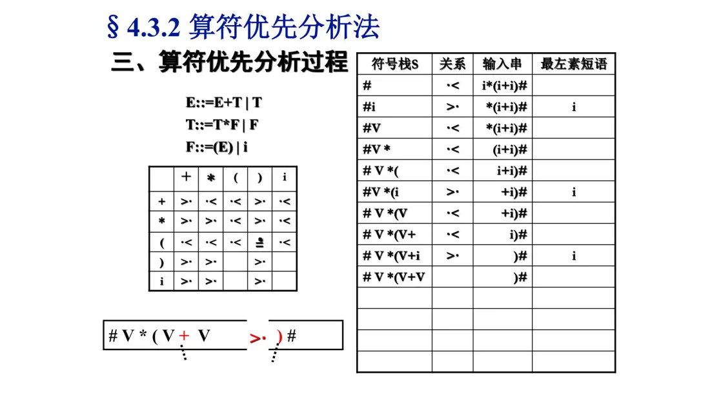

原文：

§4.3.2 算符优先分析法

三、算符优先分析过程

E::=E+T | T

T::=T\*F | F

F::=(E) | i

<table><tr><td></td><td>+</td><td>*</td><td>(</td><td>)</td><td>i</td></tr><tr><td>+</td><td>&gt;·</td><td>·&lt;</td><td>·&lt;</td><td>&gt;·</td><td>·&lt;</td></tr><tr><td>*</td><td>&gt;·</td><td>&gt;·</td><td>·&lt;</td><td>&gt;·</td><td>·&lt;</td></tr><tr><td>(</td><td>·&lt;</td><td>·&lt;</td><td>·&lt;</td><td>≡</td><td>·&lt;</td></tr><tr><td>)</td><td>&gt;·</td><td>&gt;·</td><td></td><td>&gt;·</td><td></td></tr><tr><td>i</td><td>&gt;·</td><td>&gt;·</td><td></td><td>&gt;·</td><td></td></tr></table>

<table><tr><td>符号栈S</td><td>关系</td><td>输入串</td><td>最左素短语</td></tr><tr><td>#</td><td>•&lt;</td><td>i*(i+i)#</td><td></td></tr><tr><td>#i</td><td>&gt;•</td><td>*(i+i)#</td><td>i</td></tr><tr><td>#V</td><td>•&lt;</td><td>*(i+i)#</td><td></td></tr><tr><td>#V*</td><td>•&lt;</td><td>(i+i)#</td><td></td></tr><tr><td>#V*(</td><td>•&lt;</td><td>i+i)#</td><td></td></tr><tr><td>#V*(i</td><td>&gt;•</td><td>+i)#</td><td>i</td></tr><tr><td>#V*(V</td><td>•&lt;</td><td>+i)#</td><td></td></tr><tr><td>#V*(V+</td><td>•&lt;</td><td>i)#</td><td></td></tr><tr><td>#V*(V+i</td><td>&gt;•</td><td>)#</td><td>i</td></tr><tr><td>#V*(V+V</td><td></td><td>)#</td><td></td></tr><tr><td></td><td></td><td></td><td></td></tr><tr><td></td><td></td><td></td><td></td></tr><tr><td></td><td></td><td></td><td></td></tr><tr><td></td><td></td><td></td><td></td></tr></table>

### §4.3.2 算符优先分析法

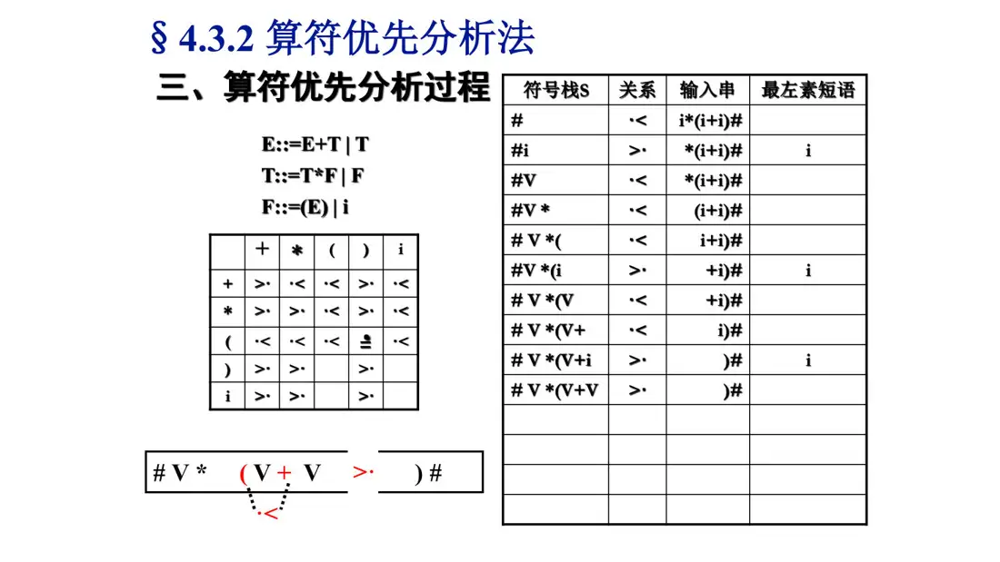

原文：

§4.3.2 算符优先分析法

三、算符优先分析过程

E::=E+T | T

T::=T\*F | F

F::=(E) | i

<table><tr><td></td><td>+</td><td>*</td><td>(</td><td>)</td><td>i</td></tr><tr><td>+</td><td>&gt;·</td><td>·&lt;</td><td>·&lt;</td><td>&gt;·</td><td>·&lt;</td></tr><tr><td>*</td><td>&gt;·</td><td>&gt;·</td><td>·&lt;</td><td>&gt;·</td><td>·&lt;</td></tr><tr><td>(</td><td>·&lt;</td><td>·&lt;</td><td>·&lt;</td><td>≡</td><td>·&lt;</td></tr><tr><td>)</td><td>&gt;·</td><td>&gt;·</td><td></td><td>&gt;·</td><td></td></tr><tr><td>i</td><td>&gt;·</td><td>&gt;·</td><td></td><td>&gt;·</td><td></td></tr></table>

<table><tr><td>符号栈S</td><td>关系</td><td>输入串</td><td>最左素短语</td></tr><tr><td>#</td><td>•&lt;</td><td>i*(i+i)#</td><td></td></tr><tr><td>#i</td><td>&gt;•</td><td>*(i+i)#</td><td>i</td></tr><tr><td>#V</td><td>•&lt;</td><td>*(i+i)#</td><td></td></tr><tr><td>#V*</td><td>•&lt;</td><td>(i+i)#</td><td></td></tr><tr><td>#V*(</td><td>•&lt;</td><td>i+i)#</td><td></td></tr><tr><td>#V*(i</td><td>&gt;•</td><td>+i)#</td><td>i</td></tr><tr><td>#V*(V</td><td>•&lt;</td><td>+i)#</td><td></td></tr><tr><td>#V*(V+</td><td>•&lt;</td><td>i)#</td><td></td></tr><tr><td>#V*(V+i</td><td>&gt;•</td><td>)#</td><td>i</td></tr><tr><td>#V*(V+V</td><td>&gt;•</td><td>)#</td><td></td></tr><tr><td></td><td></td><td></td><td></td></tr><tr><td></td><td></td><td></td><td></td></tr><tr><td></td><td></td><td></td><td></td></tr><tr><td></td><td></td><td></td><td></td></tr></table>

### §4.3.2 算符优先分析法

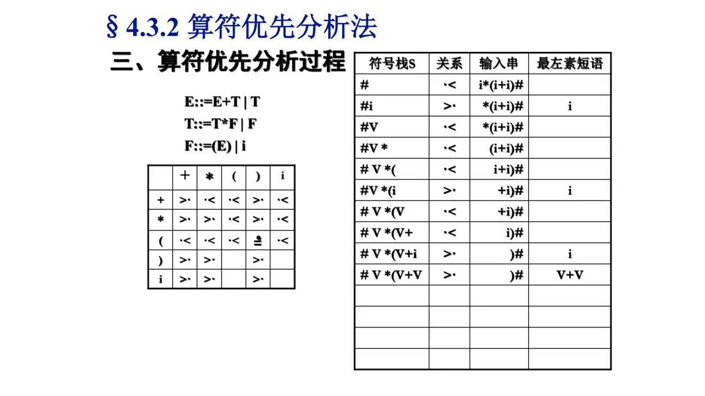

原文：

§4.3.2 算符优先分析法

三、算符优先分析过程

E::=E+T | T

T::=T\*F | F

F::=(E) | i

<table><tr><td></td><td>+</td><td>*</td><td>(</td><td>)</td><td>i</td></tr><tr><td>+</td><td>&gt;·</td><td>·&lt;</td><td>·&lt;</td><td>&gt;·</td><td>·&lt;</td></tr><tr><td>*</td><td>&gt;·</td><td>&gt;·</td><td>·&lt;</td><td>&gt;·</td><td>·&lt;</td></tr><tr><td>(</td><td>·&lt;</td><td>·&lt;</td><td>·&lt;</td><td>≡</td><td>·&lt;</td></tr><tr><td>)</td><td>&gt;·</td><td>&gt;·</td><td></td><td>&gt;·</td><td></td></tr><tr><td>i</td><td>&gt;·</td><td>&gt;·</td><td></td><td>&gt;·</td><td></td></tr></table>

<table><tr><td>符号栈S</td><td>关系</td><td>输入串</td><td>最左素短语</td></tr><tr><td>#</td><td>•&lt;</td><td>i*(i+i)#</td><td></td></tr><tr><td>#i</td><td>&gt;•</td><td>*(i+i)#</td><td>i</td></tr><tr><td>#V</td><td>•&lt;</td><td>*(i+i)#</td><td></td></tr><tr><td>#V*</td><td>•&lt;</td><td>(i+i)#</td><td></td></tr><tr><td>#V*(</td><td>•&lt;</td><td>i+i)#</td><td></td></tr><tr><td>#V*(i</td><td>&gt;•</td><td>+i)#</td><td>i</td></tr><tr><td>#V*(V</td><td>•&lt;</td><td>+i)#</td><td></td></tr><tr><td>#V*(V+</td><td>•&lt;</td><td>i)#</td><td></td></tr><tr><td>#V*(V+i</td><td>&gt;•</td><td>)#</td><td>i</td></tr><tr><td>#V*(V+V</td><td>&gt;•</td><td>)#</td><td>V+V</td></tr><tr><td></td><td></td><td></td><td></td></tr><tr><td></td><td></td><td></td><td></td></tr><tr><td></td><td></td><td></td><td></td></tr><tr><td></td><td></td><td></td><td></td></tr></table>

### §4.3.2 算符优先分析法

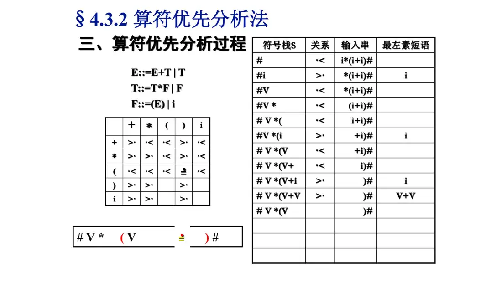

原文：

§4.3.2 算符优先分析法

三、算符优先分析过程

E::=E+T | T

T::=T\*F | F

F::=(E) | i

<table><tr><td></td><td>+</td><td>*</td><td>(</td><td>)</td><td>i</td></tr><tr><td>+</td><td>&gt;·</td><td>·&lt;</td><td>·&lt;</td><td>&gt;·</td><td>·&lt;</td></tr><tr><td>*</td><td>&gt;·</td><td>&gt;·</td><td>·&lt;</td><td>&gt;·</td><td>·&lt;</td></tr><tr><td>(</td><td>·&lt;</td><td>·&lt;</td><td>·&lt;</td><td>≡</td><td>·&lt;</td></tr><tr><td>)</td><td>&gt;·</td><td>&gt;·</td><td></td><td>&gt;·</td><td></td></tr><tr><td>i</td><td>&gt;·</td><td>&gt;·</td><td></td><td>&gt;·</td><td></td></tr></table>

<table><tr><td># V * ( V ≡ ) #</td></tr></table>

<table><tr><td>符号栈S</td><td>关系</td><td>输入串</td><td>最左素短语</td></tr><tr><td>#</td><td>•&lt;</td><td>i*(i+i)#</td><td></td></tr><tr><td>#i</td><td>&gt;•</td><td>*(i+i)#</td><td>i</td></tr><tr><td>#V</td><td>•&lt;</td><td>*(i+i)#</td><td></td></tr><tr><td>#V*</td><td>•&lt;</td><td>(i+i)#</td><td></td></tr><tr><td>#V*(</td><td>•&lt;</td><td>i+i)#</td><td></td></tr><tr><td>#V*(i</td><td>&gt;•</td><td>+i)#</td><td>i</td></tr><tr><td>#V*(V</td><td>•&lt;</td><td>+i)#</td><td></td></tr><tr><td>#V*(V+</td><td>•&lt;</td><td>i)#</td><td></td></tr><tr><td>#V*(V+i</td><td>&gt;•</td><td>)#</td><td>i</td></tr><tr><td>#V*(V+V</td><td>&gt;•</td><td>)#</td><td>V+V</td></tr><tr><td>#V*(V</td><td></td><td>)#</td><td></td></tr><tr><td></td><td></td><td></td><td></td></tr><tr><td></td><td></td><td></td><td></td></tr><tr><td></td><td></td><td></td><td></td></tr></table>

### §4.3.2 算符优先分析法

原文：

§4.3.2 算符优先分析法

三、算符优先分析过程

E::=E+T | T

T::=T\*F | F

F::=(E) | i

<table><tr><td></td><td>+</td><td>*</td><td>(</td><td>)</td><td>i</td></tr><tr><td>+</td><td>&gt;·</td><td>·&lt;</td><td>·&lt;</td><td>&gt;·</td><td>·&lt;</td></tr><tr><td>*</td><td>&gt;·</td><td>&gt;·</td><td>·&lt;</td><td>&gt;·</td><td>·&lt;</td></tr><tr><td>(</td><td>·&lt;</td><td>·&lt;</td><td>·&lt;</td><td>≡</td><td>·&lt;</td></tr><tr><td>)</td><td>&gt;·</td><td>&gt;·</td><td></td><td>&gt;·</td><td></td></tr><tr><td>i</td><td>&gt;·</td><td>&gt;·</td><td></td><td>&gt;·</td><td></td></tr></table>

<table><tr><td>符号栈S</td><td>关系</td><td>输入串</td><td>最左素短语</td></tr><tr><td>#</td><td>•&lt;</td><td>i*(i+i)#</td><td></td></tr><tr><td>#i</td><td>&gt;•</td><td>*(i+i)#</td><td>i</td></tr><tr><td>#V</td><td>•&lt;</td><td>*(i+i)#</td><td></td></tr><tr><td>#V*</td><td>•&lt;</td><td>(i+i)#</td><td></td></tr><tr><td>#V*(</td><td>•&lt;</td><td>i+i)#</td><td></td></tr><tr><td>#V*(i</td><td>&gt;•</td><td>+i)#</td><td>i</td></tr><tr><td>#V*(V</td><td>•&lt;</td><td>+i)#</td><td></td></tr><tr><td>#V*(V+</td><td>•&lt;</td><td>i)#</td><td></td></tr><tr><td>#V*(V+i</td><td>&gt;•</td><td>)#</td><td>i</td></tr><tr><td>#V*(V+V</td><td>&gt;•</td><td>)#</td><td>V+V</td></tr><tr><td>#V*(V</td><td>≡</td><td>)#</td><td></td></tr><tr><td></td><td></td><td></td><td></td></tr><tr><td></td><td></td><td></td><td></td></tr><tr><td></td><td></td><td></td><td></td></tr></table>

### §4.3.2 算符优先分析法

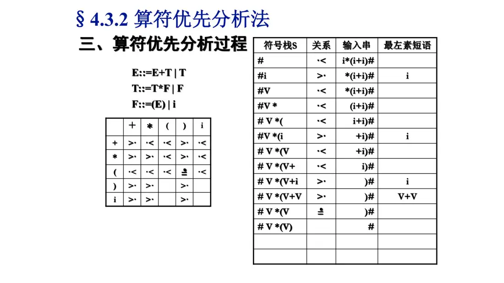

原文：

§4.3.2 算符优先分析法

三、算符优先分析过程

E::=E+T | T

T::=T\*F | F

F::=(E) | i

<table><tr><td></td><td>+</td><td>*</td><td>(</td><td>)</td><td>i</td></tr><tr><td>+</td><td>&gt;·</td><td>·&lt;</td><td>·&lt;</td><td>&gt;·</td><td>·&lt;</td></tr><tr><td>*</td><td>&gt;·</td><td>&gt;·</td><td>·&lt;</td><td>&gt;·</td><td>·&lt;</td></tr><tr><td>(</td><td>·&lt;</td><td>·&lt;</td><td>·&lt;</td><td>≡</td><td>·&lt;</td></tr><tr><td>)</td><td>&gt;·</td><td>&gt;·</td><td></td><td>&gt;·</td><td></td></tr><tr><td>i</td><td>&gt;·</td><td>&gt;·</td><td></td><td>&gt;·</td><td></td></tr></table>

<table><tr><td>符号栈S</td><td>关系</td><td>输入串</td><td>最左素短语</td></tr><tr><td>#</td><td>•&lt;</td><td>i*(i+i)#</td><td></td></tr><tr><td>#i</td><td>&gt;•</td><td>*(i+i)#</td><td>i</td></tr><tr><td>#V</td><td>•&lt;</td><td>*(i+i)#</td><td></td></tr><tr><td>#V*</td><td>•&lt;</td><td>(i+i)#</td><td></td></tr><tr><td>#V*(</td><td>•&lt;</td><td>i+i)#</td><td></td></tr><tr><td>#V*(i</td><td>&gt;•</td><td>+i)#</td><td>i</td></tr><tr><td>#V*(V</td><td>•&lt;</td><td>+i)#</td><td></td></tr><tr><td>#V*(V+</td><td>•&lt;</td><td>i)#</td><td></td></tr><tr><td>#V*(V+i</td><td>&gt;•</td><td>)#</td><td>i</td></tr><tr><td>#V*(V+V</td><td>&gt;•</td><td>)#</td><td>V+V</td></tr><tr><td>#V*(V</td><td>≡</td><td>)#</td><td></td></tr><tr><td>#V*(V)</td><td></td><td>#</td><td></td></tr><tr><td></td><td></td><td></td><td></td></tr><tr><td></td><td></td><td></td><td></td></tr></table>

### §4.3.2 算符优先分析法

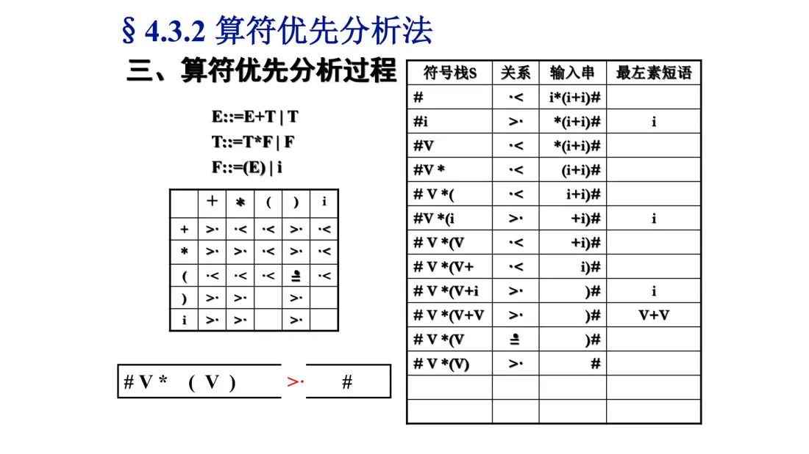

原文：

§4.3.2 算符优先分析法

三、算符优先分析过程

E::=E+T | T

T::=T\*F | F

F::=(E) | i

<table><tr><td></td><td>+</td><td>*</td><td>(</td><td>)</td><td>i</td></tr><tr><td>+</td><td>&gt;·</td><td>·&lt;</td><td>·&lt;</td><td>&gt;·</td><td>·&lt;</td></tr><tr><td>*</td><td>&gt;·</td><td>&gt;·</td><td>·&lt;</td><td>&gt;·</td><td>·&lt;</td></tr><tr><td>(</td><td>·&lt;</td><td>·&lt;</td><td>·&lt;</td><td>≡</td><td>·&lt;</td></tr><tr><td>)</td><td>&gt;·</td><td>&gt;·</td><td></td><td>&gt;·</td><td></td></tr><tr><td>i</td><td>&gt;·</td><td>&gt;·</td><td></td><td>&gt;·</td><td></td></tr></table>

<table><tr><td>#V*(V)</td><td>&gt;·</td><td>#</td></tr></table>

<table><tr><td>符号栈S</td><td>关系</td><td>输入串</td><td>最左素短语</td></tr><tr><td>#</td><td>•&lt;</td><td>i*(i+i)#</td><td></td></tr><tr><td>#i</td><td>&gt;•</td><td>*(i+i)#</td><td>i</td></tr><tr><td>#V</td><td>•&lt;</td><td>*(i+i)#</td><td></td></tr><tr><td>#V*</td><td>•&lt;</td><td>(i+i)#</td><td></td></tr><tr><td>#V*(</td><td>•&lt;</td><td>i+i)#</td><td></td></tr><tr><td>#V*(i</td><td>&gt;•</td><td>+i)#</td><td>i</td></tr><tr><td>#V*(V</td><td>•&lt;</td><td>+i)#</td><td></td></tr><tr><td>#V*(V+</td><td>•&lt;</td><td>i)#</td><td></td></tr><tr><td>#V*(V+i</td><td>&gt;•</td><td>)#</td><td>i</td></tr><tr><td>#V*(V+V</td><td>&gt;•</td><td>)#</td><td>V+V</td></tr><tr><td>#V*(V</td><td>≡</td><td>)#</td><td></td></tr><tr><td>#V*(V)</td><td>&gt;•</td><td>#</td><td></td></tr><tr><td></td><td></td><td></td><td></td></tr><tr><td></td><td></td><td></td><td></td></tr></table>

### §4.3.2 算符优先分析法

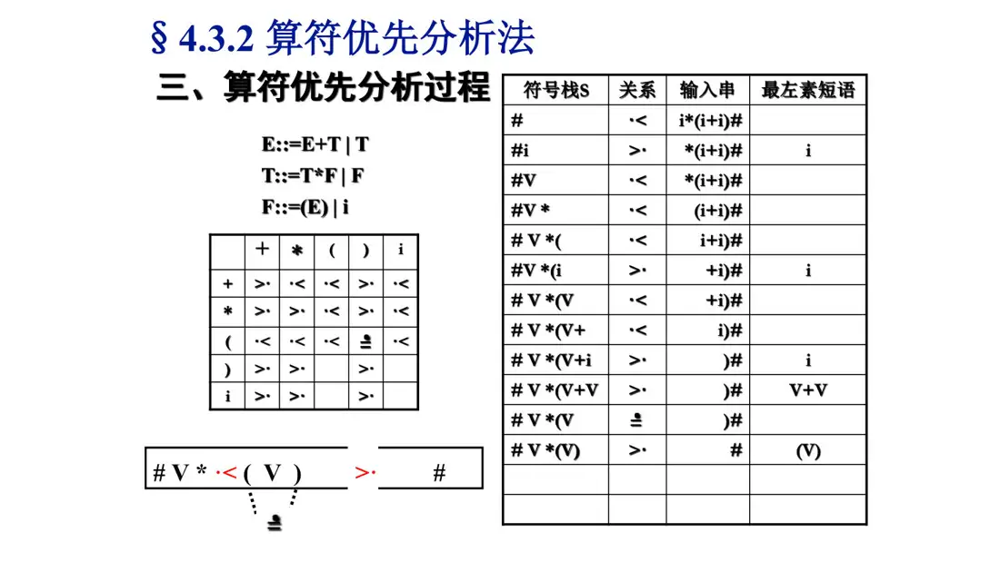

原文：

§4.3.2 算符优先分析法

三、算符优先分析过程

E::=E+T | T

T::=T\*F | F

F::=(E) | i

<table><tr><td></td><td>+</td><td>*</td><td>(</td><td>)</td><td>i</td></tr><tr><td>+</td><td>&gt;·</td><td>·&lt;</td><td>·&lt;</td><td>&gt;·</td><td>·&lt;</td></tr><tr><td>*</td><td>&gt;·</td><td>&gt;·</td><td>·&lt;</td><td>&gt;·</td><td>·&lt;</td></tr><tr><td>(</td><td>·&lt;</td><td>·&lt;</td><td>·&lt;</td><td>≡</td><td>·&lt;</td></tr><tr><td>)</td><td>&gt;·</td><td>&gt;·</td><td></td><td>&gt;·</td><td></td></tr><tr><td>i</td><td>&gt;·</td><td>&gt;·</td><td></td><td>&gt;·</td><td></td></tr></table>

<table><tr><td>符号栈S</td><td>关系</td><td>输入串</td><td>最左素短语</td></tr><tr><td>#</td><td>•&lt;</td><td>i*(i+i)#</td><td></td></tr><tr><td>#i</td><td>&gt;•</td><td>*(i+i)#</td><td>i</td></tr><tr><td>#V</td><td>•&lt;</td><td>*(i+i)#</td><td></td></tr><tr><td>#V*</td><td>•&lt;</td><td>(i+i)#</td><td></td></tr><tr><td>#V*(</td><td>•&lt;</td><td>i+i)#</td><td></td></tr><tr><td>#V*(i</td><td>&gt;•</td><td>+i)#</td><td>i</td></tr><tr><td>#V*(V</td><td>•&lt;</td><td>+i)#</td><td></td></tr><tr><td>#V*(V+</td><td>•&lt;</td><td>i)#</td><td></td></tr><tr><td>#V*(V+i</td><td>&gt;•</td><td>)#</td><td>i</td></tr><tr><td>#V*(V+V</td><td>&gt;•</td><td>)#</td><td>V+V</td></tr><tr><td>#V*(V</td><td>≡</td><td>)#</td><td></td></tr><tr><td>#V*(V)</td><td>&gt;•</td><td>#</td><td>(V)</td></tr><tr><td></td><td></td><td></td><td></td></tr><tr><td></td><td></td><td></td><td></td></tr></table>

### §4.3.2 算符优先分析法

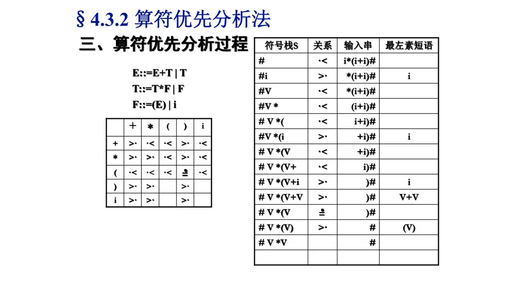

原文：

§4.3.2 算符优先分析法

三、算符优先分析过程

E::=E+T | T

T::=T\*F | F

F::=(E) | i

<table><tr><td></td><td>+</td><td>*</td><td>(</td><td>)</td><td>i</td></tr><tr><td>+</td><td>&gt;·</td><td>·&lt;</td><td>·&lt;</td><td>&gt;·</td><td>·&lt;</td></tr><tr><td>*</td><td>&gt;·</td><td>&gt;·</td><td>·&lt;</td><td>&gt;·</td><td>·&lt;</td></tr><tr><td>(</td><td>·&lt;</td><td>·&lt;</td><td>·&lt;</td><td>≡</td><td>·&lt;</td></tr><tr><td>)</td><td>&gt;·</td><td>&gt;·</td><td></td><td>&gt;·</td><td></td></tr><tr><td>i</td><td>&gt;·</td><td>&gt;·</td><td></td><td>&gt;·</td><td></td></tr></table>

<table><tr><td>符号栈S</td><td>关系</td><td>输入串</td><td>最左素短语</td></tr><tr><td>#</td><td>•&lt;</td><td>i*(i+i)#</td><td></td></tr><tr><td>#i</td><td>&gt;•</td><td>*(i+i)#</td><td>i</td></tr><tr><td>#V</td><td>•&lt;</td><td>*(i+i)#</td><td></td></tr><tr><td>#V*</td><td>•&lt;</td><td>(i+i)#</td><td></td></tr><tr><td>#V*(</td><td>•&lt;</td><td>i+i)#</td><td></td></tr><tr><td>#V*(i</td><td>&gt;•</td><td>+i)#</td><td>i</td></tr><tr><td>#V*(V</td><td>•&lt;</td><td>+i)#</td><td></td></tr><tr><td>#V*(V+</td><td>•&lt;</td><td>i)#</td><td></td></tr><tr><td>#V*(V+i</td><td>&gt;•</td><td>)#</td><td>i</td></tr><tr><td>#V*(V+V</td><td>&gt;•</td><td>)#</td><td>V+V</td></tr><tr><td>#V*(V</td><td>≡</td><td>)#</td><td></td></tr><tr><td>#V*(V)</td><td>&gt;•</td><td>#</td><td>(V)</td></tr><tr><td>#V*V</td><td></td><td>#</td><td></td></tr><tr><td></td><td></td><td></td><td></td></tr></table>

### §4.3.2 算符优先分析法

原文：

§4.3.2 算符优先分析法

三、算符优先分析过程

E::=E+T | T

T::=T\*F | F

F::=(E) | i

<table><tr><td></td><td>+</td><td>*</td><td>(</td><td>)</td><td>i</td></tr><tr><td>+</td><td>&gt;·</td><td>·&lt;</td><td>·&lt;</td><td>&gt;·</td><td>·&lt;</td></tr><tr><td>*</td><td>&gt;·</td><td>&gt;·</td><td>·&lt;</td><td>&gt;·</td><td>·&lt;</td></tr><tr><td>(</td><td>·&lt;</td><td>·&lt;</td><td>·&lt;</td><td>≡</td><td>·&lt;</td></tr><tr><td>)</td><td>&gt;·</td><td>&gt;·</td><td></td><td>&gt;·</td><td></td></tr><tr><td>i</td><td>&gt;·</td><td>&gt;·</td><td></td><td>&gt;·</td><td></td></tr></table>

<table><tr><td>符号栈S</td><td>关系</td><td>输入串</td><td>最左素短语</td></tr><tr><td>#</td><td>•&lt;</td><td>i*(i+i)#</td><td></td></tr><tr><td>#i</td><td>&gt;•</td><td>*(i+i)#</td><td>i</td></tr><tr><td>#V</td><td>•&lt;</td><td>*(i+i)#</td><td></td></tr><tr><td>#V*</td><td>•&lt;</td><td>(i+i)#</td><td></td></tr><tr><td>#V*(</td><td>•&lt;</td><td>i+i)#</td><td></td></tr><tr><td>#V*(i</td><td>&gt;•</td><td>+i)#</td><td>i</td></tr><tr><td>#V*(V</td><td>•&lt;</td><td>+i)#</td><td></td></tr><tr><td>#V*(V+</td><td>•&lt;</td><td>i)#</td><td></td></tr><tr><td>#V*(V+i</td><td>&gt;•</td><td>)#</td><td>i</td></tr><tr><td>#V*(V+V</td><td>&gt;•</td><td>)#</td><td>V+V</td></tr><tr><td>#V*(V</td><td>≡</td><td>)#</td><td></td></tr><tr><td>#V*(V)</td><td>&gt;•</td><td>#</td><td>(V)</td></tr><tr><td>#V*V</td><td>&gt;•</td><td>#</td><td></td></tr><tr><td></td><td></td><td></td><td></td></tr></table>

### §4.3.2 算符优先分析法

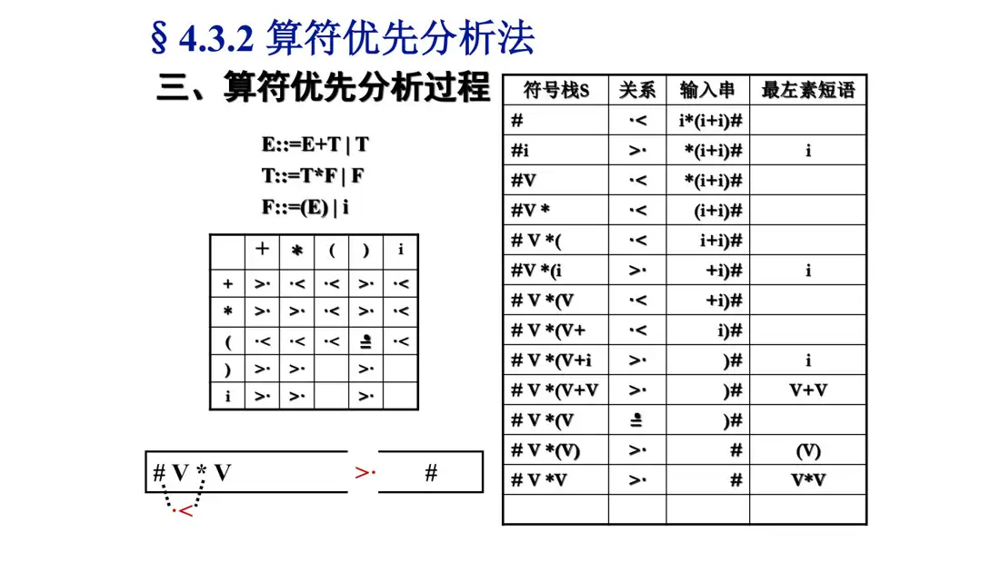

原文：

§4.3.2 算符优先分析法

三、算符优先分析过程

E::=E+T | T

T::=T\*F | F

F::=(E) | i

<table><tr><td></td><td>+</td><td>*</td><td>(</td><td>)</td><td>i</td></tr><tr><td>+</td><td>&gt;·</td><td>·&lt;</td><td>·&lt;</td><td>&gt;·</td><td>·&lt;</td></tr><tr><td>*</td><td>&gt;·</td><td>&gt;·</td><td>·&lt;</td><td>&gt;·</td><td>·&lt;</td></tr><tr><td>(</td><td>·&lt;</td><td>·&lt;</td><td>·&lt;</td><td>≡</td><td>·&lt;</td></tr><tr><td>)</td><td>&gt;·</td><td>&gt;·</td><td></td><td>&gt;·</td><td></td></tr><tr><td>i</td><td>&gt;·</td><td>&gt;·</td><td></td><td>&gt;·</td><td></td></tr></table>

<table><tr><td>符号栈S</td><td>关系</td><td>输入串</td><td>最左素短语</td></tr><tr><td>#</td><td>•&lt;</td><td>i*(i+i)#</td><td></td></tr><tr><td>#i</td><td>&gt;•</td><td>*(i+i)#</td><td>i</td></tr><tr><td>#V</td><td>•&lt;</td><td>*(i+i)#</td><td></td></tr><tr><td>#V*</td><td>•&lt;</td><td>(i+i)#</td><td></td></tr><tr><td>#V*(</td><td>•&lt;</td><td>i+i)#</td><td></td></tr><tr><td>#V*(i</td><td>&gt;•</td><td>+i)#</td><td>i</td></tr><tr><td>#V*(V</td><td>•&lt;</td><td>+i)#</td><td></td></tr><tr><td>#V*(V+</td><td>•&lt;</td><td>i)#</td><td></td></tr><tr><td>#V*(V+i</td><td>&gt;•</td><td>)#</td><td>i</td></tr><tr><td>#V*(V+V</td><td>&gt;•</td><td>)#</td><td>V+V</td></tr><tr><td>#V*(V</td><td>≡</td><td>)#</td><td></td></tr><tr><td>#V*(V)</td><td>&gt;•</td><td>#</td><td>(V)</td></tr><tr><td>#V*V</td><td>&gt;•</td><td>#</td><td>V*V</td></tr><tr><td></td><td></td><td></td><td></td></tr></table>

### §4.3.2 算符优先分析法

原文：

§4.3.2 算符优先分析法

三、算符优先分析过程

E::=E+T | T

T::=T\*F | F

F::=(E) | i

<table><tr><td></td><td>+</td><td>*</td><td>(</td><td>)</td><td>i</td></tr><tr><td>+</td><td>&gt;·</td><td>·&lt;</td><td>·&lt;</td><td>&gt;·</td><td>·&lt;</td></tr><tr><td>*</td><td>&gt;·</td><td>&gt;·</td><td>·&lt;</td><td>&gt;·</td><td>·&lt;</td></tr><tr><td>(</td><td>·&lt;</td><td>·&lt;</td><td>·&lt;</td><td>≡</td><td>·&lt;</td></tr><tr><td>)</td><td>&gt;·</td><td>&gt;·</td><td></td><td>&gt;·</td><td></td></tr><tr><td>i</td><td>&gt;·</td><td>&gt;·</td><td></td><td>&gt;·</td><td></td></tr></table>

<table><tr><td>符号栈S</td><td>关系</td><td>输入串</td><td>最左素短语</td></tr><tr><td>#</td><td>•&lt;</td><td>i*(i+i)#</td><td></td></tr><tr><td>#i</td><td>&gt;•</td><td>*(i+i)#</td><td>i</td></tr><tr><td>#V</td><td>•&lt;</td><td>*(i+i)#</td><td></td></tr><tr><td>#V*</td><td>•&lt;</td><td>(i+i)#</td><td></td></tr><tr><td>#V*(</td><td>•&lt;</td><td>i+i)#</td><td></td></tr><tr><td>#V*(i</td><td>&gt;•</td><td>+i)#</td><td>i</td></tr><tr><td>#V*(V</td><td>•&lt;</td><td>+i)#</td><td></td></tr><tr><td>#V*(V+</td><td>•&lt;</td><td>i)#</td><td></td></tr><tr><td>#V*(V+i</td><td>&gt;•</td><td>)#</td><td>i</td></tr><tr><td>#V*(V+V</td><td>&gt;•</td><td>)#</td><td>V+V</td></tr><tr><td>#V*(V</td><td>≡</td><td>)#</td><td></td></tr><tr><td>#V*(V)</td><td>&gt;•</td><td>#</td><td>(V)</td></tr><tr><td>#V*V</td><td>&gt;•</td><td>#</td><td>V*V</td></tr><tr><td>#V</td><td></td><td>#</td><td></td></tr></table>

### §4.3.2 算符优先分析法

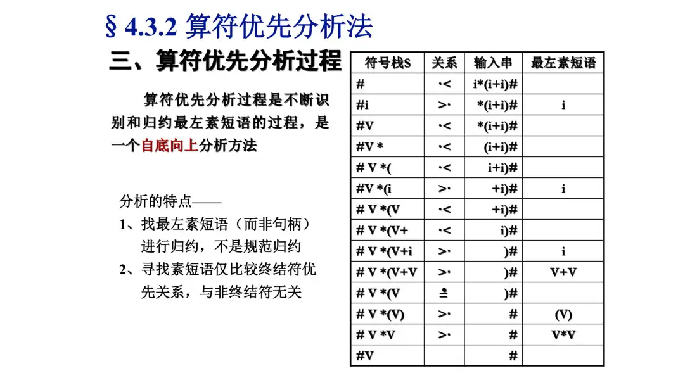

原文：

§4.3.2 算符优先分析法

三、算符优先分析过程

算符优先分析过程是不断识别和归约最左素短语的过程，是一个自底向上分析方法

分析的特点——

1、找最左素短语（而非句柄）进行归约，不是规范归约

2、寻找素短语仅比较终结符优先关系，与非终结符无关

<table><tr><td>符号栈S</td><td>关系</td><td>输入串</td><td>最左素短语</td></tr><tr><td>#</td><td>&lt;</td><td>i*(i+i)#</td><td></td></tr><tr><td>#i</td><td>&gt;</td><td>*(i+i)#</td><td>i</td></tr><tr><td>#V</td><td>&lt;</td><td>*(i+i)#</td><td></td></tr><tr><td>#V*</td><td>&lt;</td><td>(i+i)#</td><td></td></tr><tr><td>#V*(</td><td>&lt;</td><td>i+i)#</td><td></td></tr><tr><td>#V*(i</td><td>&gt;</td><td>+i)#</td><td>i</td></tr><tr><td>#V*(V</td><td>&lt;</td><td>+i)#</td><td></td></tr><tr><td>#V*(V+</td><td>&lt;</td><td>i)#</td><td></td></tr><tr><td>#V*(V+i</td><td>&gt;</td><td>)#</td><td>i</td></tr><tr><td>#V*(V+V</td><td>&gt;</td><td>)#</td><td>V+V</td></tr><tr><td>#V*(V</td><td>=</td><td>)#</td><td></td></tr><tr><td>#V*(V)</td><td>&gt;</td><td>#</td><td>(V)</td></tr><tr><td>#V*V</td><td>&gt;</td><td>#</td><td>V*V</td></tr><tr><td>#V</td><td></td><td>#</td><td></td></tr></table>

### §4.3.2 算符优先分析法

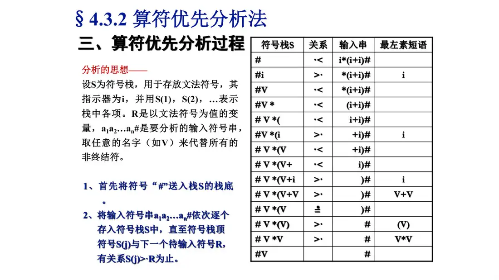

原文：

§4.3.2 算符优先分析法

三、算符优先分析过程

分析的思想—

设S为符号栈，用于存放文法符号，其指示器为i，并用S(1)，S(2)，…表示栈中各项。R是以文法符号为值的变量， $\mathbf { a _ { 1 } a _ { 2 } } . . . \mathbf { a _ { n } } \mathbf { ; }$ #是要分析的输入符号串，取任意的名字（如V）来代替所有的非终结符。

1、首先将符号“#”送入栈S的栈底

2、将输入符号串a $\scriptstyle \mathbf { l _ { 1 } } \mathbf { a _ { 2 } } \dots \mathbf { a _ { n } } ,$ #依次逐个存入符号栈S中，直至符号栈顶符号S(j)与下一个待输入符号R，有关系S(j)>·R为止。

<table><tr><td>符号栈S</td><td>关系</td><td>输入串</td><td>最左素短语</td></tr><tr><td>#</td><td>•&lt;</td><td>i*(i+i)#</td><td></td></tr><tr><td>#i</td><td>&gt;•</td><td>*(i+i)#</td><td>i</td></tr><tr><td>#V</td><td>•&lt;</td><td>*(i+i)#</td><td></td></tr><tr><td>#V*</td><td>•&lt;</td><td>(i+i)#</td><td></td></tr><tr><td>#V*(</td><td>•&lt;</td><td>i+i)#</td><td></td></tr><tr><td>#V*(i</td><td>&gt;•</td><td>+i)#</td><td>i</td></tr><tr><td>#V*(V</td><td>•&lt;</td><td>+i)#</td><td></td></tr><tr><td>#V*(V+</td><td>•&lt;</td><td>i)#</td><td></td></tr><tr><td>#V*(V+i</td><td>&gt;•</td><td>)#</td><td>i</td></tr><tr><td>#V*(V+V</td><td>&gt;•</td><td>)#</td><td>V+V</td></tr><tr><td>#V*(V</td><td>≡</td><td>)#</td><td></td></tr><tr><td>#V*(V)</td><td>&gt;•</td><td>#</td><td>(V)</td></tr><tr><td>#V*V</td><td>&gt;•</td><td>#</td><td>V*V</td></tr><tr><td>#V</td><td></td><td>#</td><td></td></tr></table>

### §4.3.2 算符优先分析法

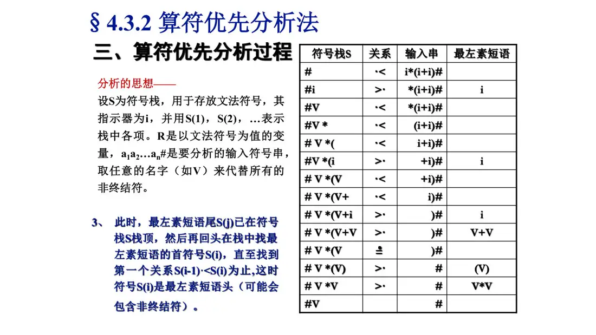

原文：

§4.3.2 算符优先分析法

三、算符优先分析过程

分析的思想—

设S为符号栈，用于存放文法符号，其指示器为i，并用S(1)，S(2)，…表示栈中各项。R是以文法符号为值的变量， $\mathbf { a _ { 1 } a _ { 2 } } . . . \mathbf { a _ { n } } \mathbf { ; }$ #是要分析的输入符号串，取任意的名字（如V）来代替所有的非终结符。

3、 此时，最左素短语尾S(j)已在符号栈S栈顶，然后再回头在栈中找最左素短语的首符号S(i)，直至找到第一个关系S(i-1)·<S(i)为止,这时符号S(i)是最左素短语头（可能会包含非终结符）。

<table><tr><td>符号栈S</td><td>关系</td><td>输入串</td><td>最左素短语</td></tr><tr><td>#</td><td>•&lt;</td><td>i*(i+i)#</td><td></td></tr><tr><td>#i</td><td>&gt;•</td><td>*(i+i)#</td><td>i</td></tr><tr><td>#V</td><td>•&lt;</td><td>*(i+i)#</td><td></td></tr><tr><td>#V*</td><td>•&lt;</td><td>(i+i)#</td><td></td></tr><tr><td>#V*(</td><td>•&lt;</td><td>i+i)#</td><td></td></tr><tr><td>#V*(i</td><td>&gt;•</td><td>+i)#</td><td>i</td></tr><tr><td>#V*(V</td><td>•&lt;</td><td>+i)#</td><td></td></tr><tr><td>#V*(V+</td><td>•&lt;</td><td>i)#</td><td></td></tr><tr><td>#V*(V+i</td><td>&gt;•</td><td>)#</td><td>i</td></tr><tr><td>#V*(V+V</td><td>&gt;•</td><td>)#</td><td>V+V</td></tr><tr><td>#V*(V</td><td>≡</td><td>)#</td><td></td></tr><tr><td>#V*(V)</td><td>&gt;•</td><td>#</td><td>(V)</td></tr><tr><td>#V*V</td><td>&gt;•</td><td>#</td><td>V*V</td></tr><tr><td>#V</td><td></td><td>#</td><td></td></tr></table>

### §4.3.2 算符优先分析法

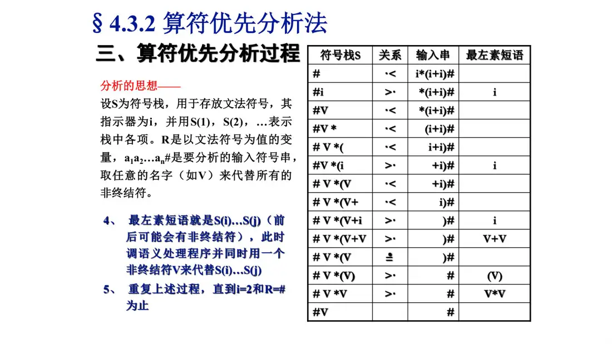

原文：

§4.3.2 算符优先分析法

三、算符优先分析过程

分析的思想—

设S为符号栈，用于存放文法符号，其指示器为i，并用S(1)，S(2)，…表示栈中各项。R是以文法符号为值的变量， $\mathbf { a _ { 1 } a _ { 2 } } . . . \mathbf { a _ { n } } \mathbf { ; }$ #是要分析的输入符号串，取任意的名字（如V）来代替所有的非终结符。

4、 最左素短语就是S(i)…S(j)（前后可能会有非终结符），此时调语义处理程序并同时用一个非终结符V来代替S(i)…S(j)

5、 重复上述过程，直到i=2和R=#为止

<table><tr><td>符号栈S</td><td>关系</td><td>输入串</td><td>最左素短语</td></tr><tr><td>#</td><td>•&lt;</td><td>i*(i+i)#</td><td></td></tr><tr><td>#i</td><td>&gt;•</td><td>*(i+i)#</td><td>i</td></tr><tr><td>#V</td><td>•&lt;</td><td>*(i+i)#</td><td></td></tr><tr><td>#V*</td><td>•&lt;</td><td>(i+i)#</td><td></td></tr><tr><td>#V*(</td><td>•&lt;</td><td>i+i)#</td><td></td></tr><tr><td>#V*(i</td><td>&gt;•</td><td>+i)#</td><td>i</td></tr><tr><td>#V*(V</td><td>•&lt;</td><td>+i)#</td><td></td></tr><tr><td>#V*(V+</td><td>•&lt;</td><td>i)#</td><td></td></tr><tr><td>#V*(V+i</td><td>&gt;•</td><td>)#</td><td>i</td></tr><tr><td>#V*(V+V</td><td>&gt;•</td><td>)#</td><td>V+V</td></tr><tr><td>#V*(V</td><td>≡</td><td>)#</td><td></td></tr><tr><td>#V*(V)</td><td>&gt;•</td><td>#</td><td>(V)</td></tr><tr><td>#V*V</td><td>&gt;•</td><td>#</td><td>V*V</td></tr><tr><td>#V</td><td></td><td>#</td><td></td></tr></table>

### §4.3.2 算符优先分析法

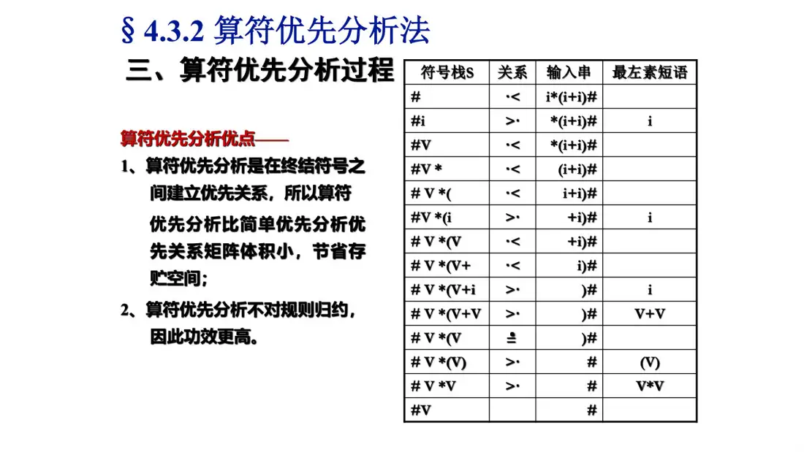

原文：

§4.3.2 算符优先分析法

三、算符优先分析过程

算符优先分析优点—

1、算符优先分析是在终结符号之间建立优先关系，所以算符优先分析比简单优先分析优先关系矩阵体积小，节省存贮空间；

2、算符优先分析不对规则归约，因此功效更高。

<table><tr><td>符号栈S</td><td>关系</td><td>输入串</td><td>最左素短语</td></tr><tr><td>#</td><td>•&lt;</td><td>i*(i+i)#</td><td></td></tr><tr><td>#i</td><td>&gt;•</td><td>*(i+i)#</td><td>i</td></tr><tr><td>#V</td><td>•&lt;</td><td>*(i+i)#</td><td></td></tr><tr><td>#V*</td><td>•&lt;</td><td>(i+i)#</td><td></td></tr><tr><td>#V*(</td><td>•&lt;</td><td>i+i)#</td><td></td></tr><tr><td>#V*(i</td><td>&gt;•</td><td>+i)#</td><td>i</td></tr><tr><td>#V*(V</td><td>•&lt;</td><td>+i)#</td><td></td></tr><tr><td>#V*(V+</td><td>•&lt;</td><td>i)#</td><td></td></tr><tr><td>#V*(V+i</td><td>&gt;•</td><td>)#</td><td>i</td></tr><tr><td>#V*(V+V</td><td>&gt;•</td><td>)#</td><td>V+V</td></tr><tr><td>#V*(V</td><td>≡</td><td>)#</td><td></td></tr><tr><td>#V*(V)</td><td>&gt;•</td><td>#</td><td>(V)</td></tr><tr><td>#V*V</td><td>&gt;•</td><td>#</td><td>V*V</td></tr><tr><td>#V</td><td></td><td>#</td><td></td></tr></table>
