# 《编译原理》第四章 语法分析（课件）

原件的每一页，下面附识别出的文字。

### 编译原理 Compiler Principles 第四章 语法分析

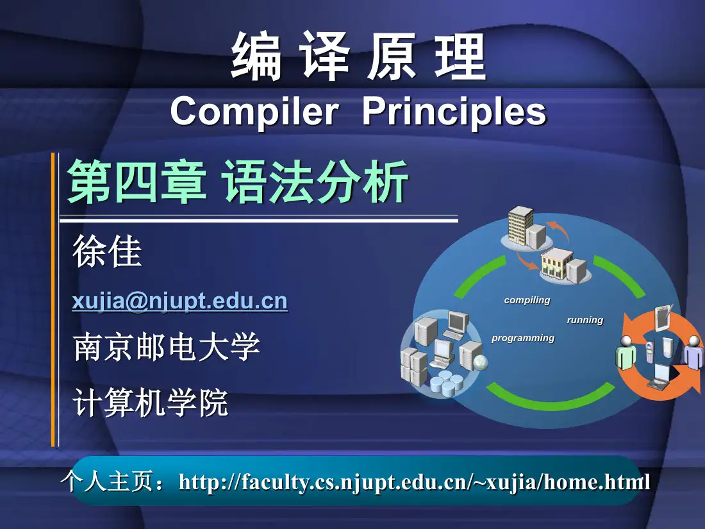

原文：

编译原理 Compiler Principles 第四章 语法分析

徐佳

xujia@njupt.edu.cn

南京邮电大学

计算机学院

compiling running programming

个人主页：http://faculty.cs.njupt.edu.cn/\~xujia/home.html

### 本章内容

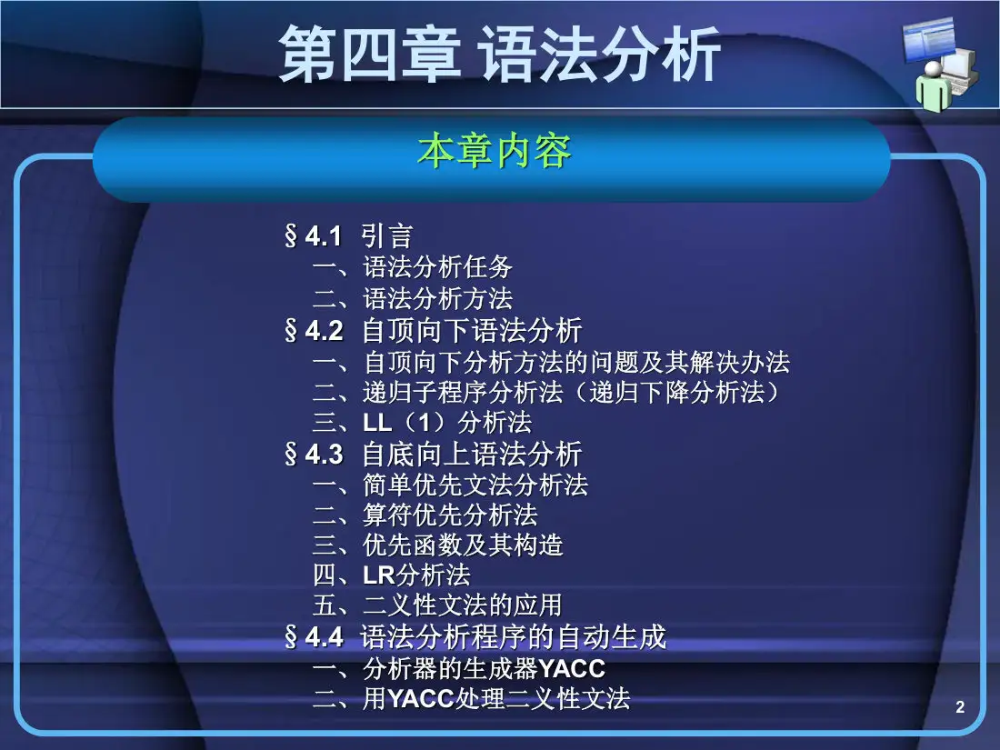

原文：

本章内容

§ 4.1 引言
一、语法分析任务
二、语法分析方法
§ 4.2 自顶向下语法分析
一、自顶向下分析方法的问题及其解决办法
二、递归子程序分析法（递归下降分析法）
三、LL（1）分析法
§ 4.3 自底向上语法分析
一、简单优先文法分析法
二、算符优先分析法
三、优先函数及其构造
四、LR分析法
五、二义性文法的应用
§ 4.4 语法分析程序的自动生成
一、分析器的生成器YACC
二、用YACC处理二义性文法

第四章 语法分析

2

### § 4.3 自底向上语法分析

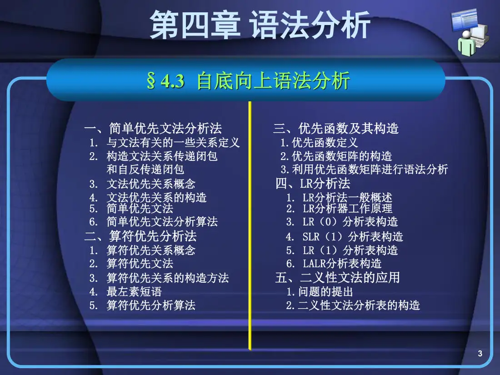

原文：

§ 4.3 自底向上语法分析

一、简单优先文法分析法

1. 与文法有关的一些关系定义

2. 构造文法关系传递闭包和自反传递闭包

3. 文法优先关系概念

4. 文法优先关系的构造

5. 简单优先文法

6. 简单优先文法分析算法

二、算符优先分析法

1. 算符优先关系概念

2. 算符优先文法

3. 算符优先关系的构造方法

4. 最左素短语

5. 算符优先分析算法

三、优先函数及其构造

1. 优先函数定义

2. 优先函数矩阵的构造

3. 利用优先函数矩阵进行语法分析

四、LR分析法

1. LR分析法一般概述

2. LR分析器工作原理

3. LR（0）分析表构造

4. SLR（1）分析表构造

5. LR（1）分析表构造

6. LALR分析表构造

五、二义性文法的应用

1. 问题的提出

2. 二义性文法分析表的构造

第四章 语法分析

3

### § 4.3 自底向上语法分析

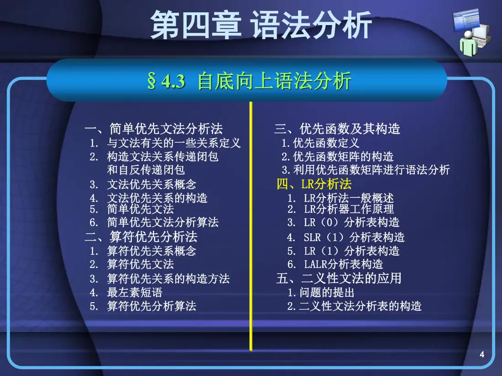

原文：

§ 4.3 自底向上语法分析

一、简单优先文法分析法

1. 与文法有关的一些关系定义

2. 构造文法关系传递闭包和自反传递闭包

3. 文法优先关系概念

4. 文法优先关系的构造

5. 简单优先文法

6. 简单优先文法分析算法

二、算符优先分析法

1. 算符优先关系概念

2. 算符优先文法

3. 算符优先关系的构造方法

4. 最左素短语

5. 算符优先分析算法

三、优先函数及其构造

1. 优先函数定义

2. 优先函数矩阵的构造

3. 利用优先函数矩阵进行语法分析

四、LR分析法

1. LR分析法一般概述

2. LR分析器工作原理

3. LR（0）分析表构造

4. SLR（1）分析表构造

5. LR（1）分析表构造

6. LALR分析表构造

五、二义性文法的应用

1. 问题的提出

2. 二义性文法分析表的构造

第四章 语法分析

4

### § 4.3 自底向上语法分析

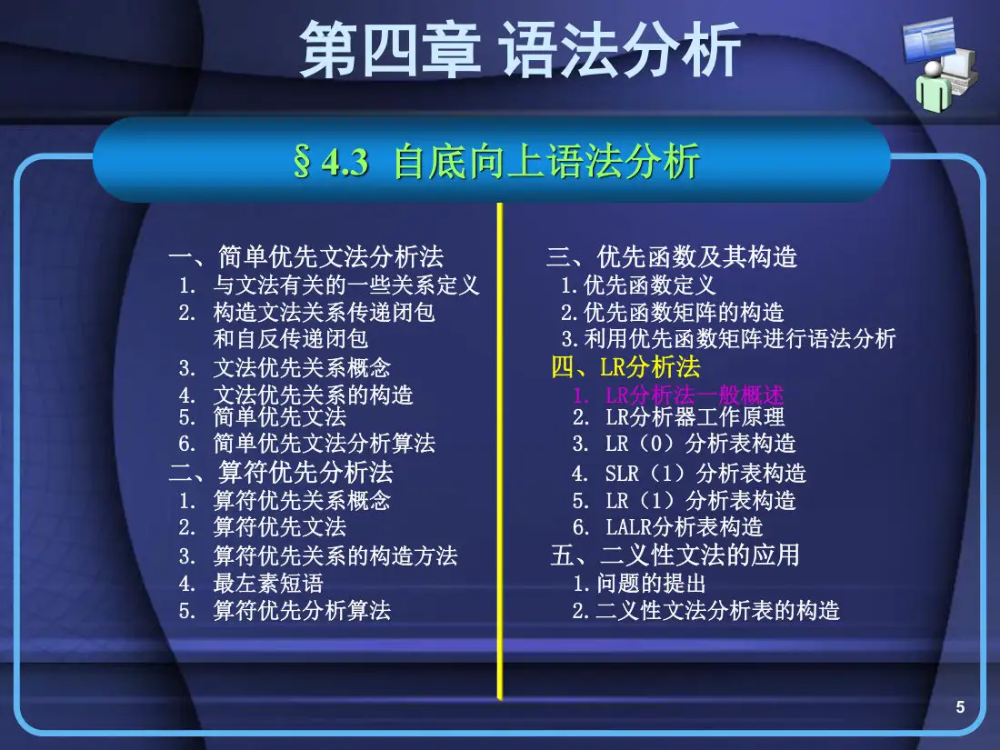

原文：

§ 4.3 自底向上语法分析

一、简单优先文法分析法

1. 与文法有关的一些关系定义

2. 构造文法关系传递闭包和自反传递闭包

3. 文法优先关系概念

4. 文法优先关系的构造

5. 简单优先文法

6. 简单优先文法分析算法

二、算符优先分析法

1. 算符优先关系概念

2. 算符优先文法

3. 算符优先关系的构造方法

4. 最左素短语

5. 算符优先分析算法

三、优先函数及其构造

1. 优先函数定义

2. 优先函数矩阵的构造

3. 利用优先函数矩阵进行语法分析

四、LR分析法

1. LR分析法一般概述

2. LR分析器工作原理

3. LR（0）分析表构造

4. SLR（1）分析表构造

5. LR（1）分析表构造

6. LALR分析表构造

五、二义性文法的应用

1. 问题的提出

2. 二义性文法分析表的构造

第四章 语法分析

5

### 1. LR分析法一般概述

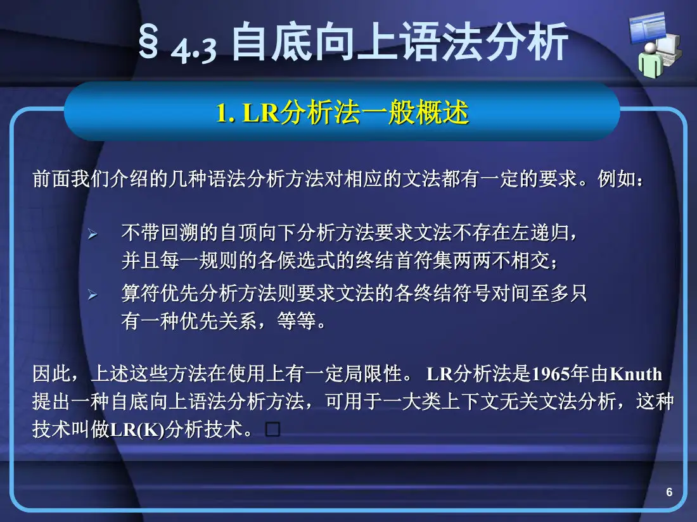

原文：

1. LR分析法一般概述

前面我们介绍的几种语法分析方法对相应的文法都有一定的要求。例如：

不带回溯的自顶向下分析方法要求文法不存在左递归，并且每一规则的各候选式的终结首符集两两不相交；

算符优先分析方法则要求文法的各终结符号对间至多只有一种优先关系，等等。

因此，上述这些方法在使用上有一定局限性。LR分析法是1965年由Knuth提出一种自底向上语法分析方法，可用于一大类上下文无关文法分析，这种技术叫做LR(K)分析技术。□

§ 4.3 自底向上语法分析

6

### (1) LR (K) 分析法定义

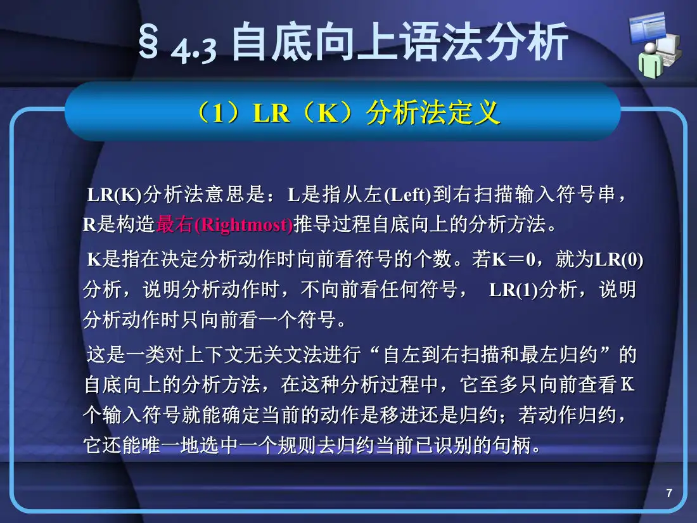

原文：

(1) LR (K) 分析法定义

LR(K)分析法意思是：L是指从左(Left)到右扫描输入符号串，R是构造最右(Rightmost)推导过程自底向上的分析方法。

K是指在决定分析动作时向前看符号的个数。若K=0，就为LR(0)分析，说明分析动作时，不向前看任何符号，LR(1)分析，说明分析动作时只向前看一个符号。

这是一类对上下文无关文法进行“自左到右扫描和最左归约”的自底向上的分析方法，在这种分析过程中，它至多只向前查看K个输入符号就能确定当前的动作是移进还是归约；若动作归约，它还能唯一地选中一个规则去归约当前已识别的句柄。

§ 4.3 自底向上语法分析

7

### (2) LR分析法的特点

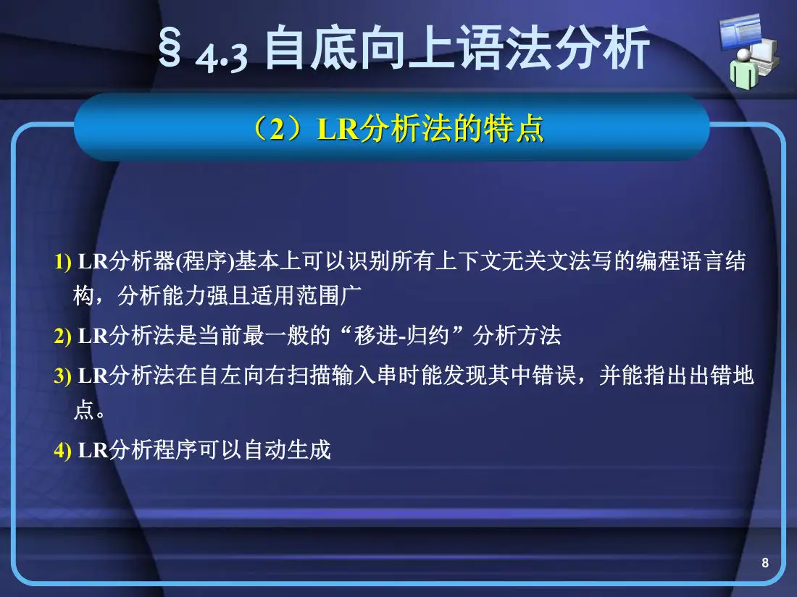

原文：

(2) LR分析法的特点

1) LR分析器(程序)基本上可以识别所有上下文无关文法写的编程语言结构，分析能力强且适用范围广

2) LR分析法是当前最一般的“移进-归约”分析方法

3) LR分析法在自左向右扫描输入串时能发现其中错误，并能指出出错地点。

4) LR分析程序可以自动生成

§ 4.3 自底向上语法分析

8

### (3) LR分析器的组成

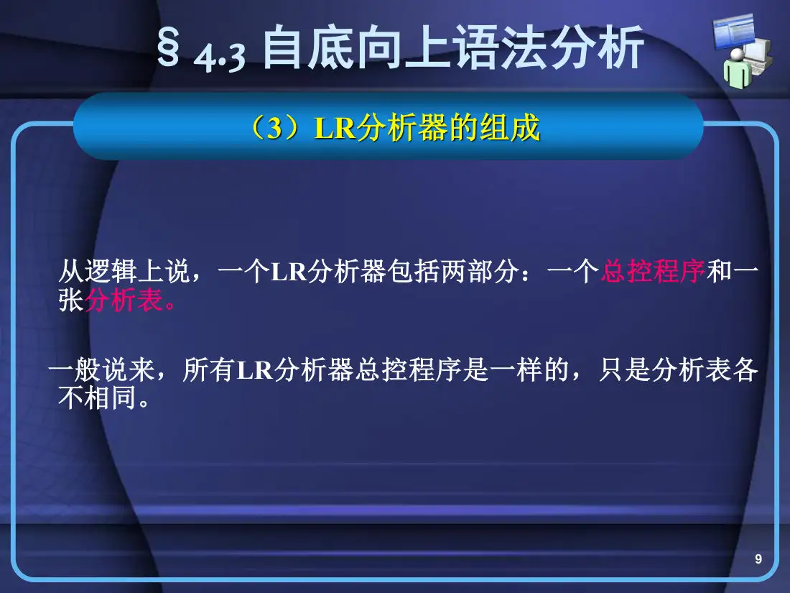

原文：

(3) LR分析器的组成

从逻辑上说，一个LR分析器包括两部分：一个总控程序和一张分析表。

一般说来，所有LR分析器总控程序是一样的，只是分析表各不相同。

§ 4.3 自底向上语法分析

9

### (4) LR分析表种类

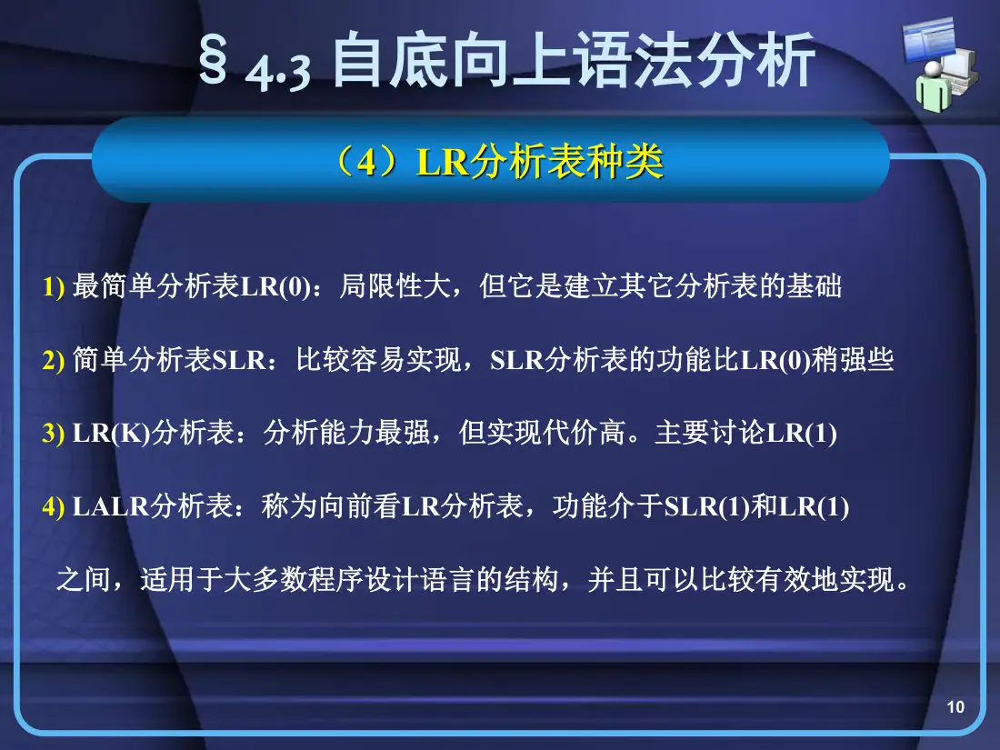

原文：

(4) LR分析表种类

1) 最简单分析表LR(0): 局限性大, 但它是建立其它分析表的基础

2) 简单分析表SLR: 比较容易实现, SLR分析表的功能比LR(0)稍强些

3) LR(K)分析表：分析能力最强，但实现代价高。主要讨论LR(1)

4) LALR分析表：称为向前看LR分析表，功能介于SLR(1)和LR(1)

之间，适用于大多数程序设计语言的结构，并且可以比较有效地实现。

§ 4.3 自底向上语法分析

10

### § 4.3 自底向上语法分析

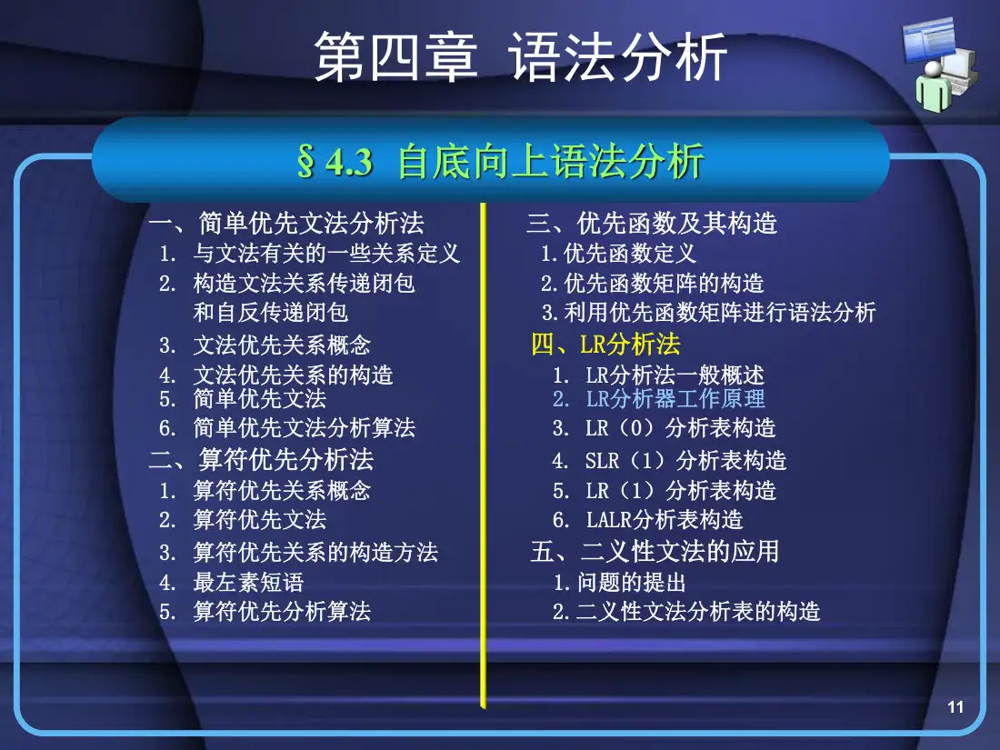

原文：

§ 4.3 自底向上语法分析

一、简单优先文法分析法

1. 与文法有关的一些关系定义

2. 构造文法关系传递闭包和自反传递闭包

3. 文法优先关系概念

4. 文法优先关系的构造

5. 简单优先文法

6. 简单优先文法分析算法

二、算符优先分析法

1. 算符优先关系概念

2. 算符优先文法

3. 算符优先关系的构造方法

4. 最左素短语

5. 算符优先分析算法

三、优先函数及其构造

1. 优先函数定义

2. 优先函数矩阵的构造

3. 利用优先函数矩阵进行语法分析

四、LR分析法

1. LR分析法一般概述

2. LR分析器工作原理

3. LR（0）分析表构造

4. SLR（1）分析表构造

5. LR（1）分析表构造

6. LALR分析表构造

五、二义性文法的应用

1. 问题的提出

2. 二义性文法分析表的构造

第四章 语法分析

11

### 2. LR分析器工作原理

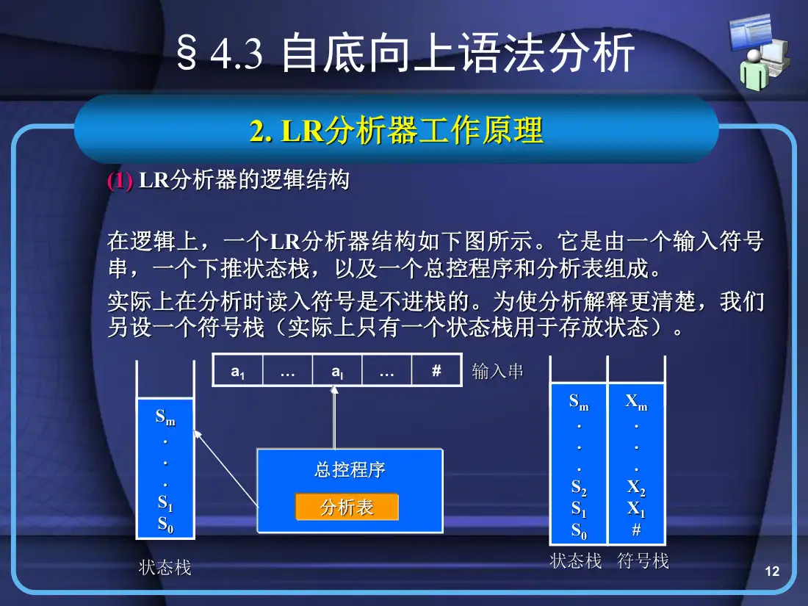

原文：

2. LR分析器工作原理

(1) LR分析器的逻辑结构

在逻辑上，一个LR分析器结构如下图所示。它是由一个输入符号串，一个下推状态栈，以及一个总控程序和分析表组成。

实际上在分析时读入符号是不进栈的。为使分析解释更清楚，我们另设一个符号栈（实际上只有一个状态栈用于存放状态）。

总控程序

分析表

输入串

$$
\begin{array}{c c} \mathbf {S _ {m}} & \mathbf {X _ {m}} \\ \cdot & \cdot \\ \cdot & \cdot \\ \cdot & \cdot \\ \mathbf {S _ {2}} & \mathbf {X _ {2}} \\ \mathbf {S _ {1}} & \mathbf {X _ {1}} \\ \mathbf {S _ {0}} & \# \end{array}
$$

§ 4.3 自底向上语法分析

状态栈

状态栈 符号栈

12

### 一个LR分析表的例子

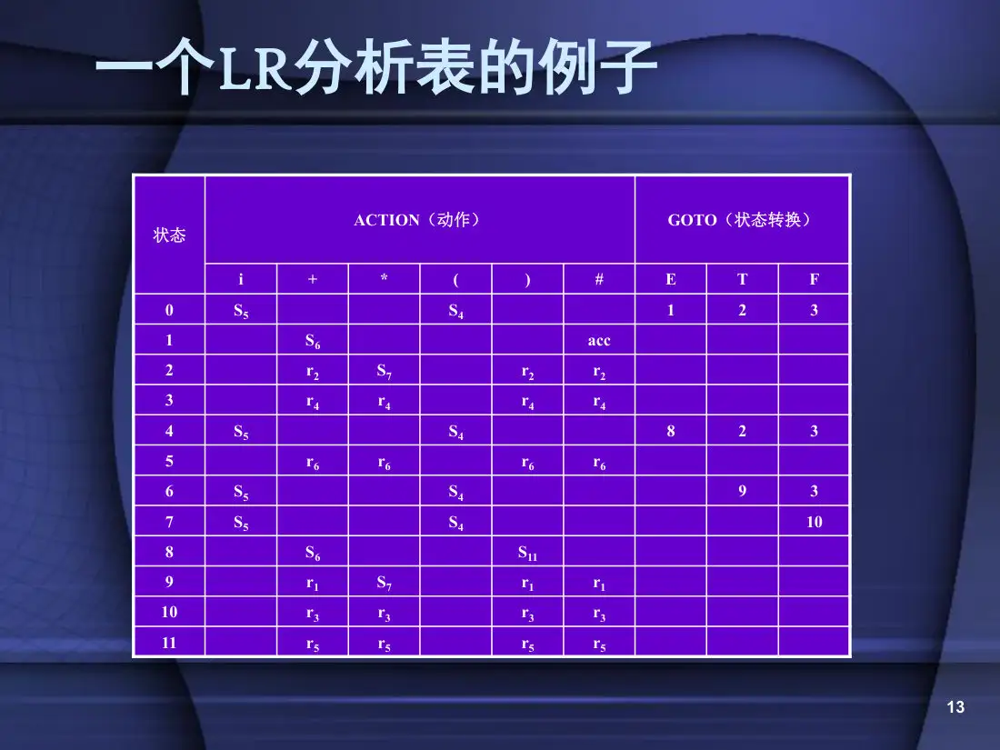

原文：

一个LR分析表的例子

<table><tr><td rowspan="2">状态</td><td colspan="6">ACTION(动作)</td><td colspan="3">GOTO(状态转换)</td></tr><tr><td>i</td><td>+</td><td>*</td><td>(</td><td>)</td><td>#</td><td>E</td><td>T</td><td>F</td></tr><tr><td>0</td><td> $S_5$ </td><td></td><td></td><td> $S_4$ </td><td></td><td></td><td>1</td><td>2</td><td>3</td></tr><tr><td>1</td><td></td><td> $S_6$ </td><td></td><td></td><td></td><td>acc</td><td></td><td></td><td></td></tr><tr><td>2</td><td></td><td> $r_2$ </td><td> $S_7$ </td><td></td><td> $r_2$ </td><td> $r_2$ </td><td></td><td></td><td></td></tr><tr><td>3</td><td></td><td> $r_4$ </td><td> $r_4$ </td><td></td><td> $r_4$ </td><td> $r_4$ </td><td></td><td></td><td></td></tr><tr><td>4</td><td> $S_5$ </td><td></td><td></td><td> $S_4$ </td><td></td><td></td><td>8</td><td>2</td><td>3</td></tr><tr><td>5</td><td></td><td> $r_6$ </td><td> $r_6$ </td><td></td><td> $r_6$ </td><td> $r_6$ </td><td></td><td></td><td></td></tr><tr><td>6</td><td> $S_5$ </td><td></td><td></td><td> $S_4$ </td><td></td><td></td><td></td><td>9</td><td>3</td></tr><tr><td>7</td><td> $S_5$ </td><td></td><td></td><td> $S_4$ </td><td></td><td></td><td></td><td></td><td>10</td></tr><tr><td>8</td><td></td><td> $S_6$ </td><td></td><td></td><td> $S_{11}$ </td><td></td><td></td><td></td><td></td></tr><tr><td>9</td><td></td><td> $r_1$ </td><td> $S_7$ </td><td></td><td> $r_1$ </td><td> $r_1$ </td><td></td><td></td><td></td></tr><tr><td>10</td><td></td><td> $r_3$ </td><td> $r_3$ </td><td></td><td> $r_3$ </td><td> $r_3$ </td><td></td><td></td><td></td></tr><tr><td>11</td><td></td><td> $r_5$ </td><td> $r_5$ </td><td></td><td> $r_5$ </td><td> $r_5$ </td><td></td><td></td><td></td></tr></table>

13

### LR分析器核心是分析表，分析表由两个子表组成：1) 分析动作表

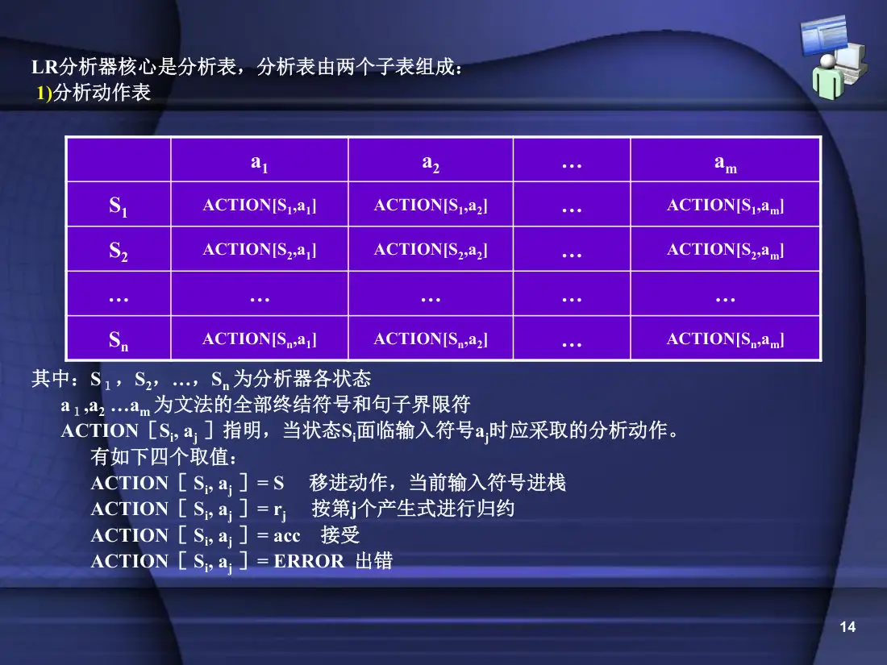

原文：

LR分析器核心是分析表，分析表由两个子表组成：1) 分析动作表

<table><tr><td></td><td> $a_1$ </td><td> $a_2$ </td><td>...</td><td> $a_m$ </td></tr><tr><td> $S_1$ </td><td>ACTION $[S_1,a_1]$ </td><td>ACTION $[S_1,a_2]$ </td><td>...</td><td>ACTION $[S_1,a_m]$ </td></tr><tr><td> $S_2$ </td><td>ACTION $[S_2,a_1]$ </td><td>ACTION $[S_2,a_2]$ </td><td>...</td><td>ACTION $[S_2,a_m]$ </td></tr><tr><td>...</td><td>...</td><td>...</td><td>...</td><td>...</td></tr><tr><td> $S_n$ </td><td>ACTION $[S_n,a_1]$ </td><td>ACTION $[S_n,a_2]$ </td><td>...</td><td>ACTION $[S_n,a_m]$ </td></tr></table>

其中： $\mathrm{S}_1$ ， $\mathrm{S}_2$ ，…， $\mathrm{S}_n$ 为分析器各状态 $\mathbf{a}_1, \mathbf{a}_2 \dots \mathbf{a}_m$ 为文法的全部终结符号和句子界限符

ACTION $[\mathrm{S}_i, \mathbf{a}_j]$ 指明，当状态 $\mathrm{S}_i$ 面临输入符号 $\mathbf{a}_j$ 时应采取的分析动作。

有如下四个取值：

ACTION $[\mathrm{S}_i, \mathbf{a}_j] = \mathrm{S}$ 移进动作，当前输入符号进栈

ACTION $[\mathrm{S}_i, \mathbf{a}_j] = \mathbf{r}_j$ 按第 $j$ 个产生式进行归约

ACTION $[\mathrm{S}_i, \mathbf{a}_j] = \mathrm{acc}$ 接受

ACTION $[\mathrm{S}_i, \mathbf{a}_j] = \mathrm{ERROR}$ 出错

14

### 2）状态转换表

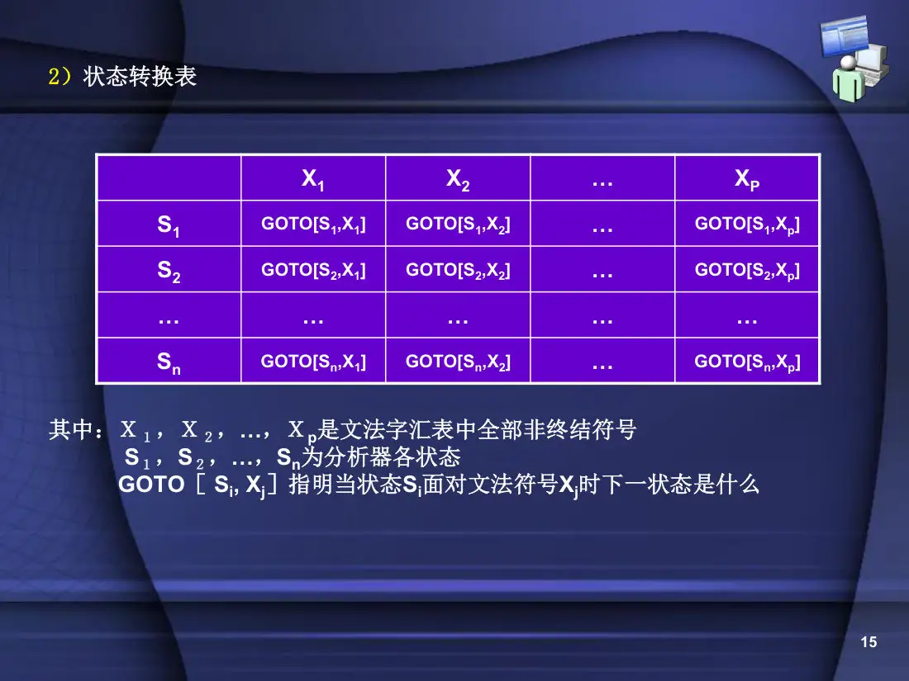

原文：

<table><tr><td></td><td> $X_1$ </td><td> $X_2$ </td><td>...</td><td> $X_P$ </td></tr><tr><td> $S_1$ </td><td>GOTO $[S_1,X_1]$ </td><td>GOTO $[S_1,X_2]$ </td><td>...</td><td>GOTO $[S_1,X_p]$ </td></tr><tr><td> $S_2$ </td><td>GOTO $[S_2,X_1]$ </td><td>GOTO $[S_2,X_2]$ </td><td>...</td><td>GOTO $[S_2,X_p]$ </td></tr><tr><td>...</td><td>...</td><td>...</td><td>...</td><td>...</td></tr><tr><td> $S_n$ </td><td>GOTO $[S_n,X_1]$ </td><td>GOTO $[S_n,X_2]$ </td><td>...</td><td>GOTO $[S_n,X_p]$ </td></tr></table>

其中： $X_{1}$ ， $X_{2}$ ，…， $X_{p}$ 是文法字汇表中全部非终结符号 $S_{1}$ ， $S_{2}$ ，…， $S_{n}$ 为分析器各状态  
GOTO $[S_{i}, X_{j}]$ 指明当状态 $S_{i}$ 面对文法符号 $X_{j}$ 时下一状态是什么

2）状态转换表

15

### (2) LR分析器基本工作过程

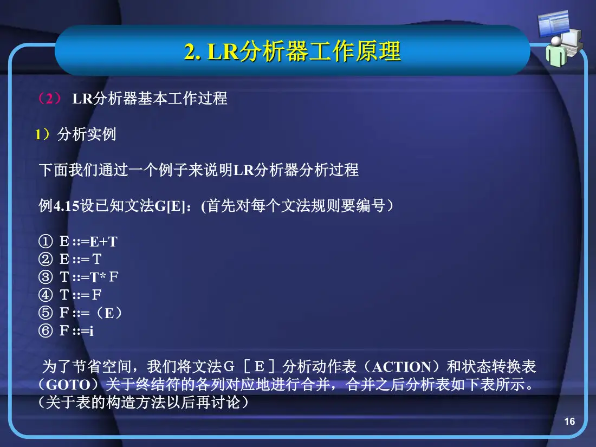

原文：

(2) LR分析器基本工作过程

1）分析实例

下面我们通过一个例子来说明LR分析器分析过程

例4.15设已知文法G[E]：(首先对每个文法规则要编号)

① E ::=E+T
② E ::=T
③ T ::=T\*F
④ T ::=F
⑤ F ::= (E)
⑥ F ::=i

为了节省空间，我们将文法G [E] 分析动作表（ACTION）和状态转换表（GOTO）关于终结符的各列对应地进行合并，合并之后分析表如下表所示。（关于表的构造方法以后再讨论）

2. LR分析器工作原理

16

### ① 实例LR分析表

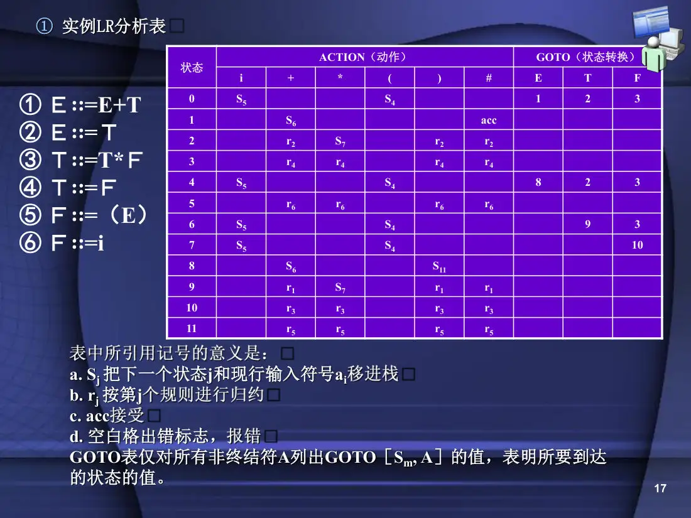

原文：

① 实例LR分析表

<table><tr><td rowspan="2">状态</td><td colspan="6">ACTION(动作)</td><td colspan="3">GOTO(状态转换)</td></tr><tr><td>i</td><td>+</td><td>*</td><td>(</td><td>)</td><td>#</td><td>E</td><td>T</td><td>F</td></tr><tr><td>0</td><td> $S_5$ </td><td></td><td></td><td> $S_4$ </td><td></td><td></td><td>1</td><td>2</td><td>3</td></tr><tr><td>1</td><td></td><td> $S_6$ </td><td></td><td></td><td></td><td>acc</td><td></td><td></td><td></td></tr><tr><td>2</td><td></td><td> $r_2$ </td><td> $S_7$ </td><td></td><td> $r_2$ </td><td> $r_2$ </td><td></td><td></td><td></td></tr><tr><td>3</td><td></td><td> $r_4$ </td><td> $r_4$ </td><td></td><td> $r_4$ </td><td> $r_4$ </td><td></td><td></td><td></td></tr><tr><td>4</td><td> $S_5$ </td><td></td><td></td><td> $S_4$ </td><td></td><td></td><td>8</td><td>2</td><td>3</td></tr><tr><td>5</td><td></td><td> $r_6$ </td><td> $r_6$ </td><td></td><td> $r_6$ </td><td> $r_6$ </td><td></td><td></td><td></td></tr><tr><td>6</td><td> $S_5$ </td><td></td><td></td><td> $S_4$ </td><td></td><td></td><td></td><td>9</td><td>3</td></tr><tr><td>7</td><td> $S_5$ </td><td></td><td></td><td> $S_4$ </td><td></td><td></td><td></td><td></td><td>10</td></tr><tr><td>8</td><td></td><td> $S_6$ </td><td></td><td></td><td> $S_{11}$ </td><td></td><td></td><td></td><td></td></tr><tr><td>9</td><td></td><td> $r_1$ </td><td> $S_7$ </td><td></td><td> $r_1$ </td><td> $r_1$ </td><td></td><td></td><td></td></tr><tr><td>10</td><td></td><td> $r_3$ </td><td> $r_3$ </td><td></td><td> $r_3$ </td><td> $r_3$ </td><td></td><td></td><td></td></tr><tr><td>11</td><td></td><td> $r_5$ </td><td> $r_5$ </td><td></td><td> $r_5$ </td><td> $r_5$ </td><td></td><td></td><td></td></tr></table>

表中所引用记号的意义是：□

a. $S_{i}$ 把下一个状态 j 和现行输入符号 $a_{i}$ 移进栈 □

b. $r_{j}$ 按第j个规则进行归约

c. acc接受□

d. 空白格出错标志，报错

GOTO表仅对所有非终结符A列出GOTO $[\mathrm{S}_{\mathrm{m}},\mathrm{A}]$ 的值，表明所要到达的状态的值。

17

### 步骤

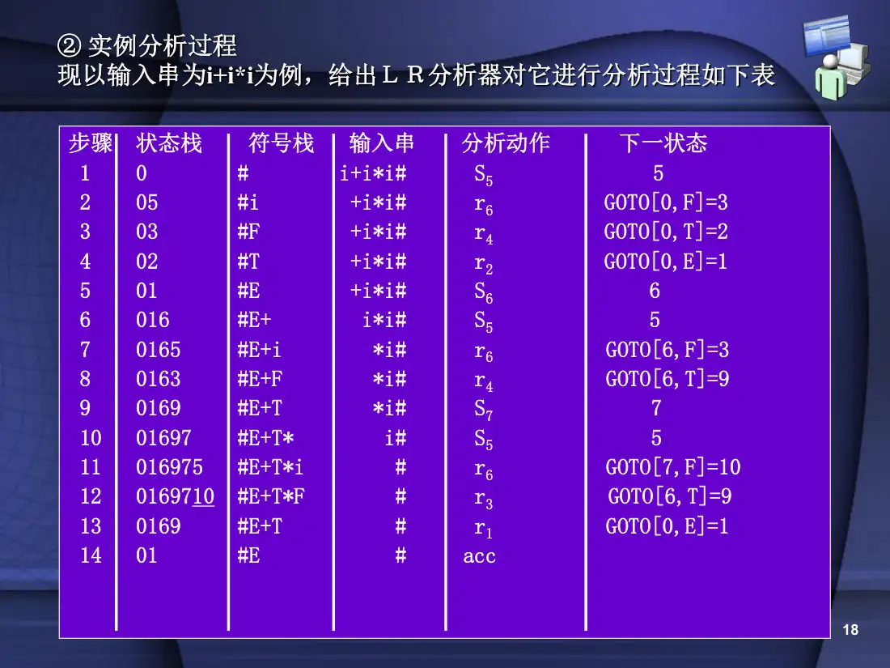

原文：

步骤
1
2
3
4
5
6
7
8
9
10
11
12
13
14

步骤 | 状态栈

符号栈

输入串

i+i\*i#

+i\*i#

+i\*i#

E+

+i\*i#

E+i

+i\*i#

E+F

i\*i#

E+T

\*i#

\*i#

E+T\*

\*i#

i#

E+T\*i

E+T\*F

01

E+T

E

分析动作

下一状态

$\mathrm{S}_5$ $\mathbf{r}_6$ $\mathbf{r}_4$ $\mathbf{r}_2$ $\mathrm{S}_6$ $\mathrm{S}_5$ $\mathbf{r}_6$ $\mathbf{r}_4$ $\mathrm{S}_7$ $\mathrm{S}_5$ $\mathbf{r}_6$ $\mathbf{r}_3$ $\mathbf{r}_1$ acc

5
GOTO[0, F]=3
GOTO[0, T]=2
GOTO[0, E]=1
6
5
GOTO[6, F]=3
GOTO[6, T]=9
7
5
GOTO[7, F]=10
GOTO[6, T]=9
GOTO[0, E]=1

② 实例分析过程
现以输入串为i+i\*i为例，给出L R分析器对它进行分析过程如下表

18

### 总结

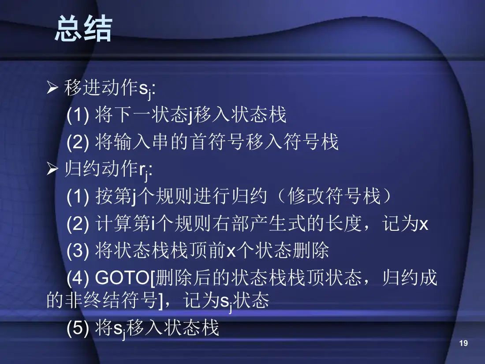

原文：

总结

移进动作s $_{j}$ :

(1) 将下一状态j移入状态栈

(2) 将输入串的首符号移入符号线

归约动作 $r_{j}$ :

(1) 按第j个规则进行归约（修改符号栈）

(2) 计算第i个规则右部产生式的长度，记为x

(3) 将状态栈栈顶前x个状态删除

(4) GOTO[删除后的状态栈栈顶状态，归约成的非终结符号]，记为s状态

(5) 将 $s_{j}$ 移入状态栈

19

### 2）LR分析器基本工作过程

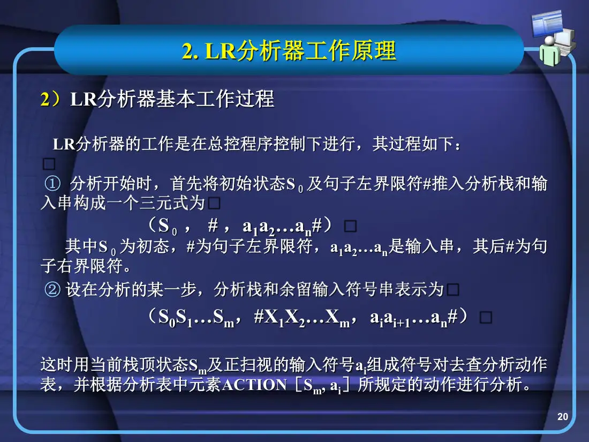

原文：

2）LR分析器基本工作过程

LR分析器的工作是在总控程序控制下进行，其过程如下：

① 分析开始时, 首先将初始状态 $\mathrm{S}_{0}$ 及句子左界限符#推入分析栈和输入串构成一个三元式为 $\square$

$$
(S _ {0}, \#, a _ {1} a _ {2}... a _ {n} #)
$$

其中 $S_{0}$ 为初态，#为句子左界限符， $a_{1}a_{2}\ldots a_{n}$ 是输入串，其后#为句子右界限符。

② 设在分析的某一步，分析栈和余留输入符号串表示为□

$$
(S _ {0} S _ {1}... S _ {m}, \# X _ {1} X _ {2}... X _ {m}, a _ {i} a _ {i + 1}... a _ {n} #)
$$

这时用当前栈顶状态 $S_{m}$ 及正扫视的输入符号 $a_{i}$ 组成符号对去查分析动作表，并根据分析表中元素ACTION $[S_{m}, a_{i}]$ 所规定的动作进行分析。

2. LR分析器工作原理

20

### $$

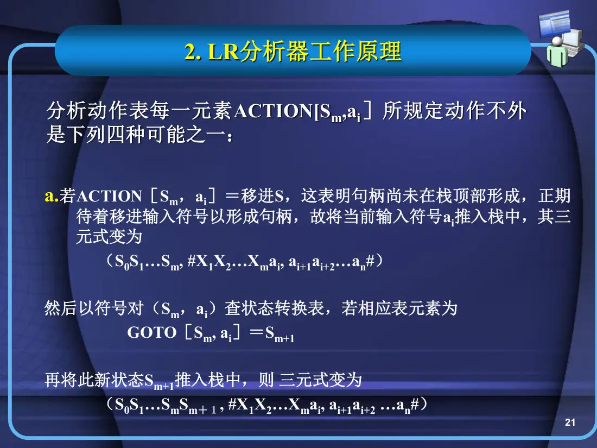

原文：

分析动作表每一元素ACTION[Sm, ai] 所规定动作不外是下列四种可能之一:

a. 若ACTION $\left[S_{m}, a_{i}\right] =$ 移进S，这表明句柄尚未在栈顶部形成，正期待着移进输入符号以形成句柄，故将当前输入符号 $a_{i}$ 推入栈中，其三元式变为

$$
(S _ {0} S _ {1}... S _ {m}, \# X _ {1} X _ {2}... X _ {m} a _ {i}, a _ {i + 1} a _ {i + 2}... a _ {n} \#)
$$

然后以符号对（ $\mathrm{S}_{\mathrm{m}}$ ， $\mathbf{a}_{\mathrm{i}}$ ）查状态转换表，若相应表元素为 $\mathrm{GOTO}[\mathrm{S}_{\mathrm{m}}, \mathbf{a}_{\mathrm{i}}] = \mathrm{S}_{\mathrm{m+1}}$

再将此新状态 $S_{m+1}$ 推入栈中，则三元式变为

$$
(\mathrm{S} _ {0} \mathrm{S} _ {1} \dots \mathrm{S} _ {\mathrm{m}} \mathrm{S} _ {\mathrm{m+1}}, \# \mathrm{X} _ {1} \mathrm{X} _ {2} \dots \mathrm{X} _ {\mathrm{m}} \mathrm{a} _ {\mathrm{i}}, \mathrm{a} _ {\mathrm{i+1}} \mathrm{a} _ {\mathrm{i+2}} \dots \mathrm{a} _ {\mathrm{n}} \#)
$$

2. LR分析器工作原理

21

### $$

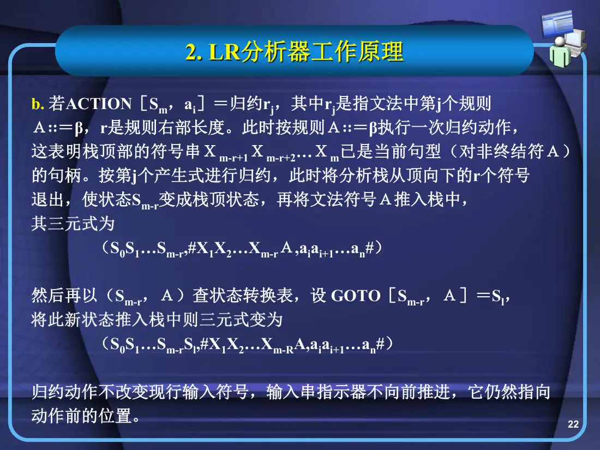

原文：

b. 若ACTION $[S_{m}, a_{i}] =$ 归约 $r_{j}$ , 其中 $r_{j}$ 是指文法中第 $j$ 个规则 A::=β, r 是规则右部长度。此时按规则 A::=β 执行一次归约动作, 这表明栈顶部的符号串 $X_{m-r+1} X_{m-r+2} \ldots X_{m}$ 已是当前句型 (对非终结符 A) 的句柄。按第 j 个产生式进行归约, 此时将分析栈从顶向下的 r 个符号退出, 使状态 $S_{m-r}$ 变成栈顶状态, 再将文法符号 A 推入栈中,

$$
(\mathrm{S} _ {0} \mathrm{S} _ {1} \dots \mathrm{S} _ {\mathrm{m-r}}, \# \mathrm{X} _ {1} \mathrm{X} _ {2} \dots \mathrm{X} _ {\mathrm{m-r}} \mathrm{A}, \mathrm{a} _ {\mathrm{i}} \mathrm{a} _ {\mathrm{i+1}} \dots \mathrm{a} _ {\mathrm{n}} \#)
$$

然后再以（ $\mathrm{S}_{\mathrm{m-r}}$ ，A）查状态转换表，设GOTO $[\mathrm{S}_{\mathrm{m-r}}, \mathrm{A}] = \mathrm{S}_{\mathrm{l}}$ ，将此新状态推入栈中则三元式变为

$$
(\mathrm{S} _ {0} \mathrm{S} _ {1} \dots \mathrm{S} _ {\mathrm{m-r}} \mathrm{S} _ {\mathrm{l}}, \# \mathrm{X} _ {1} \mathrm{X} _ {2} \dots \mathrm{X} _ {\mathrm{m-R}} \mathrm{A}, \mathrm{a} _ {\mathrm{i}} \mathrm{a} _ {\mathrm{i+1}} \dots \mathrm{a} _ {\mathrm{n}} \#)
$$

归约动作不改变现行输入符号，输入串指示器不向前推进，它仍然指向动作前的位置。

2. LR分析器工作原理

22

### 2. LR分析器工作原理

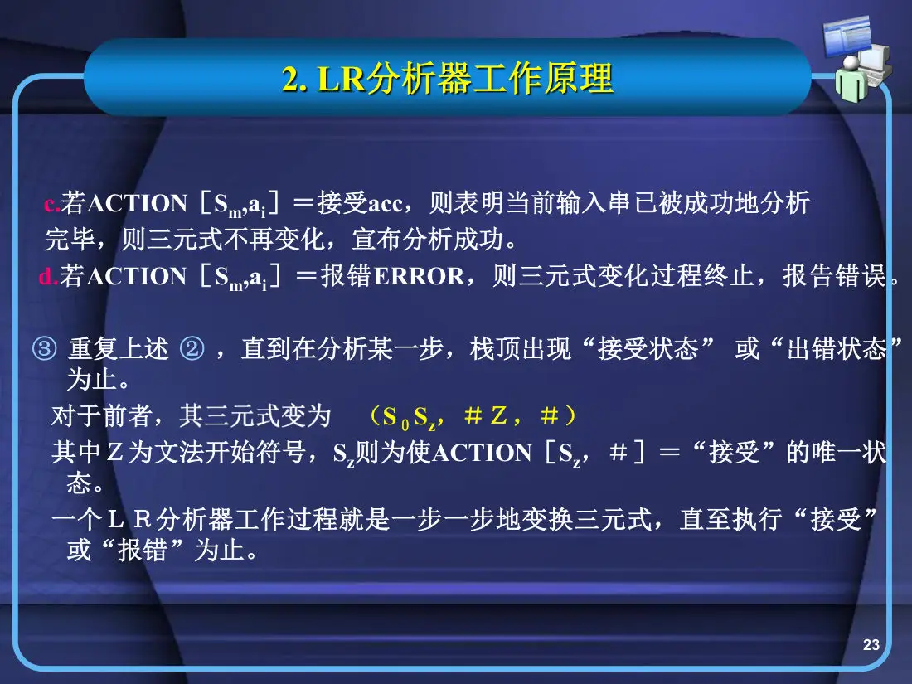

原文：

c. 若ACTION $\left[\mathrm{S}_{\mathrm{m}}, \mathrm{a}_{\mathrm{i}}\right] =$ 接受acc, 则表明当前输入串已被成功地分析完毕, 则三元式不再变化, 宣布分析成功。

d. 若ACTION $\left[\mathrm{S}_{\mathrm{m}}, \mathrm{a}_{\mathrm{i}}\right] =$ 报错ERROR，则三元式变化过程终止，报告错误。

③ 重复上述 ② ，直到在分析某一步，栈顶出现 “接受状态” 或 “出错状态”为止。

对于前者，其三元式变为 $\left(S_{0}S_{z}, \#Z, \#\right)$

其中 Z 为文法开始符号， $S_{z}$ 则为使ACTION $[S_{z}, \#] =$ “接受”的唯一状态。

一个 L R 分析器工作过程就是一步一步地变换三元式，直至执行“接受”或“报错”为止。

2. LR分析器工作原理

23

### § 4.3 自底向上语法分析

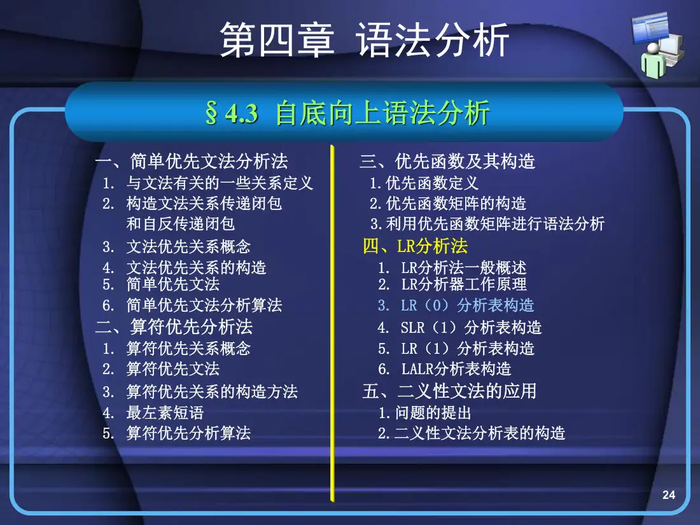

原文：

§ 4.3 自底向上语法分析

一、简单优先文法分析法

1. 与文法有关的一些关系定义

2. 构造文法关系传递闭包和自反传递闭包

3. 文法优先关系概念

4. 文法优先关系的构造

5. 简单优先文法

6. 简单优先文法分析算法

二、算符优先分析法

1. 算符优先关系概念

2. 算符优先文法

3. 算符优先关系的构造方法

4. 最左素短语

5. 算符优先分析算法

三、优先函数及其构造

1. 优先函数定义

2. 优先函数矩阵的构造

3. 利用优先函数矩阵进行语法分析

四、LR分析法

1. LR分析法一般概述

2. LR分析器工作原理

3. LR（0）分析表构造

4. SLR（1）分析表构造

5. LR（1）分析表构造

6. LALR分析表构造

五、二义性文法的应用

1. 问题的提出

2. 二义性文法分析表的构造

第四章 语法分析

24

### 3. LR(0)分析表的构造

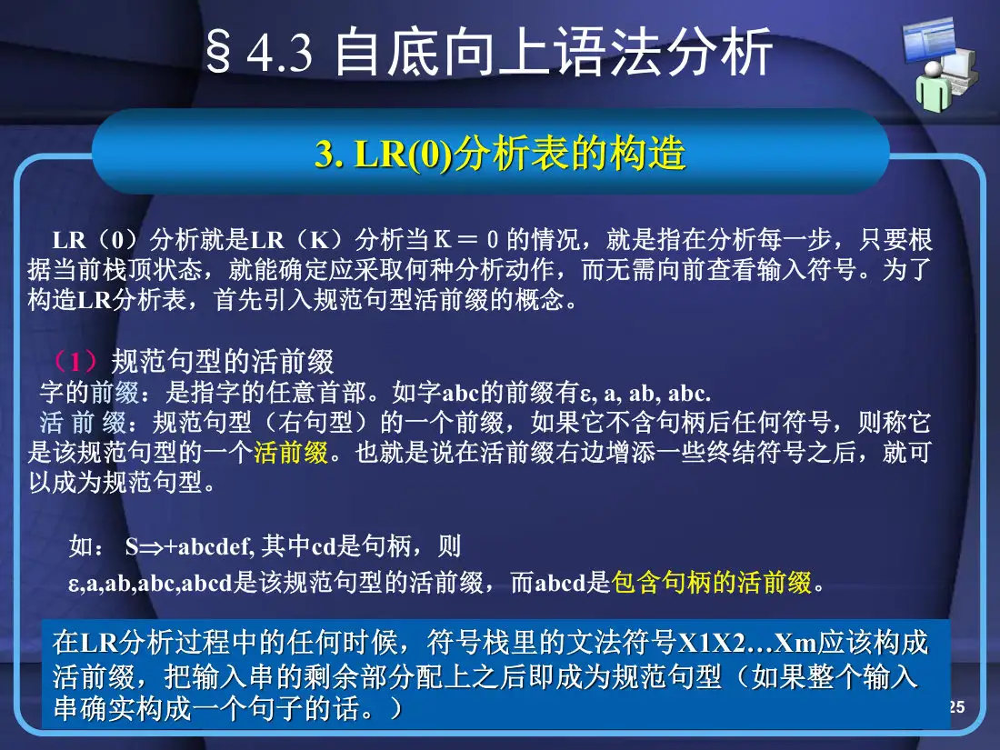

原文：

3. LR(0)分析表的构造

LR（0）分析就是LR（K）分析当 $\mathrm{K} = 0$ 的情况，就是指在分析每一步，只要根据当前栈顶状态，就能确定应采取何种分析动作，而无需向前查看输入符号。为了构造LR分析表，首先引入规范句型活前缀的概念。

(1) 规范句型的活前缀
字的前缀: 是指字的任意首部。如字abc的前缀有ε, a, ab, abc.
活前缀: 规范句型（右句型）的一个前缀，如果它不含句柄后任何符号，则称它是该规范句型的一个活前缀。也就是说在活前缀右边增添一些终结符号之后，就可以成为规范句型。

如： $S \Rightarrow + abcdef,$ 其中cd是句柄，则 $\varepsilon, a, ab, abc, abcd$ 是该规范句型的活前缀，而abcd是包含句柄的活前缀。

在LR分析过程中的任何时候，符号栈里的文法符号X1X2...Xm应该构成活前缀，把输入串的剩余部分配上之后即成为规范句型（如果整个输入串确实构成一个句子的话。）

§ 4.3 自底向上语法分析

25

### 3. LR(0)分析表的构造

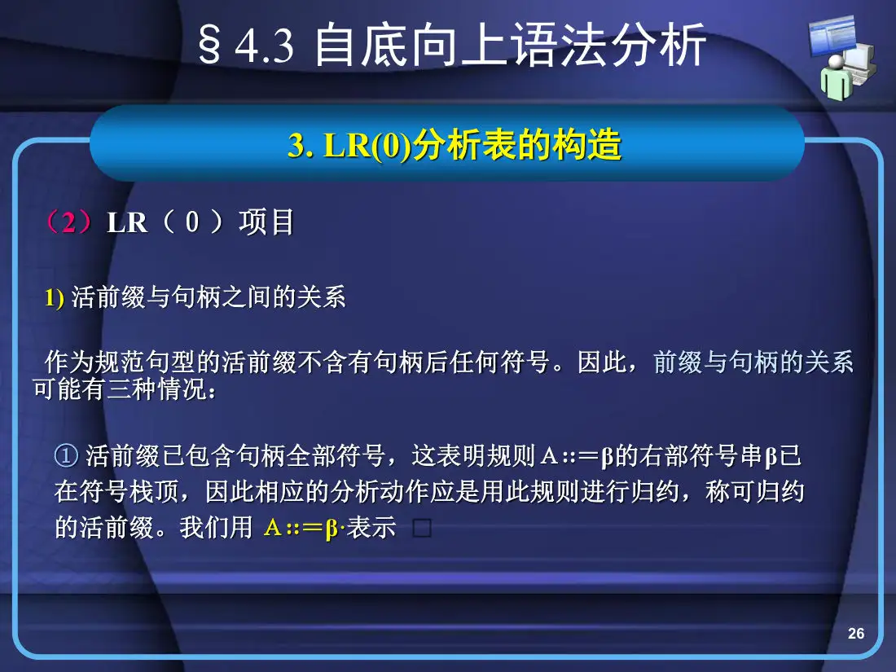

原文：

3. LR(0)分析表的构造

(2) LR (0) 项目

1) 活前缀与句柄之间的关系

作为规范句型的活前缀不含有句柄后任何符号。因此，前缀与句柄的关系可能有三种情况：

① 活前缀已包含句柄全部符号，这表明规则 A::=β 的右部符号串 β 已在符号栈顶，因此相应的分析动作应是用此规则进行归约，称可归约的活前缀。我们用 A::=β·表示 □

§ 4.3 自底向上语法分析

26

### 3. LR(0)分析表的构造

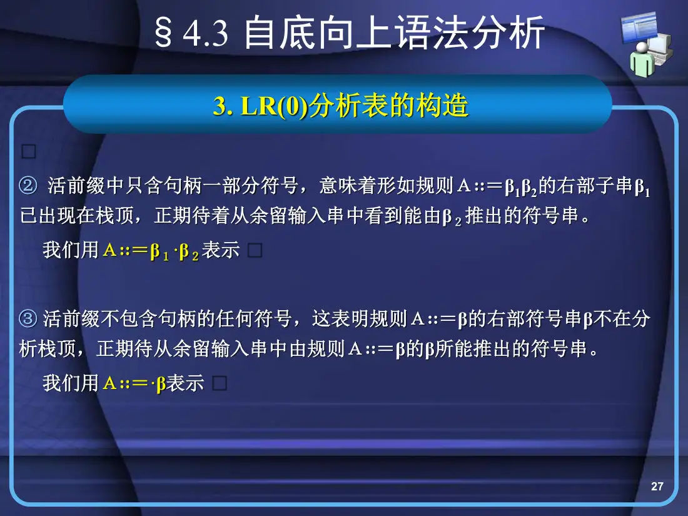

原文：

3. LR(0)分析表的构造

② 活前缀中只含句柄一部分符号，意味着形如规则 A: := $\beta_{1} \beta_{2}$ 的右部子串 $\beta_{1}$ 已出现在栈顶，正期待着从余留输入串中看到能由 $\beta_{2}$ 推出的符号串。

我们用 A::= $\beta_{1} \cdot \beta_{2}$ 表示 □

③ 活前缀不包含句柄的任何符号，这表明规则 A::=β 的右部符号串 β 不在分析栈顶，正期待从余留输入串中由规则 A::=β 的 β 所能推出的符号串。

我们用 A::=·β表示 □

§ 4.3 自底向上语法分析

27

### 2) LR (0) 项目

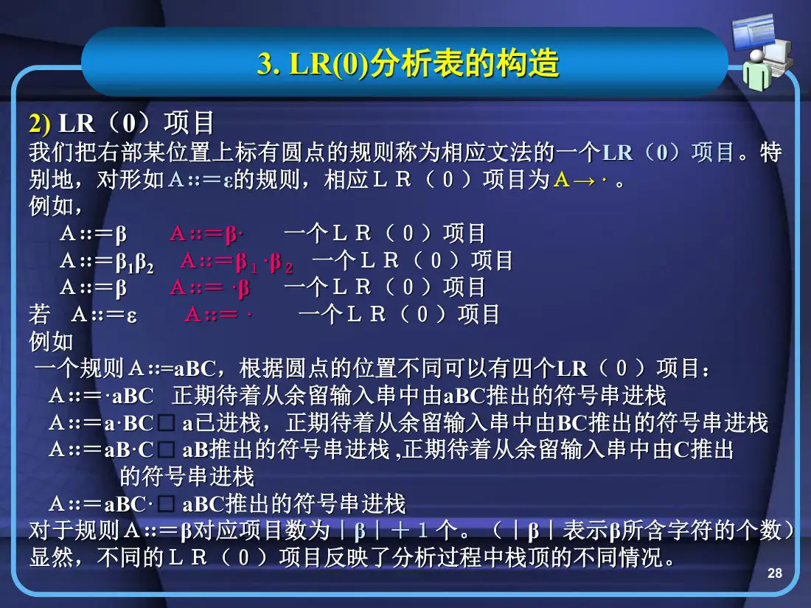

原文：

2) LR (0) 项目

我们把右部某位置上标有圆点的规则称为相应文法的一个LR（0）项目。特别地，对形如A::=ε的规则，相应LR（0）项目为A→·。

$$
A: := \beta
$$

$$
A: := \beta_ {1} \beta_ {2}
$$

$$
A: := \beta
$$

A::=β·一个LR（0）项目
A::=β₁·β₂ 一个LR（0）项目
A::=·β 一个LR（0）项目
A::=· 一个LR（0）项目

例如

一个规则 A::=aBC，根据圆点的位置不同可以有四个LR（0）项目：
A::=·aBC 正期待着从余留输入串中由aBC推出的符号串进栈
A::=a·BC□a已进栈，正期待着从余留输入串中由BC推出的符号串进栈
A::=aB·C□aB推出的符号串进栈,正期待着从余留输入串中由C推出的符号串进栈

A::=aBC·□ aBC推出的符号串进栈

对于规则 A::=β对应项目数为 |β| + 1 个。（|β| 表示β所含字符的个数）

显然，不同的LR（0）项目反映了分析过程中栈顶的不同情况。

3. LR(0)分析表的构造

28

### (3) 构造识别活前缀的有穷自动机(FA)M

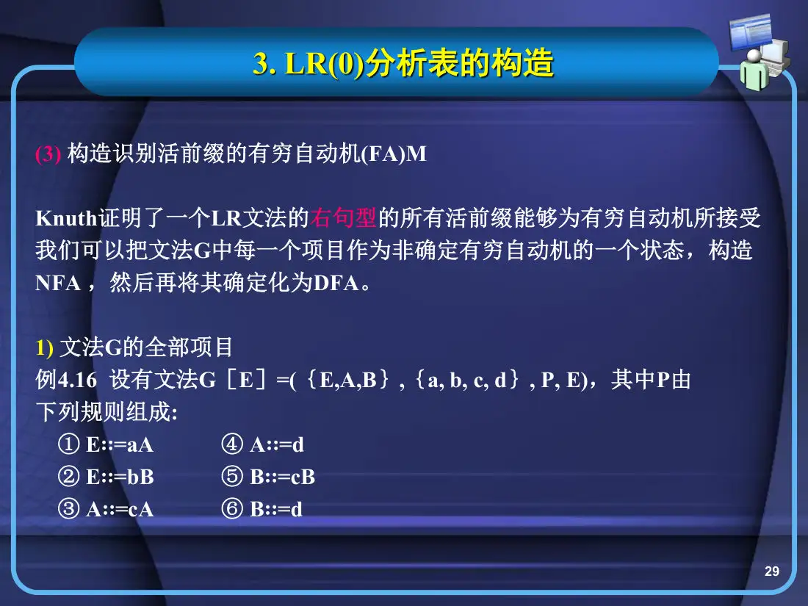

原文：

(3) 构造识别活前缀的有穷自动机(FA)M

Knuth证明了一个LR文法的右句型的所有活前缀能够为有穷自动机所接受我们可以把文法G中每一个项目作为非确定有穷自动机的一个状态，构造NFA，然后再将其确定化为DFA。

1) 文法G的全部项目
例4.16 设有文法G [E] = ( {E, A, B}, {a, b, c, d}, P, E)，其中P由下列规则组成：

① E::=aA

④ A::=d

② E::=bB

⑤ B::=cB

③ A::=cA

⑥ B::=d

3. LR(0)分析表的构造

29

### 0 S'::=E

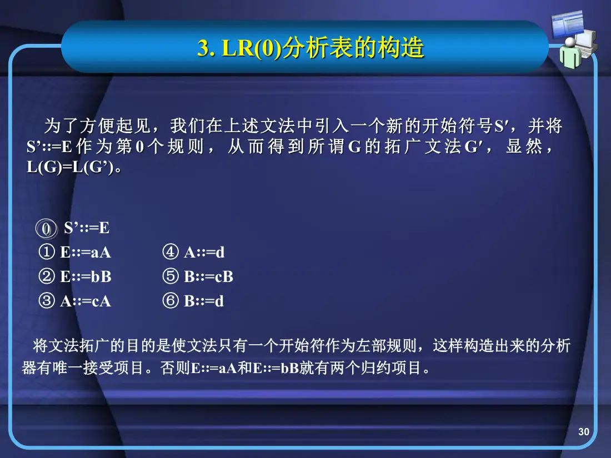

原文：

为了方便起见，我们在上述文法中引入一个新的开始符号S′，并将S′::=E作为第0个规则，从而得到所谓G的拓广文法G′，显然，L(G)=L(G′)。

0 S'::=E

① E::=aA

④ A::=d

② E::=bB

⑤ B::=cB

③ A::=cA

⑥ B::=d

将文法拓广的目的是使文法只有一个开始符作为左部规则，这样构造出来的分析器有唯一接受项目。否则E::=aA和E::=bB就有两个归约项目。

3. LR(0)分析表的构造

30

### 对于文法G',其LR(0)项目有

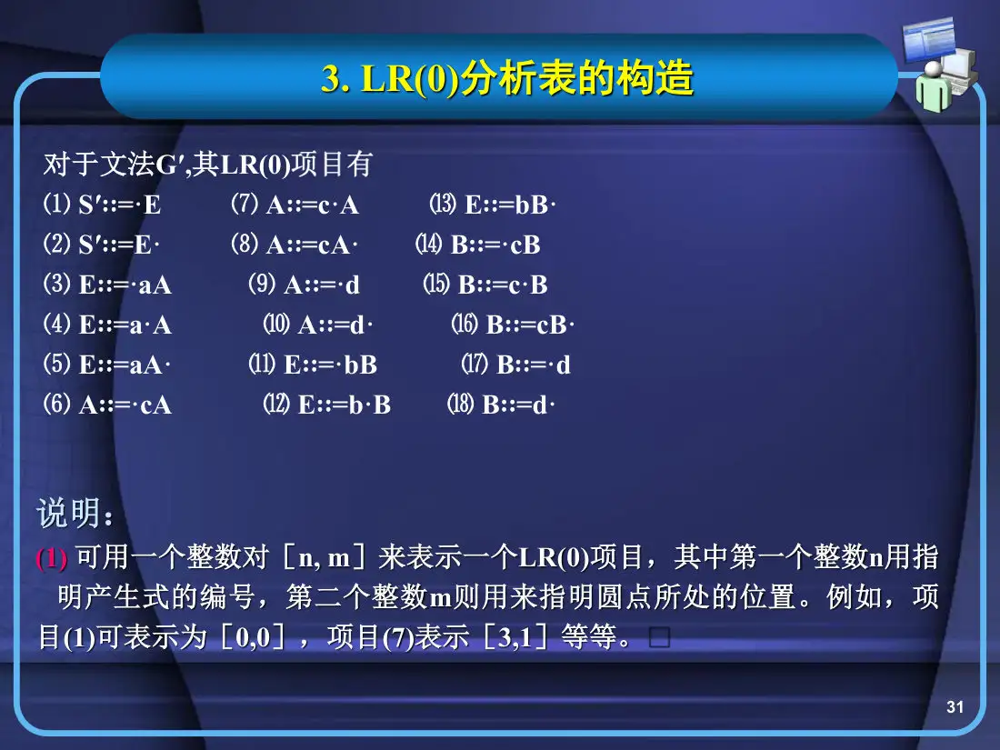

原文：

对于文法G',其LR(0)项目有

(1) $\mathrm{S}^{\prime}::= \cdot \mathrm{E}$

(7) A::=c·A

(13) E::=bB·

(2) $\mathrm{S}^{\prime}::= \mathrm{E}\cdot$

(8) A::=cA·

(14) B::=·cB

(3) E::=·aA

(9) A::=·d

(15) B::=c·B

(4) $\mathbf{E}:\mathbf{:} = \mathbf{a}\cdot \mathbf{A}$

(10) A::=d·

(16) B::=cB·

(5) E::=aA·

(11) E::=·bB

(6) A::=·cA

(12) $\mathbf{E}:\mathbf{:}:=\mathbf{b}\cdot\mathbf{B}$

(17) B::=·d

(18) B::=d·

说明：

(1) 可用一个整数对 $[\mathrm{n}, \mathrm{m}]$ 来表示一个LR(0)项目，其中第一个整数n用指明产生式的编号，第二个整数m则用来指明圆点所处的位置。例如，项目(1)可表示为 $[0, 0]$ ，项目(7)表示 $[3, 1]$ 等等。□

3. LR(0)分析表的构造

31

### (2) 我们可根据它们不同作用, 将一个文法全部LR(0)项目进行分三类。

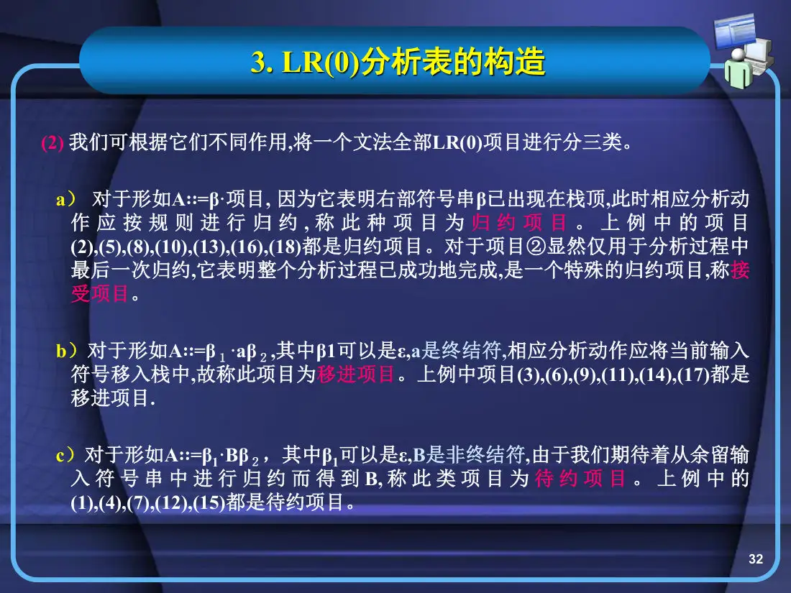

原文：

(2) 我们可根据它们不同作用, 将一个文法全部LR(0)项目进行分三类。

a) 对于形如A::=β·项目,因为它表明右部符号串β已出现在栈顶,此时相应分析动作应按规则进行归约,称此种项目为归约项目。上例中的项目(2),(5),(8),(10),(13),(16),(18)都是归约项目。对于项目②显然仅用于分析过程中最后一次归约,它表明整个分析过程已成功地完成,是一个特殊的归约项目,称接受项目。

b) 对于形如 $\mathrm{A}::=\beta_{1} \cdot \mathrm{a}\beta_{2}$ , 其中 $\beta 1$ 可以是 $\varepsilon, a$ 是终结符, 相应分析动作应将当前输入符号移入栈中, 故称此项目为移进项目。上例中项目(3), (6), (9), (11), (14), (17)都是移进项目.

c) 对于形如 $\mathrm{A}::= \beta_{1} \cdot \mathrm{B}\beta_{2}$ ，其中 $\beta_{1}$ 可以是 $\varepsilon, \mathrm{B}$ 是非终结符，由于我们期待着从余留输入符号串中进行归约而得到 $\mathrm{B}$ ，称此类项目为待约项目。上例中的 (1), (4), (7), (12), (15) 都是待约项目。

3. LR(0)分析表的构造

32

### 2) 构造识别活前缀的NFA

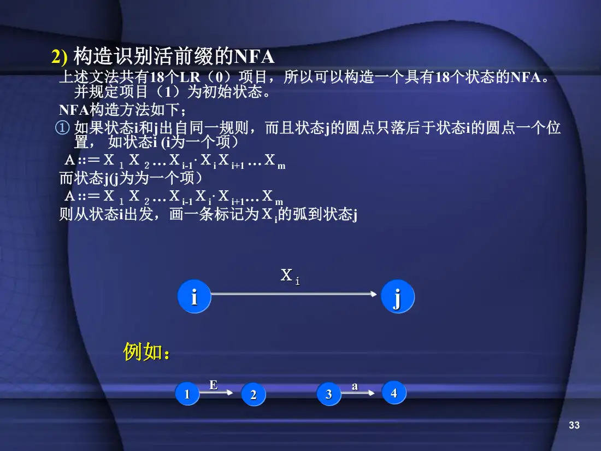

原文：

2) 构造识别活前缀的NFA
上述文法共有18个LR（0）项目，所以可以构造一个具有18个状态的NFA。并规定项目（1）为初始状态。
NFA构造方法如下；
① 如果状态i和j出自同一规则，而且状态j的圆点只落后于状态i的圆点一个位置，如状态i (i为一个项)
A::=X $_{1}$ X $_{2}$ ...X $_{i-1}$ ·X $_{i}$ X $_{i+1}$ ...X $_{m}$ 而状态j(j为为一个项)
A::=X $_{1}$ X $_{2}$ ...X $_{i-1}$ X $_{i}$ ·X $_{i+1}$ ...X $_{m}$ 则从状态i出发，画一条标记为X $_{i}$ 的弧到状态j

例如:

33

### 34

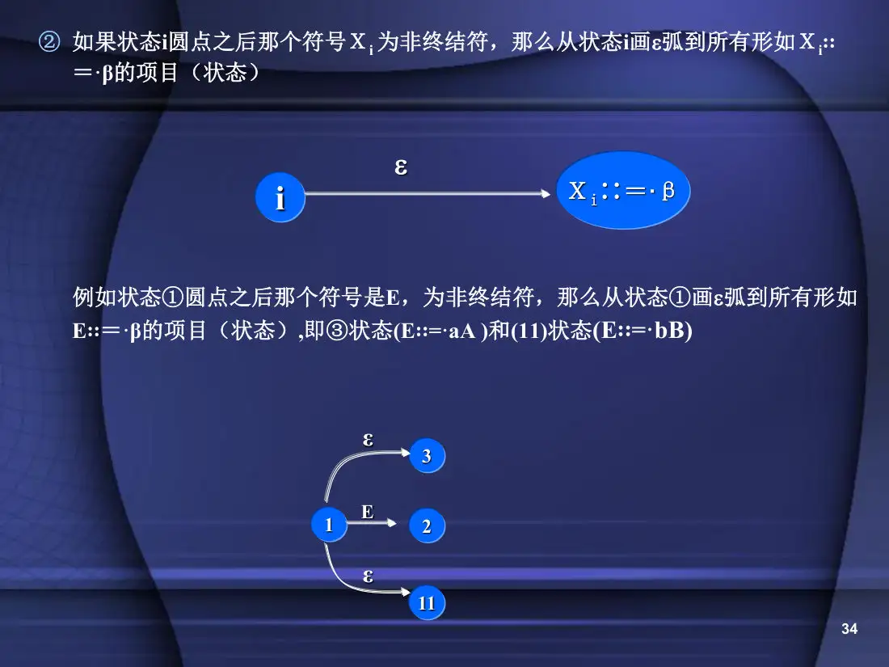

原文：

② 如果状态i圆点之后那个符号 $X_{i}$ 为非终结符, 那么从状态i画 $\varepsilon$ 弧到所有形如 $X_{i}::=\cdot\beta$ 的项目（状态）

例如状态①圆点之后那个符号是E，为非终结符，那么从状态①画ε弧到所有形如E::=·β的项目（状态），即③状态(E::=·aA)和(11)状态(E::=·bB)

34

### 35

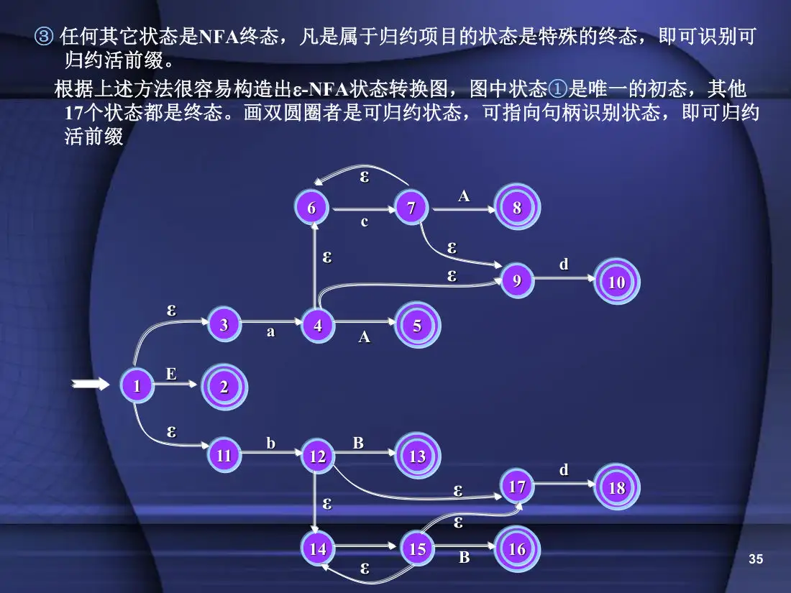

原文：

③ 任何其它状态是NFA终态，凡是属于归约项目的状态是特殊的终态，即可识别可归约活前缀。

根据上述方法很容易构造出ε-NFA状态转换图，图中状态①是唯一的初态，其他17个状态都是终态。画双圆圈者是可归约状态，可指向句柄识别状态，即可归约活前缀

35

### 例如 活前缀bcB

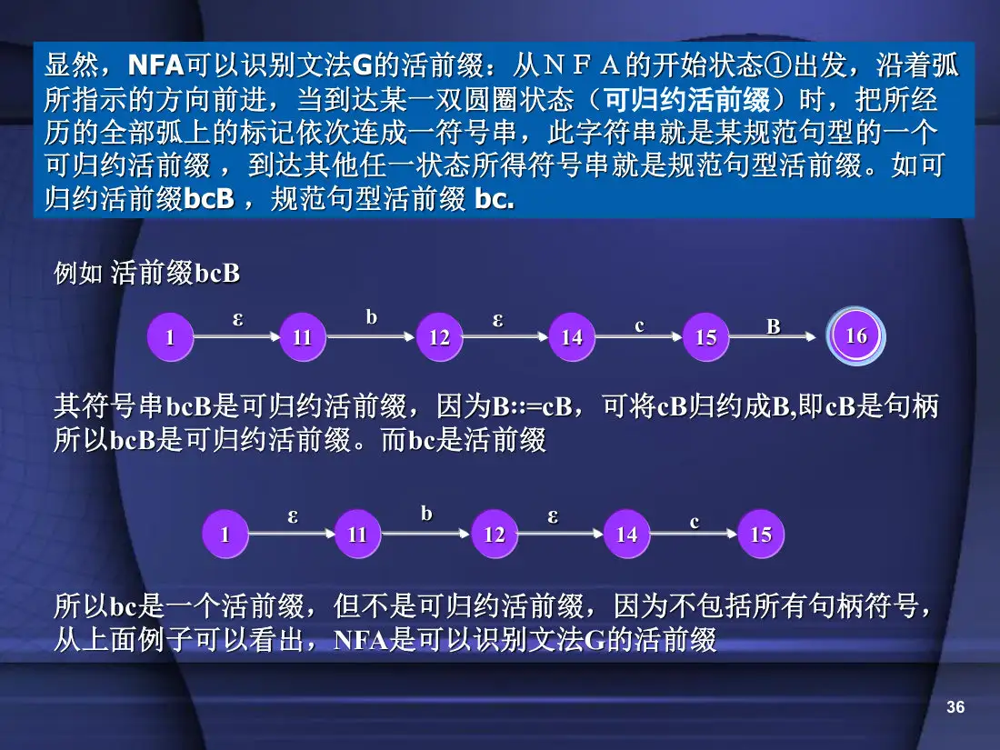

原文：

显然，NFA可以识别文法G的活前缀：从NFA的开始状态①出发，沿着弧所指示的方向前进，当到达某一双圆圈状态（可归约活前缀）时，把所经历的全部弧上的标记依次连成一符号串，此字符串就是某规范句型的一个可归约活前缀，到达其他任一状态所得符号串就是规范句型活前缀。如可归约活前缀bcB，规范句型活前缀bc.

例如 活前缀bcB

其符号串bcB是可归约活前缀，因为B::=cB，可将cB归约成B,即cB是句柄所以bcB是可归约活前缀。而bc是活前缀

所以bc是一个活前缀，但不是可归约活前缀，因为不包括所有句柄符号，从上面例子可以看出，NFA是可以识别文法G的活前缀

36

### 3) 将NFA确定化为DFA

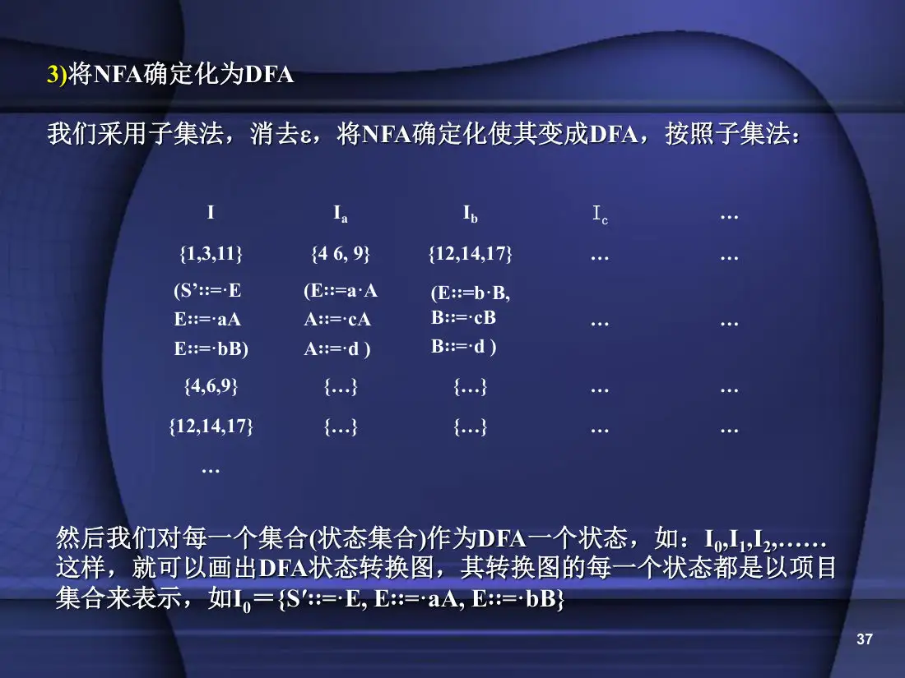

原文：

3) 将NFA确定化为DFA

我们采用子集法，消去ε，将NFA确定化使其变成DFA，按照子集法：

$$
\mathrm{I} _ {\mathrm{a}}
$$

$$
\mathrm{I} _ {\mathrm{b}}
$$

$$
I _ {c}
$$

$$
\{1, 3, 1 1 \}
$$

$$
\{4 6, 9 \}
$$

$$
\{1 2, 1 4, 1 7 \}
$$

$$
(\mathrm{S} ^ {\prime}: := \cdot \mathrm{E}
$$

$$
(\mathbf {E}: := \mathbf {a} \cdot \mathbf {A}
$$

$$
(\mathbf {E}: := \mathbf {b} \cdot \mathbf {B},
$$

$$
\mathrm{E}: := \cdot \mathrm{aA}
$$

$$
\mathrm{A}: := \cdot \mathrm{cA}
$$

$$
\mathrm{B}: := \cdot \mathrm{cB}
$$

$$
\mathrm{E}: := \cdot \mathrm{bB})
$$

$$
\mathrm{A}: := \cdot \mathrm{d})
$$

$$
\mathrm{B}: := \cdot \mathrm{d})
$$

$$
\{4, 6, 9 \}
$$

$$
\{\dots \}
$$

$$
\{\dots \}
$$

$$
\{1 2, 1 4, 1 7 \}
$$

$$
\{\dots \}
$$

$$
\{\dots \}
$$

然后我们对每一个集合(状态集合)作为DFA一个状态，如： $I_{0},I_{1},I_{2},\ldots$ 这样，就可以画出DFA状态转换图，其转换图的每一个状态都是以项目集合来表示，如 $I_{0}=\{S^{\prime}:=\cdot E,E::=\cdot aA,E::=\cdot bB\}$

37

### $$

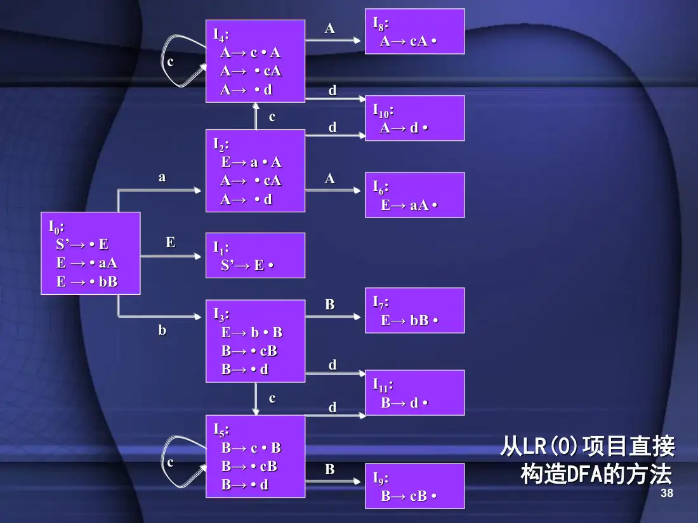

原文：

$$
\begin{array}{c}\mathrm {I_ {0} :}\\\mathrm {S^ {\prime} \rightarrow\bullet E}\\\mathrm {E\rightarrow\bullet aA}\\\mathrm {E\rightarrow\bullet bB}\end{array}
$$

$$
\begin{array}{c} \mathrm{I} _ {4}: \\ \mathrm{A} \to \mathrm{c} \cdot \mathrm{A} \\ \mathrm{A} \to \cdot \mathrm{cA} \\ \mathrm{A} \to \cdot \mathrm{d} \end{array}
$$

$$
\begin{array}{l}\mathrm{I} _ {2}:\\\mathrm{E} \rightarrow \mathrm{a} \cdot \mathrm{A}\\\mathrm{A} \rightarrow \cdot \mathrm{cA}\\\mathrm{A} \rightarrow \cdot \mathrm{d}\end{array}
$$

E

$$
\begin{array}{c}\mathrm{I} _ {1}:\\\mathrm{S} ^ {\prime} \rightarrow \mathrm{E} \cdot\end{array}
$$

b

$$
\begin{array}{l}\mathrm{I} _ {3}:\\\mathrm {\bf E} \rightarrow \mathrm {\bf b} \cdot \mathrm {\bf B}\\\mathrm {\bf B} \rightarrow \cdot \mathrm {\bf cB}\\\mathrm {\bf B} \rightarrow \cdot \mathrm {\bf d}\end{array}
$$

$$
\begin{array}{c}\mathrm{I} _ {8}:\\\mathrm{A} \rightarrow \mathrm{cA} \bullet\end{array}
$$

$$
\begin{array}{c}\mathrm{I} _ {1 0}:\\\mathrm{A} \rightarrow \mathrm{d} \cdot\end{array}
$$

$$
\begin{array}{c}\mathrm{I} _ {6}:\\\mathrm{E} \rightarrow \mathrm{aA} \cdot\end{array}
$$

$$
\begin{array}{c}\mathrm{I} _ {7}:\\\mathrm{E} \rightarrow \mathrm{bB} \cdot\end{array}
$$

$$
\begin{array}{c}\mathrm{I} _ {5}:\\\mathrm{B} \rightarrow \mathrm{c} \cdot \mathrm{B}\\\mathrm{B} \rightarrow \cdot \mathrm{cB}\\\mathrm{B} \rightarrow \cdot \mathrm{d}\end{array}
$$

$$
\begin{array}{c} \mathrm{I} _ {1 1}: \\ \mathrm{B} \to \mathrm{d} \bullet \end{array}
$$

B

$$
\begin{array}{c}\mathrm{I} _ {9}:\\\mathrm{B} \rightarrow \mathrm{cB} \cdot\end{array}
$$

从LR(0)项目直接构造DFA的方法

38

### 4) DFA 中状态及转换函数与文法项目之间的关系

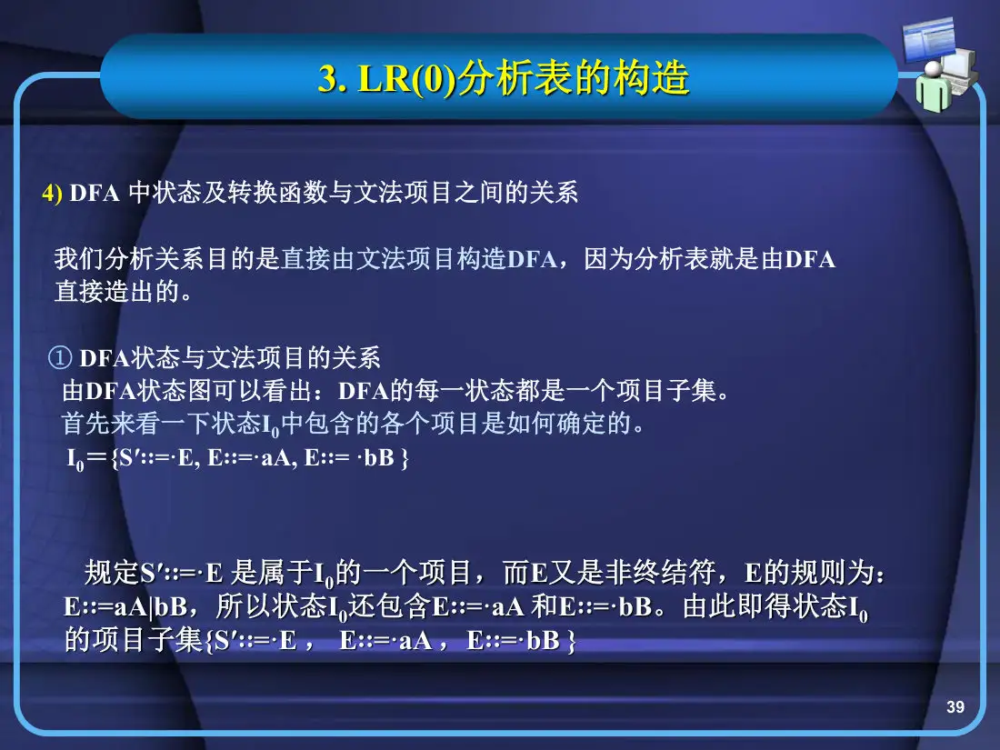

原文：

4) DFA 中状态及转换函数与文法项目之间的关系

我们分析关系目的是直接由文法项目构造DFA，因为分析表就是由DFA直接造出的。

① DFA状态与文法项目的关系
由DFA状态图可以看出：DFA的每一状态都是一个项目子集。首先来看一下状态 $I_{0}$ 中包含的各个项目是如何确定的。 $I_{0}=\{S'::=·E, E::=·aA, E::=·bB\}$

规定S'::=·E 是属于I₀的一个项目，而E又是非终结符，E的规则为：E::=aA|bB，所以状态I₀还包含E::=·aA 和E::=·bB。由此即得状态I₀的项目子集{S'::=·E，E::=·aA，E::=·bB}

3. LR(0)分析表的构造

39

### 3. LR(0)分析表的构造

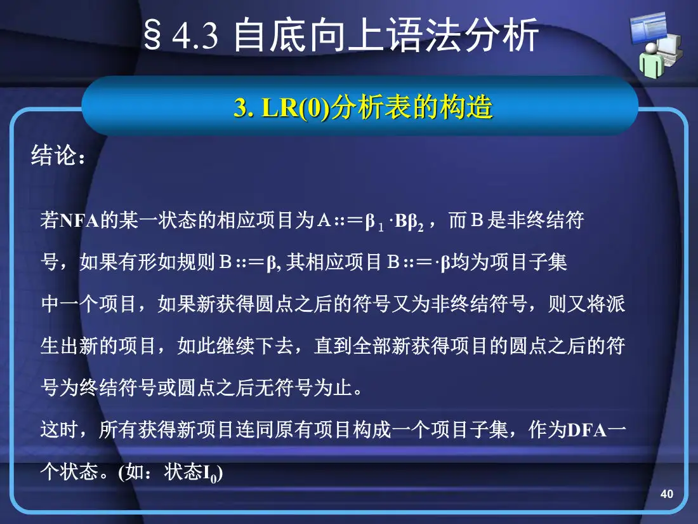

原文：

3. LR(0)分析表的构造

结论:

若NFA的某一状态的相应项目为 $A::= \beta_{1} \cdot B \beta_{2}$ ，而B是非终结符号，如果有形如规则 $B::= \beta$ ，其相应项目 $B::= \cdot \beta$ 均为项目子集中一个项目，如果新获得圆点之后的符号又为非终结符号，则又将派生出新的项目，如此继续下去，直到全部新获得项目的圆点之后的符号为终结符号或圆点之后无符号为止。

这时, 所有获得新项目连同原有项目构成一个项目子集, 作为DFA一个状态。(如: 状态 $\mathrm{I}_{0}$ )

§ 4.3 自底向上语法分析

40

### 3. LR(0)分析表的构造

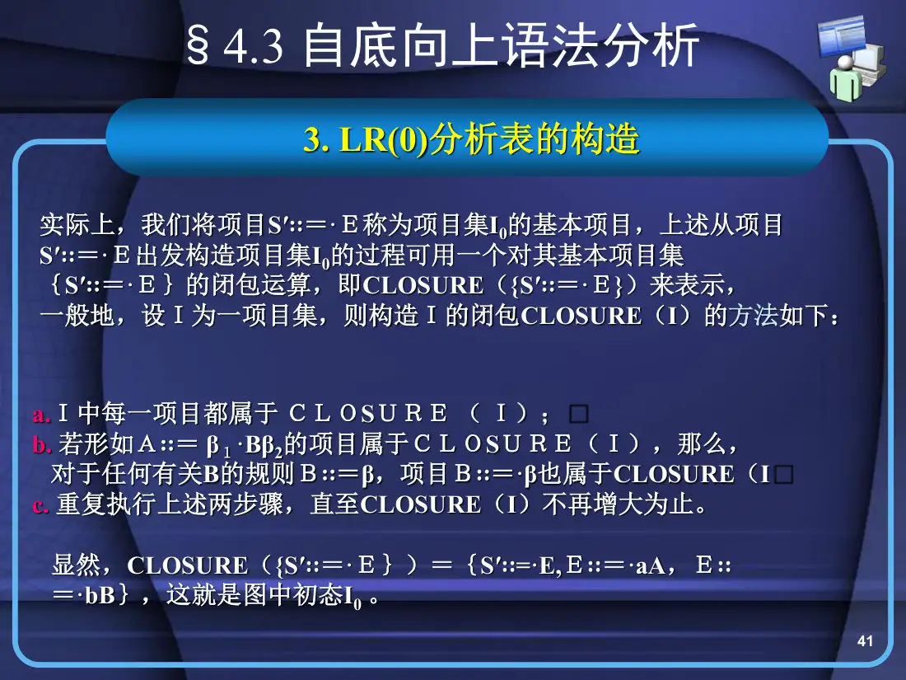

原文：

3. LR(0)分析表的构造

实际上，我们将项目S'::=·E称为项目集I₀的基本项目，上述从项目S'::=·E出发构造项目集I₀的过程可用一个对其基本项目集{S'::=·E}的闭包运算，即CLOSURE（{S'::=·E})来表示，一般地，设I为一项目集，则构造I的闭包CLOSURE（I）的方法如下：

a. I 中每一项目都属于 CLOSURE（I）；□
b. 若形如 A::= β₁·Bβ₂ 的项目属于 CLOSURE（I），那么，对于任何有关 B 的规则 B::= β，项目 B::= ·β 也属于 CLOSURE（I）
c. 重复执行上述两步骤，直至 CLOSURE（I）不再增大为止。

显然，CLOSURE（{S'::=·E}）= {S'::=·E, E::=·aA, E::=·bB}，这就是图中初态I₀。

§ 4.3 自底向上语法分析

41

### ② DFA转换函数与文法项目的关系（即从一个状态到另一个状态弧上标记）

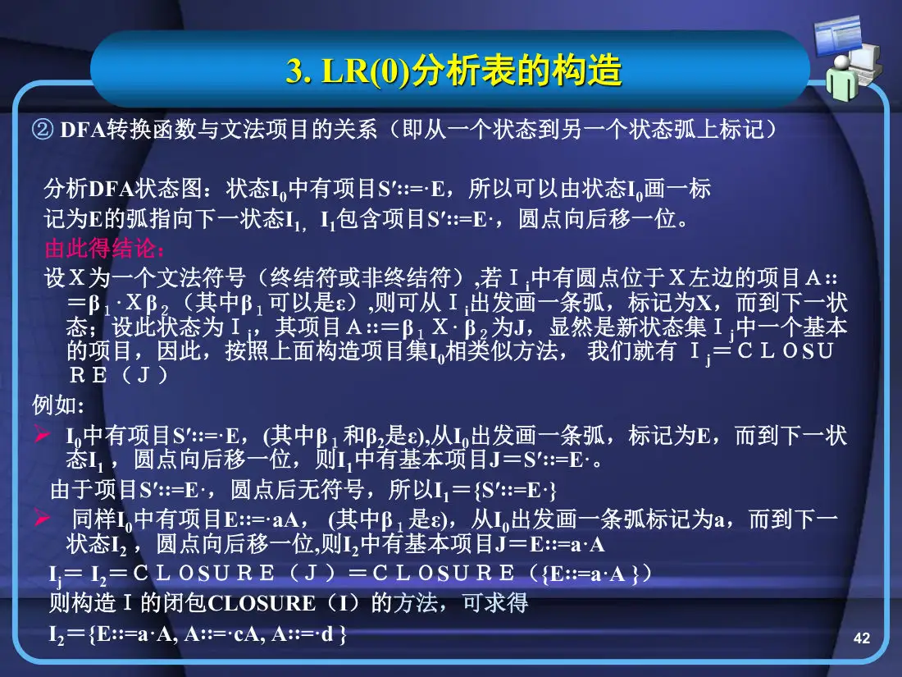

原文：

② DFA转换函数与文法项目的关系（即从一个状态到另一个状态弧上标记）

分析DFA状态图：状态 $I_{0}$ 中有项目 $S^{\prime}:=\cdot E$ ，所以可以由状态 $I_{0}$ 画一标记为E的弧指向下一状态 $I_{1}$ ， $I_{1}$ 包含项目 $S^{\prime}:=E\cdot$ ，圆点向后移一位。

设X为一个文法符号（终结符或非终结符），若 $I_{i}$ 中有圆点位于X左边的项目A::= $\beta_{1}\cdot X\beta_{2}$ （其中 $\beta_{1}$ 可以是ε），则可从 $I_{i}$ 出发画一条弧，标记为X，而到下一状态；设此状态为 $I_{i}$ ，其项目A::= $\beta_{1}X\cdot\beta_{2}$ 为J，显然是新状态集 $I_{j}$ 中一个基本的项目，因此，按照上面构造项目集 $I_{0}$ 相类似方法，我们就有 $I_{j}=CLOSURE(J)$

I₀中有项目S'::=·E，(其中β₁和β₂是ε)，从I₀出发画一条弧，标记为E，而到下一状态I₁，圆点向后移一位，则I₁中有基本项目J=S'::=E·。

由于项目S'::=E·，圆点后无符号，所以I₁={S'::=E·}

同样I₀中有项目E::=·aA，(其中β₁是ε)，从I₀出发画一条弧标记为a，而到下一状态I₂，圆点向后移一位，则I₂中有基本项目J=E::=a·A

Iⱼ = I₂ = C L O S U R E (J) = C L O S U R E ( {E::=a·A})

则构造Ⅰ的闭包CLOSURE（Ⅰ）的方法，可求得

I₂ = {E::=a·A, A::=·cA, A::=·d}

3. LR(0)分析表的构造

42

### 3. LR(0)分析表的构造

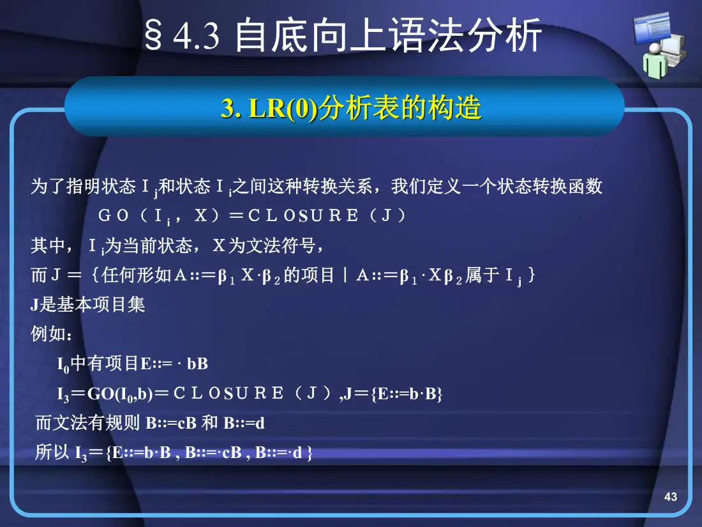

原文：

3. LR(0)分析表的构造

为了指明状态 $I_j$ 和状态 $I_i$ 之间这种转换关系，我们定义一个状态转换函数 $G O (I_i, X) = C L O S U R E (J)$

其中， $I_{i}$ 为当前状态，X为文法符号，而 $J = \{\text{任何形如} A::= \beta_{1} X \cdot \beta_{2}$ 的项目 | $A::= \beta_{1} \cdot X \beta_{2}$ 属于 $I_{j}\}$ J是基本项目集

例如:

$I_{0}$ 中有项目E::=·bB $I_{3}=GO(I_{0},b)=CLOSURE(J),J=\{E::=b\cdot B\}$ 而文法有规则 B::=cB 和 B::=d
所以 $I_{3}=\{E::=b\cdot B,B::=cB,B::=d\}$

§ 4.3 自底向上语法分析

43

### 3. LR(0)分析表的构造

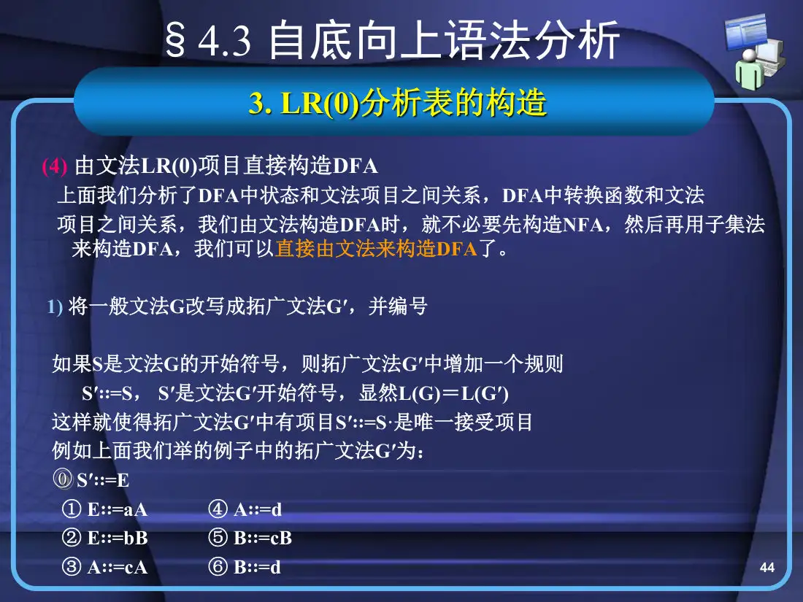

原文：

3. LR(0)分析表的构造

(4) 由文法LR(0)项目直接构造DFA
上面我们分析了DFA中状态和文法项目之间关系，DFA中转换函数和文法项目之间关系，我们由文法构造DFA时，就不必要先构造NFA，然后再用子集法来构造DFA，我们可以直接由文法来构造DFA了。

1) 将一般文法G改写成拓广文法G', 并编号

如果S是文法G的开始符号，则拓广文法G'中增加一个规则
S'::=S，S'是文法G'开始符号，显然L(G)=L(G')
这样就使得拓广文法G'中有项目S'::=S·是唯一接受项目
例如上面我们举的例子中的拓广文法G'为：

⑩ S'::=E

① E::=aA

④ A::=d

② E::=bB

⑤ B::=cB

③ A::=cA

⑥ B::=d

§ 4.3 自底向上语法分析

44

### 3. LR(0)分析表的构造

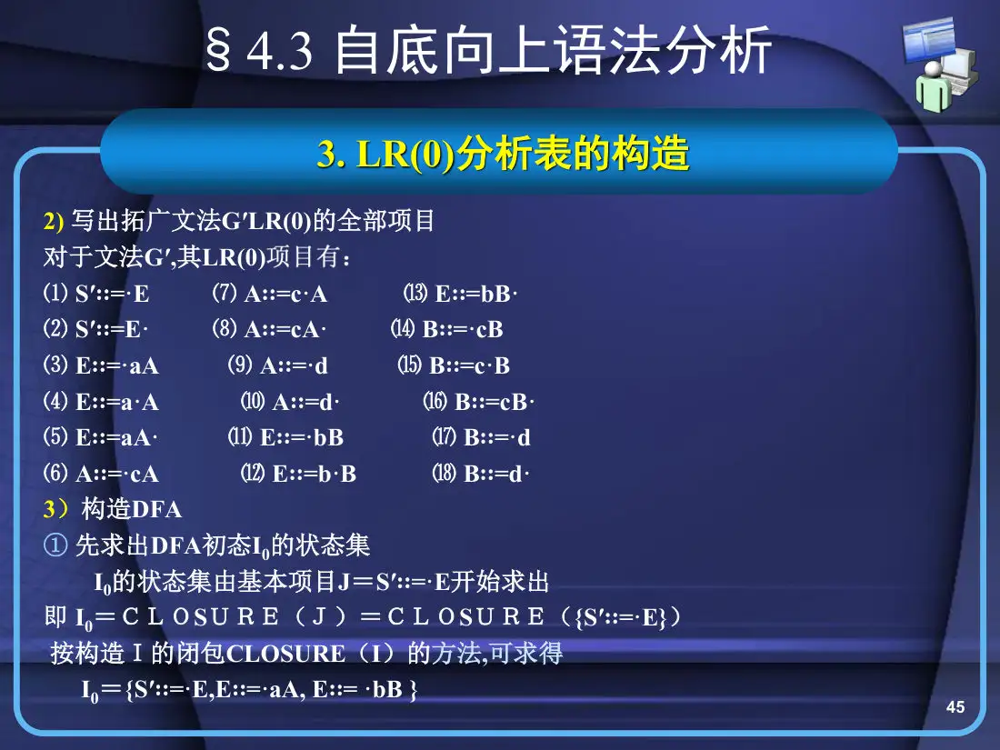

原文：

3. LR(0)分析表的构造

2) 写出拓广文法G'LR(0)的全部项目对于文法G',其LR(0)项目有:

(1) $\mathrm{S}^{\prime}::= \cdot \mathrm{E}$

(7) A::=c·A

(13) E::=bB·

(2) $\mathrm{S}^{\prime}::= \mathrm{E}\cdot$

(8) A::=cA·

(14) B::=·cB

(3) E::=·aA

(9) A::=·d

(15) B::=c·B

(4) $\mathbf{E}:\mathbf{:} = \mathbf{a}\cdot \mathbf{A}$

(10) A::=d·

(16) B::=cB·

(5) E::=aA·

(11) E::=·bB

(17) B::=·d

(6) A::=·cA

(12) E::=b·B

(18) B::=d·

3）构造DFA

① 先求出DFA初态I₀的状态集
I₀的状态集由基本项目J=S'::=·E开始求出
即 I₀=CLOSURE (J) = CLOSURE ({S'::=·E})

按构造 I 的闭包 CLOSURE（I）的方法,可求得

$\mathrm{I}_0 = \{\mathrm{S}': := \cdot \mathrm{E}, \mathrm{E}:: := \cdot \mathrm{aA}, \mathrm{E}:: := \cdot \mathrm{bB}\}$

§ 4.3 自底向上语法分析

45

### ② 由初态I₀构造其他状态I₁，I₂，I₃，…… I₁₁

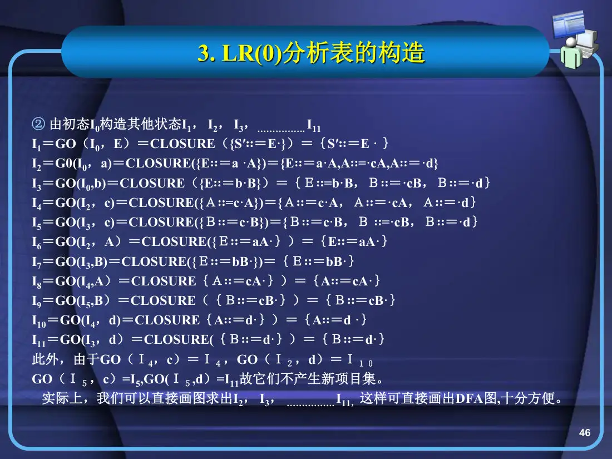

原文：

② 由初态I₀构造其他状态I₁，I₂，I₃，…… I₁₁
I₁=GO (I₀, E) = CLOSURE ( {S'::=E·}) = {S'::=E·}
I₂=G0(I₀, a)=CLOSURE( {E::=a·A})={E::=a·A,A::=·cA,A::=·d}
I₃=GO(I₀,b)=CLOSURE ( {E::=b·B}) = {E::=b·B, B::=·cB, B::=·d}
I₄=GO(I₂, c)=CLOSURE( {A::=c·A})={A::=c·A, A::=·cA, A::=·d}
I₅=GO(I₃, c)=CLOSURE( {B::=c·B})={B::=c·B, B::=·cB, B::=·d}
I₆=GO(I₂, A) = CLOSURE( {E::=aA·}) = {E::=aA·}
I₇=GO(I₃,B)=CLOSURE( {E::=bB·})={E::=bB·}
I₈=GO(I₄,A) = CLOSURE {A::=cA·})={A::=cA·}
I₉=GO(I₅,B) = CLOSURE ( {B::=cB·})={B::=cB·}
I₁₀=GO(I₄, d)=CLOSURE {A::=d·})={A::=d·}
I₁₁=GO(I₃, d) = CLOSURE( {B::=d·})={B::=d·}
此外，由于GO (I₄, c) = I₄，GO (I₂, d) = I₁₀
GO (I₅, c) = I₅, GO(I₅,d) = I₁₁ 故它们不产生新项目集。
实际上，我们可以直接画图求出I₂，I₃，…… I₁₁，这样可直接画出DFA图，十分方便

3. LR(0)分析表的构造

46

### 47

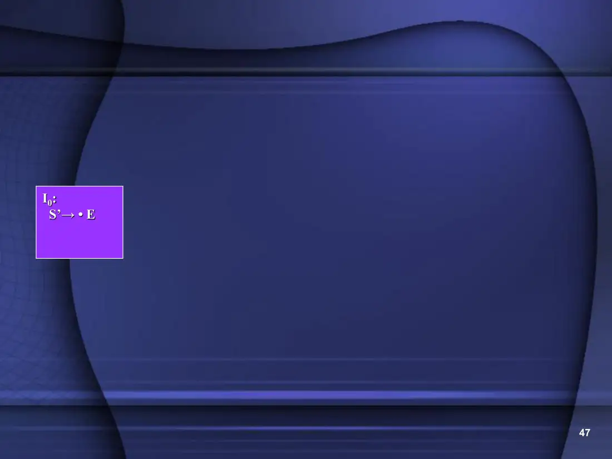

原文：

$\mathrm{I_0}$ : $\mathrm{S}^{\prime}\rightarrow \cdot \mathrm{E}$

47

### 48

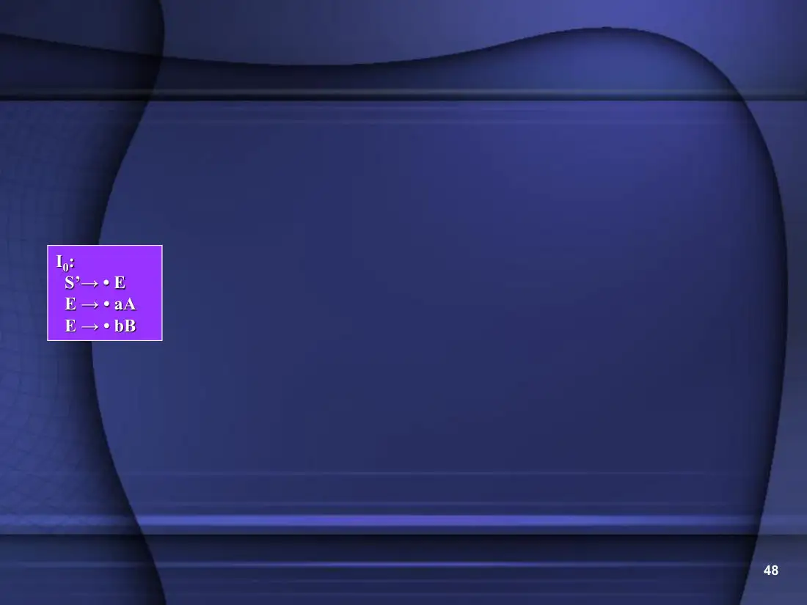

原文：

$\begin{array}{l}\mathrm{I}_{0}:\quad \\ \mathrm{S}^{\prime}\rightarrow \bullet \mathrm{E}\\ \mathrm{E}\rightarrow \bullet \mathrm{aA}\\ \mathrm{E}\rightarrow \bullet \mathrm{bB} \end{array}$ $\begin{array}{l}\mathrm{I}_{0}:\quad \\ \mathrm{S}^{\prime}\rightarrow \bullet \mathrm{E}\\ \mathrm{E}\rightarrow \bullet \mathrm{aA}\\ \mathrm{E}\rightarrow \bullet \mathrm{bB} \end{array}$

48

### 49

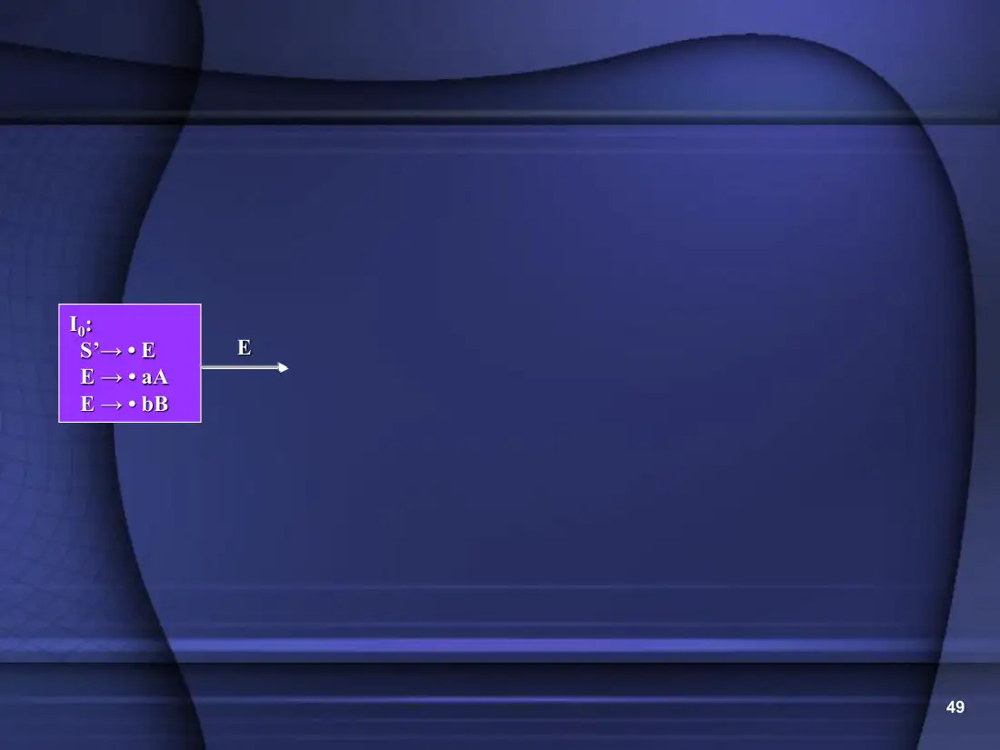

原文：

49

### 50

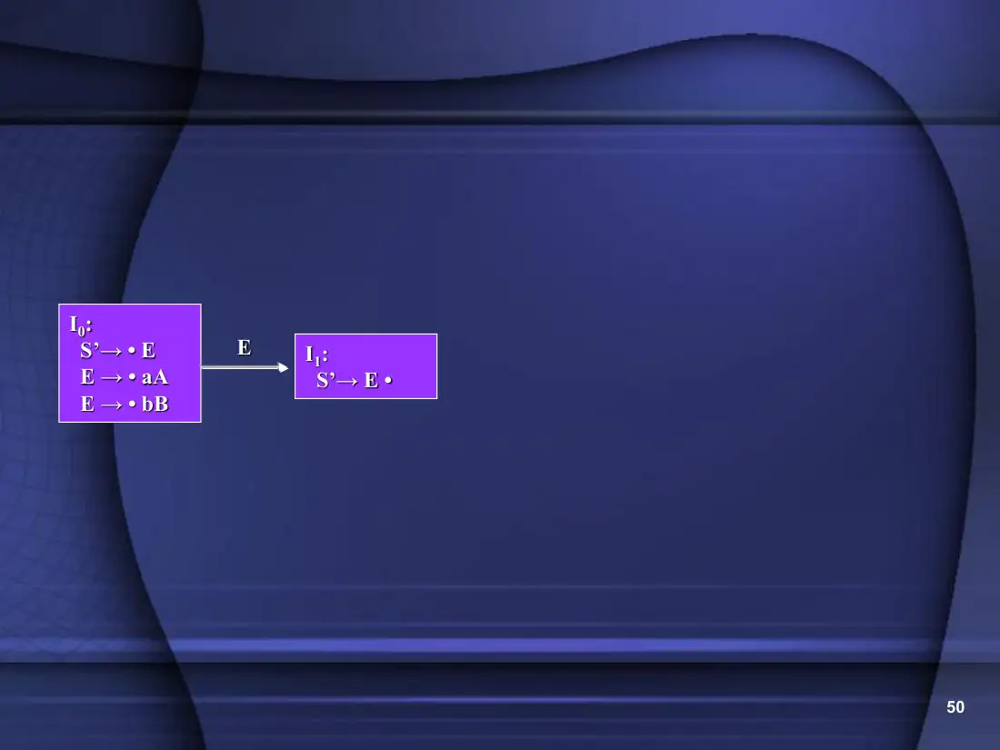

原文：

E

$\mathrm{I}_{1}$ : $\mathrm{S}^{\prime}\rightarrow \mathrm{E}\cdot$

50

### 51

原文：

$\begin{array}{l}\mathrm{I}_{0}:\quad \\ \mathrm{S}^{\prime}\rightarrow \bullet \mathrm{E}\\ \mathrm{E}\rightarrow \bullet \mathrm{aA}\\ \mathrm{E}\rightarrow \bullet \mathrm{bB} \end{array}$

E

51

### $$

原文：

$$
\begin{array}{c}\mathrm{I} _ {0}:\\\mathrm{S} ^ {\prime} \rightarrow \bullet \mathrm{E}\\\mathrm{E} \rightarrow \bullet \mathrm{aA}\\\mathrm{E} \rightarrow \bullet \mathrm{bB}\end{array}
$$

a

E

$\mathrm{I}_{2}$ : $\mathrm{E}\rightarrow \mathrm{a}\cdot \mathrm{A}$

$\mathrm{I}_{1}$ : $\mathrm{S}^{\prime}\rightarrow \mathrm{E}\cdot$

52

### $$

原文：

a

$$
\begin{array}{c}\mathrm{I} _ {0}:\\\mathrm{S} ^ {\prime} \rightarrow \bullet \mathrm{E}\\\mathrm{E} \rightarrow \bullet \mathrm{aA}\\\mathrm{E} \rightarrow \bullet \mathrm{bB}\end{array}
$$

E

$$
\begin{array}{c}\mathrm{I} _ {2}:\\\mathrm{E} \rightarrow \mathrm{a} \cdot \mathrm{A}\\\mathrm{A} \rightarrow \cdot \mathrm{cA}\\\mathrm{A} \rightarrow \cdot \mathrm{d}\end{array}
$$

$$
\begin{array}{c} \mathrm{I} _ {1}: \\ \mathrm{S} ^ {\prime} \to \mathrm{E} \cdot \end{array}
$$

53

### $$

原文：

$$
\begin{array}{c} \mathrm {I_ {0}} \colon \\ \mathrm {S^ {\prime} \to\bullet E} \\ \mathrm {E\to\bullet aA} \\ \mathrm {E\to\bullet bB} \end{array}
$$

E

$$
\begin{array}{l}\mathrm{I} _ {2}:\\\mathrm{E} \rightarrow \mathrm{a} \cdot \mathrm{A}\\\mathrm{A} \rightarrow \cdot \mathrm{cA}\\\mathrm{A} \rightarrow \cdot \mathrm{d}\end{array}
$$

$$
\begin{array}{c}\mathrm{I} _ {1}:\\\mathrm{S} ^ {\prime} \rightarrow \mathrm{E} \cdot\end{array}
$$

b

54

### $$

原文：

$$
\begin{array}{c}\mathrm{I} _ {0}:\\\mathrm{S} ^ {\prime} \rightarrow \bullet \mathrm{E}\\\mathrm{E} \rightarrow \bullet \mathrm{aA}\\\mathrm{E} \rightarrow \bullet \mathrm{bB}\end{array}
$$

$$
\begin{array}{c}\mathrm{I} _ {2}:\\\mathrm{E} \rightarrow \mathrm{a} \cdot \mathrm{A}\\\mathrm{A} \rightarrow \cdot \mathrm{cA}\\\mathrm{A} \rightarrow \cdot \mathrm{d}\end{array}
$$

E

$$
\begin{array}{c} \mathrm{I} _ {1}: \\ \mathrm{S} ^ {\prime} \to \mathrm{E} \cdot \end{array}
$$

b

$$
\begin{array}{c} \mathrm{I} _ {3}: \\ \mathrm{E} \to \mathrm{b} \cdot \mathrm{B} \end{array}
$$

55

### $$

原文：

$$
\begin{array}{c}\mathrm{I} _ {0}:\\\mathrm{S} ^ {\prime} \rightarrow \bullet \mathrm{E}\\\mathrm{E} \rightarrow \bullet \mathrm{aA}\\\mathrm{E} \rightarrow \bullet \mathrm{bB}\end{array}
$$

a

$$
\begin{array}{c}\mathrm{I} _ {2}:\\\mathrm{E} \rightarrow \mathrm{a} \cdot \mathrm{A}\\\mathrm{A} \rightarrow \cdot \mathrm{cA}\\\mathrm{A} \rightarrow \cdot \mathrm{d}\end{array}
$$

E

$$
\begin{array}{c}\mathrm{I} _ {1}:\\\mathrm{S} ^ {\prime} \rightarrow \mathrm{E} \cdot\end{array}
$$

b

$$
\begin{array}{l}\mathrm{I} _ {3}:\\\mathrm{E} \rightarrow \mathrm{b} \bullet \mathrm{B}\\\mathrm{B} \rightarrow \bullet \mathrm{cB}\\\mathrm{B} \rightarrow \bullet \mathrm{d}\end{array}
$$

56

### $$

原文：

$$
\begin{array}{c}\mathrm{I} _ {0}:\\\mathrm{S} ^ {\prime} \rightarrow \bullet \mathrm{E}\\\mathrm{E} \rightarrow \bullet \mathrm{aA}\\\mathrm{E} \rightarrow \bullet \mathrm{bB}\end{array}
$$

a

E

c

$$
\begin{array}{l}\mathrm{I} _ {2}:\\\mathrm{E} \rightarrow \mathrm{a} \cdot \mathrm{A}\\\mathrm{A} \rightarrow \cdot \mathrm{cA}\\\mathrm{A} \rightarrow \cdot \mathrm{d}\end{array}
$$

$$
\begin{array}{c}\mathrm{I} _ {1}:\\\mathrm{S} ^ {\prime} \rightarrow \mathrm{E} \cdot\end{array}
$$

b

$$
\begin{array}{l}\mathrm{I} _ {3}:\\\mathrm {\bf E} \rightarrow \mathrm {\bf b} \cdot \mathrm {\bf B}\\\mathrm {\bf B} \rightarrow \cdot \mathrm {\bf cB}\\\mathrm {\bf B} \rightarrow \cdot \mathrm {\bf d}\end{array}
$$

57

### $$

原文：

$$
\begin{array}{c}\mathrm{I} _ {0}:\\\mathrm{S} ^ {\prime} \rightarrow \bullet \mathrm{E}\\\mathrm{E} \rightarrow \bullet \mathrm{aA}\\\mathrm{E} \rightarrow \bullet \mathrm{bB}\end{array}
$$

a

E

b

$$
\begin{array}{c} \mathrm{I} _ {4}: \\ \mathrm{A} \to \mathfrak {c} \cdot \mathrm{A} \end{array}
$$

c

$$
\begin{array}{l}\mathrm{I} _ {2}:\\\mathrm{E} \rightarrow \mathrm{a} \cdot \mathrm{A}\\\mathrm{A} \rightarrow \cdot \mathrm{cA}\\\mathrm{A} \rightarrow \cdot \mathrm{d}\end{array}
$$

$$
\begin{array}{c}\mathrm{I} _ {1}:\\\mathrm{S} ^ {\prime} \rightarrow \mathrm{E} \cdot\end{array}
$$

$$
\begin{array}{l}\mathrm{I} _ {3}:\\\mathrm {\bf E} \rightarrow \mathrm {\bf b} \cdot \mathrm {\bf B}\\\mathrm {\bf B} \rightarrow \cdot \mathrm {\bf cB}\\\mathrm {\bf B} \rightarrow \cdot \mathrm {\bf d}\end{array}
$$

58

### $$

原文：

$$
\begin{array}{c}\mathrm{I} _ {0}:\\\mathrm{S} ^ {\prime} \rightarrow \bullet \mathrm{E}\\\mathrm{E} \rightarrow \bullet \mathrm{aA}\\\mathrm{E} \rightarrow \bullet \mathrm{bB}\end{array}
$$

$$
\begin{array}{l} \mathrm{I} _ {4}: \\ \mathrm{A} \to \mathrm{c} \cdot \mathrm{A} \\ \mathrm{A} \to \cdot \mathrm{cA} \\ \mathrm{A} \to \cdot \mathrm{d} \end{array}
$$

c

a

$$
\begin{array}{l}\mathrm{I} _ {2}:\\\mathrm{E} \rightarrow \mathrm{a} \cdot \mathrm{A}\\\mathrm{A} \rightarrow \cdot \mathrm{cA}\\\mathrm{A} \rightarrow \cdot \mathrm{d}\end{array}
$$

E

b

$$
\begin{array}{c}\mathrm{I} _ {1}:\\\mathrm{S} ^ {\prime} \rightarrow \mathrm{E} \cdot\end{array}
$$

$$
\begin{array}{l}\mathrm{I} _ {3}:\\\mathrm {\bf E} \rightarrow \mathrm {\bf b} \cdot \mathrm {\bf B}\\\mathrm {\bf B} \rightarrow \cdot \mathrm {\bf cB}\\\mathrm {\bf B} \rightarrow \cdot \mathrm {\bf d}\end{array}
$$

59

### $$

原文：

c

a

$$
\begin{array}{c}\mathrm{I} _ {0}:\\\mathrm{S} ^ {\prime} \rightarrow \bullet \mathrm{E}\\\mathrm{E} \rightarrow \bullet \mathrm{aA}\\\mathrm{E} \rightarrow \bullet \mathrm{bB}\end{array}
$$

$$
\begin{array}{l}\mathrm{I} _ {4}:\\\mathrm{A} \rightarrow \mathrm{c} \cdot \mathrm{A}\\\mathrm{A} \rightarrow \cdot \mathrm{cA}\\\mathrm{A} \rightarrow \cdot \mathrm{d}\end{array}
$$

b

E

c

$$
\begin{array}{l}\mathrm{I} _ {2}:\\\mathrm{E} \rightarrow \mathrm{a} \cdot \mathrm{A}\\\mathrm{A} \rightarrow \cdot \mathrm{cA}\\\mathrm{A} \rightarrow \cdot \mathrm{d}\end{array}
$$

$$
\begin{array}{c}\mathrm{I} _ {1}:\\\mathrm{S} ^ {\prime} \rightarrow \mathrm{E} \cdot\end{array}
$$

$$
\begin{array}{l}\mathrm{I} _ {3}:\\\mathrm {\bf E} \rightarrow \mathrm {\bf b} \cdot \mathrm {\bf B}\\\mathrm {\bf B} \rightarrow \cdot \mathrm {\bf cB}\\\mathrm {\bf B} \rightarrow \cdot \mathrm {\bf d}\end{array}
$$

60

### $$

原文：

$$
\begin{array}{c}\mathrm {I_ {0} :}\\\mathrm {S^ {\prime} \rightarrow\cdot E}\\\mathrm {E\rightarrow\cdot aA}\\\mathrm {E\rightarrow\cdot bB}\end{array}
$$

a

$$
\begin{array}{c}\mathrm{I} _ {4}:\\\mathrm{A} \rightarrow \mathrm{c} \cdot \mathrm{A}\\\mathrm{A} \rightarrow \cdot \mathrm{cA}\\\mathrm{A} \rightarrow \cdot \mathrm{d}\end{array}
$$

c

E

b

$$
\begin{array}{l}\mathrm{I} _ {2}:\\\mathrm{E} \rightarrow \mathrm{a} \cdot \mathrm{A}\\\mathrm{A} \rightarrow \cdot \mathrm{cA}\\\mathrm{A} \rightarrow \cdot \mathrm{d}\end{array}
$$

$$
\begin{array}{c}\mathrm{I} _ {1}:\\\mathrm{S} ^ {\prime} \rightarrow \mathrm{E} \cdot\end{array}
$$

$$
\begin{array}{l}\mathrm{I} _ {3}:\\\mathrm {\bf E} \rightarrow \mathrm {\bf b} \cdot \mathrm {\bf B}\\\mathrm {\bf B} \rightarrow \cdot \mathrm {\bf cB}\\\mathrm {\bf B} \rightarrow \cdot \mathrm {\bf d}\end{array}
$$

c

61

### $$

原文：

$$
\begin{array}{c}\mathrm {I_ {0} :}\\\mathrm {S^ {\prime} \rightarrow\bullet E}\\\mathrm {E\rightarrow\bullet aA}\\\mathrm {E\rightarrow\bullet bB}\end{array}
$$

$$
\begin{array}{c}\mathrm{I} _ {4}:\\\mathrm{A} \rightarrow \mathrm{c} \cdot \mathrm{A}\\\mathrm{A} \rightarrow \cdot \mathrm{cA}\\\mathrm{A} \rightarrow \cdot \mathrm{d}\end{array}
$$

$$
\begin{array}{l}\mathrm{I} _ {2}:\\\mathrm{E} \rightarrow \mathrm{a} \cdot \mathrm{A}\\\mathrm{A} \rightarrow \cdot \mathrm{cA}\\\mathrm{A} \rightarrow \cdot \mathrm{d}\end{array}
$$

E

$$
\begin{array}{c}\mathrm{I} _ {1}:\\\mathrm{S} ^ {\prime} \rightarrow \mathrm{E} \cdot\end{array}
$$

b

$$
\begin{array}{l}\mathrm{I} _ {3}:\\\mathrm {\bf E} \rightarrow \mathrm {\bf b} \cdot \mathrm {\bf B}\\\mathrm {\bf B} \rightarrow \cdot \mathrm {\bf cB}\\\mathrm {\bf B} \rightarrow \cdot \mathrm {\bf d}\end{array}
$$

$$
\begin{array}{c} \mathrm{I} _ {5}: \\ \mathrm{B} \to \mathrm{c} \cdot \mathrm{B} \end{array}
$$

62

### $$

原文：

$$
\begin{array}{c} \mathrm {I_ {0}} \colon \\ \mathrm {S^ {\prime} \to\bullet E} \\ \mathrm {E\to\bullet aA} \\ \mathrm {E\to\bullet bB} \end{array}
$$

$$
\begin{array}{l}\mathrm{I} _ {4}:\\\mathrm{A} \rightarrow \mathrm{c} \cdot \mathrm{A}\\\mathrm{A} \rightarrow \cdot \mathrm{cA}\\\mathrm{A} \rightarrow \cdot \mathrm{d}\end{array}
$$

c

E

$$
\begin{array}{c}\mathrm{I} _ {2}:\\\mathrm{E} \rightarrow \mathrm{a} \cdot \mathrm{A}\\\mathrm{A} \rightarrow \cdot \mathrm{cA}\\\mathrm{A} \rightarrow \cdot \mathrm{d}\end{array}
$$

$$
\begin{array}{c}\mathrm{I} _ {1}:\\\mathrm{S} ^ {\prime} \rightarrow \mathrm{E} \cdot\end{array}
$$

b

$$
\begin{array}{c}\mathrm{I} _ {3}:\\\mathbf {E} \rightarrow \mathbf {b} \cdot \mathbf {B}\\\mathbf {B} \rightarrow \cdot \mathbf {c B}\\\mathbf {B} \rightarrow \cdot \mathbf {d}\end{array}
$$

c

$$
\begin{array}{c}\mathrm{I} _ {5}:\\\mathrm{B} \rightarrow \mathrm{c} \bullet \mathrm{B}\\\mathrm{B} \rightarrow \bullet \mathrm{cB}\\\mathrm{B} \rightarrow \bullet \mathrm{d}\end{array}
$$

63

### $$

原文：

$$
\begin{array}{c} \mathrm {I_ {0}} \colon \\ \mathrm {S^ {\prime} \to\bullet E} \\ \mathrm {E\to\bullet aA} \\ \mathrm {E\to\bullet bB} \end{array}
$$

$$
\begin{array}{l}\mathrm{I} _ {4}:\\\mathrm{A} \rightarrow \mathrm{c} \cdot \mathrm{A}\\\mathrm{A} \rightarrow \cdot \mathrm{cA}\\\mathrm{A} \rightarrow \cdot \mathrm{d}\end{array}
$$

c

E

$$
\begin{array}{l}\mathrm{I} _ {2}:\\\mathrm{E} \rightarrow \mathrm{a} \cdot \mathrm{A}\\\mathrm{A} \rightarrow \cdot \mathrm{cA}\\\mathrm{A} \rightarrow \cdot \mathrm{d}\end{array}
$$

$$
\begin{array}{c}\mathrm{I} _ {1}:\\\mathrm{S} ^ {\prime} \rightarrow \mathrm{E} \cdot\end{array}
$$

b

$$
\begin{array}{c}\mathrm{I} _ {3}:\\\mathrm {\bf E} \rightarrow \mathrm {\bf b} \cdot \mathrm {\bf B}\\\mathrm {\bf B} \rightarrow \cdot \mathrm {\bf cB}\\\mathrm {\bf B} \rightarrow \cdot \mathrm {\bf d}\end{array}
$$

c

$$
\begin{array}{c}\mathrm{I} _ {5}:\\\mathrm{B} \rightarrow \mathrm{c} \bullet \mathrm{B}\\\mathrm{B} \rightarrow \bullet \mathrm{cB}\\\mathrm{B} \rightarrow \bullet \mathrm{d}\end{array}
$$

64

### $$

原文：

$$
\begin{array}{c}\mathrm {I_ {0} :}\\\mathrm {S^ {\prime} \rightarrow\bullet E}\\\mathrm {E\rightarrow\bullet aA}\\\mathrm {E\rightarrow\bullet bB}\end{array}
$$

$$
\begin{array}{c}\mathrm{I} _ {4}:\\\mathrm{A} \rightarrow \mathrm{c} \cdot \mathrm{A}\\\mathrm{A} \rightarrow \cdot \mathrm{cA}\\\mathrm{A} \rightarrow \cdot \mathrm{d}\end{array}
$$

c

$$
\begin{array}{l}\mathrm{I} _ {2}:\\\mathrm{E} \rightarrow \mathrm{a} \cdot \mathrm{A}\\\mathrm{A} \rightarrow \cdot \mathrm{cA}\\\mathrm{A} \rightarrow \cdot \mathrm{d}\end{array}
$$

E

b

$$
\begin{array}{c}\mathrm{I} _ {3}:\\\mathrm {\bf E} \rightarrow \mathrm {\bf b} \cdot \mathrm {\bf B}\\\mathrm {\bf B} \rightarrow \cdot \mathrm {\bf cB}\\\mathrm {\bf B} \rightarrow \cdot \mathrm {\bf d}\end{array}
$$

c

$$
\begin{array}{c} \mathrm{I} _ {5}: \\ \mathrm{B} \to \mathrm{c} \bullet \mathrm{B} \\ \mathrm{B} \to \bullet \mathrm{cB} \\ \mathrm{B} \to \bullet \mathrm{d} \end{array}
$$

65

### $$

原文：

$$
\begin{array}{c} \mathrm {I_ {0}} \colon \\ \mathrm {S^ {\prime} \to\bullet E} \\ \mathrm {E\to\bullet aA} \\ \mathrm {E\to\bullet bB} \end{array}
$$

$$
\begin{array}{c}\mathrm{I} _ {4}:\\\mathrm{A} \rightarrow \mathrm{c} \cdot \mathrm{A}\\\mathrm{A} \rightarrow \cdot \mathrm{cA}\\\mathrm{A} \rightarrow \cdot \mathrm{d}\end{array}
$$

c

a

$$
\begin{array}{l}\mathrm{I} _ {2}:\\\mathrm{E} \rightarrow \mathrm{a} \cdot \mathrm{A}\\\mathrm{A} \rightarrow \cdot \mathrm{cA}\\\mathrm{A} \rightarrow \cdot \mathrm{d}\end{array}
$$

A

$$
\begin{array}{c}\mathrm{I} _ {6}:\\\mathrm{E} \rightarrow \mathrm{aA} \cdot\end{array}
$$

E

b

$$
\begin{array}{c}\mathrm{I} _ {3}:\\\mathbf {E} \rightarrow \mathbf {b} \cdot \mathbf {B}\\\mathbf {B} \rightarrow \cdot \mathbf {c B}\\\mathbf {B} \rightarrow \cdot \mathbf {d}\end{array}
$$

c

$$
\begin{array}{c}\mathrm{I} _ {5}:\\\mathrm{B} \rightarrow \mathrm{c} \bullet \mathrm{B}\\\mathrm{B} \rightarrow \bullet \mathrm{cB}\\\mathrm{B} \rightarrow \bullet \mathrm{d}\end{array}
$$

66

### 67

原文：

67

### $$

原文：

$$
\begin{array}{c}\mathrm {I_ {0} :}\\\mathrm {S^ {\prime} \rightarrow\bullet E}\\\mathrm {E\rightarrow\bullet aA}\\\mathrm {E\rightarrow\bullet bB}\end{array}
$$

$$
\begin{array}{l}\mathrm{I} _ {4}:\\\mathrm{A} \rightarrow \mathrm{c} \cdot \mathrm{A}\\\mathrm{A} \rightarrow \cdot \mathrm{cA}\\\mathrm{A} \rightarrow \cdot \mathrm{d}\end{array}
$$

c

$$
\begin{array}{l}\mathrm{I} _ {2}:\\\mathrm{E} \rightarrow \mathrm{a} \cdot \mathrm{A}\\\mathrm{A} \rightarrow \cdot \mathrm{cA}\\\mathrm{A} \rightarrow \cdot \mathrm{d}\end{array}
$$

A

$$
\begin{array}{c}\mathrm{I} _ {6}:\\\mathrm{E} \rightarrow \mathrm{aA} \bullet\end{array}
$$

E

b

$$
\begin{array}{c}\mathrm{I} _ {3}:\\\mathbf {E} \rightarrow \mathbf {b} \cdot \mathbf {B}\\\mathbf {B} \rightarrow \cdot \mathbf {c B}\\\mathbf {B} \rightarrow \cdot \mathbf {d}\end{array}
$$

B

$\mathrm{I}_7$ : $\mathbf{E}\rightarrow \mathbf{bB}\cdot$

$$
\begin{array}{c}\mathrm{I} _ {5}:\\\mathrm{B} \rightarrow \mathrm{c} \bullet \mathrm{B}\\\mathrm{B} \rightarrow \bullet \mathrm{cB}\\\mathrm{B} \rightarrow \bullet \mathrm{d}\end{array}
$$

68

### $$

原文：

$$
\begin{array}{c} \mathrm {I_ {0}} \colon \\ \mathrm {S^ {\prime} \to\bullet E} \\ \mathrm {E\to\bullet aA} \\ \mathrm {E\to\bullet bB} \end{array}
$$

$$
\begin{array}{l}\mathrm{I} _ {4}:\\\mathrm{A} \rightarrow \mathrm{c} \cdot \mathrm{A}\\\mathrm{A} \rightarrow \cdot \mathrm{cA}\\\mathrm{A} \rightarrow \cdot \mathrm{d}\end{array}
$$

A

$$
\begin{array}{l}\mathrm{I} _ {2}:\\\mathrm{E} \rightarrow \mathrm{a} \cdot \mathrm{A}\\\mathrm{A} \rightarrow \cdot \mathrm{cA}\\\mathrm{A} \rightarrow \cdot \mathrm{d}\end{array}
$$

$$
\begin{array}{c}\mathrm{I} _ {6}:\\\mathrm{E} \rightarrow \mathrm{aA} \cdot\end{array}
$$

b

$$
\begin{array}{c}\mathrm{I} _ {3}:\\\mathrm{E} \rightarrow \mathrm{b} \bullet \mathrm{B}\\\mathrm{B} \rightarrow \bullet \mathrm{cB}\\\mathrm{B} \rightarrow \bullet \mathrm{d}\end{array}
$$

B

$\mathrm{I}_7$ : $\mathbf{E}\rightarrow \mathbf{bB}\cdot$

$$
\begin{array}{c}\mathrm{I} _ {5}:\\\mathrm{B} \rightarrow \mathrm{c} \bullet \mathrm{B}\\\mathrm{B} \rightarrow \bullet \mathrm{cB}\\\mathrm{B} \rightarrow \bullet \mathrm{d}\end{array}
$$

69

### $$

原文：

$$
\begin{array}{c} \mathrm {I_ {0}} \colon \\ \mathrm {S^ {\prime} \to\bullet E} \\ \mathrm {E\to\bullet aA} \\ \mathrm {E\to\bullet bB} \end{array}
$$

$$
\begin{array}{l} \mathrm{I} _ {4}: \\ \mathrm{A} \to \mathrm{c} \cdot \mathrm{A} \\ \mathrm{A} \to \cdot \mathrm{cA} \\ \mathrm{A} \to \cdot \mathrm{d} \end{array}
$$

$$
\begin{array}{l}\mathrm{I} _ {2}:\\\mathrm{E} \rightarrow \mathrm{a} \cdot \mathrm{A}\\\mathrm{A} \rightarrow \cdot \mathrm{cA}\\\mathrm{A} \rightarrow \cdot \mathrm{d}\end{array}
$$

E

$$
\begin{array}{c}\mathrm{I} _ {8}:\\\mathrm{A} \rightarrow \mathrm{cA} \bullet\end{array}
$$

b

$$
\begin{array}{c}\mathrm{I} _ {6}:\\\mathrm{E} \rightarrow \mathrm{aA} \cdot\end{array}
$$

$$
\begin{array}{c}\mathrm{I} _ {3}:\\\mathrm{E} \rightarrow \mathrm{b} \bullet \mathrm{B}\\\mathrm{B} \rightarrow \bullet \mathrm{cB}\\\mathrm{B} \rightarrow \bullet \mathrm{d}\end{array}
$$

B

$$
\begin{array}{c}\mathrm{I} _ {5}:\\\mathrm{B} \rightarrow \mathrm{c} \bullet \mathrm{B}\\\mathrm{B} \rightarrow \bullet \mathrm{cB}\\\mathrm{B} \rightarrow \bullet \mathrm{d}\end{array}
$$

70

### $$

原文：

$$
\begin{array}{c}\mathrm {I_ {0} :}\\\mathrm {S^ {\prime} \rightarrow\bullet E}\\\mathrm {E\rightarrow\bullet aA}\\\mathrm {E\rightarrow\bullet bB}\end{array}
$$

$$
\begin{array}{l} \mathrm{I} _ {4}: \\ \mathrm{A} \to \mathrm{c} \cdot \mathrm{A} \\ \mathrm{A} \to \cdot \mathrm{cA} \\ \mathrm{A} \to \cdot \mathrm{d} \end{array}
$$

$$
\begin{array}{l}\mathrm{I} _ {2}:\\\mathrm{E} \rightarrow \mathrm{a} \cdot \mathrm{A}\\\mathrm{A} \rightarrow \cdot \mathrm{cA}\\\mathrm{A} \rightarrow \cdot \mathrm{d}\end{array}
$$

b

$$
\begin{array}{c}\mathrm{I} _ {3}:\\\mathrm{E} \rightarrow \mathrm{b} \bullet \mathrm{B}\\\mathrm{B} \rightarrow \bullet \mathrm{cB}\\\mathrm{B} \rightarrow \bullet \mathrm{d}\end{array}
$$

$$
\begin{array}{c}\mathrm{I} _ {6}:\\\mathrm{E} \rightarrow \mathrm{aA} \cdot\end{array}
$$

$$
\begin{array}{c}\mathrm{I} _ {8}:\\\mathrm{A} \rightarrow \mathrm{cA} \bullet\end{array}
$$

$$
\begin{array}{c}\mathrm{I} _ {5}:\\\mathrm{B} \rightarrow \mathrm{c} \bullet \mathrm{B}\\\mathrm{B} \rightarrow \bullet \mathrm{cB}\\\mathrm{B} \rightarrow \bullet \mathrm{d}\end{array}
$$

B

71

### $$

原文：

$$
\begin{array}{c}\mathrm {I_ {0} :}\\\mathrm {S^ {\prime} \rightarrow\bullet E}\\\mathrm {E\rightarrow\bullet aA}\\\mathrm {E\rightarrow\bullet bB}\end{array}
$$

$$
\begin{array}{l} \mathrm{I} _ {4}: \\ \mathrm{A} \to \mathrm{c} \cdot \mathrm{A} \\ \mathrm{A} \to \cdot \mathrm{cA} \\ \mathrm{A} \to \cdot \mathrm{d} \end{array}
$$

c

$$
\begin{array}{l}\mathrm{I} _ {2}:\\\mathrm{E} \rightarrow \mathrm{a} \cdot \mathrm{A}\\\mathrm{A} \rightarrow \cdot \mathrm{cA}\\\mathrm{A} \rightarrow \cdot \mathrm{d}\end{array}
$$

E

b

$$
\begin{array}{c}\mathrm{I} _ {3}:\\\mathrm{E} \rightarrow \mathrm{b} \bullet \mathrm{B}\\\mathrm{B} \rightarrow \bullet \mathrm{cB}\\\mathrm{B} \rightarrow \bullet \mathrm{d}\end{array}
$$

$$
\begin{array}{c}\mathrm{I} _ {5}:\\\mathrm{B} \rightarrow \mathrm{c} \bullet \mathrm{B}\\\mathrm{B} \rightarrow \bullet \mathrm{cB}\\\mathrm{B} \rightarrow \bullet \mathrm{d}\end{array}
$$

$$
\begin{array}{c}\mathrm{I} _ {8}:\\\mathrm{A} \rightarrow \mathrm{cA} \bullet\end{array}
$$

$$
\begin{array}{c}\mathrm{I} _ {6}:\\\mathrm{E} \rightarrow \mathrm{aA} \cdot\end{array}
$$

B

B

$$
\begin{array}{c}\mathrm{I} _ {9}:\\\mathrm{B} \rightarrow \mathrm{cB} \cdot\end{array}
$$

72

### $$

原文：

$$
\begin{array}{c} \mathrm {I_ {0}} \colon \\ \mathrm {S^ {\prime} \to\bullet E} \\ \mathrm {E\to\bullet aA} \\ \mathrm {E\to\bullet bB} \end{array}
$$

$$
\begin{array}{l}\mathrm{I} _ {4}:\\\mathrm{A} \rightarrow \mathrm{c} \cdot \mathrm{A}\\\mathrm{A} \rightarrow \cdot \mathrm{cA}\\\mathrm{A} \rightarrow \cdot \mathrm{d}\end{array}
$$

c

$$
\begin{array}{l}\mathrm{I} _ {2}:\\\mathrm{E} \rightarrow \mathrm{a} \cdot \mathrm{A}\\\mathrm{A} \rightarrow \cdot \mathrm{cA}\\\mathrm{A} \rightarrow \cdot \mathrm{d}\end{array}
$$

E

b

$$
\begin{array}{c}\mathrm{I} _ {3}:\\\mathrm{E} \rightarrow \mathrm{b} \bullet \mathrm{B}\\\mathrm{B} \rightarrow \bullet \mathrm{cB}\\\mathrm{B} \rightarrow \bullet \mathrm{d}\end{array}
$$

$$
\begin{array}{c}\mathrm{I} _ {8}:\\\mathrm{A} \rightarrow \mathrm{cA} \bullet\end{array}
$$

$$
\begin{array}{c}\mathrm{I} _ {5}:\\\mathrm{B} \rightarrow \mathrm{c} \bullet \mathrm{B}\\\mathrm{B} \rightarrow \bullet \mathrm{cB}\\\mathrm{B} \rightarrow \bullet \mathrm{d}\end{array}
$$

B

$$
\begin{array}{c}\mathrm{I} _ {6}:\\\mathrm{E} \rightarrow \mathrm{aA} \bullet\end{array}
$$

B

$$
\begin{array}{c}\mathrm{I} _ {9}:\\\mathrm{B} \rightarrow \mathrm{cB} \cdot\end{array}
$$

73

### $$

原文：

c

a

$$
\begin{array}{c}\mathrm {I_ {0} :}\\\mathrm {S^ {\prime} \rightarrow\bullet E}\\\mathrm {E\rightarrow\bullet aA}\\\mathrm {E\rightarrow\bullet bB}\end{array}
$$

E

b

c

$$
\begin{array}{l}\mathrm{I} _ {4}:\\\mathrm{A} \rightarrow \mathrm{c} \cdot \mathrm{A}\\\mathrm{A} \rightarrow \cdot \mathrm{cA}\\\mathrm{A} \rightarrow \cdot \mathrm{d}\end{array}
$$

$$
\begin{array}{l}\mathrm{I} _ {2}:\\\mathrm{E} \rightarrow \mathrm{a} \cdot \mathrm{A}\\\mathrm{A} \rightarrow \cdot \mathrm{cA}\\\mathrm{A} \rightarrow \cdot \mathrm{d}\end{array}
$$

$$
\begin{array}{c}\mathrm{I} _ {3}:\\\mathbf {E} \rightarrow \mathbf {b} \cdot \mathbf {B}\\\mathbf {B} \rightarrow \cdot \mathbf {c B}\\\mathbf {B} \rightarrow \cdot \mathbf {d}\end{array}
$$

c

c

$$
\begin{array}{c}\mathrm{I} _ {5}:\\\mathrm{B} \rightarrow \mathrm{c} \bullet \mathrm{B}\\\mathrm{B} \rightarrow \bullet \mathrm{cB}\\\mathrm{B} \rightarrow \bullet \mathrm{d}\end{array}
$$

A

$$
\begin{array}{c}\mathrm{I} _ {8}:\\\mathrm{A} \rightarrow \mathrm{cA} \bullet\end{array}
$$

d

$$
\begin{array}{c}\mathrm{I} _ {1 0}:\\\mathrm{A} \rightarrow \mathrm{d} \cdot\end{array}
$$

A

$$
\begin{array}{c}\mathrm{I} _ {6}:\\\mathrm{E} \rightarrow \mathrm{aA} \cdot\end{array}
$$

B

$\mathrm{I}_7$ : $\mathrm{E}\rightarrow \mathrm{bB}\cdot$

B

$$
\begin{array}{c}\mathrm{I} _ {9}:\\\mathrm{B} \rightarrow \mathrm{cB} \cdot\end{array}
$$

74

### $$

原文：

c

$$
\begin{array}{c} \mathrm {I_ {0}} \colon \\ \mathrm {S^ {\prime} \to\bullet E} \\ \mathrm {E\to\bullet aA} \\ \mathrm {E\to\bullet bB} \end{array}
$$

a

E

c

$$
\begin{array}{l}\mathrm{I} _ {4}:\\\mathrm{A} \rightarrow \mathrm{c} \cdot \mathrm{A}\\\mathrm{A} \rightarrow \cdot \mathrm{cA}\\\mathrm{A} \rightarrow \cdot \mathrm{d}\end{array}
$$

b

$$
\begin{array}{l}\mathrm{I} _ {2}:\\\mathrm{E} \rightarrow \mathrm{a} \cdot \mathrm{A}\\\mathrm{A} \rightarrow \cdot \mathrm{cA}\\\mathrm{A} \rightarrow \cdot \mathrm{d}\end{array}
$$

$$
\begin{array}{c}\mathrm{I} _ {3}:\\\mathrm {\bf E} \rightarrow \mathrm {\bf b} \cdot \mathrm {\bf B}\\\mathrm {\bf B} \rightarrow \cdot \mathrm {\bf cB}\\\mathrm {\bf B} \rightarrow \cdot \mathrm {\bf d}\end{array}
$$

c

c

$$
\begin{array}{c}\mathrm{I} _ {5}:\\\mathrm{B} \rightarrow \mathrm{c} \cdot \mathrm{B}\\\mathrm{B} \rightarrow \cdot \mathrm{cB}\\\mathrm{B} \rightarrow \cdot \mathrm{d}\end{array}
$$

A

$$
\begin{array}{c}\mathrm{I} _ {8}:\\\mathrm{A} \rightarrow \mathrm{cA} \bullet\end{array}
$$

d

$$
\begin{array}{c}\mathrm{I} _ {1 0}:\\\mathrm{A} \rightarrow \mathrm{d} \cdot\end{array}
$$

A

$$
\begin{array}{c}\mathrm{I} _ {6}:\\\mathrm{E} \rightarrow \mathrm{aA} \bullet\end{array}
$$

B

$$
\begin{array}{c}\mathrm{I} _ {7}:\\\mathrm{E} \rightarrow \mathrm{bB} \cdot\end{array}
$$

d

B

$$
\begin{array}{c}\mathrm{I} _ {9}:\\\mathrm{B} \rightarrow \mathrm{cB} \cdot\end{array}
$$

75

### $$

原文：

c

a

$$
\begin{array}{c} \mathrm {I_ {0}} \colon \\ \mathrm {S^ {\prime} \to\bullet E} \\ \mathrm {E\to\bullet aA} \\ \mathrm {E\to\bullet bB} \end{array}
$$

E

b

$$
\begin{array}{c} \mathrm{I} _ {4}: \\ \mathrm{A} \to \mathrm{c} \cdot \mathrm{A} \\ \mathrm{A} \to \cdot \mathrm{cA} \\ \mathrm{A} \to \cdot \mathrm{d} \end{array}
$$

c

$$
\begin{array}{l}\mathrm{I} _ {2}:\\\mathrm{E} \rightarrow \mathrm{a} \cdot \mathrm{A}\\\mathrm{A} \rightarrow \cdot \mathrm{cA}\\\mathrm{A} \rightarrow \cdot \mathrm{d}\end{array}
$$

$$
\begin{array}{c}\mathrm{I} _ {1}:\\\mathrm{S} ^ {\prime} \rightarrow \mathrm{E} \cdot\end{array}
$$

$$
\begin{array}{l}\mathrm{I} _ {3}:\\\mathrm {\bf E} \rightarrow \mathrm {\bf b} \cdot \mathrm {\bf B}\\\mathrm {\bf B} \rightarrow \cdot \mathrm {\bf cB}\\\mathrm {\bf B} \rightarrow \cdot \mathrm {\bf d}\end{array}
$$

c

$$
\begin{array}{c}\mathrm{I} _ {5}:\\\mathrm{B} \rightarrow \mathrm{c} \cdot \mathrm{B}\\\mathrm{B} \rightarrow \cdot \mathrm{cB}\\\mathrm{B} \rightarrow \cdot \mathrm{d}\end{array}
$$

A

$$
\begin{array}{c}\mathrm{I} _ {8}:\\\mathrm{A} \rightarrow \mathrm{cA} \bullet\end{array}
$$

d

d

$$
\begin{array}{c} \mathrm{I} _ {1 0}: \\ \mathrm{A} \to \mathrm{d} \cdot \end{array}
$$

A

$$
\begin{array}{c}\mathrm{I} _ {6}:\\\mathrm{E} \rightarrow \mathrm{aA} \bullet\end{array}
$$

B

$$
\begin{array}{c}\mathrm{I} _ {7}:\\\mathrm{E} \rightarrow \mathrm{bB} \cdot\end{array}
$$

d

$$
\begin{array}{c}\mathrm{I} _ {1 1}:\\\mathrm{B} \rightarrow \mathrm{d} \bullet\end{array}
$$

B

$$
\begin{array}{c}\mathrm{I} _ {9}:\\\mathrm{B} \rightarrow \mathrm{cB} \cdot\end{array}
$$

76

### $$

原文：

c

$$
\begin{array}{c} \mathrm {I_ {0}} \colon \\ \mathrm {S^ {\prime} \to\bullet E} \\ \mathrm {E\to\bullet aA} \\ \mathrm {E\to\bullet bB} \end{array}
$$

a

$$
\begin{array}{l}\mathrm{I} _ {4}:\\\mathrm{A} \rightarrow \mathrm{c} \cdot \mathrm{A}\\\mathrm{A} \rightarrow \cdot \mathrm{cA}\\\mathrm{A} \rightarrow \cdot \mathrm{d}\end{array}
$$

c

E

$$
\begin{array}{l}\mathrm{I} _ {2}:\\\mathrm{E} \rightarrow \mathrm{a} \cdot \mathrm{A}\\\mathrm{A} \rightarrow \cdot \mathrm{cA}\\\mathrm{A} \rightarrow \cdot \mathrm{d}\end{array}
$$

$$
\begin{array}{c}\mathrm{I} _ {1}:\\\mathrm{S} ^ {\prime} \rightarrow \mathrm{E} \cdot\end{array}
$$

b

$$
\begin{array}{l}\mathrm{I} _ {3}:\\\mathrm {\bf E} \rightarrow \mathrm {\bf b} \cdot \mathrm {\bf B}\\\mathrm {\bf B} \rightarrow \cdot \mathrm {\bf cB}\\\mathrm {\bf B} \rightarrow \cdot \mathrm {\bf d}\end{array}
$$

c

$$
\begin{array}{c} \mathrm{I} _ {5}: \\ \mathrm{B} \to \mathrm{c} \bullet \mathrm{B} \\ \mathrm{B} \to \bullet \mathrm{cB} \\ \mathrm{B} \to \bullet \mathrm{d} \end{array}
$$

$$
\begin{array}{c}\mathrm{I} _ {8}:\\\mathrm{A} \rightarrow \mathrm{cA} \cdot\end{array}
$$

d

d

$$
\begin{array}{c} \mathrm{I} _ {1 0}: \\ \mathrm{A} \to \mathrm{d} \cdot \end{array}
$$

A

$$
\begin{array}{c}\mathrm{I} _ {6}:\\\mathrm{E} \rightarrow \mathrm{aA} \cdot\end{array}
$$

B

$$
\begin{array}{c}\mathrm{I} _ {7}:\\\mathrm{E} \rightarrow \mathrm{bB} \cdot\end{array}
$$

d

d

$$
\begin{array}{c}\mathrm{I} _ {1 1}:\\\mathrm{B} \rightarrow \mathrm{d} \bullet\end{array}
$$

B

$$
\begin{array}{c}\mathrm{I} _ {9}:\\\mathrm{B} \rightarrow \mathrm{cB} \cdot\end{array}
$$

77

### 直接从LR(o)项目构造DFA的两个核心步骤:

原文：

直接从LR(o)项目构造DFA的两个核心步骤:

➢ 闭包的构建（自我拓展）：若状态中有形如 $A \rightarrow \beta_{1} \cdot B\beta_{2}$ 的LR(0)项目，则将 $B \rightarrow \cdot x_{1} | \cdot x_{2} | \ldots | x_{n}$ 所有项目加入此状态，重复以上过程，直至新产生的LR(0)项目圆点后全是总结符号为止（ $B \in V_{N}$ ）

> 延伸：状态中所有形如 $A \rightarrow \beta_{1} \cdot \alpha \beta_{2}$ 的LR(0)项目 ( $\alpha$ 可以是 $V_{N}$ 也可以是 $V_{T}$ ), 标注一条箭弧 (箭弧上的符号为 $\alpha$ ) 延伸至新的状态, 新状态中必会有 $A \rightarrow \beta_{1} \alpha \cdot \beta_{2}$ 的LR(0)项目。所有状态都要进行延伸, 直至圆点后无符号, 出现自回路终止。

78

### (5) LR(0)项目集规范族

原文：

(5) LR(0)项目集规范族

构成识别一个文法的活前缀的DFA的项目集(状态)的全体称为这个文法的LR(0)项目集规范族。上例中文法G [E] 的LR(0)项目集规范族为 $\{\mathrm{I}_0, \mathrm{I}_1, \mathrm{I}_2, \mathrm{I}_3, \dots \mathrm{I}_{11}\}$

(6) LR(0)文法

如果一个项目集中既有移进项目又含有归约项目，或一个项目集中有两个以上不同归约项目，则称这些项目是冲突项目。前面我们构造的项目集还没有冲突项目

如果一个文法的项目规范族的每个项目集不存在任何冲突项目，则称该文法为LR（0）文法。

如：上例文法的LR（0）项目集规范族的每个项目集中就不存在冲突项目，所以该文法就是LR（0）文法。

3. LR(0)分析表的构造

79

### 构造LR（O）分析表的算法

原文：

构造LR（O）分析表的算法

表 4.17 文法 G[S']LR(0)分析表
<table><tr><td rowspan="2">状态</td><td colspan="5">ACTION</td><td colspan="3">GOTO</td></tr><tr><td>a</td><td>b</td><td>c</td><td>d</td><td>#</td><td>E</td><td>A</td><td>B</td></tr><tr><td>0</td><td> $S_{2}$ </td><td> $S_{3}$ </td><td></td><td></td><td></td><td>1</td><td></td><td></td></tr><tr><td>1</td><td></td><td></td><td></td><td></td><td>acc</td><td></td><td></td><td></td></tr><tr><td>2</td><td></td><td></td><td> $S_{4}$ </td><td> $S_{10}$ </td><td></td><td></td><td>6</td><td></td></tr><tr><td>3</td><td></td><td></td><td> $S_{5}$ </td><td> $S_{11}$ </td><td></td><td></td><td></td><td>7</td></tr><tr><td>4</td><td></td><td></td><td> $S_{4}$ </td><td> $S_{10}$ </td><td></td><td></td><td>8</td><td></td></tr><tr><td>5</td><td></td><td></td><td> $S_{5}$ </td><td> $S_{11}$ </td><td></td><td></td><td></td><td>↑</td></tr><tr><td>6</td><td> $r_{1}$ </td><td> $r_{1}$ </td><td> $r_{1}$ </td><td> $r_{1}$ </td><td> $r_{1}$ </td><td></td><td></td><td>9</td></tr><tr><td>7</td><td> $r_{2}$ </td><td> $r_{2}$ </td><td> $r_{2}$ </td><td> $r_{2}$ </td><td> $r_{2}$ </td><td></td><td></td><td></td></tr><tr><td>8</td><td> $r_{3}$ </td><td> $r_{3}$ </td><td> $r_{3}$ </td><td> $r_{3}$ </td><td> $r_{3}$ </td><td></td><td></td><td></td></tr><tr><td>9</td><td> $r_{5}$ </td><td> $r_{5}$ </td><td> $r_{5}$ </td><td> $r_{5}$ </td><td> $r_{5}$ </td><td></td><td></td><td></td></tr><tr><td>10</td><td> $r_{4}$ </td><td> $r_{4}$ </td><td> $r_{4}$ </td><td> $r_{4}$ </td><td> $r_{4}$ </td><td></td><td></td><td></td></tr><tr><td>11</td><td> $r_{6}$ </td><td> $r_{6}$ </td><td> $r_{6}$ </td><td> $r_{6}$ </td><td> $r_{6}$ </td><td></td><td></td><td></td></tr></table>

(1) 移进项目：在ACTION表填入 $s_{j}$ (j为下一状态)

(2) 待约项目：在GOTO表填入下一状态

(3) 归约项目：整行填入 $r_{j}$ (j为规则编号)

(4) 接受项目 S'::=S·，在#位置填入 acc(7) LR（0）分析表的构造
对于 LR（0）文法，我们构造出识别活前缀DFA后，我们就可以根据DFA的状态转换图来构造LR（0）分析表。
下面给出构造 LR（0）分析表的算法

80

### 3. LR(0)分析表的构造

原文：

假定 C = {I₀, I₁, I₂, I₃, ...Iₙ}, 为了方便起见, 我们用整数0, 1, 2, 3, ..., n表示状态I₀, I₁, I₂, I₃, ...Iₙ,

1）对于每个项目集 $I_i$ 中有形如 $A ::= \beta_1 \cdot X \beta_2$ 项目，且 $GO(I_i, X) = I_j$ ，若 $X = a \in V_T$ ，则置ACTION [i, a] = $S_j$ ，若 $X \in V_N$ ，则置GOTO[i, X] = j 如： $I_0$ 中有E ::= ·aA，GO (I\_0, a) = I\_2, a ∈ $V_T$ ，所以置ACTION [0, a] = $S_2$ (见p125表4.17)

$I_{2}$ 中有E::=a·A，GO $(I_{2},A)=I_{6}$ ， $A\in V_{N}$ 所以置GOTO[2, A]=6 (见p125表4.17)

3. LR(0)分析表的构造

81

### 如：

原文：

2)若归约项目 A::=β·属于 I $_{i}$ ，设 A::=β是文法第j个规则，则对任意终结符a和句子右界符#，均置ACTION [i,a或#] =r $_{j}$ ，表示按文法第j条规则将符号栈顶符号串β归约为A。

如：

I $_{6}$ 有项目E::=aA·,其规则E::=aA 是文法的第一个规则
所以置ACTION[6,a]=ACTION[6,b]=ACTION[6,c]=ACTION[6,d]=ACTION[6,#]=r $_{1}$ (见p125表4.17)

3) 若接受项目 S'::=S·属于 I $_{i}$ ，则置ACTION[i,#]=acc，表示接受如：S'::=E·属于I $_{1}$ ，所以置ACTION[1,#]=acc（见p125表4.17）

4)分析表中，凡不能用前3个规则填入信息的空白格位置上，均表示出错。

82

### (1) 写出给定文法G的拓广文法G'并编号，同时写出全部项目

原文：

(1) 写出给定文法G的拓广文法G'并编号，同时写出全部项目

(2) 写出G'初始状态I₀，项目集基本项目S'::=·S，并由此基本项目求I₀项目集合。

(3) 由 $\mathrm{I}_0$ 项目集合, 再根据GO函数和CLOSURE求LR (0) 项目其它项目集 $\mathrm{I}_1, \mathrm{I}_2 \ldots$

(4) 构造识别活前缀的DFA

(5) 由DFA根据算法构造LR（0）分析表

构造LR（0）分析表小结

83

### § 4.3 自底向上语法分析

原文：

§ 4.3 自底向上语法分析

一、简单优先文法分析法

1. 与文法有关的一些关系定义

2. 构造文法关系传递闭包和自反传递闭包

3. 文法优先关系概念

4. 文法优先关系的构造

5. 简单优先文法

6. 简单优先文法分析算法

二、算符优先分析法

1. 算符优先关系概念

2. 算符优先文法

3. 算符优先关系的构造方法

4. 最左素短语

5. 算符优先分析算法

三、优先函数及其构造

1. 优先函数定义

2. 优先函数矩阵的构造

3. 利用优先函数矩阵进行语法分析

四、LR分析法

1. LR分析法一般概述

2. LR分析器工作原理

3. LR（0）分析表构造

4. SLR（1）分析表构造

5. LR（1）分析表构造

6. LALR分析表构造

五、二义性文法的应用

1. 问题的提出

2. 二义性文法分析表的构造

第四章 语法分析

84

### 4. SLR(1)分析表构造

原文：

4. SLR(1)分析表构造

(1) 问题提出

上面介绍的LR(0)方法，是从左向右扫描源程序，当到达某规则右部最右符号时，便识别出这条规则，并且对于每一句柄，无需查看句柄之外任何输入符号。这种分析方法要求文法的每一个项目集都不含冲突性的项目。但通常程序设计语言文法不一定符合这种要求。

例如 LR(0)项目集规范族中有这样一个项目集 $I_{i}$ □ $I_{i} = \{ A ::= \beta_{1} \cdot b \beta_{2}, B ::= \beta \cdot, C ::= \beta \cdot \}$ □

其中第一个项目是移进项目，第二、三个项目是归约项目。仔细分析前面讨论的LR（0）分析表的构造可以知道，由于这三个项目相互冲突，因而使得LR（0）分析表中出现多重定义的分析动作。其原因在于

§ 4.3 自底向上语法分析

85

### 86

原文：

LR(0)分析表构造规则2)，当有归约项目 B ::=β·时，不论当前输入符号是什么，在LR(0)分析表的第i行上均置r $_{j}$ (假定 B ::=β是文法第j个规则)，同样道理，对于项目 C ::=β·，仍在LR(0)分析表第i行上置r $_{m}$ (假定 C ::=β是文法第m个规则)。而 I i中第一个项目 A ::=β $_{1}$ ·bβ $_{2}$ ，指出将下一输入符b移入分析栈，于是发生了是归约还是移进，如果归约是将栈顶β归约为B，还是归约为C。这样使得在LR(0)分析表第i行上造成多重定义。

86

### 4. SLR(1)分析表构造

原文：

4. SLR(1)分析表构造

为什么LR(0)分析表构造会出现多重定义？

由于LR(0)分析表构造时, 若是归约项目A::=β·属于I $_{i}$ 时, A::=β是文法第j个规则, 对任意终结符a和句子右界符#, 均置ACTION [i,a或#] =r $_{j}$ , 表示按文法第j条规则将符号栈顶符号串β归约为A。由于不考虑句柄后任一符号, 即不向前看符号, 一律为r $_{j}$ , 所以当有两个以上归约项目时会出现冲突。

解决这种矛盾办法是在i行上根据输入符号a决定在第i行置上唯一元素。为此我们引入SLR分析法，下面介绍SLR（1）分析表的构造。

§ 4.3 自底向上语法分析

87

### 1）解决冲突项目

原文：

1）解决冲突项目
对于 $I_{i}=\{A::=\beta1\cdot b\beta2, B::=\beta\cdot, C::=\beta\cdot\}$ 如果集合 FOLLOW（B）和 FOLLOW（C）不相交，而且不包含 b，那么，当状态 $I_{i}$ 面临任何输入符号 a 时，可采用如下“移进---归约”的决策。
①当a=b时，则移进，置ACTION[i,a]=Sj
②当a∈ FOLLOW（B）时，置ACTION[i,a]=rj
③当a∈ FOLLOW（C）时，置ACTION[i,a]=rm
④当a不属于三种情况之一，置ACTION[i,a]=“ERROR”
一般地，若一个项目集 $I_{i}$ 含有多个移进项目和归约项目，例如 $I_{i}=\{A_{1}:=\alpha\cdot a_{1}\beta_{1}, A_{2}:=\alpha\cdot a_{2}\beta_{2}, \ldots, A_{m}:=\alpha\cdot a_{m}\beta_{m}, B_{1}:=\alpha\cdot, B_{2}:=\alpha\cdot, \ldots, B_{n}:=\alpha\cdot\}$ 如果集合 $\{a_{1},a_{2},\ldots,a_{m}\}$ ，FOLLOW（ $B_{1}$ ），FOLLOW（ $B_{2}$ ），...
FOLLOW（ $B_{n}$ ）两两不相交时，可类似地根据不同的当前符号，对状态为i中的冲突
动作进行区分。这种解决“移进---归约”冲突的方法称作SLR方法。

4. SLR(1)分析表构造

### 2）SLR（1）分析表构造

原文：

2）SLR（1）分析表构造

有了SLR方法之后，只须对LR(0)分析表构造方法②进行修改，其它方法保持不变。即若归约项目A::=α·属于I $_{i}$ ，设A::=α是文法第j个规则，则对于属于FOLLOW(A)的输入符号a，置于ACTION [i,a] =r $_{j}$ ，表示按文法的第j条规则A::=α将栈顶符号串α归约成A。

3) SLR(1)文法

对于给定的文法G，若按上述方法构造的分析表不含多重定义的元素，则称文法G是SLR(1)文法。这里SLR(1)中的S代表Simple(简单)的意思，而数字1代表查看句柄外一个输入符号，即在分析过程中至多只需要向前查看一个符号（看规约规则左部非终结符号的FOLLOW集）。

4. SLR(1)分析表构造

89

### 4. SLR(1)分析表构造

原文：

4. SLR(1)分析表构造

4) SLR（1）分析表构造举例

例4.17 设有文法G [E]：□

$\mathrm{E}::=\mathrm{E}+\mathrm{T}\mid\mathrm{T}\square$

T ::= T \* F | F □

F::=(E)|i□

构造该文法SLR(1)分析表。

§ 4.3 自底向上语法分析

90

### ① 将文法G拓广为G′，同时对每一规则进行编号

原文：

① 将文法G拓广为G′，同时对每一规则进行编号
(0) S'::=E (4) T::=F
(1) E::=E+T (5) F::=(E)
(2) E::=T (6) F::=i
(3) T::=T\*F
② 对G′构造文法LR（0）项目集规范族如下：

$$
\begin{array}{l l}\text {I} _ {0}:&\mathbf {S ^ {\prime}} \rightarrow \cdot \mathbf {E}\\\square&\mathbf {E} \rightarrow \cdot \mathbf {E} + \mathbf {T}\\&\mathbf {E} \rightarrow \cdot \mathbf {T}\\&\mathbf {T} \rightarrow \cdot \mathbf {T} * \mathbf {F}\\\square&\mathbf {T} \rightarrow \cdot \mathbf {F}\\\square&\mathbf {F} \rightarrow \cdot (\mathbf {E})\\&\mathbf {F} \rightarrow \cdot \mathbf {i}\\\text {I} _ {1}:&\mathbf {S ^ {\prime}} \rightarrow \mathbf {E} \cdot \square\\&\mathbf {E} \rightarrow \mathbf {E} \cdot + \mathbf {T}\end{array}
$$

$$
\begin{array}{l l} \text {I} _ {2}: & \text {E} \to \text {T} \cdot \\ & \text {T} \to \text {T} \cdot * \text {F} \\ \text {I} _ {3}: & \text {T} \to \text {F} \cdot \\ \text {I} _ {4}: & \text {F} \to (\cdot \text {E}) \\ \square & \text {E} \to \cdot \text {E} + \text {T} \\ \square & \text {E} \to \cdot \text {T} \square \\ & \text {T} \to \cdot \text {T} * \text {F} \\ \square & \text {T} \to \cdot \text {F} \square \\ & \text {F} \to \cdot (\text {E}) \\ \square & \text {F} \to \cdot \text {i} \square \end{array}
$$

$$
\begin{array}{l l} \text {I} _ {5}: & \text {F} \to \text {i} \cdot \\ \text {I} _ {6}: & \text {E} \to \text {E} + \cdot \text {T} \\ \square & \text {T} \to \cdot \text {T} * \text {F} \\ & \text {T} \to \cdot \text {F} \\ & \text {F} \to \cdot (\text {E}) \\ \square & \text {F} \to \cdot \text {i} \\ \text {I} _ {7}: & \text {T} \to \text {T} * \cdot \text {F} \\ & \text {F} \to \cdot (\text {E}) \\ \square & \text {F} \to \cdot \text {i} \\ \end{array}
$$

$$
\begin{array}{l l}\mathrm{I} _ {8}:&\mathrm{F} \rightarrow (\mathrm{E} \cdot)\\&\mathrm{E} \rightarrow \mathrm{E} \cdot + \mathrm{T}\\\mathrm{I} _ {9}:&\mathrm{E} \rightarrow \mathrm{E} + \mathrm{T} \cdot\\&\mathrm{T} \rightarrow \mathrm{T} \cdot * \mathrm{F}\\\mathrm{I} _ {1 0}:&\mathrm{T} \rightarrow \mathrm{T} * \mathrm{F} \cdot\\\mathrm{I} _ {1 1}:&\mathrm{F} \rightarrow (\mathrm{E}) \cdot\\\square&\end{array}
$$

91

### ③ 取这些项目集作为各状态，并根据转换函数G O画出识别文法G'的有穷自动机，

原文：

③ 取这些项目集作为各状态，并根据转换函数G O画出识别文法G'的有穷自动机，

$$
\begin{array}{l}\mathrm{I} _ {1}:\\\mathrm{S} ^ {\prime} \rightarrow \mathrm{E} \bullet\\\mathrm{E} \rightarrow \mathrm{E} \bullet + \mathrm{T}\end{array}
$$

$$
\begin{array}{c} \mathrm{I} _ {1 1}: \\ \mathrm{F} \to (\mathrm{E}) \bullet \end{array}
$$

$$
\begin{array}{l}\mathrm {I_ {0} :}\\\mathrm {S^ {\prime} \rightarrow\bullet E}\\\mathrm {E\rightarrow\bullet E+ T}\\\mathrm {E\rightarrow\bullet T}\\\mathrm {T\rightarrow\bullet T* F}\\\mathrm {T\rightarrow\bullet F}\\\mathrm {F\rightarrow\bullet (E)}\\\mathrm {F\rightarrow\bullet i}\end{array}
$$

$\begin{array}{l}\mathrm{I}_{2}\colon \\ \mathrm{E}\to \mathrm{T}\bullet \\ \mathrm{T}\to \mathrm{T}\bullet *\mathrm{F} \end{array}$

$$
\begin{array}{l}\mathrm {I_ {4} :}\\\mathrm {\bf F} \rightarrow (\bullet \mathrm {\bf E})\\\mathrm {\bf E} \rightarrow \bullet \mathrm {\bf E+ T}\\\mathrm {\bf E} \rightarrow \bullet \mathrm {\bf T}\\\mathrm {\bf T} \rightarrow \bullet \mathrm {\bf T* F}\\\mathrm {\bf T} \rightarrow \bullet \mathrm {\bf F}\\\mathrm {\bf F} \rightarrow \bullet (\mathrm {\bf E})\\\mathrm {\bf F} \rightarrow \bullet \mathrm{i}\end{array}
$$

$$
\begin{array}{l}\mathrm {I_ {8} :}\\\mathrm{F} \rightarrow (\mathrm{E} \bullet)\\\mathrm{E} \rightarrow \mathrm{E} \bullet + \mathrm{T}\end{array}
$$

$$
\begin{array}{l} \mathrm{I} _ {7}: \\ \mathrm{T} \to \mathrm{T} ^ {*} \bullet \mathrm{F} \\ \mathrm{F} \to \bullet (\mathrm{E}) \\ \mathrm{F} \to \bullet \mathrm{i} \end{array}
$$

$\begin{array}{c}\mathrm{I}_{9}:\quad \\ \mathrm{E}\to \mathrm{E} + \mathrm{T}\cdot \\ \mathrm{T}\rightarrow \mathrm{T}\bullet *\mathrm{F} \end{array}$

$\mathrm{I}_{10}$ : $\mathrm{T}\rightarrow \mathrm{T}^{*}\mathrm{F}\cdot$

92

### ④ 用SLR方法解决“移进---归约”冲突。(验证P118表4.15)

原文：

④ 用SLR方法解决“移进---归约”冲突。(验证P118表4.15)
在十二个项目集中，I1、I2和I9都含有“移进---归约”冲突，其解决办法是：
对于项目集 $I_1 = \{S' := E \cdot, E := E \cdot + T\}$ ，由于集合
FOLLOW (S') = {#} 与集合 {+} 不相交，所以当状态为1时，面临着输入符号为+时便移进，而面临着输入符号为#时，则按规则S'::=E归约。
对于项目集 $I_2 = \{E := T \cdot, T := T \cdot * F\}$ ，由于集合
FOLLOW (E) = {+, ), #} 与集合 {\*} 不相交，
因此状态2面临输入符号为\*时移进，而面临输入符号为+或）或#时，按规则E::=T归约。
对于项目集 $I_9 = \{E := E + T \cdot, T := T \cdot * F\}$ ，同样由于FOLLOW (E)={+,),#}与集合 {\*} 不相交，因此状态9面临着输入符号为\*时移进，面临着输入符号为+或）或#时，按规则E::=E+T归约。

93

### 94

原文：

⑤ 根据SLR(1) 分析表构造方法构造SLR(1) 分析表. (书P118表4.15) 对于冲突项目的状态, 如状态1, 2, 9, 按用SLR方法解决构造SLR(1) 分析表.

对于其他状态项目集，只有一个归约项目，也是按照修改后构造SLR(1)分析表方法进行构造

<table><tr><td rowspan="2">状态</td><td colspan="6">ACTION(动作)</td><td colspan="3">GOTO(状态转换)</td></tr><tr><td>i</td><td>+</td><td>*</td><td>(</td><td>)</td><td>#</td><td>E</td><td>T</td><td>F</td></tr><tr><td>0</td><td> $S_5$ </td><td></td><td></td><td> $S_4$ </td><td></td><td></td><td>1</td><td>2</td><td>3</td></tr><tr><td>1</td><td></td><td> $S_6$ </td><td></td><td></td><td></td><td>acc</td><td></td><td></td><td></td></tr><tr><td>2</td><td></td><td> $r_2$ </td><td> $S_7$ </td><td></td><td> $r_2$ </td><td> $r_2$ </td><td></td><td></td><td></td></tr><tr><td>3</td><td></td><td> $r_4$ </td><td> $r_4$ </td><td></td><td> $r_4$ </td><td> $r_4$ </td><td></td><td></td><td></td></tr><tr><td>4</td><td> $S_5$ </td><td></td><td></td><td> $S_4$ </td><td></td><td></td><td>8</td><td>2</td><td>3</td></tr><tr><td>5</td><td></td><td> $r_6$ </td><td> $r_6$ </td><td></td><td> $r_6$ </td><td> $r_6$ </td><td></td><td></td><td></td></tr><tr><td>6</td><td> $S_5$ </td><td></td><td></td><td> $S_4$ </td><td></td><td></td><td></td><td>9</td><td>3</td></tr><tr><td>7</td><td> $S_5$ </td><td></td><td></td><td> $S_4$ </td><td></td><td></td><td></td><td></td><td>10</td></tr><tr><td>8</td><td></td><td> $S_6$ </td><td></td><td></td><td> $S_{11}$ </td><td></td><td></td><td></td><td></td></tr><tr><td>9</td><td></td><td> $r_1$ </td><td> $S_7$ </td><td></td><td> $r_1$ </td><td> $r_1$ </td><td></td><td></td><td></td></tr><tr><td>10</td><td></td><td> $r_3$ </td><td> $r_3$ </td><td></td><td> $r_3$ </td><td> $r_3$ </td><td></td><td></td><td></td></tr><tr><td>11</td><td></td><td> $r_5$ </td><td> $r_5$ </td><td></td><td> $r_5$ </td><td> $r_5$ </td><td></td><td></td><td></td></tr></table>

94

### § 4.3 自底向上语法分析

原文：

§ 4.3 自底向上语法分析

一、简单优先文法分析法

1. 与文法有关的一些关系定义

2. 构造文法关系传递闭包和自反传递闭包

3. 文法优先关系概念

4. 文法优先关系的构造

5. 简单优先文法

6. 简单优先文法分析算法

二、算符优先分析法

1. 算符优先关系概念

2. 算符优先文法

3. 算符优先关系的构造方法

4. 最左素短语

5. 算符优先分析算法

三、优先函数及其构造

1. 优先函数定义

2. 优先函数矩阵的构造

3. 利用优先函数矩阵进行语法分析

四、LR分析法

1. LR分析法一般概述

2. LR分析器工作原理

3. LR（0）分析表构造

4. SLR（1）分析表构造

5. LR（1）分析表构造

6. LALR分析表构造

五、二义性文法的应用

1. 问题的提出

2. 二义性文法分析表的构造

第四章 语法分析

95

### 四、LR分析法

原文：

四、LR分析法

5. LR（1）分析表的构造

(1) 问题的提出

SLR（1）也存在不足，即如果冲突项目的非终结符FOLLOW集与有关集合相交时，就不能用SLR（1）方法解决。

§ 4.3 自底向上语法分析

96

### 5. LR（1）分析表的构造

原文：

5. LR（1）分析表的构造

例4.18 设拓广文法G [S’]：

(0) S'::=S

(1) S::= C bBA

(2) A::=Aab

(3) A ::= ab

(4) B ::= C

(5) B ::= Db

(6) C ::= a

(7) D ::= a

识别此文法的全部活前缀的DFA如下图所示

§ 4.3 自底向上语法分析

97

### 识别文法G[S']全部活前缀的DFA

原文：

识别文法G[S']全部活前缀的DFA

98

### 故上述冲突可通过SLR（1）规则得到解决。

原文：

由图可知，项目集 $I_{10}=\{S::=CbBA\cdot,A::=A\cdot ab\}$ 存在“移进---归约”冲突，由于FOLLOW(S)={#}与{a}不相交，
故上述冲突可通过SLR（1）规则得到解决。
项目集 $I_{8}=\{C::=a\cdot,D::=a\cdot\}$ 中，含有归约冲突项目，由于
FOLLOW(C)={b,a}与FOLLOW(D)={b}相交，
故不能用SLR（1）方法简单地解决项目冲突。产生这种困境的原因是
SLR（1）分析方法包含的信息还不够。例如，在分析某一个时刻：

99

### 5. LR（1）分析表的构造

原文：

此时栈顶状态为8(I8),栈顶符号为a, 对于下一个输入的符号为b时, 此时,由规则C ::= a和D ::= a, 是将a归约成C还是D呢?

如果将a归约成C,此时栈中就变成#CbC,然后再读入b,栈中就变成#CbCb,而该文法不存在活前缀CbCb，因为分析栈中应该全是活前缀。

如果将a归约成D,则CbDb是活前缀，Db是句柄（B ::= Db是文法规则），为什么用D ::= a规则归约，而不用C ::= a规则归约，这说明SLR(1)分析方法包含的信息还不够。

所以在归约时，不但要向前看一个符号，而且还要看栈中符号串情况，才可以知道用某种规则归约，为了解决这个问题，我们必须将原LR(0)的项目定义加以扩充，而变成LR(1)项目，也就是说，还要看栈中活前缀是什么，再选择归约，即项目D ::=a·对Cba有效，而项目C ::=a·对Cba无效。

5. LR（1）分析表的构造

100

### (2) LR (1) 项目

原文：

(2) LR (1) 项目

1) 定义

所谓一个LR（1）项目 [A::=α·β,a] 对活前缀γ=δα有效，是指有
S⇒\*δAω⇒δαβω （显然δαβ是可归约活前缀）
其中满足下列条件：
① 当ω≠ε时，a是ω首符号； ②当ω=ε时，a=#。
例如上例文法，因有一个规范推导
S⇒C bBA⇒C bBab⇒CbDbab
即 S⇒\* C bBab⇒CbDbab
通过上面的定义中分别令
δ=Cb, A=B, α=D, β=b, ω=ab
故LR（1）项目 [B::=D·b,a] 对活前缀γ=CbD有效。
再看它的另一个规范推导
S⇒CbBA⇒CbBab⇒CbDbab⇒Cbabab
即 S⇒\* CbDbab⇒Cbabab
其中δ=Cb, A=D, α=a, β=ε, ω=bab, 故LR（1）项目
[D::=a·,b] 对活前缀γ=Cba有效，应将栈顶符号a归约为D。

存在A::=ab和B::=Db
两条规则

存在规则D::=a

5. LR（1）分析表的构造

101

### (2) LR (1) 项目

原文：

(2) LR (1) 项目

1) 定义

所谓一个LR（1）项目 [A::=α·β,a] 对活前缀γ=δα有效，是指存在规范推导
S⇒\*δAω⇒δαβω （显然δαβ是可归约活前缀）
其中满足下列条件：
① 当ω≠ε时，a是ω首符号； ②当ω=ε时，a=#。

LR（1）项目 [B::=D·b,a] LR（1）项目 [D::=a·b] 对活前缀γ
对活前缀γ=CbD有效 =Cba有效，应将栈顶符号a归约为D 102

5. LR（1）分析表的构造

### 5. LR（1）分析表的构造

原文：

5. LR（1）分析表的构造

2）LR（1）项目集规范族的构造

构造有效的 L R（1）项目集规范族的办法本质上和构造 L R（0）项目集规范族的办法是一样的。我们也需要两个函数 CLOSURE 和 GO。假定 I 是一个项目集，它的闭包 CLOSURE（I）可按下述方式构造：

① I 的任何项目都属于CLOSURE（I）；

② 若项目 [A::= α·B β,a] 属于CLOSURE（I），并对活前缀γ=δα有效，若有B::=η规则，那么对FIRST（βa）中每个终结符b，形如[B::=·η,b]的所有项目也属于CLOSURE（I）；

③ 重复执行步骤②，直到CLOSLURE（I）不再扩大，所得CLOSURE（I）便是LR（1）一个项目集。

103

### 5. LR（1）分析表的构造

原文：

5. LR（1）分析表的构造

$J = \{   \text{任何形如}\left\lbrack  {A :  :   =  \alpha  X \cdot  \beta ,\mathrm{a}}\right\rbrack  \text{的项目}\left| {\left\lbrack  {A :  :   =  \alpha  \cdot  X\beta ,a}\right\rbrack  \in  I}\right.  \}$ 有了上述CLOSURE（I）和GO（I，X）的定义之后，采用与LR（0）类似方法可以构造出给定文法G的LR（1）项目规范集族C及状态转换图。
例如，对于例4.18文法，其LR（1）项目集及状态转换图如下图所示

(4) B::=C

(0) S'::=S
(1) S::=C bBA
(2) A::=Aab
(3) A::=ab(5) B ::= Db

(6) C ::= a

(7) D::=a

104

### 识别文法G[S']LR(1)项目集及状态转换图(p130图4.19)

原文：

识别文法G[S']LR(1)项目集及状态转换图(p130图4.19)

$$
\begin{array}{c}\mathrm{I} _ {1 2}:\\\mathrm{A} \rightarrow \mathrm{ab} \bullet , \# / \mathrm{a}\end{array}
$$

$$
\begin{array}{c}\mathrm{I} _ {1}:\\\mathrm{S} ^ {\prime} \rightarrow \mathrm{S} \bullet , \#\end{array}
$$

$$
\begin{array}{c}\mathrm{I} _ {2}:\\\mathrm{S} \rightarrow \mathrm{C} \cdot \mathrm{bBA}, \#\end{array}
$$

$$
\begin{array}{c}\mathrm{I} _ {1 1}:\\\mathrm{A} \rightarrow \mathrm{a} \cdot \mathrm{b}, \# / \mathrm{a}\end{array}
$$

$$
\begin{array}{l} \mathrm {I_ {0}} \colon \\ \mathrm {S^ {\prime} \to\bullet S, \#} \\ \mathrm {S\to\bullet CbBA,\#} \\ \mathrm {C\to\bullet a, b} \end{array}
$$

$$
\begin{array}{c} \mathrm{I} _ {3}: \\ \mathrm{C} \to \mathrm{a} \bullet , \mathrm{b} \end{array}
$$

$$
\begin{array}{l}\mathrm{I} _ {4}:\\\mathrm{S} \rightarrow \mathrm{Cb} \cdot \mathrm{BA}, \#\\\mathrm{B} \rightarrow \cdot \mathrm{C}, \mathrm{a}\\\mathrm{B} \rightarrow \cdot \mathrm{Db}, \mathrm{a}\\\mathrm{C} \rightarrow \cdot \mathrm{a}, \mathrm{a}\\\mathrm{D} \rightarrow \cdot \mathrm{a}, \mathrm{b}\end{array}
$$

$$
\begin{array}{l}\mathrm{I} _ {1 0}:\\\mathrm{S} \rightarrow \mathrm{CbBA} \cdot , \#\\\mathrm{A} \rightarrow \mathrm{A} \cdot \mathrm{ab}, \# / \mathrm{a}\end{array}
$$

$$
\begin{array}{c} \mathrm{I} _ {8}: \\ \mathrm{C} \to \mathrm{a} \bullet , \mathrm{a} \\ \mathrm{D} \to \mathrm{a} \bullet , \mathrm{b} \end{array}
$$

$$
\begin{array}{c}\mathrm{I} _ {7}:\\\mathrm{B} \rightarrow \mathrm{D} \cdot \mathrm{b}, \mathrm{a}\\\Bigg \downarrow \mathrm{b}\end{array}
$$

$$
\begin{array}{c}\mathrm{I} _ {1 3}:\\\mathrm{A} \rightarrow \mathrm{Aa} \cdot \mathrm{b}, \# / \mathrm{a}\end{array}
$$

$$
\begin{array}{c} \mathrm{I} _ {6}: \\ \mathrm{B} \to \mathrm{C} \bullet , \mathrm{a} \end{array}
$$

$$
\begin{array}{c} \mathrm{I} _ {9}: \\ \mathrm{B} \to \mathrm{Db} \bullet , \mathrm{a} \end{array}
$$

$$
\begin{array}{c}\mathrm{I} _ {1 4}:\\\mathrm{A} \rightarrow \mathrm{Aab} \bullet , \# / \mathrm{a}\end{array}
$$

105

### (3) LR (1) 分析表的构造

原文：

(3) LR (1) 分析表的构造

1) 若项目 [A::=α·Xβ,b] 属于I $_i$ ，且GO (I $_i$ ,X) =I $_j$ ，当X∈V $_T$ ，置ACTION [i,X] =S $_j$ ，当 X∈V $_N$ ，则置GOTO[i, X]=j；由图4.19和表4.18可知 [C::=·a,b] ∈ I $_0$ ，a ∈V $_T$ 且GO[I $_0$ ，a]=I $_3$ 所以ACTION[0, a]=S $_3$ ；又如[S::=·CbBA，#] ∈ I $_0$ ，C∈V $_N$ 且GO[I $_0$ ,C]=I $_2$ 所以GOTO[0, C]=2

2) 若项目 [A::=α·，a] 属于I $_{i}$ ，设 A::=α是文法第j个规则，则置 ACTION [i,a] =r $_{j}$ ，表示按文法第j个规则将α归约为A；如：上例中 [C::=a·，a] ∈I $_{8}$ ，而C::=a为文法的第6条规则则ACTION[8，a]=r $_{6}$ 3) 若项目 [S'::=S·，#] 属于Ii，则置ACTION[i,#]=acc，表示接受。

5. LR（1）分析表的构造

4)分析表中不能按上述规则填入信息的空白格位置上，均表示出错ERROR

106

### 文法G[S']LR(1)分析表（p131表4.18）

原文：

文法G[S']LR(1)分析表（p131表4.18）

<table><tr><td rowspan="2">状态</td><td colspan="3">ACTION</td><td colspan="5">GOTO</td></tr><tr><td>a</td><td>b</td><td>#</td><td>S</td><td>A</td><td>B</td><td>C</td><td>D</td></tr><tr><td>0</td><td> $S_3$ </td><td></td><td></td><td>1</td><td></td><td></td><td>2</td><td></td></tr><tr><td>1</td><td></td><td></td><td>acc</td><td></td><td></td><td></td><td></td><td></td></tr><tr><td>2</td><td></td><td> $S_4$ </td><td></td><td></td><td></td><td></td><td></td><td></td></tr><tr><td>3</td><td></td><td> $r_6$ </td><td></td><td></td><td></td><td></td><td></td><td></td></tr><tr><td>4</td><td> $S_8$ </td><td></td><td></td><td></td><td></td><td>5</td><td>6</td><td>7</td></tr><tr><td>5</td><td> $S_{11}$ </td><td></td><td></td><td></td><td>10</td><td></td><td></td><td></td></tr><tr><td>6</td><td> $r_4$ </td><td></td><td></td><td></td><td></td><td></td><td></td><td></td></tr><tr><td>7</td><td></td><td> $S_9$ </td><td></td><td></td><td></td><td></td><td></td><td></td></tr><tr><td>8</td><td> $r_6$ </td><td> $r_7$ </td><td></td><td></td><td></td><td></td><td></td><td></td></tr><tr><td>9</td><td> $r_5$ </td><td></td><td></td><td></td><td></td><td></td><td></td><td></td></tr><tr><td>10</td><td> $S_{13}$ </td><td></td><td> $r_1$ </td><td></td><td></td><td></td><td></td><td></td></tr><tr><td>11</td><td></td><td> $S_{12}$ </td><td></td><td></td><td></td><td></td><td></td><td></td></tr><tr><td>12</td><td> $r_3$ </td><td></td><td> $r_3$ </td><td></td><td></td><td></td><td></td><td></td></tr><tr><td>13</td><td></td><td> $S_{14}$ </td><td></td><td></td><td></td><td></td><td></td><td></td></tr><tr><td>14</td><td> $r_2$ </td><td></td><td> $r_2$ </td><td></td><td></td><td></td><td></td><td></td></tr></table>

与LR(0)的区别仅在于规约项目

107

### (4) 说明

原文：

(4) 说明

1) 按照上述算法构造的分析表，若不存在多重定义的元素，则称此分析表为规范LR（1）分析表。使用这种分析表的分析器叫做规范LR分析器。具有规范LR（1）分析表的文法称为一个LR（1）文法。

2) LR（1）分析法比LR（0），SLR（1）适用范围更广，对多数程序设计语言来说有足够有效分析能力。

3) 若LR（1）分析法不可进行有效分析，即分析表项有多重定义，可继续向前搜k个符号，相应分析表称LR（K）分析表，具有规范LR（K）文法。

4）任何二义性文法都不是LR（K）文法。

5）由于区分向前看搜索符，LR(1)状态数比SLR（1）多。

5. LR（1）分析表的构造

108

### § 4.3 自底向上语法分析

原文：

§ 4.3 自底向上语法分析

一、简单优先文法分析法

1. 与文法有关的一些关系定义

2. 构造文法关系传递闭包和自反传递闭包

3. 文法优先关系概念

4. 文法优先关系的构造

5. 简单优先文法

6. 简单优先文法分析算法

二、算符优先分析法

1. 算符优先关系概念

2. 算符优先文法

3. 算符优先关系的构造方法

4. 最左素短语

5. 算符优先分析算法

三、优先函数及其构造

1. 优先函数定义

2. 优先函数矩阵的构造

3. 利用优先函数矩阵进行语法分析

四、LR分析法

1. LR分析法一般概述

2. LR分析器工作原理

3. LR（0）分析表构造

4. SLR（1）分析表构造

5. LR（1）分析表构造

6. LALR分析表构造

五、二义性文法的应用

1. 问题的提出

2. 二义性文法分析表的构造

第四章 语法分析

109

### 四、LR分析法

原文：

四、LR分析法

6. LALR分析表的构造

下面我们来介绍LALR（Look Ahead---LR)向前看L R分析法。

(1) 问题的提出

LALR分析法与SLR相类似，但功能比SLR（1）强，比LR（1）弱，LALR分析表比LR(1)表要小得多。对于同一文法，LALR分析表与SLR分析表具有相同数目的状态。例如，对PASCAL语言来说，处理它的LALR分析表一般要设置几百个状态，若用规范LR(1)分析表则可能要上千个状态。因此，构造LALR分析表要比构造LR分析表经济得多。

设文法G [S'] :

(0) S'::=S

(2) B ::= aB

(1) S::= B B

(3) B ::= b □

由该文法，我们LR（1）项目集及转换函数如下图所示：

§ 4.3 自底向上语法分析

110

### $$

原文：

$\begin{array}{l}\mathrm{I}_{0}:\quad \\ \mathrm{S}^{\prime}\rightarrow \bullet \mathrm{S},\# \\ \mathrm{S}\rightarrow \bullet \mathrm{BB},\# \\ \mathrm{B}\rightarrow \bullet \mathrm{aB},\mathrm{a / b}\\ \mathrm{B}\rightarrow \bullet \mathrm{b},\mathrm{a / b} \end{array}$

b

$\mathrm{I}_4$ : $\mathrm{B}\rightarrow \mathrm{b}\bullet ,\mathrm{a / b}$

b

a

$\begin{array}{l}\mathrm{I}_{3}:\quad \\ \mathrm{B}\rightarrow \mathrm{a}\cdot \mathrm{B},\mathrm{a / b}\\ \mathrm{B}\rightarrow \cdot \mathrm{aB},\mathrm{a / b}\\ \mathrm{B}\rightarrow \cdot \mathrm{b},\mathrm{a / b} \end{array}$

B

$\mathrm{I}_{8}$ : $\mathrm{B}\rightarrow \mathrm{aB}\bullet ,\mathrm{a / b}$

S

$\mathrm{I}_{1}$ : $\mathrm{S}^{\prime}\rightarrow \mathrm{S}\bullet ,\#$

B

$$
\begin{array}{l}\text {12:}\\\mathrm{S} \rightarrow \mathrm{B} \cdot \mathrm{B}, \#\\\mathrm{B} \rightarrow \cdot \mathrm{aB}, \#\\\mathrm{B} \rightarrow \cdot \mathrm{b}, \#\end{array}
$$

b

$\mathrm{I}_7$ : $\mathrm{B}\rightarrow \mathrm{b}\bullet ,\#$

B

a

b

$\mathrm{I}_{5}$ : $\mathrm{S}\rightarrow \mathrm{BB}\cdot ,\#$

$\begin{array}{l}\mathrm{I}_{6}\colon \\ \mathrm{B}\to \mathrm{a}\cdot \mathrm{B},\# \\ \mathrm{B}\rightarrow \bullet \mathrm{aB},\# \\ \mathrm{B}\rightarrow \bullet \mathrm{b},\# \end{array}$

B

$\mathrm{I}_{9}$ : $\mathrm{B}\rightarrow \mathrm{aB}\bullet ,\#$

文法G[S']LR(1)项目集和GO函数

(p132图4.20)

这个例子说明LR(1)状态数比SLR多

111

### 文法G[S']LR(1)分析表（p131表4.19）

原文：

<table><tr><td rowspan="2">状态</td><td colspan="3">ACTION</td><td colspan="2">GOTO</td></tr><tr><td>a</td><td>b</td><td>#</td><td>S</td><td>B</td></tr><tr><td>0</td><td> $S_3$ </td><td> $S_4$ </td><td></td><td>1</td><td>2</td></tr><tr><td>1</td><td></td><td></td><td>acc</td><td></td><td></td></tr><tr><td>2</td><td> $S_6$ </td><td> $S_7$ </td><td></td><td></td><td>5</td></tr><tr><td>3</td><td> $S_3$ </td><td> $S_4$ </td><td></td><td></td><td>8</td></tr><tr><td>4</td><td> $r_3$ </td><td> $r_3$ </td><td></td><td></td><td></td></tr><tr><td>5</td><td></td><td></td><td> $r_1$ </td><td></td><td></td></tr><tr><td>6</td><td> $S_6$ </td><td> $S_7$ </td><td></td><td></td><td>9</td></tr><tr><td>7</td><td></td><td></td><td> $r_3$ </td><td></td><td></td></tr><tr><td>8</td><td> $r_2$ </td><td> $r_2$ </td><td></td><td></td><td></td></tr><tr><td>9</td><td></td><td></td><td> $r_2$ </td><td></td><td></td></tr></table>

文法G[S']LR(1)分析表（p131表4.19）

112

### 6. LALR分析表的构造

原文：

6. LALR分析表的构造

从图中可以看出， $I_4$ 和 $I_7$ ，它们只有一个项目，而且第一个成分（B ::= b·）相同（核心项），不同的只是第二成分向前搜索符（分别为a/b 和#）该文法语言为a\*ba\*b。假定规范 L R 分析器正在分析输入串aa...baa...b#，分析器把第一组a和后面第一个b移进栈，此时进入状态4（ $I_4$ ），如果下一个输入符号是a或b时，分析器将使用规则 B ::= b 把栈顶的b归约为 B。状态 4 的作用在于，若第一个b后是#，它就及时地予以报错。当读入第二个b后分析器进入状态 7（ $I_7$ ），若状态 7 面临着输入符号不是#，而是a或b时，就立即报告错误；只有当它看到句末符#时，分析器选用规则 B ::= b 将栈顶b归约成 B。
现在我们把状态 $I_4$ 和 $I_7$ 合并成 $I_{47}$

$\mathrm{I}_{47} = \{\left[\mathrm{B}::= \mathrm{b}\cdot ,\mathrm{a / b / \#}\right]\}$

此时当栈顶为b时，在I $_{47}$ 状态下，不论遇a,b或#均将b归约为B，虽然未能及时发现错误，但输入下一个符号时就会发现错误，于是我们类似将以上同样状态合并使状态减少，变成LALR分析。

113

### 1) 定义

原文：

1) 定义
如果除去搜索符以外, 两个LR (1) 项目集是相同的, 则称为同心集。如 $\mathrm{I}_{4}$ 与 $\mathrm{I}_{7}$ , $\mathrm{I}_{3}$ 与 $\mathrm{I}_{6}$ , $\mathrm{I}_{8}$ 与 $\mathrm{I}_{9}$

2）说明

① 同心集合并后，其转换函数GO[I，X]可通过自身合成而得到

② 同心集合并后不会存在“移进—归约”冲突，但存在“归约—归约”冲突，因为移进和归约不同心，所以不会出现“移进—归约”冲突。

S::=aAd | bBd | aBe |

例如文法
S'::=S
S::=aAd
bAe
A::=c
B::=c

该文法一共产生四个句子acd,bcd,ace,bce
它的LR（1）分析表不会出现冲突，在
LR（1）项目集中
{ [A::=c·, d], [B::=c·, e] }
{ [A::=c·, e], [B::=c·, d] }, 它们均不含有冲突且为同心的，将它们合并，则
{ [A::=c·, d/e], [B::=c·,d/e] } 就产生“归约--归约”冲突，因为面对d或e时，不知道应该用A::=c还是用B::=c归约。

(2) 同心集的概念

114

### 6. LALR分析表的构造

原文：

6. LALR分析表的构造

(3) LALR分析表构造算法

基本思想：首先构造LR（1）项目集，如果它不存在冲突，就把同心集合并在一起，若合并后项目集规范族不存在“归约---归约”冲突，就按照这个集族构造分析表，其步骤如下：
（1）构造文法G的LR（1）的项目集族 $C=\{I_{0}, I_{1}, \ldots, I_{n}\}$ 。
（2）把全部同心集合并在一起，记为 $C'=\{J_{0}, J_{1}, \ldots, J_{m}\}$ 为新的项目集族，其中含有项目 $[S' := \cdot S, \#]$ 的 $J_{i}$ 为分析表的初态。
（3）从C'构造ACTION表：
①若 $[A::=a\cdot a\beta, b]\in J_{i}$ ，且GO $(J_{i},a)=J_{j}$ ， $a\in V_{T}$ ，则置ACTION[i,a]= $S_{j}$ 。
②若 $[A::=a\cdot a]\in J_{i}$ ，则置ACTION[i,a]= $r_{j}$ ，其中假定A::=a是文法第j个规则。
③若 $[S' := S\cdot \#]\in J_{i}$ ，则置ACTION[i,#]=acc。
（4）构造GOTO表：
假定 $Ji=I_{i1}\cup I_{i2}\cup\ldots\cup I_{it}$ ，则GO $(I_{i1},X)$ ，GO $(I_{i2},X)$ ，…，GO $(I_{it},X)$ 也是同心集，令 $J_{j}$ 是它们合并集，则GO $(J_{i},X)=J_{j}$ 。所以，若GO $(J_{i},A)=J_{j}, A\in V_{N}$ ，则置GOTO[i,A]=j。
（5）分析表中凡不能用(3)和(4)填入信息空白格,均代表出错标志。

115

### $$

原文：

GO（ $\mathrm{I}_3$ ，B）= $\mathrm{I}_8$ GO（ $\mathrm{I}_6$ ，B）= $\mathrm{I}_9$ 也是同心集，记为 $\mathrm{J}_j$

$$
\mathrm{J} _ {\mathrm{j}} = \mathrm{I} _ {8} \cup \mathrm{I} _ {9} = \mathrm{J} _ {8 9}, \quad \mathrm{GO} (\mathrm{J} _ {\mathrm{i}}, \quad \mathrm{B}) = \mathrm{GO} (\mathrm{J} _ {3 6}, \quad \mathrm{B}) = \mathrm{J} _ {8 9}
$$

所以置GOTO(36,B)=89

根据LALR分析表构造方法，可得例4.19文法G [S']的LALR分析表如下表所示

<table><tr><td rowspan="2">状态</td><td colspan="3">ACTION</td><td colspan="2">GOTO</td></tr><tr><td>a</td><td>b</td><td>#</td><td>S</td><td>B</td></tr><tr><td>0</td><td> $S_3$ </td><td> $S_4$ </td><td></td><td>1</td><td>2</td></tr><tr><td>1</td><td></td><td></td><td>acc</td><td></td><td></td></tr><tr><td>2</td><td> $S_6$ </td><td> $S_7$ </td><td></td><td></td><td>5</td></tr><tr><td>3</td><td> $S_3$ </td><td> $S_4$ </td><td></td><td></td><td>8</td></tr><tr><td>4</td><td> $r_3$ </td><td> $r_3$ </td><td></td><td></td><td></td></tr><tr><td>5</td><td></td><td></td><td> $r_1$ </td><td></td><td></td></tr><tr><td>6</td><td> $S_6$ </td><td> $S_7$ </td><td></td><td></td><td>9</td></tr><tr><td>7</td><td></td><td></td><td> $r_3$ </td><td></td><td></td></tr><tr><td>8</td><td> $r_2$ </td><td> $r_2$ </td><td></td><td></td><td></td></tr><tr><td>9</td><td></td><td></td><td> $r_2$ </td><td></td><td></td></tr></table>

<table><tr><td rowspan="2">状态</td><td colspan="3">ACTION</td><td colspan="2">GOTO</td></tr><tr><td>a</td><td>b</td><td>#</td><td>S</td><td>B</td></tr><tr><td>0</td><td> $S_{36}$ </td><td> $S_{47}$ </td><td></td><td>1</td><td>2</td></tr><tr><td>1</td><td></td><td></td><td>acc</td><td></td><td></td></tr><tr><td>2</td><td> $S_{36}$ </td><td> $S_{47}$ </td><td></td><td></td><td>5</td></tr><tr><td>36</td><td> $S_{36}$ </td><td> $S_{47}$ </td><td></td><td></td><td>89</td></tr><tr><td>47</td><td> $r_3$ </td><td> $r_3$ </td><td> $r_3$ </td><td></td><td></td></tr><tr><td>5</td><td></td><td></td><td> $r_1$ </td><td></td><td></td></tr><tr><td>89</td><td> $r_2$ </td><td> $r_2$ </td><td> $r_2$ </td><td></td><td></td></tr></table>

LR(1) 分析表

$\mathrm{J_i = I_3\cup I_6 = J_{36}}$

LALR分析表

116

### 117

原文：

经上述步骤构造出的分析表若不存在冲突, 则称它为LALR分析表, 利用LALR分析表的LR分析器称为LALR分析器, 能构成LALR分析表的文法称为LALR (1) 文法。

当输入串正确时，不论是LR分析器，还是LALR分析器，都给出了同样的“移进---归约”的序列，所差别只是状态名不同而已。

但是当输入串不符合文法时，LALR可能比LR多做了一些不必要归约，但LALR和LR均能指出输入串出错位置。

例如对aab#的LR分析过程(文法p131例4.19, LR(1)分析表p131表4.19) 可看出，在状态 4 遇#报告错误

<table><tr><td>步骤</td><td>状态栈</td><td>符号栈</td><td>输入串</td><td>分析动作</td><td>下一状态</td></tr><tr><td>1</td><td>0</td><td>#</td><td>aab#</td><td> $S_3$ </td><td>3</td></tr><tr><td>2</td><td>03</td><td>#a</td><td>ab#</td><td> $S_3$ </td><td>3</td></tr><tr><td>3</td><td>033</td><td>#a</td><td>b#</td><td> $S_4$ </td><td>4</td></tr><tr><td>4</td><td>0334</td><td>#a</td><td>#</td><td>报错</td><td></td></tr></table>

117

### 36

原文：

<table><tr><td>步骤</td><td colspan="3">状态栈</td><td>符号栈</td></tr><tr><td>1</td><td>0</td><td></td><td></td><td>#</td></tr><tr><td>2</td><td>036</td><td></td><td></td><td>#a</td></tr><tr><td>3</td><td>036</td><td>36</td><td></td><td>#aa</td></tr><tr><td>4</td><td>036</td><td>36</td><td>47</td><td>#aab</td></tr><tr><td>5</td><td>036</td><td>36</td><td>89</td><td>#aAB</td></tr><tr><td>6</td><td>036</td><td>89</td><td></td><td>#aB</td></tr><tr><td>7</td><td>02</td><td></td><td></td><td>#B</td></tr></table>

由对aab#的LALR分析过程(文法p131例4.19,LALR(1)分析表p133表4.20)可看出，栈中47遇#要归约为B，在状态2面临#时才报错。这说明LALR在LR已发现错误之后，还继续执行一些多余的规则后才发现错误。

36
36
47
GOTO[36, B]=89
GOTO[36, B]=89
GOTO[0, B]=2

<table><tr><td rowspan="2">状态</td><td colspan="3">ACTION</td><td colspan="2">GOTO</td></tr><tr><td>a</td><td>b</td><td>#</td><td>S</td><td>B</td></tr><tr><td>0</td><td> $S_{36}$ </td><td> $S_{47}$ </td><td></td><td>1</td><td>2</td></tr><tr><td>1</td><td></td><td></td><td>acc</td><td></td><td></td></tr><tr><td>2</td><td> $S_{36}$ </td><td> $S_{47}$ </td><td></td><td></td><td>5</td></tr><tr><td>36</td><td> $S_{36}$ </td><td> $S_{47}$ </td><td></td><td></td><td>89</td></tr><tr><td>47</td><td> $r_3$ </td><td> $r_3$ </td><td> $r_3$ </td><td></td><td></td></tr><tr><td>5</td><td></td><td></td><td> $r_1$ </td><td></td><td></td></tr><tr><td>89</td><td> $r_2$ </td><td> $r_2$ </td><td> $r_2$ </td><td></td><td></td></tr></table>

### 6. LALR分析表的构造

原文：

6. LALR分析表的构造

以上我们介绍了一种简单的构造LALR（1）分析表方法，即首先构造完整的LR（1）项目集族，然后依据它再构造LALR（1）分析表。

值得一提的是，不管文法是LR（0），SLR（1），LALR（1），还是LR（1），它们语法分析算法基本上都是相同的，不同之处仅在于分析表的构造一个比一个复杂，但适用的文法一个比一个更广泛。

究竟如何判断某文法是LR（0），SLR（1），LALR（1），还是LR（1）呢？

§ 4.3 自底向上语法分析

119

### 6. LALR分析表的构造

原文：

6. LALR分析表的构造

例如，p148 第30题

(1) 判断是否LR（0）文法。
要求证明不是LR（0）文法根据文法找出某一项目集存在冲突项目，包括“移进--归约”或“归约—归约”冲突

(2) 判断是SLR（1）文法，但不是LR（0）文法
先找出某项目集有冲突项目，但冲突项目的FOLLOW集不相交，可用SLR（1）消去冲突，因此是SLR（1）文法。

(3) 证明是LR（1）文法，但不是SLR（1）文法

先证明某项目集有冲突，但其FOLLOW集交叉不等于空，此时可用LR（1）项目集解决，所以是LR（1）文法。

(4) 证明是LR (1) 文法, 但不是LALR (1) 文法

先证明是LR（1）文法，即冲突项目中向前搜索符号不同，但同心集

合并后仍然有“归约--归约”冲突，所以不是LALR（1）文法。

120

### 121

原文：

<table><tr><td>分析法</td><td>DFA构建</td><td>造表(Si和GOTO动作相同)</td></tr><tr><td>LR(0)</td><td rowspan="2">LR(0)方法构建</td><td> $R_j$ :状态行所有 $V_T$ 都标记</td></tr><tr><td>SLR(1)</td><td> $R_j$ :状态行中对FOLLOW(规约项目 $V_N$ )集中 $V_T$ 标记</td></tr><tr><td>LR(1)</td><td>LR(1)方法构建</td><td> $R_j$ :状态行中仅对规约项目,后的 $V_T$ 标记</td></tr><tr><td>LALR(1)</td><td></td><td></td></tr></table>

121

### 6. LALR分析表的构造

原文：

6. LALR分析表的构造

几点结论:

(1) 任何 LR（K）文法都是无二义性文法，任何二义性文法都不是 LR（K）文法。

(2) 对于 LR (K) 文法, 满足于
LR (0) ⊆ SLR (1) ⊆ LALR (1) ⊆ LR (1)
此外, 对所有 K 都有 LR (K) ⊆ LR (K+1)

(3) 给定文法G和某个固定K，G是否是LR(K)文法是可以判定的。

(4) 给定文法G，是否存在一个K使得G是一个LR（K）文法的问题是不可判定的。

§ 4.3 自底向上语法分析

122

### § 4.3 自底向上语法分析

原文：

§ 4.3 自底向上语法分析

一、简单优先文法分析法

1. 与文法有关的一些关系定义

2. 构造文法关系传递闭包和自反传递闭包

3. 文法优先关系概念

4. 文法优先关系的构造

5. 简单优先文法

6. 简单优先文法分析算法

二、算符优先分析法

1. 算符优先关系概念

2. 算符优先文法

3. 算符优先关系的构造方法

4. 最左素短语

5. 算符优先分析算法

三、优先函数及其构造

1. 优先函数定义

2. 优先函数矩阵的构造

3. 利用优先函数矩阵进行语法分析

四、LR分析法

1. LR分析法一般概述

2. LR分析器工作原理

3. LR（0）分析表构造

4. SLR（1）分析表构造

5. LR（1）分析表构造

6. LALR分析表构造

五、二义性文法的应用

1. 问题的提出

2. 二义性文法分析表的构造

第四章 语法分析

123

### § 4.3 自底向上语法分析

原文：

§ 4.3 自底向上语法分析

一、简单优先文法分析法

1. 与文法有关的一些关系定义

2. 构造文法关系传递闭包和自反传递闭包

3. 文法优先关系概念

4. 文法优先关系的构造

5. 简单优先文法

6. 简单优先文法分析算法

二、算符优先分析法

1. 算符优先关系概念

2. 算符优先文法

3. 算符优先关系的构造方法

4. 最左素短语

5. 算符优先分析算法

三、优先函数及其构造

1. 优先函数定义

2. 优先函数矩阵的构造

3. 利用优先函数矩阵进行语法分析

四、LR分析法

1. LR分析法一般概述

2. LR分析器工作原理

3. LR（0）分析表构造

4. SLR（1）分析表构造

5. LR（1）分析表构造

6. LALR分析表构造

五、二义性文法的应用

1. 问题的提出

2. 二义性文法分析表的构造

第四章 语法分析

124

### § 4.3 自底向上语法分析

原文：

§ 4.3 自底向上语法分析

一、简单优先文法分析法

1. 与文法有关的一些关系定义

2. 构造文法关系传递闭包和自反传递闭包

3. 文法优先关系概念

4. 文法优先关系的构造

5. 简单优先文法

6. 简单优先文法分析算法

二、算符优先分析法

1. 算符优先关系概念

2. 算符优先文法

3. 算符优先关系的构造方法

4. 最左素短语

5. 算符优先分析算法

三、优先函数及其构造

1. 优先函数定义

2. 优先函数矩阵的构造

3. 利用优先函数矩阵进行语法分析

四、LR分析法

1. LR分析法一般概述

2. LR分析器工作原理

3. LR（0）分析表构造

4. SLR（1）分析表构造

5. LR（1）分析表构造

6. LALR分析表构造

五、二义性文法的应用

1. 问题的提出

2. 二义性文法分析表的构造

第四章 语法分析

125

### 五、二义性文法的应用

原文：

五、二义性文法的应用

1. 问题的提出

从前面讨论可知，各种 L R 文法都是非二义性文法，如果对二义性文法构造其 L R 分析表，必然导致失败。但是某些二义性文法是非常有用的，有些二义性文法描述程序设计语言的结构比较直观，使用方便，例如关于表达式文法和条件语句文法。

例如关于算术表达式文法G [E] 为

(1) $\mathrm{E}::= \mathrm{E} + \mathrm{E}$ (3) $\mathrm{E}::= (\mathrm{E})$

(2) $\mathrm{E} \mathrel{\text{::}} = \mathrm{E} * \mathrm{E}$ (4) $\mathrm{E} \mathrel{\text{::}} = \mathrm{i}$

由于该文法本身没规定+和\* 优先顺序，所以是二义性文法。

对该文法增加规则

(0) $E'$ ::= E

形成拓广文法，其L R（0）项目集族如下图所示

§ 4.3 自底向上语法分析

126

### $$

原文：

$$
\begin{array}{l}\mathrm{I} _ {0}:\\\mathbf {E} ^ {\prime} \rightarrow \bullet \mathbf {E}\\\mathbf {E} \rightarrow \bullet \mathbf {E} + \mathbf {E}\\\mathbf {E} \rightarrow \bullet \mathbf {E} ^ {*} \mathbf {E}\\\mathbf {E} \rightarrow \bullet (\mathbf {E})\\\mathbf {E} \rightarrow \bullet \mathbf {i}\end{array}
$$

i

$$
\begin{array}{c} \mathrm{I} _ {3}: \\ \mathrm{E} \to \mathrm{i} \bullet \end{array}
$$

i

$$
\begin{array}{l}\mathrm{I} _ {2}:\\\mathrm {\bf E} \rightarrow (\bullet \mathrm {\bf E})\\\mathrm {\bf E} \rightarrow \bullet \mathrm {\bf E} + \mathrm {\bf E}\\\mathrm {\bf E} \rightarrow \bullet \mathrm {\bf E} ^ {*} \mathrm {\bf E}\\\mathrm {\bf E} \rightarrow \bullet (\mathrm {\bf E})\\\mathrm {\bf E} \rightarrow \bullet \mathrm{i}\end{array}
$$

E

$\begin{array}{c}\mathrm{I}_{6}\colon \\ \mathrm{E}\to (\mathrm{E}\bullet)\\ \mathrm{E}\to \mathrm{E}\bullet +\mathrm{E}\\ \mathrm{E}\to \mathrm{E}\bullet^{*}\mathrm{E} \end{array}$

E

$$
\begin{array}{l}\mathrm{I} _ {1}:\\\mathrm {\bf E} ^ {\prime} \rightarrow \mathrm {\bf E} \cdot\\\mathrm {\bf E} \rightarrow \mathrm {\bf E} \cdot + \mathrm {\bf E}\\\mathrm {\bf E} \rightarrow \mathrm {\bf E} \cdot * \mathrm {\bf E}\end{array}
$$

+

$$
\begin{array}{l}\mathrm{I} _ {4}:\\\mathrm {\bf E} \rightarrow \mathrm {\bf E} + \bullet \mathrm {\bf E}\\\mathrm {\bf E} \rightarrow \bullet \mathrm {\bf E} + \mathrm {\bf E}\\\mathrm {\bf E} \rightarrow \bullet \mathrm {\bf E} ^ {*} \mathrm {\bf E}\\\mathrm {\bf E} \rightarrow \bullet (\mathrm {\bf E})\\\mathrm {\bf E} \rightarrow \bullet \mathrm {\bf i}\end{array}
$$

$$
\begin{array}{l}\mathrm{I} _ {5}:\\\mathrm {\bf E} \rightarrow \mathrm {\bf E} ^ {*} \bullet \mathrm {\bf E}\\\mathrm {\bf E} \rightarrow \bullet \mathrm {\bf E} + \mathrm {\bf E}\\\mathrm {\bf E} \rightarrow \bullet \mathrm {\bf E} ^ {*} \mathrm {\bf E}\\\mathrm {\bf E} \rightarrow \bullet (\mathrm {\bf E})\\\mathrm {\bf E} \rightarrow \bullet \mathrm{i}\end{array}
$$

$$
\begin{array}{c}\mathrm{I} _ {9}:\\\mathrm{E} \rightarrow (\mathrm{E}) \cdot\end{array}
$$

+

E

$\mathrm{I}_7$ : $\mathbf{E}\rightarrow \mathbf{E} + \mathbf{E}\cdot$ $\mathbf{E}\rightarrow \mathbf{E}\cdot +\mathbf{E}$ $\mathbf{E}\rightarrow \mathbf{E}\cdot *\mathbf{E}$

E

+

\*

$\mathrm{I_8}$ : $\mathbf{E}\rightarrow \mathbf{E}^{*}\mathbf{E}\bullet$ $\mathbf{E}\rightarrow \mathbf{E}\cdot +\mathbf{E}$ $\mathbf{E}\rightarrow \mathbf{E}\cdot *\mathbf{E}$

二义文法的LR(0)项目集

127

### 1. 问题的提出

原文：

1. 问题的提出

在项目集 I $_{1}$ ，存在“归约（接受）”和“移进”冲突，但可用 S L R 方法解决。因为 FOLLOW(E') = {#} 和 {+}、{\*} 不相交。

但在项目集 I $_{7}$ 和 I $_{8}$ 中，存在“移进归约”冲突，用 S L R 方法不能解决此冲突。因为在 I $_{7}$ 中有移进 {+，\*}，归约 E::=E+E 中，FOLLOW(E) = {+，\*}；在 I $_{8}$ 中同样有移进 {+，\*}，归约 E::=E\*E 中，FOLLOW(E) = {+，\*}，他们相交，事实上，前面介绍四种 L R 分析表都不能解决这种冲突。如果我们来考虑算符+和\*的优先顺序与结合性，则可以解决这种冲突

我们考虑输入串i+i\*i，在处理了i+i后，分析器进入状态7（I $_{7}$ ），此时符号栈中内容是E+E，状态栈中内容是一些相应状态，输入串剩余部分为\*i#，如果假定\*优先顺序先于+，则在这种情况下应该移进\*，于是，使后边的i也跟着移进，此时准备把\*和它的左右i归约成E，表4.16的SLR分析过程就是这样，算符优先分析法也是这样工作的。

另一方面，若让+优先于\*，则分析器就先把E+E归约成E，因此，在I $_{7}$ 中移进\*和归约E::=E+E的冲突可唯一地根据+和\*优先关系得到解决

§ 4.3 自底向上语法分析

128

### § 4.3 自底向上语法分析

原文：

§ 4.3 自底向上语法分析

一、简单优先文法分析法

1. 与文法有关的一些关系定义

2. 构造文法关系传递闭包和自反传递闭包

3. 文法优先关系概念

4. 文法优先关系的构造

5. 简单优先文法

6. 简单优先文法分析算法

二、算符优先分析法

1. 算符优先关系概念

2. 算符优先文法

3. 算符优先关系的构造方法

4. 最左素短语

5. 算符优先分析算法

三、优先函数及其构造

1. 优先函数定义

2. 优先函数矩阵的构造

3. 利用优先函数矩阵进行语法分析

四、LR分析法

1. LR分析法一般概述

2. LR分析器工作原理

3. LR（0）分析表构造

4. SLR（1）分析表构造

5. LR（1）分析表构造

6. LALR分析表构造

五、二义性文法的应用

1. 问题的提出

2. 二义性文法分析表的构造

第四章 语法分析

129

### 2.二义性文法分析表的构造

原文：

2.二义性文法分析表的构造

采取这种优先顺序和左结合办法我们可构造出该文法LR分析表：

<table><tr><td rowspan="2">状态</td><td colspan="6">ACTION(动作)</td><td>GOTO</td></tr><tr><td>i</td><td>+</td><td>*</td><td>(</td><td>)</td><td>#</td><td>E</td></tr><tr><td>0</td><td> $S_3$ </td><td></td><td></td><td> $S_2$ </td><td></td><td></td><td>1</td></tr><tr><td>1</td><td></td><td> $S_4$ </td><td> $S_5$ </td><td></td><td></td><td>acc</td><td></td></tr><tr><td>2</td><td> $S_3$ </td><td></td><td></td><td> $S_2$ </td><td></td><td></td><td>6</td></tr><tr><td>3</td><td></td><td> $r_4$ </td><td> $r_4$ </td><td></td><td> $r_4$ </td><td> $r_4$ </td><td></td></tr><tr><td>4</td><td> $S_3$ </td><td></td><td></td><td> $S_2$ </td><td></td><td></td><td>7</td></tr><tr><td>5</td><td> $S_3$ </td><td></td><td></td><td> $S_2$ </td><td></td><td></td><td>8</td></tr><tr><td>6</td><td></td><td> $S_4$ </td><td> $S_5$ </td><td></td><td> $S_9$ </td><td></td><td></td></tr><tr><td>7</td><td></td><td> $r_1$ </td><td> $S_5$ </td><td></td><td> $r_1$ </td><td> $r_1$ </td><td></td></tr><tr><td>8</td><td></td><td> $r_2$ </td><td> $r_2$ </td><td></td><td> $r_2$ </td><td> $r_2$ </td><td></td></tr><tr><td>9</td><td></td><td> $r_3$ </td><td> $r_3$ </td><td></td><td> $r_3$ </td><td> $r_3$ </td><td></td></tr></table>

§ 4.3 自底向上语法分析

130

### 2.二义性文法分析表的构造

原文：

2.二义性文法分析表的构造

从LR分析表可以看出，在状态7遇到符号\*时移进，遇到符号+时，按r1归约，因为\*优先于+。同样在状态8遇到符号\*和+时按r2归约。

对某些二义性文法，为了解决冲突问题，采取以下策略：

(1) 遇到 “移进归约” 冲突时, 采用移进的方法。

(2) 遇到 “归约归约” 冲突时, 优先使用列在前面规则进行归约。

例如关于条件语句（if语句）的文法：

S ::= ifEthenSelseS | ifEthenS | others

其中 S 是表示〈语句〉，E 表示〈表达式〉，others 表示其他语句。这是一个二义性文法，

为了讨论方便，用i表示ifEthen，e表示eles，a表示others，于是，关于if语句的拓广文法可以表示成如下形式：

(0) S'::= S (2)S::=iS

(1) S ::= iSeS (3) S ::= a

它的LR（0）项目集族如下图所示从上图可以看出， $I_4$ 存在“移进归约”冲突，根据规则（1），在状态 4 ( $I_4$ ) 面临着输入符号e时，让分析器采取“移进”动作，这意味着让 else与它前面最近then相匹配。这也是现今大多数高级程序设计语言中一种共同约定。于是，我们就可以从图的LR（0）项目集构造LR分析表，如下表所示

§ 4.3 自底向上语法分析

131

### 132

原文：

132

### 二义if...then...else文法LR(0)项目表

原文：

二义if...then...else文法LR(0)项目表

<table><tr><td rowspan="2">状态</td><td colspan="4">ACTION(动作)</td><td>GOTO</td></tr><tr><td>i</td><td>e</td><td>a</td><td>#</td><td>E</td></tr><tr><td>0</td><td> $S_2$ </td><td></td><td> $S_3$ </td><td></td><td>1</td></tr><tr><td>1</td><td></td><td></td><td></td><td>acc</td><td></td></tr><tr><td>2</td><td> $S_2$ </td><td></td><td> $S_3$ </td><td> $S_2$ </td><td>4</td></tr><tr><td>3</td><td></td><td> $r_3$ </td><td></td><td> $r_3$ </td><td></td></tr><tr><td>4</td><td></td><td> $S_5$ </td><td></td><td> $r_2$ </td><td></td></tr><tr><td>5</td><td> $S_2$ </td><td></td><td> $S_3$ </td><td></td><td>6</td></tr><tr><td>6</td><td></td><td> $r_1$ </td><td></td><td> $r_1$ </td><td></td></tr></table>

133

### 下一状态

原文：

例如，假定输入串为iiaea，整个分析过程如下表所示。注意，在第5行，状态4在面临符号e时选择了移进动作，而在第9行，状态9面临#选用了S::=iS进行归约的动作

<table><tr><td>步骤</td><td>状态栈</td></tr><tr><td>1</td><td>0</td></tr><tr><td>2</td><td>02</td></tr><tr><td>3</td><td>022</td></tr><tr><td>4</td><td>0223</td></tr><tr><td>5</td><td>0224</td></tr><tr><td>6</td><td>02245</td></tr><tr><td>7</td><td>022453</td></tr><tr><td>8</td><td>022456</td></tr><tr><td>9</td><td>024</td></tr><tr><td>10</td><td>01</td></tr></table>

$\mathrm{S}_2$ $\mathrm{S}_2$ $\mathrm{S}_3$ $\mathrm{r}_3$ $\mathrm{S}_5$ $\mathrm{S}_3$ $\mathrm{r}_3$ $\mathrm{r}_1$ $\mathrm{r}_2$ acc

下一状态
2
2
3
GOTO[2, S]=4
5
3
GOTO[5, S]=6
GOTO[2, S]=4
GOTO[0, S]=1

134

### § 4.1 引言

原文：

§ 4.1 引言
一、语法分析任务
二、语法分析方法
§ 4.2 自顶向下语法分析
一、自顶向下分析方法的问题及其解决办法
二、递归子程序分析法（递归下降分析法）
三、LL（1）分析法
§ 4.3 自底向上语法分析
一、简单优先文法分析法
二、算符优先分析法
三、优先函数及其构造
四、LR分析法
五、二义性文法的应用
§ 4.4 语法分析程序的自动生成
一、分析器的生成器YACC
二、用YACC处理二义性文法

本章内容

第四章 语法分析

135

### § 4.4 语法分析程序的自动生成

原文：

§ 4.4 语法分析程序的自动生成

一、分析器的生成器YACC

1. YACC的定义

2. YACC的工作过程

3. YACC的规格说明

二、用YACC处理二义性文法

第四章 语法分析

136

### § 4.4 语法分析程序的自动生成

原文：

§ 4.4 语法分析程序的自动生成

随着许多新语言的出现及计算机技术的发展，人们对开发编译程序的软件工具的需求大大增长。以 L R 文法和分析方法为基础，从上个世纪70年代开始出现自动生成语法分析程序的工具。YACC（Yet Another Compiler-Compiler）就是其中最杰出代表。该系统是美国贝尔实验室的软件产品，为UNIX操作系统下的一个软件开发工具。它是由 S·C·Johnson 设计的。目前已经移植到多种操作系统上，并已成功开发了许多编译系统，深受软件工作者所喜爱。

第四章 语法分析

137

### § 4.4 语法分析程序的自动生成

原文：

§ 4.4 语法分析程序的自动生成

一、分析器的生成器YACC

1. YACC的定义

2. YACC的工作过程

3. YACC的规格说明

二、用YACC处理二义性文法

第四章 语法分析

138

### § 4.4 语法分析程序的自动生成

原文：

§ 4.4 语法分析程序的自动生成

一、分析器的生成器YACC

1. YACC的定义

2. YACC的工作过程

3. YACC的规格说明

二、用YACC处理二义性文法

第四章 语法分析

139

### 一、分析器的生成器YACC

原文：

一、分析器的生成器YACC

1.YACC的定义

YACC是一个程序(软件工具)，它接受LALR文法类，用户提供关于语法分析器的规格说明，基于LALR语法分析的原理，自动构造一个语法分析器；并且能根据规格说明中给出的语义动作建立规定的翻译。

§ 4.4 语法分析程序的自动生成

140

### § 4.4 语法分析程序的自动生成

原文：

§ 4.4 语法分析程序的自动生成

一、分析器的生成器YACC

1. YACC的定义

2. YACC的工作过程

3. YACC的规格说明

二、用YACC处理二义性文法

第四章 语法分析

141

### 2.YACC的工作过程

原文：

2.YACC的工作过程

(1)首先需要准备一个包含编译器性能规格的YACC说明文件，例如translate.y表示。

(2)在UNIX环境下用命令yacc translate.y，使用LALR方法可把文件translate.y翻译成C程序。我们用y.tab.c表示，程序y.tab.c包含用C语言写的LALR分析器和用户准备的C语言程序。

(3)为了使LALR分析表少占空间，使用了合并技术压缩分析表规模，用命令ccy.tab.c-ly对y.tab进行编译，其中ly表示使用LR分析程序的库，编译结果得到目标程序a.out。它完成YACC程序指定的翻译。

(4)如果需要其它过程，它们可以和y.tab.c一起编译或装入，就和使用任何C程序一样。

§ 4.4 语法分析程序的自动生成

142

### Yacc

原文：

Yacc
编译器

YACC的工作过程如下图所示

143

### § 4.4 语法分析程序的自动生成

原文：

§ 4.4 语法分析程序的自动生成

一、分析器的生成器YACC

1. YACC的定义

2. YACC的工作过程

3. YACC的规格说明

二、用YACC处理二义性文法

第四章 语法分析

144

### 3.YACC的规格说明

原文：

3.YACC的规格说明

YACC的语言程序也称YACC规格说明，和第三章介绍的LEX规格说明类似。它是由说明部分、翻译规则和辅助过程三部分组成，各部分之间用双百分号分隔，如下图所示。

说明部分

0% 0%

翻译规则

0% 0%

辅助过程

§ 4.4 语法分析程序的自动生成

145

### T::= T\*F | F

原文：

为了说明怎样准备YACC的源程序，我们构造一个简单台式计算器，它读一个算术表达式，计算它，并打印它的值。设算术表达式文法如下：

$\mathrm{E} \coloneqq = \mathrm{E} + \mathrm{T} \mid \mathrm{T}$

T::= T\*F | F

F::=(E) | digit

其中digit表示 0～9 的数字。根据这一文法写出 Y A C C 的规格说明如

(1) % { □

(2) #include <ctype.h>

(3) % } □

(4) token DIGIT □

(5) % %

在规格说明里，第（1）～（4）行是YACC规格说明的说明部分，其中包括可供选择的两部分。用%{和%}括起来的部分是C语言程序的正规说明，可以说明翻译规则和辅助过程里使用的变量和函数的类型。这里用第（2）行所示的蕴含控制行代替全部说明，具体说明在文件ctype.h里。第（4）行的说明指出DIGIT是token类型的词汇，供后面两部分引用。

146

### (6) line: expr' \n' {printf("%d\n", \$1}

原文：

(6) line: expr' \n' {printf("%d\n", \$1}

(7);

(8) expr: expr' + ' term {\$\$\$=1+\$3;}

(9) | term

(10);

(11) term: term' \*' factor {\$\$\$= \$1\*\$3;}

(12) | factor

(13);

(14) factor: ' (' expr')', {\$\$\$=\$\$2; }

(15) | DIGIT

(16);

(17) %

第（6）～（16）行是翻译规则，每条规则由文法产生式和相关的语义动作组成。形如 左部::=右部1 | 右部2 | ... | 右部n | 的规则，在YACC规格说明里写成 左部：右部1 {语义动作1} | 右部2 {语义动作2}

...... | 右部n {语义动作n} ；在YACC产生式里，用单引号括起来的单个字符’c'看成是终结符号c，没括起来并且也没被说明成token类型的字母数字串看成是非终结符号。产生式的左部非终结符之后是一个冒号，可选的右部可以用竖线分隔。在产生式的末尾，即其所有右部和语义动作之后，用分号表示结束。

第一个产生式的左部非终结符看成是文法的开始符号。
Y A C C 的语义动作是 C 语言的语句序列。在语义动作里，符号$表示和左部非终结符相关的属性值，$1表示和产生式右部第一个文法符号（终结符或非终结符）相关的属性值，$表示和产生式右部第三个文法符号相关的语义动作。这样，可以在每个\( i$的值都求出之后再求$的值。在上面的规格说明里，第（8）～（10）行表示左部为 E 的产生式 E::=E+T|T 第（8）行末尾的语义动作 \( =1+\$3;$ 表示产生式右部非终结符 expr 的属性值加上非终结符 term 的属性值，结果作为左部非终结符 expr 的属性值，从而规定出按照这一产生式进行求值的语义动作。第（9）行省略了求值的语义动作；本来这一行的末尾应该设置 $=1;$ 但考虑这样原封不动进行复制的语义动作没有意义，所以省略。第（6）行的产生式表示，关于台式计算器的输入是一个算术表达式，其后用一个换行符表示输入结束；与该产生式相关的语义动作 {printf("%d\n", \$1); } 打印关于非终结符 expr 属性值，即表达式的结果值。

147

### (18) yylex () {

原文：

(18) yylex () {
(19) int c;
(20) c = getchar ()
(21) if (isdigit (c)) {
(22) yylval = c - ' 0 ', ;
(23) return DIGIT
(24) }
(25) return c;
(26) }

第（18）～（26）行是辅助过程，每个辅助过程都是C语言的函数，并且，其中必须包含名为yylex的词法分析器。每次调用函数yylex（）时，得到一个词汇，该词汇包括两部分，一部分作为函数的返回结果，是token类型的值；另一部分是该词汇的属性，通过YACC定义的全程变量yylval传递给语法分析器。本例中的词法分析器非常简单，它只能从单个的字符中区分出数字。第（20）行的getchar()是C的一个库函数，该函数读标准输入的一个字符作为返回值。第（21）行的isdigit(c)也是C的库函数，该函数判定参数c的值，如果是数字，则返回1，表示逻辑真，否则返回0，表示逻辑假。第（22）行 yylval=c - '0' 把数字字符c转换成数值，赋给全程变量yylval，作为数值词汇DIGIT的属性。第（23）行在识别出数的情况下，函数yylex返回词汇DIGIT；第（25）行，除了数之外的任何字符，函数yylex都返回该字符本身

148

### § 4.4 语法分析程序的自动生成

原文：

§ 4.4 语法分析程序的自动生成

一、分析器的生成器YACC

1. YACC的定义

2. YACC的工作过程

3. YACC的规格说明

二、用YACC处理二义性文法

第四章 语法分析

149

### 二、用YACC处理二义性文法

原文：

二、用YACC处理二义性文法

下面扩充上面关于台式计算器的规格说明，使之具有应用价值。第一，允许输入几个表达式，每个表达式占一行，并且允许出现空行。第二，表达式中的数由不止一个的数字组成，并且其中可以包含一个小数点，前面可以带负号。第三，增加减法和除法运算。这样，表达式的文法可以写成下列形式：

E ::= E + E | E - E | E    E | E / E | (E) | -E | unmber

可以看出所示是二义性文法。按这一文法写出的YACC规格说明如下

§ 4.4 语法分析程序的自动生成

150

### (5) %}

原文：

(4) #defineYYSTYPEdouble/\*double type for YACC stack \*

(5) %}

(6) token NUMBER

(7) %left' + ' ' - '

(8) %left' \*'' /'

YACC规格说明的说明部分

(9) %right UMINUS

(10) % %

(11) line: lines expr '\n' {printf("%g\n", \$2);}

(12) | lines '\n'

(13) | / ε \* /

(14);

(15) expr: expr ' +' expr {\$\$= \$1+\$3;}

(16) | expr ' -' expr {\$\$= \$1 - \$3;}

(17) | expr ' \*' expr {\$\$= \$1\*\$3;}

(18) | expr ' /' expr {\$\$=\$1 / \$3;}

(19) | ’ (’ expr’) ’ {\$\$=\$\$2}

(20) | ' -' expr %prec UMINUS {\$\$=-\$2}

(21) | NUMBER

(22);

(23) % %

YACC规格说明

的翻译规则

(1) % {

(2) #include <ctype.h>

(3) #include <stdio.h>

151

### (26) while ( (c = getchar ( ) == ' ') ;

原文：

(26) while ( (c = getchar ( ) == ' ') ;

(27) if ( (c == '.') | | (isdigit (c))) {

(28) ungetc (c, stdin);

(29) scanf (%1f", &yylval);

(30) return NUMBER;

(31) {

(32) return c;

(33) }

YACC规格说明的辅助过程

由于YACC规格说明中的文法具有二义性，YACC建立LALR分析表时将产生冲突的动作。在这种情况下，YACC将报告所产生的冲突动作的个数。如果在调用YACC命令时使用选择项“—v”，YACC将生成一个名为y.output的辅助文件，其中包含LR项目集的核心、冲突的动作和说明如何解决冲突的LALR分析表。

(24) yylex () {

(25) int c;

152

### %nonassoc '<'

原文：

YACC处理冲突遵循如下两条缺省的规则：第一，当产生“归约归约”冲突时，按照规格说明中产生式的排列顺序，选择排在前边的产生式进行归约。第二，当产生“移进归约”冲突时，选择执行移进动作。除缺省规则之外，

YACC还提供了处理“移进归约”冲突的机制。在规格说明的说明部分里，可以规定终结符号的优先顺序和结合性。例如，第（7）行规定十、一运算符具有相同的优先顺序和左结合性。类似地，用“%right”可以规定其后终结符的右结合性。而%nonassoc说明所引出符号的不可结合性,例如，说明

%nonassoc '<'

指出二元运算符’<’不可结合（即该运算符两个出现根本不能组合）。在同一结合中所出现的符号具有相同的优先级，例如第（7）行’+’和’-’具有相同优先级，第（8）行’\*’和’/’具有相同优先级。说明中出现的次序决定优先级高低。先说明者优先级低，后说明者优先级高，例如’ ’和’ /’ 优先级高于’+’和’-’。例如第（9）行说明

%right UMINUS

153

### 二、用YACC处理二义性文法

原文：

二、用YACC处理二义性文法

使得一元减UMINUS优先级高于前面五个终结符，在某些情况下，规则右部的最左的终结符难以说明适当优先级（如一元减运算符）。此时，可用该规则附加说明方式来强制它的优先级，其格式如下：

%prec〈终结符〉

用这种说明描述的规则，其右部最左终结符与上述说明中终结符具有相同的优先级和结合性。例如，第（20）行指定UMINUS具有优先级最高，即强制表达式是一元减运算符与UNINUS具有相同的优先级和结合性。应用这些机制，对二义性文法，用户可以提供附加信息。于是在发生冲突情况下，YACC可以参考终结符号的优先顺序和结合性处理冲突。

154

### 习题一

原文：

习题一

教材第146页
第22题（1），（2），（3）
第24题（1），（2）
第26题
第30题（1），（2），（3），（4）

155

### Thank You...

原文：

Thank You...

Thank you for your attention!
编译原理课程组
xujia@njupt.edu.cn

156
