# 《编译原理》简单优先关系矩阵计算（课件）

原件的每一页，下面附识别出的文字。

### 自底向上语法分析

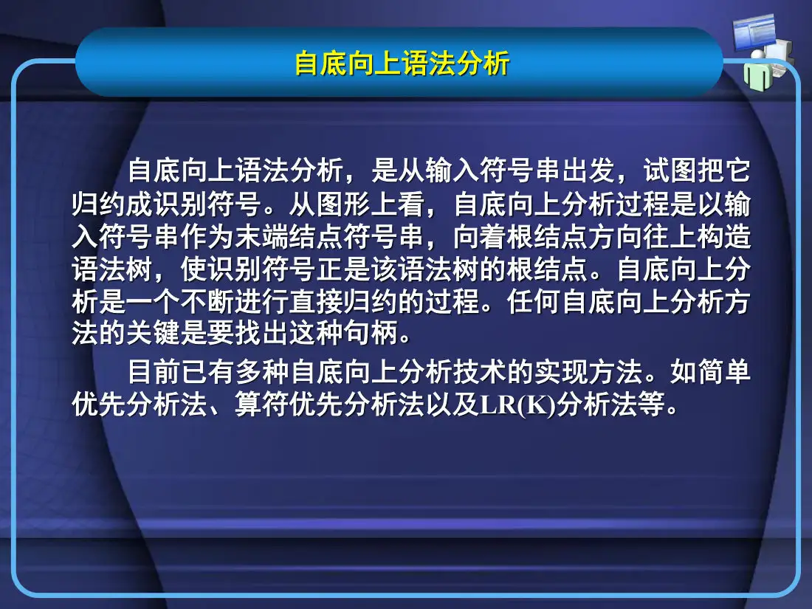

原文：

自底向上语法分析，是从输入符号串出发，试图把它归约成识别符号。从图形上看，自底向上分析过程是以输入符号串作为末端结点符号串，向着根结点方向往上构造语法树，使识别符号正是该语法树的根结点。自底向上分析是一个不断进行直接归约的过程。任何自底向上分析方法的关键是要找出这种句柄。

目前已有多种自底向上分析技术的实现方法。如简单优先分析法、算符优先分析法以及LR(K)分析法等。

自底向上语法分析

### 1. 与文法有关的一些关系定义

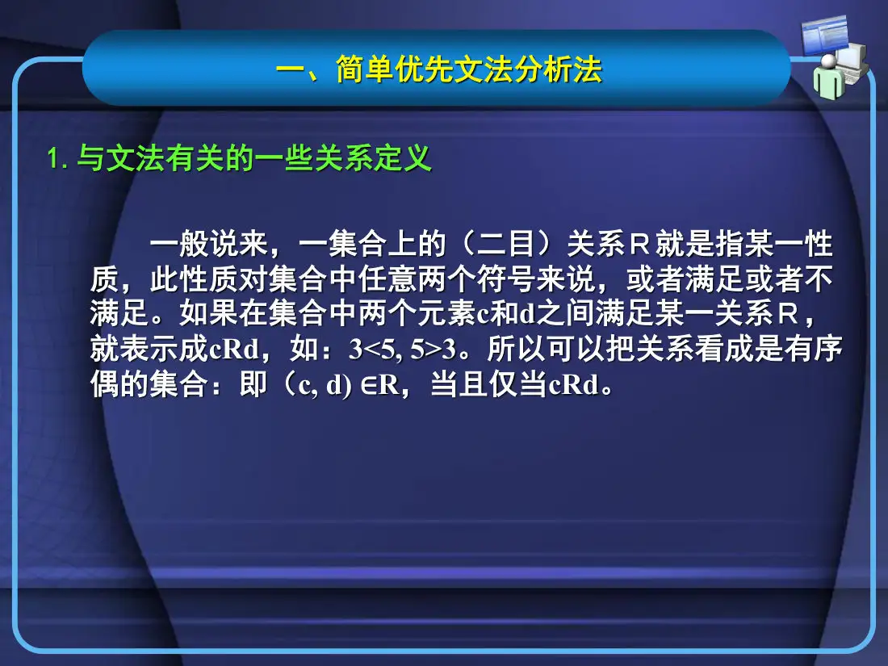

原文：

1. 与文法有关的一些关系定义

一般说来，一集合上的（二目）关系R就是指某一性质，此性质对集合中任意两个符号来说，或者满足或者不满足。如果在集合中两个元素c和d之间满足某一关系R，就表示成cRd，如：3<5, 5>3。所以可以把关系看成是有序偶的集合：即（c, d)∈R，当且仅当cRd。

一、简单优先文法分析法

### 一、简单优先文法分析法

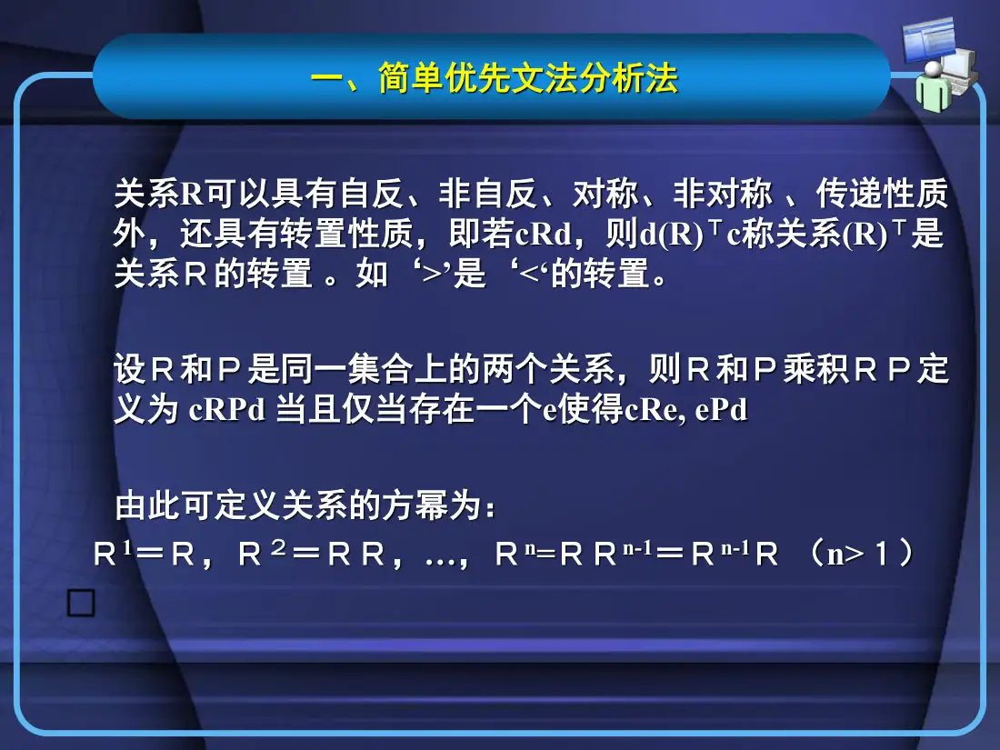

原文：

关系R可以具有自反、非自反、对称、非对称、传递性质外，还具有转置性质，即若cRd，则d(R) $^{T}$ c称关系(R) $^{T}$ 是关系R的转置。如‘>’是‘<’的转置。

设R和P是同一集合上的两个关系，则R和P乘积RP定义为cRPd当且仅当存在一个e使得cRe, ePd

由此可定义关系的方幂为： $R^{1} = R, R^{2} = RR, \ldots, R^{n} = RR^{n-1} = R^{n-1}R$ (n > 1)

一、简单优先文法分析法

### 关系R的同等关系记为 $R^{0}$ ，cR $^{0}$ d当且仅当c=d□

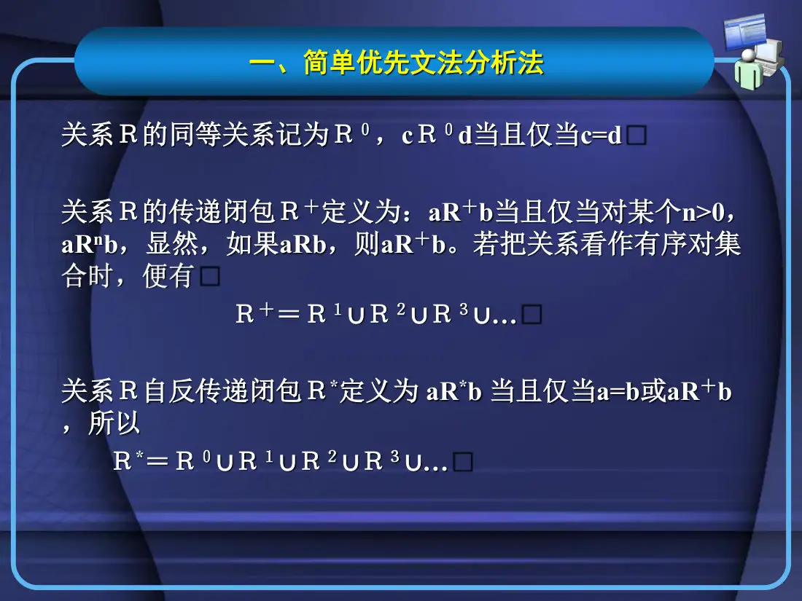

原文：

关系R的同等关系记为 $R^{0}$ ，cR $^{0}$ d当且仅当c=d□

关系 R 的传递闭包 R $^{+}$ 定义为：aR $^{+}$ b当且仅当对某个n>0，aR $^{n}$ b，显然，如果aRb，则aR $^{+}$ b。若把关系看作有序对集合时，便有□

$$
\mathsf {R} ^ {+} = \mathsf {R} ^ {1} \cup \mathsf {R} ^ {2} \cup \mathsf {R} ^ {3} \cup \dots \square
$$

关系 R 自反传递闭包 R\*定义为 aR\*b 当且仅当a=b或aR+b，所以

$$
\mathsf {R} ^ {*} = \mathsf {R} ^ {0} \cup \mathsf {R} ^ {1} \cup \mathsf {R} ^ {2} \cup \mathsf {R} ^ {3} \cup \dots \square
$$

一、简单优先文法分析法

### 鱼优

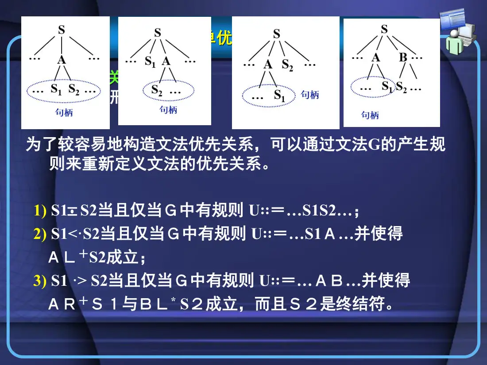

原文：

鱼优

为了较容易地构造文法优先关系，可以通过文法G的产生规则来重新定义文法的优先关系。

1) S1= S2当且仅当G中有规则 U::=...S1S2...;

2) S1<·S2当且仅当G中有规则 U::=...S1 A ...并使得 A L +S2成立;

3) S1 $\cdot >$ S2当且仅当G中有规则 U::=... A B ...并使得 AR+ S 1与BL\*S2成立，而且S2是终结符。

### 下面我们定义与任何文法有关的几个关系。

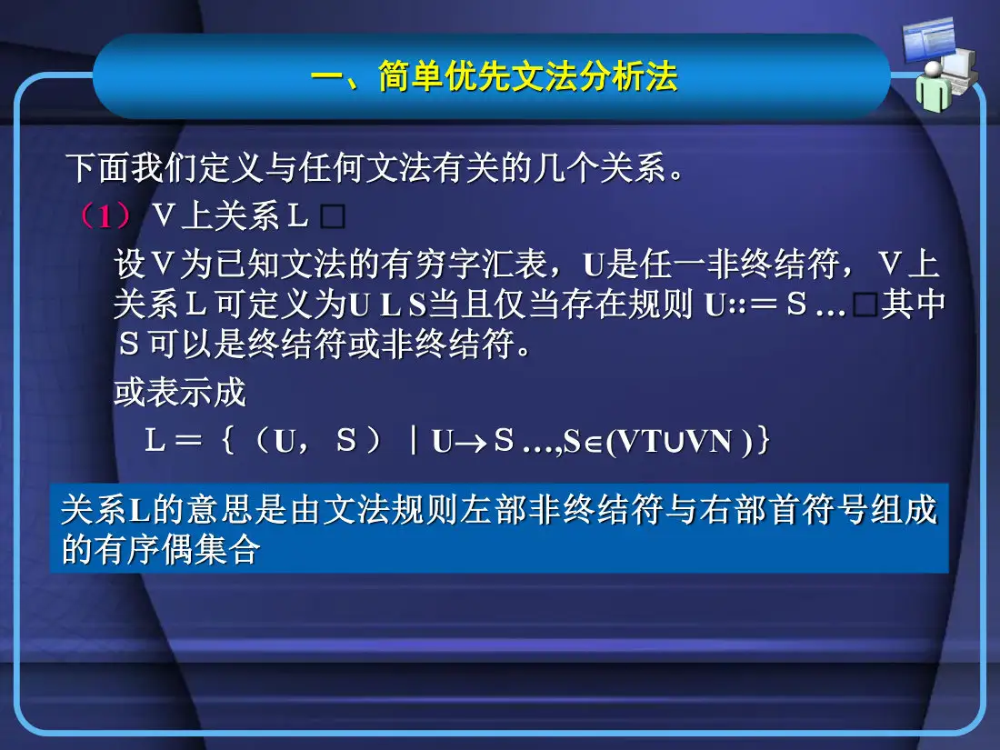

原文：

下面我们定义与任何文法有关的几个关系。

设 V 为已知文法的有穷字汇表，U 是任一非终结符，V 上关系 L 可定义为 U L S 当且仅当存在规则 U::= S ... □ 其中 S 可以是终结符或非终结符。

或表示成

$\mathrm{L} = \{\mathrm{(U,S)}\mid \mathrm{U}\rightarrow \mathrm{S}\dots ,\mathrm{S}\in (\mathrm{VTUVN})\}$

关系L的意思是由文法规则左部非终结符与右部首符号组成的有序偶集合

一、简单优先文法分析法

### 例4.5 设文法G [A]

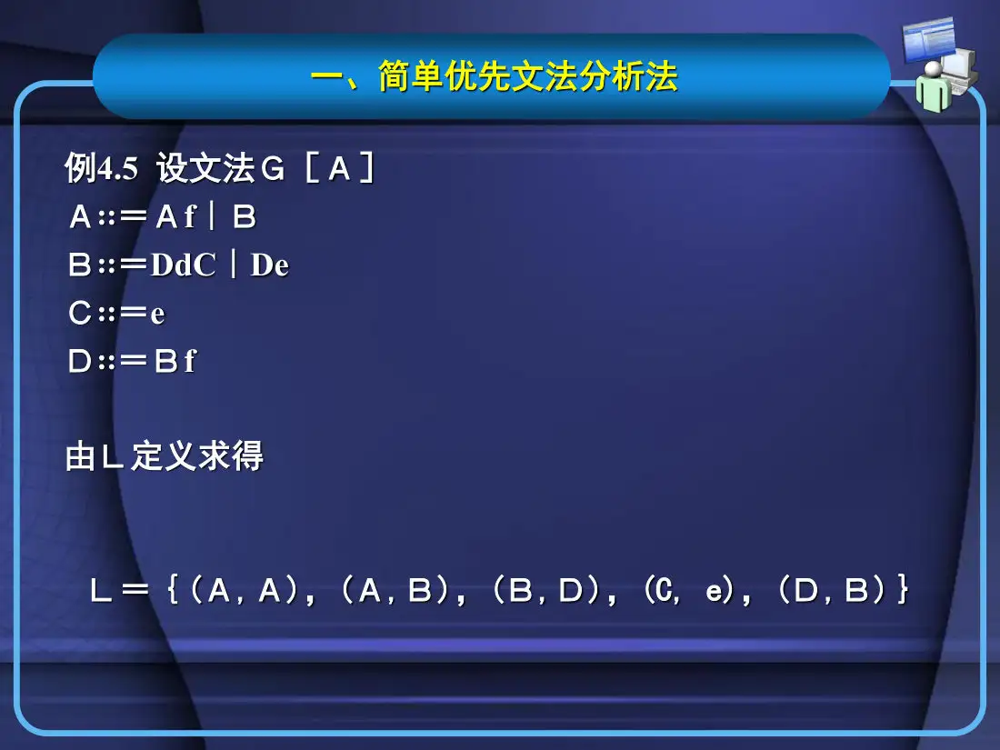

原文：

例4.5 设文法G [A]
A::=Af | B
B::=DdC | De
C::=e
D::=Bf

由L定义求得

$L = \{(A, A), (A, B), (B, D), (C, e), (D, B)\}$ (2) V 上关系传递闭包 L $^{+}$ □
V 上关系传递闭包 L $^{+}$ 定义为: U L $^{+}$ S

一、简单优先文法分析法

### 一、简单优先文法分析法

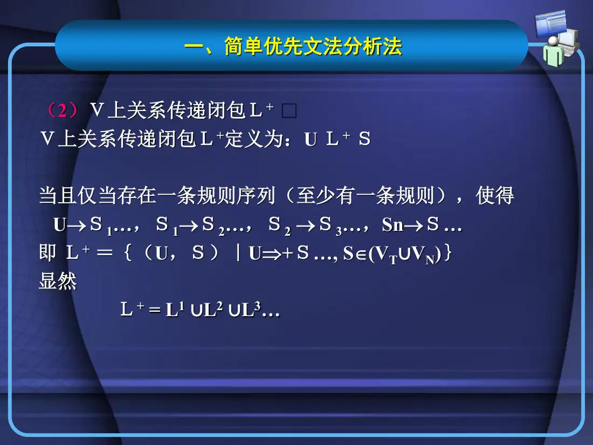

原文：

当且仅当存在一条规则序列（至少有一条规则），使得 $U \to S_1 \ldots, S_1 \to S_2 \ldots, S_2 \to S_3 \ldots, Sn \to S \ldots$ 即 $L^+ = \{ (U, S) | U \Rightarrow +S \ldots, S \in (V_T \cup V_N) \}$ 显然 $L^+ = L^1 \cup L^2 \cup L^3 \ldots$

一、简单优先文法分析法

### $$

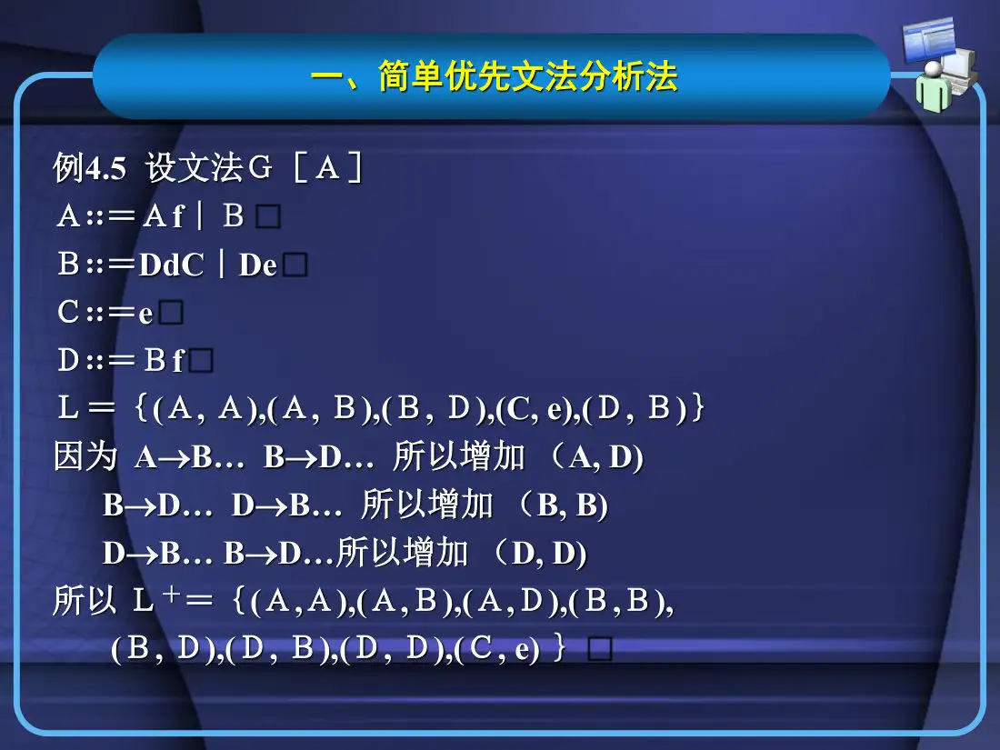

原文：

$$
\mathrm{A}: := \mathrm{Af} \mid \mathrm{B} \square
$$

$$
\mathrm{B}: := \mathrm{DdC} \mid \mathrm{De} \square
$$

$$
C: := e \square
$$

$$
\mathrm{D}: := \mathrm{Bf} \square
$$

L = {(A, A),(A, B),(B, D),(C, e),(D, B)}
因为 A→B... B→D... 所以增加 (A, D)
B→D... D→B... 所以增加 (B, B)
D→B... B→D...所以增加 (D, D)
所以 L+ = {(A, A),(A, B),(A, D),(B, B),
(B, D),(D, B),(D, D),(C, e)} □

一、简单优先文法分析法

### (3) V 上关系自反传递闭包L\

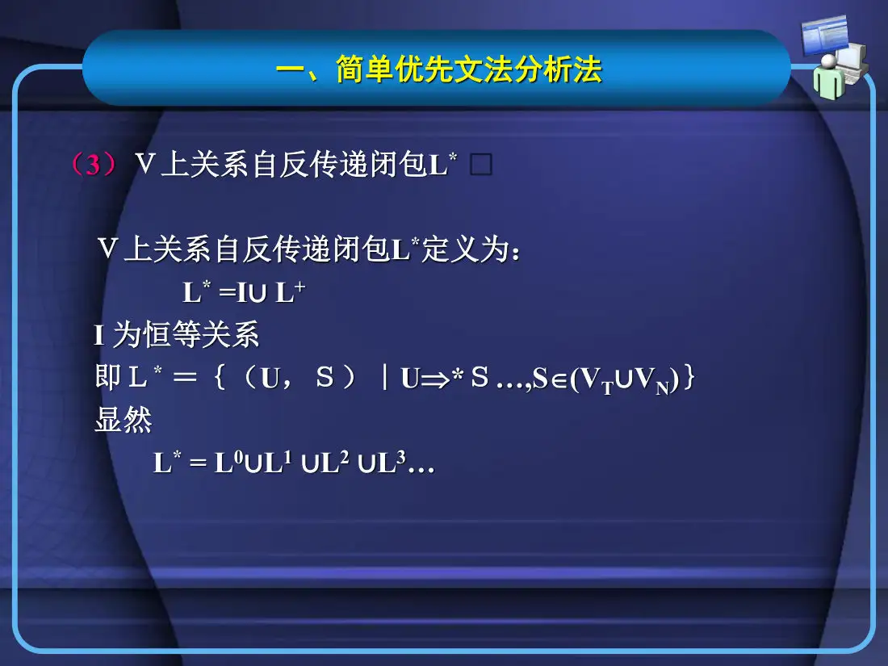

原文：

(3) V 上关系自反传递闭包L\*

V上关系自反传递闭包L\*定义为:

$$
\mathrm{L} ^ {*} = \mathrm{I} \cup \mathrm{L} ^ {+}
$$

I 为恒等关系
即 $L^{*} = \{(U, S) | U \Rightarrow^{*} S \dots, S \in (V_{T} \cup V_{N})\}$ 显然 $L^{*} = L^{0} \cup L^{1} \cup L^{2} \cup L^{3} \dots$

一、简单优先文法分析法

### 例4.5 设文法G [A]

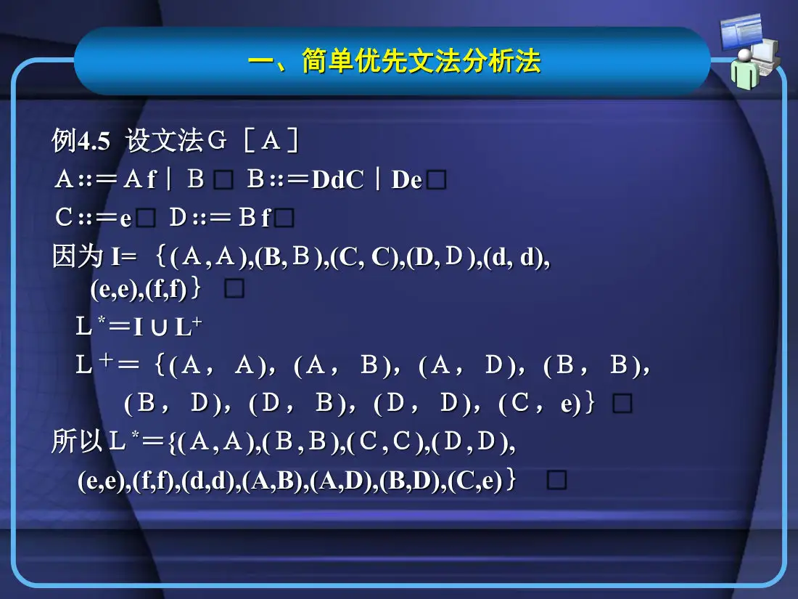

原文：

例4.5 设文法G [A]
A::=Af | B □ B::=DdC | De □
C::=e □ D::=Bf □
因为I= {(A,A),(B,B),(C,C),(D,D),(d,d),(e,e),(f,f)} □
L\* = I ∪ L+
L+ = {(A, A), (A, B), (A, D), (B, B), (B, D), (D, B), (D, D), (C, e)} □
所以L\* = {(A,A),(B,B),(C,C),(D,D), (e,e),(f,f),(d,d),(A,B),(A,D),(B,D),(C,e)} □

一、简单优先文法分析法

### (4) V 上关系 R (用类似方法可以定义)

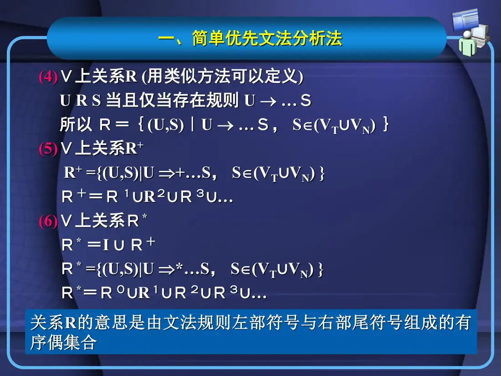

原文：

(4) V 上关系 R (用类似方法可以定义)
URS 当且仅当存在规则 U → ... S
所以 R = {(U,S) | U → ... S, S ∈ (V\_T ∪ V\_N)}

(5) V 上关系 $R^{+}$ $R^{+}=\{(U,S)|U\Rightarrow+...S,\quad S\in(V_{T}\cup V_{N})\}$ $R^{+}=R^{1}\cup R^{2}\cup R^{3}U...$

(6) V 上关系 $R^{*}$ $R^{*} = I \cup R^{+}$ $R^{*} = \{(U, S) | U \Rightarrow^{*}...S, \quad S \in (V_{T} \cup V_{N})\}$ $R^{*} = R^{0} \cup R^{1} \cup R^{2} \cup R^{3} \cup ...$

关系R的意思是由文法规则左部符号与右部尾符号组成的有序偶集合

一、简单优先文法分析法

### 例4.5 设文法G [A]

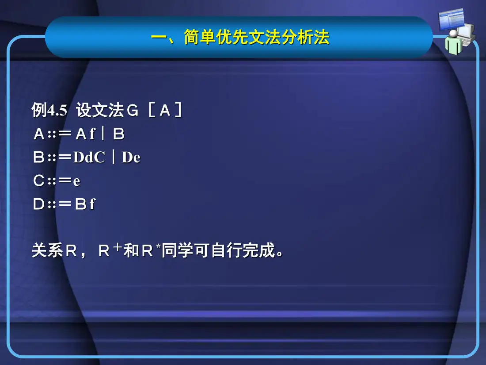

原文：

例4.5 设文法G [A]
A::=Af | B
B::=DdC | De
C::=e
D::=Bf

关系R， $R^{+}$ 和 $R^{*}$ 同学可自行完成。

一、简单优先文法分析法

### 这时，可以通过布尔矩阵求得。

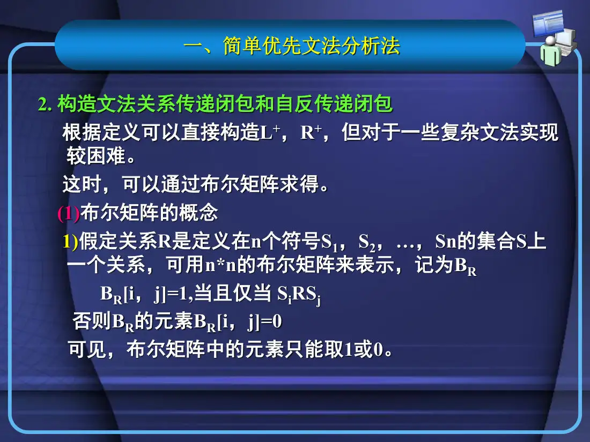

原文：

2. 构造文法关系传递闭包和自反传递闭包根据定义可以直接构造 $\mathrm{L}^{+}$ , $\mathrm{R}^{+}$ , 但对于一些复杂文法实现较困难。

这时，可以通过布尔矩阵求得。

(1)布尔矩阵的概念

1)假定关系R是定义在n个符号 $S_{1}$ ， $S_{2}$ ，…，Sn的集合S上一个关系，可用 $n*n$ 的布尔矩阵来表示，记为 $B_{R}$ $B_{R}[i, j]=1$ ，当且仅当 $S_{i}RS_{j}$ 否则 $B_{R}$ 的元素 $B_{R}[i, j]=0$ 可见，布尔矩阵中的元素只能取1或0。

一、简单优先文法分析法

### 设文法G [A]

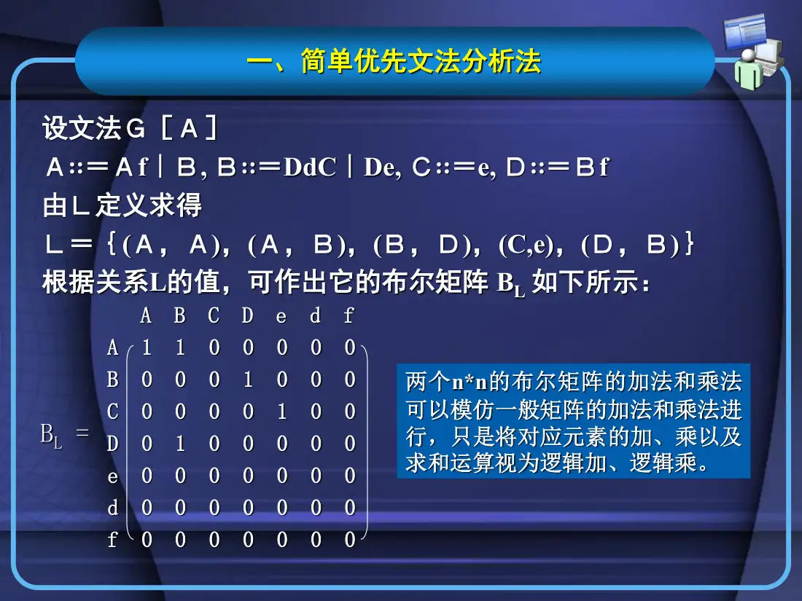

原文：

设文法G [A]
A::=Af | B, B::=DdC | De, C::=e, D::=Bf
由L定义求得
L = {(A, A), (A, B), (B, D), (C,e), (D, B)}
根据关系L的值，可作出它的布尔矩阵 B $_{L}$ 如下所示：

$$
\mathrm{B} _ {\mathrm{L}} = \begin{array}{l} \begin{array}{c c c c c c c} & \mathrm{A} & \mathrm{B} & \mathrm{C} & \mathrm{D} & \mathrm{e} & \mathrm{d} & \mathrm{f} \\ \mathrm{A} & 1 & 1 & 0 & 0 & 0 & 0 & 0 \\ \mathrm{B} & 0 & 0 & 0 & 1 & 0 & 0 & 0 \\ \mathrm{C} & 0 & 0 & 0 & 0 & 1 & 0 & 0 \\ \mathrm{D} & 0 & 1 & 0 & 0 & 0 & 0 & 0 \\ \mathrm{e} & 0 & 0 & 0 & 0 & 0 & 0 & 0 \\ \mathrm{d} & 0 & 0 & 0 & 0 & 0 & 0 & 0 \\ \mathrm{f} & 0 & 0 & 0 & 0 & 0 & 0 & 0 \end{array} \end{array}
$$

两个n\*n的布尔矩阵的加法和乘法可以模仿一般矩阵的加法和乘法进行，只是将对应元素的加、乘以及求和运算视为逻辑加、逻辑乘。

一、简单优先文法分析法

### ③ 在同一个字母表上两个关系的乘积，可由表示这两个关系的布尔矩阵乘积给出。

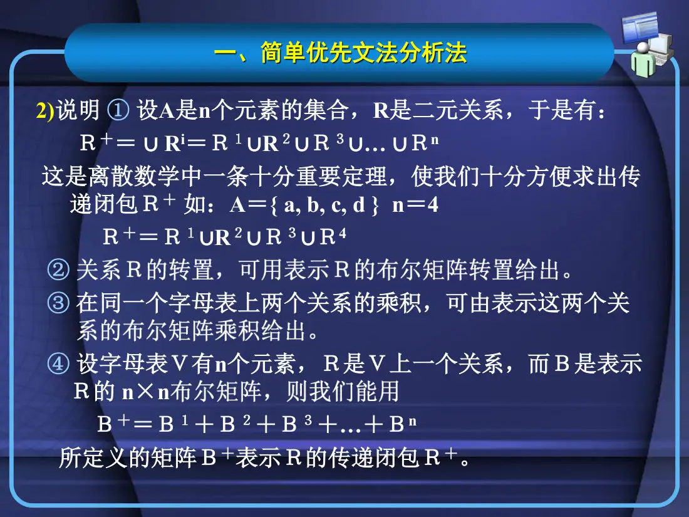

原文：

2)说明 ① 设A是n个元素的集合，R是二元关系，于是有： $R^{+} = \cup R^{i} = R^{1} \cup R^{2} \cup R^{3} \cup \ldots \cup R^{n}$ 这是离散数学中一条十分重要定理，使我们十分方便求出传递闭包 $R^{+}$ 如： $A=\{a,b,c,d\}$ n=4 $R^{+}=R^{1}\cup R^{2}\cup R^{3}\cup R^{4}$ ② 关系R的转置，可用表示R的布尔矩阵转置给出。
③ 在同一个字母表上两个关系的乘积，可由表示这两个关系的布尔矩阵乘积给出。
④ 设字母表V有n个元素，R是V上一个关系，而B是表示R的n×n布尔矩阵，则我们能用 $B^{+}=B^{1}+B^{2}+B^{3}+\ldots+B^{n}$ 所定义的矩阵 $B^{+}$ 表示R的传递闭包 $R^{+}$ 。

一、简单优先文法分析法

### (2)构造文法关系L，L⁺，L\

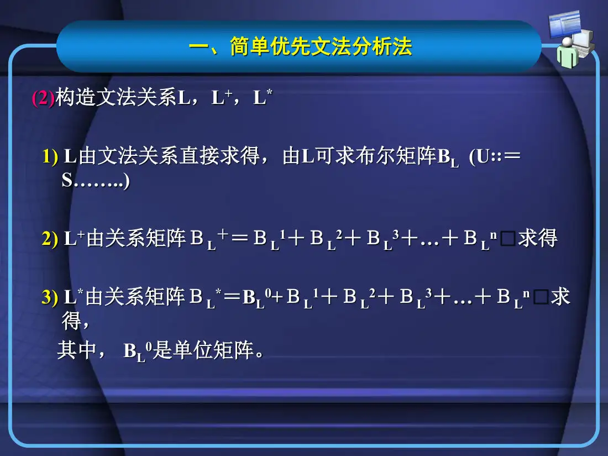

原文：

(2)构造文法关系L，L⁺，L\*

1) L由文法关系直接求得，由L可求布尔矩阵 $B_{L}$ (U::=S......)

2) $\mathrm{L}^{+}$ 由关系矩阵 $\mathrm{B_L}^{+} = \mathrm{B_L}^{1} + \mathrm{B_L}^{2} + \mathrm{B_L}^{3} + \ldots +\mathrm{B_L}^{\mathfrak{n}}$ □求得

3) L\*由关系矩阵 B $_{L}$ \*=B $_{L}$ $^{0}$ +B $_{L}$ $^{1}$ +B $_{L}$ $^{2}$ +B $_{L}$ $^{3}$ +...+B $_{L}$ $^{n}$ □求得，其中，B $_{L}$ $^{0}$ 是单位矩阵。

一、简单优先文法分析法

### (3)构造文法关系R， $R^{+}$ ， $R^{*}$

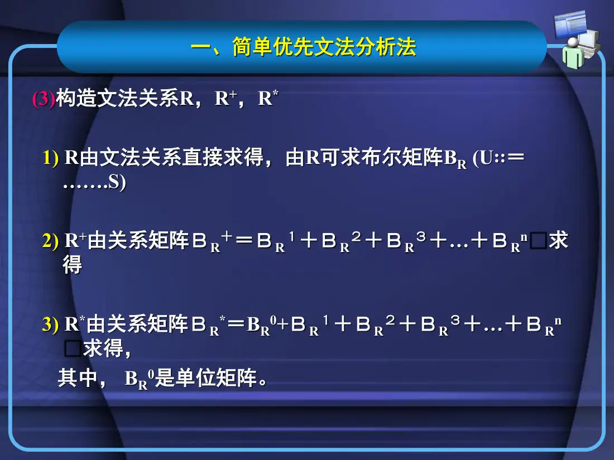

原文：

(3)构造文法关系R， $R^{+}$ ， $R^{*}$

1) R由文法关系直接求得，由R可求布尔矩阵 $B_{R}$ (U::=……S)

2) $\mathrm{R}^{+}$ 由关系矩阵 $B_{\mathrm{R}}^{+} = B_{\mathrm{R}}^{1} + B_{\mathrm{R}}^{2} + B_{\mathrm{R}}^{3} + \ldots + B_{\mathrm{R}}^{\mathrm{n}}$ □求得

3) R\*由关系矩阵 $B_{R}^{*}=B_{R}^{0}+B_{R}^{1}+B_{R}^{2}+B_{R}^{3}+\ldots+B_{R}^{n}$ □求得，
其中， $B_{R}^{0}$ 是单位矩阵。

一、简单优先文法分析法

### ①由文法规则求

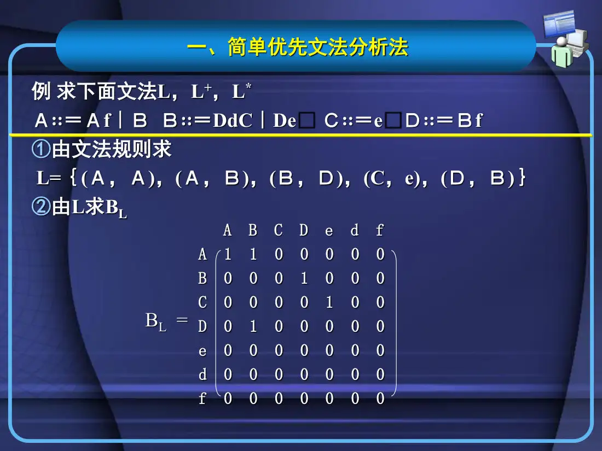

原文：

例 求下面文法L，L $^{+}$ ，L $^{*}$ A::= Af | B  B::=DdC | De □ C::=e □ D::=Bf

①由文法规则求
L= {(A, A), (A, B), (B, D), (C, e), (D, B)}
②由L求BL

$$
B _ {L} = \begin{array}{c} A \\ B \\ C \\ D \\ e \\ d \\ f \end{array} \left( \begin{array}{l l l l l l l} 1 & 1 & 0 & 0 & 0 & 0 & 0 \\ 0 & 0 & 0 & 1 & 0 & 0 & 0 \\ 0 & 0 & 0 & 0 & 1 & 0 & 0 \\ 0 & 1 & 0 & 0 & 0 & 0 & 0 \\ 0 & 0 & 0 & 0 & 0 & 0 & 0 \\ 0 & 0 & 0 & 0 & 0 & 0 & 0 \\ 0 & 0 & 0 & 0 & 0 & 0 & 0 \end{array} \right)
$$

一、简单优先文法分析法

### $$

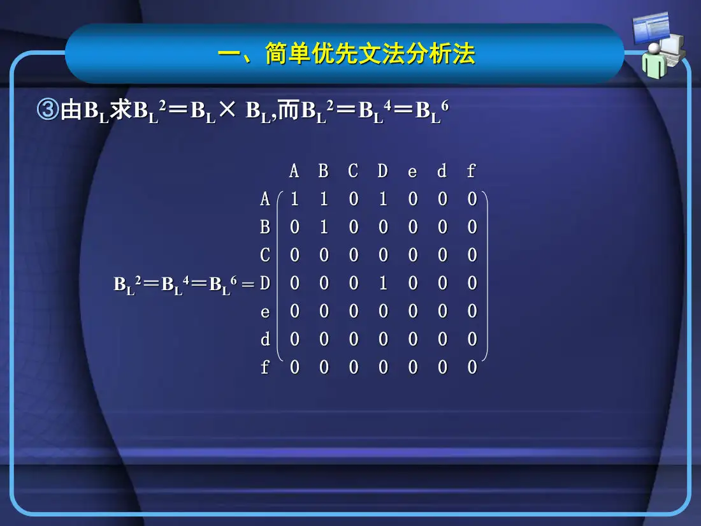

原文：

③由 $B_{L}$ 求 $B_{L}^{2}=B_{L}\times B_{L}$ ，而 $B_{L}^{2}=B_{L}^{4}=B_{L}^{6}$

$$
\mathbf {B} _ {\mathrm{L}} ^ {2} = \mathbf {B} _ {\mathrm{L}} ^ {4} = \mathbf {B} _ {\mathrm{L}} ^ {6} = \left( \begin{array}{c c c c c c c} A & B & C & D & e & d & f \\ A & 1 & 1 & 0 & 1 & 0 & 0 & 0 \\ B & 0 & 1 & 0 & 0 & 0 & 0 & 0 \\ C & 0 & 0 & 0 & 0 & 0 & 0 & 0 \\ D & 0 & 0 & 0 & 1 & 0 & 0 & 0 \\ e & 0 & 0 & 0 & 0 & 0 & 0 & 0 \\ d & 0 & 0 & 0 & 0 & 0 & 0 & 0 \\ f & 0 & 0 & 0 & 0 & 0 & 0 & 0 \end{array} \right)
$$

一、简单优先文法分析法

### $$

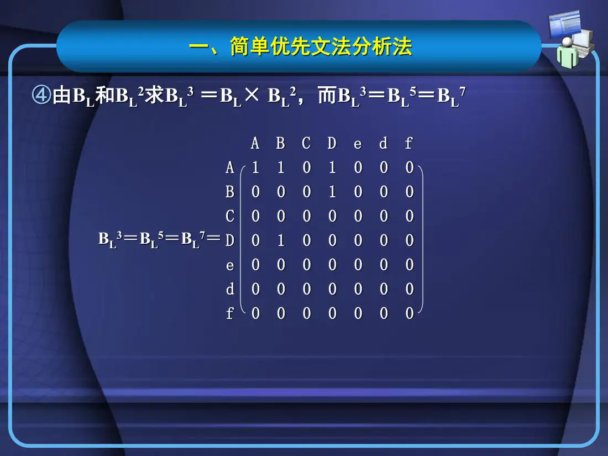

原文：

④由 $B_{L}$ 和 $B_{L}^{2}$ 求 $B_{L}^{3}=B_{L}\times B_{L}^{2}$ ，而 $B_{L}^{3}=B_{L}^{5}=B_{L}^{7}$

$$
\mathbf {B} _ {\mathrm{L}} ^ {3} = \mathbf {B} _ {\mathrm{L}} ^ {5} = \mathbf {B} _ {\mathrm{L}} ^ {7} = \left( \begin{array}{c c c c c c c} A & B & C & D & e & d & f \\ A & 1 & 1 & 0 & 1 & 0 & 0 & 0 \\ B & 0 & 0 & 0 & 1 & 0 & 0 & 0 \\ C & 0 & 0 & 0 & 0 & 0 & 0 & 0 \\ D & 0 & 1 & 0 & 0 & 0 & 0 & 0 \\ e & 0 & 0 & 0 & 0 & 0 & 0 & 0 \\ d & 0 & 0 & 0 & 0 & 0 & 0 & 0 \\ f & 0 & 0 & 0 & 0 & 0 & 0 & 0 \end{array} \right)
$$

一、简单优先文法分析法

### $$

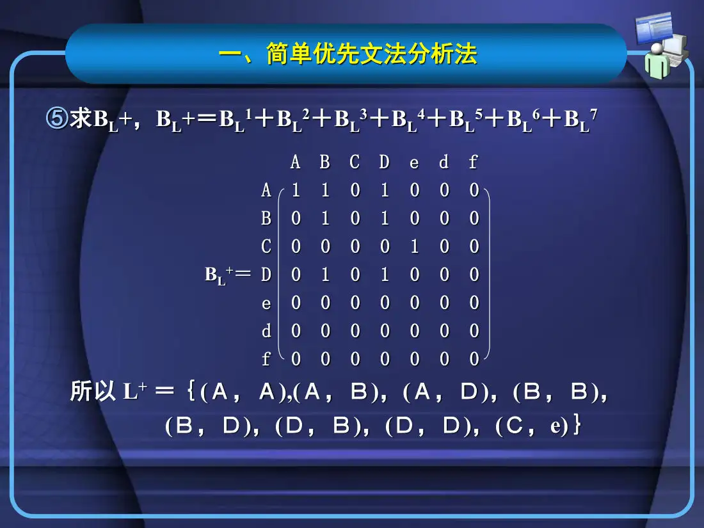

原文：

⑤求 $B_{L}^{+}$ ， $B_{L}^{+}=B_{L}^{1}+B_{L}^{2}+B_{L}^{3}+B_{L}^{4}+B_{L}^{5}+B_{L}^{6}+B_{L}^{7}$

$$
\mathbf {B} _ {\mathrm{L}} ^ {+} = \begin{array}{l} \begin{array}{c c c c c c c} & \mathrm{A} & \mathrm{B} & \mathrm{C} & \mathrm{D} & \mathrm{e} & \mathrm{d} & \mathrm{f} \\ \mathrm{A} & 1 & 1 & 0 & 1 & 0 & 0 & 0 \\ \mathrm{B} & 0 & 1 & 0 & 1 & 0 & 0 & 0 \\ \mathrm{C} & 0 & 0 & 0 & 0 & 1 & 0 & 0 \\ \mathrm{D} & 0 & 1 & 0 & 1 & 0 & 0 & 0 \\ \mathrm{e} & 0 & 0 & 0 & 0 & 0 & 0 & 0 \\ \mathrm{d} & 0 & 0 & 0 & 0 & 0 & 0 & 0 \\ \mathrm{f} & 0 & 0 & 0 & 0 & 0 & 0 & 0 \end{array} \end{array}
$$

所以 $L^{+}=\{(A,A),(A,B),(A,D),(B,B),(B,D),(D,B),(D,D),(C,e)\}$

一、简单优先文法分析法

### $$

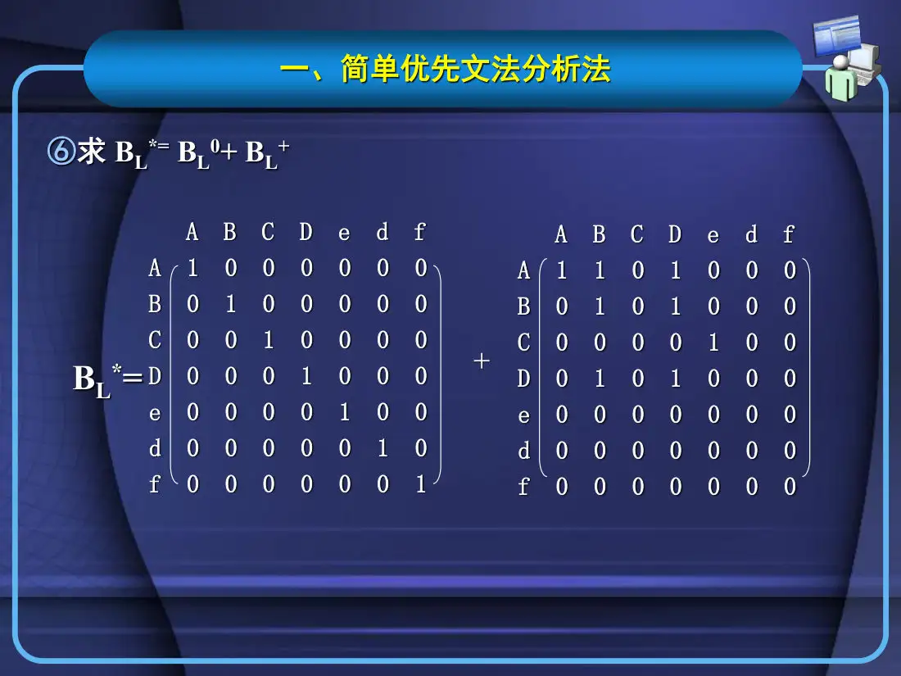

原文：

⑥求 $\mathrm{B_L}^* = \mathrm{B_L}^0 +\mathrm{B_L}^+$

$$
\mathbf {B} _ {\mathrm{L}} ^ {*} = \begin{array}{c} \text {A} \\ \text {B} \\ \text {C} \\ \text {D} \\ \text {e} \\ \text {d} \\ \text {f} \end{array} \left( \begin{array}{l l l l l l l} 1 & 0 & 0 & 0 & 0 & 0 & 0 \\ 0 & 1 & 0 & 0 & 0 & 0 & 0 \\ 0 & 0 & 1 & 0 & 0 & 0 & 0 \\ 0 & 0 & 0 & 1 & 0 & 0 & 0 \\ 0 & 0 & 0 & 0 & 1 & 0 & 0 \\ 0 & 0 & 0 & 0 & 0 & 1 & 0 \\ 0 & 0 & 0 & 0 & 0 & 0 & 1 \end{array} \right)
$$

$$
+ \begin{array}{c} \begin{array}{c c c c c c c} & \mathrm{A} & \mathrm{B} & \mathrm{C} & \mathrm{D} & \mathrm{e} & \mathrm{d} & \mathrm{f} \\ + & \mathrm{A} & 1 & 1 & 0 & 1 & 0 & 0 & 0 \\ & \mathrm{B} & 0 & 1 & 0 & 1 & 0 & 0 & 0 \\ & \mathrm{C} & 0 & 0 & 0 & 0 & 1 & 0 & 0 \\ & \mathrm{D} & 0 & 1 & 0 & 1 & 0 & 0 & 0 \\ & \mathrm{e} & 0 & 0 & 0 & 0 & 0 & 0 & 0 \\ & \mathrm{d} & 0 & 0 & 0 & 0 & 0 & 0 & 0 \\ & \mathrm{f} & 0 & 0 & 0 & 0 & 0 & 0 & 0 \end{array} \end{array}
$$

一、简单优先文法分析法

### $$

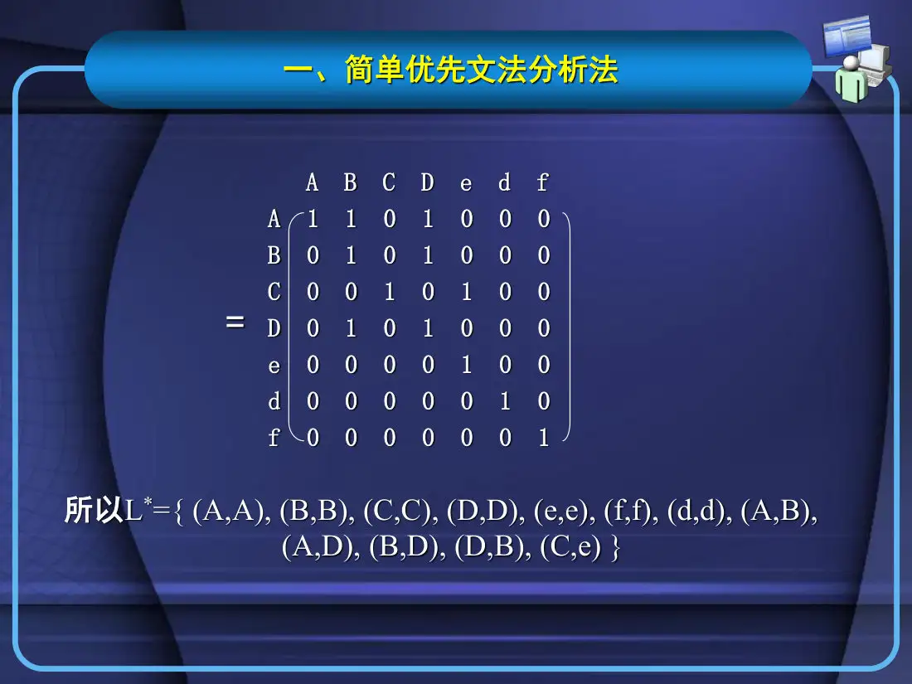

原文：

$$
= \begin{array}{c} \begin{array}{c c c c c c c} & \mathrm{A} & \mathrm{B} & \mathrm{C} & \mathrm{D} & \mathrm{e} & \mathrm{d} & \mathrm{f} \\ = & \mathrm{A} & 1 & 1 & 0 & 1 & 0 & 0 & 0 \\ & \mathrm{B} & 0 & 1 & 0 & 1 & 0 & 0 & 0 \\ & \mathrm{C} & 0 & 0 & 1 & 0 & 1 & 0 & 0 \\ & \mathrm{D} & 0 & 1 & 0 & 1 & 0 & 0 & 0 \\ & \mathrm{e} & 0 & 0 & 0 & 0 & 1 & 0 & 0 \\ & \mathrm{d} & 0 & 0 & 0 & 0 & 0 & 1 & 0 \\ & \mathrm{f} & 0 & 0 & 0 & 0 & 0 & 0 & 1 \end{array} \end{array}
$$

所以 $L^{*}=\{(A,A),(B,B),(C,C),(D,D),(e,e),(f,f),(d,d),(A,B),(A,D),(B,D),(D,B),(C,e)\}$

一、简单优先文法分析法

### (3) Warshall算法

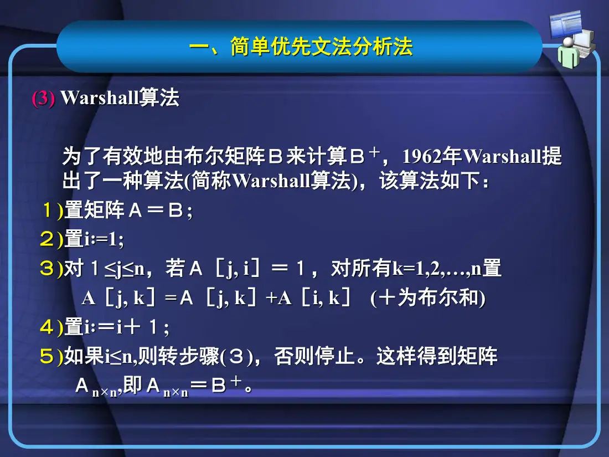

原文：

(3) Warshall算法

为了有效地由布尔矩阵 B 来计算 B $^{+}$ ，1962年Warshall 提出了一种算法(简称 Warshall 算法)，该算法如下：

1) 置矩阵 A = B;

2) 置i:=1;

3)对 $1 \leq j \leq n$ ，若 A [j, i] = 1，对所有 k=1,2,...,n 置
A [j, k] = A [j, k] + A [i, k] （+为布尔和）

4) 置i:=i+1;

5)如果i≤n,则转步骤(3)，否则停止。这样得到矩阵 $A_{n\times n}$ ，即 $A_{n\times n}=B^{+}$ 。

一、简单优先文法分析法

### i=1

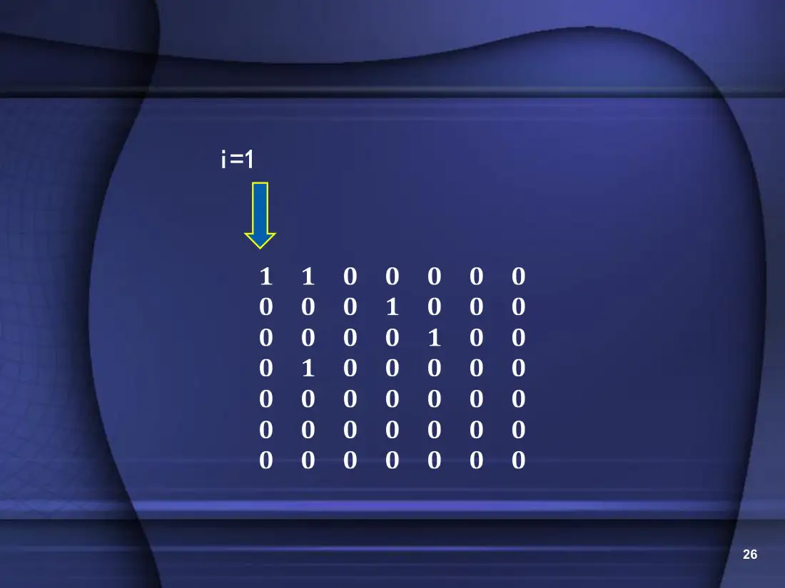

原文：

i=1

$$
\begin{array}{c c c c c c c} 1 & 1 & 0 & 0 & 0 & 0 & 0 \\ 0 & 0 & 0 & 1 & 0 & 0 & 0 \\ 0 & 0 & 0 & 0 & 1 & 0 & 0 \\ 0 & 1 & 0 & 0 & 0 & 0 & 0 \\ 0 & 0 & 0 & 0 & 0 & 0 & 0 \\ 0 & 0 & 0 & 0 & 0 & 0 & 0 \\ 0 & 0 & 0 & 0 & 0 & 0 & 0 \end{array}
$$

26

### $$

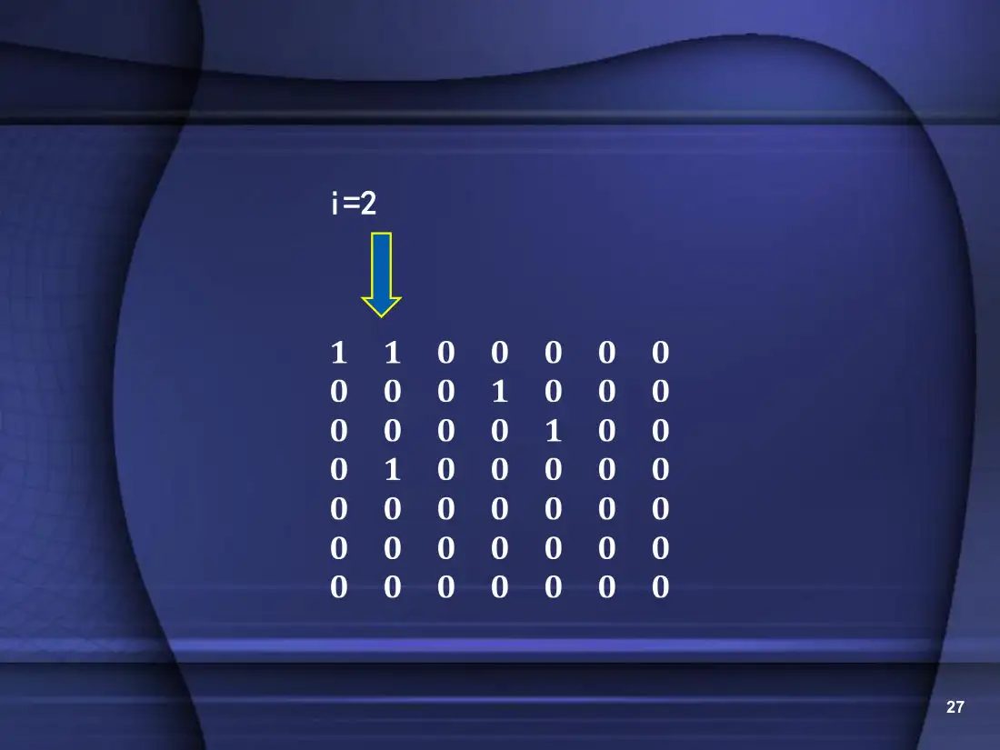

原文：

$$
\begin{array}{c c c c c c c} 1 & 1 & 0 & 0 & 0 & 0 & 0 \\ 0 & 0 & 0 & 1 & 0 & 0 & 0 \\ 0 & 0 & 0 & 0 & 1 & 0 & 0 \\ 0 & 1 & 0 & 0 & 0 & 0 & 0 \\ 0 & 0 & 0 & 0 & 0 & 0 & 0 \\ 0 & 0 & 0 & 0 & 0 & 0 & 0 \\ 0 & 0 & 0 & 0 & 0 & 0 & 0 \end{array}
$$

27

### $$

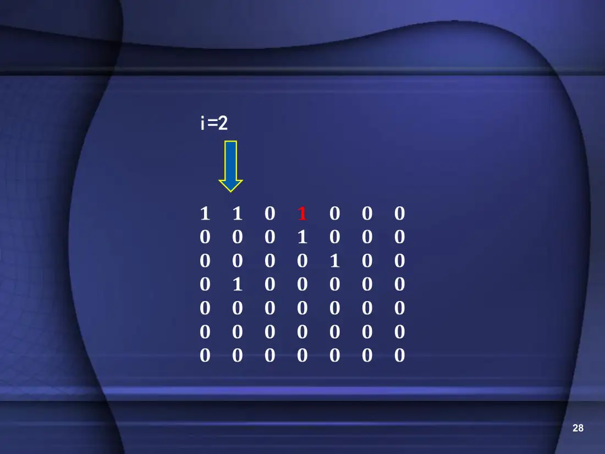

原文：

$$
\begin{array}{c c c c c c c} 1 & 1 & 0 & 1 & 0 & 0 & 0 \\ 0 & 0 & 0 & 1 & 0 & 0 & 0 \\ 0 & 0 & 0 & 0 & 1 & 0 & 0 \\ 0 & 1 & 0 & 0 & 0 & 0 & 0 \\ 0 & 0 & 0 & 0 & 0 & 0 & 0 \\ 0 & 0 & 0 & 0 & 0 & 0 & 0 \\ 0 & 0 & 0 & 0 & 0 & 0 & 0 \end{array}
$$

28

### $$

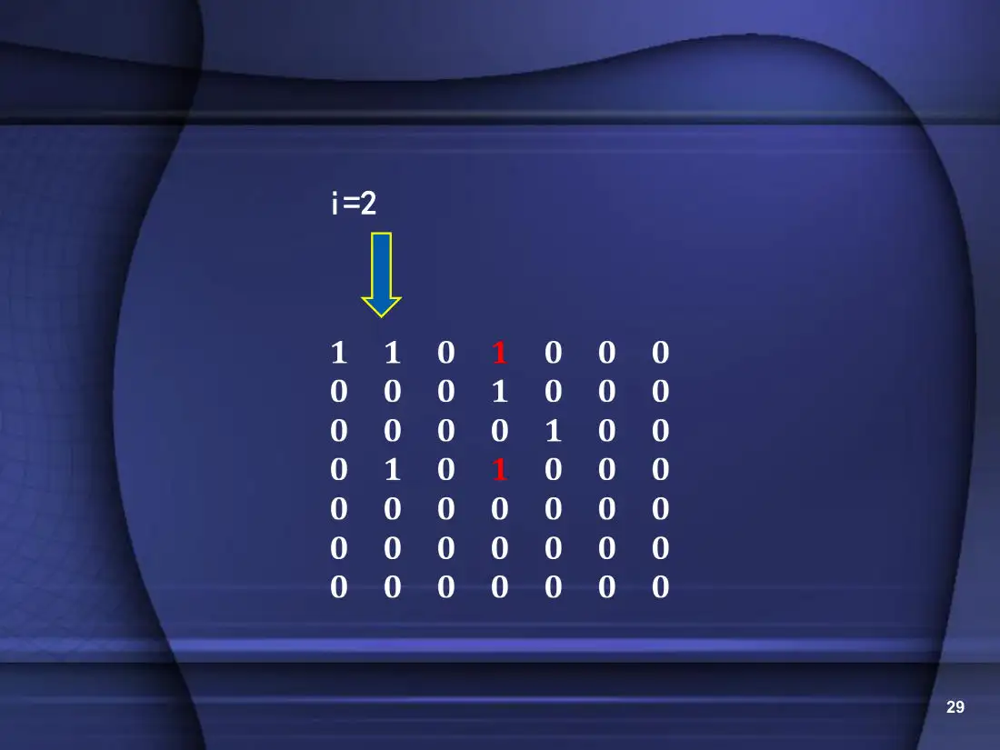

原文：

$$
\begin{array}{c c c c c c c} 1 & 1 & 0 & 1 & 0 & 0 & 0 \\ 0 & 0 & 0 & 1 & 0 & 0 & 0 \\ 0 & 0 & 0 & 0 & 1 & 0 & 0 \\ 0 & 1 & 0 & 1 & 0 & 0 & 0 \\ 0 & 0 & 0 & 0 & 0 & 0 & 0 \\ 0 & 0 & 0 & 0 & 0 & 0 & 0 \\ 0 & 0 & 0 & 0 & 0 & 0 & 0 \end{array}
$$

29

### $$

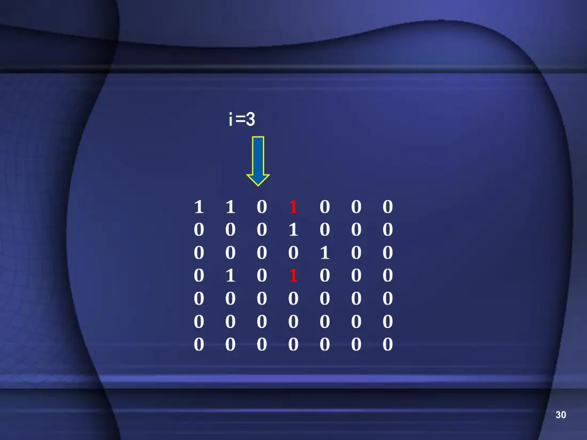

原文：

$$
\begin{array}{c c c c c c c} \text {i = 3} \\ \hline 1 & 1 & 0 & 1 & 0 & 0 & 0 \\ 0 & 0 & 0 & 1 & 0 & 0 & 0 \\ 0 & 0 & 0 & 0 & 1 & 0 & 0 \\ 0 & 1 & 0 & 1 & 0 & 0 & 0 \\ 0 & 0 & 0 & 0 & 0 & 0 & 0 \\ 0 & 0 & 0 & 0 & 0 & 0 & 0 \\ 0 & 0 & 0 & 0 & 0 & 0 & 0 \end{array}
$$

30

### $$

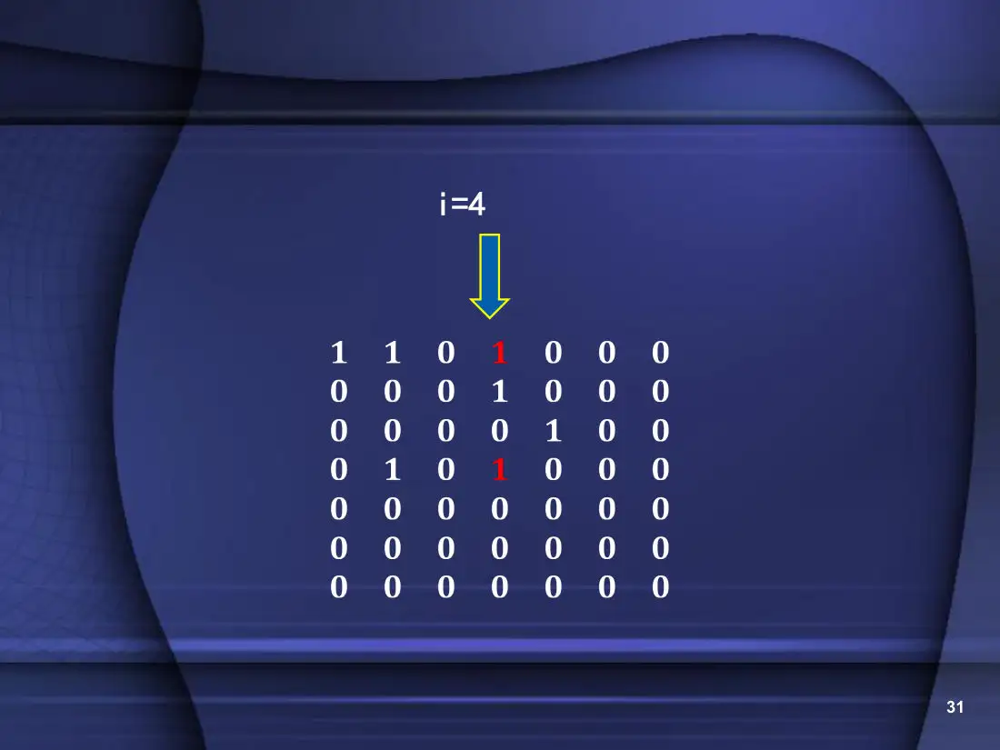

原文：

$$
\begin{array}{c c c c c c c} \text {i = 4} \\ \hline 1 & 1 & 0 & 1 & 0 & 0 & 0 \\ 0 & 0 & 0 & 1 & 0 & 0 & 0 \\ 0 & 0 & 0 & 0 & 1 & 0 & 0 \\ 0 & 1 & 0 & 1 & 0 & 0 & 0 \\ 0 & 0 & 0 & 0 & 0 & 0 & 0 \\ 0 & 0 & 0 & 0 & 0 & 0 & 0 \\ 0 & 0 & 0 & 0 & 0 & 0 & 0 \end{array}
$$

31

### $$

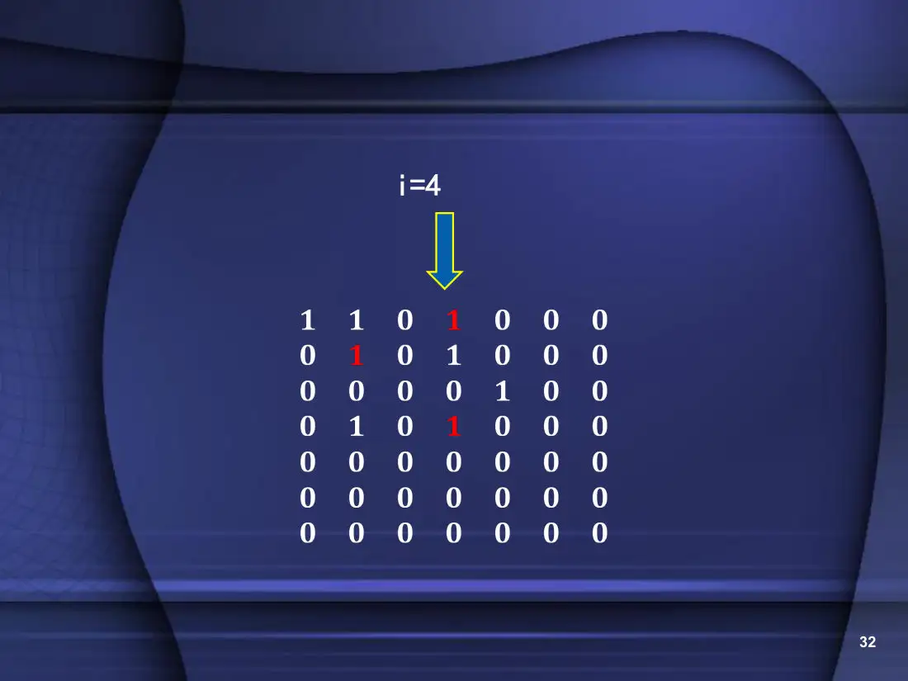

原文：

$$
\begin{array}{c c c c c c c} \text {i = 4} \\ \hline 1 & 1 & 0 & 1 & 0 & 0 & 0 \\ 0 & 1 & 0 & 1 & 0 & 0 & 0 \\ 0 & 0 & 0 & 0 & 1 & 0 & 0 \\ 0 & 1 & 0 & 1 & 0 & 0 & 0 \\ 0 & 0 & 0 & 0 & 0 & 0 & 0 \\ 0 & 0 & 0 & 0 & 0 & 0 & 0 \\ 0 & 0 & 0 & 0 & 0 & 0 & 0 \end{array}
$$

32

### $$

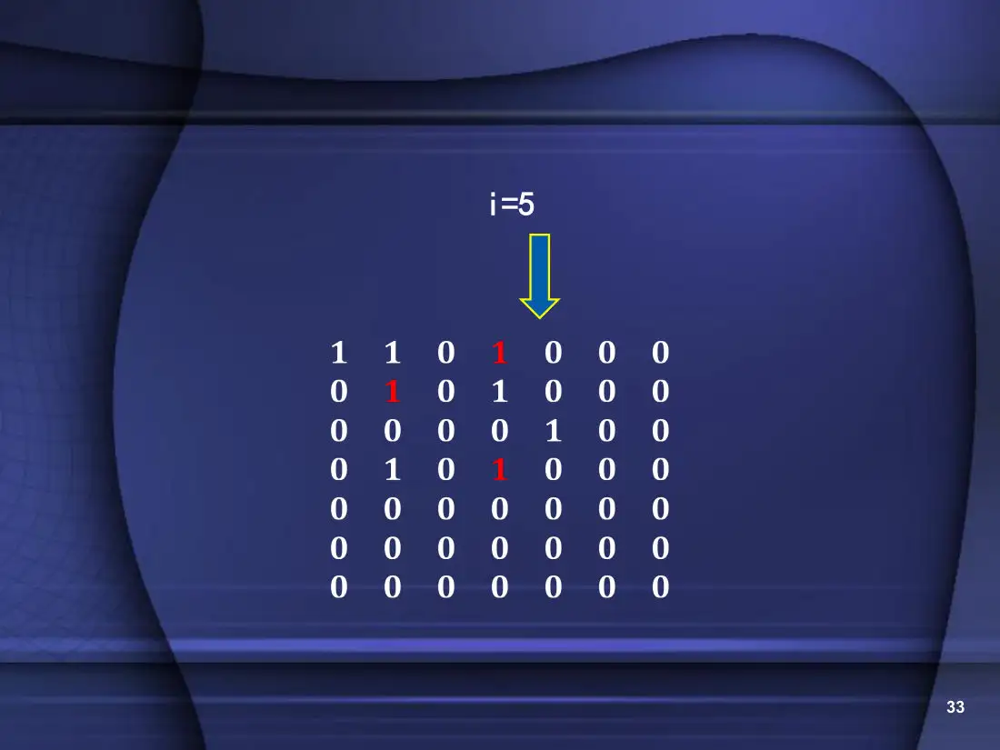

原文：

$$
\begin{array}{c c c c c c c} \text {i = 5} \\ \hline 1 & 1 & 0 & 1 & 0 & 0 & 0 \\ 0 & 1 & 0 & 1 & 0 & 0 & 0 \\ 0 & 0 & 0 & 0 & 1 & 0 & 0 \\ 0 & 1 & 0 & 1 & 0 & 0 & 0 \\ 0 & 0 & 0 & 0 & 0 & 0 & 0 \\ 0 & 0 & 0 & 0 & 0 & 0 & 0 \\ 0 & 0 & 0 & 0 & 0 & 0 & 0 \end{array}
$$

33

### 鱼优

原文：

鱼优

为了较容易地构造文法优先关系，可以通过文法G的产生规则来重新定义文法的优先关系。

1) S1= S2当且仅当G中有规则 U::=...S1S2...;

2) S1<·S2当且仅当G中有规则 U::=...S1 A ...并使得 A L +S2成立;

3) S1 $\cdot >$ S2当且仅当G中有规则 U::=... A B ...并使得 AR+ S 1与BL\*S2成立，而且S2是终结符。

### $$

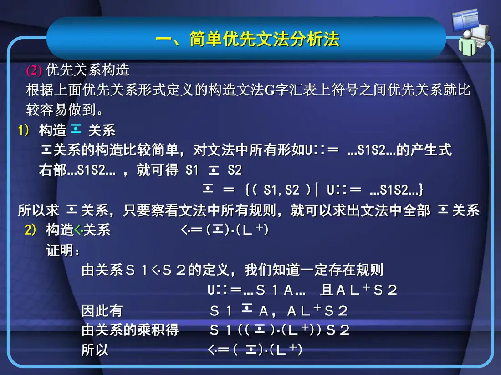

原文：

(2) 优先关系构造根据上面优先关系形式定义的构造文法G字汇表上符号之间优先关系就比较容易做到。

三关系的构造比较简单，对文法中所有形如U::= ...S1S2...的产生式右部...S1S2..., 就可得 S1 ⊕ S2

$$
\text {工} = \{(S 1, S 2) | U: := \dots S 1 S 2 \dots \}
$$

所以求 ⊗ 关系，只要察看文法中所有规则，就可以求出文法中全部 ⊗ 关系
2）构造<·关系 $\Leftarrow=(\text{ ⊗ })\cdot(L^{+})$

证明：

由关系S1<·S2的定义，我们知道一定存在规则

$$
U: := \dots S 1 A \dots
$$

$$
\mathsf {A L} ^ {+} \mathsf {S 2}
$$

因此有 S1 ⊖ A, AL+S2

由关系的乘积得 S1((工)·(L+))S2

所以

$\Leftarrow=(\text{二})\cdot(L^{+})$

一、简单优先文法分析法

### 所以求<-关系，即<-=(礎)·(L+), 只要按下面步骤进行:

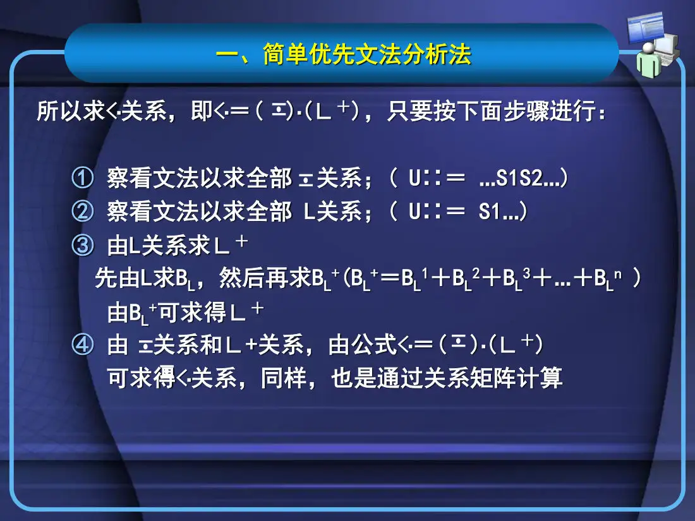

原文：

所以求<-关系，即<-=(礎)·(L+), 只要按下面步骤进行:

① 察看文法以求全部 ⊖ 关系；（U::= ...S1S2...）

② 察看文法以求全部 L关系；（U::= S1...）

③ 由L关系求 $L^{+}$ 先由L求 $B_{L}$ ，然后再求 $B_{L}^{+}(B_{L}^{+}=B_{L}^{1}+B_{L}^{2}+B_{L}^{3}+\ldots+B_{L}^{n})$ 由 $B_{L}^{+}$ 可求得 $L^{+}$

④ 由 $\sqsupseteq$ 关系和 $L +$ 关系，由公式 $<\cdot = (\sqsupset) \cdot (L^{+})$ 可求得 $<\cdot$ 关系，同样，也是通过关系矩阵计算

一、简单优先文法分析法

### 由关系S1 -> S2的定义，我们知道一定存在规则，

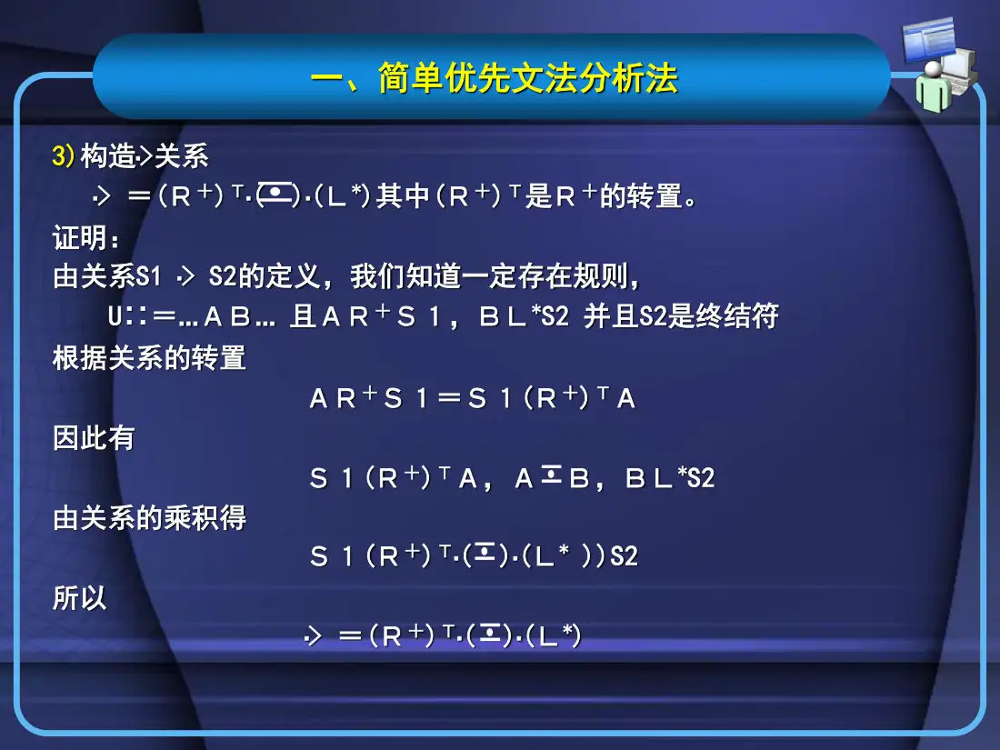

原文：

3) 构造->关系 $\cdot > = (R^{+})^{\top} \cdot (\text{●}) \cdot (L^{*})$ 其中 $(R^{+})^{\top}$ 是 $R^{+}$ 的转置。

由关系S1 -> S2的定义，我们知道一定存在规则，
U::=...AB... 且AR+S1，BL\*S2 并且S2是终结符

根据关系的转置

$$
A R ^ {+} S 1 = S 1 (R ^ {+}) ^ {T} A
$$

因此有

$$
\mathrm{S} 1 \left(\mathrm{R} ^ {+}\right) ^ {\top} \mathrm{A}, \mathrm{A} \equiv \mathrm{B}, \mathrm{BL} ^ {*} \mathrm{S} 2
$$

由关系的乘积得

$$
S 1 (R ^ {+}) ^ {\top} \cdot (\text {三}) \cdot (L ^ {*})) S 2
$$

所以

$$
\cdot > = (R ^ {+}) ^ {\top}. (\text {三}). (L ^ {*})
$$

一、简单优先文法分析法

### ① 察看文法以求全部 R 关系；(U: := ...S1)

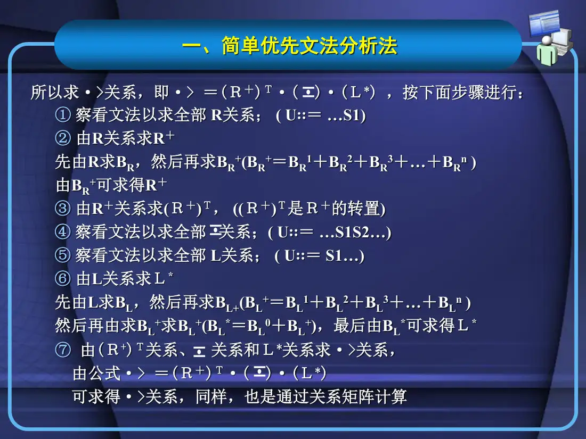

原文：

所以求 $\cdot >$ 关系，即 $\cdot > = (R^{+})^{\mathrm{T}}\cdot (\text{三})\cdot (L^{*})$ ，按下面步骤进行：

① 察看文法以求全部 R 关系；(U: := ...S1)

② 由R关系求 $R^{+}$ 先由R求 $B_{R}$ ，然后再求 $B_{R}^{+}(B_{R}^{+}=B_{R}^{1}+B_{R}^{2}+B_{R}^{3}+\ldots+B_{R}^{n})$ 由 $B_{R}^{+}$ 可求得 $R^{+}$

③ 由 $R^{+}$ 关系求 $(R^{+})^{\mathrm{T}}$ ， $((R^{+})^{\mathrm{T}}$ 是 $R^{+}$ 的转置)

④ 察看文法以求全部 ☐关系；(U::= ...S1S2...)

⑤ 察看文法以求全部 L 关系；(U::= S1...)

$$
\mathbf {B} _ {\mathrm{L}}
$$

$$
\mathrm{B} _ {\mathrm{L} +} \left(\mathrm{B} _ {\mathrm{L}} ^ {+} = \mathrm{B} _ {\mathrm{L}} ^ {1} + \mathrm{B} _ {\mathrm{L}} ^ {2} + \mathrm{B} _ {\mathrm{L}} ^ {3} + \dots + \mathrm{B} _ {\mathrm{L}} ^ {\mathrm{n}}\right)
$$

$$
\mathbf {B} _ {\mathrm{L}} ^ {+}
$$

$$
\mathrm{B} _ {\mathrm{L}} ^ {+} \left(\mathrm{B} _ {\mathrm{L}} ^ {*} = \mathrm{B} _ {\mathrm{L}} ^ {0} + \mathrm{B} _ {\mathrm{L}} ^ {+}\right)
$$

$$
\mathbf {B} _ {\mathrm{L}} ^ {*}
$$

$$
\mathsf {L} ^ {*}
$$

⑦ 由 $(R^{+})^{T}$ 关系、☐关系和L\*关系求·>关系，由公式·> = $(R^{+})^{T}$ ·(☐)·(L\*) 可求得·>关系，同样，也是通过关系矩阵计算例如：文法G[E]:Z ::= bMb M ::= (L|a L ::= Ma)
下面我们根据上面形式定义求出符号间所有优先关系
(1) 构造 ⊙ 关系:查看文法 U ::= ...S1S2..., 易得
≡ { (b,M),(M,b),((,L),(M,a),(a,)) }

一、简单优先文法分析法

### $$

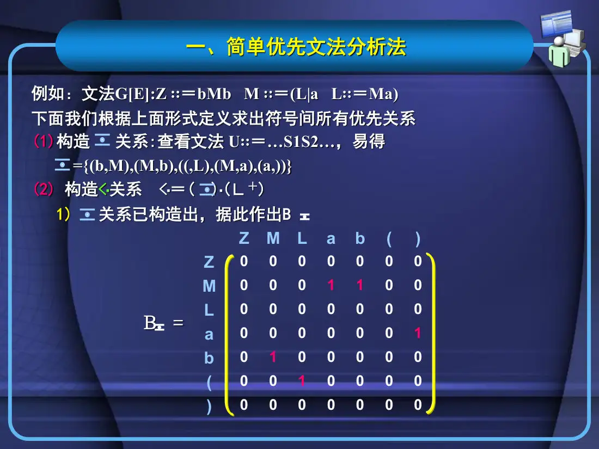

原文：

(2) 构造<关系 $<\cdot=(\text{☐})\cdot(L^{+})$ 1）关系已构造出，据此作出B

$$
B _ {z} = \begin{array}{c c c c c c c c} & Z & M & L & a & b & ( & ) \\ Z & 0 & 0 & 0 & 0 & 0 & 0 & 0 \\ M & 0 & 0 & 0 & 1 & 1 & 0 & 0 \\ L & 0 & 0 & 0 & 0 & 0 & 0 & 0 \\ a & 0 & 0 & 0 & 0 & 0 & 0 & 1 \\ b & 0 & 1 & 0 & 0 & 0 & 0 & 0 \\ ( & 0 & 0 & 1 & 0 & 0 & 0 & 0 \\ ) & 0 & 0 & 0 & 0 & 0 & 0 & 0 \end{array}
$$

一、简单优先文法分析法

### Z ::= bMb M ::= (L|a L ::= Ma)

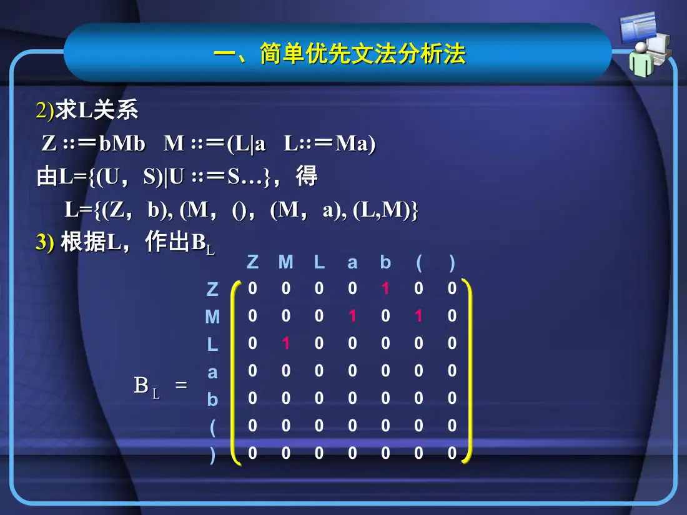

原文：

Z ::= bMb M ::= (L|a L ::= Ma)
由L = {(U, S)|U ::= S...}, 得
L = {(Z, b), (M, (), (M, a), (L,M)}

3) 根据L，作出 $B_{L}$

$$
B _ {L} = \begin{array}{c c c c c c c c} & Z & M & L & a & b & ( & ) \\ & Z & 0 & 0 & 0 & 0 & 1 & 0 & 0 \\ & M & 0 & 0 & 0 & 1 & 0 & 1 & 0 \\ & L & 0 & 1 & 0 & 0 & 0 & 0 & 0 \\ & a & 0 & 0 & 0 & 0 & 0 & 0 & 0 \\ & b & 0 & 0 & 0 & 0 & 0 & 0 & 0 \\ & ( & 0 & 0 & 0 & 0 & 0 & 0 & 0 \\ & ) & 0 & 0 & 0 & 0 & 0 & 0 & 0 \end{array}
$$

一、简单优先文法分析法

### $$

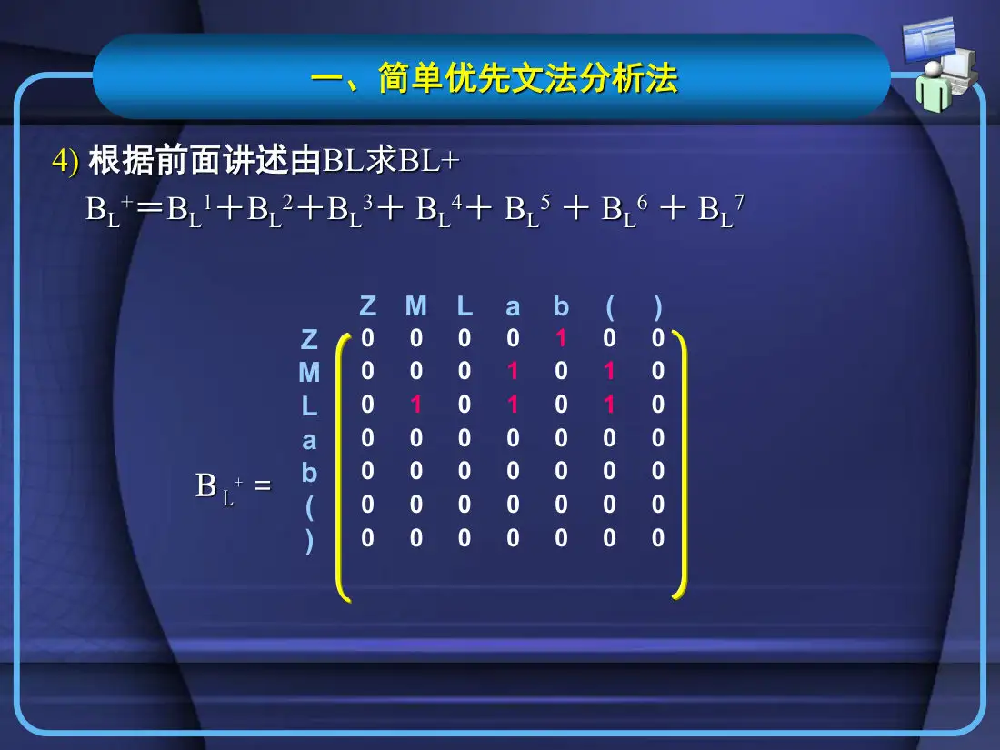

原文：

4) 根据前面讲述由BL求BL+ $B_{L}^{+}=B_{L}^{1}+B_{L}^{2}+B_{L}^{3}+B_{L}^{4}+B_{L}^{5}+B_{L}^{6}+B_{L}^{7}$

$$
B _ {L ^ {+}} = \begin{array}{c} Z \\ M \\ L \\ a \\ b \\ (\\ ) \end{array} \left( \begin{array}{c c c c c c c} Z & M & L & a & b & ( & ) \\ 0 & 0 & 0 & 0 & 1 & 0 & 0 \\ 0 & 0 & 0 & 1 & 0 & 1 & 0 \\ 0 & 1 & 0 & 1 & 0 & 1 & 0 \\ 0 & 0 & 0 & 0 & 0 & 0 & 0 \\ 0 & 0 & 0 & 0 & 0 & 0 & 0 \\ 0 & 0 & 0 & 0 & 0 & 0 & 0 \\ 0 & 0 & 0 & 0 & 0 & 0 & 0 \end{array} \right)
$$

一、简单优先文法分析法

### $$

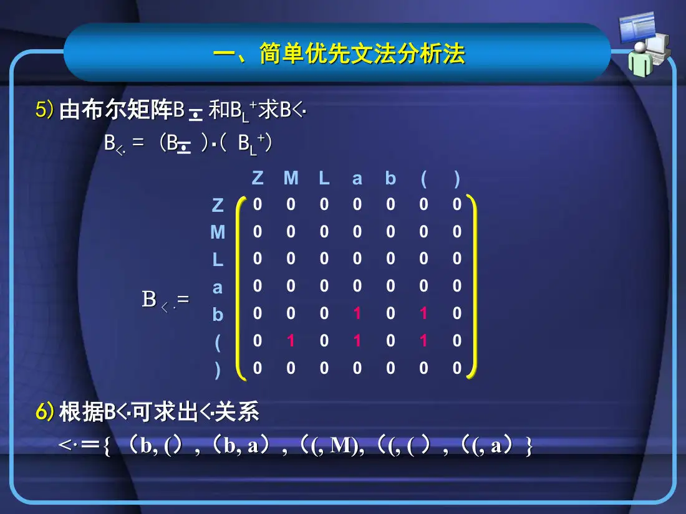

原文：

5) 由布尔矩阵 $B_{\perp}$ 和 $B_{L}^{+}$ 求 $B < \cdot$

$$
B _ {<  .} = (B _ {\text {二}}) \cdot (B _ {L ^ {+}})
$$

$$
B _ {<  } = \begin{array}{c c} & Z \quad M \quad L \quad a \quad b \quad (\\ Z & 0 \quad 0 \quad 0 \quad 0 \quad 0 \quad 0 \quad 0 \\ M & 0 \quad 0 \quad 0 \quad 0 \quad 0 \quad 0 \quad 0 \\ L & 0 \quad 0 \quad 0 \quad 0 \quad 0 \quad 0 \quad 0 \\ a & 0 \quad 0 \quad 0 \quad 0 \quad 0 \quad 0 \quad 0 \\ b & 0 \quad 0 \quad 0 \quad 1 \quad 0 \quad 1 \quad 0 \\ ( & 0 \quad 1 \quad 0 \quad 1 \quad 0 \quad 1 \quad 0 \\ ) & 0 \quad 0 \quad 0 \quad 0 \quad 0 \quad 0 \end{array}
$$

6) 根据B<·可求出<·关系

$$
<   \cdot = \left\{\left(b, () , (b, a), ((, M), ((, (), ((, a)) \right. \right\}
$$

一、简单优先文法分析法

### 1)由R={(U, S)|U ::= .....S}, 得

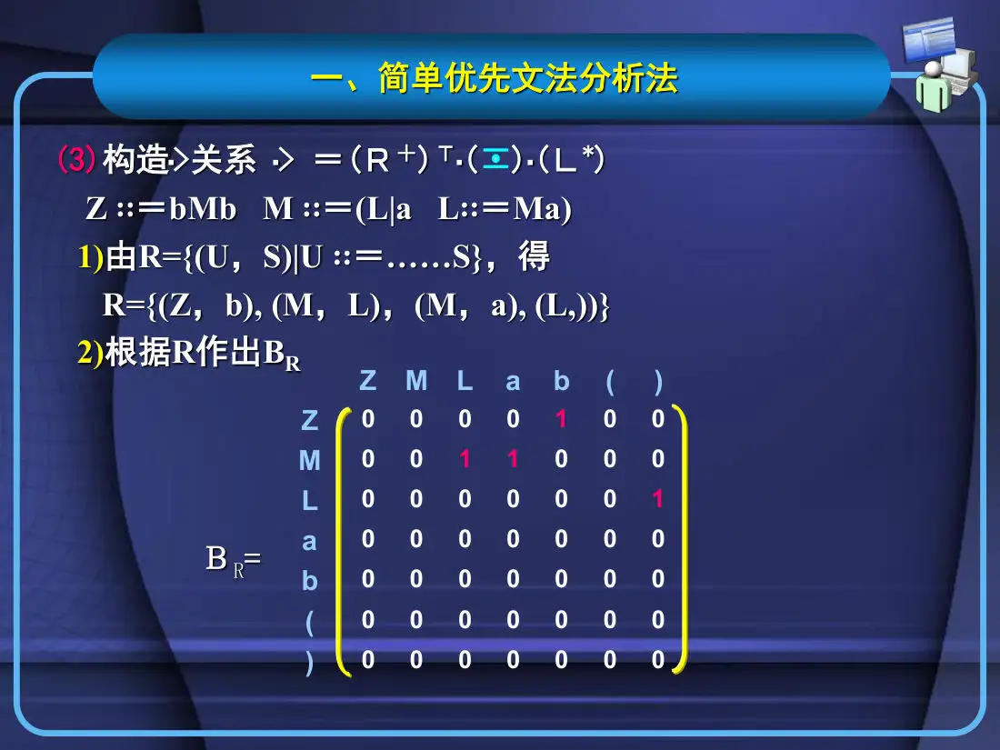

原文：

(3) 构造>关系 $\cdot > = (R^{+})^{\top} \cdot (\text{三}) \cdot (L^{*})$ Z ::= bMb M ::= (L|a L ::= Ma)
1)由R={(U, S)|U ::= .....S}, 得
R={(Z, b), (M, L), (M, a), (L,))}
2)根据R作出B $_{R}$

$$
B _ {R} = \begin{array}{c c} & Z \quad M \quad L \quad a \quad b \quad (\\ & Z \\ & M \\ & L \\ & a \\ & b \\ & (\\ & ) \end{array} \left( \begin{array}{c c c c c c c} 0 & 0 & 0 & 0 & 1 & 0 & 0 \\ 0 & 0 & 1 & 1 & 0 & 0 & 0 \\ 0 & 0 & 0 & 0 & 0 & 0 & 1 \\ 0 & 0 & 0 & 0 & 0 & 0 & 0 \\ 0 & 0 & 0 & 0 & 0 & 0 & 0 \\ 0 & 0 & 0 & 0 & 0 & 0 & 0 \\ 0 & 0 & 0 & 0 & 0 & 0 & 0 \\ 0 & 0 & 0 & 0 & 0 & 0 & 0 \end{array} \right)
$$

一、简单优先文法分析法

### 3)根据前面讲述由BR求BR+

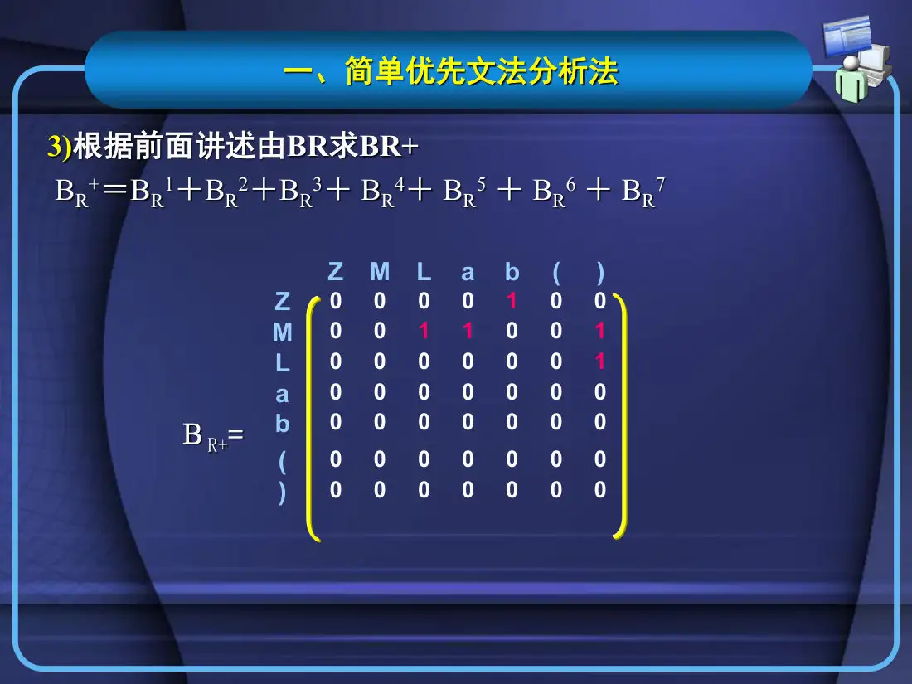

原文：

3)根据前面讲述由BR求BR+

$$
\mathrm{B} _ {\mathrm{R}} ^ {+} = \mathrm{B} _ {\mathrm{R}} ^ {1} + \mathrm{B} _ {\mathrm{R}} ^ {2} + \mathrm{B} _ {\mathrm{R}} ^ {3} + \mathrm{B} _ {\mathrm{R}} ^ {4} + \mathrm{B} _ {\mathrm{R}} ^ {5} + \mathrm{B} _ {\mathrm{R}} ^ {6} + \mathrm{B} _ {\mathrm{R}} ^ {7}
$$

$$
B _ {R ^ {+}} = \begin{array}{c c} & Z \\ & M \\ & L \\ & a \\ & b \\ & (\\ ) \end{array} \left( \begin{array}{c c c c c c c} 0 & 0 & 0 & 0 & 1 & 0 & 0 \\ 0 & 0 & 1 & 1 & 0 & 0 & 1 \\ 0 & 0 & 0 & 0 & 0 & 0 & 1 \\ 0 & 0 & 0 & 0 & 0 & 0 & 0 \\ 0 & 0 & 0 & 0 & 0 & 0 & 0 \\ 0 & 0 & 0 & 0 & 0 & 0 & 0 \\ 0 & 0 & 0 & 0 & 0 & 0 & 0 \end{array} \right)
$$

一、简单优先文法分析法

### $$

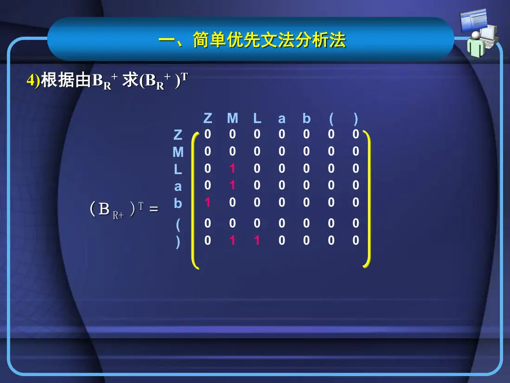

原文：

4)根据由 $B_{R}^{+}$ 求 $(B_{R}^{+})^{\mathrm{T}}$

$$
(B _ {R ^ {+}}) ^ {T} = \left( \begin{array}{l l l l l l l} Z & M & L & a & b & ( & ) \\ M & 0 & 0 & 0 & 0 & 0 & 0 \\ L & 0 & 0 & 0 & 0 & 0 & 0 \\ a & 0 & 1 & 0 & 0 & 0 & 0 \\ b & 0 & 1 & 0 & 0 & 0 & 0 \\ ( & 1 & 0 & 0 & 0 & 0 & 0 \\ ) & 0 & 0 & 0 & 0 & 0 & 0 \\ ) & 0 & 1 & 1 & 0 & 0 & 0 \end{array} \right)
$$

一、简单优先文法分析法

### 5) 三关系前面已构造出，据此作出B

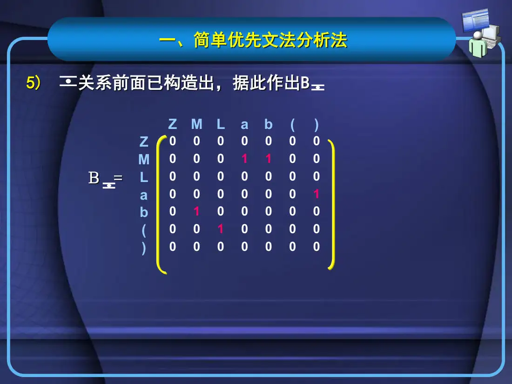

原文：

5) 三关系前面已构造出，据此作出B

$$
B _ {\text {三}} = \left( \begin{array}{c c c c c c c} Z & M & L & a & b & ( & ) \\ 0 & 0 & 0 & 0 & 0 & 0 & 0 \\ 0 & 0 & 0 & 1 & 1 & 0 & 0 \\ 0 & 0 & 0 & 0 & 0 & 0 & 0 \\ 0 & 0 & 0 & 0 & 0 & 0 & 1 \\ 0 & 1 & 0 & 0 & 0 & 0 & 0 \\ 0 & 0 & 1 & 0 & 0 & 0 & 0 \\ 0 & 0 & 0 & 0 & 0 & 0 & 0 \end{array} \right)
$$

一、简单优先文法分析法

### ①求 B $_{I}$ ，B $_{I}$ 是使主对角线都置 1

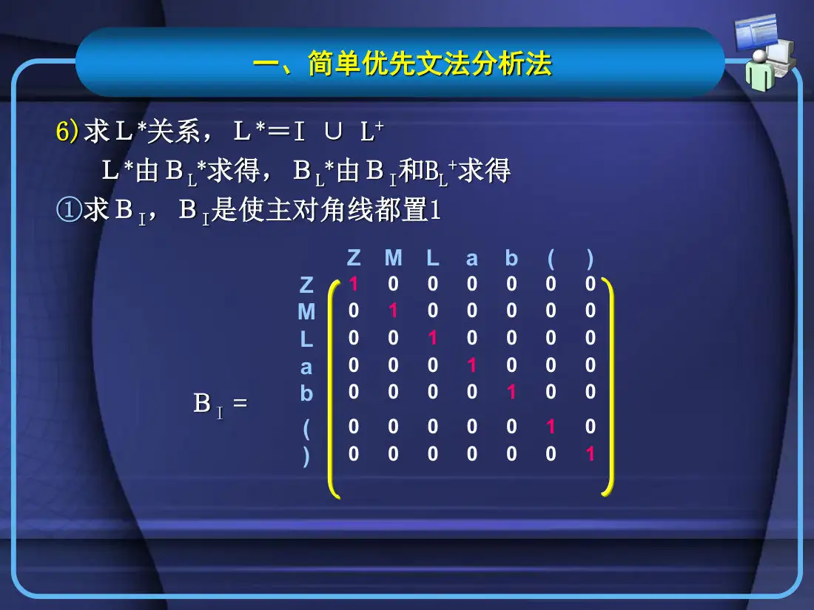

原文：

6) 求 L\*关系， $L^{*} = I \cup L^{+}$ L\*由 B $_{L}$ \*求得，B $_{L}$ \*由 B $_{I}$ 和 B $_{L}$ +求得

①求 B $_{I}$ ，B $_{I}$ 是使主对角线都置 1

$$
B _ {I} = \begin{array}{c c} & Z \quad M \quad L \quad a \quad b \quad (\\ Z & 1 \quad 0 \quad 0 \quad 0 \quad 0 \quad 0 \quad 0 \\ M & 0 \quad 1 \quad 0 \quad 0 \quad 0 \quad 0 \quad 0 \\ L & 0 \quad 0 \quad 1 \quad 0 \quad 0 \quad 0 \quad 0 \\ a & 0 \quad 0 \quad 0 \quad 1 \quad 0 \quad 0 \quad 0 \\ b & 0 \quad 0 \quad 0 \quad 0 \quad 1 \quad 0 \quad 0 \\ ( & 0 \quad 0 \quad 0 \quad 0 \quad 0 \quad 1 \quad 0 \\ ) & 0 \quad 0 \quad 0 \quad 0 \quad 0 \quad 0 \quad 1 \end{array}
$$

一、简单优先文法分析法

### ② $B_{L}^{+}$ 前面已构造出

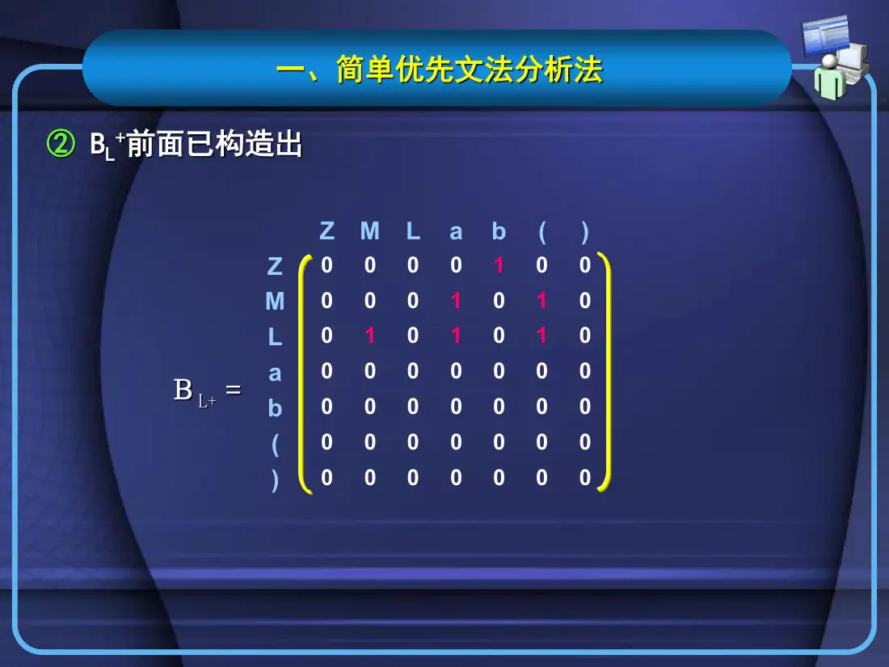

原文：

② $B_{L}^{+}$ 前面已构造出

$$
B _ {L ^ {+}} = \begin{array}{c} Z \\ M \\ L \\ a \\ b \\ (\\ ) \end{array} \left( \begin{array}{c c c c c c c} 0 & 0 & 0 & 0 & 1 & 0 & 0 \\ 0 & 0 & 0 & 1 & 0 & 1 & 0 \\ 0 & 1 & 0 & 1 & 0 & 1 & 0 \\ 0 & 0 & 0 & 0 & 0 & 0 & 0 \\ 0 & 0 & 0 & 0 & 0 & 0 & 0 \\ 0 & 0 & 0 & 0 & 0 & 0 & 0 \\ 0 & 0 & 0 & 0 & 0 & 0 & 0 \end{array} \right)
$$

一、简单优先文法分析法

### $$

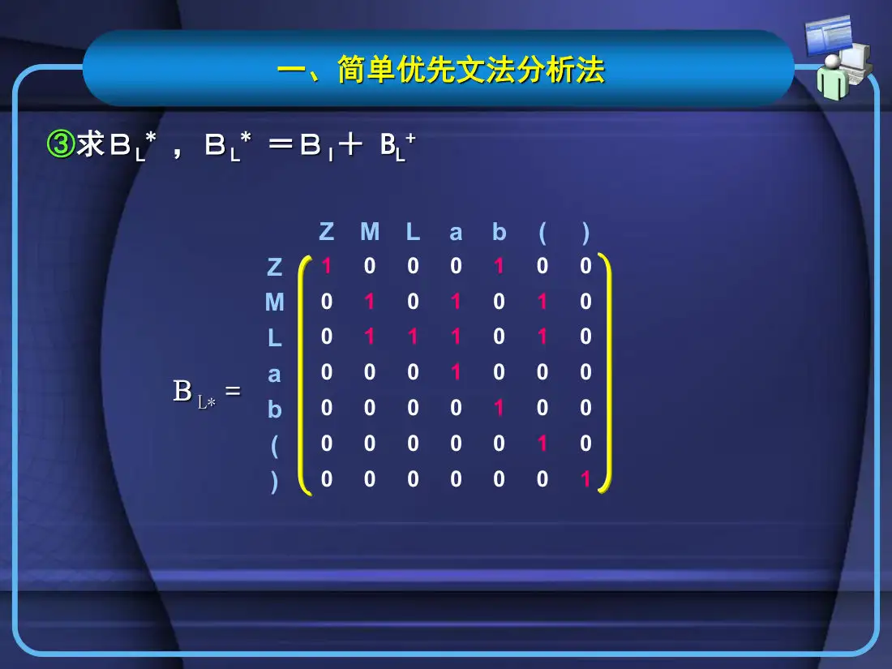

原文：

③求 $B_{L}^{*}$ ， $B_{L}^{*}=B_{I}+B_{L}^{+}$

$$
B _ {L ^ {*}} = \begin{array}{c} Z \\ M \\ L \\ a \\ b \\ (\\ ) \end{array} \left( \begin{array}{c c c c c c c} 1 & 0 & 0 & 0 & 1 & 0 & 0 \\ 0 & 1 & 0 & 1 & 0 & 1 & 0 \\ 0 & 1 & 1 & 1 & 0 & 1 & 0 \\ 0 & 0 & 0 & 1 & 0 & 0 & 0 \\ 0 & 0 & 0 & 0 & 1 & 0 & 0 \\ 0 & 0 & 0 & 0 & 0 & 1 & 0 \\ 0 & 0 & 0 & 0 & 0 & 0 & 1 \end{array} \right)
$$

一、简单优先文法分析法

### $$

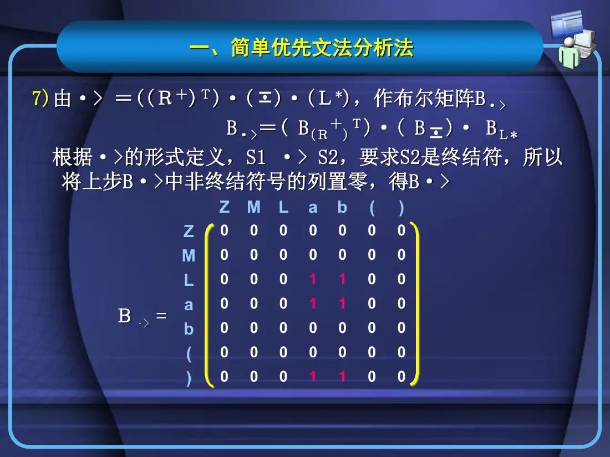

原文：

7) 由 $\cdot > = ((R^{+})^{\mathrm{T}})\cdot (\Xi)\cdot (L^{*})$ ，作布尔矩阵B.> B. $>$ $= (B_{(R^{+})}^{\mathrm{T}})\cdot (B_{\Xi})\cdot B_{L*}$

根据 • >的形式定义，S1 • > S2，要求S2是终结符，所以将上步B • >中非终结符号的列置零，得B • >

$$
B _ {\cdot \cdot} = \begin{array}{c c c c c c c c} & Z & M & L & a & b & ( & ) \\ Z & 0 & 0 & 0 & 0 & 0 & 0 & 0 \\ M & 0 & 0 & 0 & 0 & 0 & 0 & 0 \\ L & 0 & 0 & 0 & 1 & 1 & 0 & 0 \\ a & 0 & 0 & 0 & 1 & 1 & 0 & 0 \\ b & 0 & 0 & 0 & 0 & 0 & 0 & 0 \\ ( & 0 & 0 & 0 & 0 & 0 & 0 & 0 \\ ) & 0 & 0 & 0 & 1 & 1 & 0 & 0 \end{array}
$$

一、简单优先文法分析法

### 一、简单优先文法分析法

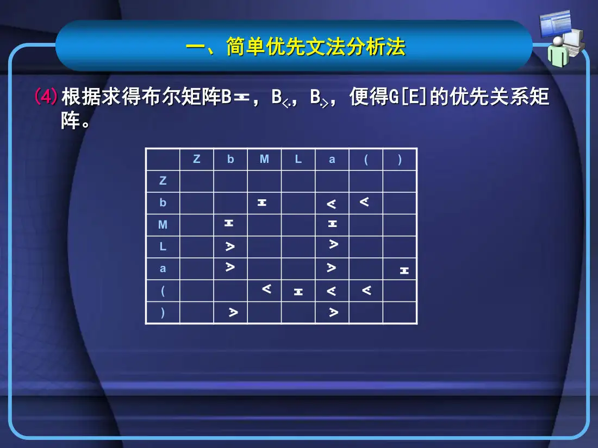

原文：

(4) 根据求得布尔矩阵 $B =$ ， $B_{<}$ ， $B_{>}$ ，便得 $G[E]$ 的优先关系矩阵。

<table><tr><td></td><td>Z</td><td>b</td><td>M</td><td>L</td><td>a</td><td>(</td><td>)</td></tr><tr><td>Z</td><td></td><td></td><td></td><td></td><td></td><td></td><td></td></tr><tr><td>b</td><td></td><td></td><td> $\overline{I}$ </td><td></td><td>&lt;</td><td>&lt;</td><td></td></tr><tr><td>M</td><td></td><td> $\overline{I}$ </td><td></td><td></td><td> $\overline{I}$ </td><td></td><td></td></tr><tr><td>L</td><td></td><td>&gt;</td><td></td><td></td><td>&gt;</td><td></td><td></td></tr><tr><td>a</td><td></td><td>&gt;</td><td></td><td></td><td>&gt;</td><td></td><td> $\overline{I}$ </td></tr><tr><td>(</td><td></td><td></td><td>&lt;</td><td> $\overline{I}$ </td><td>&lt;</td><td>&lt;</td><td></td></tr><tr><td>)</td><td></td><td>&gt;</td><td></td><td></td><td>&gt;</td><td></td><td></td></tr></table>

一、简单优先文法分析法
