# 《编译原理》算符优先关系矩阵计算（课件）

原件的每一页，下面附识别出的文字。

### 1. 算符优先关系概念

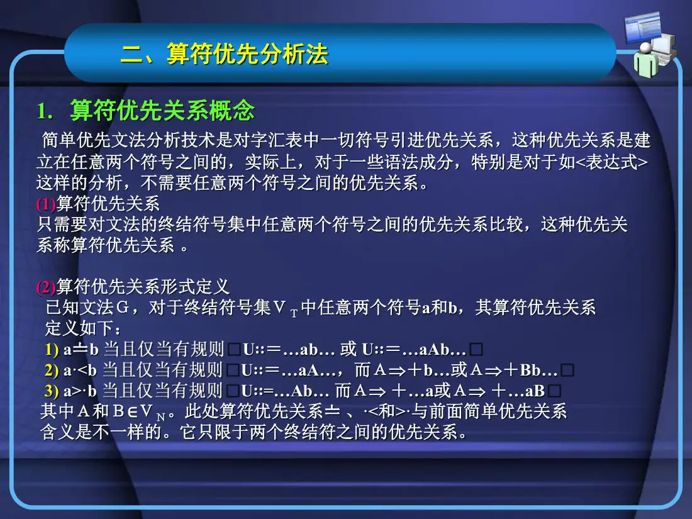

原文：

1. 算符优先关系概念

简单优先文法分析技术是对字汇表中一切符号引进优先关系，这种优先关系是建立在任意两个符号之间的，实际上，对于一些语法成分，特别是对于如<表达式>这样的分析，不需要任意两个符号之间的优先关系。

(1)算符优先关系

只需要对文法的终结符号集中任意两个符号之间的优先关系比较，这种优先关系称算符优先关系。

(2)算符优先关系形式定义
已知文法G，对于终结符号集 $V_T$ 中任意两个符号a和b，其算符优先关系定义如下：
1) a≠b 当且仅当有规则 □U::=...ab... 或 U::=...aAb... □
2) a·<b 当且仅当有规则 □U::=...aA..., 而 A⇒+b...或 A⇒+Bb... □
3) a>·b 当且仅当有规则 □U::=...Ab... 而 A⇒+...a或 A⇒+...aB□ 其中 A 和 B∈V\_N。此处算符优先关系≠、·<和>·与前面简单优先关系含义是不一样的。它只限于两个终结符之间的优先关系。

二、算符优先分析法

### 3. 算符优先关系的构造方法

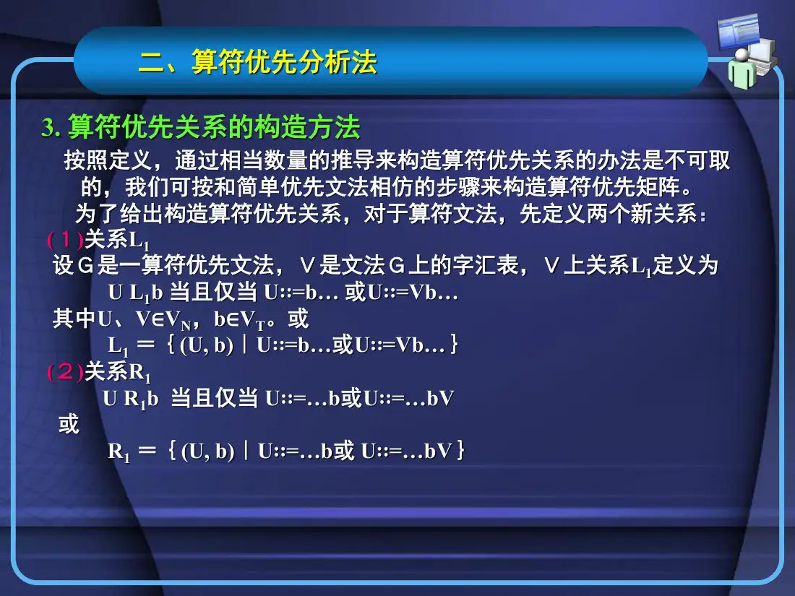

原文：

3. 算符优先关系的构造方法

按照定义，通过相当数量的推导来构造算符优先关系的办法是不可取的，我们可按和简单优先文法相仿的步骤来构造算符优先矩阵。为了给出构造算符优先关系，对于算符文法，先定义两个新关系：

设 G 是一算符优先文法，V 是文法 G 上的字汇表，V 上关系 $L_{1}$ 定义为 U $L_{1}b$ 当且仅当 U::=b... 或 U::=Vb...
其中 U、 $V \in V_{N}$ ， $b \in V_{T}$ 。或 $L_{1} = \{(U, b) | U::=b... \text{或} U::=Vb... \}$

(2)关系 $R_{1}$ $U R_{1}b$ 当且仅当 U: := ... b 或 U: := ... bV

或

$R_{1}=\left\{(U,b)\mid U::=...b或U::=...bV\right\}$

二、算符优先分析法

### (3) 算符优先关系的构造

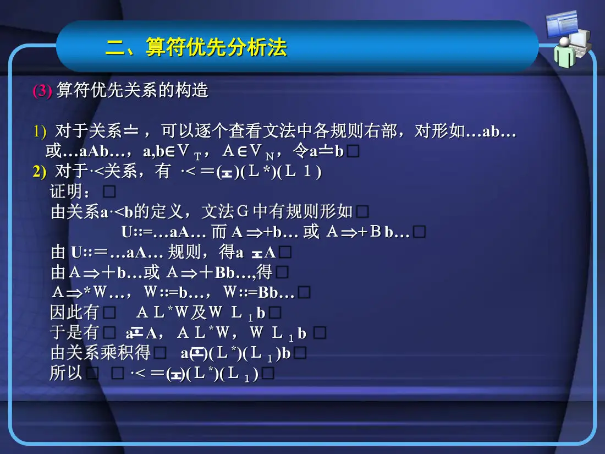

原文：

(3) 算符优先关系的构造

1) 对于关系 $\pm$ ，可以逐个查看文法中各规则右部，对形如...ab...或...aAb..., a,b∈V $_{T}$ ，A∈V $_{N}$ ，令a $\pm$ b□

2) 对于·<关系，有 $\cdot < = (\underline{\text{一}})(L^{*})(L1)$ 证明：□
由关系a·<b的定义，文法G中有规则形如□
U: := ... aA... 而 A ⇒ +b... 或 A ⇒ +Bb... □
由 U: := ... aA... 规则，得a ⊖A□
由 A ⇒ +b...或 A ⇒ +Bb..., 得□
A ⇒ \*W..., W: := b..., W: := Bb... □
因此有 □ AL \*W及WL $_{1}$ b□
于是有 □ a ⊖A, AL \*W, WL $_{1}$ b □
由关系乘积得 □ a ⊖(L $^{*}$ )(L $_{1}$ )b□
所以 □ □ · < = (■)(L $^{*}$ )(L $_{1}$ )□

二、算符优先分析法

### 求·<关系，即·<=(=)(L\*)(L1)，只要按下面步骤进行：

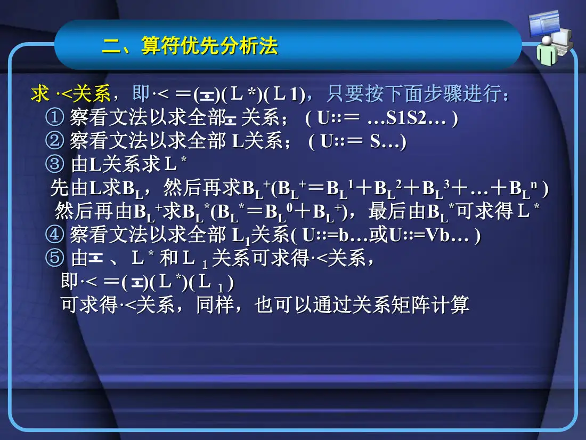

原文：

求·<关系，即·<=(=)(L\*)(L1)，只要按下面步骤进行：

① 察看文法以求全部≡关系；(U::= ...S1S2...)

② 察看文法以求全部 L 关系；(U::= S...)

③ 由L关系求 $L^{*}$ 先由L求 $B_{L}$ ，然后再求 $B_{L}^{+}(B_{L}^{+}=B_{L}^{1}+B_{L}^{2}+B_{L}^{3}+\ldots+B_{L}^{n})$ 然后再由 $B_{L}^{+}$ 求 $B_{L}^{*}(B_{L}^{*}=B_{L}^{0}+B_{L}^{+})$ ，最后由 $B_{L}^{*}$ 可求得 $L^{*}$ ④ 察看文法以求全部 $L_{1}$ 关系(U::=b...或U::=Vb...)

⑤ 由三、L\*和L₁关系可求得·<关系，即·<=(三)(L\*)(L₁) 可求得·<关系，同样，也可以通过关系矩阵计算

二、算符优先分析法

### 证明：

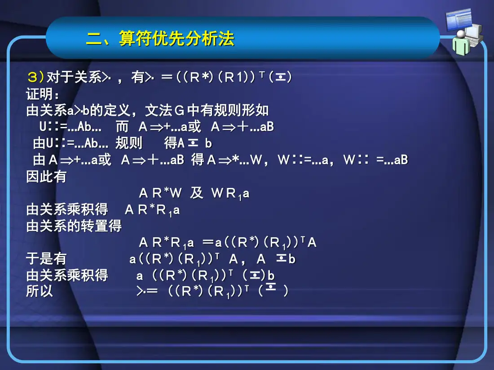

原文：

3) 对于关系\$\cdot\$，有\$\cdot\$=(\$(R^{\*})(R1)\$)^{\text{T}}(\$\boxminus\$)
证明：
由关系a>b的定义，文法G中有规则形如
U::=...Ab... 而 A\$\Rightarrow\$+...a或 A\$\Rightarrow\$+...aB
由U::=...Ab... 规则 得A\$\supseteq\$b
由A\$\Rightarrow\$+...a或 A\$\Rightarrow\$+...aB 得A\$\Rightarrow\$\*...W，W::=...a，W::=...aB
因此有
AR\*W 及 WR\$\_{1}\$a
由关系乘积得 AR\*R\$\_{1}\$a
由关系的转置得
AR\*R\$\_{1}\$a = a((R^{\*})(R\$\_{1}\$))^{\text{T}}A
于是有 a((R^{\*})(R\$\_{1}\$))^{\text{T}} A，A \$\supseteq\$b
由关系乘积得 a ((R^{\*})(R\$\_{1}\$))^{\text{T}} (\$\boxminus\$)b
所以 >\$=\$\$(R^{\*})(R\$\_{1}\$))^{\text{T}} (\$\boxminus\$ )

二、算符优先分析法

### ① 察看文法以求全部 R关系；（U::= … S）

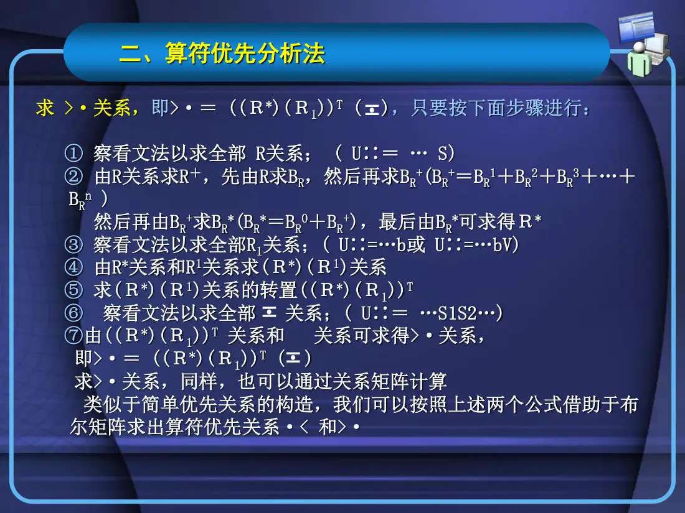

原文：

求 >·关系，即>·= $((R^{*})(R_{1}))^{\mathrm{T}}(\text{二})$ ，只要按下面步骤进行：

① 察看文法以求全部 R关系；（U::= … S）

② 由R关系求 $R^{+}$ ，先由R求 $B_{R}$ ，然后再求 $B_{R}^{+}(B_{R}^{+}=B_{R}^{1}+B_{R}^{2}+B_{R}^{3}+\cdots+B_{R}^{n})$

然后再由 $\mathrm{B_R^+}$ 求 $\mathrm{B_R^* (B_R^* = B_R^0 + B_R^+)}$ ，最后由 $\mathrm{B_R^*}$ 可求得 $\mathbb{R}^*$

③ 察看文法以求全部R $_{1}$ 关系；（U::=⋯b或 U::=⋯bV）

④ 由R\*关系和R $^{1}$ 关系求(R\*) (R $^{1}$ )关系

⑤ 求 $(R^{*})(R^{1})$ 关系的转置 $((R^{*})(R_{1}))^{\mathrm{T}}$

⑥ 察看文法以求全部 ⊖ 关系；（U: := …S1S2…）

⑦由 $((R^{*})(R_{1}))^{\mathrm{T}}$ 关系和 关系可求得>·关系，

$$
\bullet = \left(\left(R ^ {*}\right) \left(R _ {1}\right)\right) ^ {T}
$$

求>·关系，同样，也可以通过关系矩阵计算
类似于简单优先关系的构造，我们可以按照上述两个公式借助于布尔矩阵求出算符优先关系·<和>·

二、算符优先分析法

### 例4.11 构造文法G [E] 的算符优先矩阵。□

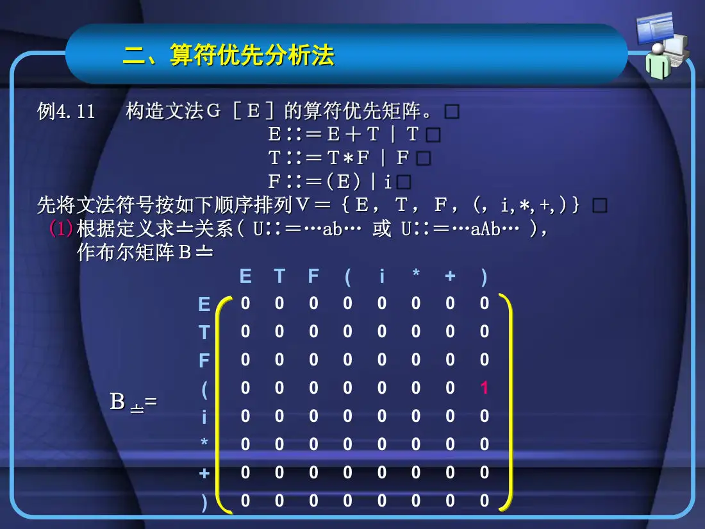

原文：

例4.11 构造文法G [E] 的算符优先矩阵。□
E ::= E + T | T □
T ::= T \* F | F □
F ::= (E) | i □

先将文法符号按如下顺序排列 V = { E, T, F, (, i, \*, +,) } □
(1) 根据定义求≡关系 ( U::=⋯ab⋯ 或 U::=⋯aAb⋯ )，
作布尔矩阵 B ≡

$$
\mathrm{B} _ {\pm} =
$$

$$
\begin{array}{c c c c c c c c} & E & T & F & ( & i & * & + & ) \\ E & 0 & 0 & 0 & 0 & 0 & 0 & 0 & 0 \\ T & 0 & 0 & 0 & 0 & 0 & 0 & 0 & 0 \\ F & 0 & 0 & 0 & 0 & 0 & 0 & 0 & 0 \\ ( & 0 & 0 & 0 & 0 & 0 & 0 & 0 & 1 \\ i & 0 & 0 & 0 & 0 & 0 & 0 & 0 & 0 \\ * & 0 & 0 & 0 & 0 & 0 & 0 & 0 & 0 \\ + & 0 & 0 & 0 & 0 & 0 & 0 & 0 & 0 \\ ) & 0 & 0 & 0 & 0 & 0 & 0 & 0 & 0 \end{array}
$$

二、算符优先分析法

### (2) 作布尔矩阵 B< 求< 关系, < = (≡) (L\*) (L 1)

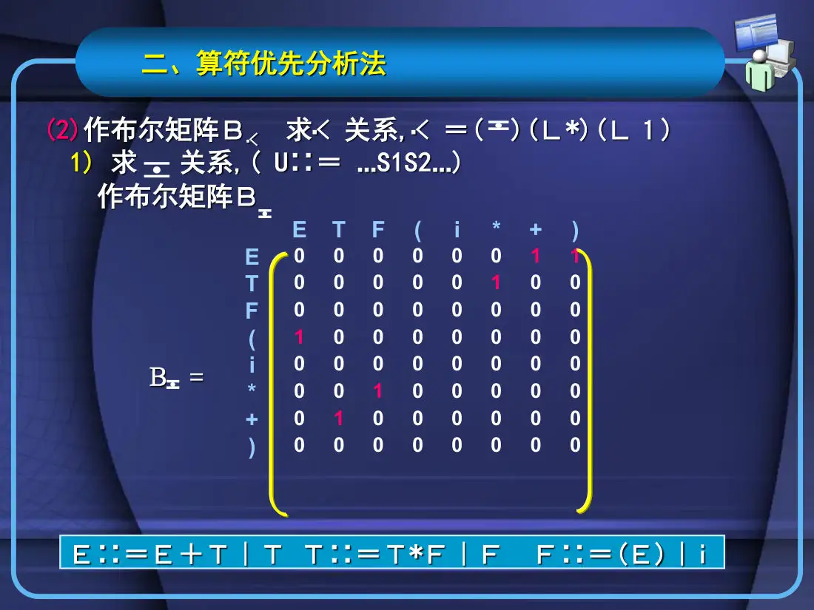

原文：

(2) 作布尔矩阵 B< 求< 关系, < = (≡) (L\*) (L 1)
1) 求 ⊖ 关系, (U: := ...S1S2...)
作布尔矩阵 B

$$
B _ {\text {工}} = \begin{array}{c c c c c c c c c} & E & T & F & ( & i & * & + & ) \\ E & 0 & 0 & 0 & 0 & 0 & 0 & 1 & 1 \\ T & 0 & 0 & 0 & 0 & 0 & 1 & 0 & 0 \\ F & 0 & 0 & 0 & 0 & 0 & 0 & 0 & 0 \\ ( & 1 & 0 & 0 & 0 & 0 & 0 & 0 & 0 \\ i & 0 & 0 & 0 & 0 & 0 & 0 & 0 & 0 \\ * & 0 & 0 & 1 & 0 & 0 & 0 & 0 & 0 \\ + & 0 & 1 & 0 & 0 & 0 & 0 & 0 & 0 \\ ) & 0 & 0 & 0 & 0 & 0 & 0 & 0 & 0 \end{array}
$$

E ::= E + T | T T ::= T \* F | F F ::= (E) | i

二、算符优先分析法

### $$

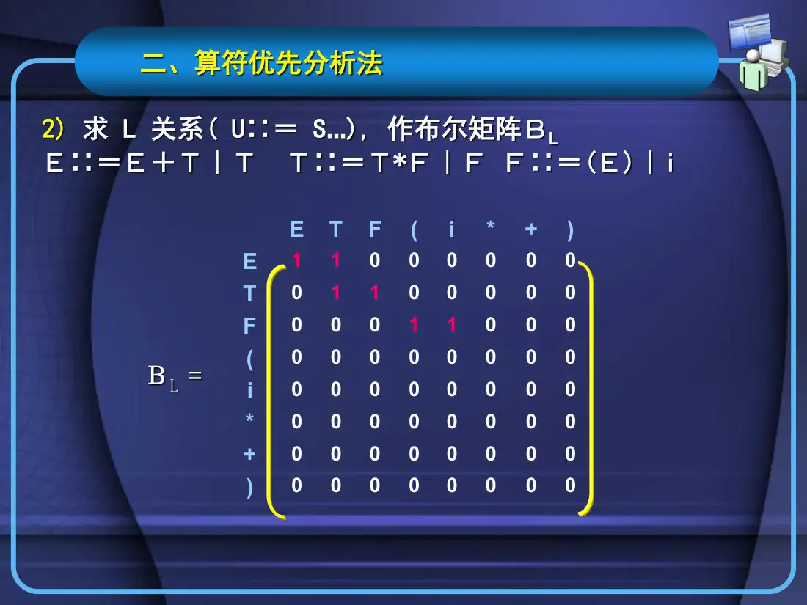

原文：

2) 求 L 关系 (U::= S...), 作布尔矩阵 B $_{L}$ E::=E+T | T    T::=T\*F | F    F::=(E) | i

$$
B _ {L} = \left( \begin{array}{c c c c c c c c} & E & T & F & ( & i & * & + & ) \\ E & 1 & 1 & 0 & 0 & 0 & 0 & 0 & 0 \\ T & 0 & 1 & 1 & 0 & 0 & 0 & 0 & 0 \\ F & 0 & 0 & 0 & 1 & 1 & 0 & 0 & 0 \\ ( & 0 & 0 & 0 & 0 & 0 & 0 & 0 & 0 \\ i & 0 & 0 & 0 & 0 & 0 & 0 & 0 & 0 \\ * & 0 & 0 & 0 & 0 & 0 & 0 & 0 & 0 \\ + & 0 & 0 & 0 & 0 & 0 & 0 & 0 & 0 \\ ) & 0 & 0 & 0 & 0 & 0 & 0 & 0 & 0 \end{array} \right)
$$

二、算符优先分析法

### 3) 由 $B_{L}$ 求 $B_{L}^{*}$

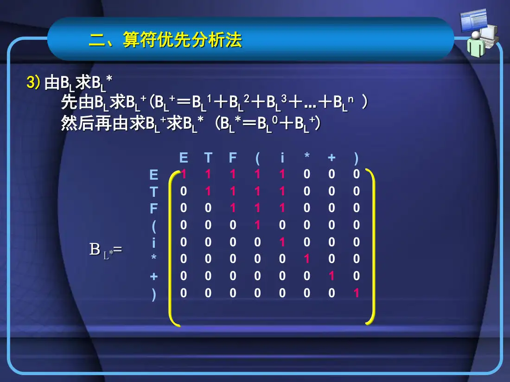

原文：

3) 由 $B_{L}$ 求 $B_{L}^{*}$

先由 $B_{L}$ 求 $B_{L}^{+}(B_{L}^{+}=B_{L}^{1}+B_{L}^{2}+B_{L}^{3}+\ldots+B_{L}^{n})$ 然后再由求 $B_{L}^{+}$ 求 $B_{L}^{*}(B_{L}^{*}=B_{L}^{0}+B_{L}^{+})$

$$
B _ {L ^ {*}} = \begin{array}{c c c c c c c c c} & E & T & F & ( & i & * & + & ) \\ E & 1 & 1 & 1 & 1 & 1 & 0 & 0 & 0 \\ T & 0 & 1 & 1 & 1 & 1 & 0 & 0 & 0 \\ F & 0 & 0 & 1 & 1 & 1 & 0 & 0 & 0 \\ ( & 0 & 0 & 0 & 1 & 0 & 0 & 0 & 0 \\ i & 0 & 0 & 0 & 0 & 1 & 0 & 0 & 0 \\ * & 0 & 0 & 0 & 0 & 0 & 1 & 0 & 0 \\ + & 0 & 0 & 0 & 0 & 0 & 0 & 1 & 0 \\ ) & 0 & 0 & 0 & 0 & 0 & 0 & 0 & 1 \end{array}
$$

二、算符优先分析法

### $$

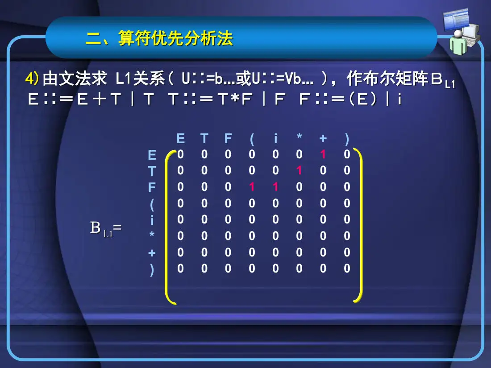

原文：

4) 由文法求 L1 关系 (U::=b...或U::=Vb... )，作布尔矩阵 B $_{L1}$ E::=E+T | T T::=T\*F | F F::=(E) | i

$$
B _ {L 1} = \begin{array}{c c c c c c c c c} & E & T & F & ( & i & * & + & ) \\ E & 0 & 0 & 0 & 0 & 0 & 0 & 1 & 0 \\ T & 0 & 0 & 0 & 0 & 0 & 1 & 0 & 0 \\ F & 0 & 0 & 0 & 1 & 1 & 0 & 0 & 0 \\ ( & 0 & 0 & 0 & 0 & 0 & 0 & 0 & 0 \\ i & 0 & 0 & 0 & 0 & 0 & 0 & 0 & 0 \\ * & 0 & 0 & 0 & 0 & 0 & 0 & 0 & 0 \\ + & 0 & 0 & 0 & 0 & 0 & 0 & 0 & 0 \\ ) & 0 & 0 & 0 & 0 & 0 & 0 & 0 & 0 \end{array}
$$

二、算符优先分析法

### $$

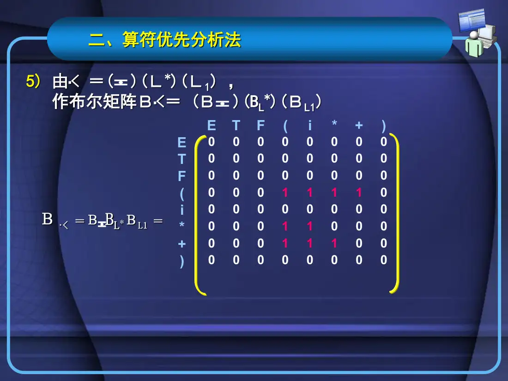

原文：

5) 由 $< = (\mp)(L^{*})(L_{1})$ ，作布尔矩阵 $B < = (B \mp)(B_{L}^{*})(B_{L1})$

$$
B _ {\cdot \leftarrow} = B _ {\text {三}} B _ {L ^ {*}} B _ {L 1} = \begin{array}{c c c c c c c c c} & E & T & F & ( & i & * & + & ) \\ E & 0 & 0 & 0 & 0 & 0 & 0 & 0 & 0 \\ T & 0 & 0 & 0 & 0 & 0 & 0 & 0 & 0 \\ F & 0 & 0 & 0 & 0 & 0 & 0 & 0 & 0 \\ ( & 0 & 0 & 0 & 1 & 1 & 1 & 1 & 0 \\ i & 0 & 0 & 0 & 0 & 0 & 0 & 0 & 0 \\ * & 0 & 0 & 0 & 1 & 1 & 0 & 0 & 0 \\ + & 0 & 0 & 0 & 1 & 1 & 1 & 0 & 0 \\ ) & 0 & 0 & 0 & 0 & 0 & 0 & 0 & 0 \end{array}
$$

二、算符优先分析法

### 1) 由文法以求 R关系 (U::= ...S), 作布尔矩阵 BR

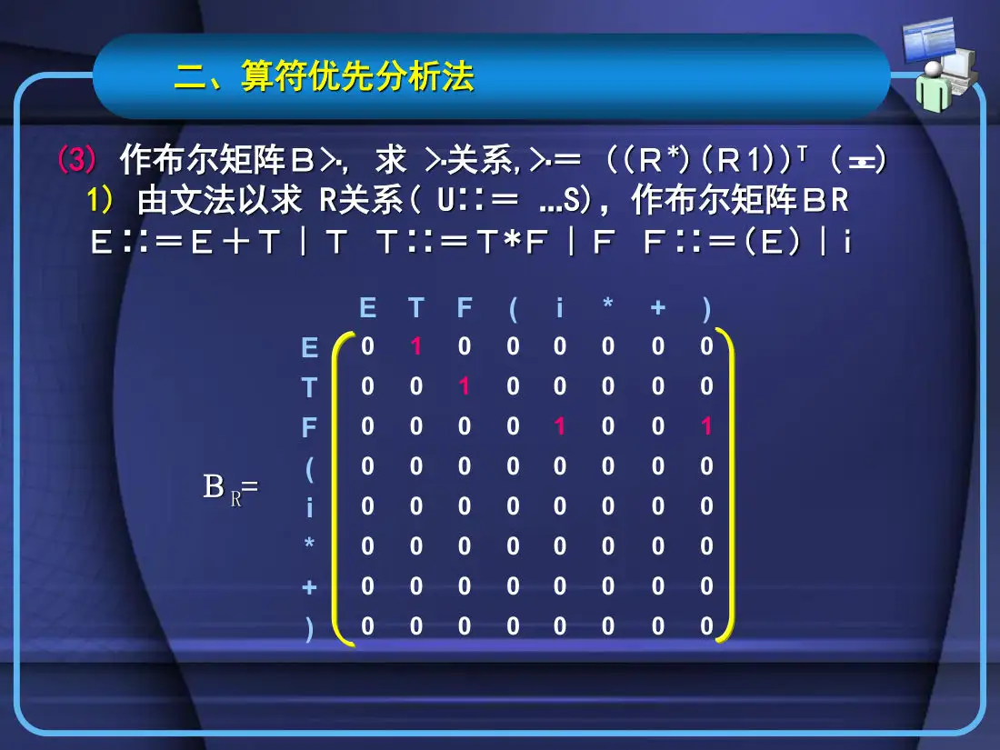

原文：

(3) 作布尔矩阵 B>, 求 >关系, >= ((R\*) (R1)) $^{T}$ (=)
1) 由文法以求 R关系 (U::= ...S), 作布尔矩阵 BR
E::= E + T | T T::= T \* F | F F::= (E) | i

$$
B _ {R} = \begin{array}{c c c c c c c c c} & E & T & F & ( & i & * & + & ) \\ E & 0 & 1 & 0 & 0 & 0 & 0 & 0 & 0 \\ T & 0 & 0 & 1 & 0 & 0 & 0 & 0 & 0 \\ F & 0 & 0 & 0 & 0 & 1 & 0 & 0 & 1 \\ (\quad) & 0 & 0 & 0 & 0 & 0 & 0 & 0 & 0 \\ i & 0 & 0 & 0 & 0 & 0 & 0 & 0 & 0 \\ * & 0 & 0 & 0 & 0 & 0 & 0 & 0 & 0 \\ + & 0 & 0 & 0 & 0 & 0 & 0 & 0 & 0 \\ ) & 0 & 0 & 0 & 0 & 0 & 0 & 0 & 0 \end{array}
$$

二、算符优先分析法

### $$

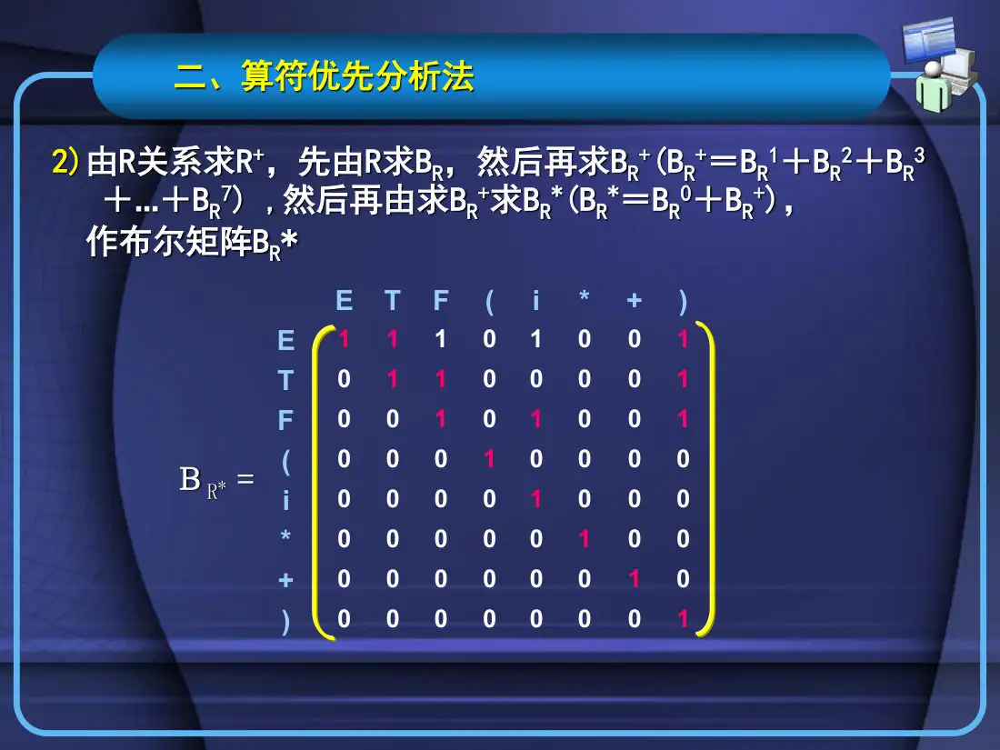

原文：

2) 由R关系求 $R^{+}$ ，先由R求 $B_{R}$ ，然后再求 $B_{R}^{+}(B_{R}^{+}=B_{R}^{1}+B_{R}^{2}+B_{R}^{3}+\ldots+B_{R}^{7})$ ，然后再由求 $B_{R}^{+}$ 求 $B_{R}^{*}(B_{R}^{*}=B_{R}^{0}+B_{R}^{+})$ ，作布尔矩阵 $B_{R}^{*}$

$$
B _ {R ^ {*}} = \begin{array}{c} E \\ T \\ F \\ (\\ i \\ * \\ + \\ ) \end{array} \left( \begin{array}{c c c c c c c c} E & T & F & ( & i & * & + & ) \\ 1 & 1 & 1 & 0 & 1 & 0 & 0 & 1 \\ 0 & 1 & 1 & 0 & 0 & 0 & 0 & 1 \\ 0 & 0 & 1 & 0 & 1 & 0 & 0 & 1 \\ 0 & 0 & 0 & 1 & 0 & 0 & 0 & 0 \\ 0 & 0 & 0 & 0 & 1 & 0 & 0 & 0 \\ 0 & 0 & 0 & 0 & 0 & 1 & 0 & 0 \\ 0 & 0 & 0 & 0 & 0 & 0 & 1 & 0 \\ 0 & 0 & 0 & 0 & 0 & 0 & 1 & 0 \\ 0 & 0 & 0 & 0 & 0 & 0 & 0 & 1 \end{array} \right)
$$

二、算符优先分析法

### $$

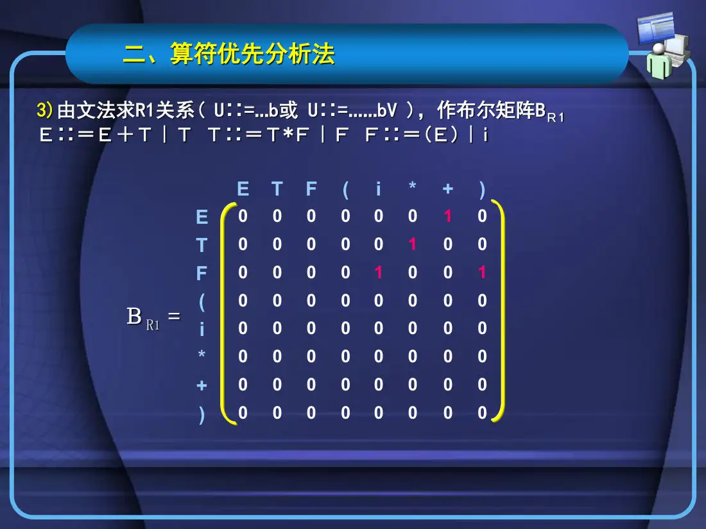

原文：

3) 由文法求R1关系（U::=...b或 U::=......bV），作布尔矩阵B $_{R1}$ E::=E+T | T T::=T\*F | F F::=(E) | i

$$
B _ {R 1} = \begin{array}{c c c c c c c c c} & E & T & F & ( & i & * & + & ) \\ E & 0 & 0 & 0 & 0 & 0 & 0 & 1 & 0 \\ T & 0 & 0 & 0 & 0 & 0 & 1 & 0 & 0 \\ F & 0 & 0 & 0 & 0 & 1 & 0 & 0 & 1 \\ (\quad) & 0 & 0 & 0 & 0 & 0 & 0 & 0 & 0 \\ i & 0 & 0 & 0 & 0 & 0 & 0 & 0 & 0 \\ * & 0 & 0 & 0 & 0 & 0 & 0 & 0 & 0 \\ + & 0 & 0 & 0 & 0 & 0 & 0 & 0 & 0 \\ ) & 0 & 0 & 0 & 0 & 0 & 0 & 0 & 0 \end{array}
$$

二、算符优先分析法

### $$

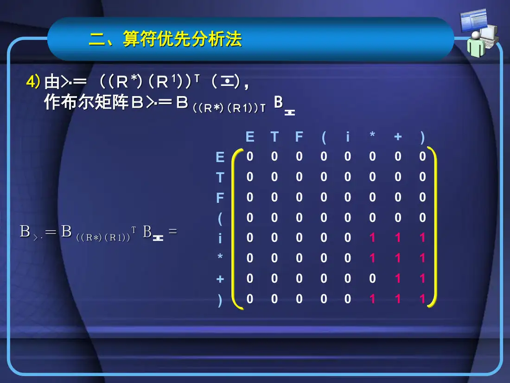

原文：

4) 由 $\geqslant = ((R^{*})(R^{1}))^{\mathrm{T}}(\text{三})$ ，作布尔矩阵 $B \geqslant = B_{((R^{*})(R^{1}))^{\mathrm{T}}}B_{\text{三}}$

$$
\mathrm{B} _ {> \cdot} = \mathrm{B} _ {\left((\mathrm{R} *) (\mathrm{R} 1)\right) ^ {\mathrm{T}}} \mathrm{B} _ {\text {三}} =
$$

$$
\begin{array}{c c c c c c c c} & E & T & F & ( & i & * & + & ) \\ E & 0 & 0 & 0 & 0 & 0 & 0 & 0 & 0 \\ T & 0 & 0 & 0 & 0 & 0 & 0 & 0 & 0 \\ F & 0 & 0 & 0 & 0 & 0 & 0 & 0 & 0 \\ ( & 0 & 0 & 0 & 0 & 0 & 0 & 0 & 0 \\ i & 0 & 0 & 0 & 0 & 0 & 1 & 1 & 1 \\ * & 0 & 0 & 0 & 0 & 0 & 1 & 1 & 1 \\ + & 0 & 0 & 0 & 0 & 0 & 0 & 1 & 1 \\ ) & 0 & 0 & 0 & 0 & 0 & 1 & 1 & 1 \end{array}
$$

二、算符优先分析法

### 算符优先关系矩阵

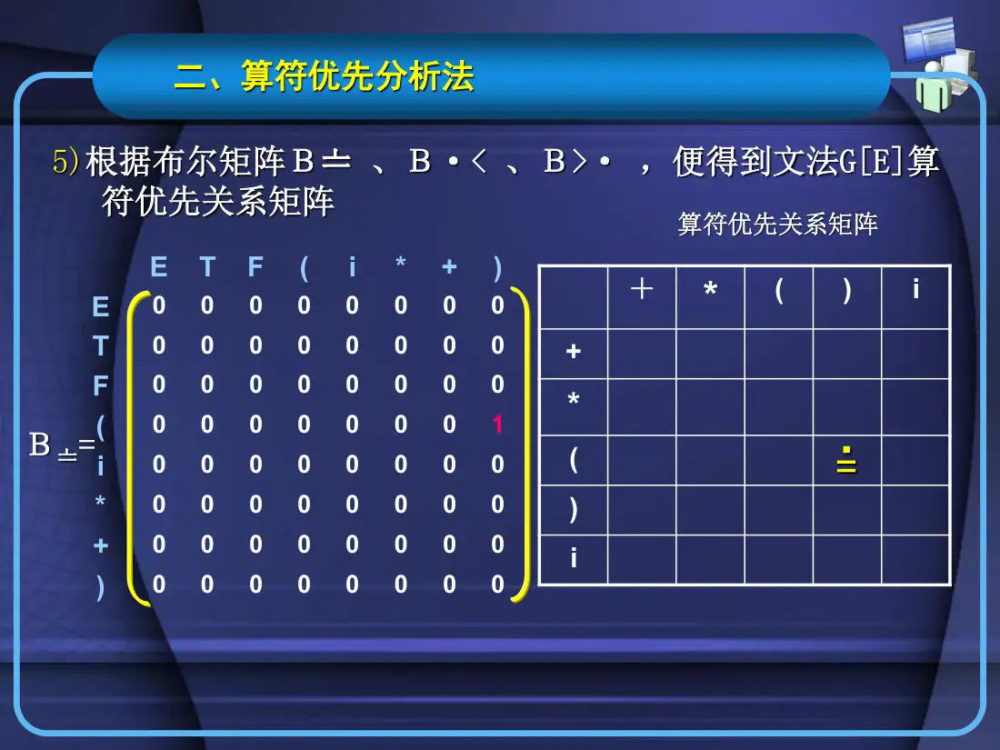

原文：

5) 根据布尔矩阵 B ≡ 、 B • < 、 B > • ，便得到文法 G [E] 算符优先关系矩阵
算符优先关系矩阵

算符优先关系矩阵

$$
B _ {\pm} = \left( \begin{array}{c c c c c c c c} & E & T & F & ( & i & * & + & ) \\ E & 0 & 0 & 0 & 0 & 0 & 0 & 0 & 0 \\ T & 0 & 0 & 0 & 0 & 0 & 0 & 0 & 0 \\ F & 0 & 0 & 0 & 0 & 0 & 0 & 0 & 0 \\ (i & 0 & 0 & 0 & 0 & 0 & 0 & 1 \\ * & 0 & 0 & 0 & 0 & 0 & 0 & 0 \\ + & 0 & 0 & 0 & 0 & 0 & 0 & 0 \\ ) & 0 & 0 & 0 & 0 & 0 & 0 & 0 \end{array} \right)
$$

$$
\begin{array}{c c c c c} & + & * & ( & ) & i \\ \hline + & & & & \\ * & & & & \\ ( & & & = & \\ ) & & & & \\ i & & & & \end{array}
$$

二、算符优先分析法

### 5) 根据布尔矩阵 B = 、 B  ，便得到文法G[E]算符优先关系矩阵

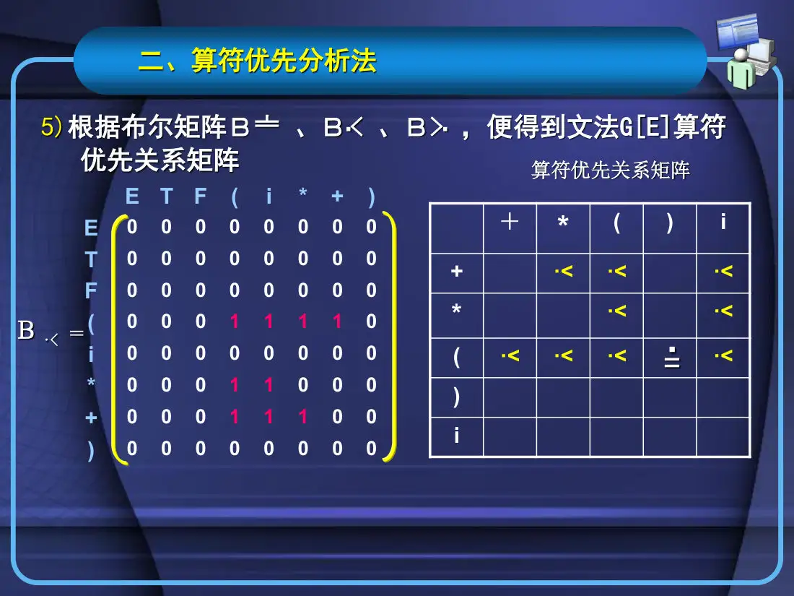

原文：

5) 根据布尔矩阵 B = 、 B < 、 B > ，便得到文法G[E]算符优先关系矩阵
算符优先关系矩阵

$$
B _ {\cdot \cdot} = \left( \begin{array}{c c c c c c c c} & E & T & F & ( & i & * & + & ) \\ E & 0 & 0 & 0 & 0 & 0 & 0 & 0 & 0 \\ T & 0 & 0 & 0 & 0 & 0 & 0 & 0 & 0 \\ F & 0 & 0 & 0 & 0 & 0 & 0 & 0 & 0 \\ i & 0 & 0 & 0 & 1 & 1 & 1 & 1 & 0 \\ * & 0 & 0 & 0 & 0 & 0 & 0 & 0 & 0 \\ + & 0 & 0 & 0 & 1 & 1 & 0 & 0 & 0 \\ ) & 0 & 0 & 0 & 1 & 1 & 1 & 0 & 0 \\ \end{array} \right)
$$

<table><tr><td></td><td>+</td><td>*</td><td>(</td><td>)</td><td>i</td></tr><tr><td>+</td><td></td><td>&lt;</td><td>&lt;</td><td></td><td>&lt;</td></tr><tr><td>*</td><td></td><td></td><td>&lt;</td><td></td><td>&lt;</td></tr><tr><td>(</td><td>&lt;</td><td>&lt;</td><td>&lt;</td><td>=</td><td>&lt;</td></tr><tr><td>)</td><td></td><td></td><td></td><td></td><td></td></tr><tr><td>i</td><td></td><td></td><td></td><td></td><td></td></tr></table>

二、算符优先分析法

### 5) 根据布尔矩阵 B = 、 B  ，便得到文法G [E]算符优先关系矩阵

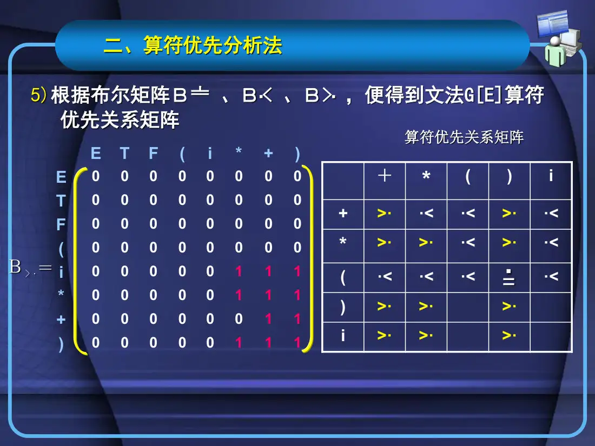

原文：

5) 根据布尔矩阵 B = 、 B < 、 B > ，便得到文法G [E]算符优先关系矩阵

算符优先关系矩阵

$$
B _ {>}. = \left( \begin{array}{c c c c c c c c} & E & T & F & ( & i & * & + \\ E & 0 & 0 & 0 & 0 & 0 & 0 & 0 \\ T & 0 & 0 & 0 & 0 & 0 & 0 & 0 \\ F & 0 & 0 & 0 & 0 & 0 & 0 & 0 \\ ( & 0 & 0 & 0 & 0 & 0 & 0 & 0 \\ i & 0 & 0 & 0 & 0 & 1 & 1 & 1 \\ * & 0 & 0 & 0 & 0 & 1 & 1 & 1 \\ + & 0 & 0 & 0 & 0 & 0 & 1 & 1 \\ ) & 0 & 0 & 0 & 0 & 1 & 1 & 1 \end{array} \right)
$$

$$
\begin{array}{c c c c c c} & + & * & ( & ) & i \\ \hline + & >. & <   & <   & >. & <   \\ * & >. & >. & <   & >. & <   \\ \hline ( & <   & <   & <   & = & <   \\ \hline) & >. & >. & & >. \\ \hline i & >. & >. & & >. \end{array}
$$

二、算符优先分析法
