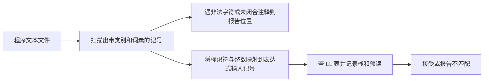

# 《编译原理》课程实验教学大纲

这份导读对应 2014 年编写的历史实验大纲。大纲在课程 B0301141S 的 48 学时内安排了两项必做实验，各 4 个上机学时，分别手工构造词法分析器和 LL(1) 语法分析器。原件把实验计入平时考核，约占课程总成绩 10%，并结合准备、课堂表现、结果和报告评分；它不是现行任课安排。原件主表按单人组列出，第二项附录允许两人分工做表和驱动；当前实践应以当期要求为准。

两项实验接在一起，但交付物不同。第一项把字符变成带类别的记号，第二项判断哪些记号按语法能构成一句话。一个记号合法，绝不意味着它出现的位置合法。



## 实验一：文件输入、预处理与词法编码（原件第 3–4 页）

能让用户录入并保存程序，也要实际从文件读入待分析文本，而不是把示例字符串写死。按原件示例的类别号，分别输出 **1 保留字、2 标识符、3 无符号整数、4 运算符、5 分隔符**，并同时输出原词素。标识符从字母或下划线起步，之后才允许数字；先读完名字再查保留字表，避免把以保留字开头的长名字拆错。运算符应按能匹配的最长形式处理，例如 `>=` 属一个记号；与它外观相近的 `> =` 则是两个记号。负号不是无符号整数的一部分。

原件要求展示去掉注释和多余空白的预处理结果。==删掉字符不能删掉词素边界==：如果直接把 `int/**/_sum` 拼成 `int_sum`，保留字和变量名会被错当成一个标识符。可在扫描时跳过注释和空白，另生成保留必要分隔的预处理视图，同时保留原文行列号以供报错。若扩展到含字符串文字的语言，还要先识别所在状态，不能把字符串内部的注释状字符误删。

| 独立试例 | 预期记号或诊断 |
|---|---|
| `int/**/_sum;` | `(1,int) (2,_sum) (5,;)` |
| `ifx>=20` | `(2,ifx) (4,>=) (3,20)` |
| `-3` | `(4,-) (3,3)`；这不表示下一实验的表达式文法一定允许一元负号 |
| 遇到 `/*` 后一直读到文件末尾 | 报未闭合注释，指到开始位置，不能当成已经正常处理完毕 |

原件后面的思考题把常见失误放在一起。可按层次区分：关键字被归类为标识符、注释未配对是词法或记号化错误；词素都合法但搭不出句子是语法错误；语句形状正确而赋值两侧类型不兼容，属于语义检查，不能指望扫描器由字符判断。参见 [词法分析器功能](../../../topics/编译原理/词法分析器功能.md) 与 [单词编码与预处理](../../../topics/编译原理/单词编码与预处理.md)。

## 实验二：把左递归文法改成能预测的形式（第 5–6 页）

目标是识别只由操作数、加法、乘法和括号组成的表达式，显示全过程，而不是只报“对”或“错”。原件的表达式与项规则有直接左递归，直接用它们做自顶向下预测，会在尚未消费输入时重新要求解析自己。将“先有一项或一个因子，后面可继续零次以上”写成单独的尾部状态：

```text
E → T Q         Q → + T Q | ε
T → F R         R → * F R | ε
F → ( E ) | i
```

由此从词法接到语法：`i` 是操作数记号类别，不是要求用户实际输入字母 i；标识符或无符号整数都可映射到这个类别。真正的值与名字若仍有用，可以另作属性保存。输入末尾用结束标记 `#`，不是要求用户多写一个字符。

| 非终结符 | FIRST | FOLLOW | 分析表精炼表示 |
|---|---|---|---|
| E | `(, i` | `), #` | 在 `(`、`i` 上选择 `TQ` |
| Q | `+, ε` | `), #` | `+` 上用 `+TQ`；`)`、`#` 上用空规则 |
| T | `(, i` | `+, ), #` | 在 `(`、`i` 上选择 `FR` |
| R | `*, ε` | `+, ), #` | `*` 上用 `*FR`；`+`、`)`、`#` 上用空规则 |
| F | `(, i` | `*, +, ), #` | `(` 上用 `(E)`；`i` 上用 `i` |

表共有 13 个非空格，无冲突；未列项报错。驱动初始栈从底到顶放 `# E`。展开非终结符时将右部倒序入栈，不前进输入；终结符才和预读匹配并消费；两侧均到结束标记才成功。用一张追踪表同时记当前栈、未读记号、所用产生式或匹配结果。参见 [LL(1) 分析法](../../../topics/编译原理/LL1分析法.md)。

> [!TIP]
> 新例 `index+2*(mask+7)` 映射成 `i+i*(i+i)`，可接受。检查到第一个加号时，先用 R 的空规则结束前一项，==此时不消费加号==，再交给 Q 匹配。只确认“最终成功”会漏掉错误的空规则消费；同时运行 `index+2*`、多右括号、缺因子三个失败用例。

原件进一步问能否让用户自行输入规则。可把表生成器拆出：先统一终结符、非终结符、开始符号及空串记法，再检测直接和间接左递归，求 FIRST 与 FOLLOW 的不动点，填表并保留冲突所在格。存在冲突时应输出诊断，不能任取一个产生式继续；不是任意上下文无关文法都能获得一张等价且无冲突的 LL(1) 表。参见 [自顶向下分析中的问题](../../../topics/编译原理/自顶向下问题与解决.md)。

## 报告与验收（原件第 1–2 页及两附录）

报告说明任务、输入输出和工具环境，写出算法及组件怎样衔接，再附成功和失败的实验轨迹、错误原因与改进。第一项附记号规则和一份真实可重跑的文件；第二项附改写文法、集合、分析表和运行记录。异地复现时可换集成开发环境；历史大纲中列出的工具并非限定只能使用旧版本。与其只提交最后截图，不如给读者一组最小输入，让其独立判断“边界有没有保住、失败发生在哪一层”。
