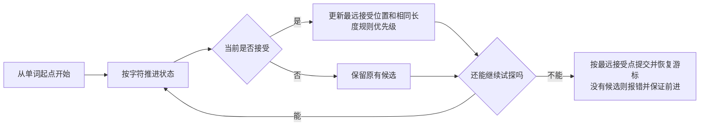
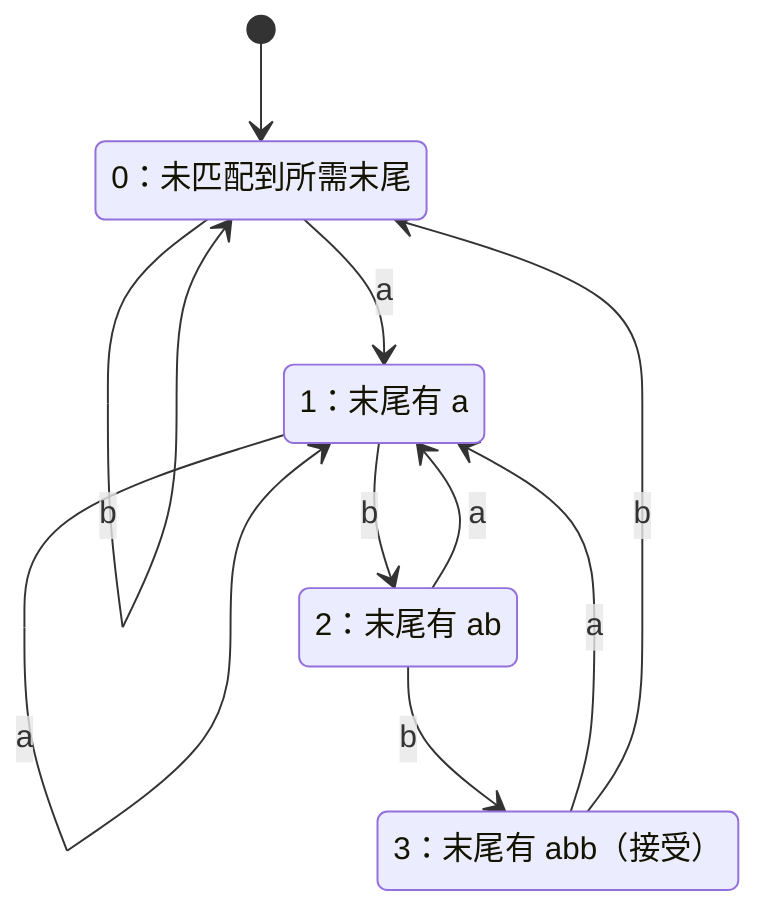

# 词法分析伴读：最远接受点与有穷自动机

词法分析器只有一串字符，却要交给语法分析器一个个有边界、有类别的单词符号。困难并不是「把字符逐个读掉」，而是：已经能结束时，要不要继续读？继续读失败后，刚才读过的字符归谁？这份历史课件伴读用新规则和新算例回答这些问题，不照录原课件或教材题，不代表现行考核范围。

## 先识别词形，再决定给下游什么

文本中的 x7 是**词素**；扫描后可以交出「标识符」这个类别，加上 x7 的名字表入口及源码位置。同样，读到整数词素 004 时，可以保留原始区间，另附十进制数值 4；保留字、定界符和运算符通常用类别本身就能说明作用，不需要额外值。类别、值和源码区间的职责不同，所以两个名字可以同属一个类别，而诊断仍能准确指出其中一个。

词法错误如不能纳入任何规则的非法字符、到文件尾仍未闭合的串或块注释；声明是否重复、变量是否已声明，通常需语法或语义层的上下文，存储布局也不是一般扫描器的职责。课件由简化实现介绍名字、常量和存储处理；不要把这种分工当成词法分析的定义。独立扫描可以先产生一个单词序列供下游使用；按需扫描可让语法分析器每次取一个符号；不论手写分支或状态矩阵驱动，保持同一输出约定才可以替换实现。参见[词法分析器功能](../../../topics/编译原理/词法分析器功能.md)和[单词编码与预处理](../../../topics/编译原理/单词编码与预处理.md)。

## 停在接受态，不等于现在就应提交

**补充。** 设教学规则识别保留字 let、普通标识符（字母开头，后接零个或多个字母、数字）、整数字面量（一串数字）、带指数的字面量（整数后接 e、可选的正负号、至少一位数字），以及 :=、:、<=、< 和 +，跳过空白。规则采用最长匹配，同长度时保留字优先。怎样扫描「let let7:=12e+<4」？

**参考解答。** 对 let，保留字和标识符都能接受同样长的前缀，于是保留字优先；对 let7，虽然读到 let 时已经形成候选，但标识符还能走一步，要用更长的候选。看见冒号时也保留接受点，同时再试一个等号。最容易出错的是 12e+：读到 12 时整数已接受，读入 e 和加号只是进入指数的中间态。后面是小于号而不是数字，因此要回到 12 的末尾；e 和加号分属随后两个词。不能只退一格。按左闭右开的字符区间（从零开始）核算：

| 区间 | 词素 | 送出的类别 |
|---|---|---|
| [0,3) | let | 保留字 |
| [4,8) | let7 | 标识符 |
| [8,10) | := | 赋值 |
| [10,12) | 12 | 整数 |
| [12,13) | e | 标识符 |
| [13,14) | + | 加号 |
| [14,15) | < | 小于号 |
| [15,16) | 4 | 整数 |

换成 12e+3 时，最后一次接受发生在 3 之后，整个片段才是同一个带指数字面量。这是为解释扫描规则而设的行为；若具体语言要求把不完整指数作为一个错误，则须明确加入错误规则，而不是假定通用策略自动做到。

第 74 页介绍了另一种名称冲突：某些旧式 Fortran 方言中，语句前缀究竟是循环关键字还是变量名，不能只看其开头，需要再读后续上下文。这里的保留字 let 则能用完整词素直接判别。不是每门语言都可以把关键字识别机械地化成同一张表。

缓冲区里至少区分词素起点、试探指针、最远接受位置；分块边界并不是输入结束。双缓冲可以交替装填，跨块仍保留必要字符；遇到超长标识符，要扩容、续存或按规范诊断，不能用固定容量悄悄拆词。文件结束用长度或独立哨兵区分，不能把合法字节误作结束。只有在语言规则确认无意义的位置才略过空白和注释：把 let let7 的所有空白先删除会拼成另一个词，在字符串、缩进敏感语法和诊断位置信息上也会出问题。==遇到共享前缀，先记录接受点，再决定交付；遇到分块边界，先判断是否真正到尾。==

## 从一条正规式到一张状态表

下面用另设的二字母语言贯通[正规文法与状态图](../../../topics/编译原理/正规文法与状态图.md)、[正规式与自动机转换](../../../topics/编译原理/正规式与自动机转换.md)及 [DFA 与 NFA 等价转换](../../../topics/编译原理/DFA与NFA等价转换.md)。正规式 $(a|b)^*abb$ 描述以 abb 结尾的词；并不是含有 abb 就行，abba 是直观反例。这里的空串写作 $\varepsilon$，只含空串的语言是 $\{\varepsilon\}$，而空语言 $\varnothing$ 一个串也没有。连接的先后不能互换：ab 与 ba 的语言不同。

**参考解答（自编）。** 右线性规则是「S→aS、bS 或 aA；A→bB；B→bF；F→ε」。同样的写法也可以直接读成 NFA：S 读 a 可以往两个地方去，读 b 留在 S；A、B 各读一次 b 才到终态 F。左线性规则 U→Va 的边方向相反，从 V 经 a 到 U；只用终结符的规则由新初态引入，原开始符号成为终态。分别使用左或右线性写法都能描述正规语言，但在规则中随意混用不是等价性的条件。例如 S→aA 或 ε、A→Sb 生成等量配对的 $a^nb^n$，不是正规语言。

**参考解答（第 55–58、143 页的方向检查）。** 第一个左线性例中，从新初态读 0 或 1，各欠一个互补的字符；读满一块便回原开始符号对应的终态，还能再走下一块。因此语言是一个或多个 01、10 的连接，0110 与 101001 都接受，空串不接受。第 143 页的模型里，新初态只以 0 到 A；A 读 0 可接受，也可到 B，在 B 读 1 后循环回 A。扫描方向的式子是 $0(01)^*0$，所以 00 和 0010 接受，010 不接受。把左线性边按右线性方法画会颠倒这个推理。

若从正规式而非文法出发，可先为单字符或空串分别画标号边，用空串边连接两段、引入并联分支或允许零次及任意次循环。这会产生一个可统一为单入口单出口的 $\varepsilon$-NFA；该形状是构造方便，并非所有 NFA 的定义。确定化时，取初态集合的空串闭包，对每个字符把所有可能边并在一起，再求一次闭包。子集初次出现才开新行；含旧终态的子集是新终态。若原图有多个初态，可直接从它们的合并闭包起步，等价于加一个新初态并接空串边。

下表对刚才的文法 NFA 算可达子集。这里没有空串边，闭包不增加状态；若某列走不到任何状态，应补一个空集合陷阱态来保持完整转移，本例中 S 总留在子集中，陷阱不可达。

| DFA 状态 | NFA 子集 | 读 a | 读 b | 接受 |
|---|---|---|---|---|
| 0 | {S} | 1 | 0 | 否 |
| 1 | {S,A} | 1 | 2 | 否 |
| 2 | {S,B} | 1 | 3 | 否 |
| 3 | {S,F} | 1 | 0 | 是 |

表中状态编号也可看成「目前最长末尾和 abb 的前缀匹配了多少字符」。输入 aabb 落于 3，继续读 a 会转回 1，因此停止位置决定是否接受。要把图转回右线性文法，每条由 U 经 a 到 V 的边写成 U→aV，各终态加 U→ε，选择初态为开始符号；原图若有空串边，可先消除空串转移或用状态方程把它吸收。把 S 可接受后缀写成语言方程，S 所代表的语言为 $(\{a,b\})S\cup\{abb\}$，因此是 $\{a,b\}^*\{abb\}$。一般解形如 $X=AX\cup B$ 时，$\varepsilon$ 不在 A 中可由每次至少消耗一个字符推出唯一解 $A^*B$；如果递归项排列是 $XA$，结果是 $BA^*$，位置不能换。这个条件防止把恒等式 $X=X$ 误当唯一解。

**参考解答（第 132–134、155–159 页的两种子集）。** 识别相邻 00 或 11 的 NFA，可以保留「继续搜索」路径，并在每个位置另开一条路径验证相邻一对。对 10010，读第二、第三位的两个 0 就有一条完整接受路径，后面的字符不会撤销它。另一个两态 NFA 的可达子集仅为 $\{S_0\}$、$\{S_1\}$ 与 $\{S_0,S_1\}$；从 $\{S_1\}$ 读 b 到第三个集合不是「任选一个」，而是同时保留其两个后继。第二、第三个集合均是接受状态。

## 合并状态时，比较的是余下字符串的行为

求最小 [DFA](../../../topics/编译原理/有穷自动机.md) 时先去掉不可达状态，按接受与不接受分组，再用每个输入下的后继组反复细分。前表的 3 被空串和其他状态区分，2 可用后缀 b 与 0 和 1 区分，1 可用 bb 与 0 区分，所以四个都不能合并。若识别多种词，还须按最终选择的规则或动作分组：两个状态即使都接受，分别返回整数和标识符时也不能并。==最小化必须保住所需的输出，不只是保住「能接受」这个布尔值。==

> [!TIP]
> 课件的二进制计数例（第 160 页）可不从大正规式入手。若要接受零的数量不能被 3 整除的串，状态记录余数即可：读 0 取下一个余数，读 1 自环；接受余 1 或 2，初态余 0 不接受，空串因此拒绝。这里「其他字符不影响余数」才是需要从题面抽出的条件。

课件第 120–124、188、195–198、215–216 页的长例恰好给出对照：语言若改成「**出现过**相邻的 aa 或 bb」，一旦找到就不必再看最后两个字符是什么。**参考解答。** 精简后的四种记录是「尚未读入」「未发现、上一字符是 a」「未发现、上一字符是 b」「已经发现」。前两种末尾记录碰到相同字符会进入第四态，相异则只更新末尾；第四态对 a、b 都自环。空串区分第四态，a 与 b 分别区分对应的末尾记录和初态，也能区分两种末尾记录。因而这四态不仅够用，也不能再合并；这解释了原件图为什么可以合并多个接受态，而前面的 abb 尾缀例不能在接受后直接进入吸收态。

## 生成扫描器，不是把规则表交给语法分析

[LEX 自动生成](../../../topics/编译原理/LEX自动生成.md)的辅助定义段给重复模式起名字，规则段把词形与动作配对。每条规则先转为带接受标签的 NFA，用空串边从统一入口接起来，确定化并保留规则标签和优先级，最后以转移矩阵和控制循环驱动。产出是扫描器，不是对某个具体文件的单词序列；运行生成的扫描器，才会根据最长匹配选择动作、填词值或报告错误。用输入 let 与 let7、输入 12e+ 与 12e+3，以及分别在这些词内部设置的任意缓冲边界回归测试，能分清错误出在规则、动作还是扫描游标。

> [!WARNING]
> 不要在所有规则共用的入口直接交付一个空串词；它不消费输入，下一次调用可能再次交付同一个词。需要可选片段时，让它作为非空词形的一部分；文件结束和错误恢复由显式控制分支处理。
