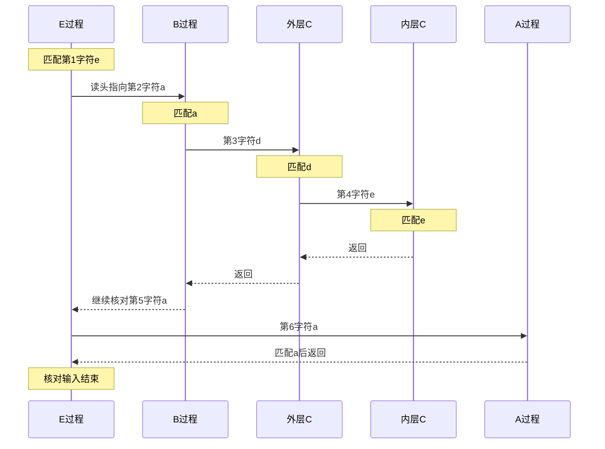
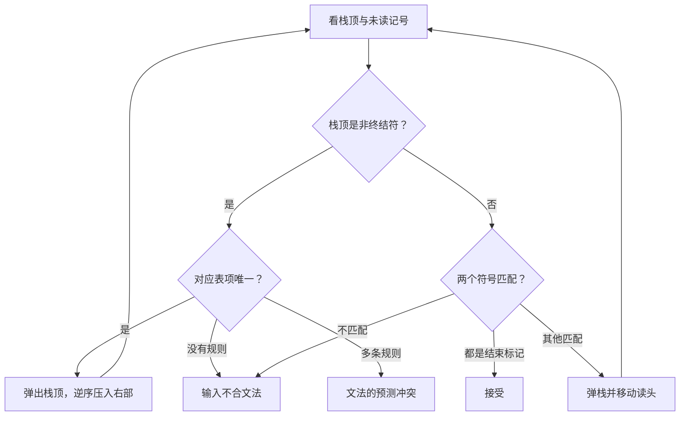

# 语法分析 1 伴读：从递归调用到预测表

这份历史课件的问题是：读到下一个记号时，能否只作一次决定，就展开正确的产生式？从回溯、文法改写走到手写递归下降，再把同样的决定编成预测表，正好构成一条实现路线。本伴读按原课件的例子重新推导，并另给可检查的反例；末尾仅列教材习题编号，未附题干。

## 第 1–17 页：词对了，不代表句子对了

[语法分析](../../../topics/编译原理/语法分析概述.md)的输入是词法分析得到的记号序列，关心序列能否由文法的开始符号生成，以及这些记号组成了什么结构。比如 `i + * i` 可以拆成合法记号，却不是下面的表达式文法能生成的句子；`i + i` 能组成表达式，但操作数类型是否能相加还得由后续语义规则决定。语法结构能给后续翻译提供遍历顺序，却不等于已经完成类型检查或生成中间代码。

| 方向 | 用什么证据做决定 | 这一章讲到哪里 |
| --- | --- | --- |
| 自顶向下 | 从开始符号展开当前最左非终结符，输入记号不断消除候选 | 回溯的代价、递归下降、预测表 |
| 自底向上 | 从已读符号中识别可归约的片段，一步步归回开始符号 | 只概览优先关系法和 LR 系列；展开见[短语与句柄](../../../topics/编译原理/短语与句柄.md)和[LR 分析法](../../../topics/编译原理/LR分析法概述.md) |

## 第 18–43 页：两种卡住，不能只用一种改写

选错产生式才回头重选，会把此前扫描、建树甚至语义动作变成试做；更糟的是，左递归可能在==没有消耗任何输入==时调用自己，让另一个可行分支永远得不到尝试。课件第 29 页的文法是 S → AB，A → bB | Aa，B → Sb | a。按不恰当顺序尝试会陷入递归，但并不说明 `baabaab` 不在语言中；一条最左推导是：

```text
S ⇒ AB ⇒ AaB ⇒ bBaB ⇒ baaB ⇒ baaSb
  ⇒ baaABb ⇒ baabBBb ⇒ baabaBb ⇒ baabaab
```

共同左前缀是另一种卡点。例如 F → id ( E ) | id [ E ] | id 可改写成 F → id R，R → ( E ) | [ E ] | ε，先读掉 id 再决定后缀。ε 并不是随时可选的“兜底”：如果 id 后面的记号不能合法接在 F 之后，R 应当报错。提取左因子后也还要重新求预测集合；两个以不同非终结符开头的右部仍可能都推出以同一个终结符开头的串。

对 A → Aα | β，若每个 α 都非空、β 是不以 A 开头的退出分支，则改成 A → βA′，A′ → αA′ | ε；多项时把各自候选列出来。这揭示了原文法生成的是“一个 β 加任意多个 α”。改写改变分析树形状，不自动改变语义运算规则。例如把 E → E − F | F 改成尾部递归之后，生成抽象语法树仍应将 `i−i−i` 从左向右折叠成 `(i−i)−i`；按尾部的递归形状直接组合可能反而形成 `i−(i−i)`。若 α 还能推出空串，仅有表面上的去左递归也不保证每轮消费输入，必须再分析可空路径。

间接回绕要先[把藏起来的开头显出来](../../../topics/编译原理/自顶向下问题与解决.md)。课件使用的经典排序法以无文法循环、无原始空产生式为前提：按固定顺序处理非终结符，对目前的 Aᵢ，不断用已处理的 Aⱼ 候选替换规则开头的 Aⱼ（j < i），再消除 Aᵢ 的直接左递归。也不要把这个有前提的算法机械地施加到任意含空规则的文法上。

- 第 38 页 A → aB | Bb，B → Ac | d，按 A、B 排序：B → aBc | Bbc | d，再改为 B → aBcB′ | dB′，B′ → bcB′ | ε。
- 第 41–42 页 S → Aa | b，A → Ac | Sd | e，按 S、A 排序：A → Ac | Aad | bd | e，再得到 A → bdA′ | eA′，A′ → cA′ | adA′ | ε。
- 第 43 页 S → Aa | Bb，A → Ac | Sd | Ba | a，B → Se | b，按 S、A、B 排序：A → BbdA′ | BaA′ | aA′，A′ → cA′ | adA′ | ε。将 B 中的 Se 先替换成 Aa e 或 Bb e，再代入 A 的新规则并消除 B 的直接左递归，得到 B → aA′aeB′ | bB′，B′ → bdA′aeB′ | aA′aeB′ | beB′ | ε。比如 B 的最短支路仍可直接推出 b；原推导 B ⇒ Se ⇒ Bbe ⇒ bbe 则对应新推导 B ⇒ bB′ ⇒ bbeB′ ⇒ bbe。保留这些串并不证明改写后的文法已经是 LL(1)。

> [!TIP]
> 不读输入就兜回自己，先找左递归；多个候选抢同一开头，先提取共同前缀，再验预测集合。两种症状可以同时出现。

## 第 44–92 页：递归下降凭什么知道该回哪一层？

[递归下降](../../../topics/编译原理/递归下降分析法.md)通常让每个非终结符对应一个子程序。终结符由匹配函数核对并消费；调用另一个非终结符时，当前调用帧保留“子调用结束后从哪里继续”。全局读头只向前走，返回时不把已经消费的输入再读一遍。课件中四个过程的最小派发逻辑可以重建如下：

| 入口 | 看见的记号与应执行动作 |
| --- | --- |
| E | 匹配 e，调用 B，匹配 a，调用 A |
| A | 看见 a 则匹配 a；看见 b 则匹配 b、调用 A、匹配 c、调用 B |
| B | 看见 d 则匹配 d、调用 E、再匹配 d；看见 a 则匹配 a、调用 C |
| C | 看见 e 则匹配 e；看见 d 则匹配 d 再调用 C |

未列出的入口记号或匹配失败即报错，开始过程返回后还必须到达输入末尾。课件的 `eadeaa` 中，最容易漏掉的是 C 内层返回后继续完成 E 的剩余部分：



对应最左推导是 E ⇒ eBaA ⇒ eaCaA ⇒ eadCaA ⇒ eadeaA ⇒ eadeaa。进一步试 `eadeaab`：本身能够返回的 E 不足以认定整串正确，末尾检查会抓住多出来的 b。

课件随后把同样的写法用于表达式：E → TE′，E′ → +TE′ | ε，T → FT′，T′ → *FT′ | ε，F → (E) | i。F 负责括号和基本操作数，T 吃掉组成同一乘积的因素，E 连接多个 T，所以 `i+i*i` 分成一个单独的 i 加上一个乘积。**订正：** 第 87 页所列终结符与产生式不符；按产生式，终结符是 `i + * ( )`，ε 是空串，`#` 是输入结束标记，不是表达式里的终结符。

> [!CAUTION]
> 课件的表达式示例省略了一部分错误处理。严格的 T′ 过程只可在 `+`、`)`、`#` 前选择空产生式；遇到 `i` 等其他记号应报错，不能把“不是乘号”一律当成合法结束。完整分析器有时会在外层发现同一个错，但不能据此认为局部预测是正确的。

## 第 93–129 页：从过程分支提取出预测表

LL(1) 的第一个 L 表示从左到右读，第二个 L 表示按最左推导展开，1 表示每次只向前看一个输入记号。推动分析的三样东西是符号栈、未读输入和预测表。把 E 的入口先压在 `#` 上方；应用 A → XYZ 时弹出 A，按 Z、Y、X 的次序压栈，使 X 最先展开。空右部不压任何东西。



要证明“这格应当填这条规则”，需要回答两层问题：

1. **FIRST 是从里面往外看。** FIRST(X₁…Xₙ) 先加入 FIRST(X₁) 中的非空成员；只有 X₁ 可空时，这个串才可能从 X₂ 开头。继续到首个不可空符号；整串都可空才加入 ε。课件第 107 页中的 FIRST(PQ) = {p, q, ε}，FIRST(BC) = {b, e}，FIRST(C) = {c, f}；这里 e 是一个可读终结符，不是 ε。
2. **FOLLOW 是从外面往后看。** 规则 A → αBβ 中，FIRST(β) 除去 ε 后加入 FOLLOW(B)；β 可空时，将 FOLLOW(A) 也传给 FOLLOW(B)。开始符号的 FOLLOW 先加 `#`。规则可能相互依赖，反复传播到集合不再扩大；FOLLOW 里从不加入 ε。

对 A → α，SELECT 先取 FIRST(α) 的非空成员；若 α 可空，再并入 FOLLOW(A)。对每个 a ∈ SELECT，把规则写进 M[A,a]。空格是当前配置的错误，重格是文法的预测冲突，性质不同。

| 非终结符 | FIRST | FOLLOW | 预测表非空列及右部 |
| --- | --- | --- | --- |
| E | i、( | )、# | i 或 (：TE′ |
| E′ | +、ε | )、# | +：+TE′；) 或 #：ε |
| T | i、( | +、)、# | i 或 (：FT′ |
| T′ | *、ε | +、)、# | *：*FT′；+、) 或 #：ε |
| F | i、( | *、+、)、# | i：i；(：(E) |

**订正：** 第 126、128 页预测表的 `M[E′,+]` 应填 **E′ → +TE′**，`M[T′,*]` 应填 **T′ → *FT′**；两格均须与所在行的非终结符一致。用课件的 `i+i*i#` 手算：第一项的 T′ 遇 `+` 退出，E′ 读 `+` 后进入下一项；第二项的 T′ 遇 `*` 则展开并读后续 F。到 `#` 时，T′ 和 E′ 才依次退出。将输入改成 `i+*i#`，消耗加号后栈顶 T 面对 `*`，此格为空，应立即拒绝。另试 `(i+i)*(i+i*i)#`，右括号先结束括号内的 E，括号外的乘号由外层 T′ 处理，两个层次不会抢同一个记号。

## 第 130–135 页：提了左因子，为什么还会冲突？

课件的条件语句抽象是 S → iCtSS′ | a，S′ → eS | ε，C → b。重复的 `iCtS` 已经因子化；但 S 在 iCtSS′ 中之后可见 e，并且 S′ 在句末继承 S 的 FOLLOW。于是 FOLLOW(S′) 含 e，导致 M[S′,e] 一格同时能填 eS 和 ε。也就是说：看到 else 时，如果本层退出，外层仍可能合法接手。

在 `ibtibtaea` 中，外层 S 可以退出内层 S′ 并将 e 分给外层，也可以在内层 S′ 消费 e、外层再退出。语言规则若指定 else 就近配对，是显式的冲突处置；它不是“原预测表自然没有冲突”。

> [!WARNING]
> “这份文法不是 LL(1)”不能推出“这个语言没有 LL(1) 文法”。课件的 S → aSb | aabb 两个右部都以 a 开头；最短串 aabb 与较长串 aaabbb 甚至有共同的前两个 a，第三个记号才把原选择区分开。改写为 S → aaUbb，U → aUb | ε 后，在 U 处见 a 继续套一层，见 b 退出，一眼就够。两份文法都生成 $a^n b^n$（$n\ge 2$）。

当面对新题，先看产生式是不是把决定推得太早；再以 SELECT 检查能否推迟；最后用一对最短的合法与非法串，核对选项、出错位置和完整输入检查。这里真正需要保持的不是“看到某一个字符就递归”，而是：**每次展开都与未读输入和已经保留在栈中的后续义务相容。**

第 136–137 页只列课后题编号，第 138 页是结束页；此处不伪补题意。另见 [LL(1) 分析法](../../../topics/编译原理/LL1分析法.md)。
