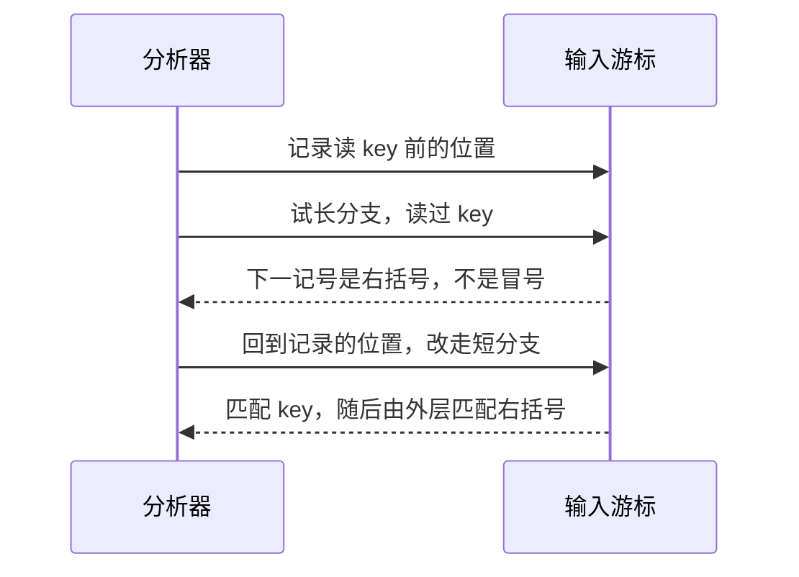
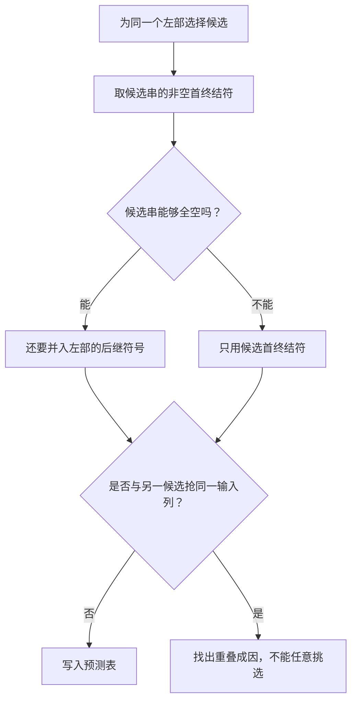

# 语法分析一：怎样只看一个符号作决定

词法分析把 `out = x + y * z` 分成标识符、赋值号和运算符，却没有回答「加的是哪两项」。语法分析在给定文法下把这些记号组织成有层次的结构，或者报告不匹配；优先级来自文法和分析规则，不来自词法记号本身。通常的词法记号用正规语言描述，任意深度的括号嵌套则需要比有限自动机更强的机制，例如上下文无关文法与分析栈。下文依据历史课件独立讲解；图和未注明原件页码的例子均为自编，不代表现行课程考核范围。

| 决策 | 自顶向下 | 自底向上 |
|---|---|---|
| 从哪一头开始 | 从开始符号展开，预测接下来会出现什么 | 从输入移进记号，识别句柄再归约 |
| 怎样实现 | 递归下降让子程序与非终结符对应；LL(1) 用一个向前看记号选择最左推导的分支 | 简单优先按文法符号间关系；算符优先按终结符间关系；LR 依状态、向前看和分析表选择移进或归约 |
| 能处理什么 | 递归下降可以手写回溯，并不自动等于 LL(1) | 确定性 LR 方法覆盖面比 LL(1) 广，但不能直接解析任意上下文无关文法 |

例如把 `x + y * z` 读成 `+(x, *(y,z))` 就保留了乘法先结合的结构。原课件第 6 页的相邻正、负号在其例示语言中报错；若另一门语言支持一元负号，`x + -y` 可以合法。==语法错误必须相对于明确的文法判断==。可对照[语法分析概述](../../../topics/编译原理/语法分析概述.md)、[语法树与二义性](../../../topics/编译原理/语法树与二义性.md)和 [LR 分析概述](../../../topics/编译原理/LR分析法概述.md)。

## 预测失败与输入不合法，是两件事

**补充。** 设 `S → [ A ]`，`A → key : value | key`，输入 `[ key ]`。若先试长分支，分析器读过 `key` 后才发现 `]` 不是冒号；正确做法是恢复分支入口的输入位置和相关状态，再试短分支。这不是把错误位置跳过，也不是保留失败分支的语义副作用。若许多层都有共享开头，朴素试探还可能一遍遍访问同一输入前缀。

**参考解答（第 8–16 页）。** 原件的 `cad` 先试带 `b` 的较长分支会失败，但退回并选择只产生 `a` 的分支即可接受。不同候选如果一开头就有不同的终结符，根本不用试：第 15 页的 `caa` 属于以 `c` 起头的分支，第 16 页的条件语句由保留字 `if` 引导。实际候选往往先写非终结符，不能把右部第一个书写符号直接当「路标」。

## 路标是第一个可能读到的终结符

$\mathrm{FIRST}(\alpha)$ 收集候选串 $\alpha$ 能推出的第一个终结符；若整个候选串能消失，还记录 $\varepsilon$。从左到右扫描：把当前符号的非空 FIRST 并入；只有当前符号可空，才把机会交给右边；只有全部可空，才加入 $\varepsilon$。相互依赖的 FIRST 集通过反复传播新增元素求出，直到不再变化。

**参考解答（第 17–21 页）。** 第 18 页传播得到 $\mathrm{FIRST}(P)=\{p,\varepsilon\}$、$\mathrm{FIRST}(Q)=\{q,\varepsilon\}$、$\mathrm{FIRST}(PQ)=\{p,q,\varepsilon\}$、$\mathrm{FIRST}(B)=\{b,e\}$、$\mathrm{FIRST}(C)=\{c,f\}$、$\mathrm{FIRST}(BC)=\{b,e\}$。这里 $e$ 是终结符，不是空串，所以不会跳过 $B$ 去取 $C$ 的首符号。第 17 页的三个候选分别有 $\mathrm{FIRST}(ABe)=\{a,b,e\}$、$\mathrm{FIRST}(CAb)=\{c\}$、$\mathrm{FIRST}(DBa)=\{d\}$。输入 `da` 从第三个候选开始，$D$ 消耗 `d`，$B$ 退为空串，末尾 `a` 匹配。$\varepsilon$ 不消耗输入。

**订正（第 20、22 页的适用范围）。** 候选可空时，还要知道它左部的后继符号。LL(1) 对同一左部的不同候选比较预测集合（SELECT），不能仅检查 FIRST：不可空时取 FIRST；可空时去掉其中的 $\varepsilon$，再并入该左部的 FOLLOW。$\varepsilon$ 不占输入列。

一个反例是 `S → A x`、`A → x | ε`：后两候选的 FIRST 分别为 $\{x\}$ 和 $\{\varepsilon\}$，确实不相交，但两个候选都要填写向前看 `x` 这一列。它们分别产生 `xx` 和 `x`，这个文法没有二义性，却不是 LL(1)。见 [LL(1) 分析](../../../topics/编译原理/LL1分析法.md)。

## 两种改写修的是不同的故障

### 开头已经相同：消费共同部分以后再分叉

原件第 23 页的两个候选都从星号开始；拆开以后，已经消耗的星号不需要试第二遍。对于单星输入，下一个记号是外层后继 `y`，剩余候选应取空；如看见第二个星号，就走另一支。相同思路处理上面的 `key`：写成 `A → key Tail`、`Tail → : value | ε`，见冒号选长尾，见外层右括号选空尾，其他记号报错。

若重叠藏在非终结符后，先展开暴露冲突的位置。第 24 页须先把候选中打头的 $A$ 展开，暴露两个 `a` 前缀，再把这两支合并；换出的尾部可由 `d` 或 $SE$ 起步，两者的 FIRST 分别为 $\{d\}$ 和 $\{a,b\}$。这页没有定义 $E$，故这里只核所示候选，不判整部文法的 LL(1) 性质。

> [!WARNING]
> 提左公因子只把决策推迟，不保证最终无冲突。`A → x | ε` 没有共同的书写前缀，却仍可因后继重叠发生冲突。改写以后要重算预测集合。

### 没吃进记号就又调用自己：先建立基项，再迭代后缀

若候选形如 $A\to A\alpha\mid\beta$，朴素递归下降沿第一支返回 $A$ 时还没读任何输入。一次有限推导须在最内层先选择基项 $\beta$，其后才有零或多段 $\alpha$。因此可用 $A\to\beta R$、$R\to\alpha R\mid\varepsilon$ 表示同样的串；若有多个后缀、多个基项，将它们分别放进对应选择。没有任何基项时，不能凭空给 $A$ 添空产生式。若从可空前缀一路跳过又回到原符号，虽形式上出现右递归，程序也可能原地循环。

| 信号 | 首先检查 | 改写时应保持 |
|---|---|---|
| 候选争同一个向前看记号 | 重叠来自显式前缀、间接首符号还是可空后继 | 原有终结串；新表不能同格填两条规则 |
| 同一非终结符再现而游标没前移 | 是直接左递归，还是经其他符号绕回来 | 终结串，以及另由语义动作保障的结合性 |

**参考解答（第 25、28 页）。** 算术文法改写后依次识别项 `i`、加号和另一项 `i*i`；乘法尾在项内部先走，整个串构成「左项加乘积」。第 25 页的 `bbdac` 可以接受，因为该推导中各次重复先消耗 `b` 或 `a`。文法变换保持的是终结串语言，不自动保持语法树形状。自编变式 `8-3-2` 应从 8 开始累积，先减 3 再减 2 得 3；不能因为改成右尾部就求 `8-(3-2)` 得 7。

**参考解答（第 29、32 页）。** 按 $A,B$ 排序，用 $A$ 的候选替换 $B\to Ac$ 头上的 $A$；$B$ 的递归候选变成在自身后加 `bc`，基项是 $aBc$ 或 `d`。故 $B$ 可写成扩充 BNF $B\to(aBc\mid d)\{bc\}$，花括号允许重复零次；$A$ 保持。第 32 页按 $S,Q,R$ 排序，代入 $S$ 再代入 $Q$，得到 $R\to Rbca\mid bca\mid ca\mid a$；消掉直接左递归后，$R\to(bca\mid ca\mid a)\{bca\}$，$S,Q$ 保持。取 $R$ 的基项 `a` 并重复一次 `bca`，得到 `abca`；不能倒转后缀内部的符号次序。

第 30–31 页的一般算法先排好非终结符，再按该次序处理每个符号：逐个展开其候选左端中编号更早的符号，随后消掉露出的直接左递归。这一版本假定原文法没有空产生式，也没有 $A\Rightarrow^+ A$ 这样的环；违背时应先处理可空符号与循环，或选用有相应适用条件的变换。第 33 页还用扩充 BNF 表达算术例：「项再重复零或多段加号加项」，项则「因子再重复零或多段乘号加因子」。写成循环后，每轮应真正消费输入，不能不断重复一个可空主体。

知识点：[文法产生式与推导](../../../topics/编译原理/文法产生式与推导.md)、[文法的其他表示法](../../../topics/编译原理/文法其他表示法.md)、[自顶向下分析的问题与解决](../../../topics/编译原理/自顶向下问题与解决.md)、[递归下降分析](../../../topics/编译原理/递归下降分析法.md)。
