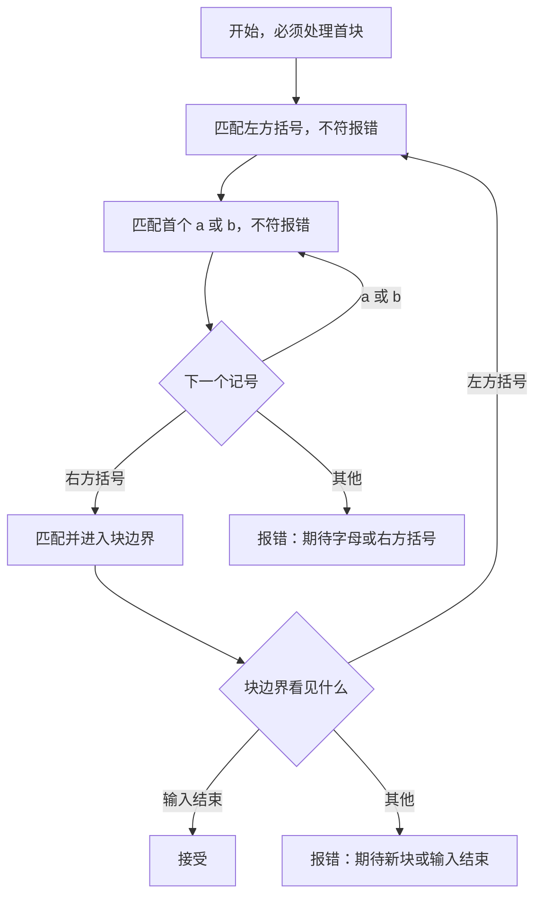

# 语法分析二：递归下降的调用栈与空分支

递归下降把「现在应该读哪个语法成分」交给当前函数，把「读完以后应到哪里接着读」留在调用栈中。若把这两件事都塞进一个不断覆盖的全局变量，内层函数一返回，外层剩下的匹配动作就无处可找。本篇沿用历史课件的三组问题，重新组织算法、验算和流程图，不代表现行考核范围。

从第 2 页的分类看，递归下降和预测表都是先猜应该展开哪个非终结符，但前者让宿主语言的调用栈承载上下文，后者显式保存待匹配的符号。[算符优先分析](../../../topics/编译原理/算符优先分析法.md)依赖终结符之间的优先关系，[LR 分析](../../../topics/编译原理/LR分析法概述.md)则在状态栈上积累证据再归约。LR 的适用范围更宽并不表示任意文法都能生成无冲突的分析表。

## 栈顶保留的是哪条没做完的承诺？

[递归下降分析法](../../../topics/编译原理/递归下降分析法.md)为每个非终结符构造一个过程。右部是串，就从左到右执行：终结符要求当前记号相等才前进一步；非终结符调用相应过程，回来后再做右部的其余工作。原课件用递归入口、出口显式管理返回地址；现代语言的普通函数调用已经保存返回位置和局部状态，不需要再维护同一份地址栈。若词法单元不止一个字符，前进一步指读下一个记号，不是把字符串指针简单加一。起始过程成功之后还须确认已到输入末尾。

**参考解答（第 5–40 页）。** 原例有四种过程：E 依次处理 `e`、B、`a`、A；A 在 `a` 与 `b` 开头的分支间选择，后一支在 `b` 后调用 A、读 `c`，再调用 B；B 遇 `d` 则读 `d`、调用 E、再读 `d`，遇 `a` 则读 `a` 后调用 C；C 吞掉零个或多个 `d` 后必须读一个 `e`。这些分支不为空，同一过程内的多个分支各有不同首记号，不用试错。对课件输入 `eadeaa`，末尾记作 `#`，逐步验证如下：

| 已消费前缀 | 下一记号 | 调用与待办 |
| --- | --- | --- |
| `e` | `a` | E 调用 B；E 还欠 `a A` |
| `ea` | `d` | B 调用 C；C 必须完成一串以 `e` 结束的字符 |
| `ead` | `e` | C 再调用 C；外层 C 要等内层回来 |
| `eade` | `a` | 内层 C 读完 `e`，两层 C 与 B 依次返回；E 恢复执行 |
| `eadea` | `a` | E 先匹配欠着的 `a`，再调用 A |
| `eadeaa` | `#` | A 读完 `a`，E 返回；起始调用到末尾，接受 |

这一串的最大过程栈是 `E → B → C → C`。最深层返回时，下一输入仍是 `a`，它不是被「退回」给早先的位置。把最后再接一个 `a`，原有各过程仍可能顺利返回，但最外层发现尚有记号，必须拒绝。可以用[产生式与推导](../../../topics/编译原理/文法产生式与推导.md)交叉核对：$E\Rightarrow eBaA\Rightarrow eaCaA\Rightarrow eadCaA\Rightarrow eadeaA\Rightarrow eadeaa$。

## 一眼选不出分支，和一步也走不动，是两种故障

**参考解答（第 41–42 页）。** 把 B 的候选改成 `d E d` 与 `d C`，遇到 `d` 时两条都可能。先读公共的 `d` 也没有自动消除冲突：E 从 `e` 起步，C 也可以由 `e` 起步。正确的问题是「在这个输入位置，哪几条候选的预测集合重叠？」而不是「先试哪一条更快」。可以改变文法、采用更强的预测，或采用能够回滚的搜索式分析；最后一种必须恢复输入位置以及已经发生的语义动作，不是这里采用的无回溯算法。

若改成 `B → B E d | a C`，沿第一支递归进入 B 时连第一个记号都没消耗。朴素过程就可能在同一个输入位置一直调用自己，这不是「提前多看一个字符」能修掉的问题。出现这两类现象时，分别查[自顶向下分析的分支冲突和左递归](../../../topics/编译原理/自顶向下问题与解决.md)。原例中的 `C → d C` 虽然也递归，却先消耗了一个 `d`，因此不同；这条判断也适用于检查间接调用是否沿一圈不前进。

## 空分支不读记号，也不是万能退路

**参考解答（第 43–46 页）。** 表达式分成表达式 E、项 T、因子 F：E 先读 T，再处理零个或多个 `+ T`；T 先读 F，再处理零个或多个 `* F`；F 是单个标识符记号 `i`，或括号中的完整 E。因子优先处理括号，乘法由项先收完，最后才轮到表达式累加。若要构造通常的左结合树，可在循环里每读一项就更新累计树，不必把右递归尾部按右结合直接照抄。自编核对：`i+i*i` 应读成 `i+(i*i)`，而 `(i+i)*i` 由括号先完成左因子。

**订正（第 43 页）。** 页首的终结符清单与实际产生式不一致。按本页规则，应有 `i`、`+`、`*`、`(`、`)`，没有减号；$\varepsilon$ 表示空串，不是读入的记号。`#` 则是本例另加的输入结束标记。

| 当前位置 | 应继续读取 | 允许选择空尾部 |
| --- | --- | --- |
| E 的尾部 | `+`，接着读一个 T | 看到 `)` 或 `#` |
| T 的尾部 | `*`，接着读一个 F | 看到 `+`、`)` 或 `#` |
| F | `i`，或 `(` 后读 E 并匹配 `)` | 无 |

> [!WARNING]
> **补充。** “不是加号就返回”只有在调用方仍会作完整校验时，才有可能在更外层报错。用 [LL(1) 的预测集合](../../../topics/编译原理/LL1分析法.md)能把错误留在首次不匹配的地方：空尾部只在当前记号属于该尾部的 FOLLOW 集时选中，其他一律报错。`i+` 在需要一个 T 时失败，`ii` 不能靠空分支吞掉，`(i` 则要报缺少右括号。==选空不消费当前记号==：留着的 `)` 正等外层匹配。

## 方括号作业：先识别语言，再决定怎样写过程

**参考解答（第 47 页）。** 原题的 X 从 `a` 或 `b` 开始，再在右端追加 `a` 或 `b`，因此恰好生成非空的二字母表上的串。B 的左递归每走一步，就在右边增加一个 A；结束时才生成一个 X 和 `]`。把 A 自己开头的 `[` 合起来，得到一个非空方括号块，后面接零个或多个 A。由有限推导树归纳，每个后续 A 也只能贡献一串相邻的方括号块；反之，任意非空的块序列都可让第一个 A 负责首块，并为其他每块各排一个后续 A。于是语言恰为「一个或多个装着非空字母串的方括号块」，原文法并不生成嵌套的方括号。

若只做识别，可重写为 `A → 块 余块`、`余块 → 块 余块 | ε`、`块 → [ 字母串 ]`。字母串先匹配一个 `a` 或 `b`，再按当前记号重复匹配；遇 `]` 停止，无须为每个字母再开一层栈。主过程在 `[` 时再读一块，在 `#` 时接受，否则失败。该重写保持终结符串，不声称保留原来多个后续 A 的归组方式；例如三个块可让根部挂两个后续 A，也可让根部只挂一个 A、由后续 A 再带出最后一块。要保留语义动作时，应另定义需要的树结构。

> [!TIP]
> 用边界反例检查出口：`[a][bba]` 通过；空输入没有首块，`[]` 没有首字母，`[a[b]]` 在块内遇到非法左括号，`[a]b` 在块边界还有额外字符。只消除产生式的直接左递归不保证得到无回溯分析器；先找出实际要识别的语言，再核对分支与退出条件。
