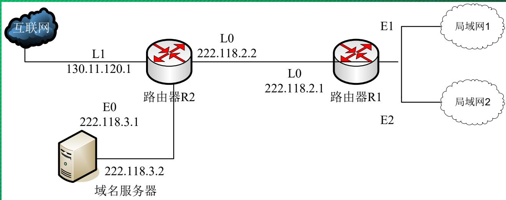

# 2017-2018学年第一学期《计算机通信与网络》期末复习提纲

原件经识别和整理；“参考解答”是我们补的。

# 2017-2018学年第一学期《计算机通信与网络》期末复习提纲

本资料整理自南京邮电大学计算机学院计算机系统与网络教学中心提供的期末复习要点PPT，保留了原有的章节结构、知识点要求及样题。

## 考试题型与分值

- 选择题：20分（10题，每题2分）
- 填空题：20分（每空1分）
- 简答题：20分（4题，每题5分）
- 综合应用题：40分

注：试卷中包含一张附录，包括以太网MAC帧结构、IPv4数据报格式、UDP以及TCP报文段格式，但要求大家掌握其各个字段的含义。另外，还包括教材中52页表2-2（汉明码中校正子与错码位置）。

## 第一章 概述

### 知识点

1. 理解计算机网络定义和组成
2. 理解网络的类型及其特征（网络拓扑结构、网络覆盖范围）
3. 掌握网络体系结构的概念
4. 掌握协议概念和协议三要素
5. 掌握OSI/RM体系结构的七层模型及通用的五层体系结构各层的功能
6. 掌握TCP/IP体系结构

知识点：[网络管理功能与SNMP协议（FCAPS五大功能、MIB、ASN.1）](../../../topics/计算机网络/network_management_snmp.md)、[密码学与数据加密技术（对称与非对称密钥、数字签名、报文摘要）](../../../topics/计算机网络/cryptography_encryption.md)、[身份认证与访问控制（防火墙、RADIUS）](../../../topics/计算机网络/auth_access_control.md)

### 样题

#### 选择 1

下列选项中，不属于网络体系结构中所描述的内容是\_\_\_\_。

- A. 网络层次
- B. 协议内部实现细节
- C. 每一层使用协议
- D. 每层须完成的功能

#### 填空 1

计算机网络按照网络的作用范围进行分类，可以分为局域网、\_\_\_\_、城域网和个人区域网。

## 第二章 数据通信技术基础

知识点：[网络管理功能与SNMP协议（FCAPS五大功能、MIB、ASN.1）](../../../topics/计算机网络/network_management_snmp.md)、[计算机网络性能指标（速率、时延、吞吐量计算）](../../../topics/计算机网络/performance_metrics.md)

### 知识点

1. 理解信息、数据与信号(概念)
2. 掌握数据通信系统技术指标（传信率、传码率、信道带宽、时延、误码率、信道容量，包括香农公式和奈氏准则）
3. 了解各种传输介质
4. 掌握编码与调制（（差分）曼彻斯特编码、信号的各种转换原理与具体方法）
5. 掌握多路复用技术概念、分类，掌握码分复用的应用
6. 理解数据交换技术
7. 理解物理层接口特性

知识点：[网络管理功能与SNMP协议（FCAPS五大功能、MIB、ASN.1）](../../../topics/计算机网络/network_management_snmp.md)、[密码学与数据加密技术（对称与非对称密钥、数字签名、报文摘要）](../../../topics/计算机网络/cryptography_encryption.md)、[身份认证与访问控制（防火墙、RADIUS）](../../../topics/计算机网络/auth_access_control.md)

### 样题

#### 选择 1

对带宽为 $4 \mathrm{kHz}$ 的信号, 采用 PCM 技术数字化, 每次采样用 8 位编码, 为使数据不失真, 需要的通信能力为 ( )

- A. $12 \mathrm{kb} / \mathrm{s}$
- B. $8 \mathrm{kb} / \mathrm{s}$
- C. $32 \mathrm{kb} / \mathrm{s}$
- D. $64 \mathrm{kb} / \mathrm{s}$

#### 选择 2

共有4个站进行码分多址通信。4个站的码片序列为
A: $(-1-1-1+1+1-1+1+1)$
B: $(-1-1+1-1+1+1+1-1)$
C: $(-1+1-1+1+1+1-1-1)$
D: $(-1+1-1-1-1-1+1-1)$

若收到码片序列S: $(-1+1-3+1-1-3+1+1)$ ，则没有发送数据的站是（）

- A. A站
- B. B站
- C. C站
- D. D站

## 第三章 数据链路层

知识点：[网络管理功能与SNMP协议（FCAPS五大功能、MIB、ASN.1）](../../../topics/计算机网络/network_management_snmp.md)、[计算机网络性能指标（速率、时延、吞吐量计算）](../../../topics/计算机网络/performance_metrics.md)

### 知识点

1. 理解数据电路与数据链路概念
2. 掌握数据链路层的七个功能
3. 理解滑动窗口机制的工作原理与过程
4. 掌握停止一等待协议、连续ARQ、选择ARQ的原理和窗口尺寸和应用
5. 掌握差错控制原理；汉明距离和纠检错能力的关系；差错控制编码的计算（汉明码和CRC）
6. 理解HDLC与PPP协议（帧结构、透明传输、帧类型、协议组成）

知识点：[网络管理功能与SNMP协议（FCAPS五大功能、MIB、ASN.1）](../../../topics/计算机网络/network_management_snmp.md)、[密码学与数据加密技术（对称与非对称密钥、数字签名、报文摘要）](../../../topics/计算机网络/cryptography_encryption.md)、[身份认证与访问控制（防火墙、RADIUS）](../../../topics/计算机网络/auth_access_control.md)

### 样题

#### 选择 1

HDLC采用“0”比特插入法的目的是（）。

- A. 差错控制
- B. 链路管理
- C. 保证传输的透明性
- D. 流量控制

#### 简答 1

假设收到的信息码字为110111，校验和CRC为1001，生成多项式为： $G(x)=X^{4}+X^{3}+1$ ，请问收到的信息有错吗，为什么？

## 第四章 局域网与广域网

知识点：[网络管理功能与SNMP协议（FCAPS五大功能、MIB、ASN.1）](../../../topics/计算机网络/network_management_snmp.md)、[计算机网络性能指标（速率、时延、吞吐量计算）](../../../topics/计算机网络/performance_metrics.md)

### 知识点

1. 理解决定局域网的特性的主要技术
2. 了解IEEE 802 局域网标准，局域网的子层划分
3. 掌握CSMA/CD协议（原理、争用期、最短帧的计算、以太网MAC帧格式）
4. 掌握以太网级联与扩展（物理层、数据链路层扩展设备的原理）
5. 理解透明网桥转发帧的算法
6. 理解10BASE-T, 10BASE-F等表述10、BASE、T、F的含义
7. 掌握以太网交换机三种转发方式及其特点
8. 掌握虚拟局域网VLAN的概念
9. 理解无线局域网链路层协议CSMA/CA，数据帧发送过程
10. 掌握虚电路和数据报比较
11. 了解三种广域网技术（X.25、帧中继、ATM）

知识点：[网络管理功能与SNMP协议（FCAPS五大功能、MIB、ASN.1）](../../../topics/计算机网络/network_management_snmp.md)、[密码学与数据加密技术（对称与非对称密钥、数字签名、报文摘要）](../../../topics/计算机网络/cryptography_encryption.md)、[身份认证与访问控制（防火墙、RADIUS）](../../../topics/计算机网络/auth_access_control.md)

### 样题

#### 填空 1

对于100Mbps的以太网交换机，当输出端口无排队，以无碎片交换方式转发一个1000字节的以太网帧（不包括前导码）时，引入的转发延迟至少是\_\_\_\_μs。

- A. 0.48
- B. 5.12
- C. 10
- D. 80

#### 计算 1

假设在一个采用CSMA/CD 协议的网络中，传输介质是一根长度为1000m长的完整电缆，传输速率为100Mbit/s，电缆中的信号传播速度是200 000 km/s。

(1) 求能够使用此协议的最短帧长。

(2) 若最小数据帧长度减少40 比特，则最远的两个站点之间的距离至少需要增加还是减少？具体变化多少米？

## 第五章 网络层与网络互连

知识点：[网络管理功能与SNMP协议（FCAPS五大功能、MIB、ASN.1）](../../../topics/计算机网络/network_management_snmp.md)、[计算机网络性能指标（速率、时延、吞吐量计算）](../../../topics/计算机网络/performance_metrics.md)

### 知识点

1. 理解分类的IP地址分类，特殊的IP地址
2. 掌握IP地址和硬件地址的联系与区别
3. 理解IP数据报格式，掌握对网络采集报文的解析方法
4. 掌握IP数据报分片原理与计算
5. 理解因特网控制报文协议ICMP及其应用
6. 掌握划分子网的计算过程和步骤
7. 掌握CIDR原理、地址块的分配、路由聚合技术，以及最长前缀匹配
8. 掌握因特网有两大类路由选择协议（IGP包括RIP、OSPF，了解EGP的概念）
9. 理解路由器的组成部分、如何构建路由表以及如何转发IP分组
10. 理解IP发展技术（VPN、NAT）
11. 掌握IPv6（地址特点、地址表示、地址种类、与IPv4的过渡方法）

知识点：[网络管理功能与SNMP协议（FCAPS五大功能、MIB、ASN.1）](../../../topics/计算机网络/network_management_snmp.md)、[密码学与数据加密技术（对称与非对称密钥、数字签名、报文摘要）](../../../topics/计算机网络/cryptography_encryption.md)、[身份认证与访问控制（防火墙、RADIUS）](../../../topics/计算机网络/auth_access_control.md)

### 样题

#### 选择 1

两个主机通过电缆直接相连，主机A的IP地址为220.17.33.24/28，而主机B的IP地址为220.17.33.100/28，两个主机互相Ping不能，这时应该\_\_\_\_。

- A. 改变主机A的地址为220.17.33.15
- B. 改变主机B的地址为220.17.33.111
- C. 改变子网掩码为26
- D. 改变子网掩码为25

#### 综合 1

某公司网络拓扑如图所示，路由器R1通过接口E1、E2分别连接局域网1、局域网2，通过接口L0连接路由器R2，并通过路由器R2连接域名服务器与互联网。R1的L0接口的IP地址是222.118.2.1；R2的L0接口的IP地址是222.118.2.2，L1接口的IP地址是130.11.120.1，E0接口的IP地址是222.118.3.1；域名服务器的IP地址是222.118.3.2。

（1）将IP地址空间222.118.1.0/24划分为2个子网，分别分配给局域网1和局域网2，每个局域网需分配的IP地址数不少于120个。请给出子网划分结果，说明理由或给出必要的计算过程。

（2）请给出R1的路由表，使其明确包括到局域网1的路由、局域网2的路由、域名服务器的主机路由和互联网的路由。

## 第六章 传输层

知识点：[网络管理功能与SNMP协议（FCAPS五大功能、MIB、ASN.1）](../../../topics/计算机网络/network_management_snmp.md)、[计算机网络性能指标（速率、时延、吞吐量计算）](../../../topics/计算机网络/performance_metrics.md)

### 知识点

1. 掌握传输层的功能
2. 理解端口和套接字概念
3. 掌握UDP基本概念，理解其报文格式以及校验和计算
4. 掌握TCP（基本概念、报文格式、可靠传输、连接管理、流量控制、拥塞控制）

知识点：[网络管理功能与SNMP协议（FCAPS五大功能、MIB、ASN.1）](../../../topics/计算机网络/network_management_snmp.md)、[密码学与数据加密技术（对称与非对称密钥、数字签名、报文摘要）](../../../topics/计算机网络/cryptography_encryption.md)、[身份认证与访问控制（防火墙、RADIUS）](../../../topics/计算机网络/auth_access_control.md)

### 样题

#### 选择 1

在平均往返时间RTT为20ms的快速以太网上运行TCP/IP协议，假设TCP的最大窗口尺寸为64KB，问此时TCP协议所能支持的最大数据传输率是\_\_\_\_。

- A. 3.2Mbps
- B. 12.8Mbps
- C. 26.2Mbps
- D. 51.2Mbps

#### 计算 2

设TCP的门限窗口的初始值为8（单位为报文段）。当拥塞窗口上升到12时网络发生了超时，TCP使用慢启动、拥塞避免技术。试分别求出第1次到第15次传输的各拥塞窗口大小。

## 第七章 应用层

知识点：[网络管理功能与SNMP协议（FCAPS五大功能、MIB、ASN.1）](../../../topics/计算机网络/network_management_snmp.md)、[计算机网络性能指标（速率、时延、吞吐量计算）](../../../topics/计算机网络/performance_metrics.md)

### 知识点

1. 理解因特网部分应用层协议与传输层协议的对应关系
2. 理解应用协议网络基本模式
3. 掌握应用层基本协议原理与应用（DNS、FTP、DHCP）
4. 掌握电子邮件原理与应用（组成构件、SMTP、POP、MIME）
5. 理解万维网技术原理与应用（URL、HTTP、HTML、搜索引擎）

知识点：[网络管理功能与SNMP协议（FCAPS五大功能、MIB、ASN.1）](../../../topics/计算机网络/network_management_snmp.md)、[密码学与数据加密技术（对称与非对称密钥、数字签名、报文摘要）](../../../topics/计算机网络/cryptography_encryption.md)、[身份认证与访问控制（防火墙、RADIUS）](../../../topics/计算机网络/auth_access_control.md)

### 样题

#### 选择 1

如果本地域名服务器无缓存，当采用递归方法解析另一网络某主机域名时，用户主机和本地域名服务器发送的域名请求条数分别为( )。

- A. 1 条，1 条
- B. 1 条，多条
- C. 多条，1 条
- D. 多条，多条

#### 选择 2

HTTP/1.1协议以持续的非流水线方式工作，一次请求-响应时间为RTT，假定rfc.html页面引用了2个JPEG小图像，则从Web请求开始到浏览器收到全部内容为止，需要( )个RTT。

- A. 2
- B. 3
- C. 4
- D. 5

## 第八章 网络管理与网络安全

知识点：[网络管理功能与SNMP协议（FCAPS五大功能、MIB、ASN.1）](../../../topics/计算机网络/network_management_snmp.md)、[计算机网络性能指标（速率、时延、吞吐量计算）](../../../topics/计算机网络/performance_metrics.md)

### 知识点

1. 掌握网络管理五大功能域
2. 理解简单网络管理协议SNMP的基本原理
3. 掌握网络安全威胁因素
4. 理解加密算法（对称加密、非对称加密技术）

知识点：[网络管理功能与SNMP协议（FCAPS五大功能、MIB、ASN.1）](../../../topics/计算机网络/network_management_snmp.md)、[密码学与数据加密技术（对称与非对称密钥、数字签名、报文摘要）](../../../topics/计算机网络/cryptography_encryption.md)、[身份认证与访问控制（防火墙、RADIUS）](../../../topics/计算机网络/auth_access_control.md)

### 样题

#### 选择 1

网络管理功能中，“对网络资源利用率及有关通信活动进行分析，以帮助网络管理人员评价网络资源及相关通信活动的情况和效率”，描述的是( )。

- A. 计费管理
- B. 故障管理
- C. 性能管理
- D. 安全管理

#### 填空 1

网络管理五大功能为\_\_\_\_、性能管理、配置管理、\_\_\_\_和计费管理。

知识点：[网络管理功能与SNMP协议（FCAPS五大功能、MIB、ASN.1）](../../../topics/计算机网络/network_management_snmp.md)、[计算机网络性能指标（速率、时延、吞吐量计算）](../../../topics/计算机网络/performance_metrics.md)
