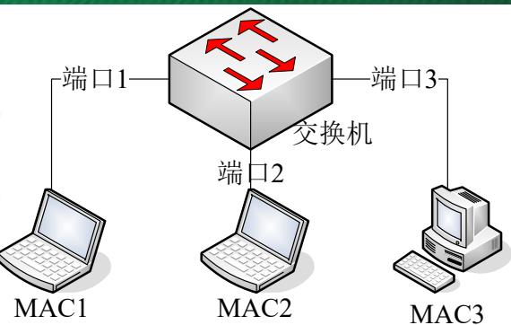

# 2017-2018学年第二学期《计算机通信与网络》期末复习提纲

原件经识别和整理；“参考解答”是我们补的。

## 考试题型

- 单项选择题（10 题，20 分）
- 填空题（15 空，15 分）
- 简答题（5 题，30 分）
- 综合应用题（4 题，35 分）

注 1：试卷中包含一张附录，包括以太网 MAC 帧结构、IPv4 数据报格式、UDP 以及 TCP 报文段格式，但要求大家掌握其各个字段的含义。注 2：样题为期末考试的参考题型。章节编号按照课件上的编号。

## 第一章

### 第一章 复习要点

1. 掌握计算机网络在逻辑上的组成（通信子网和终端系统）。
2. 掌握协议的概念以及协议三要素。
3. 掌握网络体系结构的基本概念，OSI/RM 七个层次的名称（按照顺序）和主要功能。
4. 理解下三层传输的基本单位。如：物理层（比特）、数据链路层（帧）、网络层（分组）。
5. 掌握 TCP/IP 体系结构中的分层（四层）。能够区分一些主要的协议位于的层次。

知识点：[网络体系结构与协议（OSI/RM与TCP/IP模型、协议三要素）](../../../topics/计算机网络/architecture_protocols.md)、[计算机网络的定义、组成与拓扑分类](../../../topics/计算机网络/network_basics.md)

### 填空 1

计算机网络按照网络的作用范围进行分类，可以分为因特网、广域网、城域网、\_\_\_\_ 和个人区域网。

知识点：[域名系统DNS（层次名字空间、递归与迭代查询解析）](../../../topics/计算机网络/dns.md)

### 选择 1

下列不属于通信子网的是（ ）。

- A. 网桥
- B. 路由器
- C. 集线器
- D. PC 机

知识点：[IPv4协议与数据报格式（分类IP地址、分片计算、首部字段）](../../../topics/计算机网络/ipv4_datagram.md)

### 填空 2

网络协议由语法、语义和\_\_\_\_ 三个要素组成。

知识点：[文件传送与远程登录（FTP双连接机制、TFTP、Telnet）](../../../topics/计算机网络/ftp_telnet.md)

### 选择 2

在 TCP/IP 模型中，支持进程间端到端传送服务的是（ ）。

- A. 传输层
- B. 应用层
- C. 会话层
- D. 网络层

## 第二章 数据通信技术基础

知识点：[TCP流量控制与拥塞控制（滑动窗口、慢开始、拥塞避免、快重传与快恢复）](../../../topics/计算机网络/tcp_flow_congestion.md)、[计算机网络性能指标（速率、时延、吞吐量计算）](../../../topics/计算机网络/performance_metrics.md)、[网络体系结构与协议（OSI/RM与TCP/IP模型、协议三要素）](../../../topics/计算机网络/architecture_protocols.md)

### 第二章 复习要点

1. 掌握传信速率、传码速率（波特率）、发送时延、传播时延、误码率的计算。
2. 掌握两种信道容量的计算。（香农公式和奈氏准则）
3. 了解常用的有线传输介质名称及其应用。
4. 掌握曼彻斯特和差分曼彻斯特编码的规则。
5. 掌握四种多路复用技术的名称及其应用。
6. 掌握三种基本的数据交换技术名称和特点。
7. 理解汉明码的基本概念和编码规则。
8. 掌握 CRC 编码的计算方法以及接收方的差错检测过程。

知识点：[计算机网络性能指标（速率、时延、吞吐量计算）](../../../topics/计算机网络/performance_metrics.md)、[信道容量与传输速率计算（奈氏准则与香农公式）](../../../topics/计算机网络/channel_capacity.md)、[数据编码与调制技术（曼彻斯特编码、PCM、基带与频带传输）](../../../topics/计算机网络/encoding_modulation.md)

### 填空 1

若码元周期 $T = 2 \times 10^{-4}$ 秒，且传送 8 电平信号，则传码速率为 \_\_\_\_ Bd、传信速率为 \_\_\_\_ b/s。

知识点：[域名系统DNS（层次名字空间、递归与迭代查询解析）](../../../topics/计算机网络/dns.md)

### 选择 1

一个带宽为 4kHz 的理想低通信道，若一个码元携带 3bit 的信息量，则最高信息传送速率为 \_\_\_\_ kb/s。

- A. 6
- B. 12
- C. 24
- D. 48

知识点：[IPv4协议与数据报格式（分类IP地址、分片计算、首部字段）](../../../topics/计算机网络/ipv4_datagram.md)

### 填空 2

汉明码能够纠正\_\_\_\_ 位差错，若汉明码的信息位长度 4，则监督位至少为\_\_\_\_ 位，编码效率是\_\_\_\_%。

知识点：[文件传送与远程登录（FTP双连接机制、TFTP、Telnet）](../../../topics/计算机网络/ftp_telnet.md)

### 填空 3

已知待传送的数据 M=10101，若采用 CRC 技术进行检错，生成多项式为 $x^{4}+x+1$，则循环冗余码为\_\_\_\_。

知识点：[差错控制与检测编码（汉明码、CRC循环冗余校验）](../../../topics/计算机网络/error_control.md)

### 填空 4

传统的固定电话网采用的多路复用技术是\_\_\_\_。

知识点：[信道复用技术（FDM、TDM、WDM、CDM）](../../../topics/计算机网络/multiplexing.md)、[数据通信系统模型与传输媒体](../../../topics/计算机网络/comm_basics_media.md)

### 填空 5

以太网 10Base2 使用的传输介质是\_\_\_\_。

## 第三、四章

知识点：[CSMA/CD协议与以太网（争用期、最短帧长、MAC帧格式）](../../../topics/计算机网络/csmacd_ethernet.md)、[数据通信系统模型与传输媒体](../../../topics/计算机网络/comm_basics_media.md)

### 第三、四章 复习要点

1. 了解数据链路层的基本功能。
2. 掌握流量控制的概念，掌握并比较几种常用的流量控制方法（停止等待协议、连续 ARQ 协议和选择 ARQ 协议）的基本思想，掌握这三种方法对应的发送窗口、接收窗口尺寸的取值范围。
3. 理解 HDLC 协议和 PPP 协议中保证数据透明传输的方法。
4. 掌握 CSMA/CD 协议的相关知识（包括其工作原理、争用期的概念及计算、最短帧长的计算）。
5. 掌握一个有效的以太网帧的帧长范围（最长和最短帧长）。
6. 掌握集线器和网桥工作的层次和特点、平均带宽的计算、冲突域和广播域的分割情况，掌握网桥转发帧的过程。
7. 理解 10BASE-T、10BASE-F、100BASE-T、100BASE-F 中 10、100、BASE、T、F 的含义。
8. 掌握以太帧的三种类型（单播、多播和广播），掌握以太网交换机转发帧的三种方式和特点。
9. 理解广域网的概念，X.25、帧中继和 ATM 网络中都采用虚电路服务。

知识点：[数据链路层功能与透明传输（HDLC、PPP协议）](../../../topics/计算机网络/dll_functions.md)、[流量控制与可靠传输（停止等待、连续ARQ、选择ARQ及窗口尺寸）](../../../topics/计算机网络/flow_control.md)、[CSMA/CD协议与以太网（争用期、最短帧长、MAC帧格式）](../../../topics/计算机网络/csmacd_ethernet.md)

### 选择 1

利用 IEEE802.3 协议局域网传送 ASCII 码信息“NJUPT”，若封装成 MAC 帧格式，需要填充（ ）个字节。

知识点：[IPv4协议与数据报格式（分类IP地址、分片计算、首部字段）](../../../topics/计算机网络/ipv4_datagram.md)

### 选择 2

下列设备中，分割广播域的设备是（ ）。

- A. 集线器
- B. 路由器
- C. 交换机
- D. 网桥

知识点：[TCP流量控制与拥塞控制（滑动窗口、慢开始、拥塞避免、快重传与快恢复）](../../../topics/计算机网络/tcp_flow_congestion.md)、[计算机网络性能指标（速率、时延、吞吐量计算）](../../../topics/计算机网络/performance_metrics.md)、[网络体系结构与协议（OSI/RM与TCP/IP模型、协议三要素）](../../../topics/计算机网络/architecture_protocols.md)

### 选择 3

以下关于广域网的描述正确的是（ ）。

- A. 广域网中一般采用平面结构的编址方案
- B. X.25、帧中继、ATM 都采用快速分组交换技术
- C. X.25、帧中继、ATM 都提供虚电路服务
- D. 相比局域网，广域网的传输速率更高

知识点：[广域网基本概念与虚电路服务（X.25、帧中继、ATM）](../../../topics/计算机网络/wan_concepts.md)、[数据交换技术（电路交换、报文交换、分组交换）](../../../topics/计算机网络/switching_tech.md)

### 计算 1

局域网采用 CSMA/CD 协议，传输介质是长度为 1000m 长的电缆，电缆中的信号传播速度是 $2 \times 10^{8} \mathrm{~m} / \mathrm{s}$。若最短帧长为 1000 bit，求出该局域网的最大传输速率。

知识点：[CSMA/CD协议与以太网（争用期、最短帧长、MAC帧格式）](../../../topics/计算机网络/csmacd_ethernet.md)、[计算机网络性能指标（速率、时延、吞吐量计算）](../../../topics/计算机网络/performance_metrics.md)

### 综合 1

某以太网拓扑及主机的 MAC 地址如题图所示，交换机转发表为空，输出端口无排队帧，不考虑帧校验延迟。主机 MAC1 向主机 MAC3 发送一个数据帧，主机 MAC3 收到该数据帧后，向主机 MAC1 发送一个确认帧。写出交换机的转发端口，并更新交换机的转发表。

## 第五、六章

知识点：[CSMA/CD协议与以太网（争用期、最短帧长、MAC帧格式）](../../../topics/计算机网络/csmacd_ethernet.md)、[IPv4协议与数据报格式（分类IP地址、分片计算、首部字段）](../../../topics/计算机网络/ipv4_datagram.md)、[TCP连接管理与可靠传输（三次握手、四次挥手、序号确认、RTT与RTO）](../../../topics/计算机网络/tcp_connection_reliability.md)

### 第五、六章 复习要点

1. 会区分一个分类的 IP 地址的类型 P141。
2. 掌握 ARP 协议的作用及工作原理。
3. 会分析 IP 数据报的主要字段 145。
4. 掌握 IP 数据报分片原理与计算 142。
5. 掌握子网的划分和计算。（会计算所用的子网掩码、每个子网的子网地址、每个子网容纳的主机数、每个子网最小的 IP 地址、最大的 IP 地址及广播地址）156-168。
6. 掌握路由器工作的层次和根据目的 IP 地址进行转发数据报的过程 148, 158。
7. 掌握 CIDR 地址块中地址个数的计算，掌握路由的汇聚，路由最长前缀匹配。161-162。
8. 掌握 ICMP 的原理及其应用。153。
9. 掌握 RIP 和 OSPF 的基本概念（包括使用的算法名称、动态路由更新算法）166, 169。
10. 掌握实现 VPN 用到的技术（隧道技术和加密技术），以及 NAT 的作用。189。
11. 掌握 UDP 和 TCP 的特点。192, 200。
12. 掌握如何通过三次握手建立 TCP 的连接。202。
13. 掌握 TCP 流量控制过程，发送窗口的取值和拥塞窗口、对方的接收窗口之间的关系 209。

知识点：[IPv4协议与数据报格式（分类IP地址、分片计算、首部字段）](../../../topics/计算机网络/ipv4_datagram.md)、[ARP地址解析协议与ICMP控制报文](../../../topics/计算机网络/arp_icmp.md)、[子网划分与CIDR（子网掩码计算、路由聚合、最长前缀匹配）](../../../topics/计算机网络/subnet_cidr.md)、[互联网路由选择协议（RIP距离向量、OSPF链路状态、BGP）](../../../topics/计算机网络/routing_protocols.md)、[网络互连与IP转发（路由器转发过程、NAT、VPN、移动IP、组播）](../../../topics/计算机网络/network_interconnection.md)、[TCP连接管理与可靠传输（三次握手、四次挥手、序号确认、RTT与RTO）](../../../topics/计算机网络/tcp_connection_reliability.md)、[TCP流量控制与拥塞控制（滑动窗口、慢开始、拥塞避免、快重传与快恢复）](../../../topics/计算机网络/tcp_flow_congestion.md)、[UDP协议（无连接特性、报文段格式、伪首部校验和计算）](../../../topics/计算机网络/udp_protocol.md)

### 选择 1

在 IPv4 中，一个数据报总长度为 3000 字节（固定长度的首部），现在经过 MTU=1500 字节的网络传送，则该数据报被划分数据报片个数是\_\_\_\_。

- A. 1
- B. 2
- C. 3
- D. 4

知识点：[IPv4协议与数据报格式（分类IP地址、分片计算、首部字段）](../../../topics/计算机网络/ipv4_datagram.md)

### 选择 2

一个 TCP 连接总是以 1KB 的最大段长发送 TCP 段，假如接收窗口足够大，发送方有足够多的数据要发送。初始的门限值 ssthresh=16KB，当发送窗口为 8KB 时发生了超时，则此时门限值 ssthresh 应变为（ ）。

- A. 2KB
- B. 4KB
- C. 8KB
- D. 16KB

知识点：[TCP流量控制与拥塞控制（滑动窗口、慢开始、拥塞避免、快重传与快恢复）](../../../topics/计算机网络/tcp_flow_congestion.md)、[计算机网络性能指标（速率、时延、吞吐量计算）](../../../topics/计算机网络/performance_metrics.md)、[网络体系结构与协议（OSI/RM与TCP/IP模型、协议三要素）](../../../topics/计算机网络/architecture_protocols.md)

### 综合 1

已知网络号是 192.168.60.0，要在此网络中划分 2 个一样大的子网，且每个子网规模尽可能的大（不允许使用全 0 和全 1 的子网）。请写出子网掩码，所有子网的子网地址和子网内的广播地址。

答案：

✿ 192.168.60.0 是 C 类地址，3 个字节网络号，1 个字节主机号。本题不可以使用全 0 和全 1 的子网，所以需要借用 2 个比特主机位作为子网位，子网掩码是 255.255.255.192。子网地址则指网络号不变，主机位二进制全为 0 的 IP 地址。本题两个子网号分别为 01 和 10，所以第一个子网地址为 192.168.60.01000000，即 192.168.60.64，第二个子网地址为 192.168.60.10000000，即 192.168.60.128。

✿ 广播地址则指网络号不变，主机位二进制全为 1 的 IP 地址。第一个子网广播地址为 192.168.60.01111111，即 192.168.60.127，第二个子网广播地址为 192.168.60.1011111，即 192.168.60.191。

## 第七、八章

知识点：[CSMA/CD协议与以太网（争用期、最短帧长、MAC帧格式）](../../../topics/计算机网络/csmacd_ethernet.md)、[IPv4协议与数据报格式（分类IP地址、分片计算、首部字段）](../../../topics/计算机网络/ipv4_datagram.md)、[TCP连接管理与可靠传输（三次握手、四次挥手、序号确认、RTT与RTO）](../../../topics/计算机网络/tcp_connection_reliability.md)

### 第七、八章 复习要点

1. 掌握域名系统的作用。221。
2. 理解 FTP 应用的两个连接名称及其各自的作用。227。
3. 掌握 DHCP 的全称和作用，一台计算机访问因特网需要配置的四个项目 229。
4. 理解发送电子邮件的过程，掌握其中使用的应用层协议（SMTP、MIME 和 POP3）名称 230。
5. 了解 WWW 和 HTTP、URL 的基本概念。239。
6. 会解析传输层、网络层、数据链路层的协议报文。
7. 掌握网络管理的五大功能。250。

知识点：[万维网与HTTP协议（URL、请求与响应报文、Web缓存）](../../../topics/计算机网络/www_http.md)、[动态主机配置协议DHCP（工作原理、中继代理）](../../../topics/计算机网络/dhcp.md)、[电子邮件系统（SMTP、POP3、IMAP、MIME）](../../../topics/计算机网络/email_protocols.md)

### 填空 1

域名系统的功能是实现\_\_\_\_ 到\_\_\_\_ 的解析。

知识点：[域名系统DNS（层次名字空间、递归与迭代查询解析）](../../../topics/计算机网络/dns.md)

### 简答 1

上网时通常需要配置哪四项参数？当自动获取 IP 地址时，使用的是什么协议？

知识点：[子网划分与CIDR（子网掩码计算、路由聚合、最长前缀匹配）](../../../topics/计算机网络/subnet_cidr.md)、[动态主机配置协议DHCP（工作原理、中继代理）](../../../topics/计算机网络/dhcp.md)

### 填空 2

FTP 使用两条 TCP 连接来完成文件传输，即控制连接和\_\_\_\_ 连接。

知识点：[文件传送与远程登录（FTP双连接机制、TFTP、Telnet）](../../../topics/计算机网络/ftp_telnet.md)

### 综合 1

使用 Wireshark 采集到一个数据帧，内容如下图所示（16 进制表示），请回答：

| 偏移 | 字节 | 字节 |
| --- | --- | --- |
| 0000: | f0 1f af 67 52 a7 00 19 | e0 38 12 e4 08 00 45 00 |
| 0010: | 00 34 00 00 40 00 3b 06 | 0b 76 ca 77 e0 c9 c0 a8 |
| 0020: | c8 64 00 50 c5 74 13 0b | 52 0c 53 fa d8 8c 80 12 |
| 0030: | 16 d0 cc 7f 00 00 02 04 | 05 b4 01 01 04 02 01 03 |

(1) 源 MAC 地址和目的 MAC 地址分别是多少？

(2) 源站和目的站 IP 地址分别是什么？

(3) IP 数据报的协议字段是多少，表示什么协议？

(4) 该报文来自什么应用层协议？

知识点：[CSMA/CD协议与以太网（争用期、最短帧长、MAC帧格式）](../../../topics/计算机网络/csmacd_ethernet.md)、[IPv4协议与数据报格式（分类IP地址、分片计算、首部字段）](../../../topics/计算机网络/ipv4_datagram.md)、[TCP连接管理与可靠传输（三次握手、四次挥手、序号确认、RTT与RTO）](../../../topics/计算机网络/tcp_connection_reliability.md)

### 综合 2

目的 MAC 地址、源 MAC 地址、数据帧，内容如下图所示（进制表示），本回答：协议 TCP、源 IP 地址、目的 IP 地址。

(1) 源 MAC 地址、HTTP MAC 地址分别是多少？

(2) 源站和目的站 IP 地址分别是什么？

(3) IP 数据报的协议字段是多少，表示什么协议？

(4) 该报文来自什么应用层协议？实现什么功能？

## 祝大家期末考试顺利!

南京邮电大学

-2018.6-

知识点：[CSMA/CD协议与以太网（争用期、最短帧长、MAC帧格式）](../../../topics/计算机网络/csmacd_ethernet.md)、[IPv4协议与数据报格式（分类IP地址、分片计算、首部字段）](../../../topics/计算机网络/ipv4_datagram.md)、[万维网与HTTP协议（URL、请求与响应报文、Web缓存）](../../../topics/计算机网络/www_http.md)
