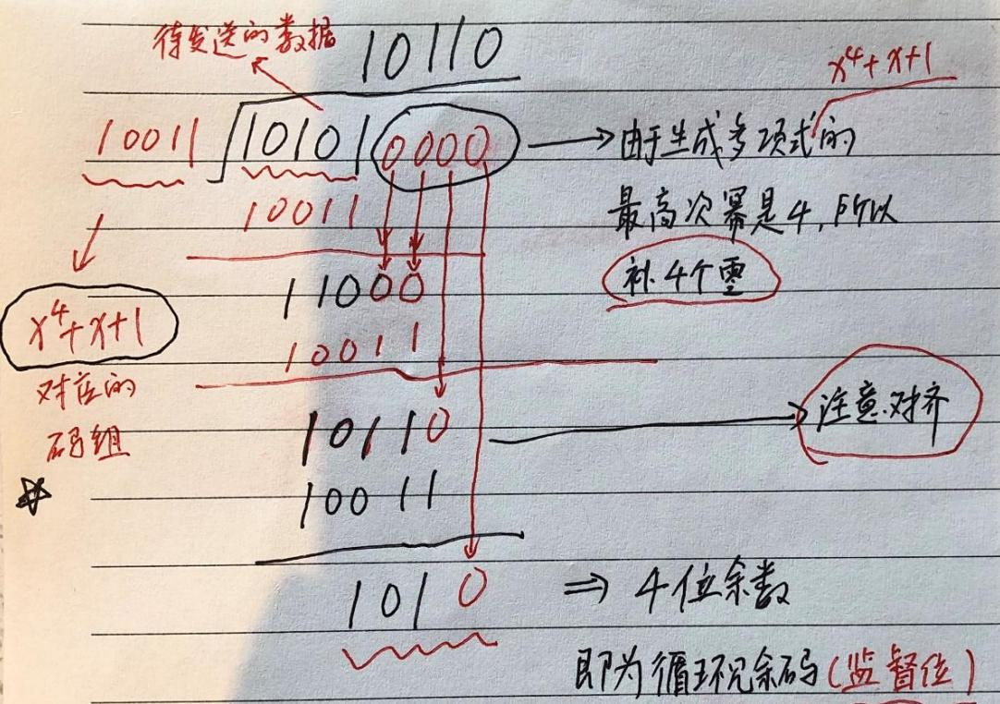
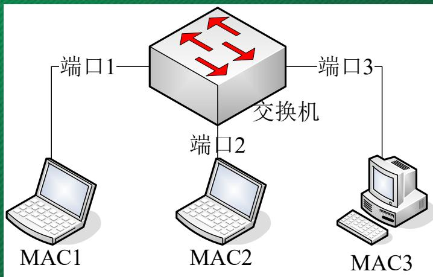
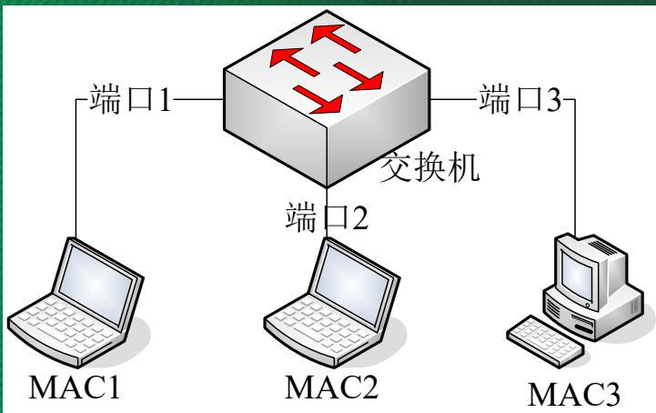
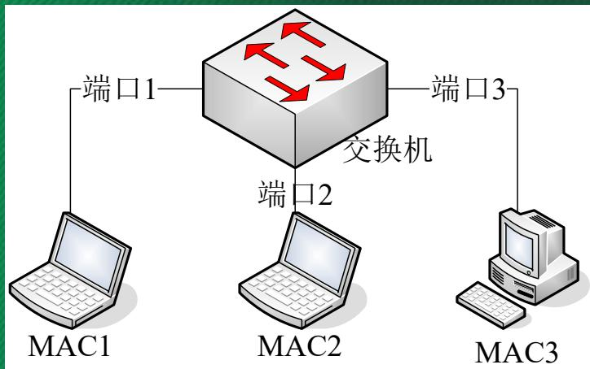
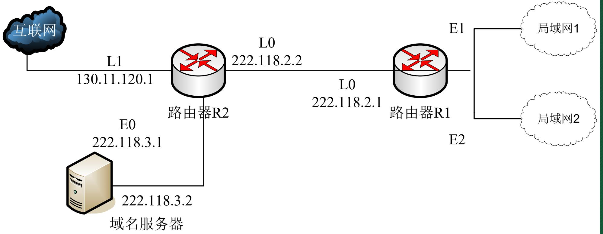
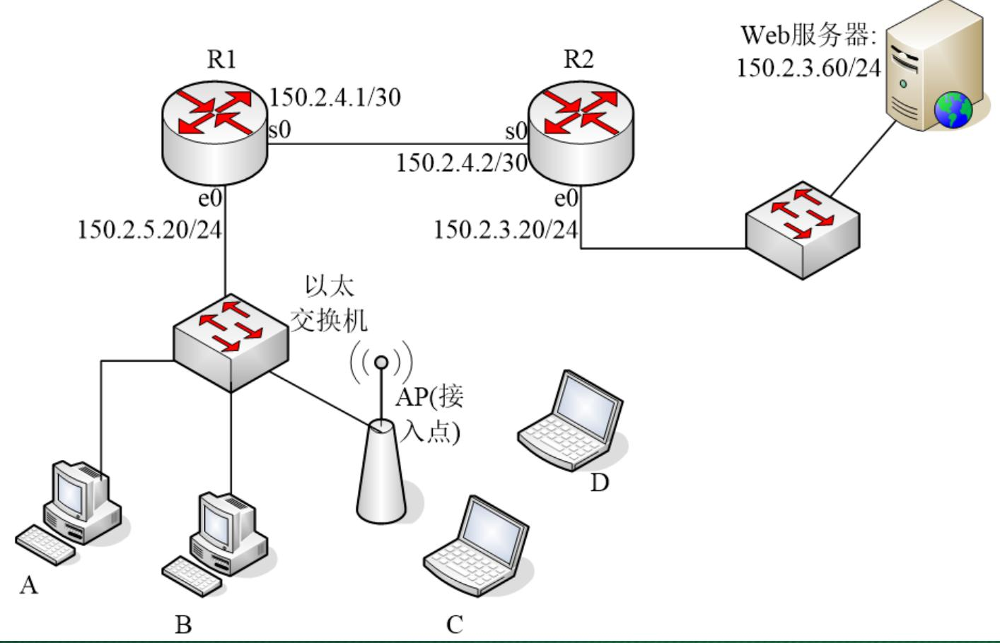
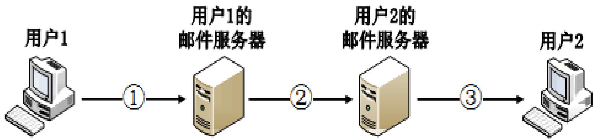

# 2018—2019 学年第二学期《计算机通信与网络》复习提纲

原件经识别和整理；“参考解答”是我们补的。

## 考试题型与分值

- 单项选择题：20 分（10 题，每题 2 分）
- 填空题：20 分（每空 1 分）
- 简答题：20 分（4 题，每题 5 分）
- 综合应用题：40 分

注：试卷中包含一张附录，包括以太网 MAC 帧结构、IPv4 数据报格式、UDP 以及 TCP 报文段格式，但要求大家掌握其各个字段的含义。

## 第一章 概述

### 概述

1. 掌握计算机网络在逻辑上的组成（通信子网和终端系统）及其各自的作用。
2. 理解网络的类型（网络拓扑结构、网络覆盖范围）。
3. 掌握网络体系结构的概念；掌握协议概念和协议三要素的名称、含义。
4. 掌握 OSI/RM 体系结构的七层模型名称及下三层传输的基本单位、五层体系结构各层的功能。
5. 掌握 TCP/IP 体系结构各层功能。

知识点：[计算机网络的定义、组成与拓扑分类](../../../topics/计算机网络/network_basics.md)、[网络体系结构与协议（OSI/RM与TCP/IP模型、协议三要素）](../../../topics/计算机网络/architecture_protocols.md)

### 概述样题

#### 选择 1

下列选项中，不属于网络体系结构中所描述的内容是\_\_\_\_。

- A. 网络层次
- B. 协议内部实现细节
- C. 每一层使用协议
- D. 每层须完成的功能

#### 填空 1

计算机网络按照网络的作用范围进行分类，可以分为局域网、\_\_\_\_、城域网和个人区域网。

#### 选择 2

通信双方必须遵循的控制信息交换规则的集合是\_\_\_\_。

- A. 服务访问点
- B. 原语
- C. 协议
- D. 网络体系结构

#### 填空 2

网络协议由语法、语义和\_\_\_\_三个要素组成。

#### 选择 3

OSI 体系结构中，直接为表示层提供服务的是（ ）。

- A. 传输层
- B. 应用层
- C. 会话层
- D. 网络层

#### 简答 1

从逻辑上说，计算机网络由哪两个部分组成？这两个部分的主要作用分别是什么？

## 第二章 数据通信技术基础

知识点：[网络体系结构与协议（OSI/RM与TCP/IP模型、协议三要素）](../../../topics/计算机网络/architecture_protocols.md)、[计算机网络的定义、组成与拓扑分类](../../../topics/计算机网络/network_basics.md)、[数据通信系统模型与传输媒体](../../../topics/计算机网络/comm_basics_media.md)

### 数据通信技术基础

1. 掌握数据通信系统技术指标的计算（传信率、传码率、信道带宽、时延、误码率、信道容量，包括香农公式和奈氏第一准则）。
2. 了解各种传输介质的名称。
3. 掌握编码与调制中（（差分）曼彻斯特编码、信号的各种转换的方法）。
4. 掌握多路复用技术概念、分类以及在实际网络中的应用。
5. 理解数据交换技术的主要特点。
6. 掌握汉明距离和纠/检错能力的关系；差错控制编码的计算（汉明码和 CRC）。
7. 掌握数据通信接口的四个特性的名称和含义。

知识点：[信道容量与传输速率计算（奈氏准则与香农公式）](../../../topics/计算机网络/channel_capacity.md)、[数据编码与调制技术（曼彻斯特编码、PCM、基带与频带传输）](../../../topics/计算机网络/encoding_modulation.md)、[信道复用技术（FDM、TDM、WDM、CDM）](../../../topics/计算机网络/multiplexing.md)

### 数据通信技术基础样题

#### 选择 1

对带宽为 $4 \mathrm{kHz}$ 的信号，采用 PCM 技术数字化，每次采样用 8 位编码，为使数据不失真，需要的通信能力为（ ）。

- A. $12 \mathrm{kb/s}$
- B. $8 \mathrm{kb/s}$
- C. $32 \mathrm{kb/s}$
- D. $64 \mathrm{kb/s}$

答案：D。

#### 选择 2

共有 4 个站进行码分多址通信。4 个站的码片序列为

- A：$(-1-1-1+1+1+1-1+1+1)$
- B：$(-1-1+1-1+1+1+1+1-1)$
- C：$(-1+1-1+1+1+1+1-1-1)$
- D：$(-1+1-1-1-1-1+1-1)$

若收到码片序列 S：$(-1+1-3+1-1-3+1+1)$，则没有发送数据的站是（ ）。

- A. A 站
- B. B 站
- C. C 站
- D. D 站

答案：C。

#### 填空 1

若码元周期 $T=2\times10^{-4}$ 秒，且传送 8 电平信号，则传码速率为\_\_\_\_ Bd、传信速率为\_\_\_\_ b/s。

答案：$5000 \mathrm{~Bd}$、$15000 \mathrm{~b/s}$。

#### 填空 2

假设某站点的码片序列为 11100101，则发送了比特“0”的时候，在信道上传输的码片序列是\_\_\_\_，发送了比特“1”的时候，码片序列是\_\_\_\_。

答案：00011010、11100101。

#### 填空 3

已知待传送的数据 M=10101，若采用 CRC 技术进行检错，生成多项式为 $x^{4}+x+1$，则循环冗余码为\_\_\_\_。

答案：1010。

解析：待发送的数据 10110。



实际在信道上发送的是 1010101010，信息位 10101，监督位 01010。也就是通过降低传输效率，换取了接收端接收到的数据序列本身有了差错检测的功能。（注记：是检错，不是纠错。）

## 第三章 数据链路层

知识点：[信道容量与传输速率计算（奈氏准则与香农公式）](../../../topics/计算机网络/channel_capacity.md)、[信道复用技术（FDM、TDM、WDM、CDM）](../../../topics/计算机网络/multiplexing.md)、[差错控制与检测编码（汉明码、CRC循环冗余校验）](../../../topics/计算机网络/error_control.md)

### 数据链路层

1. 理解数据链路层的七个功能。
2. 理解滑动窗口机制的工作原理与过程。
3. 掌握停止—等待协议、连续 ARQ、选择 ARQ 的原理和窗口尺寸的作用。
4. 理解 HDLC 与 PPP 协议（帧结构、透明传输、帧类型）。
5. 理解多路访问信道的常用介质访问控制方法原理（CSMA 和改进的 CSMA，和第四章的内容有些重复，可以和第四章结合在一起）。

知识点：[数据链路层功能与透明传输（HDLC、PPP协议）](../../../topics/计算机网络/dll_functions.md)、[流量控制与可靠传输（停止等待、连续ARQ、选择ARQ及窗口尺寸）](../../../topics/计算机网络/flow_control.md)、[介质访问控制基础（信道共享、竞争系统与令牌机制）](../../../topics/计算机网络/mac_basics.md)

### 数据链路层样题

#### 选择 1

HDLC 采用“0”比特插入法的目的是（ ）。

- A. 差错控制
- B. 链路管理
- C. 保证传输的透明性
- D. 流量控制

答案：C。

#### 填空 1

数据链路层采用连续 ARQ 协议，发送方已经发送了编号为 0～7 的帧，当计时器超时，若发送方只收到 0、2、3 号帧的确认，则发送方需要重发\_\_\_\_个帧。

答案：4。

## 第四章 局域网与广域网

知识点：[数据链路层功能与透明传输（HDLC、PPP协议）](../../../topics/计算机网络/dll_functions.md)、[流量控制与可靠传输（停止等待、连续ARQ、选择ARQ及窗口尺寸）](../../../topics/计算机网络/flow_control.md)、[介质访问控制基础（信道共享、竞争系统与令牌机制）](../../../topics/计算机网络/mac_basics.md)

### 局域网与广域网

1. 了解 IEEE 802 局域网标准，局域网的子层划分。
2. 掌握 CSMA/CD 协议（原理、争用期、最短帧的计算、以太网 MAC 帧格式）。
3. 理解 10BASE-T、10BASE-F 等以太网的几个技术特性（传输技术、传输介质、拓扑结构、介质访问控制方法等）。
4. 掌握以太网级联与扩展使用的设备及特点（物理层、数据链路层扩展设备的原理）。
5. 理解网桥（交换机）帧过滤的算法。
6. 掌握以太网交换机转发帧的过程，三种转发方式及其特点，理解碎片帧的含义。
7. 了解虚拟局域网 VLAN 的基本概念。
8. 理解无线局域网链路层协议 CSMA/CA（三种帧间间隔、实现信道预约的方法等）。
9. 理解虚电路和数据报的原理、优缺点。
10. 了解三种广域网技术（X.25、帧中继、ATM）。

知识点：[局域网体系结构与IEEE 802标准（LLC与MAC子层）](../../../topics/计算机网络/lan_ieee802.md)、[CSMA/CD协议与以太网（争用期、最短帧长、MAC帧格式）](../../../topics/计算机网络/csmacd_ethernet.md)、[广域网基本概念与虚电路服务（X.25、帧中继、ATM）](../../../topics/计算机网络/wan_concepts.md)

### 局域网与广域网样题

#### 选择 1

对于 100Mbps 的以太网交换机，当输出端口无排队，以无碎片交换方式转发一个 1000 字节的以太网帧（不包括前导码）时，引入的转发延迟至少是\_\_\_\_ μs。

- A. 0.48
- B. 5.12
- C. 10
- D. 80

答案：B。

#### 计算 1

局域网采用 CSMA/CD 协议，传输介质是用中继器相连的两根总长度为 1600m 长的电缆，电缆中的信号传播速度是 $2\times10^{8} \mathrm{~m/s}$。若信号经过中继器产生 2us 时延，且最短帧长为 1000 bit，求出该局域网的最大传输速率。

答案：50Mb/s。

#### 综合 1

某以太网拓扑及主机的 MAC 地址如题图所示，交换机转发表为空，输出端口无排队帧，不考虑帧校验延迟。主机 MAC1 向主机 MAC3 发送一个数据帧，主机 MAC3 收到该数据帧后，向主机 MAC1 发送一个确认帧。写出交换机的转发端口，并更新交换机的转发表。



分析：主机 MAC1 向主机 MAC3 发送一个数据帧，交换机的 1 号端口收到该帧，并把该帧转发至端口 2 和端口 3。



交换机转发表：

| 站地址 | 端口号 |
| --- | --- |
| MAC1 | ① |

分析：主机 MAC3 向主机 MAC1 发送的确认帧，交换机的 3 号端口收到该帧后，把该帧转发至端口 1。



交换机转发表：

| 站地址 | 端口号 |
| --- | --- |
| MAC1 | ① |
| MAC3 | ③ |

## 第五章 网络层与网络互连

知识点：[CSMA/CD协议与以太网（争用期、最短帧长、MAC帧格式）](../../../topics/计算机网络/csmacd_ethernet.md)、[局域网的扩展与互连设备（集线器、网桥、交换机、冲突域与广播域）](../../../topics/计算机网络/lan_extension.md)、[计算机网络性能指标（速率、时延、吞吐量计算）](../../../topics/计算机网络/performance_metrics.md)

### 网络层与网络互连

1. 理解分类的 IP 地址分类，特殊的 IP 地址。
2. 掌握 IP 地址和硬件地址的联系与映射。
3. 理解 IP 数据报格式，掌握对网络采集报文的解析方法。
4. 掌握 IP 数据报分片原理与计算。
5. 理解因特网控制报文协议 ICMP 及其应用。
6. 掌握划分子网的计算过程和步骤。
7. 掌握 CIDR 原理、地址块的分配、路由聚合技术，以及最长前缀匹配。

## 第五章 网络层与网络互连

知识点：[IPv4协议与数据报格式（分类IP地址、分片计算、首部字段）](../../../topics/计算机网络/ipv4_datagram.md)、[子网划分与CIDR（子网掩码计算、路由聚合、最长前缀匹配）](../../../topics/计算机网络/subnet_cidr.md)、[ARP地址解析协议与ICMP控制报文](../../../topics/计算机网络/arp_icmp.md)

### 复习要点

- 掌握因特网有两大类路由选择协议（IGP 包括 RIP、OSPF 原理，了解 EGP 的概念）。
- 掌握直接交付和间接交付的概念。理解路由器的组成部分和转发 IP 分组的原理（包括写路由表等）（参考样题第 2 题）。
- 了解 IP 组播的原理。
- 理解 IP 地址转换应用（VPN、NAT）。
- 掌握 IPv6（地址种类、地址表示、分级地址结构、IPv6 首部的应用，IPv4 至 IPv6 的过渡方法）。

知识点：[网络管理功能与SNMP协议（FCAPS五大功能、MIB、ASN.1）](../../../topics/计算机网络/network_management_snmp.md)、[密码学与数据加密技术（对称与非对称密钥、数字签名、报文摘要）](../../../topics/计算机网络/cryptography_encryption.md)

### 选择 1

两个主机通过电缆直接相连，主机 A 的 IP 地址为 220.17.33.24/28，而主机 B 的 IP 地址为 220.17.33.100/28，两个主机互相 Ping 不能，这时应该\_\_\_\_。

- A. 改变主机 A 的地址为 220.17.33.15
- B. 改变主机 B 的地址为 220.17.33.111
- C. 改变子网掩码为 26
- D. 改变子网掩码为 25

答案：D。

知识点：[网络管理功能与SNMP协议（FCAPS五大功能、MIB、ASN.1）](../../../topics/计算机网络/network_management_snmp.md)、[计算机网络性能指标（速率、时延、吞吐量计算）](../../../topics/计算机网络/performance_metrics.md)

### 综合 1

某公司网络拓扑如图所示，路由器 R1 通过接口 E1、E2 分别连接局域网 1、局域网 2，通过接口 L0 连接路由器 R2，并通过路由器 R2 连接域名服务器与互联网。R1 的 L0 接口的 IP 地址是 222.118.2.1；R2 的 L0 接口的 IP 地址是 222.118.2.2，L1 接口的 IP 地址是 130.11.120.1，E0 接口的 IP 地址是 222.118.3.1；域名服务器的 IP 地址是 222.118.3.2。



(1) 将 IP 地址空间 222.118.1.0/24 划分为 2 个子网，分别分配给局域网 1 和局域网 2，每个局域网需分配的 IP 地址数不少于 120 个。请给出子网划分结果，说明理由或给出必要的计算过程。

(2) 请给出 R1 的路由表，使其明确包括到局域网 1 的路由、局域网 2 的路由、域名服务器的主机路由和互联网的路由。

(3) 请采用路由聚合技术，给出 R2 到局域网 1 和局域网 2 的路由。

参考解答：

(1) 局域网 1：202.118.1.0/25；局域网 2：202.118.1.128/25。

(2) R1 的路由表结构为：目的网络 IP 地址、子网掩码、下一跳 IP 地址、接口。

| 目的网络IP地址 | 子网掩码 | 下一跳IP地址 | 接口 |
| --- | --- | --- | --- |
| 202.118.1.0 | 255.255.255.128 | — | $E_1$ |
| 202.118.1.128 | 255.255.255.128 | — | $E_2$ |
| 202.118.3.2 | 255.255.255.255 | 202.118.2.2 | $L_0$ |
| 0.0.0.0 | 0.0.0.0 | 202.118.2.2 | $L_0$ |

(3) R2 的路由表结构为：

| 目的网络IP地址 | 子网掩码 | 下一跳IP地址 | 接口 |
| --- | --- | --- | --- |
| 202.118.1.0 | 255.255.255.0 | 202.118.2.1 | $L_0$ |

知识点：[IPv4协议与数据报格式（分类IP地址、分片计算、首部字段）](../../../topics/计算机网络/ipv4_datagram.md)、[传输层服务与端口（复用与分用、五元组、熟知端口）](../../../topics/计算机网络/transport_services_ports.md)、[TCP连接管理与可靠传输（三次握手、四次挥手、序号确认、RTT与RTO）](../../../topics/计算机网络/tcp_connection_reliability.md)

### 选择 2

在 IPv4 中，一个数据报总长度为 3000 字节（固定长度的首部），现在经过 MTU=1500 字节的网络传送，则该数据报被划分数据报片个数是\_\_\_\_。

- A. 1
- B. 2
- C. 3
- D. 4

答案：C。

知识点：[电子邮件系统（SMTP、POP3、IMAP、MIME）](../../../topics/计算机网络/email_protocols.md)、[网络体系结构与协议（OSI/RM与TCP/IP模型、协议三要素）](../../../topics/计算机网络/architecture_protocols.md)

### 计算 1

求 212.10.4.0/24，212.10.5.0/24，212.10.6.0/24，212.10.7.0/24 汇聚后的网络地址。

参考解答：

212.10.00000100.0

212.10.00000101.0

212.10.00000110.0

212.10.00000111.0

汇聚后的网络地址为 212.10.4.0/22。

知识点：[子网划分与CIDR（子网掩码计算、路由聚合、最长前缀匹配）](../../../topics/计算机网络/subnet_cidr.md)、[IPv4协议与数据报格式（分类IP地址、分片计算、首部字段）](../../../topics/计算机网络/ipv4_datagram.md)

### 计算 2

128.14.32.0/20 表示的地址块共有多少个地址？最大和最小的地址分别是什么？

参考解答：共有 $2^{(32-20)}=2^{12}=4096$ 个地址。最小地址为 128.14.32.0，最大地址为 128.14.47.255。

知识点：[子网划分与CIDR（子网掩码计算、路由聚合、最长前缀匹配）](../../../topics/计算机网络/subnet_cidr.md)、[IPv4协议与数据报格式（分类IP地址、分片计算、首部字段）](../../../topics/计算机网络/ipv4_datagram.md)

### 综合 2

请分析下图中有几个网络，并给出每个网络的子网掩码、子网地址、有效 IP 地址范围、广播地址。



## 第六章 传输层

知识点：[子网划分与CIDR（子网掩码计算、路由聚合、最长前缀匹配）](../../../topics/计算机网络/subnet_cidr.md)、[IPv4协议与数据报格式（分类IP地址、分片计算、首部字段）](../../../topics/计算机网络/ipv4_datagram.md)、[网络互连与IP转发（路由器转发过程、NAT、VPN、移动IP、组播）](../../../topics/计算机网络/network_interconnection.md)

### 复习要点

- 掌握传输层的功能、作用、分类。
- 理解端口和套接字概念。
- 掌握 UDP 基本概念，理解其报文格式以及校验和计算（伪首部）。
- 掌握 TCP（基本概念、报文格式、可靠传输、往返时延的确定、连接管理、流量控制、慢启动和拥塞控制）。

知识点：[网络管理功能与SNMP协议（FCAPS五大功能、MIB、ASN.1）](../../../topics/计算机网络/network_management_snmp.md)、[密码学与数据加密技术（对称与非对称密钥、数字签名、报文摘要）](../../../topics/计算机网络/cryptography_encryption.md)

### 选择 1

主机甲向主机乙发送一个 (SYN = 1, Seq = x) 的 TCP 段，期望与主机乙建立 TCP 连接，若主机乙接受该连接请求，则主机乙向主机甲发送的正确的 TCP 段可能是（ ）。

- A. (SYN = 1, ACK = 0, Seq = y, Ack = x+1)
- B. (SYN = 1, ACK = 1, Seq = y, Ack = x+1)
- C. (SYN = 1, ACK = 1, Seq = x+1, Ack = y)
- D. (SYN = 0, ACK = 1, Seq = x+1, Ack = y)

知识点：[网络管理功能与SNMP协议（FCAPS五大功能、MIB、ASN.1）](../../../topics/计算机网络/network_management_snmp.md)、[计算机网络性能指标（速率、时延、吞吐量计算）](../../../topics/计算机网络/performance_metrics.md)

### 综合 1

利用数据包捕获软件捕获到的一个 IP 数据报从首部开始的部分内容如下图所示（均用 16 进制表示），请写出本次通信所对应的五元组。（注意：涉及到的 IP 地址请用点分十进制表示，端口号请用十进制表示）

注意五元组的顺序：源 IP 地址、源端口号、目的 IP 地址、目的端口号、传输层的协议（TCP 或 UDP）

```
45 00 02 79 1C A4 40 00
80 06 00 00 0A 0A 01 5F
DA 1E 73 7B 07 38 00 50
19 71 85 77 7F 25 2B AA
50 18 FF FF 5B 6E 00 00
47 45 54 20 2F 73 2F 62
6C 6F 67 5F 34 62 63 66
64 64 63 64
```

参考解答：

对应的五元组：

- 源 IP 地址：10.10.1.95
- 源端口号：0738H=1848
- 目的 IP 地址：218.30.115.123
- 目的端口号：50H=80
- 传输层的协议：TCP

## 第七章 应用层

知识点：[IPv4协议与数据报格式（分类IP地址、分片计算、首部字段）](../../../topics/计算机网络/ipv4_datagram.md)、[传输层服务与端口（复用与分用、五元组、熟知端口）](../../../topics/计算机网络/transport_services_ports.md)、[TCP连接管理与可靠传输（三次握手、四次挥手、序号确认、RTT与RTO）](../../../topics/计算机网络/tcp_connection_reliability.md)

### 复习要点

- 理解因特网部分应用层协议与传输层协议的对应关系。
- 理解网络应用模式、服务器工作模式。
- 掌握应用层基本协议原理与应用（DNS、FTP、DHCP）。
- 掌握电子邮件原理与应用（组成构件、SMTP、POP、MIME）。
- 理解万维网技术原理与应用（URL、HTTP、HTML、搜索引擎）。

知识点：[网络管理功能与SNMP协议（FCAPS五大功能、MIB、ASN.1）](../../../topics/计算机网络/network_management_snmp.md)、[密码学与数据加密技术（对称与非对称密钥、数字签名、报文摘要）](../../../topics/计算机网络/cryptography_encryption.md)

### 选择 1

如果本地域名服务器无缓存，当采用递归方法解析另一网络某主机域名时，用户主机和本地域名服务器发送的域名请求条数分别为（ ）。

- A. 1 条，1 条
- B. 1 条，多条
- C. 多条，1 条
- D. 多条，多条

答案：A。

知识点：[网络管理功能与SNMP协议（FCAPS五大功能、MIB、ASN.1）](../../../topics/计算机网络/network_management_snmp.md)、[计算机网络性能指标（速率、时延、吞吐量计算）](../../../topics/计算机网络/performance_metrics.md)

### 选择 2

若用户 1 向用户 2 发送电子邮件的过程如下图所示，则图中①、②、③阶段分别使用的应用层协议可以是\_\_\_\_\_\_\_\_\_\_。

- A. SMTP、SMTP、SMTP
- B. POP3、SMTP、POP3
- C. POP3、SMTP、SMTP
- D. SMTP、SMTP、POP3



答案：D。

## 第八章 网络管理与网络安全

知识点：[电子邮件系统（SMTP、POP3、IMAP、MIME）](../../../topics/计算机网络/email_protocols.md)、[网络体系结构与协议（OSI/RM与TCP/IP模型、协议三要素）](../../../topics/计算机网络/architecture_protocols.md)

### 复习要点

- 掌握网络管理五大功能。
- 理解简单网络管理协议 SNMP 的基本原理、工作机制。
- 掌握网络安全威胁因素。
- 理解加密算法（对称加密、非对称加密技术）及其应用场景。

知识点：[网络管理功能与SNMP协议（FCAPS五大功能、MIB、ASN.1）](../../../topics/计算机网络/network_management_snmp.md)、[密码学与数据加密技术（对称与非对称密钥、数字签名、报文摘要）](../../../topics/计算机网络/cryptography_encryption.md)

### 选择 1

网络管理功能中，“对网络资源利用率及有关通信活动进行分析，以帮助网络管理人员评价网络资源及相关通信活动的情况和效率”，描述的是（ ）。

- A. 计费管理
- B. 故障管理
- C. 性能管理
- D. 安全管理

答案：C。

知识点：[网络管理功能与SNMP协议（FCAPS五大功能、MIB、ASN.1）](../../../topics/计算机网络/network_management_snmp.md)、[计算机网络性能指标（速率、时延、吞吐量计算）](../../../topics/计算机网络/performance_metrics.md)

### 填空 1

网络管理五大功能为\_\_\_\_、性能管理、配置管理、\_\_\_\_和计费管理。

答案：安全管理、故障管理。

知识点：[网络管理功能与SNMP协议（FCAPS五大功能、MIB、ASN.1）](../../../topics/计算机网络/network_management_snmp.md)
