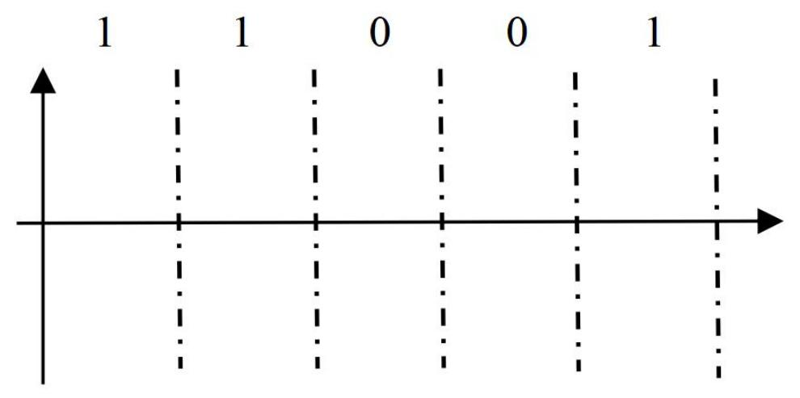
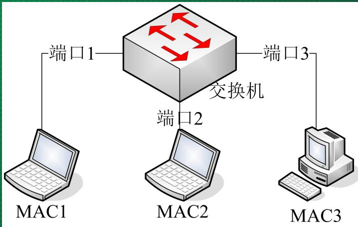
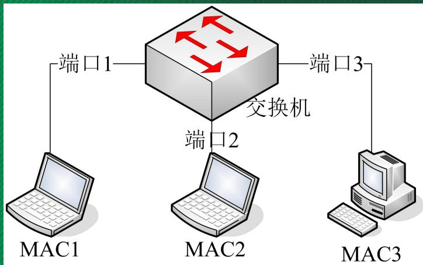
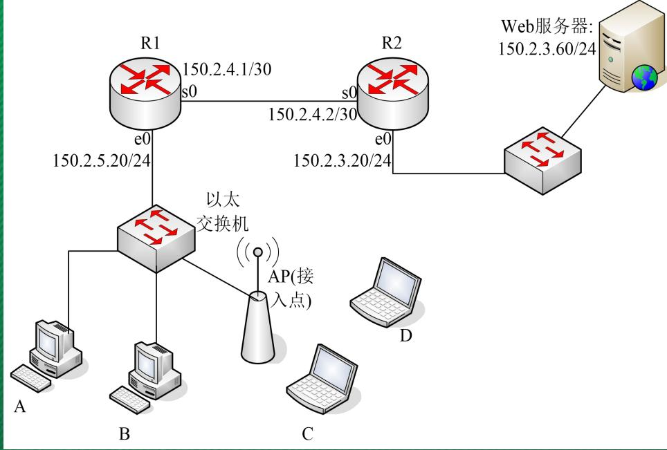
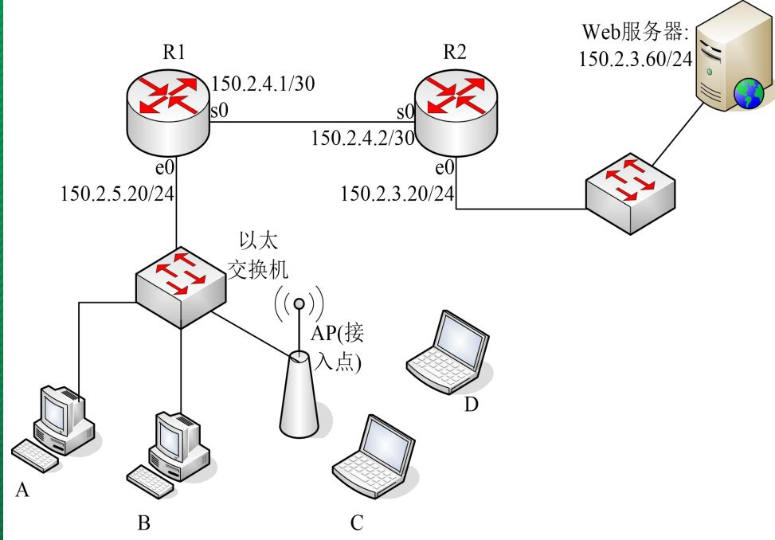
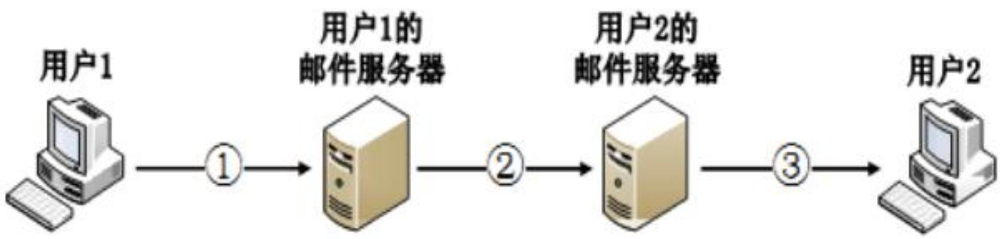

# 2020—2021 学年第二学期《计算机通信与网络》期末复习提纲

原件经识别和整理；“参考解答”是我们补的。

## 第一章 概述

### 概述 1

掌握计算机网络在逻辑上的组成（通信子网和终端系统）及其各自的作用。

知识点：[计算机网络的定义、组成与拓扑分类](../../../topics/计算机网络/network_basics.md)

### 概述 2

理解网络的类型（网络拓扑结构、网络覆盖范围）。

知识点：[计算机网络的定义、组成与拓扑分类](../../../topics/计算机网络/network_basics.md)

### 概述 3

掌握网络体系结构的概念；掌握协议概念和协议三要素的名称、含义。

知识点：[网络体系结构与协议（OSI/RM与TCP/IP模型、协议三要素）](../../../topics/计算机网络/architecture_protocols.md)

### 概述 4

掌握 OSI/RM 体系结构的七层模型名称及下三层传输的基本单位、五层体系结构各层的功能，相邻层的数据封装关系。

知识点：[网络体系结构与协议（OSI/RM与TCP/IP模型、协议三要素）](../../../topics/计算机网络/architecture_protocols.md)

### 概述 5

掌握 TCP/IP 体系结构各层功能。

知识点：[网络体系结构与协议（OSI/RM与TCP/IP模型、协议三要素）](../../../topics/计算机网络/architecture_protocols.md)、[TCP连接管理与可靠传输（三次握手、四次挥手、序号确认、RTT与RTO）](../../../topics/计算机网络/tcp_connection_reliability.md)、[传输层服务与端口（复用与分用、五元组、熟知端口）](../../../topics/计算机网络/transport_services_ports.md)

### 选择 1

包含 N 个节点的星型拓扑网络中，链路数目是（ ）。

- A. N-1
- B. N
- C. N+1
- D. N(N-1)/2

答案：A。

知识点：[网络管理功能与SNMP协议（FCAPS五大功能、MIB、ASN.1）](../../../topics/计算机网络/network_management_snmp.md)、[计算机网络性能指标（速率、时延、吞吐量计算）](../../../topics/计算机网络/performance_metrics.md)

### 选择 2

计算机网络按照网络的作用范围进行分类，可以分为个人区域网、局域网、城域网、广域网等。

答案：正确。

知识点：[网络管理功能与SNMP协议（FCAPS五大功能、MIB、ASN.1）](../../../topics/计算机网络/network_management_snmp.md)、[网络体系结构与协议（OSI/RM与TCP/IP模型、协议三要素）](../../../topics/计算机网络/architecture_protocols.md)

### 选择 3

通信双方必须遵循的控制信息交换规则的集合是（ ）。

- A. 服务访问点
- B. 原语
- C. 协议
- D. 网络体系结构

答案：C。

知识点：[网络体系结构与协议（OSI/RM与TCP/IP模型、协议三要素）](../../../topics/计算机网络/architecture_protocols.md)

### 填空 1

网络协议由语法、语义和 同步 三个要素组成。

答案：同步。

知识点：[流量控制与可靠传输（停止等待、连续ARQ、选择ARQ及窗口尺寸）](../../../topics/计算机网络/flow_control.md)

### 选择 4

OSI 体系结构中直接为网络层提供服务的是（ ）。

- A. 传输层
- B. 数据链路层
- C. 物理层
- D. 网络层

答案：B。

知识点：[网络体系结构与协议（OSI/RM与TCP/IP模型、协议三要素）](../../../topics/计算机网络/architecture_protocols.md)、[数据链路层功能与透明传输（HDLC、PPP协议）](../../../topics/计算机网络/dll_functions.md)

### 选择 5

下列不属于通信子网中的设备是（ ）。

- A. 网桥
- B. 路由器
- C. 集线器
- D. PC 机

答案：D。

## 第二章 数据通信技术基础

知识点：[局域网的扩展与互连设备（集线器、网桥、交换机、冲突域与广播域）](../../../topics/计算机网络/lan_extension.md)、[计算机网络的定义、组成与拓扑分类](../../../topics/计算机网络/network_basics.md)、[数据链路层功能与透明传输（HDLC、PPP协议）](../../../topics/计算机网络/dll_functions.md)

### 数据通信 1

掌握数据通信系统技术指标的计算（传信率、传码率、信道带宽、发送时延和传播时延、误码率、信道容量，包括香农公式和奈氏第一准则）。

知识点：[计算机网络性能指标（速率、时延、吞吐量计算）](../../../topics/计算机网络/performance_metrics.md)、[信道容量与传输速率计算（奈氏准则与香农公式）](../../../topics/计算机网络/channel_capacity.md)

### 数据通信 2

了解各种传输介质的名称。

知识点：[数据通信系统模型与传输媒体](../../../topics/计算机网络/comm_basics_media.md)

### 数据通信 3

掌握曼彻斯特和差分曼彻斯特编码的规则。

知识点：[数据编码与调制技术（曼彻斯特编码、PCM、基带与频带传输）](../../../topics/计算机网络/encoding_modulation.md)、[数据通信系统模型与传输媒体](../../../topics/计算机网络/comm_basics_media.md)、[物理层接口特性与标准（机械、电气、功能、规程特性）](../../../topics/计算机网络/physical_layer_interface.md)

### 数据通信 4

掌握多路复用技术概念、分类以及在实际网络中的应用。

知识点：[信道复用技术（FDM、TDM、WDM、CDM）](../../../topics/计算机网络/multiplexing.md)、[数据通信系统模型与传输媒体](../../../topics/计算机网络/comm_basics_media.md)、[计算机网络的定义、组成与拓扑分类](../../../topics/计算机网络/network_basics.md)

### 数据通信 5

理解数据交换技术的主要特点。

知识点：[数据交换技术（电路交换、报文交换、分组交换）](../../../topics/计算机网络/switching_tech.md)、[计算机网络性能指标（速率、时延、吞吐量计算）](../../../topics/计算机网络/performance_metrics.md)

### 数据通信 6

掌握汉明码的编码规则，数据位长度和校验位长度的关系。

知识点：[差错控制与检测编码（汉明码、CRC循环冗余校验）](../../../topics/计算机网络/error_control.md)

### 数据通信 7

掌握发送方 CRC 校验码的计算方法以及接收方的差错检测过程（生成多项式，CRC 校验码，发送序列，接收端如何检错）。

知识点：[差错控制与检测编码（汉明码、CRC循环冗余校验）](../../../topics/计算机网络/error_control.md)、[数据通信系统模型与传输媒体](../../../topics/计算机网络/comm_basics_media.md)、[物理层接口特性与标准（机械、电气、功能、规程特性）](../../../topics/计算机网络/physical_layer_interface.md)

### 选择 1

对带宽为 $4\mathrm{kHz}$ 的信号，采用 PCM 技术数字化，每次采样用 8 位编码，为使数据不失真，需要的通信能力为（ ）。

- A. $12\mathrm{kb/s}$
- B. $8\mathrm{kb/s}$
- C. $32\mathrm{kb/s}$
- D. $64\mathrm{kb/s}$

答案：D。

知识点：[网络管理功能与SNMP协议（FCAPS五大功能、MIB、ASN.1）](../../../topics/计算机网络/network_management_snmp.md)、[计算机网络性能指标（速率、时延、吞吐量计算）](../../../topics/计算机网络/performance_metrics.md)

### 选择 2

共有 4 个站进行码分多址通信。4 个站的码片序列为

- A：$(-1-1-1+1+1-1+1+1)$
- B：$(-1-1+1-1+1+1+1-1)$
- C：$(-1+1-1+1+1+1-1-1)$
- D：$(-1+1-1-1-1-1+1-1)$

若收到码片序列 S：$(-1+1-3+1-1-3+1+1)$，则没有发送数据的站是（ ）。

- A. A 站
- B. B 站
- C. C 站
- D. D 站

答案：C。

知识点：[网络管理功能与SNMP协议（FCAPS五大功能、MIB、ASN.1）](../../../topics/计算机网络/network_management_snmp.md)、[网络体系结构与协议（OSI/RM与TCP/IP模型、协议三要素）](../../../topics/计算机网络/architecture_protocols.md)

### 填空 1

若码元周期 $T=2\times10^{-4}$ 秒，且传送 8 电平信号，则传码速率为\_\_\_\_ Bd、传信速率为\_\_\_\_ b/s。

答案：5000 Bd、15000 b/s。

知识点：[流量控制与可靠传输（停止等待、连续ARQ、选择ARQ及窗口尺寸）](../../../topics/计算机网络/flow_control.md)

### 填空 2

假设某站点的码片序列为 11100101，则发送了比特“0”的时候，在信道上传输的码片序列是\_\_\_\_，发送了比特“1”的时候，码片序列是\_\_\_\_。

答案：00011010、11100101。

知识点：[网络管理功能与SNMP协议（FCAPS五大功能、MIB、ASN.1）](../../../topics/计算机网络/network_management_snmp.md)

### 计算 1

已知发送端待传送的数据 $M=10101$，若采用 CRC 技术进行检错，生成多项式为 $x^{4}+x+1$，则循环冗余码是什么？实际在信道上传送的数据序列是什么？若接收端收到的数据序列是 101101010，如何判断是否有错？

答案：循环冗余码为 1010，待发送的数据为 10110。实际在信道上发送的是 101101010（信息位 10101 + 监督位 1010）。也就是通过降低传输效率，换取了接收端接收到的数据序列本身有了差错检测的功能（是检错，不是纠错）。

知识点：[CSMA/CD协议与以太网（争用期、最短帧长、MAC帧格式）](../../../topics/计算机网络/csmacd_ethernet.md)、[计算机网络性能指标（速率、时延、吞吐量计算）](../../../topics/计算机网络/performance_metrics.md)、[介质访问控制基础（信道共享、竞争系统与令牌机制）](../../../topics/计算机网络/mac_basics.md)

### 简答 1

已知曼彻斯特码的编码规则：每个码元周期的中间有跳变（极性转换），二进制“0”表示为负电平到正电平的跳变；二进制“1”表示为正电平到负电平的跳变。

请画出二进制序列 11001 对应的曼彻斯特编码波形。



## 第三章 数据链路层

知识点：[数据编码与调制技术（曼彻斯特编码、PCM、基带与频带传输）](../../../topics/计算机网络/encoding_modulation.md)

### 数据链路 1

理解数据链路层的七个功能。

知识点：[数据链路层功能与透明传输（HDLC、PPP协议）](../../../topics/计算机网络/dll_functions.md)

### 数据链路 2

理解滑动窗口机制的工作原理与过程。

知识点：[流量控制与可靠传输（停止等待、连续ARQ、选择ARQ及窗口尺寸）](../../../topics/计算机网络/flow_control.md)、[数据链路层功能与透明传输（HDLC、PPP协议）](../../../topics/计算机网络/dll_functions.md)

### 数据链路 3

掌握停止—等待协议信道利用率的计算、连续 ARQ、选择 ARQ 的工作过程和窗口尺寸判断，连续 ARQ 信道利用率的计算。

知识点：[流量控制与可靠传输（停止等待、连续ARQ、选择ARQ及窗口尺寸）](../../../topics/计算机网络/flow_control.md)

### 数据链路 4

理解 HDLC 与 PPP 协议如何实现透明传输。

知识点：[数据链路层功能与透明传输（HDLC、PPP协议）](../../../topics/计算机网络/dll_functions.md)、[数据通信系统模型与传输媒体](../../../topics/计算机网络/comm_basics_media.md)、[网络体系结构与协议（OSI/RM与TCP/IP模型、协议三要素）](../../../topics/计算机网络/architecture_protocols.md)

### 数据链路 5

理解多路访问信道的常用介质访问控制方法原理（CSMA 和改进的 CSMA，和第四章的内容有些重复，可以和第四章结合在一起）。

知识点：[介质访问控制基础（信道共享、竞争系统与令牌机制）](../../../topics/计算机网络/mac_basics.md)、[CSMA/CD协议与以太网（争用期、最短帧长、MAC帧格式）](../../../topics/计算机网络/csmacd_ethernet.md)、[局域网体系结构与IEEE 802标准（LLC与MAC子层）](../../../topics/计算机网络/lan_ieee802.md)

### 选择 1

HDLC 采用“0”比特插入法的目的是（ ）。

- A. 差错控制
- B. 链路管理
- C. 保证传输的透明性
- D. 流量控制

答案：C。

知识点：[网络管理功能与SNMP协议（FCAPS五大功能、MIB、ASN.1）](../../../topics/计算机网络/network_management_snmp.md)、[计算机网络性能指标（速率、时延、吞吐量计算）](../../../topics/计算机网络/performance_metrics.md)

### 填空 1

数据链路层采用连续 ARQ 协议，发送方已经发送了编号为 0～7 的帧，当计时器超时，若发送方收到 0～3 号帧的确认，则发送方需要重发\_\_\_\_个帧。

答案：4。

## 第四章 局域网与广域网

知识点：[流量控制与可靠传输（停止等待、连续ARQ、选择ARQ及窗口尺寸）](../../../topics/计算机网络/flow_control.md)

### 局域网 1

了解 IEEE 802 局域网标准，局域网的子层划分。

知识点：[局域网体系结构与IEEE 802标准（LLC与MAC子层）](../../../topics/计算机网络/lan_ieee802.md)

### 局域网 2

掌握 CSMA/CD 协议（原理、争用期、最短帧的计算、以太网 MAC 帧格式、退避时间的决定因素）。

知识点：[CSMA/CD协议与以太网（争用期、最短帧长、MAC帧格式）](../../../topics/计算机网络/csmacd_ethernet.md)、[介质访问控制基础（信道共享、竞争系统与令牌机制）](../../../topics/计算机网络/mac_basics.md)、[局域网体系结构与IEEE 802标准（LLC与MAC子层）](../../../topics/计算机网络/lan_ieee802.md)

### 局域网 3

理解 10BASE-T、10BASE-F 等以太网的几个技术特性（传输技术、传输介质、拓扑结构、介质访问控制方法等）。

知识点：[CSMA/CD协议与以太网（争用期、最短帧长、MAC帧格式）](../../../topics/计算机网络/csmacd_ethernet.md)、[局域网体系结构与IEEE 802标准（LLC与MAC子层）](../../../topics/计算机网络/lan_ieee802.md)

### 局域网 4

掌握以太网级联与扩展使用的设备及特点（物理层、数据链路层扩展设备的原理）。

知识点：[局域网的扩展与互连设备（集线器、网桥、交换机、冲突域与广播域）](../../../topics/计算机网络/lan_extension.md)、[数据链路层功能与透明传输（HDLC、PPP协议）](../../../topics/计算机网络/dll_functions.md)、[CSMA/CD协议与以太网（争用期、最短帧长、MAC帧格式）](../../../topics/计算机网络/csmacd_ethernet.md)

### 局域网 5

掌握网桥（交换机）帧过滤和转发表更新的算法。

知识点：[局域网的扩展与互连设备（集线器、网桥、交换机、冲突域与广播域）](../../../topics/计算机网络/lan_extension.md)、[数据链路层功能与透明传输（HDLC、PPP协议）](../../../topics/计算机网络/dll_functions.md)

### 局域网 6

掌握以太网交换机转发帧的过程，三种转发方式及其特点，理解碎片帧的含义。

知识点：[局域网的扩展与互连设备（集线器、网桥、交换机、冲突域与广播域）](../../../topics/计算机网络/lan_extension.md)、[CSMA/CD协议与以太网（争用期、最短帧长、MAC帧格式）](../../../topics/计算机网络/csmacd_ethernet.md)

### 局域网 7

了解虚拟局域网 VLAN 的基本概念。

知识点：[高速以太网与无线局域网（VLAN、CSMA/CA）](../../../topics/计算机网络/high_speed_wireless_lan.md)、[局域网的扩展与互连设备（集线器、网桥、交换机、冲突域与广播域）](../../../topics/计算机网络/lan_extension.md)、[网络体系结构与协议（OSI/RM与TCP/IP模型、协议三要素）](../../../topics/计算机网络/architecture_protocols.md)

### 局域网 8

理解无线局域网链路层协议 CSMA/CA（能够区分三种帧间间隔、实现信道预约的方法等）。

知识点：[高速以太网与无线局域网（VLAN、CSMA/CA）](../../../topics/计算机网络/high_speed_wireless_lan.md)、[介质访问控制基础（信道共享、竞争系统与令牌机制）](../../../topics/计算机网络/mac_basics.md)

### 局域网 9

理解虚电路和数据报的原理、优缺点。

知识点：[数据交换技术（电路交换、报文交换、分组交换）](../../../topics/计算机网络/switching_tech.md)、[广域网基本概念与虚电路服务（X.25、帧中继、ATM）](../../../topics/计算机网络/wan_concepts.md)

### 局域网 10

了解三种广域网技术（X.25、帧中继、ATM）。

知识点：[广域网基本概念与虚电路服务（X.25、帧中继、ATM）](../../../topics/计算机网络/wan_concepts.md)

### 选择 1

对于 100Mbps 的以太网交换机，当输出端口无排队，以无碎片交换方式转发一个 1000 字节的以太网帧（不包括前导码）时，引入的转发延迟至少是\_\_\_\_ μs。

- A. 0.48
- B. 5.12
- C. 10
- D. 80

答案：B。

知识点：[网络管理功能与SNMP协议（FCAPS五大功能、MIB、ASN.1）](../../../topics/计算机网络/network_management_snmp.md)、[计算机网络性能指标（速率、时延、吞吐量计算）](../../../topics/计算机网络/performance_metrics.md)

### 计算 1

A、B 两站位于长 4km 的基带总线局域网的两端，数据传输速率为 20Mbps，信号传播速度为 $2\times10^{8}\mathrm{m/s}$。

（1）该基带总线局域网内的最短帧长。

（2）若 A 站点给 B 站点发送数据时，已经发生了 2 次冲突，则该站点在下一次重传之前可能等待的最长时间是多少？

答案：（1）800bit；（2）120 微秒。

知识点：[CSMA/CD协议与以太网（争用期、最短帧长、MAC帧格式）](../../../topics/计算机网络/csmacd_ethernet.md)、[计算机网络性能指标（速率、时延、吞吐量计算）](../../../topics/计算机网络/performance_metrics.md)、[介质访问控制基础（信道共享、竞争系统与令牌机制）](../../../topics/计算机网络/mac_basics.md)

### 综合 1

某以太网拓扑及主机的 MAC 地址如题图所示，交换机转发表为空，输出端口无排队帧，不考虑帧校验延迟。主机 MAC1 向主机 MAC3 发送一个数据帧，主机 MAC3 收到该数据帧后，向主机 MAC1 发送一个确认帧。写出交换机的转发端口，并更新交换机的转发表。



答案：主机 MAC1 向主机 MAC3 发送一个数据帧，交换机的 1 号端口收到该帧，并把该帧转发至端口 2 和端口 3。

交换机转发表：

| 站地址 | 端口号 |
| --- | --- |
| MAC1 | 1 |

## 第四章 局域网与广域网样题

知识点：[局域网的扩展与互连设备（集线器、网桥、交换机、冲突域与广播域）](../../../topics/计算机网络/lan_extension.md)、[CSMA/CD协议与以太网（争用期、最短帧长、MAC帧格式）](../../../topics/计算机网络/csmacd_ethernet.md)、[数据链路层功能与透明传输（HDLC、PPP协议）](../../../topics/计算机网络/dll_functions.md)

### 综合 3

某以太网拓扑及主机的 MAC 地址如题图所示，交换机转发表为空，输出端口无排队帧，不考虑帧校验延迟。主机 MAC1 向主机 MAC3 发送一个数据帧，主机 MAC3 收到该数据帧后，向主机 MAC1 发送一个确认帧。写出交换机的转发端口，并更新交换机的转发表。



分析：主机 MAC3 向主机 MAC1 发送的确认帧，交换机的 3 号端口收到该帧后，把该帧转发至端口 1。

交换机转发表：

| 站地址 | 端口号 |
| --- | --- |
| MAC1 | ① |
| MAC3 | ② |

## 第五章 网络层与网络互连

知识点：[CSMA/CD协议与以太网（争用期、最短帧长、MAC帧格式）](../../../topics/计算机网络/csmacd_ethernet.md)、[IPv4协议与数据报格式（分类IP地址、分片计算、首部字段）](../../../topics/计算机网络/ipv4_datagram.md)、[TCP连接管理与可靠传输（三次握手、四次挥手、序号确认、RTT与RTO）](../../../topics/计算机网络/tcp_connection_reliability.md)、[万维网与HTTP协议（URL、请求与响应报文、Web缓存）](../../../topics/计算机网络/www_http.md)

### 复习要点

1. 理解分类的 IP 地址分类，特殊的 IP 地址。
2. 掌握 IP 地址和硬件地址的联系与映射。
3. 理解 IP 数据报格式，掌握对网络采集报文的解析方法。
4. 掌握 IP 数据报分片原理与计算。
5. 理解因特网控制报文协议 ICMP 及其应用。
6. 掌握子网的划分和地址分配（会计算所用的子网掩码、每个子网的子网地址、每个子网容纳的主机数、每个子网最小的 IP 地址、最大的 IP 地址及广播地址）。
7. 掌握 CIDR 原理、地址块的分配、路由聚合技术，以及最长前缀匹配。
8. 掌握因特网路由选择协议 RIP 的工作原理。
9. 掌握直接交付和间接交付的概念。理解路由器的组成部分和转发 IP 分组的原理（包括写路由表等）。
10. 理解 IP 地址转换应用（VPN、NAT）。
11. 掌握 IPv6（地址种类、地址表示、分级地址结构，IPv4 至 IPv6 的过渡方法）。

知识点：[网络管理功能与SNMP协议（FCAPS五大功能、MIB、ASN.1）](../../../topics/计算机网络/network_management_snmp.md)、[密码学与数据加密技术（对称与非对称密钥、数字签名、报文摘要）](../../../topics/计算机网络/cryptography_encryption.md)、[身份认证与访问控制（防火墙、RADIUS）](../../../topics/计算机网络/auth_access_control.md)

### 选择 1

在 IPv4 中，一个数据报总长度为 3000 字节（固定长度的首部），现在经过 MTU=1500 字节的网络传送，则该数据报被划分数据报片个数是（ ）。

- A. 1
- B. 2
- C. 3
- D. 4

答案：C。

知识点：[网络管理功能与SNMP协议（FCAPS五大功能、MIB、ASN.1）](../../../topics/计算机网络/network_management_snmp.md)、[计算机网络性能指标（速率、时延、吞吐量计算）](../../../topics/计算机网络/performance_metrics.md)

### 计算 2

求 212.10.4.0/24、212.10.5.0/24、212.10.6.0/24、212.10.7.0/24 汇聚后的网络地址。

知识点：[子网划分与CIDR（子网掩码计算、路由聚合、最长前缀匹配）](../../../topics/计算机网络/subnet_cidr.md)、[IPv4协议与数据报格式（分类IP地址、分片计算、首部字段）](../../../topics/计算机网络/ipv4_datagram.md)

### 计算 3

128.14.32.0/20 表示的地址块共有多少个地址？对应的广播地址是什么？

知识点：[TCP流量控制与拥塞控制（滑动窗口、慢开始、拥塞避免、快重传与快恢复）](../../../topics/计算机网络/tcp_flow_congestion.md)、[TCP连接管理与可靠传输（三次握手、四次挥手、序号确认、RTT与RTO）](../../../topics/计算机网络/tcp_connection_reliability.md)

### 综合 4

已知因特网的一部分如图所示，其中路由器 R1 的 e0 口、路由器 R2 的 e0 口和 Web 服务器的网络接口配置如图所示。

（1）图中的 AP 工作在 OSI 体系结构中的哪一层？

（2）主机 A 配置的默认网关地址是 150.2.4.1，主机 B 配置的默认网关地址是 150.2.5.20，主机 A 和 B 的 IP 地址配置正确，主机 A 是否能够访问主机 B？

（3）请补充路由器 R1 路由表。

| 目的网络 | 下一跳路由器 IP 地址 | 接口 |
| --- | --- | --- |
| 150.2.5.0/24 | 直连 | e0 |
| 150.2.4.0/30 | 直连 | ? |
| 150.2.3.0/24 | ? | ? |



答案：

（1）图中的 AP 工作在 OSI 体系结构中数据链路层。

（2）可以访问，因为两台主机在同一个物理网络中，所以是直接交付，和配置的默认网关地址正确与否没关系。

（3）路由器 R1 路由表：

| 目的网络 | 下一跳路由器 IP 地址 | 接口 |
| --- | --- | --- |
| 150.2.5.0/24 | 直连 | e0 |
| 150.2.4.0/30 | 直连 | s0 |
| 150.2.3.0/24 | 150.2.4.2 | s0 |



## 第六章 传输层

知识点：[网络体系结构与协议（OSI/RM与TCP/IP模型、协议三要素）](../../../topics/计算机网络/architecture_protocols.md)、[子网划分与CIDR（子网掩码计算、路由聚合、最长前缀匹配）](../../../topics/计算机网络/subnet_cidr.md)、[网络互连与IP转发（路由器转发过程、NAT、VPN、移动IP、组播）](../../../topics/计算机网络/network_interconnection.md)

### 复习要点

1. 掌握传输层的功能、作用、分类。
2. 理解端口和套接字概念。
3. 掌握 UDP 基本概念，理解其报文格式以及校验和计算（伪首部）。
4. 掌握 TCP（基本概念、报文格式、可靠传输、往返时延的确定、连接管理、流量控制、慢启动和拥塞控制）。

知识点：[网络管理功能与SNMP协议（FCAPS五大功能、MIB、ASN.1）](../../../topics/计算机网络/network_management_snmp.md)、[密码学与数据加密技术（对称与非对称密钥、数字签名、报文摘要）](../../../topics/计算机网络/cryptography_encryption.md)、[身份认证与访问控制（防火墙、RADIUS）](../../../topics/计算机网络/auth_access_control.md)

### 选择 1

主机甲向主机乙发送一个（SYN = 1，Seq = x）的 TCP 段，期望与主机乙建立 TCP 连接，若主机乙接受该连接请求，则主机乙向主机甲发送的正确的 TCP 段可能是（ ）。

- A. (SYN = 1, ACK = 0, Seq = y, Ack = x+1)
- B. (SYN = 1, ACK = 1, Seq = y, Ack = x+1)
- C. (SYN = 1, ACK = 1, Seq = x+1, Ack = y)
- D. (SYN = 0, ACK = 1, Seq = x+1, Ack = y)

答案：B。

知识点：[网络管理功能与SNMP协议（FCAPS五大功能、MIB、ASN.1）](../../../topics/计算机网络/network_management_snmp.md)、[计算机网络性能指标（速率、时延、吞吐量计算）](../../../topics/计算机网络/performance_metrics.md)

### 综合 2

利用数据包捕获软件捕获到的一个 IP 数据报从首部开始的部分内容如下图所示（均用 16 进制表示），请写出本次通信所对应的五元组。（注意：涉及到的 IP 地址请用点分十进制表示，端口号请用十进制表示；五元组的顺序：源 IP 地址、源端口号、目的 IP 地址、目的端口号、传输层的协议（TCP 或 UDP））

```
45 00 02 79 1C A4 40 00
80 06 00 00 0A 0A 01 5F
DA 1E 73 7B 07 38 00 50
19 71 85 77 7F 25 2B AA
50 18 FF FF 5B 6E 00 00
47 45 54 20 2F 73 2F 62
6C 6F 67 5F 34 62 63 66
64 64 63 64
```

答案：

源 IP 地址：10.10.1.95

源端口号：0738H = 1848

目的 IP 地址：218.30.115.123

目的端口号：50H = 80

传输层的协议：TCP

知识点：[IPv4协议与数据报格式（分类IP地址、分片计算、首部字段）](../../../topics/计算机网络/ipv4_datagram.md)、[传输层服务与端口（复用与分用、五元组、熟知端口）](../../../topics/计算机网络/transport_services_ports.md)、[TCP连接管理与可靠传输（三次握手、四次挥手、序号确认、RTT与RTO）](../../../topics/计算机网络/tcp_connection_reliability.md)

### 计算 3

一个 TCP 连接总是以 1KB 的最大段长发送 TCP 段，假如接收窗口为 8KB，发送方有足够多的数据要发送，当发送窗口为 16KB 时发生了超时，如果在接下来的 5 个 RTT 内不再发生超时的情况下，拥塞窗口和发送窗口分别是多少 KB？

知识点：[TCP流量控制与拥塞控制（滑动窗口、慢开始、拥塞避免、快重传与快恢复）](../../../topics/计算机网络/tcp_flow_congestion.md)、[TCP连接管理与可靠传输（三次握手、四次挥手、序号确认、RTT与RTO）](../../../topics/计算机网络/tcp_connection_reliability.md)

### 复习要点

1. 理解因特网部分应用层协议与传输层协议的对应关系。
2. 理解网络应用模式、服务器工作模式。
3. 掌握应用层基本协议原理与应用（DNS、FTP、DHCP）。
4. 掌握电子邮件原理与应用（组成构件、SMTP、POP、MIME）。
5. 理解万维网技术原理与应用（URL、HTTP、HTML、搜索引擎）。

知识点：[网络管理功能与SNMP协议（FCAPS五大功能、MIB、ASN.1）](../../../topics/计算机网络/network_management_snmp.md)、[密码学与数据加密技术（对称与非对称密钥、数字签名、报文摘要）](../../../topics/计算机网络/cryptography_encryption.md)、[身份认证与访问控制（防火墙、RADIUS）](../../../topics/计算机网络/auth_access_control.md)

### 选择 1

使用 UDP 作为传输层协议的应用层协议为（ ）。

- A. FTP
- B. Telnet
- C. HTTP
- D. DHCP

答案：D。

知识点：[网络管理功能与SNMP协议（FCAPS五大功能、MIB、ASN.1）](../../../topics/计算机网络/network_management_snmp.md)、[计算机网络性能指标（速率、时延、吞吐量计算）](../../../topics/计算机网络/performance_metrics.md)

### 选择 2

若用户 1 向用户 2 发送电子邮件的过程如下图所示，则图中①、②、③阶段分别使用的应用层协议可以是（ ）。

- A. SMTP、SMTP、SMTP
- B. POP3、SMTP、POP3
- C. POP3、SMTP、SMTP
- D. SMTP、SMTP、POP3



答案：D。

知识点：[网络管理功能与SNMP协议（FCAPS五大功能、MIB、ASN.1）](../../../topics/计算机网络/network_management_snmp.md)、[网络体系结构与协议（OSI/RM与TCP/IP模型、协议三要素）](../../../topics/计算机网络/architecture_protocols.md)

### 综合 3

使用 Wireshark 采集到一个数据帧，内容如下图所示（16 进制表示），请回答：

| 偏移 | 字节 | 字节 |
| --- | --- | --- |
| 0000: | f0 1f af 67 52 a7 00 19 | e0 38 12 e4 08 00 45 00 |
| 0010: | 00 34 00 00 40 00 3b 06 | 0b 76 ca 77 e0 c9 c0 a8 |
| 0020: | c8 64 00 50 c5 74 13 0b | 52 0c 53 fa d8 8c 80 12 |
| 0030: | 16 d0 cc 7f 00 00 02 04 | 05 b4 01 01 04 02 01 03 |

（1）源 MAC 地址和目的 MAC 地址分别是多少？

（2）源站和目的站 IP 地址分别是什么？

（3）IP 数据报的协议字段是多少，表示什么协议？

（4）该报文来自什么应用层协议？

（5）IP 分组中数据部分的长度是多少字节？

答案：

（1）目的 MAC 地址：f0 1f af 67 52 a7；源 MAC 地址：00 19 e0 38 12 e4。

（2）源 IP 地址：192.168.200.100；目的 IP 地址：202.119.224.201。

（3）协议字段为 06H，表示 TCP 协议。

（4）该报文来自 HTTP，实现的功能是请求页面（GET 请求）。

（5）IP 分组中数据部分的长度：34H − 20H = 32 字节。

## 第八章 网络管理和网络安全

知识点：[CSMA/CD协议与以太网（争用期、最短帧长、MAC帧格式）](../../../topics/计算机网络/csmacd_ethernet.md)、[IPv4协议与数据报格式（分类IP地址、分片计算、首部字段）](../../../topics/计算机网络/ipv4_datagram.md)、[TCP连接管理与可靠传输（三次握手、四次挥手、序号确认、RTT与RTO）](../../../topics/计算机网络/tcp_connection_reliability.md)、[万维网与HTTP协议（URL、请求与响应报文、Web缓存）](../../../topics/计算机网络/www_http.md)

### 复习要点

1. 掌握网络管理五大功能。
2. 理解简单网络管理协议 SNMP 的基本原理、工作机制。
3. 掌握网络安全威胁因素。
4. 理解加密算法（对称加密、非对称加密技术）及其应用场景。

知识点：[网络管理功能与SNMP协议（FCAPS五大功能、MIB、ASN.1）](../../../topics/计算机网络/network_management_snmp.md)、[密码学与数据加密技术（对称与非对称密钥、数字签名、报文摘要）](../../../topics/计算机网络/cryptography_encryption.md)、[身份认证与访问控制（防火墙、RADIUS）](../../../topics/计算机网络/auth_access_control.md)

### 选择 1

网络管理功能中，“对网络资源利用率及有关通信活动进行分析，以帮助网络管理人员评价网络资源及相关通信活动的情况和效率”，描述的是（ ）。

- A. 计费管理
- B. 故障管理
- C. 性能管理
- D. 安全管理

知识点：[网络管理功能与SNMP协议（FCAPS五大功能、MIB、ASN.1）](../../../topics/计算机网络/network_management_snmp.md)、[计算机网络性能指标（速率、时延、吞吐量计算）](../../../topics/计算机网络/performance_metrics.md)

### 填空 2

网络管理五大功能为 ______、性能管理、配置管理、______ 和计费管理。

## 第八章 网络管理与网络安全样题

知识点：[网络管理功能与SNMP协议（FCAPS五大功能、MIB、ASN.1）](../../../topics/计算机网络/network_management_snmp.md)

### 选择 1

网络管理功能中，“对网络资源利用率及有关通信活动进行分析，以帮助网络管理人员评价网络资源及相关通信活动的情况和效率”，描述的是（ ）。

- A. 计费管理
- B. 故障管理
- C. 性能管理
- D. 安全管理

答案：C。

知识点：[网络管理功能与SNMP协议（FCAPS五大功能、MIB、ASN.1）](../../../topics/计算机网络/network_management_snmp.md)、[计算机网络性能指标（速率、时延、吞吐量计算）](../../../topics/计算机网络/performance_metrics.md)

### 选择 2

网络管理五大功能为安全管理、性能管理、配置管理、故障管理和计费管理。

答案：安全管理、性能管理、配置管理、故障管理和计费管理。

知识点：[网络管理功能与SNMP协议（FCAPS五大功能、MIB、ASN.1）](../../../topics/计算机网络/network_management_snmp.md)、[网络体系结构与协议（OSI/RM与TCP/IP模型、协议三要素）](../../../topics/计算机网络/architecture_protocols.md)
