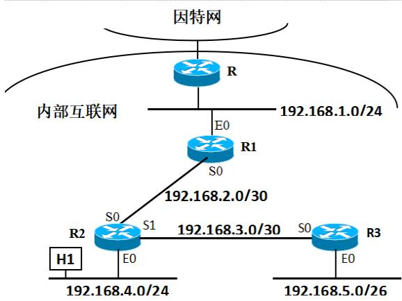

# 2021—2022学年第二学期《计算机通信与网络》期末试卷（A卷）

原件经识别和整理；“参考解答”是我们补的。

## 一、简答题（每题 5 分，共 35 分）

### 简答 1

在 10Mbps 的以太网中发送数据，采用哪种信号编码方法？若通过以太网口发送一串数据“101101”，请画出对应的数字信号波形。

知识点：[数据编码与调制技术（曼彻斯特编码、PCM、基带与频带传输）](../../../topics/计算机网络/encoding_modulation.md)、[CSMA/CD协议与以太网（争用期、最短帧长、MAC帧格式）](../../../topics/计算机网络/csmacd_ethernet.md)、[物理层接口特性与标准（机械、电气、功能、规程特性）](../../../topics/计算机网络/physical_layer_interface.md)

### 简答 2

多个站点通过 CDMA 共享链路，站点 A 和站点 B 进行通信，已知站点 A 的码片序列是（－1 －1 －1 ＋1 ＋1 －1 ＋1 ＋1），现有三个序列：

① （－1 －1 ＋1 －1 ＋1 ＋1 ＋1 －1）

② （－1 ＋1 －1 ＋1 ＋1 ＋1 ＋1 －1）

③ （－1 ＋1 －1 －1 －1 －1 ＋1 －1）

（1）为了能够与站点 A 通信，在①到③中，站点 B 可以选择的码片序列是哪些？

（2）若 B 站接收到序列（－1 ＋1 －3 ＋1 －1 －3 ＋1 ＋1 ＋3 －1 －1 －1 －1 ＋3 －1 －1），则 A 发送的两位数据比特是什么？

知识点：[信道复用技术（FDM、TDM、WDM、CDM）](../../../topics/计算机网络/multiplexing.md)、[数据通信系统模型与传输媒体](../../../topics/计算机网络/comm_basics_media.md)

### 简答 3

关于 HDLC 和 PPP 协议，请回答下列问题：

（1）HDLC 和 PPP 中，哪个属于面向比特的数据链路层协议？哪个经常用于拨号上网？

（2）当 PPP 工作在异步链路时，为保证数据的透明传输，采用字符填充的方法。若出现在链路上的数据帧中部分数据字节用十六进制表示为

7D 5E FE 27 7D 5D 34 7D 5D 65 7D 5E ，

请写出字节填充前的数据序列。

知识点：[数据链路层功能与透明传输（HDLC、PPP协议）](../../../topics/计算机网络/dll_functions.md)

### 简答 4

利用一台以太交换机构建的网络拓扑如题 1-4 图所示，交换机转发表为空。若主机 MAC1 运行 PING 程序想要探测主机 MAC3 的可达性，请回答下列问题：

（1）首先，主机 MAC1 广播一个数据帧，帧内封装 ARP 地址解析请求报文，则该帧到达交换机时，通过哪些端口进行转发？然后，MAC3 单播发送 ARP 应答报文，该报文封装的数据帧到达交换机时，通过哪些端口进行转发？

（2）接上题（1），主机 MAC1 的 PING 程序发送探测请求报文，该报文先后经过网络层和数据链路层封装后形成的数据帧到达交换机时，通过哪些端口进行转发？

（3）在题 1-4 表中填写更新后的转发表。（注：四台主机的物理地址用 MAC1–MAC4 表示）

题 1-4 表 交换机转发表

| 主机 MAC 地址 | 交换机端口号 |
| --- | --- |
|  |  |
|  |  |

知识点：[局域网的扩展与互连设备（集线器、网桥、交换机、冲突域与广播域）](../../../topics/计算机网络/lan_extension.md)、[CSMA/CD协议与以太网（争用期、最短帧长、MAC帧格式）](../../../topics/计算机网络/csmacd_ethernet.md)、[ARP地址解析协议与ICMP控制报文](../../../topics/计算机网络/arp_icmp.md)

### 简答 5

设互联网中有 A、B、C、D 四台主机，IP 地址分别配置成 201.33.20.80，201.33.20.112，201.33.20.200 和 201.33.20.222，子网掩码都配置成是 255.255.255.224。

（1）若主机 A 发送一个 IP 数据报，目的 IP 地址为 255.255.255.255，则哪些主机能够接收到该报文？请说明原因。

（2）若主机 A 发送一个 IP 数据报，目的 IP 地址为 201.33.20.223，则哪些主机能够接收到该报文？请说明原因。

知识点：[IPv4协议与数据报格式（分类IP地址、分片计算、首部字段）](../../../topics/计算机网络/ipv4_datagram.md)、[子网划分与CIDR（子网掩码计算、路由聚合、最长前缀匹配）](../../../topics/计算机网络/subnet_cidr.md)

### 简答 6

某专用网的出口路由器支持 NAT 功能，该路由器的公网地址为 201.112.12.230，对应的转换表如题 1-6 表所示，请回答：

（1）若该专用网内有一台主机（IP 地址为 10.10.8.27），开启浏览器进程（对应的端口号为 43572），访问公网内的 web 服务器（IP 地址为 211.23.33.12，服务端口为 80），请写出该数据报到达服务器时，源 IP 地址和源端口分别是多少？

（2）写出上题（1）中，主机发出的报文（NAT 转换前）所对应的五元组。

题 1-6 表

| 内部地址 | 内部端口号 | NAPT 端口 | 外部地址 | 外部端口号 | 协议 |
| --- | --- | --- | --- | --- | --- |
| 10.10.8.27 | 21043 | 14007 | 211.23.33.12 | 80 | TCP |
| 10.10.8.27 | 43572 | 14012 | 211.23.33.12 | 80 | TCP |
| 10.10.8.11 | 21043 | 14013 | 211.23.33.12 | 80 | TCP |

知识点：[网络互连与IP转发（路由器转发过程、NAT、VPN、移动IP、组播）](../../../topics/计算机网络/network_interconnection.md)、[传输层服务与端口（复用与分用、五元组、熟知端口）](../../../topics/计算机网络/transport_services_ports.md)

### 简答 7

小红同学打开浏览器，在地址栏中输入“http://www.baidu.com”，想要访问百度网站。请问在页面提取过程中，可能会使用到哪些协议？（至少写出 5 个协议，中文或者英文缩写都可以）

## 二、综合应用题（共 55 分）

知识点：[域名系统DNS（层次名字空间、递归与迭代查询解析）](../../../topics/计算机网络/dns.md)、[万维网与HTTP协议（URL、请求与响应报文、Web缓存）](../../../topics/计算机网络/www_http.md)、[TCP连接管理与可靠传输（三次握手、四次挥手、序号确认、RTT与RTO）](../../../topics/计算机网络/tcp_connection_reliability.md)、[IPv4协议与数据报格式（分类IP地址、分片计算、首部字段）](../../../topics/计算机网络/ipv4_datagram.md)、[ARP地址解析协议与ICMP控制报文](../../../topics/计算机网络/arp_icmp.md)

### 综合 1

（本题 10 分）主机甲通过电路交换网络向主机乙发送一个文件，文件长度为 64000 bit，电路连接的建立时间和释放时间都是 1 s，信道上信息传送速率为 64 kbps，主机甲和主机乙之间的传送路径上包含两台交换机，请回答下列问题：

（1）不考虑信号的传播时延，两台主机之间文件传送需要花费的总时延是多少？

（2）若将电路交换网换成分组交换网，每个分组大小为 640 bit，忽略链路传播延迟、分组头开销和分组拆装与排队时间，其他条件不变，则文件传送所需的总时延是多少？

知识点：[数据交换技术（电路交换、报文交换、分组交换）](../../../topics/计算机网络/switching_tech.md)、[计算机网络性能指标（速率、时延、吞吐量计算）](../../../topics/计算机网络/performance_metrics.md)

### 综合 2

（本题 15 分）在一个电缆总长度为 1000 米的 CSMA/CD 网络中，数据传输速率为 100 Mbps，信号在电缆中的传播速度约为 $2\times10^8\ \mathrm{m/s}$，若不考虑中继器引入的处理时延，请回答：

（1）争用期是多少？

（2）网络中各站点发送的数据帧长度至少是多少字节？

（3）若该网络中一台主机欲发送总长度为 16 个字节的 UDP 数据报，主机 A 网络接口发送的数据帧中最多需要填充多少字节数据？

（4）若该网络中一台主机发送某数据帧连续三次都遇到冲突，则在下次重传前，需要等待的最短退避时间和最长退避时间分别是多少？

知识点：[CSMA/CD协议与以太网（争用期、最短帧长、MAC帧格式）](../../../topics/计算机网络/csmacd_ethernet.md)、[计算机网络性能指标（速率、时延、吞吐量计算）](../../../topics/计算机网络/performance_metrics.md)、[UDP协议（无连接特性、报文段格式、伪首部校验和计算）](../../../topics/计算机网络/udp_protocol.md)

### 综合 3

（本题 15 分）已知一个公司网络如题 2-3 图所示，该公司通过出口路由器 R 与外界因特网相连。

（1）请为主机 H1、路由器 R1 的 E0 口、路由器 R3 的 E0 口配置 IP 地址，要求：主机 H1 的 IP 地址是所在网络最大可用地址，路由器 R1 的 E0 口和路由器 R3 的 E0 口设置为所在网络最小可用 IP 地址。

（2）题 2-3 表是路由器 R2 的路由表，请填写①–⑤，并推断路由器 R1 S0 口的 IP 地址。

（3）若路由器 R2 接收到目的地址分别为 192.168.1.10 和 192.168.5.10 的 IP 数据报，写出 R2 为这两个数据报所选路由的下一跳 IP 地址。

（4）若路由器 R2 从 E0 口接收到一个 IP 数据报，长度为 1500 字节，想要通过 S1 口进行转发，已知网络 192.168.3.0/30 对应的 MTU 为 820 字节（固定长度的 IP 首部），则 R2 需要将数据报划分为几个分片？每个分片的 MF 比特是多少？每个分片携带多少字节的数据？

题 2-3 表

| 目的网络 | 子网掩码 | 下一跳路由器 |
| --- | --- | --- |
| 192.168.1.0 | 255.255.255.0 | 192.168.2.1 |
| 192.168.2.0 | ① | - |
| 192.168.3.0 | ② | - |
| 192.168.4.0 | ③ | - |
| 192.168.5.0 | ④ | 192.168.3.2 |
| 0.0.0.0 | 0.0.0.0 | ⑤ |

知识点：[子网划分与CIDR（子网掩码计算、路由聚合、最长前缀匹配）](../../../topics/计算机网络/subnet_cidr.md)、[IPv4协议与数据报格式（分类IP地址、分片计算、首部字段）](../../../topics/计算机网络/ipv4_datagram.md)、[网络互连与IP转发（路由器转发过程、NAT、VPN、移动IP、组播）](../../../topics/计算机网络/network_interconnection.md)

### 综合 4

（本题 15 分）主机 A 和主机 B 通过 TCP 全双工连接传送应用进程的数据。A 和 B 在连接建立过程中选择的初始序号都是 0。请回答下列问题：

（1）假设主机 A 向主机 B 连续发送了 3 个数据段，每个分段都携带 100 字节的数据，则三个分段中序号字段的数值分别是什么？若第二个分段丢失，主机 B 正确接收到第一个和第三个报文段后，返回的报文中确认号字段数值分别是什么？

（2）若主机 A 的拥塞窗口 cwnd 大小（以报文段个数为单位）与传输轮次 n 的关系如题 2-4 表所示，请问主机 A 的数据发送过程共使用几次慢启动算法，分别对应哪些传输轮次？开始时刻慢启动门限是多大？哪个轮次的传输数据过程中，出现了超时？超时后，慢启动门限调整为多少？第 5 个和第 15 个报文段分别在第几个传输轮次发送？

题 2-4 表 TCP 的拥塞窗口 cwnd 大小与传输轮次 n 的关系表

| cwnd | 1 | 2 | 4 | 8 | 9 | 10 | 11 | 12 | 1 |
| --- | --- | --- | --- | --- | --- | --- | --- | --- | --- |
| n | 1 | 2 | 3 | 4 | 5 | 6 | 7 | 8 | 9 |
| cwnd | 2 | 4 | 6 | 7 | 8 | 9 | 10 | 5 | 6 |
| n | 10 | 11 | 12 | 13 | 14 | 15 | 16 | 17 | 18 |

## 三、解析题（共 10 分）

知识点：[TCP流量控制与拥塞控制（滑动窗口、慢开始、拥塞避免、快重传与快恢复）](../../../topics/计算机网络/tcp_flow_congestion.md)、[TCP连接管理与可靠传输（三次握手、四次挥手、序号确认、RTT与RTO）](../../../topics/计算机网络/tcp_connection_reliability.md)

### 解析 1

题 3-1 表中显示了某主机捕获到的四个 IP 数据报的前 20 个字节，以 16 进制数表示。请回答题中的①–⑩。

题 3-1 表

| 报文 1 | 45 00 05 DC 27 77 20 00 40 01 C9 4A C0 A8 0A 08 CA 77 E3 CB |
| --- | --- |
| 报文 2 | 45 00 02 24 27 77 00 B9 40 01 EC 79 C0 A8 0A 08 CA 77 E3 CB |
| 报文 3 | 45 48 05 DC D5 DF 20 00 2E 01 2C 9A CA 77 E3 CB C0 A8 0A 08 |
| 报文 4 | 45 48 02 24 D5 DF 00 B9 2E 01 4F C9 CA 77 E3 CB C0 A8 0A 08 |

（1）发送前两个报文的主机对应的 IP 地址是 ① ，发送后两个报文的主机对应的 IP 地址是 ② 。（请用点分十进制表示）

（2）报文 1 和报文 3 首部中，TTL 字段值分别是 ③ 和 ④ 。

（3）报文 1 的首部中，MF= ⑤ ，片偏移字段值是 ⑥ ；报文 2 的首部中，MF= ⑦ ，片偏移字段值是 ⑧ （请用十进制表示），报文 1 和报文 2 重组后的报文的数据部分长度是 ⑨ 字节。

（4）根据四个报文的协议字段值，推测出这四个报文中数据所属的协议是 ⑩ 。

知识点：[IPv4协议与数据报格式（分类IP地址、分片计算、首部字段）](../../../topics/计算机网络/ipv4_datagram.md)、[子网划分与CIDR（子网掩码计算、路由聚合、最长前缀匹配）](../../../topics/计算机网络/subnet_cidr.md)
