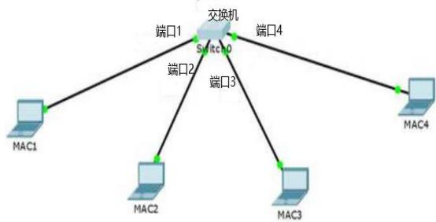

# 2021—2022学年第二学期《计算机通信与网络》期末试卷（A卷）

原件经识别和整理；“参考解答”是我们补的。

## 一、简答题（每题 5 分，共 35 分）

### 简答 1

在 10Mbps 的以太网中发送数据，采用哪种信号编码方法？若通过以太网口发送一串数据“101101”，请画出对应的数字信号波形。

参考解答：**结论**

10Mbps 以太网采用的信号编码方法是**曼彻斯特编码（Manchester Encoding）**。

**推理与波形绘制**

1. **编码方法依据**：在 IEEE 802.3 标准中，10Mbps 以太网（如 10BASE-T、10BASE5 等）的物理层规定使用曼彻斯特编码。该编码在每个比特周期中间都有一次电平跳变，既能表示数据，又能提取时钟同步信号。
2. **编码规则（IEEE 802.3 约定）**：
   - 比特周期中间的**向下跳变（高电平 $\to$ 低电平）表示“1”**。
   - 比特周期中间的**向上跳变（低电平 $\to$ 高电平）表示“0”**。
   - 比特边界处的电平跳变仅用于配合下一个比特的中间跳变而进行的状态过渡，不代表数据。
3. **数据“101101”的波形推导**：
   - 第 1 位 `1`：高 $\to$ 低（结束于低电平）
   - 第 2 位 `0`：低 $\to$ 高（起始于低电平，边界无跳变；结束于高电平）
   - 第 3 位 `1`：高 $\to$ 低（起始于高电平，边界无跳变；结束于低电平）
   - 第 4 位 `1`：高 $\to$ 低（起始于高电平，前一比特结束于低电平，故**边界有低 $\to$ 高跳变**；结束于低电平）
   - 第 5 位 `0`：低 $\to$ 高（起始于低电平，边界无跳变；结束于高电平）
   - 第 6 位 `1`：高 $\to$ 低（起始于高电平，边界无跳变；结束于低电平）

**数字信号波形图**

```text
高电平 ┌───┐       ┌───┐   ┌───┐       ┌───┐   ┌───┐
       │   │       │   │   │   │       │   │   │   │
低电平 ┘   └───────┘   └───┘   └───────┘   └───┘   └───
         1       0       1       1       0       1
```

*(注：国内部分教材可能采用“1 为低到高、0 为高到低”的相反约定。若按此约定，上述波形上下完全反相，只要明确标注所采用的约定规则即可得分。本解答采用 IEEE 802.3 官方及谢希仁《计算机网络》主流约定。)*

知识点：[数据编码与调制技术（曼彻斯特编码、PCM、基带与频带传输）](../../../topics/计算机网络/encoding_modulation.md)、[CSMA/CD协议与以太网（争用期、最短帧长、MAC帧格式）](../../../topics/计算机网络/csmacd_ethernet.md)、[物理层接口特性与标准（机械、电气、功能、规程特性）](../../../topics/计算机网络/physical_layer_interface.md)

### 简答 2

多个站点通过 CDMA 共享链路，站点 A 和站点 B 进行通信，已知站点 A 的码片序列是（－1 －1 －1 ＋1 ＋1 －1 ＋1 ＋1），现有三个序列：

① （－1 －1 ＋1 －1 ＋1 ＋1 ＋1 －1）

② （－1 ＋1 －1 ＋1 ＋1 ＋1 ＋1 －1）

③ （－1 ＋1 －1 －1 －1 －1 ＋1 －1）

（1）为了能够与站点 A 通信，在①到③中，站点 B 可以选择的码片序列是哪些？

（2）若 B 站接收到序列（－1 ＋1 －3 ＋1 －1 －3 ＋1 ＋1 ＋3 －1 －1 －1 －1 ＋3 －1 －1），则 A 发送的两位数据比特是什么？

参考解答：### （1）站点 B 可选的码片序列

**结论：① 和 ③**

CDMA 要求各站点码片序列**正交**，即内积为 0。设 $A = (-1,-1,-1,+1,+1,-1,+1,+1)$，分别计算内积：

$$A \cdot ① = 1+1-1-1+1-1+1-1 = 0 \quad \checkmark$$

$$A \cdot ② = 1-1+1+1+1-1+1-1 = 2 \neq 0 \quad \times$$

$$A \cdot ③ = 1-1+1-1-1+1+1-1 = 0 \quad \checkmark$$

①、③ 与 A 正交，可作为 B 的码片序列；② 与 A 不正交，故不可选。

---

### （2）A 发送的两位数据比特

**结论：$1 \quad 0$**

接收序列长 16，分为两组（每组 8 个码片对应 1 bit）：

$$S_1 = (-1,+1,-3,+1,-1,-3,+1,+1)$$
$$S_2 = (+3,-1,-1,-1,-1,+3,-1,-1)$$

将每组与 $A$ 做内积并除以 $N=8$：

$$S_1 \cdot A = (-1)(-1)+(+1)(-1)+(-3)(-1)+(+1)(+1)+(-1)(+1)+(-3)(-1)+(+1)(+1)+(+1)(+1)$$
$$= 1-1+3+1-1+3+1+1 = 8$$
$$\frac{S_1 \cdot A}{8} = +1 \implies \text{比特 } 1$$

$$S_2 \cdot A = (+3)(-1)+(-1)(-1)+(-1)(-1)+(-1)(+1)+(-1)(+1)+(+3)(-1)+(-1)(+1)+(-1)(+1)$$
$$= -3+1+1-1-1-3-1-1 = -8$$
$$\frac{S_2 \cdot A}{8} = -1 \implies \text{比特 } 0$$

> 内积为 $+N$ 表示发送 1，$-N$ 表示发送 0。由于其他正交站点的贡献在内积中被消除，结果仅反映 A 的数据。

知识点：[信道复用技术（FDM、TDM、WDM、CDM）](../../../topics/计算机网络/multiplexing.md)、[数据通信系统模型与传输媒体](../../../topics/计算机网络/comm_basics_media.md)

### 简答 3

关于 HDLC 和 PPP 协议，请回答下列问题：

（1）HDLC 和 PPP 中，哪个属于面向比特的数据链路层协议？哪个经常用于拨号上网？

（2）当 PPP 工作在异步链路时，为保证数据的透明传输，采用字符填充的方法。若出现在链路上的数据帧中部分数据字节用十六进制表示为

7D 5E FE 27 7D 5D 34 7D 5D 65 7D 5E ，

请写出字节填充前的数据序列。

参考解答：## （1）

**结论：HDLC 是面向比特的数据链路层协议；PPP 经常用于拨号上网。**

- HDLC 帧的定界采用 8 bit 标志 $\texttt{01111110}$，透明传输采用**零比特填充**（遇 5 个连续 1 填 0），帧内信息以比特为单位组织，故为面向比特的协议。
- PPP 是面向字节的协议，支持异步和同步链路，具有链路控制、身份鉴别、多协议封装等功能，是用户通过调制解调器拨号接入 ISP 时最常用的数据链路层协议。

## （2）

**结论：字节填充前的数据序列为 $\texttt{7E FE 27 7D 34 7D 65 7E}$。**

PPP 异步链路的字节填充规则：

| 原数据字节 | 填充后字节 |
|:---:|:---:|
| $\texttt{7E}$（标志） | $\texttt{7D\ 5E}$ |
| $\texttt{7D}$（转义符） | $\texttt{7D\ 5D}$ |
| 小于 $\texttt{20}$ 的控制字符 $c$ | $\texttt{7D}\ (c \oplus \texttt{20})$ |

**还原（逆过程）**：凡遇 $\texttt{7D}$，将其与紧随的一个字节取出，按“后一字节 $\oplus\ \texttt{20}$”还原为原字节；其余字节原样保留。

逐段还原：

$$\underbrace{\texttt{7D 5E}}_{\texttt{7E}}\ \texttt{FE}\ \texttt{27}\ \underbrace{\texttt{7D 5D}}_{\texttt{7D}}\ \texttt{34}\ \underbrace{\texttt{7D 5D}}_{\texttt{7D}}\ \texttt{65}\ \underbrace{\texttt{7D 5E}}_{\texttt{7E}}$$

故填充前的数据序列为：

$$\texttt{7E FE 27 7D 34 7D 65 7E}$$

知识点：[数据链路层功能与透明传输（HDLC、PPP协议）](../../../topics/计算机网络/dll_functions.md)

### 简答 4

利用一台以太交换机构建的网络拓扑如题 1-4 图所示，交换机转发表为空。若主机 MAC1 运行 PING 程序想要探测主机 MAC3 的可达性，请回答下列问题：

（1）首先，主机 MAC1 广播一个数据帧，帧内封装 ARP 地址解析请求报文，则该帧到达交换机时，通过哪些端口进行转发？然后，MAC3 单播发送 ARP 应答报文，该报文封装的数据帧到达交换机时，通过哪些端口进行转发？

（2）接上题（1），主机 MAC1 的 PING 程序发送探测请求报文，该报文先后经过网络层和数据链路层封装后形成的数据帧到达交换机时，通过哪些端口进行转发？

（3）在题 1-4 表中填写更新后的转发表。（注：四台主机的物理地址用 MAC1–MAC4 表示）



题 1-4 表 交换机转发表

| 主机 MAC 地址 | 交换机端口号 |
| --- | --- |
|  |  |
|  |  |

参考解答：### （1）
**结论**：
- MAC1 广播 ARP 请求帧：通过**端口 2、3、4**（即除端口 1 外的所有其他端口）转发。
- MAC3 单播 ARP 应答帧：仅通过**端口 1** 转发。

**推理**：
- 交换机收到广播帧时，将源 MAC 地址（MAC1）与进入端口（端口 1）绑定并记入转发表，同时向除接收端口外的所有端口进行泛洪。
- 交换机收到单播帧时，将源 MAC 地址（MAC3）与进入端口（端口 3）绑定并记入转发表；随后查找目的 MAC 地址（MAC1），命中转发表中的端口 1，因此仅从端口 1 进行单播转发。

### （2）
**结论**：
- 仅通过**端口 3** 转发。

**推理**：
- PING 探测请求（ICMP Echo Request）封装后为单播数据帧，目的 MAC 地址为 MAC3。交换机查找转发表，命中 MAC3 对应的端口 3，因此仅从端口 3 转发。

### （3）
**结论**：

| 主机 MAC 地址 | 交换机端口号 |
| --- | --- |
| MAC1 | 1 |
| MAC3 | 3 |

**推理**：
- 交换机利用自学习算法建立转发表，仅记录发送过数据帧的源 MAC 地址及其对应的进入端口。在上述通信过程中，仅有 MAC1 和 MAC3 发送了数据帧，MAC2 和 MAC4 未发送任何数据帧，故转发表中只更新 MAC1 和 MAC3 的记录。

> **注**：以上解答基于常规拓扑假设，即 MAC1~MAC4 依次连接交换机的端口 1~4。若原图中主机连接的端口号不同，请将上述结论中的端口号替换为对应主机实际连接的物理端口号。

知识点：[局域网的扩展与互连设备（集线器、网桥、交换机、冲突域与广播域）](../../../topics/计算机网络/lan_extension.md)、[CSMA/CD协议与以太网（争用期、最短帧长、MAC帧格式）](../../../topics/计算机网络/csmacd_ethernet.md)、[ARP地址解析协议与ICMP控制报文](../../../topics/计算机网络/arp_icmp.md)

### 简答 5

设互联网中有 A、B、C、D 四台主机，IP 地址分别配置成 201.33.20.80，201.33.20.112，201.33.20.200 和 201.33.20.222，子网掩码都配置成是 255.255.255.224。

（1）若主机 A 发送一个 IP 数据报，目的 IP 地址为 255.255.255.255，则哪些主机能够接收到该报文？请说明原因。

（2）若主机 A 发送一个 IP 数据报，目的 IP 地址为 201.33.20.223，则哪些主机能够接收到该报文？请说明原因。

参考解答：按通常子网模型判断：

**结论：**

1. 只有 A 能收到。  
2. C、D 能收到。

**推理/计算：**

掩码 $255.255.255.224$ 即 $/27$，子网块大小为：


$$
256-224=32
$$


各主机所在子网为：

- A：$201.33.20.80 \in 201.33.20.64/27$，范围 $201.33.20.64 \sim 201.33.20.95$
- B：$201.33.20.112 \in 201.33.20.96/27$，范围 $201.33.20.96 \sim 201.33.20.127$
- C：$201.33.20.200 \in 201.33.20.192/27$，范围 $201.33.20.192 \sim 201.33.20.223$
- D：$201.33.20.222 \in 201.33.20.192/27$

**（1）** $255.255.255.255$ 是受限广播地址，只在本子网内广播，路由器不转发。A 所在子网 $201.33.20.64/27$ 中只有 A，因此只有 A 能收到。

**（2）** $201.33.20.223$ 是子网 $201.33.20.192/27$ 的广播地址，主机位全为 1。C、D 都在该子网内，因此 C、D 能收到；A、B 不在该子网，不能收到。

知识点：[IPv4协议与数据报格式（分类IP地址、分片计算、首部字段）](../../../topics/计算机网络/ipv4_datagram.md)、[子网划分与CIDR（子网掩码计算、路由聚合、最长前缀匹配）](../../../topics/计算机网络/subnet_cidr.md)

### 简答 6

某专用网的出口路由器支持 NAT 功能，该路由器的公网地址为 201.112.12.230，对应的转换表如题 1-6 表所示，请回答：

（1）若该专用网内有一台主机（IP 地址为 10.10.8.27），开启浏览器进程（对应的端口号为 43572），访问公网内的 web 服务器（IP 地址为 211.23.33.12，服务端口为 80），请写出该数据报到达服务器时，源 IP 地址和源端口分别是多少？

（2）写出上题（1）中，主机发出的报文（NAT 转换前）所对应的五元组。

题 1-6 表

| 内部地址 | 内部端口号 | NAPT 端口 | 外部地址 | 外部端口号 | 协议 |
| --- | --- | --- | --- | --- | --- |
| 10.10.8.27 | 21043 | 14007 | 211.23.33.12 | 80 | TCP |
| 10.10.8.27 | 43572 | 14012 | 211.23.33.12 | 80 | TCP |
| 10.10.8.11 | 21043 | 14013 | 211.23.33.12 | 80 | TCP |

参考解答：**结论：**

（1）到达服务器时，源 IP 为 **201.112.12.230**，源端口为 **14012**。  
（2）NAT 转换前的五元组为：  

$$
(10.10.8.27,\ 43572,\ 211.23.33.12,\ 80,\ \mathrm{TCP})
$$


**推理过程：**

（1）查 NAT 转换表，匹配条目为：

| 内部地址 | 内部端口号 | NAPT 端口 | 外部地址 | 外部端口号 | 协议 |
| --- | --- | --- | --- | --- | --- |
| 10.10.8.27 | 43572 | 14012 | 211.23.33.12 | 80 | TCP |

因此该报文经 NAPT 转换后，源 IP 被替换为路由器公网地址 **201.112.12.230**，源端口被替换为 NAPT 端口 **14012**，目的 IP 和目的端口不变。

（2）NAT 转换前，主机发出的原始报文五元组为：

- 源 IP：10.10.8.27
- 源端口：43572
- 目的 IP：211.23.33.12
- 目的端口：80
- 协议：TCP

知识点：[网络互连与IP转发（路由器转发过程、NAT、VPN、移动IP、组播）](../../../topics/计算机网络/network_interconnection.md)、[传输层服务与端口（复用与分用、五元组、熟知端口）](../../../topics/计算机网络/transport_services_ports.md)

### 简答 7

小红同学打开浏览器，在地址栏中输入“http://www.baidu.com”，想要访问百度网站。请问在页面提取过程中，可能会使用到哪些协议？（至少写出 5 个协议，中文或者英文缩写都可以）

## 二、综合应用题（共 55 分）

参考解答：**结论**：至少会用到 **DNS、UDP、TCP、IP、HTTP、ARP**（还可能涉及 **BGP/OSPF** 等路由协议）。

**简要过程**：

- **DNS**：浏览器需要将 `www.baidu.com` 解析为百度服务器的 IP 地址。
- **UDP**：DNS 查询通常使用 UDP 协议承载，目标端口为 53。
- **TCP**：客户端与百度服务器建立 TCP 连接，提供可靠传输，默认目标端口为 80。
- **HTTP**：浏览器通过 TCP 连接发送 HTTP 请求，服务器返回网页内容。
- **IP**：上层数据在网络层封装为 IP 数据报，实现跨网络寻址和转发。
- **ARP**：在局域网内发送数据时，需要将下一跳 IP 地址解析为 MAC 地址。
- **BGP/OSPF**：数据跨多个自治系统或大型网络传输时，路由器之间使用路由协议进行路径选择。

知识点：[域名系统DNS（层次名字空间、递归与迭代查询解析）](../../../topics/计算机网络/dns.md)、[万维网与HTTP协议（URL、请求与响应报文、Web缓存）](../../../topics/计算机网络/www_http.md)、[TCP连接管理与可靠传输（三次握手、四次挥手、序号确认、RTT与RTO）](../../../topics/计算机网络/tcp_connection_reliability.md)、[IPv4协议与数据报格式（分类IP地址、分片计算、首部字段）](../../../topics/计算机网络/ipv4_datagram.md)、[ARP地址解析协议与ICMP控制报文](../../../topics/计算机网络/arp_icmp.md)

### 综合 1

（本题 10 分）主机甲通过电路交换网络向主机乙发送一个文件，文件长度为 64000 bit，电路连接的建立时间和释放时间都是 1 s，信道上信息传送速率为 64 kbps，主机甲和主机乙之间的传送路径上包含两台交换机，请回答下列问题：

（1）不考虑信号的传播时延，两台主机之间文件传送需要花费的总时延是多少？

（2）若将电路交换网换成分组交换网，每个分组大小为 640 bit，忽略链路传播延迟、分组头开销和分组拆装与排队时间，其他条件不变，则文件传送所需的总时延是多少？

参考解答：**结论**

1. 电路交换的文件传送总时延为 $\boxed{3\ \text{s}}$。
2. 分组交换的文件传送总时延为 $\boxed{1.02\ \text{s}}$（交换机采用存储转发，各链路可流水传输）。

**计算过程**

### （1）电路交换

文件的发送时延为


$$
t_{\text{发}}=\frac{64000}{64\times 10^3}=1\ \text{s}.
$$


电路交换建立的是端到端电路，发送时延不需要按链路数重复计算。计入电路建立和释放时间，总时延为


$$
T_{\text{电路}}=t_{\text{建立}}+t_{\text{发}}+t_{\text{释放}}
=1+1+1=\boxed{3\ \text{s}}.
$$


### （2）分组交换

分组交换不需要建立和释放电路，因此不计上述两个 $1\ \text{s}$。

文件被划分为


$$
N=\frac{64000}{640}=100
$$


个分组，每个分组在一条链路上的发送时延为


$$
t_p=\frac{640}{64\times 10^3}=0.01\ \text{s}.
$$


路径中有两台交换机，因此共有 $3$ 段链路。第一个分组到达主机乙需要经过 $3$ 次发送；此后分组流水传输，每隔 $t_p$ 到达一个，故最后一个分组到达乙的总时间为


$$
\begin{aligned}
T_{\text{分组}}
&=3t_p+(N-1)t_p\\
&=(100+3-1)\times 0.01\\
&=\boxed{1.02\ \text{s}}.
\end{aligned}
$$


知识点：[数据交换技术（电路交换、报文交换、分组交换）](../../../topics/计算机网络/switching_tech.md)、[计算机网络性能指标（速率、时延、吞吐量计算）](../../../topics/计算机网络/performance_metrics.md)

### 综合 2

（本题 15 分）在一个电缆总长度为 1000 米的 CSMA/CD 网络中，数据传输速率为 100 Mbps，信号在电缆中的传播速度约为 $2\times10^8\ \mathrm{m/s}$，若不考虑中继器引入的处理时延，请回答：

（1）争用期是多少？

（2）网络中各站点发送的数据帧长度至少是多少字节？

（3）若该网络中一台主机欲发送总长度为 16 个字节的 UDP 数据报，主机 A 网络接口发送的数据帧中最多需要填充多少字节数据？

（4）若该网络中一台主机发送某数据帧连续三次都遇到冲突，则在下次重传前，需要等待的最短退避时间和最长退避时间分别是多少？

参考解答：**（1）**
**结论：** 争用期为 $10\ \mu\mathrm{s}$。
**过程：** 
单程传播时延 $\tau = \frac{L}{v} = \frac{1000}{2\times10^8} = 5\times10^{-6}\ \mathrm{s} = 5\ \mu\mathrm{s}$。
争用期等于端到端往返传播时延，即 $2\tau = 2 \times 5\ \mu\mathrm{s} = 10\ \mu\mathrm{s}$。

**（2）**
**结论：** 数据帧长度至少为 125 字节。
**过程：** 
为保证能检测到冲突，最小帧长 $L_{\min}$ 的发送时间必须不小于争用期。
$L_{\min} = C \times 2\tau = 100\times10^6\ \mathrm{bps} \times 10\times10^{-6}\ \mathrm{s} = 1000\ \mathrm{bit}$。
转换为字节：$1000\ \mathrm{bit} \div 8\ \mathrm{bit/Byte} = 125\ \mathrm{Byte}$。

**（3）**
**结论：** 最多需要填充 71 字节数据。
**过程：** 
UDP 数据报长度为 16 字节，加上 20 字节的固定 IP 首部，IP 数据报总长为 $16 + 20 = 36$ 字节。
MAC 帧首部和尾部（FCS）共占 $14 + 4 = 18$ 字节。
由（2）可知，该网络 MAC 帧最小总长度为 125 字节，因此 MAC 帧数据字段的最小长度为 $125 - 18 = 107$ 字节。
当 IP 首部无选项（即取最短的 20 字节）时，需要填充的字节数最多，为 $107 - 36 = 71$ 字节。

**（4）**
**结论：** 最短退避时间为 $0\ \mu\mathrm{s}$，最长退避时间为 $70\ \mu\mathrm{s}$。
**过程：** 
连续 3 次遇到冲突，即当前准备进行第 3 次重传，重传次数 $k=3$。
根据截断二进制指数退避算法，退避倍数 $r$ 从 $[0, 2^k-1]$ 即 $[0, 7]$ 中随机选取。
退避时间计算公式为 $r \times 2\tau$。
当 $r=0$ 时，最短退避时间为 $0 \times 10\ \mu\mathrm{s} = 0\ \mu\mathrm{s}$；
当 $r=7$ 时，最长退避时间为 $7 \times 10\ \mu\mathrm{s} = 70\ \mu\mathrm{s}$。

知识点：[CSMA/CD协议与以太网（争用期、最短帧长、MAC帧格式）](../../../topics/计算机网络/csmacd_ethernet.md)、[计算机网络性能指标（速率、时延、吞吐量计算）](../../../topics/计算机网络/performance_metrics.md)、[UDP协议（无连接特性、报文段格式、伪首部校验和计算）](../../../topics/计算机网络/udp_protocol.md)

### 综合 3

（本题 15 分）已知一个公司网络如题 2-3 图所示，该公司通过出口路由器 R 与外界因特网相连。

（1）请为主机 H1、路由器 R1 的 E0 口、路由器 R3 的 E0 口配置 IP 地址，要求：主机 H1 的 IP 地址是所在网络最大可用地址，路由器 R1 的 E0 口和路由器 R3 的 E0 口设置为所在网络最小可用 IP 地址。

（2）题 2-3 表是路由器 R2 的路由表，请填写①–⑤，并推断路由器 R1 S0 口的 IP 地址。

（3）若路由器 R2 接收到目的地址分别为 192.168.1.10 和 192.168.5.10 的 IP 数据报，写出 R2 为这两个数据报所选路由的下一跳 IP 地址。

（4）若路由器 R2 从 E0 口接收到一个 IP 数据报，长度为 1500 字节，想要通过 S1 口进行转发，已知网络 192.168.3.0/30 对应的 MTU 为 820 字节（固定长度的 IP 首部），则 R2 需要将数据报划分为几个分片？每个分片的 MF 比特是多少？每个分片携带多少字节的数据？

题 2-3 表

| 目的网络 | 子网掩码 | 下一跳路由器 |
| --- | --- | --- |
| 192.168.1.0 | 255.255.255.0 | 192.168.2.1 |
| 192.168.2.0 | ① | - |
| 192.168.3.0 | ② | - |
| 192.168.4.0 | ③ | - |
| 192.168.5.0 | ④ | 192.168.3.2 |
| 0.0.0.0 | 0.0.0.0 | ⑤ |


参考解答：（1）**地址配置**

- 主机 H1：$\boxed{192.168.1.254}$
- 路由器 R1 的 E0 口：$\boxed{192.168.1.1}$
- 路由器 R3 的 E0 口：$\boxed{192.168.4.1}$

**推理：**

- H1 所在网络为 $192.168.1.0/24$，可用地址范围为 $192.168.1.1\sim192.168.1.254$，其中 $192.168.1.0$ 是网络地址，$192.168.1.255$ 是广播地址，因此最大可用地址为 $192.168.1.254$。
- R1 的 E0 口也位于 $192.168.1.0/24$ 网络，最小可用地址为 $192.168.1.1$。
- R3 的 E0 口位于 $192.168.4.0/24$ 网络，最小可用地址为 $192.168.4.1$。

---

（2）**路由表填写及 R1 的 S0 口地址**

| 空格 | 答案 |
|---|---|
| ① | $\boxed{255.255.255.252}$ |
| ② | $\boxed{255.255.255.252}$ |
| ③ | $\boxed{255.255.255.0}$ |
| ④ | $\boxed{255.255.255.0}$ |
| ⑤ | $\boxed{192.168.2.1}$ |

路由器 R1 的 S0 口 IP 地址为：


$$
\boxed{192.168.2.1}
$$


**推理：**

- $192.168.2.0$ 和 $192.168.3.0$ 均为 $/30$ 网络，对应子网掩码为 $255.255.255.252$。
- $192.168.4.0$ 和 $192.168.5.0$ 均为 $/24$ 网络，对应子网掩码为 $255.255.255.0$。
- R2 访问外部因特网的默认路由应指向 R1，因此下一跳为 R1 的 S0 口地址。
- R2 访问 $192.168.1.0/24$ 的下一跳为 $192.168.2.1$，该地址就是 R1 的 S0 口地址，所以默认路由的下一跳也为 $192.168.2.1$。

---

（3）**R2 选择的下一跳**

- 目的地址为 $192.168.1.10$ 时，下一跳为 $\boxed{192.168.2.1}$。
- 目的地址为 $192.168.5.10$ 时，下一跳为 $\boxed{192.168.3.2}$。

**推理：**

- $192.168.1.10$ 匹配目的网络 $192.168.1.0/24$，其下一跳为 R1 的 S0 口，即 $192.168.2.1$。
- $192.168.5.10$ 匹配目的网络 $192.168.5.0/24$，其下一跳为 R3 的 S0 口，即 $192.168.3.2$。

---

（4）**IP 数据报分片**

R2 需要将数据报划分为 $\boxed{2}$ 个分片。

| 分片 | MF 比特 | 携带的数据长度 |
|---|---:|---:|
| 第 1 个分片 | $\boxed{1}$ | $\boxed{800\text{ 字节}}$ |
| 第 2 个分片 | $\boxed{0}$ | $\boxed{680\text{ 字节}}$ |

**计算过程：**

原 IP 数据报总长度为 $1500$ 字节，固定长度 IP 首部为 $20$ 字节，因此原数据报携带的数据量为


$$
1500-20=1480\text{ 字节}
$$


出口链路 MTU 为 $820$ 字节，每个分片最多可携带的数据量为


$$
820-20=800\text{ 字节}
$$


由于分片的数据长度必须是 $8$ 字节的整数倍，而


$$
800\div 8=100
$$


所以每个非末尾分片可携带 $800$ 字节数据。

因此：

- 第 1 个分片携带 $800$ 字节数据，总长度为 $800+20=820$ 字节，后面还有分片，故 $MF=1$；
- 第 2 个分片携带剩余数据


$$
1480-800=680\text{ 字节}
$$


其总长度为 $680+20=700$ 字节，是最后一个分片，故 $MF=0$。

知识点：[子网划分与CIDR（子网掩码计算、路由聚合、最长前缀匹配）](../../../topics/计算机网络/subnet_cidr.md)、[IPv4协议与数据报格式（分类IP地址、分片计算、首部字段）](../../../topics/计算机网络/ipv4_datagram.md)、[网络互连与IP转发（路由器转发过程、NAT、VPN、移动IP、组播）](../../../topics/计算机网络/network_interconnection.md)

### 综合 4

（本题 15 分）主机 A 和主机 B 通过 TCP 全双工连接传送应用进程的数据。A 和 B 在连接建立过程中选择的初始序号都是 0。请回答下列问题：

（1）假设主机 A 向主机 B 连续发送了 3 个数据段，每个分段都携带 100 字节的数据，则三个分段中序号字段的数值分别是什么？若第二个分段丢失，主机 B 正确接收到第一个和第三个报文段后，返回的报文中确认号字段数值分别是什么？

（2）若主机 A 的拥塞窗口 cwnd 大小（以报文段个数为单位）与传输轮次 n 的关系如题 2-4 表所示，请问主机 A 的数据发送过程共使用几次慢启动算法，分别对应哪些传输轮次？开始时刻慢启动门限是多大？哪个轮次的传输数据过程中，出现了超时？超时后，慢启动门限调整为多少？第 5 个和第 15 个报文段分别在第几个传输轮次发送？

题 2-4 表 TCP 的拥塞窗口 cwnd 大小与传输轮次 n 的关系表

| cwnd | 1 | 2 | 4 | 8 | 9 | 10 | 11 | 12 | 1 |
| --- | --- | --- | --- | --- | --- | --- | --- | --- | --- |
| n | 1 | 2 | 3 | 4 | 5 | 6 | 7 | 8 | 9 |
| cwnd | 2 | 4 | 6 | 7 | 8 | 9 | 10 | 5 | 6 |
| n | 10 | 11 | 12 | 13 | 14 | 15 | 16 | 17 | 18 |

## 三、解析题（共 10 分）

参考解答：### （1）
**结论：**
- 三个分段的序号分别为：$0$、$100$、$200$。
- 主机 B 返回的确认号分别为：$100$、$100$。

**推理与计算过程：**
- **序号计算：** TCP 序号表示该报文段数据部分的第一个字节的序号。主机 A 的初始序号（ISN）为 $0$。
  - 第 1 个分段携带 $100$ 字节，序号为 $0$。
  - 第 2 个分段序号为 $0 + 100 = 100$。
  - 第 3 个分段序号为 $100 + 100 = 200$。
- **确认号计算：** TCP 确认号表示期望收到对方下一个报文段的第一个字节的序号（累积确认机制）。
  - 收到第 1 个分段（序号 $0$，长度 $100$）后，B 期望收到序号 $100$ 的字节，故确认号为 $100$。
  - 第 2 个分段丢失，收到第 3 个分段（序号 $200$）时，由于序号 $100 \sim 199$ 的数据未收到，基于累积确认机制，B 仍期望收到序号 $100$ 的字节，故确认号依然为 $100$。

### （2）
**结论：**
- 共使用 **2 次**慢启动算法，分别对应传输轮次 **1~4** 和 **9~11**。
- 开始时刻慢启动门限（ssthresh）为 **8**。
- 在**第 8 轮**传输数据过程中出现了超时。
- 超时后，慢启动门限调整为 **6**。
- 第 5 个报文段在第 **3** 个传输轮次发送；第 15 个报文段在第 **4** 个传输轮次发送。

**推理与计算过程：**
- **慢启动算法次数及轮次：** 慢启动阶段 `cwnd` 呈指数增长（每次翻倍）。
  - 第一次：$n=1 \sim 4$ 时，`cwnd` 从 $1$ 增至 $8$（$1 \to 2 \to 4 \to 8$），$n=5$ 时变为 $9$ 进入拥塞避免，此为第 1 次慢启动。
  - 第二次：$n=9$ 时 `cwnd` 降为 $1$，重新进入慢启动，$n=9 \sim 11$ 时 `cwnd` 从 $1$ 增至 $4$（$1 \to 2 \to 4$），$n=12$ 时变为 $6$ 进入拥塞避免，此为第 2 次慢启动。
  - （注：$n=17$ 时 `cwnd` 从 $10$ 降为 $5$，属于快重传和快恢复，非慢启动）。
- **初始慢启动门限：** 第 1 次慢启动在 $n=4$（`cwnd`=$8$）结束，$n=5$ 开始线性增长，说明初始 `ssthresh` $= 8$。
- **超时轮次及门限调整：** $n=8$ 时 `cwnd`=$12$，$n=9$ 时 `cwnd` 骤降为 $1$。`cwnd` 降为 $1$ 是超时重传的特征，说明在**第 8 轮**传输中发生了超时。超时后 `ssthresh` 调整为超时前 `cwnd` 的一半，即 $12 / 2 = 6$。
- **报文段发送轮次计算：** 第 $n$ 轮发送的报文段数量等于该轮的 `cwnd` 值。计算累计发送量：
  - 第 1 轮：发送 $1$ 个，累计 $1$ 个（包含第 $1$ 个）。
  - 第 2 轮：发送 $2$ 个，累计 $1+2=3$ 个（包含第 $2 \sim 3$ 个）。
  - 第 3 轮：发送 $4$ 个，累计 $3+4=7$ 个（包含第 $4 \sim 7$ 个），**第 5 个**在此轮发送。
  - 第 4 轮：发送 $8$ 个，累计 $7+8=15$ 个（包含第 $8 \sim 15$ 个），**第 15 个**在此轮发送。

知识点：[TCP流量控制与拥塞控制（滑动窗口、慢开始、拥塞避免、快重传与快恢复）](../../../topics/计算机网络/tcp_flow_congestion.md)、[TCP连接管理与可靠传输（三次握手、四次挥手、序号确认、RTT与RTO）](../../../topics/计算机网络/tcp_connection_reliability.md)

### 解析 1

题 3-1 表中显示了某主机捕获到的四个 IP 数据报的前 20 个字节，以 16 进制数表示。请回答题中的①–⑩。

题 3-1 表

| 报文 1 | 45 00 05 DC 27 77 20 00 40 01 C9 4A C0 A8 0A 08 CA 77 E3 CB |
| --- | --- |
| 报文 2 | 45 00 02 24 27 77 00 B9 40 01 EC 79 C0 A8 0A 08 CA 77 E3 CB |
| 报文 3 | 45 48 05 DC D5 DF 20 00 2E 01 2C 9A CA 77 E3 CB C0 A8 0A 08 |
| 报文 4 | 45 48 02 24 D5 DF 00 B9 2E 01 4F C9 CA 77 E3 CB C0 A8 0A 08 |

（1）发送前两个报文的主机对应的 IP 地址是 ① ，发送后两个报文的主机对应的 IP 地址是 ② 。（请用点分十进制表示）

（2）报文 1 和报文 3 首部中，TTL 字段值分别是 ③ 和 ④ 。

（3）报文 1 的首部中，MF= ⑤ ，片偏移字段值是 ⑥ ；报文 2 的首部中，MF= ⑦ ，片偏移字段值是 ⑧ （请用十进制表示），报文 1 和报文 2 重组后的报文的数据部分长度是 ⑨ 字节。

（4）根据四个报文的协议字段值，推测出这四个报文中数据所属的协议是 ⑩ 。

参考解答：**结论**

| 空 | 答案 |
|---|---|
| ① | 192.168.10.8 |
| ② | 202.119.227.203 |
| ③ | 64 |
| ④ | 46 |
| ⑤ | 1 |
| ⑥ | 0 |
| ⑦ | 0 |
| ⑧ | 185（对应字节偏移 1480） |
| ⑨ | 2008 |
| ⑩ | ICMP（网际控制报文协议） |

**简要推理**

- 首部长度：首字节低 4 位为 5，故首部长度为 $5 \times 4 = 20$ 字节。
- 源 IP 地址从首部第 13~16 字节读出：
  - 报文 1、2：$C0 A8 0A 08 = 192.168.10.8$
  - 报文 3、4：$CA 77 E3 CB = 202.119.227.203$
- TTL 字段为第 9 字节：
  - 报文 1：$0x40 = 64$
  - 报文 3：$0x2E = 46$
- 报文 1 的标志+片偏移字段为 $0x2000$，最高 3 位为 $001$，故 MF=1，片偏移字段值 = 0。
- 报文 2 的标志+片偏移字段为 $0x00B9$，最高 3 位为 $000$，故 MF=0，片偏移字段值 $0x00B9 = 185$。
- 报文 1 数据部分：$1500 - 20 = 1480$ 字节；报文 2 数据部分：$548 - 20 = 528$ 字节。重组后数据部分总长：$1480 + 528 = 2008$ 字节。
- 四个报文协议字段均为 $0x01$，对应 ICMP。

知识点：[IPv4协议与数据报格式（分类IP地址、分片计算、首部字段）](../../../topics/计算机网络/ipv4_datagram.md)、[子网划分与CIDR（子网掩码计算、路由聚合、最长前缀匹配）](../../../topics/计算机网络/subnet_cidr.md)
