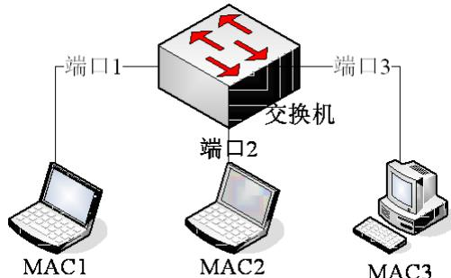
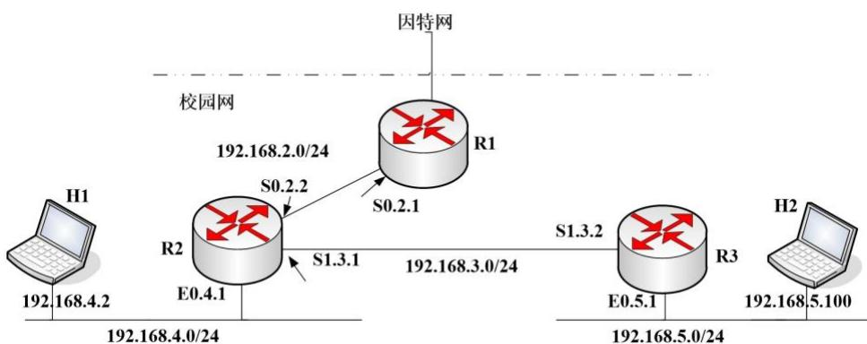
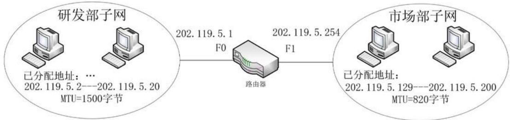

# 《计算机通信与网络》四次测试题及解析（2020.12）

原件经识别和整理；“参考解答”是我们补的。

## 测验 1：概论和物理层

### 选择 1

通信双方必须遵循的控制信息交换规则的集合是

- A. 服务访问点
- B. 原语
- C. 协议
- D. 网络体系结构

答案：C

知识点：[IPv4协议与数据报格式（分类IP地址、分片计算、首部字段）](../../../topics/计算机网络/ipv4_datagram.md)

### 填空 1

网络协议由语法、语义和 \_\_\_\_ 三个要素组成。

参考解答：**结论**  
域名（或主机名）；IP地址  

**推理**  
域名系统（DNS）的核心作用是充当互联网的“电话簿”，将人类易于记忆的层次化字符标识（域名）映射为计算机网络层路由和寻址所需的数字标识（IP地址），从而实现网络设备的准确寻址与通信。

知识点：[域名系统DNS（层次名字空间、递归与迭代查询解析）](../../../topics/计算机网络/dns.md)

### 简答 1

写出以下网络事件发生在 OSI 体系结构的哪个层次：

（1）发送和接收电子邮件

（2）在信道上透明传输比特流

参考解答：**结论**

1. **四项参数**：IP 地址、子网掩码、默认网关、DNS 服务器地址。
2. **应用层协议**：DHCP（动态主机配置协议，Dynamic Host Configuration Protocol）。

**简要说明**

- **四项参数的作用**：主机接入网络并进行通信时，需要 **IP 地址** 作为网络层逻辑标识；**子网掩码** 用于划分网络号和主机号，判断目的主机是否在同一子网；**默认网关** 用于将发往外部网络的数据包交由路由器转发；**DNS 服务器地址** 用于将域名解析为对应的 IP 地址。
- **DHCP 协议机制**：DHCP 属于应用层协议，传输层基于 UDP（服务器端口 $67$，客户端端口 $68$）。客户端通过 DHCP Discover、Offer、Request、Ack 四步交互过程，自动从服务器获取上述网络配置参数。

知识点：[动态主机配置协议DHCP（工作原理、中继代理）](../../../topics/计算机网络/dhcp.md)、[IPv4协议与数据报格式（分类IP地址、分片计算、首部字段）](../../../topics/计算机网络/ipv4_datagram.md)、[网络互连与IP转发（路由器转发过程、NAT、VPN、移动IP、组播）](../../../topics/计算机网络/network_interconnection.md)

### 简答 2

按照网络的作用范围划分，计算机网络有哪些分类？

参考解答：PPP 协议主要由三部分组成：

1. **封装成帧**：定义将网络层分组封装为 PPP 帧的格式，提供帧定界、透明传输和差错检测功能。
2. **链路控制协议 LCP**：负责数据链路的建立、配置、测试和终止，可协商认证方式、压缩、最大接收单元等选项。
3. **网络控制协议 NCP**：为不同网络层协议建立和配置逻辑连接，使 PPP 能同时支持多种网络层协议，例如 IP 使用 IPCP。

其中，PAP、CHAP 等认证协议通常作为 LCP 协商的可选认证机制使用。

知识点：[ARP地址解析协议与ICMP控制报文](../../../topics/计算机网络/arp_icmp.md)、[IPv4协议与数据报格式（分类IP地址、分片计算、首部字段）](../../../topics/计算机网络/ipv4_datagram.md)、[网络互连与IP转发（路由器转发过程、NAT、VPN、移动IP、组播）](../../../topics/计算机网络/network_interconnection.md)

### 计算 1

若码元周期 $T = 2 \times 10^{-4}$ 秒，且传送 8 电平信号，则传码速率为 \_\_\_\_ Bd、传信速率为 \_\_\_\_ b/s。

参考解答：结论：采用“0”比特填充后的输出为：

```text
10100111110010111101
```

推理过程：

面向比特同步协议通常采用“零比特插入”规则：发送端在数据段中每遇到连续 $5$ 个 `1`，就在其后插入一个 `0`。

原数据为：

```text
1010011111010111101
```

可划分为：

```text
10100 11111 010111101
```

其中：

```text
11111
```

是连续 $5$ 个 `1`，因此在其后插入一个 `0`：

```text
10100 11111 0 010111101
```

合并得到：

```text
10100111110010111101
```

知识点：[子网划分与CIDR（子网掩码计算、路由聚合、最长前缀匹配）](../../../topics/计算机网络/subnet_cidr.md)、[IPv4协议与数据报格式（分类IP地址、分片计算、首部字段）](../../../topics/计算机网络/ipv4_datagram.md)

### 计算 2

采用相位调制技术在带宽为 32kHz 的无噪声信道上传输数字信号。若要达到 192kbps 的信道容量，需要有 \_\_\_\_ 种不同的载波相位。

参考解答：## 结论

| 情形 | 最大信道利用率 |
|---|---|
| 1）停止-等待 | $\dfrac{1}{501} \approx 0.2\%$ |
| 2）连续 ARQ，$W_T=7$ | $\dfrac{7}{501} \approx 1.4\%$ |
| 3）连续 ARQ，$W_T=127$ | $\dfrac{127}{501} \approx 25.3\%$ |

## 计算过程

**关键参数**

- 一帧的发送时间：$t_f = \dfrac{1000\ \text{bit}}{10^6\ \text{bit/s}} = 1\ \text{ms}$
- 单程传播时延：$t_p = 250\ \text{ms}$
- 成功传送一帧的完整周期（开始发送 → 收到确认）：忽略确认帧长和处理时延，则
$$T = t_f + 2t_p = 1 + 2\times 250 = 501\ \text{ms}$$

**利用率公式**

一个周期 $T$ 内，发送方最多可连续发送 $W_T$ 帧，占用信道时间 $W_T t_f$；其余时间空闲等待确认。故

$$U = \frac{W_T \, t_f}{t_f + 2t_p} = \frac{W_T}{1+2a},\qquad a = \frac{t_p}{t_f} = \frac{250}{1} = 250,\ \ 1+2a = 501$$

（仅当 $W_T \ge 501$ 时才能连续发送、$U=100\%$，本题三种情况均达不到。）

**逐项代入**

1）停止-等待相当于 $W_T = 1$：
$$U = \frac{1 \times 1}{501} \approx 0.2\%$$

2）$W_T = 7$，且 $7\times 1 = 7 \ll 501$，窗口远未占满周期：
$$U = \frac{7 \times 1}{501} \approx 1.4\%$$

3）$W_T = 127$，且 $127\times 1 = 127 < 501$，仍不能连续发送：
$$U = \frac{127 \times 1}{501} \approx 25.3\%$$

**说明**：传播时延与发送时间之比 $a=250$ 极大（卫星信道的典型特点），要占满信道需要 $W_T \ge 1+2a = 501$，故 $127$ 帧的窗口仍只利用了约四分之一的信道容量。

知识点：[子网划分与CIDR（子网掩码计算、路由聚合、最长前缀匹配）](../../../topics/计算机网络/subnet_cidr.md)、[IPv4协议与数据报格式（分类IP地址、分片计算、首部字段）](../../../topics/计算机网络/ipv4_datagram.md)

### 填空 2

假设某站点的码片序列为 11100101，则发送了比特“0”的时候，在信道上传输的码片序列是 \_\_\_\_，发送了比特“1”的时候，码片序列是 \_\_\_\_。

参考解答：**结论**：URL（统一资源定位符）。

**说明**：万维网中每个文档由 URL 唯一标识，它包含协议、主机名和路径等信息，因此可用来定位和访问文档。

知识点：[万维网与HTTP协议（URL、请求与响应报文、Web缓存）](../../../topics/计算机网络/www_http.md)

### 计算 3

已知待传送的数据 $M=1010$，若采用 CRC 技术进行检错，生成多项式为 $x^3 + x + 1$，则循环冗余码为 \_\_\_\_，实际发送的数据序列为 \_\_\_\_。

参考解答：帧长至少为 **160 bit**。

**推理与计算过程：**

1. 停止等待协议的信道利用率公式为 $U = \frac{T_D}{T_D + 2t_p + T_A}$，其中 $T_D$ 为数据帧发送时延，$t_p$ 为单向传播时延，$T_A$ 为确认帧发送时延。
2. 根据题意，确认帧长度和处理时间均可忽略，即 $T_A = 0$。要求信道利用率 $U \ge 50\%$，需满足：
   $$ \frac{T_D}{T_D + 2t_p} \ge 0.5 $$
3. 求解上述不等式：
   $$ T_D \ge 0.5T_D + t_p \implies 0.5T_D \ge t_p \implies T_D \ge 2t_p $$
4. 代入已知单向传播时延 $t_p = 20\text{ ms}$，求得数据帧的最小发送时延：
   $$ T_D \ge 2 \times 20\text{ ms} = 40\text{ ms} = 0.04\text{ s} $$
5. 根据发送时延公式 $T_D = \frac{L}{C}$（$L$ 为帧长，$C$ 为信道速率），计算最小帧长：
   $$ L = C \times T_D = 4000\text{ b/s} \times 0.04\text{ s} = 160\text{ bit} $$

知识点：[IPv4协议与数据报格式（分类IP地址、分片计算、首部字段）](../../../topics/计算机网络/ipv4_datagram.md)

### 简答 3

PCM 调制过程。

参考解答：**结论**

- **100**：数据传输速率为 $100\ \text{Mbps}$。
- **BASE**：采用**基带**（Baseband）传输方式，即信道全部带宽用于传输单一数字信号。
- **T**：传输介质为**双绞线**（Twisted pair）。

**说明**

IEEE 802.3 以太网命名规则为 `速率-传输方式-介质`：

| 部分 | 含义 | 补充 |
|------|------|------|
| `100` | 速率 $100\ \text{Mbps}$ | 也称"快速以太网"（Fast Ethernet） |
| `BASE` | 基带传输 | 与之对应的是 `BROAD`（宽带），如 10BROAD36 |
| `T` | 双绞线（通常为非屏蔽双绞线 UTP） | 常见标准包括 100BASE-TX（Cat 5 UTP，2 对线）和 100BASE-T4（Cat 3 UTP，4 对线） |

知识点：[局域网体系结构与IEEE 802标准（LLC与MAC子层）](../../../topics/计算机网络/lan_ieee802.md)、[CSMA/CD协议与以太网（争用期、最短帧长、MAC帧格式）](../../../topics/计算机网络/csmacd_ethernet.md)、[数据通信系统模型与传输媒体](../../../topics/计算机网络/comm_basics_media.md)

### 简答 4

三种基本的数字调制方法。

参考解答：**结论：**三种方式体现了**转发时延与差错过滤能力之间的折中**：直通式时延最小但不检错，存储转发式可靠性最高但时延最大，碎片隔离式介于两者之间。

| 转发方式 | 主要特点 |
|---|---|
| **存储转发式**（Store-and-Forward） | 接收并缓存完整帧，进行 CRC 校验，正确后才查表转发，错误则丢弃。能过滤错误帧和冲突碎片，便于不同速率端口之间转发；但**时延最大，且随帧长增加而增大**。 |
| **直通式**（Cut-through） | 收到帧头中的目的 MAC 地址后即可查表转发，不等待整帧接收完毕。**时延小且基本固定**；但因未接收帧尾 FCS，不能进行完整差错校验，可能转发错误帧。 |
| **碎片隔离式／无碎片式**（Fragment-Free） | 接收到前 $64\ \text{B}$ 后再转发，可滤除通常小于 $64\ \text{B}$ 的冲突碎片。时延小于存储转发式、大于直通式，但仍可能转发后续存在 CRC 错误的帧。 |

**依据：**以太网合法帧的最小长度为 $64\ \text{B}$，而 FCS 位于帧尾，因此越早转发，时延越小，但能进行的差错检查也越少。

知识点：[局域网的扩展与互连设备（集线器、网桥、交换机、冲突域与广播域）](../../../topics/计算机网络/lan_extension.md)、[CSMA/CD协议与以太网（争用期、最短帧长、MAC帧格式）](../../../topics/计算机网络/csmacd_ethernet.md)

### 填空 3

\_\_\_\_ 交换方式适于传输可靠性要求较高的突发性数据。

参考解答：**答案：数据**（即数据连接）。

FTP 基于客户/服务器模式，两条 TCP 连接分工如下：

- **控制连接**：使用服务器熟知端口 21，在整个会话期间保持打开，只用来传送 FTP 命令和响应（如登录、指定文件、发起传输等），不传文件本身；
- **数据连接**：用于实际传输文件（或目录列表），每次传输时建立、传完即关闭，主动模式下服务器由端口 20 发起建立。

这样把控制信息与文件数据分开传送（带外控制），所以一次 FTP 会话中控制连接只有一条，而数据连接可随多次文件传输反复建立。

知识点：[文件传送与远程登录（FTP双连接机制、TFTP、Telnet）](../../../topics/计算机网络/ftp_telnet.md)

### 填空 4

\_\_\_\_ 交换和 \_\_\_\_ 交换都采用存储转发方式。

参考解答：**报文**；**分组**（两者顺序可互换）

在计算机网络的数据交换技术中，**报文交换**和**分组交换**的中间节点都需要先将接收到的数据单元（报文或分组）完整接收并缓存在内存中，然后再根据路由信息转发至下一节点，这种机制统称为“存储转发”（Store-and-Forward）。相比之下，**电路交换**在通信前会建立端到端的专用物理通路，数据沿通路直接透传，无需中间节点的存储与转发。

知识点：[数据交换技术（电路交换、报文交换、分组交换）](../../../topics/计算机网络/switching_tech.md)

### 计算 4

两主机之间包含一段卫星链路和 3 段有线链路；卫星链路的传播时延是 250ms；每段有线链路的长度是 2km，传播速度是 $2 \times 10^8 \text{m/s}$。主机及各中继节点均采用分组交换方式，数据传输速率均为 100Mbps，设发送的分组的长度是 500 字节，忽略处理时延，请问分组的端到端时延是多少？

## 测验 2：数据链路层和局域网

参考解答：**结论：端到端时延约为 250.19 ms（≈ 250.2 ms），其中卫星链路的传播时延占绝对主导。**

**分析链路结构**

路径为：源主机 —卫星链路→ 中继节点1 —有线→ 中继节点2 —有线→ 中继节点3 —有线→ 目的主机。

- 共 4 段链路（1 段卫星 + 3 段有线），5 台设备（2 主机 + 3 中继节点）。
- 采用分组交换（存储转发），分组在每段链路上都要被完整发送一次，故**发送次数 = 4 次**。

**1. 发送时延**

$$
L = 500 \text{ B} = 4000 \text{ bit},\quad R = 100 \text{ Mbps} = 10^8 \text{ bit/s}
$$

每段链路的发送时延：

$$
t_{\text{发送}} = \frac{4000}{10^8} = 4\times 10^{-5} \text{ s} = 0.04 \text{ ms}
$$

总发送时延（4 次发送）：

$$
4 \times 0.04 = 0.16 \text{ ms}
$$

**2. 传播时延**

卫星链路（题设给定）：

$$
t_{\text{卫}} = 250 \text{ ms}
$$

每段有线链路（2000 m，传播速度 $2\times10^8$ m/s）：

$$
t_{\text{线}} = \frac{2\times 10^3}{2\times 10^8} = 1\times 10^{-5} \text{ s} = 0.01 \text{ ms}
$$

3 段有线链路共 $3 \times 0.01 = 0.03$ ms，故总传播时延：

$$
250 + 0.03 = 250.03 \text{ ms}
$$

**3. 端到端总时延**

忽略处理时延（和排队时延），总时延 = 总发送时延 + 总传播时延：

$$
T = 0.16 + 250.03 = 250.19 \text{ ms}
$$

即端到端时延约 **250.19 ms**。可见卫星传播时延（250 ms）远大于其余各项之和（0.19 ms），是决定性因素。

知识点：[CSMA/CD协议与以太网（争用期、最短帧长、MAC帧格式）](../../../topics/计算机网络/csmacd_ethernet.md)、[计算机网络性能指标（速率、时延、吞吐量计算）](../../../topics/计算机网络/performance_metrics.md)

### 计算 1

在面向比特同步协议的帧数据段中，出现如下信息：1010011111010111101（高位在左低位在右），则采用“0”比特填充后的输出是什么？

参考解答：结论：采用“0”比特填充后的输出为：

```text
10100111110010111101
```

推理过程：

面向比特同步协议通常采用“零比特插入”规则：发送端在数据段中每遇到连续 $5$ 个 `1`，就在其后插入一个 `0`。

原数据为：

```text
1010011111010111101
```

可划分为：

```text
10100 11111 010111101
```

其中：

```text
11111
```

是连续 $5$ 个 `1`，因此在其后插入一个 `0`：

```text
10100 11111 0 010111101
```

合并得到：

```text
10100111110010111101
```

知识点：[子网划分与CIDR（子网掩码计算、路由聚合、最长前缀匹配）](../../../topics/计算机网络/subnet_cidr.md)、[IPv4协议与数据报格式（分类IP地址、分片计算、首部字段）](../../../topics/计算机网络/ipv4_datagram.md)

### 简答 1

HDLC 协议中的控制字段从高位到低位排列为 11010001，试说明该帧是什么帧，该控制段表示什么含义？

参考解答：**结论**

1. **四项参数**：IP 地址、子网掩码、默认网关、DNS 服务器地址。
2. **应用层协议**：DHCP（动态主机配置协议，Dynamic Host Configuration Protocol）。

**简要说明**

- **四项参数的作用**：主机接入网络并进行通信时，需要 **IP 地址** 作为网络层逻辑标识；**子网掩码** 用于划分网络号和主机号，判断目的主机是否在同一子网；**默认网关** 用于将发往外部网络的数据包交由路由器转发；**DNS 服务器地址** 用于将域名解析为对应的 IP 地址。
- **DHCP 协议机制**：DHCP 属于应用层协议，传输层基于 UDP（服务器端口 $67$，客户端端口 $68$）。客户端通过 DHCP Discover、Offer、Request、Ack 四步交互过程，自动从服务器获取上述网络配置参数。

知识点：[动态主机配置协议DHCP（工作原理、中继代理）](../../../topics/计算机网络/dhcp.md)、[IPv4协议与数据报格式（分类IP地址、分片计算、首部字段）](../../../topics/计算机网络/ipv4_datagram.md)、[网络互连与IP转发（路由器转发过程、NAT、VPN、移动IP、组播）](../../../topics/计算机网络/network_interconnection.md)

### 简答 2

简述 PPP 协议的组成。

参考解答：PPP 协议主要由三部分组成：

1. **封装成帧**：定义将网络层分组封装为 PPP 帧的格式，提供帧定界、透明传输和差错检测功能。
2. **链路控制协议 LCP**：负责数据链路的建立、配置、测试和终止，可协商认证方式、压缩、最大接收单元等选项。
3. **网络控制协议 NCP**：为不同网络层协议建立和配置逻辑连接，使 PPP 能同时支持多种网络层协议，例如 IP 使用 IPCP。

其中，PAP、CHAP 等认证协议通常作为 LCP 协商的可选认证机制使用。

知识点：[ARP地址解析协议与ICMP控制报文](../../../topics/计算机网络/arp_icmp.md)、[IPv4协议与数据报格式（分类IP地址、分片计算、首部字段）](../../../topics/计算机网络/ipv4_datagram.md)、[网络互连与IP转发（路由器转发过程、NAT、VPN、移动IP、组播）](../../../topics/计算机网络/network_interconnection.md)

### 计算 2

假设卫星信道的数据率为 1Mb/s，取卫星信道的单程传播时延为 250ms，每一个数据帧长度是 1000bit。忽略误码率、确认帧长和处理时间。试计算下列情况下的卫星信道可能达到的最大的信道利用率分别是多少？

1）停止-等待协议；

2）连续 ARQ 协议，$W_T = 7$；

3）连续 ARQ 协议，$W_T = 127$。

参考解答：## 结论

| 情形 | 最大信道利用率 |
|---|---|
| 1）停止-等待 | $\dfrac{1}{501} \approx 0.2\%$ |
| 2）连续 ARQ，$W_T=7$ | $\dfrac{7}{501} \approx 1.4\%$ |
| 3）连续 ARQ，$W_T=127$ | $\dfrac{127}{501} \approx 25.3\%$ |

## 计算过程

**关键参数**

- 一帧的发送时间：$t_f = \dfrac{1000\ \text{bit}}{10^6\ \text{bit/s}} = 1\ \text{ms}$
- 单程传播时延：$t_p = 250\ \text{ms}$
- 成功传送一帧的完整周期（开始发送 → 收到确认）：忽略确认帧长和处理时延，则
$$T = t_f + 2t_p = 1 + 2\times 250 = 501\ \text{ms}$$

**利用率公式**

一个周期 $T$ 内，发送方最多可连续发送 $W_T$ 帧，占用信道时间 $W_T t_f$；其余时间空闲等待确认。故

$$U = \frac{W_T \, t_f}{t_f + 2t_p} = \frac{W_T}{1+2a},\qquad a = \frac{t_p}{t_f} = \frac{250}{1} = 250,\ \ 1+2a = 501$$

（仅当 $W_T \ge 501$ 时才能连续发送、$U=100\%$，本题三种情况均达不到。）

**逐项代入**

1）停止-等待相当于 $W_T = 1$：
$$U = \frac{1 \times 1}{501} \approx 0.2\%$$

2）$W_T = 7$，且 $7\times 1 = 7 \ll 501$，窗口远未占满周期：
$$U = \frac{7 \times 1}{501} \approx 1.4\%$$

3）$W_T = 127$，且 $127\times 1 = 127 < 501$，仍不能连续发送：
$$U = \frac{127 \times 1}{501} \approx 25.3\%$$

**说明**：传播时延与发送时间之比 $a=250$ 极大（卫星信道的典型特点），要占满信道需要 $W_T \ge 1+2a = 501$，故 $127$ 帧的窗口仍只利用了约四分之一的信道容量。

知识点：[子网划分与CIDR（子网掩码计算、路由聚合、最长前缀匹配）](../../../topics/计算机网络/subnet_cidr.md)、[IPv4协议与数据报格式（分类IP地址、分片计算、首部字段）](../../../topics/计算机网络/ipv4_datagram.md)

### 计算 3

信道速率为 4kb/s，采用停止等待协议，单向传播时延 $t_p$ 为 20ms，确认帧长度和处理时间均可忽略，问帧长为多少才能使信道利用率达到至少 50%？

参考解答：帧长至少为 **160 bit**。

**推理与计算过程：**

1. 停止等待协议的信道利用率公式为 $U = \frac{T_D}{T_D + 2t_p + T_A}$，其中 $T_D$ 为数据帧发送时延，$t_p$ 为单向传播时延，$T_A$ 为确认帧发送时延。
2. 根据题意，确认帧长度和处理时间均可忽略，即 $T_A = 0$。要求信道利用率 $U \ge 50\%$，需满足：
   $$ \frac{T_D}{T_D + 2t_p} \ge 0.5 $$
3. 求解上述不等式：
   $$ T_D \ge 0.5T_D + t_p \implies 0.5T_D \ge t_p \implies T_D \ge 2t_p $$
4. 代入已知单向传播时延 $t_p = 20\text{ ms}$，求得数据帧的最小发送时延：
   $$ T_D \ge 2 \times 20\text{ ms} = 40\text{ ms} = 0.04\text{ s} $$
5. 根据发送时延公式 $T_D = \frac{L}{C}$（$L$ 为帧长，$C$ 为信道速率），计算最小帧长：
   $$ L = C \times T_D = 4000\text{ b/s} \times 0.04\text{ s} = 160\text{ bit} $$

知识点：[IPv4协议与数据报格式（分类IP地址、分片计算、首部字段）](../../../topics/计算机网络/ipv4_datagram.md)

### 简答 3

解释“100BASE-T”中 100，BASE，T 的含义。

参考解答：**结论**

- **100**：数据传输速率为 $100\ \text{Mbps}$。
- **BASE**：采用**基带**（Baseband）传输方式，即信道全部带宽用于传输单一数字信号。
- **T**：传输介质为**双绞线**（Twisted pair）。

**说明**

IEEE 802.3 以太网命名规则为 `速率-传输方式-介质`：

| 部分 | 含义 | 补充 |
|------|------|------|
| `100` | 速率 $100\ \text{Mbps}$ | 也称"快速以太网"（Fast Ethernet） |
| `BASE` | 基带传输 | 与之对应的是 `BROAD`（宽带），如 10BROAD36 |
| `T` | 双绞线（通常为非屏蔽双绞线 UTP） | 常见标准包括 100BASE-TX（Cat 5 UTP，2 对线）和 100BASE-T4（Cat 3 UTP，4 对线） |

知识点：[局域网体系结构与IEEE 802标准（LLC与MAC子层）](../../../topics/计算机网络/lan_ieee802.md)、[CSMA/CD协议与以太网（争用期、最短帧长、MAC帧格式）](../../../topics/计算机网络/csmacd_ethernet.md)、[数据通信系统模型与传输媒体](../../../topics/计算机网络/comm_basics_media.md)

### 选择 1

在数据链路层实现网络互联的网络设备是（）。

- A. 中继器
- B. 网桥
- C. 路由器
- D. 网关

答案：B

知识点：[IPv4协议与数据报格式（分类IP地址、分片计算、首部字段）](../../../topics/计算机网络/ipv4_datagram.md)

### 填空 1

以太交换机根据 \_\_\_\_ 地址转发数据帧，根据 \_\_\_\_ 地址更新转发表。

参考解答：**结论**  
域名（或主机名）；IP地址  

**推理**  
域名系统（DNS）的核心作用是充当互联网的“电话簿”，将人类易于记忆的层次化字符标识（域名）映射为计算机网络层路由和寻址所需的数字标识（IP地址），从而实现网络设备的准确寻址与通信。

知识点：[域名系统DNS（层次名字空间、递归与迭代查询解析）](../../../topics/计算机网络/dns.md)

### 填空 2

使用单个集线器构成的以太网在物理上是 \_\_\_\_ 拓扑结构，逻辑上是 \_\_\_\_ 拓扑结构。

参考解答：**结论**：URL（统一资源定位符）。

**说明**：万维网中每个文档由 URL 唯一标识，它包含协议、主机名和路径等信息，因此可用来定位和访问文档。

知识点：[万维网与HTTP协议（URL、请求与响应报文、Web缓存）](../../../topics/计算机网络/www_http.md)

### 简答 4

简述以太交换机转发帧的三种方式的特点。

参考解答：**结论：**三种方式体现了**转发时延与差错过滤能力之间的折中**：直通式时延最小但不检错，存储转发式可靠性最高但时延最大，碎片隔离式介于两者之间。

| 转发方式 | 主要特点 |
|---|---|
| **存储转发式**（Store-and-Forward） | 接收并缓存完整帧，进行 CRC 校验，正确后才查表转发，错误则丢弃。能过滤错误帧和冲突碎片，便于不同速率端口之间转发；但**时延最大，且随帧长增加而增大**。 |
| **直通式**（Cut-through） | 收到帧头中的目的 MAC 地址后即可查表转发，不等待整帧接收完毕。**时延小且基本固定**；但因未接收帧尾 FCS，不能进行完整差错校验，可能转发错误帧。 |
| **碎片隔离式／无碎片式**（Fragment-Free） | 接收到前 $64\ \text{B}$ 后再转发，可滤除通常小于 $64\ \text{B}$ 的冲突碎片。时延小于存储转发式、大于直通式，但仍可能转发后续存在 CRC 错误的帧。 |

**依据：**以太网合法帧的最小长度为 $64\ \text{B}$，而 FCS 位于帧尾，因此越早转发，时延越小，但能进行的差错检查也越少。

知识点：[局域网的扩展与互连设备（集线器、网桥、交换机、冲突域与广播域）](../../../topics/计算机网络/lan_extension.md)、[CSMA/CD协议与以太网（争用期、最短帧长、MAC帧格式）](../../../topics/计算机网络/csmacd_ethernet.md)

### 计算 4

若构造一个电缆总长度为 1000 米的 CSMA/CD 网络，数据传输速率为 100Mbps，该电缆通过一个中继器连接，信号经过中继器会产生 $2\mu s$ 时延，若信号在电缆中的传播速度约为 $2 \times 10^8 \text{m/s}$，该网络中允许传送的最短帧长是多少比特？

参考解答：$\tau = 1000 \text{m} / (2 \times 10^8 \text{m/s}) = 5\mu s$，争用期 $= 2 \times (5\mu s + 2\mu s) = 14\mu s$，最短帧长 $= 14\mu s \times 100 \text{Mbps} = 1400 \text{bit}$。

参考解答：**结论：端到端时延约为 250.19 ms（≈ 250.2 ms），其中卫星链路的传播时延占绝对主导。**

**分析链路结构**

路径为：源主机 —卫星链路→ 中继节点1 —有线→ 中继节点2 —有线→ 中继节点3 —有线→ 目的主机。

- 共 4 段链路（1 段卫星 + 3 段有线），5 台设备（2 主机 + 3 中继节点）。
- 采用分组交换（存储转发），分组在每段链路上都要被完整发送一次，故**发送次数 = 4 次**。

**1. 发送时延**

$$
L = 500 \text{ B} = 4000 \text{ bit},\quad R = 100 \text{ Mbps} = 10^8 \text{ bit/s}
$$

每段链路的发送时延：

$$
t_{\text{发送}} = \frac{4000}{10^8} = 4\times 10^{-5} \text{ s} = 0.04 \text{ ms}
$$

总发送时延（4 次发送）：

$$
4 \times 0.04 = 0.16 \text{ ms}
$$

**2. 传播时延**

卫星链路（题设给定）：

$$
t_{\text{卫}} = 250 \text{ ms}
$$

每段有线链路（2000 m，传播速度 $2\times10^8$ m/s）：

$$
t_{\text{线}} = \frac{2\times 10^3}{2\times 10^8} = 1\times 10^{-5} \text{ s} = 0.01 \text{ ms}
$$

3 段有线链路共 $3 \times 0.01 = 0.03$ ms，故总传播时延：

$$
250 + 0.03 = 250.03 \text{ ms}
$$

**3. 端到端总时延**

忽略处理时延（和排队时延），总时延 = 总发送时延 + 总传播时延：

$$
T = 0.16 + 250.03 = 250.19 \text{ ms}
$$

即端到端时延约 **250.19 ms**。可见卫星传播时延（250 ms）远大于其余各项之和（0.19 ms），是决定性因素。

知识点：[CSMA/CD协议与以太网（争用期、最短帧长、MAC帧格式）](../../../topics/计算机网络/csmacd_ethernet.md)、[计算机网络性能指标（速率、时延、吞吐量计算）](../../../topics/计算机网络/performance_metrics.md)

### 综合 1

某以太网拓扑及主机的 MAC 地址如题图所示，交换机转发表为空，输出端口无排队帧，不考虑帧校验延迟。主机 MAC1 向主机 MAC3 发送一个数据帧，主机 MAC3 收到该数据帧后，向主机 MAC1 发送一个确认帧。写出交换机的转发端口，并更新交换机的转发表。



答案：MAC1→MAC3 向端口 2,3 转发（MAC1, 端口 1）；MAC3→MAC1 向端口 1 转发（MAC3, 端口 3）。

## 测验 3：网络层和传输层

知识点：[IPv4协议与数据报格式（分类IP地址、分片计算、首部字段）](../../../topics/计算机网络/ipv4_datagram.md)、[TCP连接管理与可靠传输（三次握手、四次挥手、序号确认、RTT与RTO）](../../../topics/计算机网络/tcp_connection_reliability.md)、[传输层服务与端口（复用与分用、五元组、熟知端口）](../../../topics/计算机网络/transport_services_ports.md)

### 选择 1

在 IPv4 中，一个数据报总长度为 3000 字节（固定长度的首部），现在经过 MTU=1500 字节的网络传送，则该数据报被划分数据报片个数是（）。

- A. 1
- B. 2
- C. 3
- D. 4

答案：C

参考解答：20+2980 → 20+1480, 20+1480, 20+20，共 3 片。

知识点：[IPv4协议与数据报格式（分类IP地址、分片计算、首部字段）](../../../topics/计算机网络/ipv4_datagram.md)

### 计算 1

求 212.10.4.0/24, 212.10.5.0/24, 212.10.6.0/24, 212.10.7.0/24 汇聚后的网络地址。

答案：212.10.4.0/22

参考解答：212.10.0000 01xx.x/22，即 0000 0100, 0000 0101, 0000 0110, 0000 0111 的前 22 位相同。

参考解答：结论：采用“0”比特填充后的输出为：

```text
10100111110010111101
```

推理过程：

面向比特同步协议通常采用“零比特插入”规则：发送端在数据段中每遇到连续 $5$ 个 `1`，就在其后插入一个 `0`。

原数据为：

```text
1010011111010111101
```

可划分为：

```text
10100 11111 010111101
```

其中：

```text
11111
```

是连续 $5$ 个 `1`，因此在其后插入一个 `0`：

```text
10100 11111 0 010111101
```

合并得到：

```text
10100111110010111101
```

知识点：[子网划分与CIDR（子网掩码计算、路由聚合、最长前缀匹配）](../../../topics/计算机网络/subnet_cidr.md)、[IPv4协议与数据报格式（分类IP地址、分片计算、首部字段）](../../../topics/计算机网络/ipv4_datagram.md)

### 计算 2

128.14.32.0/20 表示的地址块共有多少个地址？最大和最小的地址分别是什么？

答案：$2^{12}$ 个地址；最小地址 128.14.32.0，最大地址 128.14.47.255。

参考解答：128.14.0010 xxxx.x/20，47 对应 0010 1111。

参考解答：## 结论

| 情形 | 最大信道利用率 |
|---|---|
| 1）停止-等待 | $\dfrac{1}{501} \approx 0.2\%$ |
| 2）连续 ARQ，$W_T=7$ | $\dfrac{7}{501} \approx 1.4\%$ |
| 3）连续 ARQ，$W_T=127$ | $\dfrac{127}{501} \approx 25.3\%$ |

## 计算过程

**关键参数**

- 一帧的发送时间：$t_f = \dfrac{1000\ \text{bit}}{10^6\ \text{bit/s}} = 1\ \text{ms}$
- 单程传播时延：$t_p = 250\ \text{ms}$
- 成功传送一帧的完整周期（开始发送 → 收到确认）：忽略确认帧长和处理时延，则
$$T = t_f + 2t_p = 1 + 2\times 250 = 501\ \text{ms}$$

**利用率公式**

一个周期 $T$ 内，发送方最多可连续发送 $W_T$ 帧，占用信道时间 $W_T t_f$；其余时间空闲等待确认。故

$$U = \frac{W_T \, t_f}{t_f + 2t_p} = \frac{W_T}{1+2a},\qquad a = \frac{t_p}{t_f} = \frac{250}{1} = 250,\ \ 1+2a = 501$$

（仅当 $W_T \ge 501$ 时才能连续发送、$U=100\%$，本题三种情况均达不到。）

**逐项代入**

1）停止-等待相当于 $W_T = 1$：
$$U = \frac{1 \times 1}{501} \approx 0.2\%$$

2）$W_T = 7$，且 $7\times 1 = 7 \ll 501$，窗口远未占满周期：
$$U = \frac{7 \times 1}{501} \approx 1.4\%$$

3）$W_T = 127$，且 $127\times 1 = 127 < 501$，仍不能连续发送：
$$U = \frac{127 \times 1}{501} \approx 25.3\%$$

**说明**：传播时延与发送时间之比 $a=250$ 极大（卫星信道的典型特点），要占满信道需要 $W_T \ge 1+2a = 501$，故 $127$ 帧的窗口仍只利用了约四分之一的信道容量。

知识点：[子网划分与CIDR（子网掩码计算、路由聚合、最长前缀匹配）](../../../topics/计算机网络/subnet_cidr.md)、[IPv4协议与数据报格式（分类IP地址、分片计算、首部字段）](../../../topics/计算机网络/ipv4_datagram.md)

### 简答 1

简述 ARP 协议的中文名称及作用。

参考解答：ARP 请求报文是广播发送的，将请求报文封装在以太帧中传输，帧的目的地址是 FF FF FF FF FF FF。ARP 响应报文是单播发送的。

参考解答：**结论**

1. **四项参数**：IP 地址、子网掩码、默认网关、DNS 服务器地址。
2. **应用层协议**：DHCP（动态主机配置协议，Dynamic Host Configuration Protocol）。

**简要说明**

- **四项参数的作用**：主机接入网络并进行通信时，需要 **IP 地址** 作为网络层逻辑标识；**子网掩码** 用于划分网络号和主机号，判断目的主机是否在同一子网；**默认网关** 用于将发往外部网络的数据包交由路由器转发；**DNS 服务器地址** 用于将域名解析为对应的 IP 地址。
- **DHCP 协议机制**：DHCP 属于应用层协议，传输层基于 UDP（服务器端口 $67$，客户端端口 $68$）。客户端通过 DHCP Discover、Offer、Request、Ack 四步交互过程，自动从服务器获取上述网络配置参数。

知识点：[动态主机配置协议DHCP（工作原理、中继代理）](../../../topics/计算机网络/dhcp.md)、[IPv4协议与数据报格式（分类IP地址、分片计算、首部字段）](../../../topics/计算机网络/ipv4_datagram.md)、[网络互连与IP转发（路由器转发过程、NAT、VPN、移动IP、组播）](../../../topics/计算机网络/network_interconnection.md)

### 综合 1

TCP 报文段首部的 16 进制为 `04 85 00 50 2E 7C 84 03 FE 34 D7 47 50 11 FF 6C DE 69 00 00`，请分析这个 TCP 报文段首部哪些标志位有效以及使用的应用层协议。

答案：标志位 `50 11` 有效；应用层协议端口号为 `00 50`（80），即 HTTP。

知识点：[IPv4协议与数据报格式（分类IP地址、分片计算、首部字段）](../../../topics/计算机网络/ipv4_datagram.md)、[TCP连接管理与可靠传输（三次握手、四次挥手、序号确认、RTT与RTO）](../../../topics/计算机网络/tcp_connection_reliability.md)、[传输层服务与端口（复用与分用、五元组、熟知端口）](../../../topics/计算机网络/transport_services_ports.md)

### 综合 2

已知因特网的一部分如图所示，其中路由器 R1 的 e0 口、路由器 R2 的 e0 口和 Web 服务器的网络接口配置如图所示。

（1）图中的 AP 工作在 OSI 体系结构中的哪一层？

（2）主机 A 配置的默认网关地址是 150.2.4.1，主机 B 配置的默认网关地址是 150.2.5.20，主机 A 和 B 的 IP 地址配置正确，主机 A 是否能够访问主机 B？

（3）请补充路由器 R1 路由表。


| 目的网络 | 下一跳路由器 IP 地址 | 接口 |
| :--- | :--- | :--- |
| 150.2.5.0/24 | 直连 | e0 |
| 150.2.4.0/30 | 直连 | ? |
| 150.2.3.0/24 | ? | ? |

参考解答：### (1) 源 MAC 地址和目的 MAC 地址

- **目的 MAC 地址**：`F0:1F:AF:67:52:A7`
- **源 MAC 地址**：`00:19:E0:38:12:E4`

以太网帧头部前 6 字节为目的 MAC，接着 6 字节为源 MAC：

| 字段 | 偏移 | 十六进制值 |
|------|------|-----------|
| 目的 MAC | 0–5 | `f0 1f af 67 52 a7` |
| 源 MAC | 6–11 | `00 19 e0 38 12 e4` |
| 类型 | 12–13 | `08 00`（IPv4） |

---

### (2) 源站和目的站 IP 地址

- **源 IP 地址**：`202.119.224.201`
- **目的 IP 地址**：`192.168.200.100`

IP 头部从第 14 字节开始，IHL = 5（20 字节），源 IP 在偏移 26–29，目的 IP 在偏移 30–33：

$$
\text{源 IP} = \texttt{ca.77.e0.c9} = 202.119.224.201
$$

$$
\text{目的 IP} = \texttt{c0.a8.c8.64} = 192.168.200.100
$$

---

### (3) IP 协议字段

协议字段位于 IP 头部偏移 9（第 23 字节），值为 **`06`**，表示 **TCP** 协议。

---

### (4) 应用层协议及功能

**应用层协议：HTTP**

**功能：TCP 三次握手的第二次握手（SYN+ACK），服务器同意建立连接。**

推理过程：

1. **TCP 头部**从第 34 字节开始：
   - 源端口：`00 50` = **80**（HTTP 服务端口）
   - 目的端口：`c5 74` = 50548（客户端临时端口）

2. **TCP 标志位**（偏移 47 字节）：`0x12` = `0001 0010`
   - SYN = 1，ACK = 1 → **SYN+ACK 报文**

3. 源端口为 80，表明该报文**来自 Web 服务器**，是服务器对客户端 SYN 请求的确认响应，属于 TCP 三次握手的第二步，用于建立 HTTP 连接。

知识点：[CSMA/CD协议与以太网（争用期、最短帧长、MAC帧格式）](../../../topics/计算机网络/csmacd_ethernet.md)、[IPv4协议与数据报格式（分类IP地址、分片计算、首部字段）](../../../topics/计算机网络/ipv4_datagram.md)、[TCP连接管理与可靠传输（三次握手、四次挥手、序号确认、RTT与RTO）](../../../topics/计算机网络/tcp_connection_reliability.md)

### 计算 3

一个 IP 数据报总长度为 4200 字节（包含固定长度的首部）。现在需要经过某物理网络传送，但是该网络的 MTU=1000 字节。则该数据报被分片后最后一个分片的数据部分的长度是（）字节。

答案：276

参考解答：4200=20+4180。MTU=1000，1000-20=980，980%8=4，980-4=976。4 个 20+976，$976 \times 4=3904$，4180-3904=276，20+276，一共 5 个分片。

参考解答：帧长至少为 **160 bit**。

**推理与计算过程：**

1. 停止等待协议的信道利用率公式为 $U = \frac{T_D}{T_D + 2t_p + T_A}$，其中 $T_D$ 为数据帧发送时延，$t_p$ 为单向传播时延，$T_A$ 为确认帧发送时延。
2. 根据题意，确认帧长度和处理时间均可忽略，即 $T_A = 0$。要求信道利用率 $U \ge 50\%$，需满足：
   $$ \frac{T_D}{T_D + 2t_p} \ge 0.5 $$
3. 求解上述不等式：
   $$ T_D \ge 0.5T_D + t_p \implies 0.5T_D \ge t_p \implies T_D \ge 2t_p $$
4. 代入已知单向传播时延 $t_p = 20\text{ ms}$，求得数据帧的最小发送时延：
   $$ T_D \ge 2 \times 20\text{ ms} = 40\text{ ms} = 0.04\text{ s} $$
5. 根据发送时延公式 $T_D = \frac{L}{C}$（$L$ 为帧长，$C$ 为信道速率），计算最小帧长：
   $$ L = C \times T_D = 4000\text{ b/s} \times 0.04\text{ s} = 160\text{ bit} $$

知识点：[IPv4协议与数据报格式（分类IP地址、分片计算、首部字段）](../../../topics/计算机网络/ipv4_datagram.md)

### 简答 2

简述路由跟踪实现原理。

参考解答：TTL=1,2,3,4,5,…；ICMP 报文 echo request，TTL 超时差错报告 ICMP 报文（路由器发送），ICMP 报文 echo reply（被探测主机发送）。

## 测验 4：应用层

参考解答：PPP 协议主要由三部分组成：

1. **封装成帧**：定义将网络层分组封装为 PPP 帧的格式，提供帧定界、透明传输和差错检测功能。
2. **链路控制协议 LCP**：负责数据链路的建立、配置、测试和终止，可协商认证方式、压缩、最大接收单元等选项。
3. **网络控制协议 NCP**：为不同网络层协议建立和配置逻辑连接，使 PPP 能同时支持多种网络层协议，例如 IP 使用 IPCP。

其中，PAP、CHAP 等认证协议通常作为 LCP 协商的可选认证机制使用。

知识点：[ARP地址解析协议与ICMP控制报文](../../../topics/计算机网络/arp_icmp.md)、[IPv4协议与数据报格式（分类IP地址、分片计算、首部字段）](../../../topics/计算机网络/ipv4_datagram.md)、[网络互连与IP转发（路由器转发过程、NAT、VPN、移动IP、组播）](../../../topics/计算机网络/network_interconnection.md)

### 填空 1

域名系统的功能是实现 \_\_\_\_ 到 \_\_\_\_ 的解析。

参考解答：**结论**  
域名（或主机名）；IP地址  

**推理**  
域名系统（DNS）的核心作用是充当互联网的“电话簿”，将人类易于记忆的层次化字符标识（域名）映射为计算机网络层路由和寻址所需的数字标识（IP地址），从而实现网络设备的准确寻址与通信。

知识点：[域名系统DNS（层次名字空间、递归与迭代查询解析）](../../../topics/计算机网络/dns.md)

### 填空 2

在万维网（WWW）中，使用 \_\_\_\_ 来标志万维网上的各种文档。

补充：URL：统一资源定位符。

参考解答：**结论**：URL（统一资源定位符）。

**说明**：万维网中每个文档由 URL 唯一标识，它包含协议、主机名和路径等信息，因此可用来定位和访问文档。

知识点：[万维网与HTTP协议（URL、请求与响应报文、Web缓存）](../../../topics/计算机网络/www_http.md)

### 简答 1

上网时通常需要配置哪四项参数？当自动获取 IP 地址时，使用的是什么应用层协议？

参考解答：**结论**

1. **四项参数**：IP 地址、子网掩码、默认网关、DNS 服务器地址。
2. **应用层协议**：DHCP（动态主机配置协议，Dynamic Host Configuration Protocol）。

**简要说明**

- **四项参数的作用**：主机接入网络并进行通信时，需要 **IP 地址** 作为网络层逻辑标识；**子网掩码** 用于划分网络号和主机号，判断目的主机是否在同一子网；**默认网关** 用于将发往外部网络的数据包交由路由器转发；**DNS 服务器地址** 用于将域名解析为对应的 IP 地址。
- **DHCP 协议机制**：DHCP 属于应用层协议，传输层基于 UDP（服务器端口 $67$，客户端端口 $68$）。客户端通过 DHCP Discover、Offer、Request、Ack 四步交互过程，自动从服务器获取上述网络配置参数。

知识点：[动态主机配置协议DHCP（工作原理、中继代理）](../../../topics/计算机网络/dhcp.md)、[IPv4协议与数据报格式（分类IP地址、分片计算、首部字段）](../../../topics/计算机网络/ipv4_datagram.md)、[网络互连与IP转发（路由器转发过程、NAT、VPN、移动IP、组播）](../../../topics/计算机网络/network_interconnection.md)

### 填空 3

FTP 使用两条 TCP 连接来完成文件传输，即控制连接和 \_\_\_\_ 连接。

补充：控制连接用来传递命令，数据连接用来传输文件。

参考解答：**答案：数据**（即数据连接）。

FTP 基于客户/服务器模式，两条 TCP 连接分工如下：

- **控制连接**：使用服务器熟知端口 21，在整个会话期间保持打开，只用来传送 FTP 命令和响应（如登录、指定文件、发起传输等），不传文件本身；
- **数据连接**：用于实际传输文件（或目录列表），每次传输时建立、传完即关闭，主动模式下服务器由端口 20 发起建立。

这样把控制信息与文件数据分开传送（带外控制），所以一次 FTP 会话中控制连接只有一条，而数据连接可随多次文件传输反复建立。

知识点：[文件传送与远程登录（FTP双连接机制、TFTP、Telnet）](../../../topics/计算机网络/ftp_telnet.md)

### 综合 1

在 192.168.0.101 主机上捕获的一个以太帧，16 进制显示的内容如下：

```text
0000 50 89 65 15 2f 82 00 26 c7 16 2e ac 08 00 45 00
0010 00 34 0d 16 40 00 80 06 e1 ad c0 a8 00 65 3a de
0020 10 15 1d 3e 01 bb 80 df cf 64 00 00 00 00 80 02
0030 20 00 d3 d8 00 00 02 04 05 b4 01 03 03 02 01 01
0040 04 02
```

请回答：

（1）如何识别该以太帧中封装了 IP 包，IP 包中封装的是 TCP 报文段？这是主机发的 IP 包吗？MF、DF、片偏移量？

（2）该 IP 包的数据部分封装了一个 TCP 连接建立阶段的 TCP 报文段，这是第几次握手，因为置位的标志位为 \_\_\_，该 TCP 报文段的首部为多少字节？

（3）已知 HTTPS 使用 TCP 熟知端口号 443(0x01bb)，可以推测客户方设定的初始序号为（用 16 进制表示），服务器的套接字是什么？TCP 连接的五元组是什么？

答案：（2）第二次握手，SYN=1, ACK=0；首部长度为 $8 \times 4 = 32$ 字节。

知识点：[IPv4协议与数据报格式（分类IP地址、分片计算、首部字段）](../../../topics/计算机网络/ipv4_datagram.md)、[TCP连接管理与可靠传输（三次握手、四次挥手、序号确认、RTT与RTO）](../../../topics/计算机网络/tcp_connection_reliability.md)、[传输层服务与端口（复用与分用、五元组、熟知端口）](../../../topics/计算机网络/transport_services_ports.md)

### 综合 2

使用 Wireshark 采集到一个数据帧，内容如下图所示（16 进制表示）：

```text
0000： f0 1f af 67 52 a7 00 19 e0 38 12 e4 08 00 45 00
0010： 00 34 00 00 40 00 3b 06 0b 76 ca 77 e0 c9 c0 a8
0020： c8 64 00 50 c5 74 13 0b 52 0c 53 fa d8 8c 80 12
0030： 16 d0 cc 7f 00 00 02 04 05 b4 01 01 04 02 01 03
```

请回答：

(1) 源 MAC 地址和目的 MAC 地址分别是多少?

(2) 源站和目的站 IP 地址分别是什么?

(3) IP 数据报的协议字段是多少，表示什么协议?

(4) 该报文来自什么应用层协议？实现什么功能?

参考解答：### (1) 源 MAC 地址和目的 MAC 地址

- **目的 MAC 地址**：`F0:1F:AF:67:52:A7`
- **源 MAC 地址**：`00:19:E0:38:12:E4`

以太网帧头部前 6 字节为目的 MAC，接着 6 字节为源 MAC：

| 字段 | 偏移 | 十六进制值 |
|------|------|-----------|
| 目的 MAC | 0–5 | `f0 1f af 67 52 a7` |
| 源 MAC | 6–11 | `00 19 e0 38 12 e4` |
| 类型 | 12–13 | `08 00`（IPv4） |

---

### (2) 源站和目的站 IP 地址

- **源 IP 地址**：`202.119.224.201`
- **目的 IP 地址**：`192.168.200.100`

IP 头部从第 14 字节开始，IHL = 5（20 字节），源 IP 在偏移 26–29，目的 IP 在偏移 30–33：

$$
\text{源 IP} = \texttt{ca.77.e0.c9} = 202.119.224.201
$$

$$
\text{目的 IP} = \texttt{c0.a8.c8.64} = 192.168.200.100
$$

---

### (3) IP 协议字段

协议字段位于 IP 头部偏移 9（第 23 字节），值为 **`06`**，表示 **TCP** 协议。

---

### (4) 应用层协议及功能

**应用层协议：HTTP**

**功能：TCP 三次握手的第二次握手（SYN+ACK），服务器同意建立连接。**

推理过程：

1. **TCP 头部**从第 34 字节开始：
   - 源端口：`00 50` = **80**（HTTP 服务端口）
   - 目的端口：`c5 74` = 50548（客户端临时端口）

2. **TCP 标志位**（偏移 47 字节）：`0x12` = `0001 0010`
   - SYN = 1，ACK = 1 → **SYN+ACK 报文**

3. 源端口为 80，表明该报文**来自 Web 服务器**，是服务器对客户端 SYN 请求的确认响应，属于 TCP 三次握手的第二步，用于建立 HTTP 连接。

知识点：[CSMA/CD协议与以太网（争用期、最短帧长、MAC帧格式）](../../../topics/计算机网络/csmacd_ethernet.md)、[IPv4协议与数据报格式（分类IP地址、分片计算、首部字段）](../../../topics/计算机网络/ipv4_datagram.md)、[TCP连接管理与可靠传输（三次握手、四次挥手、序号确认、RTT与RTO）](../../../topics/计算机网络/tcp_connection_reliability.md)

### 综合 3

利用 3 台路由器组建校园网，当前的网络连接拓扑如图所示。已知路由器 R2 的 E0 接口配置的 IP 地址是 192.168.4.1，请回答以下问题：

（1）假设某一个用户携带笔记本电脑，想通过手动配置网络，接入到 192.168.4.0/24 物理网络中，要想成功连网，则该用户允许配置的最小主机 IP 地址、最大主机 IP 地址、子网掩码和默认网关（路由器）IP 地址分别是什么？

（2）现考虑将主机 H2 所连网络划分成 4 个一样大的子网，且每个子网规模尽可能的大，且允许使用全 0 和全 1 的子网号。请写出子网掩码，每个子网对应的子网地址和子网广播地址，以及每个子网允许接入的主机数目。



参考解答：### （1）手动配置网络参数

**结论：**
- **最小主机 IP 地址**：`192.168.4.1`（若要求不与默认网关冲突，则为 `192.168.4.2`）
- **最大主机 IP 地址**：`192.168.4.254`
- **子网掩码**：`255.255.255.0`
- **默认网关 IP 地址**：`192.168.4.1`

**推理过程：**
1. 已知网络为 $192.168.4.0/24$，其子网掩码为 $255.255.255.0$。
2. 该子网的网络地址为 $192.168.4.0$，广播地址为 $192.168.4.255$。因此，可用的主机 IP 地址范围是 $192.168.4.1 \sim 192.168.4.254$。
3. 题目已知路由器 R2 的 E0 接口（即该网络的默认网关）IP 为 $192.168.4.1$。理论上该子网的最小可用主机 IP 是 $192.168.4.1$，但在实际配置中为了避免与网关 IP 冲突，分配给普通主机的最小 IP 通常从 $192.168.4.2$ 开始。

---

### （2）子网划分

**结论：**
- **子网掩码**：`255.255.255.192`（或表示为 `/26`）
- **每个子网允许接入的主机数目**：$62$ 台
- **各子网的子网地址和广播地址**：
  - **子网 1**：子网地址 `192.168.4.0`，广播地址 `192.168.4.63`
  - **子网 2**：子网地址 `192.168.4.64`，广播地址 `192.168.4.127`
  - **子网 3**：子网地址 `192.168.4.128`，广播地址 `192.168.4.191`
  - **子网 4**：子网地址 `192.168.4.192`，广播地址 `192.168.4.255`

**推理与计算过程：**
1. **确定子网掩码**：H2 所连网络为 $192.168.4.0/24$。要将其划分为 4 个一样大的子网，需要向主机位借用 $n$ 位，满足 $2^n \ge 4$，解得 $n = 2$。题目明确允许使用全 0 和全 1 的子网号，故直接借用 2 位。新的网络前缀长度为 $24 + 2 = 26$，对应的子网掩码为 $255.255.255.192$。
2. **计算主机数目**：剩余主机位数为 $32 - 26 = 6$ 位。每个子网允许接入的最大主机数目为 $2^6 - 2 = 62$ 台（减去全 0 的网络地址和全 1 的广播地址）。
3. **计算子网地址与广播地址**：子网的地址块大小为 $256 - 192 = 64$。以此步长递增，可得出 4 个子网的网络地址（即子网地址）分别为 $0, 64, 128, 192$。每个子网的广播地址为其下一个子网地址减 1（最后一个子网为 $255$），由此得出上述各子网的广播地址。

知识点：[IPv4协议与数据报格式（分类IP地址、分片计算、首部字段）](../../../topics/计算机网络/ipv4_datagram.md)、[子网划分与CIDR（子网掩码计算、路由聚合、最长前缀匹配）](../../../topics/计算机网络/subnet_cidr.md)、[网络互连与IP转发（路由器转发过程、NAT、VPN、移动IP、组播）](../../../topics/计算机网络/network_interconnection.md)

### 综合 4

某公司网络如题图所示，IP 地址空间 202.119.5.0/24 已经被平分给研发部和市场部两个子网（全 0 和全 1 的子网地址可以使用），并已经分别为两个子网内若干台主机分配了 IP 地址，路由器两个接口 F0 和 F1 的 IP 地址分别是 202.119.5.1 和 202.119.5.254，研发部子网的 MTU=1500 字节，市场部子网的 MTU=820 字节。请回答下列问题：

（1）研发部子网和市场部子网的子网地址、广播地址分别是什么？

（2）若每台主机仅分配 1 个 IP 地址，则研发部子网还能再连接多少台主机？

（3）若研发部某主机 202.119.5.2 向市场部某主机 202.119.5.200 发送一个总长度是 1500 字节（首部长度 20 字节）的 IP 分组，则在路由器处会分成几个分片？写出每个分片的片偏移字段的值以及数据部分的长度。



参考解答：**结论**

1. 研发部子网：子网地址 $202.119.5.0/25$，广播地址 $202.119.5.127$。  
   市场部子网：子网地址 $202.119.5.128/25$，广播地址 $202.119.5.255$。

2. 研发部子网还能再连接 **122 台**主机。

3. 路由器处会分成 **2 个分片**：  
   - 分片 1：数据部分长度 $800$ B，片偏移字段值为 $0$  
   - 分片 2：数据部分长度 $680$ B，片偏移字段值为 $100$

---

**简要过程**

- 原地址块 $202.119.5.0/24$ 平分给两个子网，需借 1 位，变为两个 $/25$ 子网。  
  研发部 F0 接口 $202.119.5.1$ 位于 $0\sim127$ 地址块，市场部 F1 接口 $202.119.5.254$ 位于 $128\sim255$ 地址块。

- 每个 $/25$ 子网可用主机地址数为：

$$
2^{7}-2=126
$$

题图中研发部已有 3 台主机，且路由器 F0 占用 1 个地址，共占用 4 个地址，因此：

$$
126-4=122
$$

- IP 分组总长度 $1500$ B，首部 $20$ B，所以数据部分：

$$
1500-20=1480\text{ B}
$$

市场部 MTU 为 $820$ B，每个分片首部 $20$ B，因此每个分片数据部分最大为：

$$
820-20=800\text{ B}
$$

且 $800$ 是 8 的倍数，满足片偏移要求。

$$
1480=800+680
$$

所以分成 2 个分片。片偏移以 8 字节为单位：

$$
\text{分片 1 偏移}=0,\qquad \text{分片 2 偏移}=\frac{800}{8}=100
$$

知识点：[子网划分与CIDR（子网掩码计算、路由聚合、最长前缀匹配）](../../../topics/计算机网络/subnet_cidr.md)、[IPv4协议与数据报格式（分类IP地址、分片计算、首部字段）](../../../topics/计算机网络/ipv4_datagram.md)
