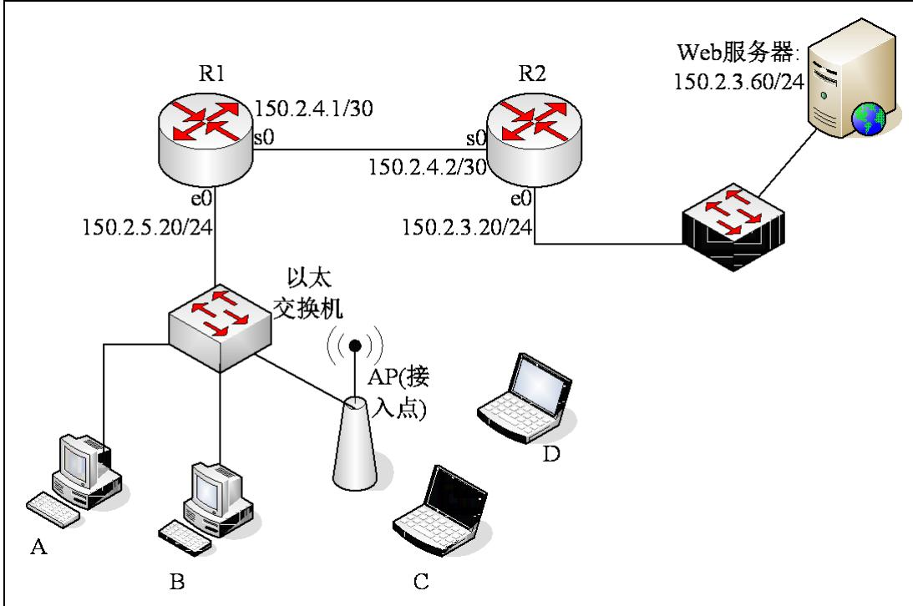

# 《计算机通信与网络》四次测试题及解析（2020.12）

原件经识别和整理；“参考解答”是我们补的。

## 测验 1：概论和物理层

### 选择 1

通信双方必须遵循的控制信息交换规则的集合是

- A. 服务访问点
- B. 原语
- C. 协议
- D. 网络体系结构

答案：C

知识点：[IPv4协议与数据报格式（分类IP地址、分片计算、首部字段）](../../../topics/计算机网络/ipv4_datagram.md)

### 填空 1

网络协议由语法、语义和 \_\_\_\_ 三个要素组成。

知识点：[域名系统DNS（层次名字空间、递归与迭代查询解析）](../../../topics/计算机网络/dns.md)

### 简答 1

写出以下网络事件发生在 OSI 体系结构的哪个层次：

（1）发送和接收电子邮件

（2）在信道上透明传输比特流

知识点：[动态主机配置协议DHCP（工作原理、中继代理）](../../../topics/计算机网络/dhcp.md)、[IPv4协议与数据报格式（分类IP地址、分片计算、首部字段）](../../../topics/计算机网络/ipv4_datagram.md)、[网络互连与IP转发（路由器转发过程、NAT、VPN、移动IP、组播）](../../../topics/计算机网络/network_interconnection.md)

### 简答 2

按照网络的作用范围划分，计算机网络有哪些分类？

知识点：[ARP地址解析协议与ICMP控制报文](../../../topics/计算机网络/arp_icmp.md)、[IPv4协议与数据报格式（分类IP地址、分片计算、首部字段）](../../../topics/计算机网络/ipv4_datagram.md)、[网络互连与IP转发（路由器转发过程、NAT、VPN、移动IP、组播）](../../../topics/计算机网络/network_interconnection.md)

### 计算 1

若码元周期 $T = 2 \times 10^{-4}$ 秒，且传送 8 电平信号，则传码速率为 \_\_\_\_ Bd、传信速率为 \_\_\_\_ b/s。

知识点：[子网划分与CIDR（子网掩码计算、路由聚合、最长前缀匹配）](../../../topics/计算机网络/subnet_cidr.md)、[IPv4协议与数据报格式（分类IP地址、分片计算、首部字段）](../../../topics/计算机网络/ipv4_datagram.md)

### 计算 2

采用相位调制技术在带宽为 32kHz 的无噪声信道上传输数字信号。若要达到 192kbps 的信道容量，需要有 \_\_\_\_ 种不同的载波相位。

知识点：[子网划分与CIDR（子网掩码计算、路由聚合、最长前缀匹配）](../../../topics/计算机网络/subnet_cidr.md)、[IPv4协议与数据报格式（分类IP地址、分片计算、首部字段）](../../../topics/计算机网络/ipv4_datagram.md)

### 填空 2

假设某站点的码片序列为 11100101，则发送了比特“0”的时候，在信道上传输的码片序列是 \_\_\_\_，发送了比特“1”的时候，码片序列是 \_\_\_\_。

知识点：[万维网与HTTP协议（URL、请求与响应报文、Web缓存）](../../../topics/计算机网络/www_http.md)

### 计算 3

已知待传送的数据 $M=1010$，若采用 CRC 技术进行检错，生成多项式为 $x^3 + x + 1$，则循环冗余码为 \_\_\_\_，实际发送的数据序列为 \_\_\_\_。

知识点：[IPv4协议与数据报格式（分类IP地址、分片计算、首部字段）](../../../topics/计算机网络/ipv4_datagram.md)

### 简答 3

PCM 调制过程。

知识点：[局域网体系结构与IEEE 802标准（LLC与MAC子层）](../../../topics/计算机网络/lan_ieee802.md)、[CSMA/CD协议与以太网（争用期、最短帧长、MAC帧格式）](../../../topics/计算机网络/csmacd_ethernet.md)、[数据通信系统模型与传输媒体](../../../topics/计算机网络/comm_basics_media.md)

### 简答 4

三种基本的数字调制方法。

知识点：[局域网的扩展与互连设备（集线器、网桥、交换机、冲突域与广播域）](../../../topics/计算机网络/lan_extension.md)、[CSMA/CD协议与以太网（争用期、最短帧长、MAC帧格式）](../../../topics/计算机网络/csmacd_ethernet.md)

### 填空 3

\_\_\_\_ 交换方式适于传输可靠性要求较高的突发性数据。

知识点：[文件传送与远程登录（FTP双连接机制、TFTP、Telnet）](../../../topics/计算机网络/ftp_telnet.md)

### 填空 4

\_\_\_\_ 交换和 \_\_\_\_ 交换都采用存储转发方式。

知识点：[数据交换技术（电路交换、报文交换、分组交换）](../../../topics/计算机网络/switching_tech.md)

### 计算 4

两主机之间包含一段卫星链路和 3 段有线链路；卫星链路的传播时延是 250ms；每段有线链路的长度是 2km，传播速度是 $2 \times 10^8 \text{m/s}$。主机及各中继节点均采用分组交换方式，数据传输速率均为 100Mbps，设发送的分组的长度是 500 字节，忽略处理时延，请问分组的端到端时延是多少？

## 测验 2：数据链路层和局域网

知识点：[CSMA/CD协议与以太网（争用期、最短帧长、MAC帧格式）](../../../topics/计算机网络/csmacd_ethernet.md)、[计算机网络性能指标（速率、时延、吞吐量计算）](../../../topics/计算机网络/performance_metrics.md)

### 计算 1

在面向比特同步协议的帧数据段中，出现如下信息：1010011111010111101（高位在左低位在右），则采用“0”比特填充后的输出是什么？

知识点：[子网划分与CIDR（子网掩码计算、路由聚合、最长前缀匹配）](../../../topics/计算机网络/subnet_cidr.md)、[IPv4协议与数据报格式（分类IP地址、分片计算、首部字段）](../../../topics/计算机网络/ipv4_datagram.md)

### 简答 1

HDLC 协议中的控制字段从高位到低位排列为 11010001，试说明该帧是什么帧，该控制段表示什么含义？

知识点：[动态主机配置协议DHCP（工作原理、中继代理）](../../../topics/计算机网络/dhcp.md)、[IPv4协议与数据报格式（分类IP地址、分片计算、首部字段）](../../../topics/计算机网络/ipv4_datagram.md)、[网络互连与IP转发（路由器转发过程、NAT、VPN、移动IP、组播）](../../../topics/计算机网络/network_interconnection.md)

### 简答 2

简述 PPP 协议的组成。

知识点：[ARP地址解析协议与ICMP控制报文](../../../topics/计算机网络/arp_icmp.md)、[IPv4协议与数据报格式（分类IP地址、分片计算、首部字段）](../../../topics/计算机网络/ipv4_datagram.md)、[网络互连与IP转发（路由器转发过程、NAT、VPN、移动IP、组播）](../../../topics/计算机网络/network_interconnection.md)

### 计算 2

假设卫星信道的数据率为 1Mb/s，取卫星信道的单程传播时延为 250ms，每一个数据帧长度是 1000bit。忽略误码率、确认帧长和处理时间。试计算下列情况下的卫星信道可能达到的最大的信道利用率分别是多少？

1）停止-等待协议；

2）连续 ARQ 协议，$W_T = 7$；

3）连续 ARQ 协议，$W_T = 127$。

知识点：[子网划分与CIDR（子网掩码计算、路由聚合、最长前缀匹配）](../../../topics/计算机网络/subnet_cidr.md)、[IPv4协议与数据报格式（分类IP地址、分片计算、首部字段）](../../../topics/计算机网络/ipv4_datagram.md)

### 计算 3

信道速率为 4kb/s，采用停止等待协议，单向传播时延 $t_p$ 为 20ms，确认帧长度和处理时间均可忽略，问帧长为多少才能使信道利用率达到至少 50%？

知识点：[IPv4协议与数据报格式（分类IP地址、分片计算、首部字段）](../../../topics/计算机网络/ipv4_datagram.md)

### 简答 3

解释“100BASE-T”中 100，BASE，T 的含义。

知识点：[局域网体系结构与IEEE 802标准（LLC与MAC子层）](../../../topics/计算机网络/lan_ieee802.md)、[CSMA/CD协议与以太网（争用期、最短帧长、MAC帧格式）](../../../topics/计算机网络/csmacd_ethernet.md)、[数据通信系统模型与传输媒体](../../../topics/计算机网络/comm_basics_media.md)

### 选择 1

在数据链路层实现网络互联的网络设备是（）。

- A. 中继器
- B. 网桥
- C. 路由器
- D. 网关

答案：B

知识点：[IPv4协议与数据报格式（分类IP地址、分片计算、首部字段）](../../../topics/计算机网络/ipv4_datagram.md)

### 填空 1

以太交换机根据 \_\_\_\_ 地址转发数据帧，根据 \_\_\_\_ 地址更新转发表。

知识点：[域名系统DNS（层次名字空间、递归与迭代查询解析）](../../../topics/计算机网络/dns.md)

### 填空 2

使用单个集线器构成的以太网在物理上是 \_\_\_\_ 拓扑结构，逻辑上是 \_\_\_\_ 拓扑结构。

知识点：[万维网与HTTP协议（URL、请求与响应报文、Web缓存）](../../../topics/计算机网络/www_http.md)

### 简答 4

简述以太交换机转发帧的三种方式的特点。

知识点：[局域网的扩展与互连设备（集线器、网桥、交换机、冲突域与广播域）](../../../topics/计算机网络/lan_extension.md)、[CSMA/CD协议与以太网（争用期、最短帧长、MAC帧格式）](../../../topics/计算机网络/csmacd_ethernet.md)

### 计算 4

若构造一个电缆总长度为 1000 米的 CSMA/CD 网络，数据传输速率为 100Mbps，该电缆通过一个中继器连接，信号经过中继器会产生 $2\mu s$ 时延，若信号在电缆中的传播速度约为 $2 \times 10^8 \text{m/s}$，该网络中允许传送的最短帧长是多少比特？

知识点：[CSMA/CD协议与以太网（争用期、最短帧长、MAC帧格式）](../../../topics/计算机网络/csmacd_ethernet.md)、[计算机网络性能指标（速率、时延、吞吐量计算）](../../../topics/计算机网络/performance_metrics.md)

### 综合 1

某以太网拓扑及主机的 MAC 地址如题图所示，交换机转发表为空，输出端口无排队帧，不考虑帧校验延迟。主机 MAC1 向主机 MAC3 发送一个数据帧，主机 MAC3 收到该数据帧后，向主机 MAC1 发送一个确认帧。写出交换机的转发端口，并更新交换机的转发表。


答案：MAC1→MAC3 向端口 2,3 转发（MAC1, 端口 1）；MAC3→MAC1 向端口 1 转发（MAC3, 端口 3）。

## 测验 3：网络层和传输层

知识点：[IPv4协议与数据报格式（分类IP地址、分片计算、首部字段）](../../../topics/计算机网络/ipv4_datagram.md)、[TCP连接管理与可靠传输（三次握手、四次挥手、序号确认、RTT与RTO）](../../../topics/计算机网络/tcp_connection_reliability.md)、[传输层服务与端口（复用与分用、五元组、熟知端口）](../../../topics/计算机网络/transport_services_ports.md)

### 选择 1

在 IPv4 中，一个数据报总长度为 3000 字节（固定长度的首部），现在经过 MTU=1500 字节的网络传送，则该数据报被划分数据报片个数是（）。

- A. 1
- B. 2
- C. 3
- D. 4

答案：C

知识点：[IPv4协议与数据报格式（分类IP地址、分片计算、首部字段）](../../../topics/计算机网络/ipv4_datagram.md)

### 计算 1

求 212.10.4.0/24, 212.10.5.0/24, 212.10.6.0/24, 212.10.7.0/24 汇聚后的网络地址。

答案：212.10.4.0/22

知识点：[子网划分与CIDR（子网掩码计算、路由聚合、最长前缀匹配）](../../../topics/计算机网络/subnet_cidr.md)、[IPv4协议与数据报格式（分类IP地址、分片计算、首部字段）](../../../topics/计算机网络/ipv4_datagram.md)

### 计算 2

128.14.32.0/20 表示的地址块共有多少个地址？最大和最小的地址分别是什么？

答案：$2^{12}$ 个地址；最小地址 128.14.32.0，最大地址 128.14.47.255。

知识点：[子网划分与CIDR（子网掩码计算、路由聚合、最长前缀匹配）](../../../topics/计算机网络/subnet_cidr.md)、[IPv4协议与数据报格式（分类IP地址、分片计算、首部字段）](../../../topics/计算机网络/ipv4_datagram.md)

### 简答 1

简述 ARP 协议的中文名称及作用。

知识点：[动态主机配置协议DHCP（工作原理、中继代理）](../../../topics/计算机网络/dhcp.md)、[IPv4协议与数据报格式（分类IP地址、分片计算、首部字段）](../../../topics/计算机网络/ipv4_datagram.md)、[网络互连与IP转发（路由器转发过程、NAT、VPN、移动IP、组播）](../../../topics/计算机网络/network_interconnection.md)

### 综合 1

TCP 报文段首部的 16 进制为 `04 85 00 50 2E 7C 84 03 FE 34 D7 47 50 11 FF 6C DE 69 00 00`，请分析这个 TCP 报文段首部哪些标志位有效以及使用的应用层协议。

答案：标志位 `50 11` 有效；应用层协议端口号为 `00 50`（80），即 HTTP。

知识点：[IPv4协议与数据报格式（分类IP地址、分片计算、首部字段）](../../../topics/计算机网络/ipv4_datagram.md)、[TCP连接管理与可靠传输（三次握手、四次挥手、序号确认、RTT与RTO）](../../../topics/计算机网络/tcp_connection_reliability.md)、[传输层服务与端口（复用与分用、五元组、熟知端口）](../../../topics/计算机网络/transport_services_ports.md)

### 综合 2

已知因特网的一部分如图所示，其中路由器 R1 的 e0 口、路由器 R2 的 e0 口和 Web 服务器的网络接口配置如图所示。

（1）图中的 AP 工作在 OSI 体系结构中的哪一层？

（2）主机 A 配置的默认网关地址是 150.2.4.1，主机 B 配置的默认网关地址是 150.2.5.20，主机 A 和 B 的 IP 地址配置正确，主机 A 是否能够访问主机 B？

（3）请补充路由器 R1 路由表。



| 目的网络 | 下一跳路由器 IP 地址 | 接口 |
| :--- | :--- | :--- |
| 150.2.5.0/24 | 直连 | e0 |
| 150.2.4.0/30 | 直连 | ? |
| 150.2.3.0/24 | ? | ? |

知识点：[CSMA/CD协议与以太网（争用期、最短帧长、MAC帧格式）](../../../topics/计算机网络/csmacd_ethernet.md)、[IPv4协议与数据报格式（分类IP地址、分片计算、首部字段）](../../../topics/计算机网络/ipv4_datagram.md)、[TCP连接管理与可靠传输（三次握手、四次挥手、序号确认、RTT与RTO）](../../../topics/计算机网络/tcp_connection_reliability.md)

### 计算 3

一个 IP 数据报总长度为 4200 字节（包含固定长度的首部）。现在需要经过某物理网络传送，但是该网络的 MTU=1000 字节。则该数据报被分片后最后一个分片的数据部分的长度是（）字节。

答案：276

知识点：[IPv4协议与数据报格式（分类IP地址、分片计算、首部字段）](../../../topics/计算机网络/ipv4_datagram.md)

### 简答 2

简述路由跟踪实现原理。

知识点：[ARP地址解析协议与ICMP控制报文](../../../topics/计算机网络/arp_icmp.md)、[IPv4协议与数据报格式（分类IP地址、分片计算、首部字段）](../../../topics/计算机网络/ipv4_datagram.md)、[网络互连与IP转发（路由器转发过程、NAT、VPN、移动IP、组播）](../../../topics/计算机网络/network_interconnection.md)

### 填空 1

域名系统的功能是实现 \_\_\_\_ 到 \_\_\_\_ 的解析。

知识点：[域名系统DNS（层次名字空间、递归与迭代查询解析）](../../../topics/计算机网络/dns.md)

### 填空 2

在万维网（WWW）中，使用 \_\_\_\_ 来标志万维网上的各种文档。

补充：URL：统一资源定位符。

知识点：[万维网与HTTP协议（URL、请求与响应报文、Web缓存）](../../../topics/计算机网络/www_http.md)

### 简答 1

上网时通常需要配置哪四项参数？当自动获取 IP 地址时，使用的是什么应用层协议？

知识点：[动态主机配置协议DHCP（工作原理、中继代理）](../../../topics/计算机网络/dhcp.md)、[IPv4协议与数据报格式（分类IP地址、分片计算、首部字段）](../../../topics/计算机网络/ipv4_datagram.md)、[网络互连与IP转发（路由器转发过程、NAT、VPN、移动IP、组播）](../../../topics/计算机网络/network_interconnection.md)

### 填空 3

FTP 使用两条 TCP 连接来完成文件传输，即控制连接和 \_\_\_\_ 连接。

补充：控制连接用来传递命令，数据连接用来传输文件。

知识点：[文件传送与远程登录（FTP双连接机制、TFTP、Telnet）](../../../topics/计算机网络/ftp_telnet.md)

### 综合 1

在 192.168.0.101 主机上捕获的一个以太帧，16 进制显示的内容如下：

```text
0000 50 89 65 15 2f 82 00 26 c7 16 2e ac 08 00 45 00
0010 00 34 0d 16 40 00 80 06 e1 ad c0 a8 00 65 3a de
0020 10 15 1d 3e 01 bb 80 df cf 64 00 00 00 00 80 02
0030 20 00 d3 d8 00 00 02 04 05 b4 01 03 03 02 01 01
0040 04 02
```

请回答：

（1）如何识别该以太帧中封装了 IP 包，IP 包中封装的是 TCP 报文段？这是主机发的 IP 包吗？MF、DF、片偏移量？

（2）该 IP 包的数据部分封装了一个 TCP 连接建立阶段的 TCP 报文段，这是第几次握手，因为置位的标志位为 \_\_\_，该 TCP 报文段的首部为多少字节？

（3）已知 HTTPS 使用 TCP 熟知端口号 443(0x01bb)，可以推测客户方设定的初始序号为（用 16 进制表示），服务器的套接字是什么？TCP 连接的五元组是什么？

答案：（2）第二次握手，SYN=1, ACK=0；首部长度为 $8 \times 4 = 32$ 字节。

知识点：[IPv4协议与数据报格式（分类IP地址、分片计算、首部字段）](../../../topics/计算机网络/ipv4_datagram.md)、[TCP连接管理与可靠传输（三次握手、四次挥手、序号确认、RTT与RTO）](../../../topics/计算机网络/tcp_connection_reliability.md)、[传输层服务与端口（复用与分用、五元组、熟知端口）](../../../topics/计算机网络/transport_services_ports.md)

### 综合 2

使用 Wireshark 采集到一个数据帧，内容如下图所示（16 进制表示）：

```text
0000： f0 1f af 67 52 a7 00 19 e0 38 12 e4 08 00 45 00
0010： 00 34 00 00 40 00 3b 06 0b 76 ca 77 e0 c9 c0 a8
0020： c8 64 00 50 c5 74 13 0b 52 0c 53 fa d8 8c 80 12
0030： 16 d0 cc 7f 00 00 02 04 05 b4 01 01 04 02 01 03
```

请回答：

(1) 源 MAC 地址和目的 MAC 地址分别是多少?

(2) 源站和目的站 IP 地址分别是什么?

(3) IP 数据报的协议字段是多少，表示什么协议?

(4) 该报文来自什么应用层协议？实现什么功能?

知识点：[CSMA/CD协议与以太网（争用期、最短帧长、MAC帧格式）](../../../topics/计算机网络/csmacd_ethernet.md)、[IPv4协议与数据报格式（分类IP地址、分片计算、首部字段）](../../../topics/计算机网络/ipv4_datagram.md)、[TCP连接管理与可靠传输（三次握手、四次挥手、序号确认、RTT与RTO）](../../../topics/计算机网络/tcp_connection_reliability.md)

### 综合 3

利用 3 台路由器组建校园网，当前的网络连接拓扑如图所示。已知路由器 R2 的 E0 接口配置的 IP 地址是 192.168.4.1，请回答以下问题：

（1）假设某一个用户携带笔记本电脑，想通过手动配置网络，接入到 192.168.4.0/24 物理网络中，要想成功连网，则该用户允许配置的最小主机 IP 地址、最大主机 IP 地址、子网掩码和默认网关（路由器）IP 地址分别是什么？

（2）现考虑将主机 H2 所连网络划分成 4 个一样大的子网，且每个子网规模尽可能的大，且允许使用全 0 和全 1 的子网号。请写出子网掩码，每个子网对应的子网地址和子网广播地址，以及每个子网允许接入的主机数目。


知识点：[IPv4协议与数据报格式（分类IP地址、分片计算、首部字段）](../../../topics/计算机网络/ipv4_datagram.md)、[子网划分与CIDR（子网掩码计算、路由聚合、最长前缀匹配）](../../../topics/计算机网络/subnet_cidr.md)、[网络互连与IP转发（路由器转发过程、NAT、VPN、移动IP、组播）](../../../topics/计算机网络/network_interconnection.md)

### 综合 4

某公司网络如题图所示，IP 地址空间 202.119.5.0/24 已经被平分给研发部和市场部两个子网（全 0 和全 1 的子网地址可以使用），并已经分别为两个子网内若干台主机分配了 IP 地址，路由器两个接口 F0 和 F1 的 IP 地址分别是 202.119.5.1 和 202.119.5.254，研发部子网的 MTU=1500 字节，市场部子网的 MTU=820 字节。请回答下列问题：

（1）研发部子网和市场部子网的子网地址、广播地址分别是什么？

（2）若每台主机仅分配 1 个 IP 地址，则研发部子网还能再连接多少台主机？

（3）若研发部某主机 202.119.5.2 向市场部某主机 202.119.5.200 发送一个总长度是 1500 字节（首部长度 20 字节）的 IP 分组，则在路由器处会分成几个分片？写出每个分片的片偏移字段的值以及数据部分的长度。


知识点：[子网划分与CIDR（子网掩码计算、路由聚合、最长前缀匹配）](../../../topics/计算机网络/subnet_cidr.md)、[IPv4协议与数据报格式（分类IP地址、分片计算、首部字段）](../../../topics/计算机网络/ipv4_datagram.md)
