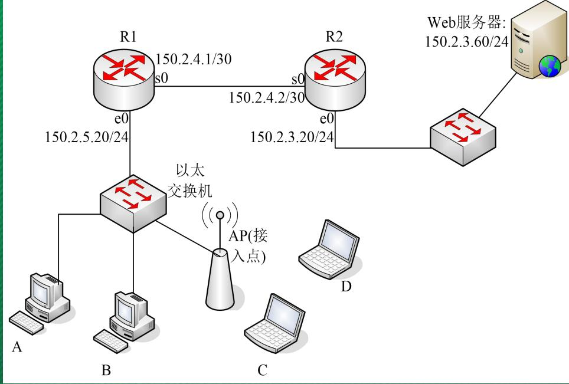
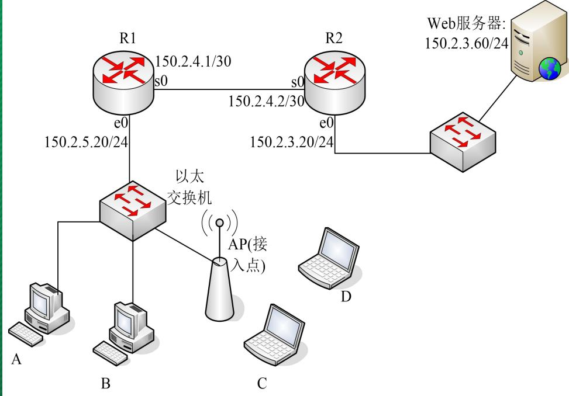

# 《计算机通信与网络》期末复习提纲（2021-2022学年第二学期）

原件经识别和整理；“参考解答”是我们补的。

## 计算机通信与网络

### Computer Communication & Networks

## 复习提纲

南京邮电大学计算机学院计算机系统与网络教学中心

知识点：[网络体系结构与协议（OSI/RM与TCP/IP模型、协议三要素）](../../../topics/计算机网络/architecture_protocols.md)、[计算机网络的定义、组成与拓扑分类](../../../topics/计算机网络/network_basics.md)、[数据交换技术（电路交换、报文交换、分组交换）](../../../topics/计算机网络/switching_tech.md)

### 考试题型与分值

■ 简答题：35分（7题，每题5分）

■ 综合应用题：55分（4题）

■ 解析题：10分（1题）

知识点：[计算机网络性能指标（速率、时延、吞吐量计算）](../../../topics/计算机网络/performance_metrics.md)、[网络体系结构与协议（OSI/RM与TCP/IP模型、协议三要素）](../../../topics/计算机网络/architecture_protocols.md)、[计算机网络的定义、组成与拓扑分类](../../../topics/计算机网络/network_basics.md)

### 第一章 概述

1. 掌握计算机网络在逻辑上的组成及其各自的作用。

2.理解网络的类型（网络拓扑结构、网络覆盖范围）

3. 掌握网络体系结构的概念；掌握协议概念和协议三要素的名称、含义。

4. 掌握OSI/RM和TCP/IP体系结构中每一层的名称和主要功能，理解封装的概念。

知识点：[计算机网络的定义、组成与拓扑分类](../../../topics/计算机网络/network_basics.md)、[网络体系结构与协议（OSI/RM与TCP/IP模型、协议三要素）](../../../topics/计算机网络/architecture_protocols.md)

### 第二章 数据通信技术基础

1. 曼彻斯特和差分曼彻斯特两种数字信号编码方法和应用

2. 掌握数据通信系统技术指标的计算（传信率、传码率、信道带宽、发送时延和传播时延、误码率、信道容量，包括香农公式和奈氏第一准则）

3. 掌握多路复用技术的概念和分类，CDMA中码片序列的特点以及数据发送和接收过程。

知识点：[数据交换技术（电路交换、报文交换、分组交换）](../../../topics/计算机网络/switching_tech.md)、[差错控制与检测编码（汉明码、CRC循环冗余校验）](../../../topics/计算机网络/error_control.md)、[数据通信系统模型与传输媒体](../../../topics/计算机网络/comm_basics_media.md)

### 第二章 数据通信技术基础

4.理解数据交换技术的主要特点和数据传送过程。

5. 掌握汉明码中数据位长度和校验位长度的关系。

6. 掌握发送方CRC校验码的计算方法以及接收方的差错检测过程（生成多项式，CRC校验码，发送序列，接收端如何检错）。

知识点：[数据交换技术（电路交换、报文交换、分组交换）](../../../topics/计算机网络/switching_tech.md)、[差错控制与检测编码（汉明码、CRC循环冗余校验）](../../../topics/计算机网络/error_control.md)、[数据通信系统模型与传输媒体](../../../topics/计算机网络/comm_basics_media.md)

### 第二章 数据通信技术基础样题

1. 共有4个站进行码分多址通信。4个站的码片序列为

A: $(-1 - 1 - 1 + 1 + 1 - 1 + 1 + 1)$

B: $(-1 - 1 + 1 - 1 + 1 + 1 + 1 - 1)$

C: $(-1 + 1 - 1 + 1 + 1 + 1 - 1 - 1)$

D: $(-1 + 1 - 1 - 1 - 1 - 1 + 1 - 1)$

■ 若收到码片序列S: （-1+1-3+1-1-3+1+1），则没有发送数据的站是哪个？

知识点：[计算机网络性能指标（速率、时延、吞吐量计算）](../../../topics/计算机网络/performance_metrics.md)、[数据交换技术（电路交换、报文交换、分组交换）](../../../topics/计算机网络/switching_tech.md)

### 第二章 数据通信技术基础样题

2、源站通过分组交换网想要向目的站发送900000bit的文件，从源站到目的站共经过3段链路，数据率为100Mb/s。每个分组长1000比特，分组头部为100比特，忽略信号的传播时延以及交换结点的处理时延，请计算该文件传送所需的总时延是多少？

知识点：[计算机网络性能指标（速率、时延、吞吐量计算）](../../../topics/计算机网络/performance_metrics.md)、[数据交换技术（电路交换、报文交换、分组交换）](../../../topics/计算机网络/switching_tech.md)

### 第三章 数据链路层

1. 理解滑动窗口的基本概念

2. 掌握停止一等待协议的工作过程

3. 掌握连续ARQ、选择ARQ的工作过程、发送窗口和接收窗口大小的计算。

4. 掌握HDLC的零比特插入删除法和PPP的字节填充方法。

知识点：[流量控制与可靠传输（停止等待、连续ARQ、选择ARQ及窗口尺寸）](../../../topics/计算机网络/flow_control.md)、[数据链路层功能与透明传输（HDLC、PPP协议）](../../../topics/计算机网络/dll_functions.md)

### 第三章 数据链路层样题

1. HDLC帧中部分数据比特为“0111101111110”，经过填充后出现在链路上的比特序列是什么？

2.主机A和主机B的数据链路层采用连续ARQ协议进行流量控制，帧序号长度为3bit，则两主机的发送窗口尺寸最大设置为多少？接收窗口为多大？

知识点：[数据链路层功能与透明传输（HDLC、PPP协议）](../../../topics/计算机网络/dll_functions.md)、[流量控制与可靠传输（停止等待、连续ARQ、选择ARQ及窗口尺寸）](../../../topics/计算机网络/flow_control.md)

### 第四章 局域网与广域网

1. 掌握CSMA/CD协议（原理、争用期、最短帧的计算、以太网MAC帧格式、帧填充、退避时间的决定因素）

2.理解 10BASE-T, 10BASE-F 等以太网的几个技术特性（传输技术、传输介质、拓扑结构、介质访问控制方法等）

3. 掌握集线器和网桥的工作层次、原理
4. 掌握网桥（交换机）帧过滤和转发表更新的算法。

5. 掌握以太网交换机转发帧的过程，三种转发方式及其特点，理解碎片帧的含义。

知识点：[CSMA/CD协议与以太网（争用期、最短帧长、MAC帧格式）](../../../topics/计算机网络/csmacd_ethernet.md)、[局域网的扩展与互连设备（集线器、网桥、交换机、冲突域与广播域）](../../../topics/计算机网络/lan_extension.md)、[介质访问控制基础（信道共享、竞争系统与令牌机制）](../../../topics/计算机网络/mac_basics.md)

### 第四章 局域网与广域网样题

1. 以太交换机的三种帧转发方式中，不可能转发出错帧的是哪种方式？

2、A、B两站位于长4km的基带总线局域网的两端，数据传输速率为20Mbps，信号传播速度为 $2 \times 10^{8}$ m/s，

(1)该基带总线局域网内的最短帧长。

(2)若A站点给B站点发送数据时，已经发生了2次冲突，站点可供选择的最大退避系数是多少？

知识点：[CSMA/CD协议与以太网（争用期、最短帧长、MAC帧格式）](../../../topics/计算机网络/csmacd_ethernet.md)、[介质访问控制基础（信道共享、竞争系统与令牌机制）](../../../topics/计算机网络/mac_basics.md)、[局域网的扩展与互连设备（集线器、网桥、交换机、冲突域与广播域）](../../../topics/计算机网络/lan_extension.md)

### 第五章 网络层与网络互连

■ 1.理解分类的IP地址分类方法，特殊的IP地址

■ 2. 理解ARP协议的作用

■ 3.理解IP数据报格式，掌握对网络采集报文的解析方法

4. 掌握IP数据报分片原理与计算

■ 5.理解因特网控制报文协议ICMP及其PING应用

■ 6. 掌握子网的划分和地址分配。（会计算所用的子网掩码、每个子网的子网地址、每个子网容纳的主机数、每个子网最小的IP地址、最大的IP地址及广播地址）

7. 掌握CIDR路由聚合技术，以及最长前缀匹配。

知识点：[互联网路由选择协议（RIP距离向量、OSPF链路状态、BGP）](../../../topics/计算机网络/routing_protocols.md)、[网络互连与IP转发（路由器转发过程、NAT、VPN、移动IP、组播）](../../../topics/计算机网络/network_interconnection.md)、[IPv4协议与数据报格式（分类IP地址、分片计算、首部字段）](../../../topics/计算机网络/ipv4_datagram.md)

### 第五章 网络层与网络互连

■ 8.掌握因特网路由选择协议RIP的工作原理

■ 9. 掌握直接交付和间接交付的概念。理解路由器的组成部分和转发IP分组的原理（包括写路由表等）

■ 10. 掌握定向广播和受限广播两种方式

■ 11. 理解NAT技术中地址转换过程

知识点：[互联网路由选择协议（RIP距离向量、OSPF链路状态、BGP）](../../../topics/计算机网络/routing_protocols.md)、[网络互连与IP转发（路由器转发过程、NAT、VPN、移动IP、组播）](../../../topics/计算机网络/network_interconnection.md)、[IPv4协议与数据报格式（分类IP地址、分片计算、首部字段）](../../../topics/计算机网络/ipv4_datagram.md)

### 第五章 网络层与网络互连样题

1、在IPv4中，一个数据报总长度为3000字节（固定长度的首部），现在经过MTU=1500字节的网络传送，则该数据报被划分数据报片的个数是多少？每个分片首部中MF和片偏移字段是多少？

2、在子网192.168.4.0/30中，能接收到目的IP地址为192.168.4.3的IP分组的最大主机个数是多少？

知识点：[IPv4协议与数据报格式（分类IP地址、分片计算、首部字段）](../../../topics/计算机网络/ipv4_datagram.md)、[子网划分与CIDR（子网掩码计算、路由聚合、最长前缀匹配）](../../../topics/计算机网络/subnet_cidr.md)

### 第五章 样题

■3、已知因特网的一部分如图所示，其中路由器R1的e0口、路由器R2的e0口和Web服务器的网络接口配置如图所示（1）图中的AP工作在OSI体系结构中的哪一层？

(2) 主机A配置的默认网关地址是150.2.4.1, 主机B配置的默认网关地址是150.2.5.20,

(2) 主机A配置的默认网关地址的默认网关地址是150.2.5.20,主机A和B的IP地址配置正确,主机A是否能够访问主机B? (3) 请补充路由器R1路由表

| 目的网络 | 下一跳路由器IP地址 | 接口 |
| --- | --- | --- |
| 150.2.5.0/24 | 直连 | e0 |
| 150.2.4.0/30 | 直连 | ? |
| 150.2.3.0/24 | ? | ? |



知识点：[网络互连与IP转发（路由器转发过程、NAT、VPN、移动IP、组播）](../../../topics/计算机网络/network_interconnection.md)、[子网划分与CIDR（子网掩码计算、路由聚合、最长前缀匹配）](../../../topics/计算机网络/subnet_cidr.md)、[网络体系结构与协议（OSI/RM与TCP/IP模型、协议三要素）](../../../topics/计算机网络/architecture_protocols.md)

### 第五章 样题

3. (1) 图中的AP工作在OSI体系结构中数据链路层  
(2) 可以访问，因为两台主机在同一个物理网络中,所以是直接交付,和配置的默认网关地址正确与否没关系。

(3) 请补充路由器R1路由表

| 目的网络 | 下一跳路由器IP地址 | 接口 |
| --- | --- | --- |
| 150.2.5.0/24 | 直连 | e0 |
| 150.2.4.0/30 | 直连 | s0 |
| 150.2.3.0/24 | 150.2.4.2 | s0 |



知识点：[网络互连与IP转发（路由器转发过程、NAT、VPN、移动IP、组播）](../../../topics/计算机网络/network_interconnection.md)、[子网划分与CIDR（子网掩码计算、路由聚合、最长前缀匹配）](../../../topics/计算机网络/subnet_cidr.md)、[网络体系结构与协议（OSI/RM与TCP/IP模型、协议三要素）](../../../topics/计算机网络/architecture_protocols.md)

### 第六章 传输层

■ 1. 掌握传输层的功能，作用，分类

■ 2.理解端口,套接字和五元组概念

■ 3. 掌握UDP基本概念，理解其报文格式以及校验和计算（伪首部）

■ 4. 掌握TCP（基本概念、报文格式、可靠传输、往返时延的确定、连接管理、流量控制、慢启动和拥塞控制）

知识点：[传输层服务与端口（复用与分用、五元组、熟知端口）](../../../topics/计算机网络/transport_services_ports.md)、[UDP协议（无连接特性、报文段格式、伪首部校验和计算）](../../../topics/计算机网络/udp_protocol.md)、[TCP连接管理与可靠传输（三次握手、四次挥手、序号确认、RTT与RTO）](../../../topics/计算机网络/tcp_connection_reliability.md)

### 第六章 传输层样题

1、主机甲向主机乙发送一个(SYN = 1, Seq = x)的TCP段，期望与主机乙建立TCP连接，若主机乙接受该连接请求，则主机甲向主机乙发送的第一个数据分段中序号字段数值是多少？

知识点：[TCP流量控制与拥塞控制（滑动窗口、慢开始、拥塞避免、快重传与快恢复）](../../../topics/计算机网络/tcp_flow_congestion.md)、[TCP连接管理与可靠传输（三次握手、四次挥手、序号确认、RTT与RTO）](../../../topics/计算机网络/tcp_connection_reliability.md)

### 第六章 传输层样题

2. 利用数据包捕获软件捕获到的一个IP数据报从首部开始的部分内容如下图所示(均用16进制表示)，请写出本次通信所对应的五元组。（注意：涉及到的IP地址请用点分十进制表示，端口号请用十进制表示）

注意五元组的顺序：源IP地址源端口号、目的IP地址、目的端口号、传输层的协议(TCP或UDP)

```
45 00 02 79 1C A4 40 00
80 06 00 00 0A 0A 01 5F
DA 1E 73 7B 07 38 00 50
19 71 85 77 7F 25 2B AA
50 18 FF FF 5B 6E 00 00
47 45 54 20 2F 73 2F 62
6C 6F 67 5F 34 62 63 66
64 64 63 64
```

知识点：[TCP流量控制与拥塞控制（滑动窗口、慢开始、拥塞避免、快重传与快恢复）](../../../topics/计算机网络/tcp_flow_congestion.md)、[TCP连接管理与可靠传输（三次握手、四次挥手、序号确认、RTT与RTO）](../../../topics/计算机网络/tcp_connection_reliability.md)

### 第六章 传输层样题

2. 利用数据包捕获软件捕获到的一个IP数据报从首部开始的部分内容如下图所示(均用16进制表示)，请写出本次通信所对应的五元组。（注意：根据IP分组格式、TCP或UDP首部格式来分析）

对应的五元组：
源IP地址：10.10.1.95
源端口号：0738H=1848
目的IP地址：218.30.115.123
目的端口号：50H=80
传输层的协议：TCP

```
45 00 02 79 1C A4 40 00
80 06 00 00 0A 0A 01 5F
DA 1E 73 7B 07 38 00 50
19 71 85 77 7F 25 2B AA
50 18 FF FF 5B 6E 00 00
47 45 54 20 2F 73 2F 62
6C 6F 67 5F 34 62 63 66
64 64 63 64
```

知识点：[TCP流量控制与拥塞控制（滑动窗口、慢开始、拥塞避免、快重传与快恢复）](../../../topics/计算机网络/tcp_flow_congestion.md)、[TCP连接管理与可靠传输（三次握手、四次挥手、序号确认、RTT与RTO）](../../../topics/计算机网络/tcp_connection_reliability.md)

### 第六章 传输层样题

3、一个TCP连接总是以1KB的最大段长发送TCP段，假如接收窗口为8KB，发送方有足够多的数据要发送，当拥塞窗口为16KB时发生了超时，如果在接下来的5个RTT内不再发生超时的情况下，拥塞窗口和发送窗口分别是多少KB?

拥塞窗口：1KB，2KB，4KB，8KB，9KB

发送窗口：1KB，2KB，4KB，8KB，8KB

知识点：[TCP流量控制与拥塞控制（滑动窗口、慢开始、拥塞避免、快重传与快恢复）](../../../topics/计算机网络/tcp_flow_congestion.md)、[TCP连接管理与可靠传输（三次握手、四次挥手、序号确认、RTT与RTO）](../../../topics/计算机网络/tcp_connection_reliability.md)

### 第七章 应用层

■ 1. 理解因特网部分应用层协议与传输层协议的对应关系

■ 2.理解网络应用模式、服务器工作模式

■ 3. 掌握应用层基本协议原理与应用（DNS、FTP、DHCP）

■ 4. 掌握电子邮件原理与应用（组成构件、SMTP、POP、MIME）

■ 5.理解万维网技术原理与应用（URL、HTTP、HTML、搜索引擎）

知识点：[域名系统DNS（层次名字空间、递归与迭代查询解析）](../../../topics/计算机网络/dns.md)、[文件传送与远程登录（FTP双连接机制、TFTP、Telnet）](../../../topics/计算机网络/ftp_telnet.md)、[电子邮件系统（SMTP、POP3、IMAP、MIME）](../../../topics/计算机网络/email_protocols.md)、[万维网与HTTP协议（URL、请求与响应报文、Web缓存）](../../../topics/计算机网络/www_http.md)、[动态主机配置协议DHCP（工作原理、中继代理）](../../../topics/计算机网络/dhcp.md)

### 第七章 应用层样题

1. 使用Wireshark采集到一个数据帧，内容如下图所示（16进制表示），请回答：

| 0000: | f0 1f af 67 52 a7 00 19 | e0 38 12 e4 08 00 45 00 |
| --- | --- | --- |
| 0010: | 00 34 00 00 40 00 3b 06 | 0b 76 ca 77 e0 c9 c0 a8 |
| 0020: | c8 64 00 50 c5 74 13 0b | 52 0c 53 fa d8 8c 80 12 |
| 0030: | 16 d0 cc 7f 00 00 02 04 | 05 b4 01 01 04 02 01 03 |

(1)源MAC地址和目的MAC地址分别是多少?

■ (2)源站和目的站IP地址分别是什么?

(3)IP数据报的协议字段是多少，表示什么协议？

■ (4)该报文来自什么应用层协议？

(5)IP分组中数据部分的长度是多少字节?

知识点：[介质访问控制基础（信道共享、竞争系统与令牌机制）](../../../topics/计算机网络/mac_basics.md)、[IPv4协议与数据报格式（分类IP地址、分片计算、首部字段）](../../../topics/计算机网络/ipv4_datagram.md)、[万维网与HTTP协议（URL、请求与响应报文、Web缓存）](../../../topics/计算机网络/www_http.md)

### 第七章 应用层样题

3 目的MAC 地址源MAC
地址

数据帧，内容如下图

协议TCP

0020:

0030:

源IP地址

目的IP地址

(1)源总长度 HTTP MAC地址分别是多少？

(2)源站和目的站IP地址分别是什么?

(3)IP数据报的协议字段是多少，表示什么协议？

(4)该报文来自什么应用层协议？实现什么功能？

(5)IP分组中数据部分的长度34H-20=32字节

知识点：[介质访问控制基础（信道共享、竞争系统与令牌机制）](../../../topics/计算机网络/mac_basics.md)、[IPv4协议与数据报格式（分类IP地址、分片计算、首部字段）](../../../topics/计算机网络/ipv4_datagram.md)、[万维网与HTTP协议（URL、请求与响应报文、Web缓存）](../../../topics/计算机网络/www_http.md)

### The End!

知识点：[计算机网络的定义、组成与拓扑分类](../../../topics/计算机网络/network_basics.md)、[网络体系结构与协议（OSI/RM与TCP/IP模型、协议三要素）](../../../topics/计算机网络/architecture_protocols.md)、[数据通信系统模型与传输媒体](../../../topics/计算机网络/comm_basics_media.md)

### 南京邮电大学

-2022.5-

知识点：[计算机网络性能指标（速率、时延、吞吐量计算）](../../../topics/计算机网络/performance_metrics.md)、[信道容量与传输速率计算（奈氏准则与香农公式）](../../../topics/计算机网络/channel_capacity.md)、[数据通信系统模型与传输媒体](../../../topics/计算机网络/comm_basics_media.md)
