# 《计算机通信与网络》期末复习要点（2017—2018学年第二学期）

原件经识别和整理；“参考解答”是我们补的。

# 计算机通信与网络

## 第一章 概论

### 掌握计算机网络在逻辑上的组成

通信子网和终端系统

知识点：[计算机网络的定义、组成与拓扑分类](../../../topics/计算机网络/network_basics.md)

### 掌握协议的概念以及协议三要素

概念：协议是通信双方都必须遵守的，控制信息交换的规则的集合。

三要素：语法、语义、同步

知识点：[网络体系结构与协议（OSI/RM与TCP/IP模型、协议三要素）](../../../topics/计算机网络/architecture_protocols.md)

### 掌握网络体系结构的基本概念，OSI/RM 七个层次的名称（按照顺序）和主要功能

基本概念：计算机网络的分层、各层协议和层间接口的集合。

从上到下：

应用层

表示层

会话层

传输层：提供端到端的数据传输服务。

网络层：提供路由选择服务。单位：分组。

数据链路层：在通信的实体间建立数据链路连接。单位：帧。

物理层：实现比特流的透明传输。单位：比特。

知识点：[网络体系结构与协议（OSI/RM与TCP/IP模型、协议三要素）](../../../topics/计算机网络/architecture_protocols.md)、[计算机网络的定义、组成与拓扑分类](../../../topics/计算机网络/network_basics.md)

### 理解下三层传输的基本单位

（见上节：网络层—分组，数据链路层—帧，物理层—比特）

知识点：[网络体系结构与协议（OSI/RM与TCP/IP模型、协议三要素）](../../../topics/计算机网络/architecture_protocols.md)

### 掌握 TCP/IP 体系结构中的分层（四层）。能够区分一些主要的协议位于的层次

从上到下：

互连网络层 Internet Layer

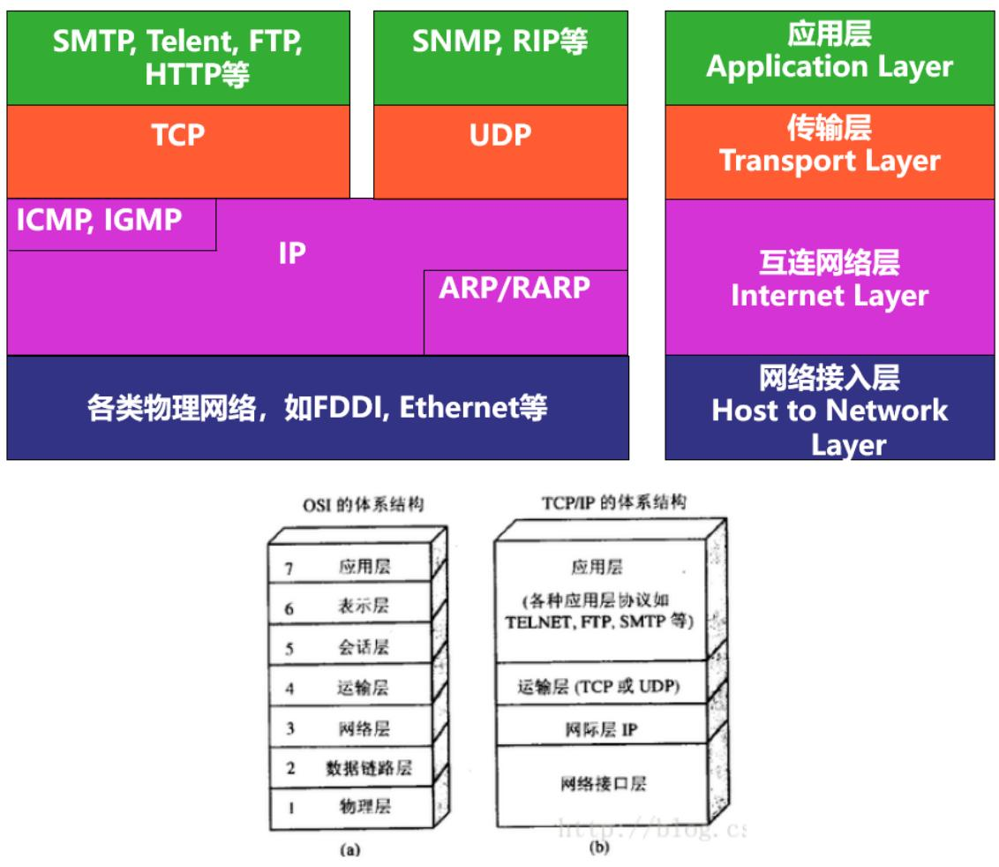

网络接入层 Host to Network Layer

## 第二章 数据通信技术基础

知识点：[网络体系结构与协议（OSI/RM与TCP/IP模型、协议三要素）](../../../topics/计算机网络/architecture_protocols.md)

### 掌握传信速率、传码速率（波特率）、发送时延、传播时延、误码率的计算

传码速率：波特率； $N_{Bd}=1/T$ ；每秒钟传输信号码元的个数；波特 (Baud)

传信速率：比特率； $R_{b}$ ；每秒钟传输二进制码元的个数；比特/秒 (bit/s)

$$
R_{b} = N_{Bd} \times \log_{2} M
$$

发送时延 ts：数据块从结点进入到传输媒体所需要的时间。

$$
\text{发送时延} = \text{数据帧长度 (b) / 信道带宽 (b/s)}
$$

传播时延 tp：数据在信道上的发送速率。

传播时延 = 信道长度 (m) / 电磁波在信道上的传播速率 (m/s)

误码率：在一定时间内接收到出错的比特数 $\mathbf{e}_{1}$ 与总的传输比特数 $\mathbf{e}_{2}$ 之比。

$$
\mathrm{P}_{\mathrm{e}} = \left(\mathrm{e}_{1} / \mathrm{e}_{2}\right) \times 100\%
$$

$$
1\mathrm{Mb} = 10^{6}\mathrm{b} \quad 1\mathrm{Gb} = 10^{9}\mathrm{b}
$$

信道利用率：ts/(ts+2tp)

知识点：[计算机网络性能指标（速率、时延、吞吐量计算）](../../../topics/计算机网络/performance_metrics.md)、[数据通信系统模型与传输媒体](../../../topics/计算机网络/comm_basics_media.md)

### 掌握两种信道容量的计算（香农公式和奈氏准则）

奈奎斯特定理：理想无噪声条件：

$$
C = 2W\log_{2}M
$$

香农公式：有噪声条件：

$$
\mathrm{C} = W\log_{2}(1 + S/N)
$$

$$
(S/N)\mathrm{dB} = 10\log_{10}(\text{信号功率}P_{1} / \text{噪声功率}P_{2})
$$

知识点：[信道容量与传输速率计算（奈氏准则与香农公式）](../../../topics/计算机网络/channel_capacity.md)

### 了解常用的有线传输介质名称及其应用

双绞线：价格低，安装方便，带宽窄，抗干扰性能较差；模拟传输和数字传输。

同轴电缆：具有较好的抗干扰特性；高速数据传输。

光缆：通信衰耗小，距离长，抗干扰能力强，传输容量大，保密性好。

知识点：[数据通信系统模型与传输媒体](../../../topics/计算机网络/comm_basics_media.md)、[计算机网络的定义、组成与拓扑分类](../../../topics/计算机网络/network_basics.md)

### 掌握曼彻斯特和差分曼彻斯特编码的规则

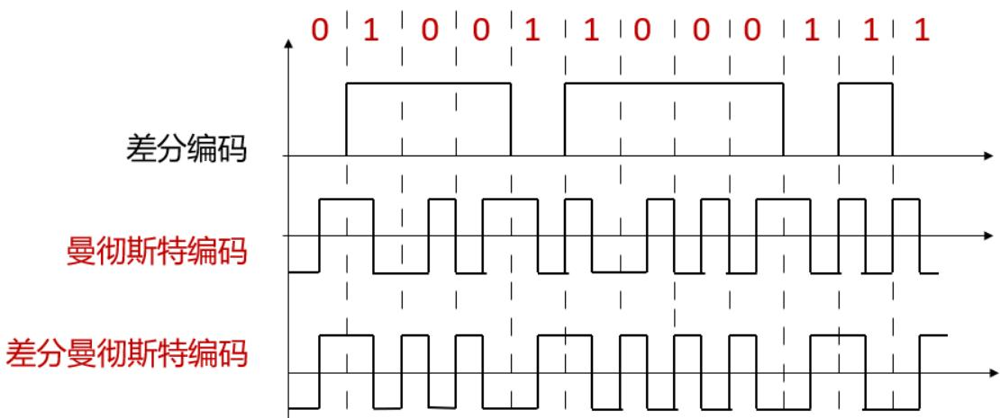

差分编码：遇 0 保持，遇 1 翻转

曼彻斯特编码：0: 0→1, 1: 1→0

差分曼彻斯特编码：先差分，再曼彻斯特

知识点：[数据编码与调制技术（曼彻斯特编码、PCM、基带与频带传输）](../../../topics/计算机网络/encoding_modulation.md)

### 掌握四种多路复用技术的名称及其应用

时分复用

频分复用：载波电话系统、电视

码分复用：CDMA，码分多址复用

每个站分配的码片序列不仅必须各不相同，并且还必须互相正交。

当内积结果为正时，表明 A 站发送比特 1；结果为负数时，表明发送比特 0；当结果为 0 时，表明该站未发送数据。

波分复用：光纤

知识点：[信道复用技术（FDM、TDM、WDM、CDM）](../../../topics/计算机网络/multiplexing.md)、[数据通信系统模型与传输媒体](../../../topics/计算机网络/comm_basics_media.md)、[计算机网络的定义、组成与拓扑分类](../../../topics/计算机网络/network_basics.md)

### 掌握三种基本的数据交换技术名称和特点

电路交换：建立连接，实时性好，线路利用率低

存储交换：报文交换——存储-转发方式，延迟高

存储交换：分组交换——线路利用率高，数据传输质量高、可靠性高

知识点：[数据交换技术（电路交换、报文交换、分组交换）](../../../topics/计算机网络/switching_tech.md)

### 理解汉明码的基本概念和编码规则

汉明码能纠正 1 位差错

码长 n，信息位 k，监督位数 r = n - k（冗余信息或校验位）

$$
2^{r} \geq \mathrm{n} + 1, \text{即} 2^{r} \geq k + r + 1
$$

编码效率 R = k/n

偶校验，无错情况下 r 个矫正因子都为 0

校验位生成式：

汉明码偶校验关系：

$$
\mathbf{c}_{2} = \mathbf{c}_{6} \oplus \mathbf{c}_{5} \oplus \mathbf{c}_{4}
$$

$$
\mathbf{S}_{1} = \mathbf{c}_{6} \oplus \mathbf{c}_{5} \oplus \mathbf{c}_{4} \oplus \mathbf{c}_{2}
$$

$$
\mathbf{c}_{1} = \mathbf{c}_{6} \oplus \mathbf{c}_{5} \oplus \mathbf{c}_{3}
$$

$$
\mathbf{S}_{2} = \mathbf{c}_{6} \oplus \mathbf{c}_{5} \oplus \mathbf{c}_{3} \oplus \mathbf{c}_{1}
$$

$$
\mathbf{c}_{0} = \mathbf{c}_{6} \oplus \mathbf{c}_{4} \oplus \mathbf{c}_{3}
$$

$$
\mathbf{S}_{3} = \mathbf{c}_{6} \oplus \mathbf{c}_{4} \oplus \mathbf{c}_{3} \oplus \mathbf{c}_{0}
$$

⊕：异或：数值相同→0，不同→1

如果要能检测 e 个差错，则编码集的汉明距离至少为 $e+1$；

如果要能纠正 t 个差错，则编码集的汉明距离至少为 $2t + 1$；

如果要能检测 e 个差错，同时能纠正 t 个差错 $(e>t)$，则编码集的汉明距离至少为 $e+t+1$；

【例】一个报文的比特序列为 1101011011 通过数据链路传输，采用 CRC 进行差错检测，如所用的生成多项式为 $g(x)=x^{4}+x+1$，试说明：1) CRC 码的产生过程及所产生的发送序列；2) CRC 码的检测过程（有差错及无差错）。生成多项式为 $g(x)=x^{4}+x+1$，则其编码为 10011，r=4。因为 r=4，所以 CRC 校验码是 4 位的。对于报文 1101011011，将其左移 4 位，即在报文末尾加 4 个“0”，这等于报文乘以 $2^{4}$，然后被生成多项式模 2 除。

| 生成发送序列 | 无差错 | 有差错 |
| --- | --- | --- |
| $\frac{11010110110000}{11010110111110}$ | | |

知识点：[差错控制与检测编码（汉明码、CRC循环冗余校验）](../../../topics/计算机网络/error_control.md)、[数据链路层功能与透明传输（HDLC、PPP协议）](../../../topics/计算机网络/dll_functions.md)

### 掌握 CRC 编码的计算方法以及接收方的差错检测过程

只能做到“无差错接受”：凡是接受的帧（即不包括丢弃的帧），我们都能以非常接近于 1 的概率认为这些帧在传输过程中没有产生差错。

要做到“可靠传输”（即发送什么就收到什么）就必须再加上确认和重传机制。

知识点：[差错控制与检测编码（汉明码、CRC循环冗余校验）](../../../topics/计算机网络/error_control.md)、[数据链路层功能与透明传输（HDLC、PPP协议）](../../../topics/计算机网络/dll_functions.md)

### 物理层标准主要描述了通信接口的相关特性

包括：机械特性（几何尺寸、引线排列）、电气特性（电气参数）、功能特性（功能）和规程特性（接口上传输时间与控制需要执行的事件顺序）。

知识点：[物理层接口特性与标准（机械、电气、功能、规程特性）](../../../topics/计算机网络/physical_layer_interface.md)

### 脉冲编码调制（PCM）的处理流程

抽样、量化、编码

## 第三章 数据链路层、第四章 局域网和广域网

知识点：[数据编码与调制技术（曼彻斯特编码、PCM、基带与频带传输）](../../../topics/计算机网络/encoding_modulation.md)

### 了解数据链路层的基本功能

链路管理，帧定界（帧同步），流量控制，差错控制，数据和控制信息的识别，透明传输，寻址

知识点：[数据链路层功能与透明传输（HDLC、PPP协议）](../../../topics/计算机网络/dll_functions.md)、[流量控制与可靠传输（停止等待、连续ARQ、选择ARQ及窗口尺寸）](../../../topics/计算机网络/flow_control.md)、[差错控制与检测编码（汉明码、CRC循环冗余校验）](../../../topics/计算机网络/error_control.md)

### 掌握流量控制的概念，掌握并比较几种常用的流量控制方法（停止等待协议，连续 ARQ 协议和选择 ARQ 协议）的基本思想，掌握这三种方法对应的发送窗口、接收窗口尺寸的取值范围

流量控制：协调链路两端的发送站和接收站之间的数据传输流量，以保证双方的数据发送和接受达到平衡。

停止-等待协议：一次发完一个数据帧后主动停止发送，等待确认

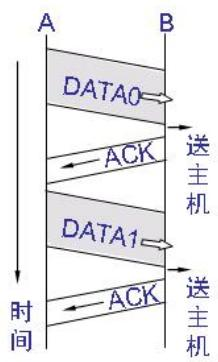

四种情况：

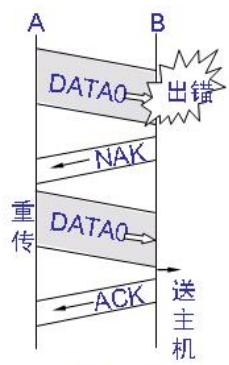

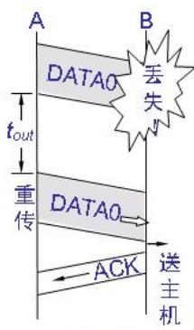

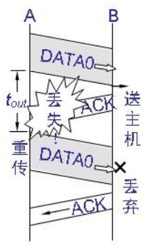

发送窗口和接收窗口都为 1。

连续 ARQ 协议：如果出现差错，则从出现差错的数据帧开始全部重发。

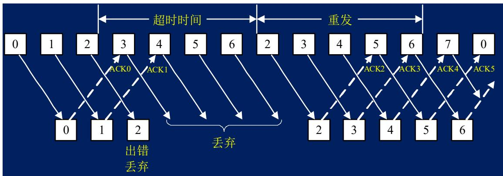

选择 ARQ 协议：只重传出现差错的数据帧或者计时器超时的数据帧，但是此时必须加大接收窗口。

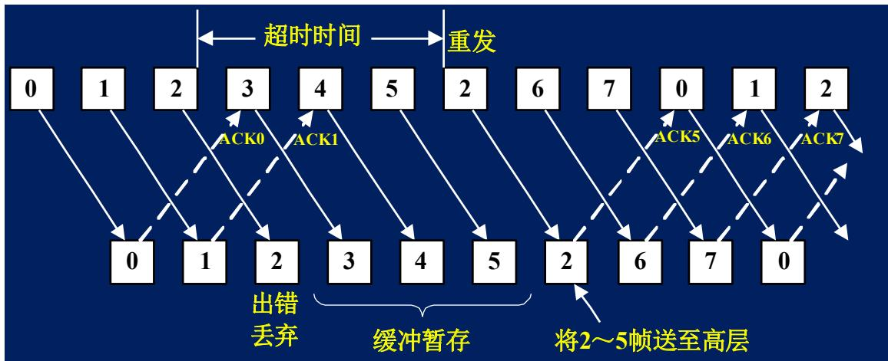

知识点：[流量控制与可靠传输（停止等待、连续ARQ、选择ARQ及窗口尺寸）](../../../topics/计算机网络/flow_control.md)、[数据链路层功能与透明传输（HDLC、PPP协议）](../../../topics/计算机网络/dll_functions.md)、[TCP流量控制与拥塞控制（滑动窗口、慢开始、拥塞避免、快重传与快恢复）](../../../topics/计算机网络/tcp_flow_congestion.md)

### 理解 HDLC 协议和 PPP 协议中保证数据透明传输的方法

帧的开头、结尾都是 01111110 (0x7E)

HDLC（高级数据链路控制）：零比特自动插入/删除法（在发送端，当一串比特流数据中有 5 个连续 1 时，就立即自动插入一个“0”）

HDLC 中，帧的类型可以分为信息帧、监督帧、无编号帧三种

PPP（点对点协议）：（面向字符，数据链路层）

由三部分组成：在串行链路上封装 IP 数据报的方法；链路控制协议；网络控制协议

同步通信应用：零比特插入/删除法

异步通信应用：字符填充法：

0x7E→0x7D, 0x5E;

0x7D→0x7D, 0x5D;

ASCII 控制字符（<0x20）→前面加入一个 0x7D。

知识点：[数据链路层功能与透明传输（HDLC、PPP协议）](../../../topics/计算机网络/dll_functions.md)、[数据编码与调制技术（曼彻斯特编码、PCM、基带与频带传输）](../../../topics/计算机网络/encoding_modulation.md)

### 掌握 CSMA/CD 协议的相关知识（包括其工作原理、争用期的概念及计算、最短帧长的计算）

CSMA/CD：载波侦听多路访问/冲突检测

工作原理：载波监听、冲突检测、多路访问

发送过程中继续检测信道。如果发现冲突，立即停止发送，并通知全网。等待随机时间后重新监听和发送。

争用期：以太网的端到端往返时延 $2\tau$ 称为争用期，或碰撞窗口。 $\boldsymbol{\tau} = \mathbf{d} / \mathbf{v}$

最先发送数据帧的站，在发送数据帧后至多经过时间 $2\tau$（两倍的端到端往返时延）就可知道发送的数据帧是否遭受了碰撞。

经过争用期这段时间还没有检测到碰撞，才能肯定这次发送不会发生碰撞。

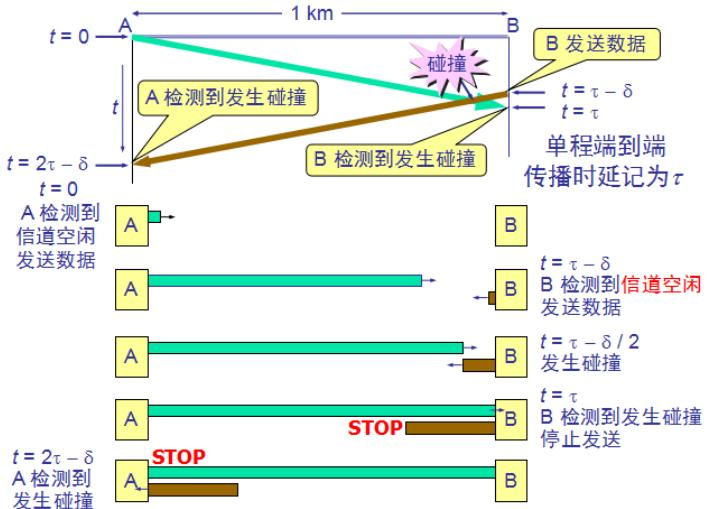

二进制指数类型退避算法：

发生碰撞的站在停止发送数据后，要推迟（退避）一个随机时间才能再发送数据。

① 确定基本退避时间，一般是取为争用期 $2\tau$。

② 定义重传次数 k，k <= 10，即 k = Min[重传次数, 10]

③ 从整数集合 $[0,1,\cdots,(2k-1)]$ 中随机地取出一个数，记为 r。重传所需的时延就是 r 倍的基本退避时间。

④ 当重传达 16 次仍不能成功时丢弃该帧，并向高层报告。

对于 10Mbit/s 的局域网，取 51.2μs 为争用期长度，在争用期内可发送 512bit 数据，即 64 字节。如果发生冲突，就一定是在发送的前 64 字节之内。

知识点：[CSMA/CD协议与以太网（争用期、最短帧长、MAC帧格式）](../../../topics/计算机网络/csmacd_ethernet.md)、[介质访问控制基础（信道共享、竞争系统与令牌机制）](../../../topics/计算机网络/mac_basics.md)、[局域网体系结构与IEEE 802标准（LLC与MAC子层）](../../../topics/计算机网络/lan_ieee802.md)

### 掌握一个有效的以太网帧的帧长范围（最长和最短帧长）

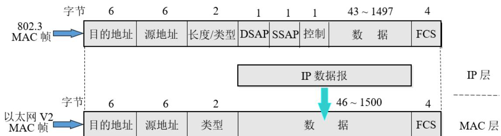

## 6. 掌握集线器和网桥工作的层次和特点、平均带宽的计算、冲突域和广播域的分割情况，掌握网桥转发帧的过程

集线器：物理层，拓展了冲突域，拓展了广播域，没有提高最大总吞吐量：

10M/s，10 台：每台 1M/s

网桥：数据链路层，分割了冲突域，拓展了广播域。

以太网交换机：相当于多端口网桥，没有过滤广播通信的功能

10M/s，10 台：每台 10M/s

网桥转发帧的过程：

例如：如图所示，6 个站点通过透明网桥 B1 和 B2 连接到一个扩展的局域网上。初始时网桥 B1 和 B2 的转发表都为空。假设需要传输的帧序列如下：H2 传输给 H1；H5 传输给 H4；H3 传输给 H5；H1 传输给 H2；H6 传输给 H5。请给出这些帧传输完后网桥 B1 和网桥 B2 的转发表。假设转发表表项的格式为：[站点，端口]。

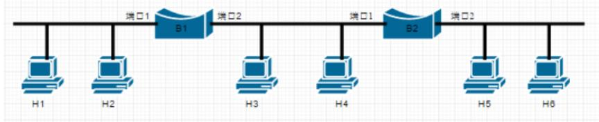

| 发送的帧 | B1 转发表 | B1 的处理 | B2 转发表 | B2 的处理 |
| --- | --- | --- | --- | --- |
| H2--->H1 | H2, 1 | 登记，转发 | H2, 1 | 登记，转发 |
| H5--->H4 | H5, 2 | 登记，转发 | H5, 2 | 登记，转发 |
| H3--->H5 | H3, 2 | 登记，丢弃 | H3, 1 | 登记，转发 |
| H1--->H2 | H1, 1 | 登记，丢弃 |  |  |
| H6--->H5 | H6, 2 | 登记，丢弃 |  |  |

路由器：网络层，防止广播风暴，每个端口都构成一个独立的广播域。

## 7. 理解 10BASE-T、10BASE-F、100BASE-T、100BASE-F 中 10、100、BASE、T、F 的含义

10：数据率为 10Mb/s

BASE：基带信号，采用曼彻斯特编码

T：双绞线

最长帧长：$6+6+2+1500+4=1518$ Byte

F：光纤

10BASE5：粗缆，每一段电缆线长 $500 \mathrm{~m}$

10BASE2：细缆，每一段电缆线长 $200 \mathrm{~m}$

## 8. 掌握以太帧的三种类型（单播、多播和广播），掌握以太网交换机转发帧的三种方式和特点

以太帧的三种类型：

单播帧（一对一），多播帧（一对多），广播帧（一对全体）

以太帧目的地址的三种类型：

单播地址，组播地址，广播地址

以太网交换机转发帧：

直通交换方式：不检查差错直接转发；时延最小；可能转发差错帧/碎片帧。

存储转发方式：传输延迟大，负荷增大时会引起阻塞现象。

无碎片交换方式：收到 64Byte 后再直通转发；可能会转发差错帧。

## 9. 理解广域网的概念，X.25、帧中继和 ATM 网络中都采用虚电路服务

广域网：用来实现长距离传输数据的网络，由节点交换机和链路构成。广域网中的节点交换机一般采用存储转发方式，链路一般采用点到点链路。

X.25、帧中继和 ATM 网络中都采用虚电路服务。

虚电路服务特点：需要建立连接，数据传输，连接释放的过程。建立在分组交换的基础上。

## 10. IEEE802 系列标准将局域网数据链路层分为两个子层

逻辑链路子层 LLC、媒体访问控制子层 MAC。

## 11. 用集线器/双绞线连接的局域网

物理上成星型拓扑，逻辑上为总线式拓扑。

## 第五章 网络层与网络互连、第六章 传输层

知识点：[CSMA/CD协议与以太网（争用期、最短帧长、MAC帧格式）](../../../topics/计算机网络/csmacd_ethernet.md)、[局域网的扩展与互连设备（集线器、网桥、交换机、冲突域与广播域）](../../../topics/计算机网络/lan_extension.md)

### 1. 会区分一个分类的 IP 地址的类型

| 类别 | 7 位 | 24 位 |
| --- | --- | --- |
| A 类 | 0 | 网络号（7 位）+ 主机号（24 位） |

| 类别 | 14 位 | 16 位 |
| --- | --- | --- |
| B 类 | 1 0 | 网络号（14 位）+ 主机号（16 位） |

| 类别 | 21 位 | 8 位 |
| --- | --- | --- |
| C 类 | 1 1 0 | 网络号（21 位）+ 主机号（8 位） |

| 类别 | 28 位 |
| --- | --- |
| D 类 | 1 1 1 0 + 多播组号（28 位） |

| 类别 | 27 位 |
| --- | --- |
| E 类 | 1 1 1 1 0 + （留待后用，27 位） |

图 1-5 五类互联网地址

| 类别 | 地址范围 | 最大网络数 | 最大主机数 | 私有 IP 范围 |
| --- | --- | --- | --- | --- |
| A | 0.0.0.0~127.255.255.255 | $126(2^7-2)$ | $256^3-2$ | 10.0.0.0~10.255.255.255 |
| B | 128.0.0.0~191.255.255.255 | $2^{14}$ | $256^2-2$ | 172.16.0.0~172.31.255.255 |
| C | 192.0.0.0~223.255.255.255 | $2^{21}$ | 256-2 | 192.168.0.0~192.168.255.255 |

知识点：[IPv4协议与数据报格式（分类IP地址、分片计算、首部字段）](../../../topics/计算机网络/ipv4_datagram.md)、[网络互连与IP转发（路由器转发过程、NAT、VPN、移动IP、组播）](../../../topics/计算机网络/network_interconnection.md)

### 2. 掌握 ARP 协议的作用及工作原理

ARP（地址解析协议）：实现从 IP 地址到 MAC 地址的动态映射。

原理：当主机 A 欲向本局域网上的某个主机 B 发送 IP 数据报时，就先在其 ARP 高速缓存表中查看有无主机 B 的 IP 地址。如有，就可查出其对应的硬件地址，如果没有，则广播发送一个 ARP 请求报文。

知识点：[ARP地址解析协议与ICMP控制报文](../../../topics/计算机网络/arp_icmp.md)

### 3. 会分析 IP 数据报的主要字段

1 Byte = 8 bit

知识点：[IPv4协议与数据报格式（分类IP地址、分片计算、首部字段）](../../../topics/计算机网络/ipv4_datagram.md)、[网络体系结构与协议（OSI/RM与TCP/IP模型、协议三要素）](../../../topics/计算机网络/architecture_protocols.md)、[网络互连与IP转发（路由器转发过程、NAT、VPN、移动IP、组播）](../../../topics/计算机网络/network_interconnection.md)

### 4. 掌握 IP 数据报分片原理与计算

除最后一个分片外，其余分片的数据部分的大小应该尽量接近但不超过网络 MTU 并且是 8 字节的整数倍，最后一个分片可以比其余分片小。

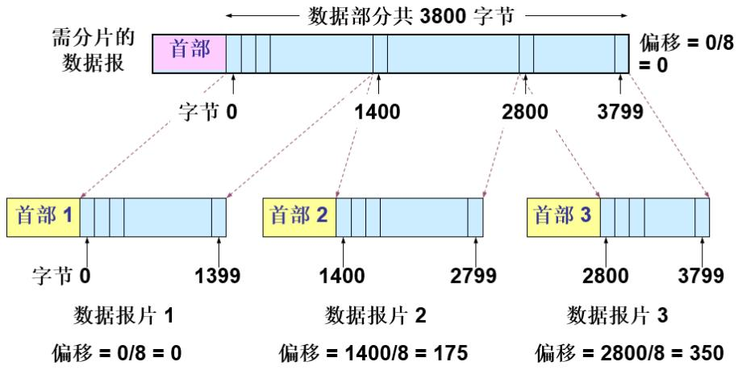

知识点：[IPv4协议与数据报格式（分类IP地址、分片计算、首部字段）](../../../topics/计算机网络/ipv4_datagram.md)、[子网划分与CIDR（子网掩码计算、路由聚合、最长前缀匹配）](../../../topics/计算机网络/subnet_cidr.md)、[计算机网络性能指标（速率、时延、吞吐量计算）](../../../topics/计算机网络/performance_metrics.md)

### 5. 掌握子网的划分和计算（会计算所用的子网掩码、每个子网的子网地址、每个子网容纳的主机数、每个子网最小的 IP 地址、最大的 IP 地址及广播地址）

子网掩码：对应的网络号均为 1，主机号均为 0

子网地址 = 子网掩码 AND IP 地址

广播地址：网络号不变，主机号全为 1 的 IP 地址。

一家集团公司有 12 家子公司，每家子公司又有 4 个部门。上级给出一个 172.16.0.0/16 的网段，让给每家子公司以及子公司的部门分配网段。

思路：既然有 12 家子公司，那么就要划分 12 个子网段，但是每家子公司又有 4 个部门，因此又要在每家子公司所属的网段中划分 4 个子网分配给各部门。

步骤：

A. 先划分各子公司的所属网段。

有 12 家子公司，那么就有 $2^{n} \geqslant 12, n \geqslant 4$。因此，网络位需要向主机位借 4 位。那么就可以从 172.16.0.0/16 这个大网段中划出 2 的 4 次方 = 16 个子网。

详细过程：

先将 172.16.0.0/16 用二进制表示

10101100.00010000.00000000.00000000/16

借 4 位后（可划分出 16 个子网）：

| 序号 | 二进制 | 网段 |
| --- | --- | --- |
| 1) | 10101100.00010000.0000 | 0000.00000000/20【172.16.0.0/20】 |
| 2) | 10101100.00010000.0001 | 0000.00000000/20【172.16.16.0/20】 |
| 3) | 10101100.00010000.0010 | 0000.00000000/20【172.16.32.0/20】 |
| 4) | 10101100.00010000.0011 | 0000.00000000/20【172.16.48.0/20】 |
| 5) | 10101100.00010000.0100 | 0000.00000000/20【172.16.64.0/20】 |
| 6) | 10101100.00010000.0101 | 0000.00000000/20【172.16.80.0/20】 |
| 7) | 10101100.00010000.0110 | 0000.00000000/20【172.16.96.0/20】 |
| 8) | 10101100.00010000.0111 | 0000.00000000/20【172.16.112.0/20】 |
| 9) | 10101100.00010000.1000 | 0000.00000000/20【172.16.128.0/20】 |
| 10) | 10101100.00010000.1001 | 0000.00000000/20【172.16.144.0/20】 |
| 11) | 10101100.00010000.1010 | 0000.00000000/20【172.16.160.0/20】 |
| 12) | 10101100.00010000.1011 | 0000.00000000/20【172.16.176.0/20】 |
| 13) | 10101100.00010000.1100 | 0000.00000000/20【172.16.192.0/20】 |
| 14) | 10101100.00010000.1101 | 0000.00000000/20【172.16.208.0/20】 |
| 15) | 10101100.00010000.1110 | 0000.00000000/20【172.16.224.0/20】 |
| 16) | 10101100.00010000.1111 | 0000.00000000/20【172.16.240.0/20】 |

我们从这 16 个子网中选择 12 个即可，就将前 12 个分给下面的各子公司。每个子公司最多容纳主机数目为 $2^{12}-2=4094$。（通常情况下全 0 全 1 的子网不分配）

B. 再划分子公司各部门的所属网段

以甲公司获得 172.16.0.0/20 为例，其他子公司的部门网段划分同甲公司。

有 4 个部门，那么就有 $2^n \geqslant 4$，$n \geqslant 2$。因此，网络位需要向主机位借 2 位。那么就可以从 172.16.0.0/20 这个网段中再划出 $2^2=4$ 个子网，正符合要求。

详细过程：

先将 172.16.0.0/20 用二进制表示

10101100.00010000.00000000.00000000/20

借 2 位后（可划分出 4 个子网）：

① 10101100.00010000.000000 00.00000000/22【172.16.0.0/22】

② 10101100.00010000.000001 00.00000000/22【172.16.4.0/22】

③ 10101100.00010000.000010 00.00000000/22【172.16.8.0/22】

④ 10101100.00010000.000011 00.00000000/22【172.16.12.0/22】

将这 4 个网段分给甲公司的 4 个部门即可。每个部门最多容纳主机数目为 2 的 10 次方 -2=1024。

知识点：[子网划分与CIDR（子网掩码计算、路由聚合、最长前缀匹配）](../../../topics/计算机网络/subnet_cidr.md)、[IPv4协议与数据报格式（分类IP地址、分片计算、首部字段）](../../../topics/计算机网络/ipv4_datagram.md)

### 6. 掌握路由器工作的层次和根据目的 IP 地址进行转发数据报的过程

路由器工作在网络层，可以抑制网络风暴。

提取目的站 IP 地址与路由表中的表项进行匹配，来决定把数据报发往何处。

路由表表项：(子网掩码, 目的网络地址, 下一跳地址)

知识点：[网络互连与IP转发（路由器转发过程、NAT、VPN、移动IP、组播）](../../../topics/计算机网络/network_interconnection.md)、[子网划分与CIDR（子网掩码计算、路由聚合、最长前缀匹配）](../../../topics/计算机网络/subnet_cidr.md)、[互联网路由选择协议（RIP距离向量、OSPF链路状态、BGP）](../../../topics/计算机网络/routing_protocols.md)

### 7. 掌握 CIDR 地址块中地址个数的计算，掌握路由的汇聚，路由最长前缀匹配

地址个数：x.y.z.w/N 中，地址有 $2^{32-N}$ 个

路由汇聚：

某企业分配给产品部的 IP 地址块为 192.168.31.192/26，分配给市场部的 IP 地址块为 192.168.31.160/27，分配给财务部的 IP 地址块为 192.168.31.128/27，那么这三个地址块经过聚合后的地址为（ ）

A、192.168.31.0/25　B、192.168.31.0/26　C、192.168.31.128/25　D、192.168.31.128/26

此例三个 IP 聚合：

192.168.31.192

192.168.31.160

192.168.31.128

比较，相同的部分均为 192.168.31，总共 24 位相同，最后一组换成二进制再比较：

192.168.31.11000000

192.168.31.10100000

192.168.31.10000000

比较得出，总共 25 位相同，那么，聚合后的 IP（网络前缀）就为 192.168.31.10000000，将 10000000 转为十进制为 128，聚合后的 IP 就是 192.168.31.128。可直接写成 192.168.31.128/25。

因为有 25 位相同，也以，子网掩码网络号就是 25 位，主机号剩下 7 位，网络号全为 1，主机号全为 0，即 11111111.11111111.11111111.10000000，转换为十进制，255.255.255.128。

所以，本题选 C。

最长前缀匹配：路由器查找路由表时，即使找到了一个匹配表项，查找还不能结束，必须查找完所有的项，在所有的匹配表项中再选择具有最长前缀的路由表项。

## 第4章 网络层（续）

知识点：[子网划分与CIDR（子网掩码计算、路由聚合、最长前缀匹配）](../../../topics/计算机网络/subnet_cidr.md)

### 最长前缀匹配举例

收到的分组的目的地址 D = 206.0.71.130

路由表中的项目：

① 206.0.68.0/22

② 206.0.71.128/25

解：

D & 255.255.252.0 = 206.0.68.0，与①匹配

D & 255.255.255.128 = 206.0.71.128，与②匹配

选择两个匹配的地址中更具体的一个，即选择具有最长网络前缀的路由。

知识点：[子网划分与CIDR（子网掩码计算、路由聚合、最长前缀匹配）](../../../topics/计算机网络/subnet_cidr.md)、[IPv4协议与数据报格式（分类IP地址、分片计算、首部字段）](../../../topics/计算机网络/ipv4_datagram.md)、[网络互连与IP转发（路由器转发过程、NAT、VPN、移动IP、组播）](../../../topics/计算机网络/network_interconnection.md)

### 8. 掌握 ICMP 的原理及其应用

ICMP：因特网控制报文协议，网络层，是 IP 的重要组成部分。

两大类：

- 差错报告报文：目的不可达报文、超时报文、源抑制报文（拥塞/无缓存）
- 提供信息的报文：回应请求与应答报文（ping）

知识点：[ARP地址解析协议与ICMP控制报文](../../../topics/计算机网络/arp_icmp.md)、[IPv4协议与数据报格式（分类IP地址、分片计算、首部字段）](../../../topics/计算机网络/ipv4_datagram.md)

### 9. 掌握 RIP 和 OSPF 的基本概念（包括使用的算法名称、动态路由更新算法）

RIP（路由信息协议）：使用距离向量算法，应用层。

OSPF（开放最短路径优先）：使用链路状态算法，网络层。

知识点：[互联网路由选择协议（RIP距离向量、OSPF链路状态、BGP）](../../../topics/计算机网络/routing_protocols.md)、[网络体系结构与协议（OSI/RM与TCP/IP模型、协议三要素）](../../../topics/计算机网络/architecture_protocols.md)

### 10. 掌握实现 VPN 用到的技术（隧道技术和加密技术），以及 NAT 的作用

VPN（虚拟专用网）的实现主要使用了两种基本技术：隧道传输和加密技术。

NAT（网络地址转换）作用：将专用 IP 地址的域和因特网连通。

知识点：[虚拟专用网与高层安全（隧道协议、IPSec、SSL/TLS）](../../../topics/计算机网络/vpn_high_layer_security.md)、[网络互连与IP转发（路由器转发过程、NAT、VPN、移动IP、组播）](../../../topics/计算机网络/network_interconnection.md)、[密码学与数据加密技术（对称与非对称密钥、数字签名、报文摘要）](../../../topics/计算机网络/cryptography_encryption.md)

### 11. 掌握 UDP 和 TCP 的特点

UDP：无连接；提供不可靠的服务；点到点和多点通信；面向报文。

TCP：面向连接；提供可靠服务；只能进行点到点通信；面向字节流。

知识点：[UDP协议（无连接特性、报文段格式、伪首部校验和计算）](../../../topics/计算机网络/udp_protocol.md)、[传输层服务与端口（复用与分用、五元组、熟知端口）](../../../topics/计算机网络/transport_services_ports.md)、[TCP连接管理与可靠传输（三次握手、四次挥手、序号确认、RTT与RTO）](../../../topics/计算机网络/tcp_connection_reliability.md)

### 12. 掌握如何通过三次握手建立 TCP 的连接

三次握手建立连接：

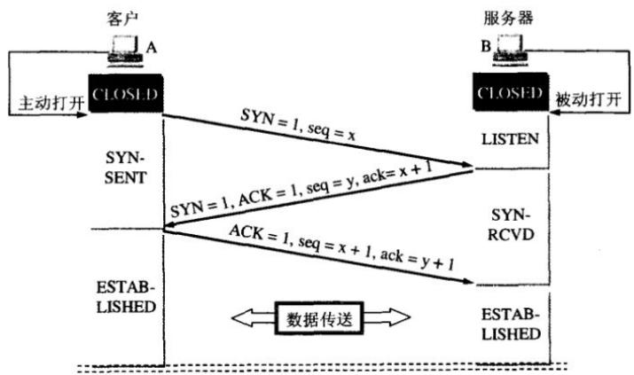

四次握手释放连接：

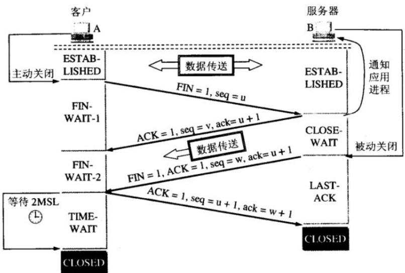

知识点：[TCP连接管理与可靠传输（三次握手、四次挥手、序号确认、RTT与RTO）](../../../topics/计算机网络/tcp_connection_reliability.md)

### 13. 掌握 TCP 流量控制过程，发送窗口的取值和拥塞窗口、对方的接收窗口之间的关系

拥塞窗口 cwnd，接收窗口 rwnd。

发送窗口的取值：Min(rwnd, cwnd)

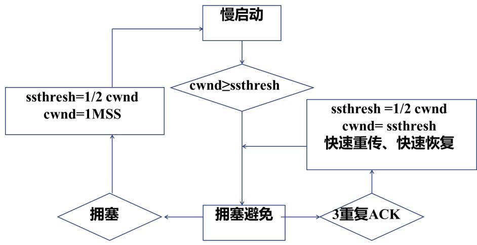

例：主机甲和乙已建立了 TCP 连接，甲始终以 MSS=1KB 大小的段发送数据，并一直有数据发送，乙每收到一个数据段都会发出接收窗口（rwnd）为 6KB 确认段。若甲在 t=0 时刻发生超时时拥塞窗口（cwnd）为 8KB。从 t=0 时刻起，经过 3 个 RTT 后，不再发生超时情况下，求主机甲的发送窗口。

解：t=0 时刻发生超时时拥塞窗口（cwnd）为 8KB，所以在下一个时刻 t=1RTT，此时的拥塞窗口 cwnd 减半变为 4KB，然后进入慢启动算法 MSS=1KB 开始，2KB（t=2RTT），4KB（t=3RTT），经过 3 个 RTT 后，因为要执行拥塞避免算法，则拥塞窗口为 5KB，发送窗口为 Min[rwnd, cwnd] = Min[6KB, 5KB] = 5KB。

慢启动：指数方式增大 cwnd

拥塞避免：线性增大 cwnd

## 第七章 应用层、第八章 网络管理与网络安全

知识点：[TCP流量控制与拥塞控制（滑动窗口、慢开始、拥塞避免、快重传与快恢复）](../../../topics/计算机网络/tcp_flow_congestion.md)、[流量控制与可靠传输（停止等待、连续ARQ、选择ARQ及窗口尺寸）](../../../topics/计算机网络/flow_control.md)

### 1. 掌握域名系统的作用

实现域名到 IP 系统的解析。

知识点：[域名系统DNS（层次名字空间、递归与迭代查询解析）](../../../topics/计算机网络/dns.md)

### 2. 理解 FTP 应用的两个连接名称及其各自的作用

控制连接：端口号 21，传输请求。

数据连接：端口号 20，实际用于传输文件。

知识点：[文件传送与远程登录（FTP双连接机制、TFTP、Telnet）](../../../topics/计算机网络/ftp_telnet.md)

### 3. 掌握 DHCP 的全称和作用，一台计算机访问因特网需要配置的四个项目

全称：Dynamic Host Configuration Protocol，动态主机配置协议。

作用：允许一台计算机加入新网可自动获取 IP 地址，不用人工参与。

访问互联网需要配置的四个项目：

- IP 地址
- 子网掩码
- 默认网关 IP 地址
- DNS 服务器 IP 地址

知识点：[动态主机配置协议DHCP（工作原理、中继代理）](../../../topics/计算机网络/dhcp.md)、[子网划分与CIDR（子网掩码计算、路由聚合、最长前缀匹配）](../../../topics/计算机网络/subnet_cidr.md)、[域名系统DNS（层次名字空间、递归与迭代查询解析）](../../../topics/计算机网络/dns.md)

### 4. 理解发送电子邮件的过程，掌握其中使用的应用层协议（SMTP、MIME 和 POP3）名称

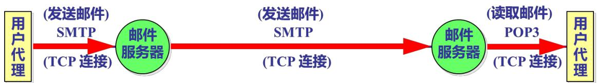

过程：

(1) 发信人调用用户代理来编辑要发送的邮件。用户代理用 SMTP 把邮件传送给发送端邮件服务器。

(2) 发送端邮件服务器将邮件放入邮件缓存队列中，等待发送。

(3) 运行在发送端邮件服务器的 SMTP 客户进程，发现在邮件缓存中有待发送的邮件，就向运行在接收端邮件服务器的 SMTP 服务器进程发起 TCP 连接的建立。

(4) TCP 连接建立后，SMTP 客户进程开始向远程的 SMTP 服务器进程发送邮件。当所有的待发送邮件发完了，SMTP 就关闭所建立的 TCP 连接。

(5) 运行在接收端邮件服务器中的 SMTP 服务器进程收到邮件后，将邮件放入收信人的用户邮箱中，等待收信人在方便时进行读取。

(6) 收信人在打算收信时，调用用户代理，使用 POP3（或 IMAP）协议将自己的邮件从接收端邮件服务器的用户邮箱中的取回（如果邮箱中有来信的话）。

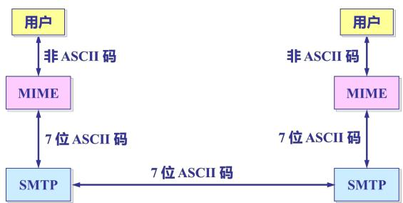

知识点：[电子邮件系统（SMTP、POP3、IMAP、MIME）](../../../topics/计算机网络/email_protocols.md)

### 5. 了解 WWW 和 HTTP、URL 的基本概念

WWW：端口 80。

HTTP：超文本传输协议，应用层，使用 TCP 连接为分布式超媒体信息系统提供可靠传输。

URL：统一资源定位符，用来标志万维网上的各种文档。

知识点：[万维网与HTTP协议（URL、请求与响应报文、Web缓存）](../../../topics/计算机网络/www_http.md)

### 6. 会解析传输层、网络层、数据链路层的协议报文

根据附录。

知识点：[传输层服务与端口（复用与分用、五元组、熟知端口）](../../../topics/计算机网络/transport_services_ports.md)、[IPv4协议与数据报格式（分类IP地址、分片计算、首部字段）](../../../topics/计算机网络/ipv4_datagram.md)、[数据链路层功能与透明传输（HDLC、PPP协议）](../../../topics/计算机网络/dll_functions.md)

### 7. 掌握网络管理的五大功能

配置管理、性能管理、故障管理、计费管理、安全管理。

知识点：[网络管理功能与SNMP协议（FCAPS五大功能、MIB、ASN.1）](../../../topics/计算机网络/network_management_snmp.md)
