# 《计算机通信与网络》第1章 概论（课件）

原件的每一页，下面附识别出的文字。

### 南京邮电大学通信与信息工程学院

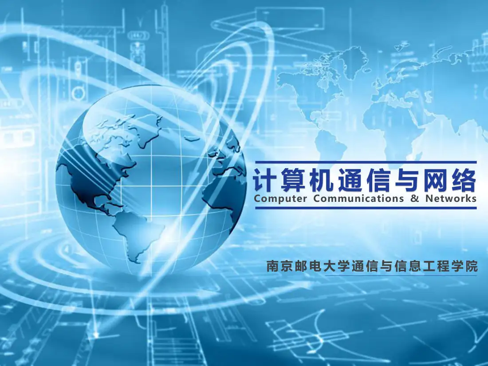

原文：

计算机通信与网络 Computer Communications & Networks

南京邮电大学通信与信息工程学院

### 联系方式

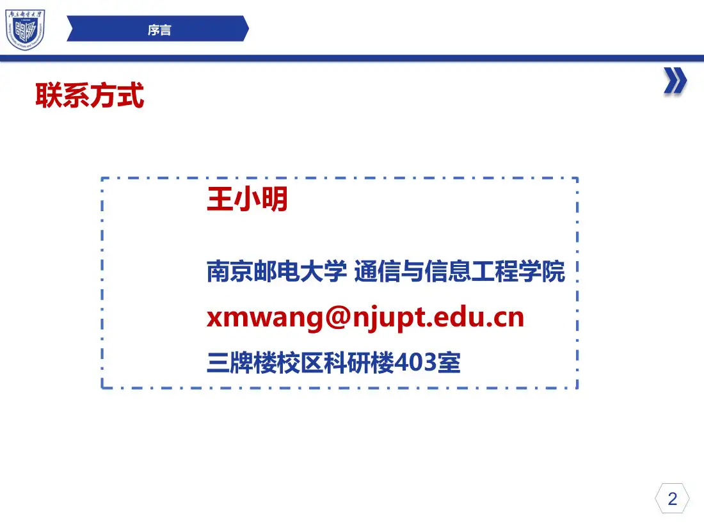

原文：

联系方式

王小明

南京邮电大学 通信与信息工程学院

xmwang@njupt.edu.cn

三牌楼校区科研楼403室

南志執電大學Nanjing Ue ofPo

序言

2

### 课程与考核

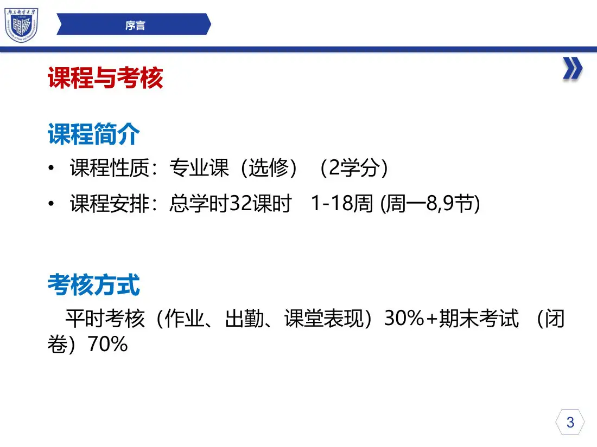

原文：

课程与考核

课程简介

• 课程性质：专业课（选修）（2学分）

• 课程安排：总学时32课时 1-18周 (周一8,9节)

考核方式

平时考核（作业、出勤、课堂表现）30%+期末考试 （闭卷）70%

南志郵電大學

序言

3

### 教材

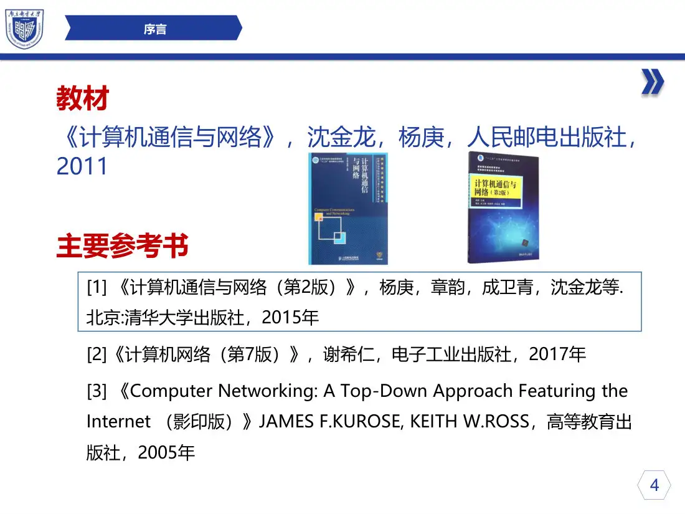

原文：

教材

《计算机通信与网络》，沈金龙，杨庚，人民邮电出版社，

2011

主要参考书

[1] 《计算机通信与网络（第2版）》，杨庚，章韵，成卫青，沈金龙等.北京:清华大学出版社，2015年

[2]《计算机网络（第7版）》，谢希仁，电子工业出版社，2017年

[3] 《Computer Networking: A Top-Down Approach Featuring theInternet （影印版）》JAMES F.KUROSE, KEITH W.ROSS，高等教育出版社，2005年

南志郵電大學Nanjing Une

序言

》

4

### 第 1 章 概 论

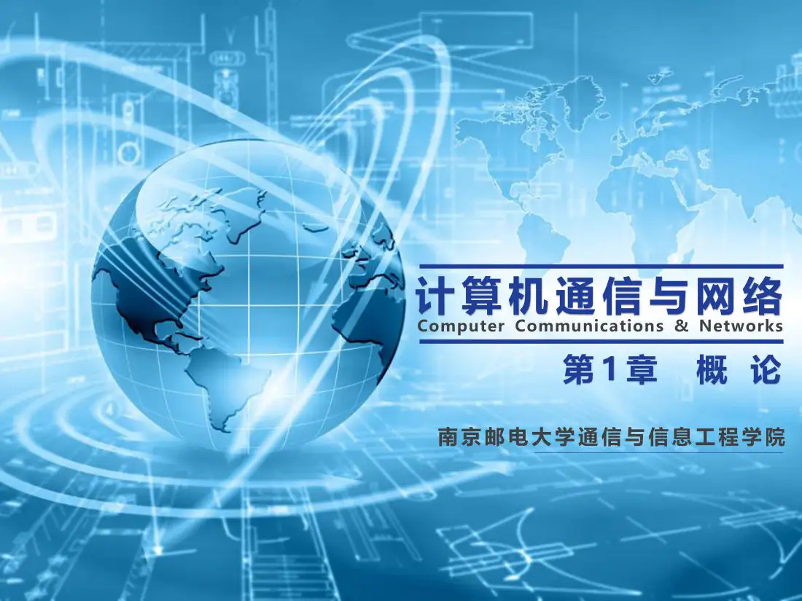

原文：

计算机通信与网络 Computer Communications & Networks

第 1 章 概 论

南京邮电大学通信与信息工程学院

### 大纲要求R e q u i r e m e n t s

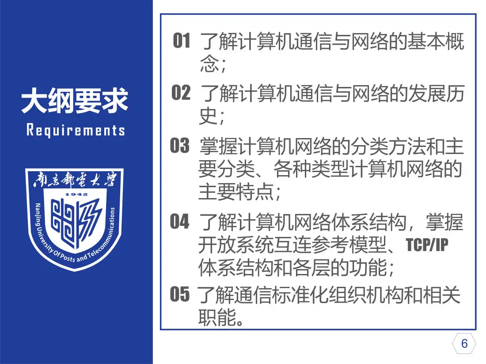

原文：

大纲要求R e q u i r e m e n t s

01 了解计算机通信与网络的基本概念；

02 了解计算机通信与网络的发展历史；

03 掌握计算机网络的分类方法和主要分类、各种类型计算机网络的主要特点；

04 了解计算机网络体系结构，掌握开放系统互连参考模型、TCP/IP体系结构和各层的功能；

05 了解通信标准化组织机构和相关职能。

6

### 01 计算机通信与网络的发展过程

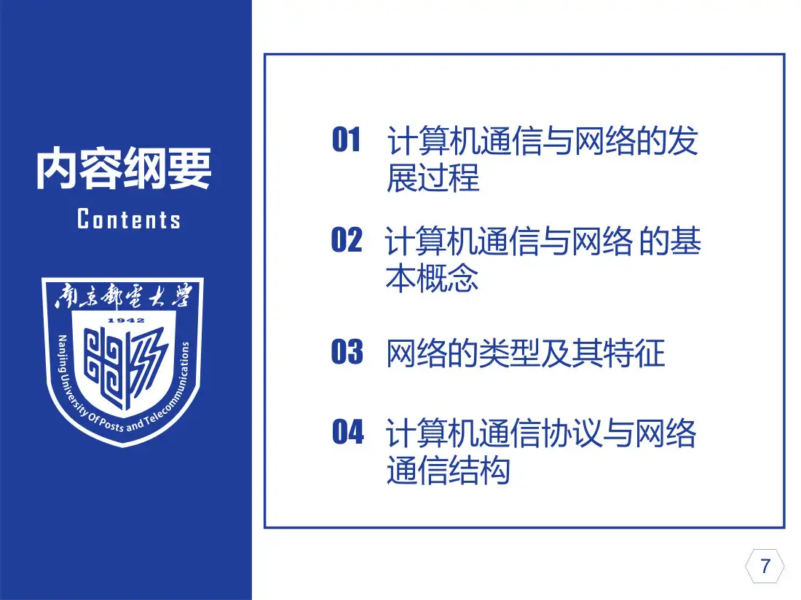

原文：

01 计算机通信与网络的发展过程  
02 计算机通信与网络的基本概念  
03 网络的类型及其特征  
04 计算机通信协议与网络通信结构

内容纲要C o n t e n t s

7

### 主要发展阶段

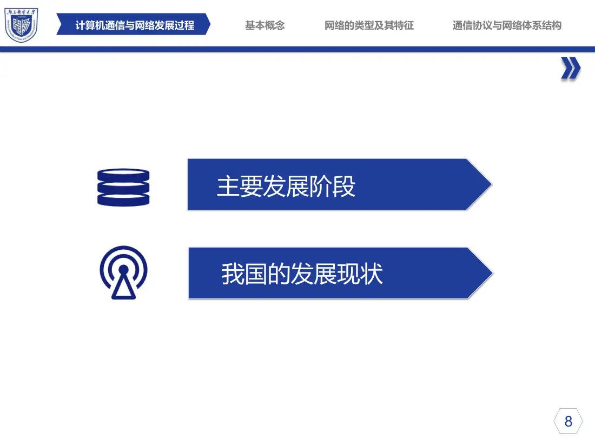

原文：

主要发展阶段

我国的发展现状

南志郵電大學

计算机通信与网络发展过程

基本概念

网络的类型及其特征

通信协议与网络体系结构

》

8

### 发展过程

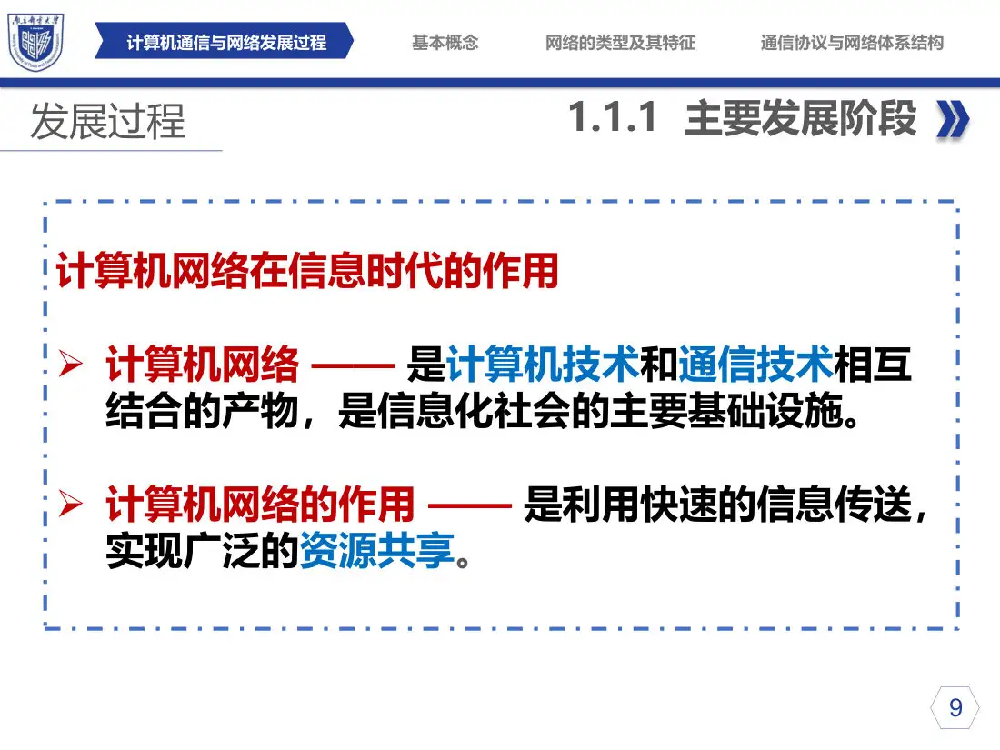

原文：

发展过程

1.1.1 主要发展阶段

计算机网络在信息时代的作用

计算机网络 —— 是计算机技术和通信技术相互结合的产物，是信息化社会的主要基础设施。

计算机网络的作用 —— 是利用快速的信息传送，实现广泛的资源共享。

南志郵電大學Nanjing Un

计算机通信与网络发展过程

基本概念

网络的类型及其特征

通信协议与网络体系结构

9

### 发展过程

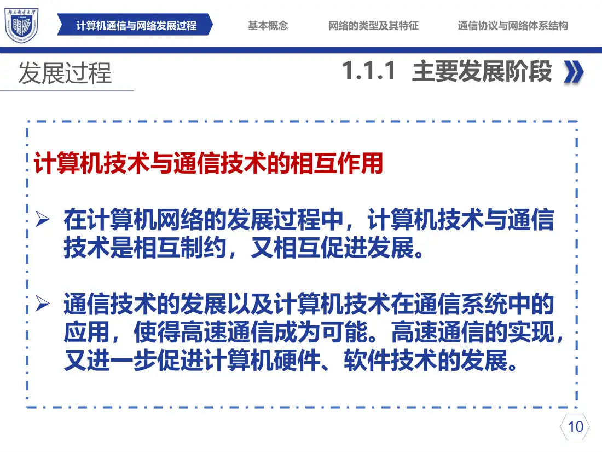

原文：

发展过程

1.1.1 主要发展阶段

计算机技术与通信技术的相互作用

在计算机网络的发展过程中，计算机技术与通信技术是相互制约，又相互促进发展。

通信技术的发展以及计算机技术在通信系统中的应用，使得高速通信成为可能。高速通信的实现，又进一步促进计算机硬件、软件技术的发展。

南志郵電大學Nanjing Un

计算机通信与网络发展过程

基本概念

网络的类型及其特征

通信协议与网络体系结构

10

### 发展过程

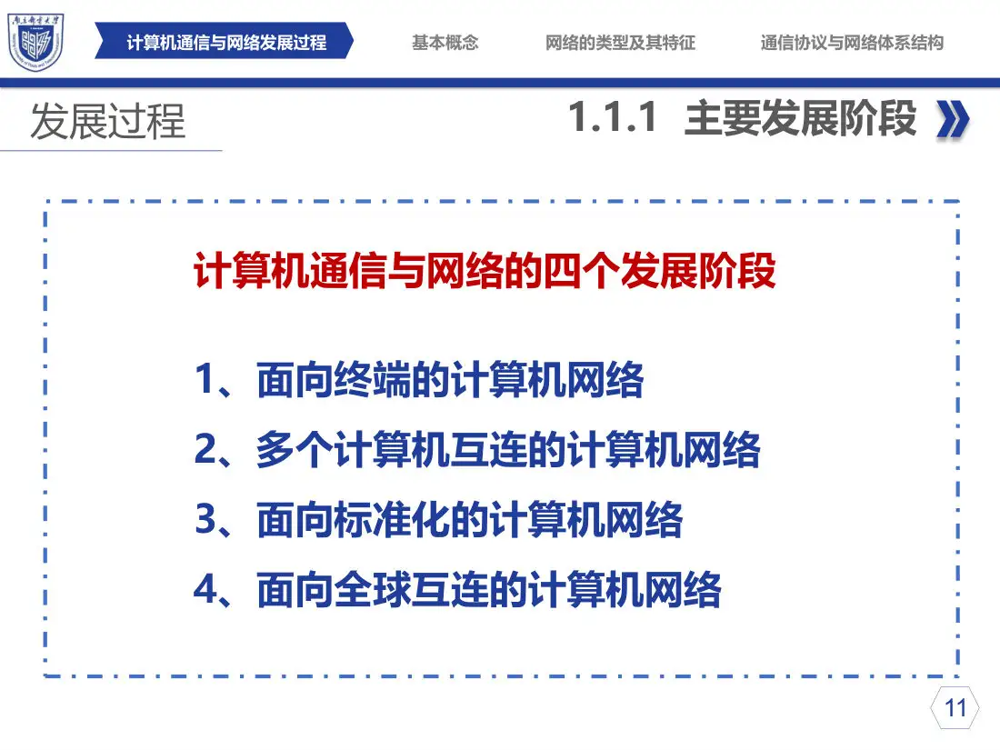

原文：

发展过程

1.1.1 主要发展阶段

计算机通信与网络的四个发展阶段

1、面向终端的计算机网络

2、多个计算机互连的计算机网络

3、面向标准化的计算机网络

4、面向全球互连的计算机网络

南志郵電大學Nanjing Un

计算机通信与网络发展过程

基本概念

网络的类型及其特征

通信协议与网络体系结构

11

### 发展过程

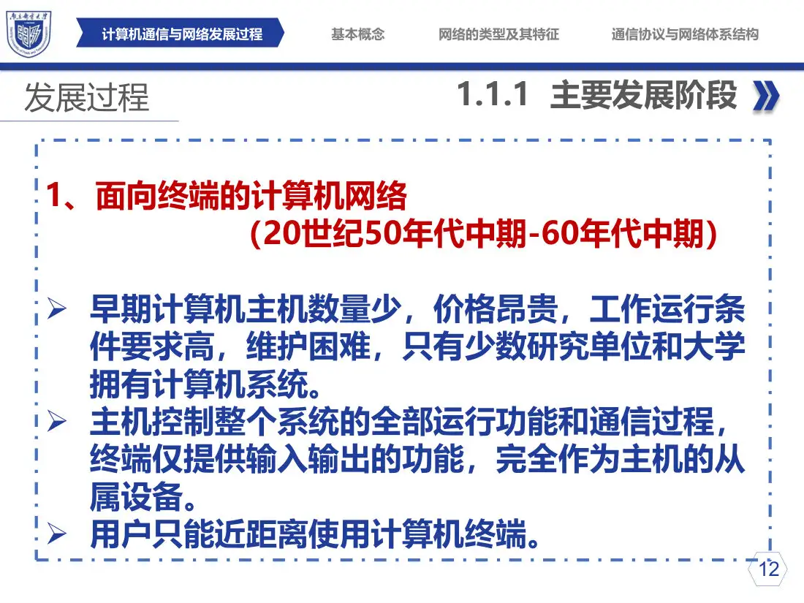

原文：

发展过程

1.1.1 主要发展阶段

1、面向终端的计算机网络（20世纪50年代中期-60年代中期）

早期计算机主机数量少，价格昂贵，工作运行条件要求高，维护困难，只有少数研究单位和大学拥有计算机系统。

主机控制整个系统的全部运行功能和通信过程，终端仅提供输入输出的功能，完全作为主机的从属设备。

➢ 用户只能近距离使用计算机终端。

南志郵電大學Nanjing Un

计算机通信与网络发展过程

基本概念

网络的类型及其特征

通信协议与网络体系结构

12

### 发展过程

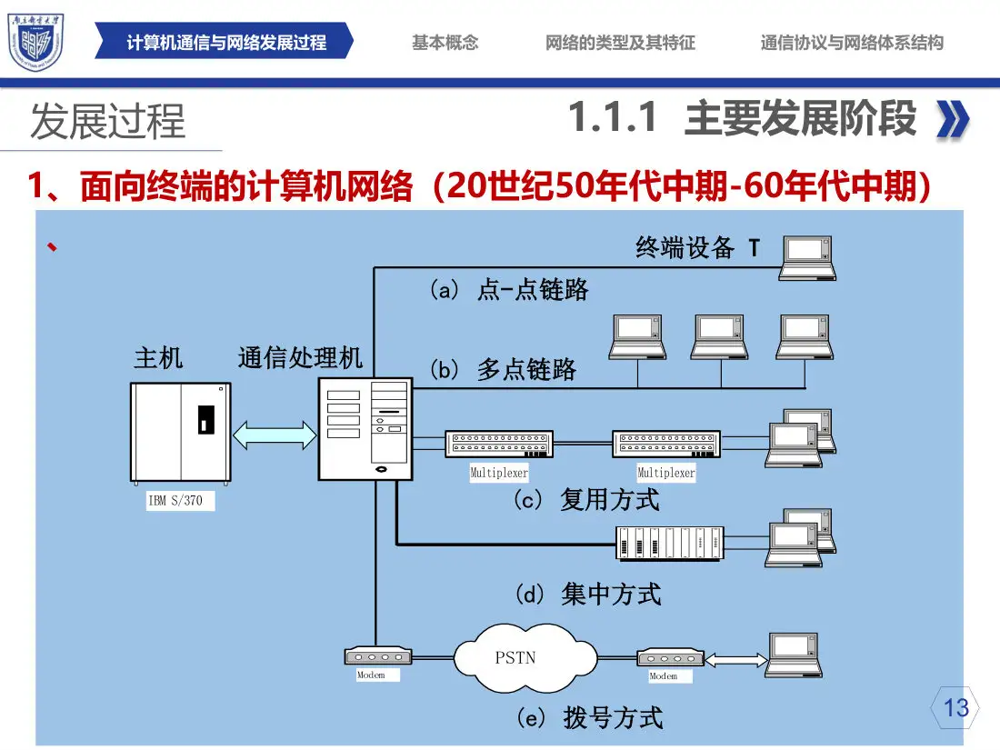

原文：

发展过程

1.1.1 主要发展阶段

1、面向终端的计算机网络（20世纪50年代中期-60年代中期）

(e) 拨号方式

南志郵電大學Nanjing Un

计算机通信与网络发展过程

基本概念

网络的类型及其特征

通信协议与网络体系结构

13

### 发展过程

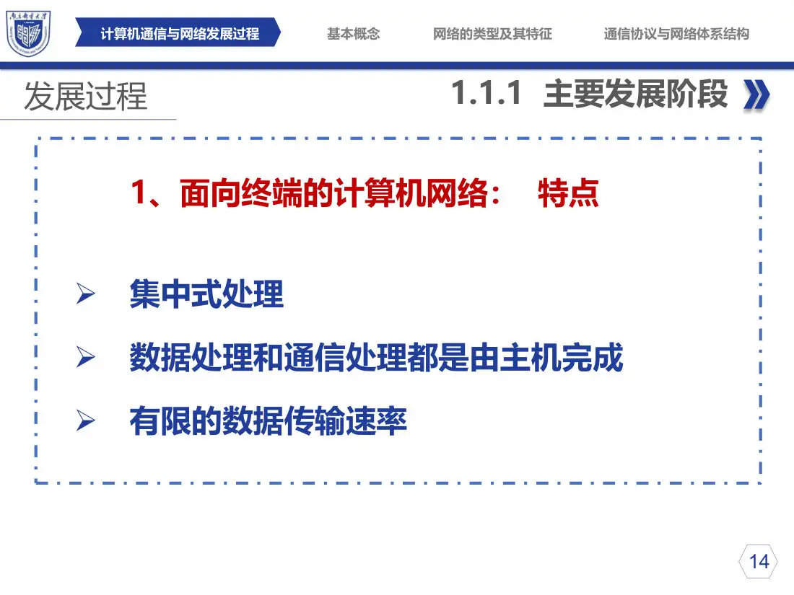

原文：

发展过程

1.1.1 主要发展阶段

1、面向终端的计算机网络： 特点

集中式处理

➢ 数据处理和通信处理都是由主机完成

有限的数据传输速率

南志郵電大學Nanjing Un

计算机通信与网络发展过程

基本概念

网络的类型及其特征

通信协议与网络体系结构

14

### 发展过程

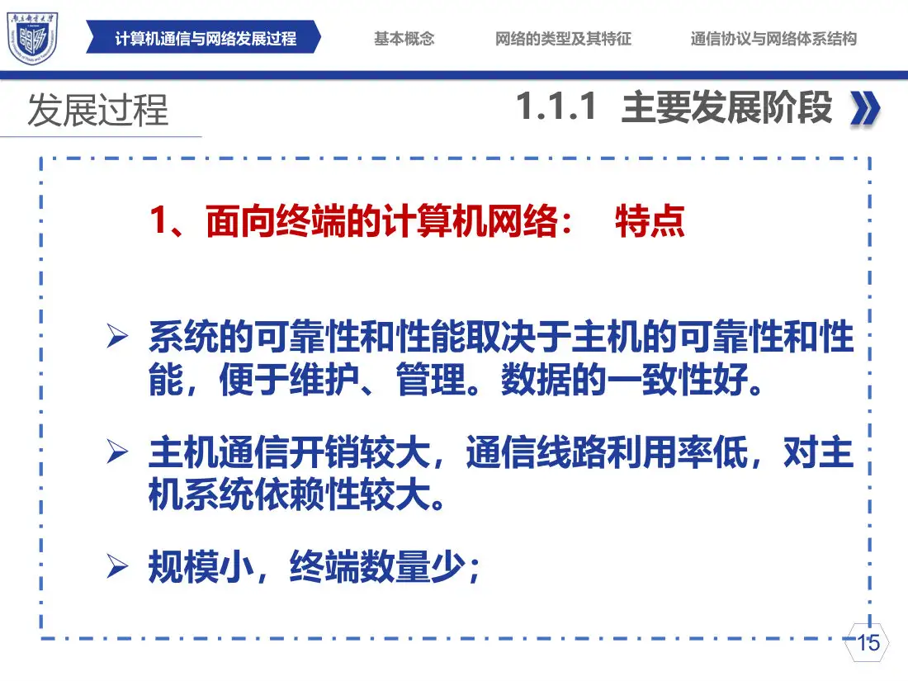

原文：

发展过程

1.1.1 主要发展阶段

1、面向终端的计算机网络： 特点

➢ 系统的可靠性和性能取决于主机的可靠性和性能，便于维护、管理。数据的一致性好。

➢ 主机通信开销较大，通信线路利用率低，对主机系统依赖性较大。

规模小，终端数量少；

南志郵電大學Nanjing Un

计算机通信与网络发展过程

基本概念

网络的类型及其特征

通信协议与网络体系结构

15

### 发展过程

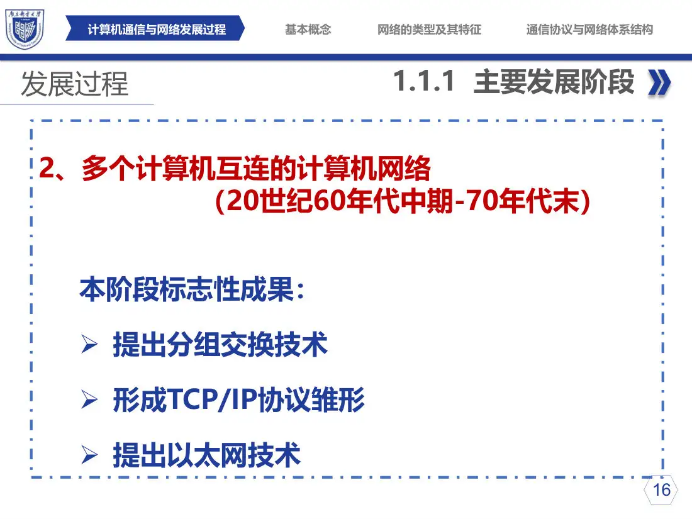

原文：

发展过程

1.1.1 主要发展阶段

2、多个计算机互连的计算机网络（20世纪60年代中期-70年代末）

本阶段标志性成果：

提出分组交换技术

形成TCP/IP协议雏形

提出以太网技术

南志郵電大學Nanjing Un

计算机通信与网络发展过程

基本概念

网络的类型及其特征

通信协议与网络体系结构

16

### 发展过程

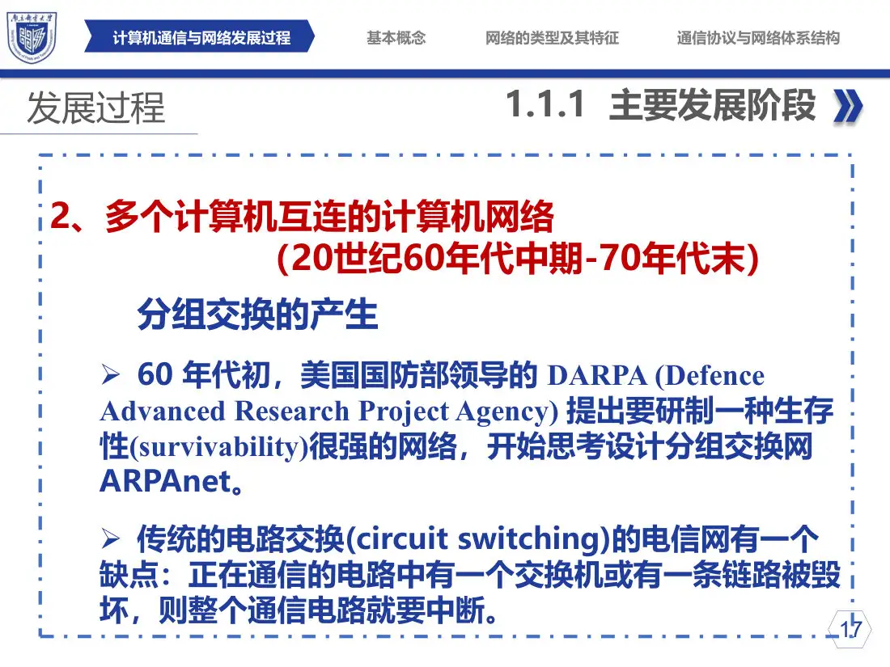

原文：

发展过程

1.1.1 主要发展阶段

2、多个计算机互连的计算机网络（20世纪60年代中期-70年代末）

分组交换的产生

➢ 60 年代初，美国国防部领导的 DARPA (DefenceAdvanced Research Project Agency) 提出要研制一种生存性(survivability)很强的网络，开始思考设计分组交换网ARPAnet。

➢ 传统的电路交换(circuit switching)的电信网有一个缺点：正在通信的电路中有一个交换机或有一条链路被毁坏，则整个通信电路就要中断。

南志郵電大學Nanjing Un

计算机通信与网络发展过程

基本概念

网络的类型及其特征

通信协议与网络体系结构

### 发展过程

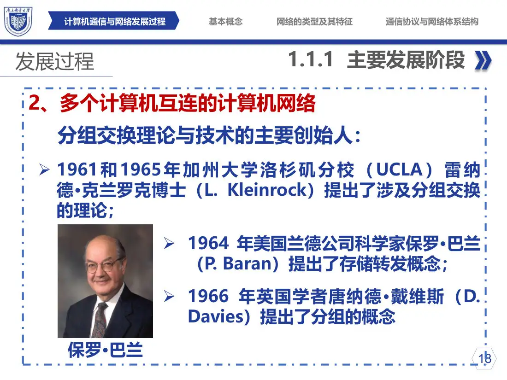

原文：

发展过程

1.1.1 主要发展阶段

2、多个计算机互连的计算机网络

分组交换理论与技术的主要创始人：

➢ 1961和1965年加州大学洛杉矶分校（UCLA）雷纳德·克兰罗克博士（L. Kleinrock）提出了涉及分组交换的理论；

1964 年美国兰德公司科学家保罗·巴兰（P. Baran）提出了存储转发概念；

1966 年英国学者唐纳德·戴维斯（D.Davies）提出了分组的概念

南志郵電大學Nanjing Un

计算机通信与网络发展过程

基本概念

网络的类型及其特征

通信协议与网络体系结构

18

### 发展过程

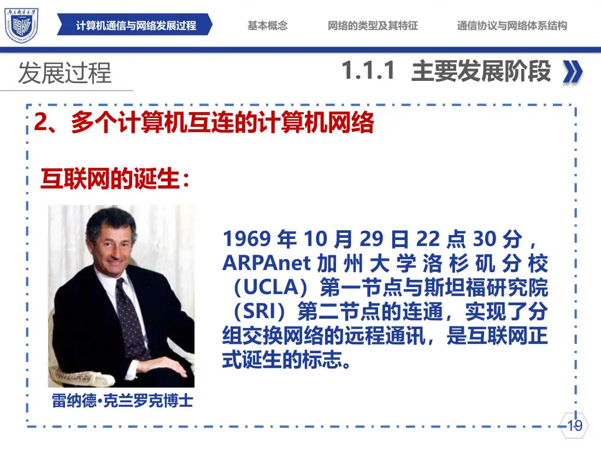

原文：

发展过程

1.1.1 主要发展阶段

2、多个计算机互连的计算机网络

互联网的诞生：

1969 年 10 月 29 日 22 点 30 分 ，ARPAnet 加 州 大 学 洛 杉 矶 分 校（UCLA）第一节点与斯坦福研究院（SRI）第二节点的连通，实现了分组交换网络的远程通讯，是互联网正式诞生的标志。

南志郵電大學Nanjing Un

计算机通信与网络发展过程

基本概念

网络的类型及其特征

通信协议与网络体系结构

19

### 发展过程

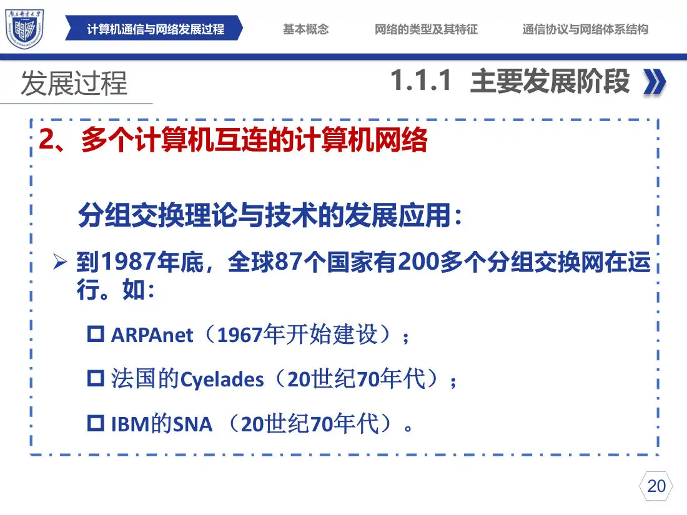

原文：

发展过程

1.1.1 主要发展阶段

2、多个计算机互连的计算机网络

分组交换理论与技术的发展应用：

➢ 到1987年底，全球87个国家有200多个分组交换网在运行。如：

 ARPAnet（1967年开始建设）；

 法国的Cyelades（20世纪70年代）；

 IBM的SNA （20世纪70年代）。

南志郵電大學Nanjing Un

计算机通信与网络发展过程

基本概念

网络的类型及其特征

通信协议与网络体系结构

20

### 发展过程

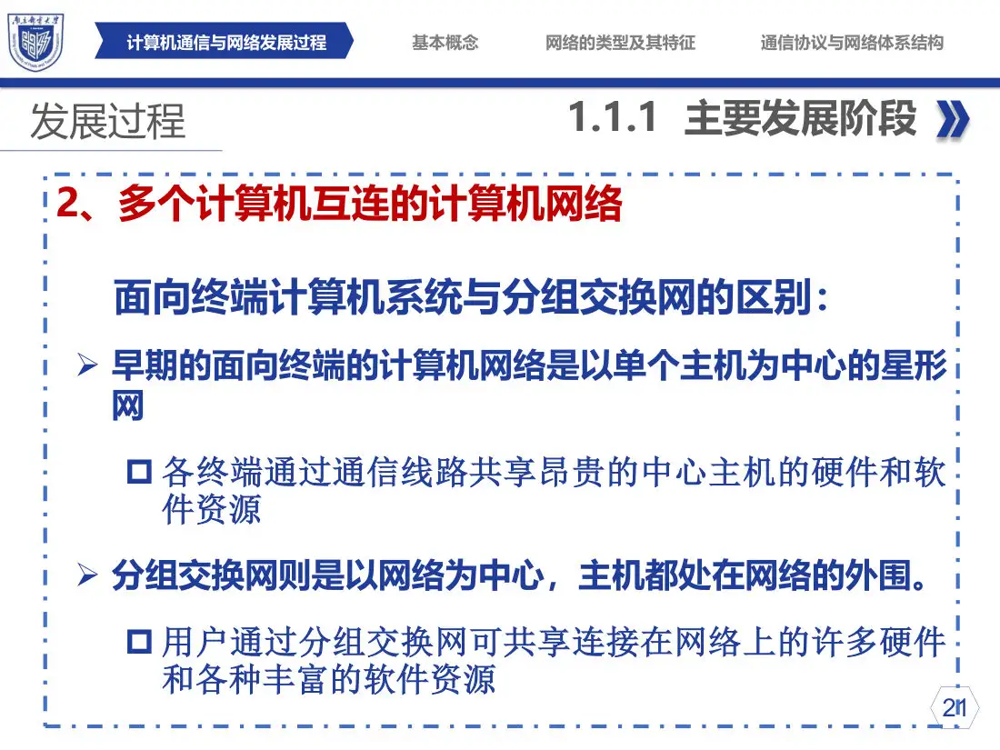

原文：

发展过程

1.1.1 主要发展阶段

2、多个计算机互连的计算机网络

面向终端计算机系统与分组交换网的区别：

➢ 早期的面向终端的计算机网络是以单个主机为中心的星形网

各终端通过通信线路共享昂贵的中心主机的硬件和软件资源

➢ 分组交换网则是以网络为中心，主机都处在网络的外围。

用户通过分组交换网可共享连接在网络上的许多硬件和各种丰富的软件资源

南志郵電大學Nanjing Un

计算机通信与网络发展过程

基本概念

网络的类型及其特征

通信协议与网络体系结构

21

### 发展过程

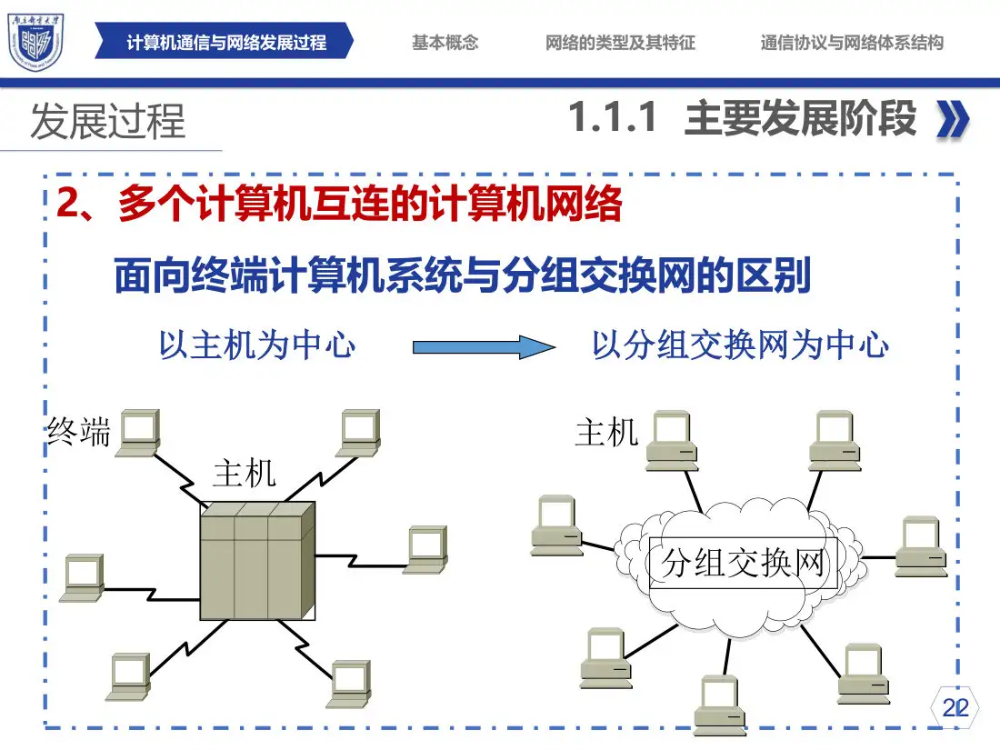

原文：

发展过程

1.1.1 主要发展阶段

2、多个计算机互连的计算机网络

面向终端计算机系统与分组交换网的区别

以主机为中心

以分组交换网为中心

南立郵電大學

计算机通信与网络发展过程

基本概念

网络的类型及其特征

通信协议与网络体系结构

22

### 发展过程

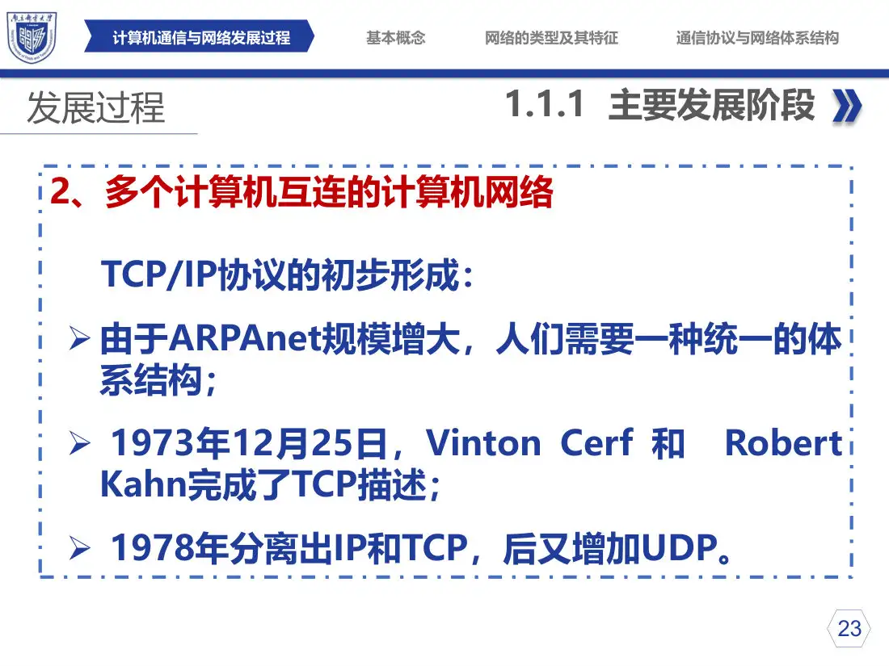

原文：

发展过程

1.1.1 主要发展阶段

2、多个计算机互连的计算机网络

TCP/IP协议的初步形成：

➢由于ARPAnet规模增大，人们需要一种统一的体系结构；

➢ 1973年12月25日，Vinton Cerf 和 RobertKahn完成了TCP描述；

➢ 1978年分离出IP和TCP，后又增加UDP。

南志郵電大學Nanjing Un

计算机通信与网络发展过程

基本概念

网络的类型及其特征

通信协议与网络体系结构

23

### 发展过程

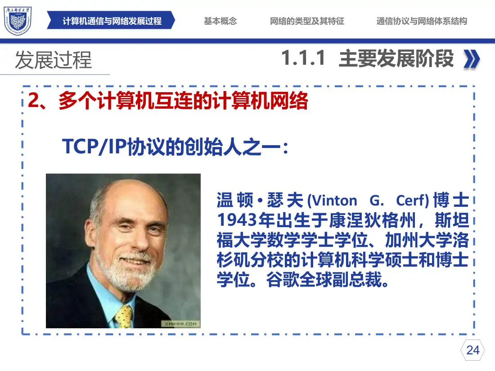

原文：

发展过程

1.1.1 主要发展阶段

2、多个计算机互连的计算机网络

TCP/IP协议的创始人之一：

温 顿 · 瑟 夫 (Vinton G. Cerf) 博 士1943年出生于康涅狄格州，斯坦福大学数学学士学位、加州大学洛杉矶分校的计算机科学硕士和博士学位。谷歌全球副总裁。

南志郵電大學Nanjing Un

计算机通信与网络发展过程

基本概念

网络的类型及其特征

通信协议与网络体系结构

24

### 发展过程

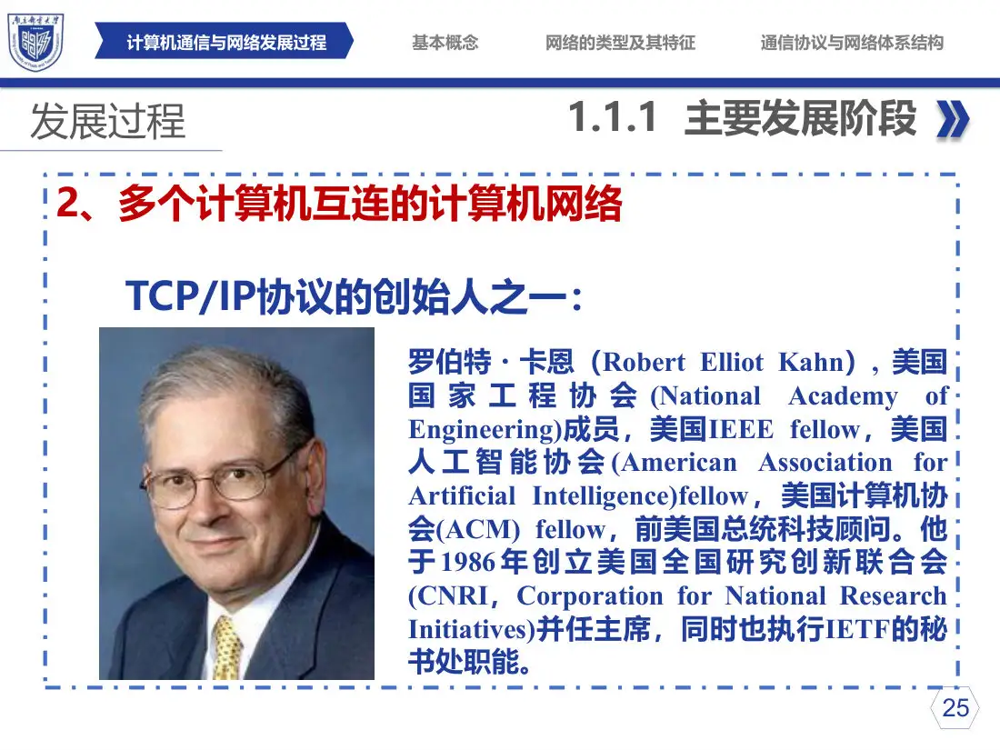

原文：

发展过程

1.1.1 主要发展阶段

2、多个计算机互连的计算机网络

TCP/IP协议的创始人之一：

罗伯特・卡恩（Robert Elliot Kahn）, 美国国 家 工 程 协 会 (National Academy ofEngineering)成员，美国IEEE fellow，美国人 工 智 能 协 会 (American Association forArtificial Intelligence)fellow，美国计算机协会(ACM) fellow，前美国总统科技顾问。他于1986年创立美国全国研究创新联合会(CNRI，Corporation for National ResearchInitiatives)并任主席，同时也执行IETF的秘书处职能。

南志郵電大學Nanjing Un

计算机通信与网络发展过程

基本概念

网络的类型及其特征

通信协议与网络体系结构

25

### 发展过程

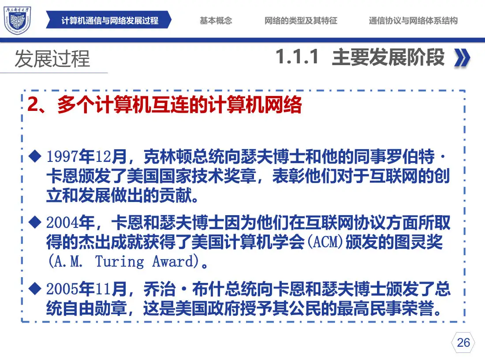

原文：

发展过程

1.1.1 主要发展阶段

2、多个计算机互连的计算机网络

1997年12月，克林顿总统向瑟夫博士和他的同事罗伯特・卡恩颁发了美国国家技术奖章，表彰他们对于互联网的创立和发展做出的贡献。

2004年，卡恩和瑟夫博士因为他们在互联网协议方面所取得的杰出成就获得了美国计算机学会(ACM)颁发的图灵奖(A.M. Turing Award)。

◆ 2005年11月，乔治·布什总统向卡恩和瑟夫博士颁发了总统自由勋章，这是美国政府授予其公民的最高民事荣誉。

南志郵電大學Nanjing Un

计算机通信与网络发展过程

基本概念

网络的类型及其特征

通信协议与网络体系结构

26

### 发展过程

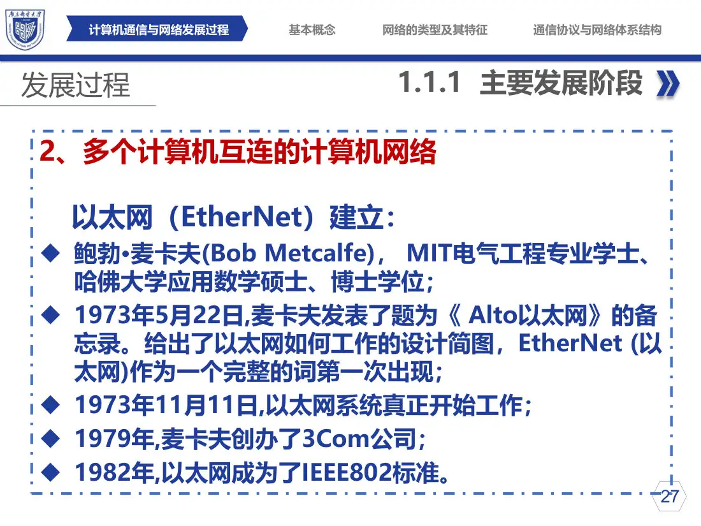

原文：

发展过程

1.1.1 主要发展阶段

2、多个计算机互连的计算机网络

以太网（EtherNet）建立：

◆ 鲍勃·麦卡夫(Bob Metcalfe)， MIT电气工程专业学士、哈佛大学应用数学硕士、博士学位；

1973年5月22日,麦卡夫发表了题为《 Alto以太网》的备忘录。给出了以太网如何工作的设计简图，EtherNet (以太网)作为一个完整的词第一次出现；

◆ 1973年11月11日,以太网系统真正开始工作；

◆ 1979年,麦卡夫创办了3Com公司；

◆ 1982年,以太网成为了IEEE802标准。

南志郵電大學Nanjing Un

计算机通信与网络发展过程

基本概念

网络的类型及其特征

通信协议与网络体系结构

27

### 发展过程

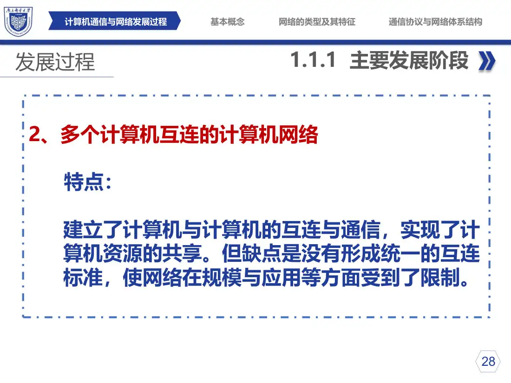

原文：

发展过程

1.1.1 主要发展阶段

2、多个计算机互连的计算机网络

特点：

建立了计算机与计算机的互连与通信，实现了计算机资源的共享。但缺点是没有形成统一的互连标准，使网络在规模与应用等方面受到了限制。

南志郵電大學Nanjing Un

计算机通信与网络发展过程

基本概念

网络的类型及其特征

通信协议与网络体系结构

28

### 发展过程

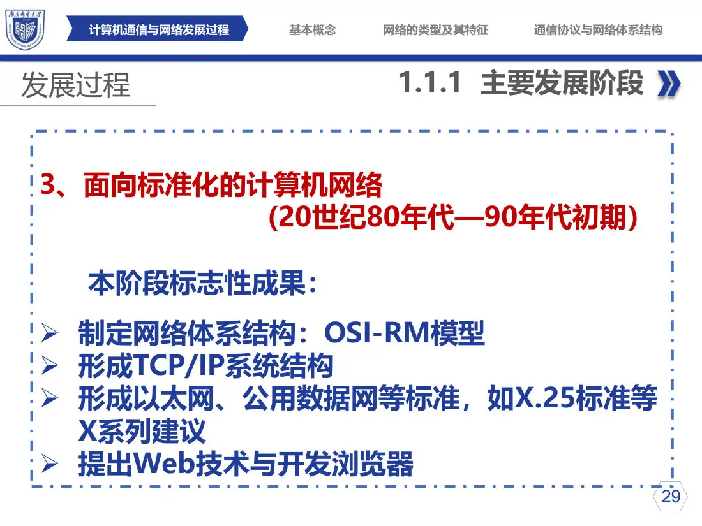

原文：

发展过程

1.1.1 主要发展阶段

3、面向标准化的计算机网络(20世纪80年代—90年代初期）

本阶段标志性成果：

➢ 制定网络体系结构：OSI-RM模型

形成TCP/IP系统结构

➢ 形成以太网、公用数据网等标准，如X.25标准等X系列建议

提出Web技术与开发浏览器

南志郵電大學Nanjing Un

计算机通信与网络发展过程

基本概念

网络的类型及其特征

通信协议与网络体系结构

29

### 发展过程

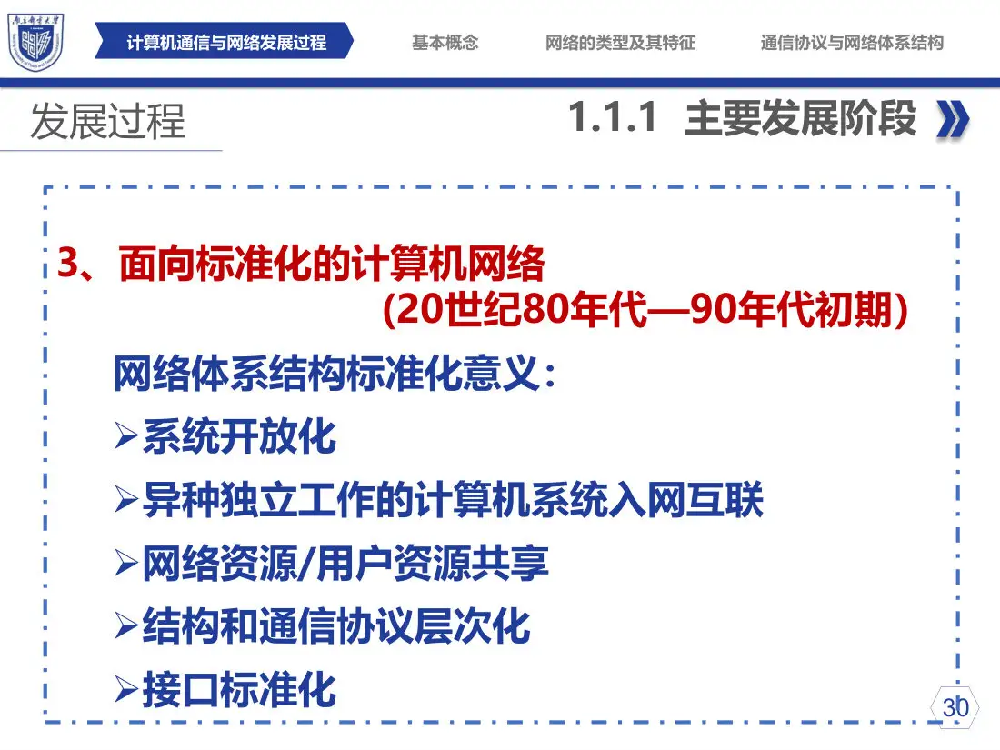

原文：

发展过程

1.1.1 主要发展阶段

3、面向标准化的计算机网络(20世纪80年代—90年代初期）

网络体系结构标准化意义：

➢系统开放化

➢异种独立工作的计算机系统入网互联

➢网络资源/用户资源共享

➢结构和通信协议层次化

➢接口标准化

南志郵電大學Nanjing Une

计算机通信与网络发展过程

基本概念

网络的类型及其特征

通信协议与网络体系结构

30

### 发展过程

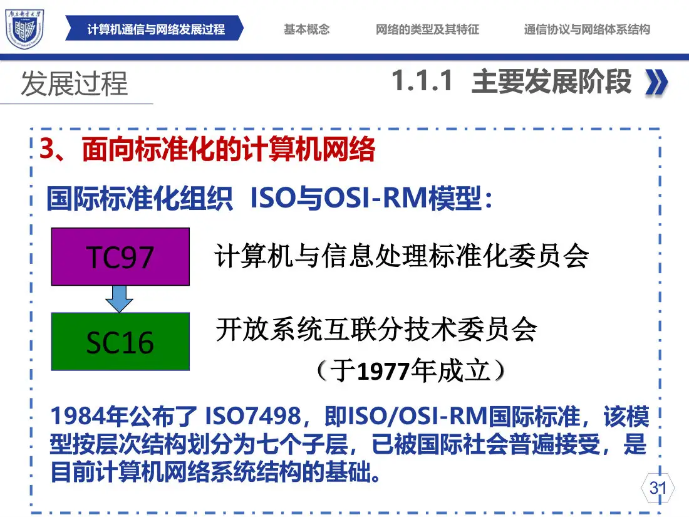

原文：

发展过程

1.1.1 主要发展阶段

3、面向标准化的计算机网络

国际标准化组织 ISO与OSI-RM模型：

SC16

计算机与信息处理标准化委员会

开放系统互联分技术委员会（于1977年成立）

1984年公布了 ISO7498，即ISO/OSI-RM国际标准，该模型按层次结构划分为七个子层，已被国际社会普遍接受，是目前计算机网络系统结构的基础。

南志郵電大學Nanjing Une

计算机通信与网络发展过程

基本概念

网络的类型及其特征

通信协议与网络体系结构

31

### 发展过程

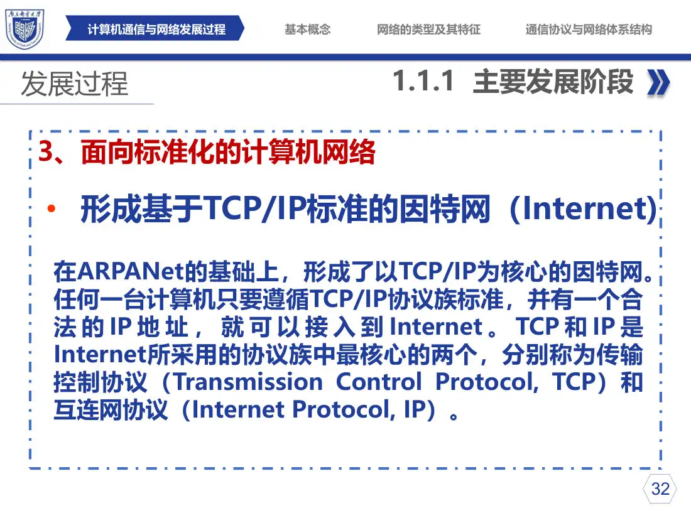

原文：

发展过程

1.1.1 主要发展阶段

3、面向标准化的计算机网络

• 形成基于TCP/IP标准的因特网（Internet)

在ARPANet的基础上，形成了以TCP/IP为核心的因特网。任何一台计算机只要遵循TCP/IP协议族标准，并有一个合法 的 IP 地 址 ， 就 可 以 接 入 到 Internet 。 TCP 和 IP 是Internet所采用的协议族中最核心的两个，分别称为传输控制协议（Transmission Control Protocol, TCP）和互连网协议（Internet Protocol, IP）。

南志郵電大學Nanjing Un

计算机通信与网络发展过程

基本概念

网络的类型及其特征

通信协议与网络体系结构

32

### 发展过程

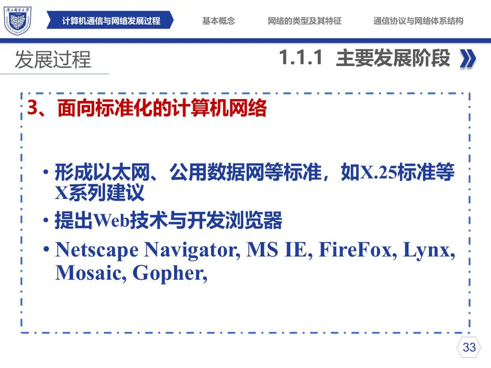

原文：

发展过程

1.1.1 主要发展阶段

3、面向标准化的计算机网络

• 形成以太网、公用数据网等标准，如X.25标准等X系列建议

• 提出Web技术与开发浏览器

• Netscape Navigator, MS IE, FireFox, Lynx, Mosaic, Gopher,

南志郵電大學Nanjing Un

计算机通信与网络发展过程

基本概念

网络的类型及其特征

通信协议与网络体系结构

33

### 发展过程

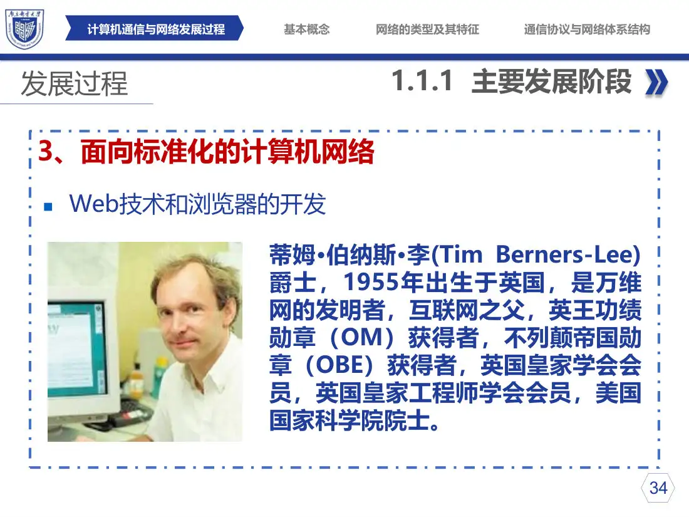

原文：

发展过程

1.1.1 主要发展阶段

3、面向标准化的计算机网络

◼ Web技术和浏览器的开发

蒂姆·伯纳斯·李(Tim Berners-Lee)爵士，1955年出生于英国，是万维网的发明者，互联网之父，英王功绩勋章（OM）获得者，不列颠帝国勋章（OBE）获得者，英国皇家学会会员，英国皇家工程师学会会员，美国国家科学院院士。

南志郵電大學Nanjing Un

计算机通信与网络发展过程

基本概念

网络的类型及其特征

通信协议与网络体系结构

34

### 发展过程

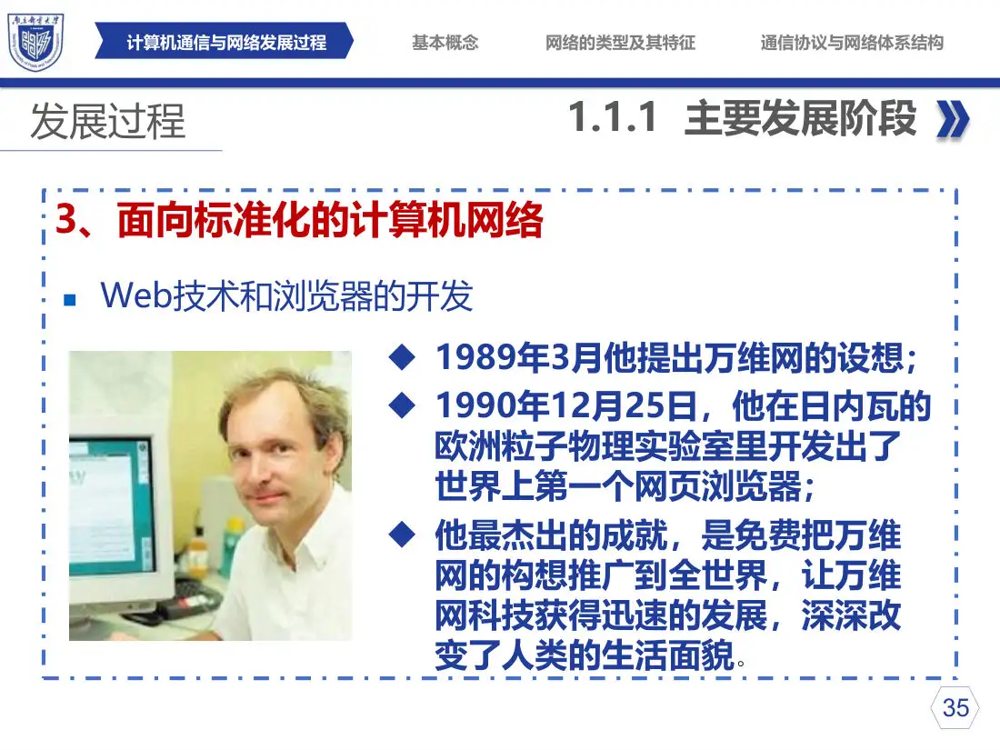

原文：

发展过程

1.1.1 主要发展阶段

3、面向标准化的计算机网络

◼ Web技术和浏览器的开发

◆ 1989年3月他提出万维网的设想；

1990年12月25日，他在日内瓦的欧洲粒子物理实验室里开发出了世界上第一个网页浏览器；

他最杰出的成就，是免费把万维网的构想推广到全世界，让万维网科技获得迅速的发展，深深改变了人类的生活面貌。

南志郵電大學Nanjing Un

计算机通信与网络发展过程

基本概念

网络的类型及其特征

通信协议与网络体系结构

35

### 发展过程

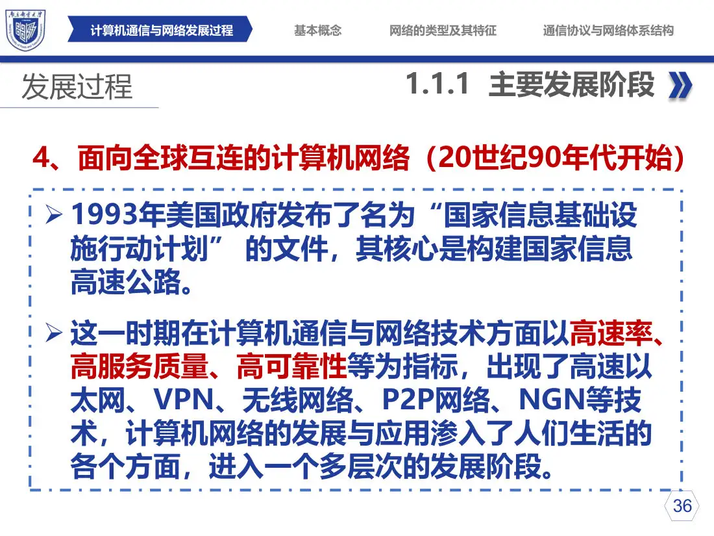

原文：

发展过程

1.1.1 主要发展阶段

4、面向全球互连的计算机网络（20世纪90年代开始）

➢ 1993年美国政府发布了名为“国家信息基础设施行动计划” 的文件，其核心是构建国家信息高速公路。

➢这一时期在计算机通信与网络技术方面以高速率、高服务质量、高可靠性等为指标，出现了高速以太网、VPN、无线网络、P2P网络、NGN等技术，计算机网络的发展与应用渗入了人们生活的各个方面，进入一个多层次的发展阶段。

南志郵電大學Nanjing Un

计算机通信与网络发展过程

基本概念

网络的类型及其特征

通信协议与网络体系结构

36

### 发展过程

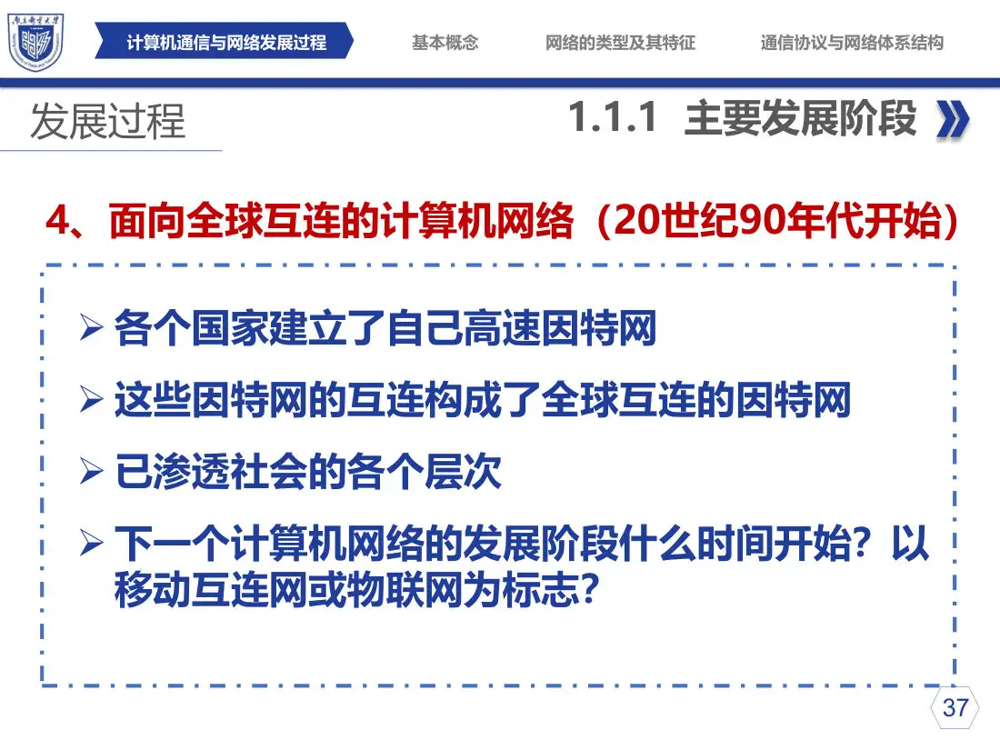

原文：

发展过程

1.1.1 主要发展阶段

4、面向全球互连的计算机网络（20世纪90年代开始）

➢ 各个国家建立了自己高速因特网

➢这些因特网的互连构成了全球互连的因特网

➢ 已渗透社会的各个层次

➢ 下一个计算机网络的发展阶段什么时间开始？以移动互连网或物联网为标志？

南志郵電大學Nanjing Un

计算机通信与网络发展过程

基本概念

网络的类型及其特征

通信协议与网络体系结构

37

### 我国因特网发展过程：三个阶段

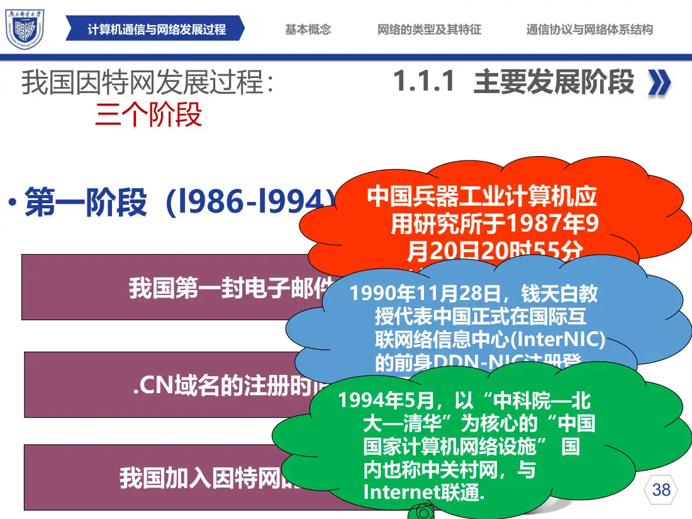

原文：

我国因特网发展过程：三个阶段

• 第一阶段（l986-l994）

我国第一封电子邮件

.CN域名的注册时

我国加入因特网

1.1.1 主要发展阶段

：几个事件中国兵器工业计算机应用研究所于1987年9月20日20时55分

1990年11月28日，钱天白教授代表中国正式在国际互联网络信息中心(InterNIC)的前身DDN-NIC注册登

1994年5月，以“中科院—北大—清华”为核心的“中国国家计算机网络设施” 国内也称中关村网，与Internet联通.

38

南志郵電大學Nanjing Un

计算机通信与网络发展过程

基本概念

网络的类型及其特征

通信协议与网络体系结构

### 我国因特网发展过程：三个阶段

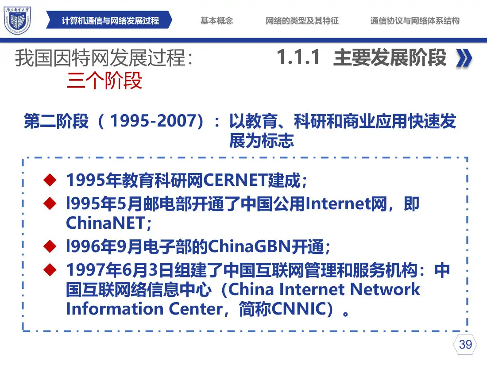

原文：

我国因特网发展过程：三个阶段

1.1.1 主要发展阶段

第二阶段（ 1995-2007）：以教育、科研和商业应用快速发展为标志

◆ 1995年教育科研网CERNET建成；

◆ l995年5月邮电部开通了中国公用Internet网，即ChinaNET；

◆ l996年9月电子部的ChinaGBN开通；

1997年6月3日组建了中国互联网管理和服务机构：中国互联网络信息中心（China Internet NetworkInformation Center，简称CNNIC）。

南志郵電大學Nanjing Un

计算机通信与网络发展过程

基本概念

网络的类型及其特征

通信协议与网络体系结构

39

### 我国因特网发展过程：三个阶段

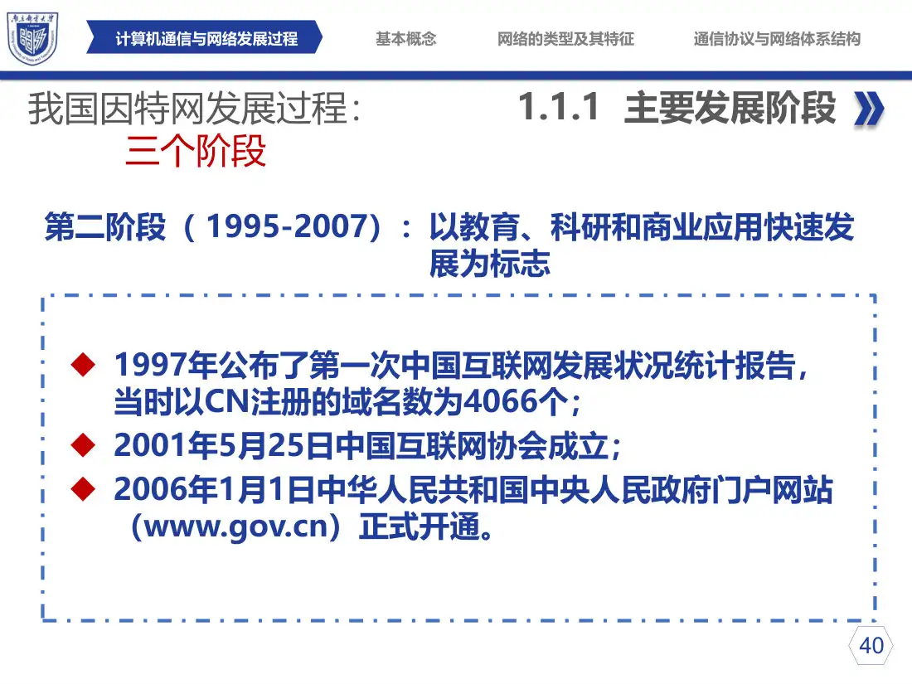

原文：

我国因特网发展过程：三个阶段

1.1.1 主要发展阶段

第二阶段（ 1995-2007）：以教育、科研和商业应用快速发展为标志

◆ 1997年公布了第一次中国互联网发展状况统计报告，当时以CN注册的域名数为4066个；

◆ 2001年5月25日中国互联网协会成立；

◆ 2006年1月1日中华人民共和国中央人民政府门户网站（www.gov.cn）正式开通。

南志郵電大學Nanjing Un

计算机通信与网络发展过程

基本概念

网络的类型及其特征

通信协议与网络体系结构

40

### 我国因特网发展过程：三个阶段

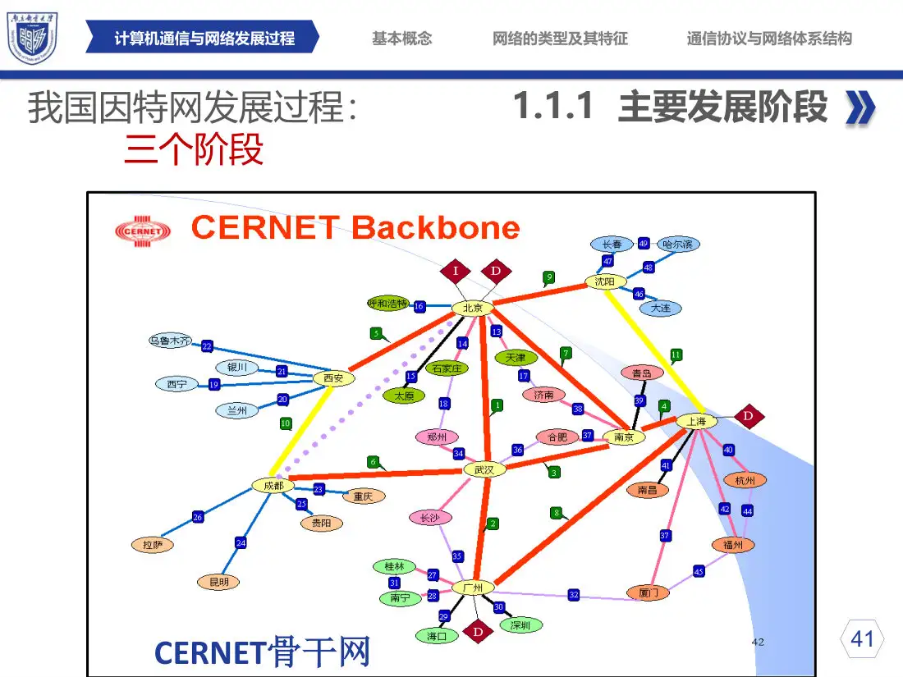

原文：

我国因特网发展过程：三个阶段

1.1.1 主要发展阶段

南志郵電大學Nanjing Un

计算机通信与网络发展过程

基本概念

网络的类型及其特征

通信协议与网络体系结构

41

### 我国因特网发展过程：

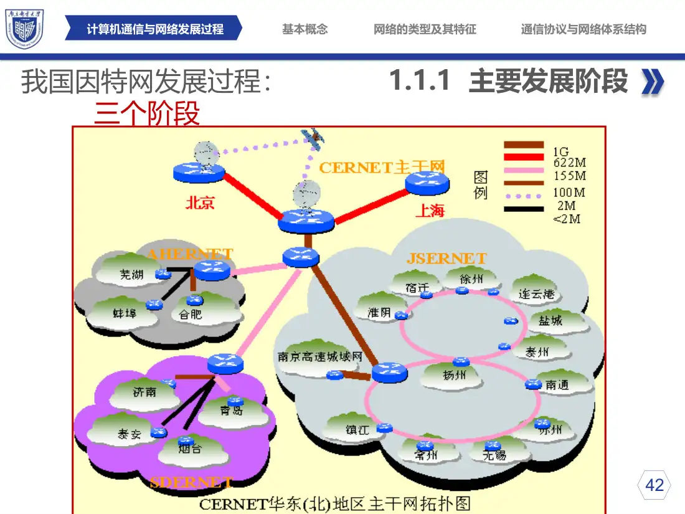

原文：

我国因特网发展过程：

1.1.1 主要发展阶段

三个阶段

南志郵電大學Nanjing Un

计算机通信与网络发展过程

基本概念

网络的类型及其特征

通信协议与网络体系结构

### 我国因特网发展过程：

原文：

我国因特网发展过程：

1.1.1 主要发展阶段

南志郵電大學Nanjing Un

计算机通信与网络发展过程

基本概念

网络的类型及其特征

通信协议与网络体系结构

### 我国因特网发展过程：三个阶段

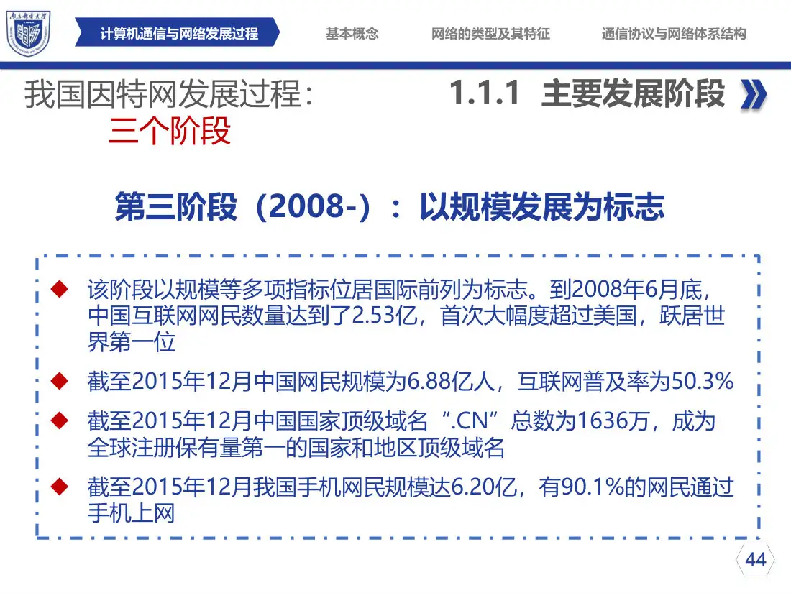

原文：

我国因特网发展过程：三个阶段

1.1.1 主要发展阶段

第三阶段（2008-）：以规模发展为标志

◆ 该阶段以规模等多项指标位居国际前列为标志。到2008年6月底，中国互联网网民数量达到了2.53亿，首次大幅度超过美国，跃居世界第一位

◆ 截至2015年12月中国网民规模为6.88亿人，互联网普及率为50.3%

◆ 截至2015年12月中国国家顶级域名“.CN”总数为1636万，成为全球注册保有量第一的国家和地区顶级域名

◆ 截至2015年12月我国手机网民规模达6.20亿，有90.1%的网民通过手机上网

南志郵電大學Nanjing Un

计算机通信与网络发展过程

基本概念

网络的类型及其特征

通信协议与网络体系结构

44

### 我国因特网发展过程：三个阶段

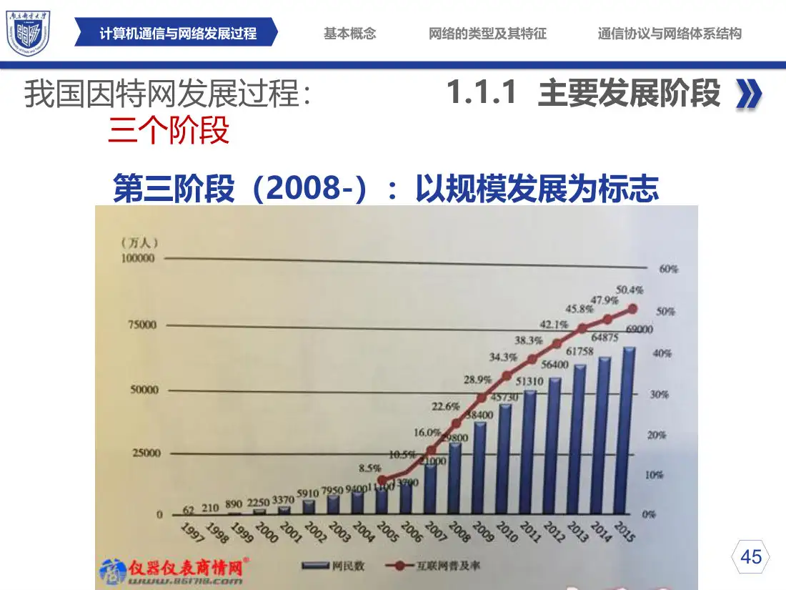

原文：

我国因特网发展过程：三个阶段

1.1.1 主要发展阶段

第三阶段（2008-）：以规模发展为标志

南志郵電大學Nanjing Un

计算机通信与网络发展过程

基本概念

网络的类型及其特征

通信协议与网络体系结构

仅器仪表商情网

45

### 计算机网络的定义

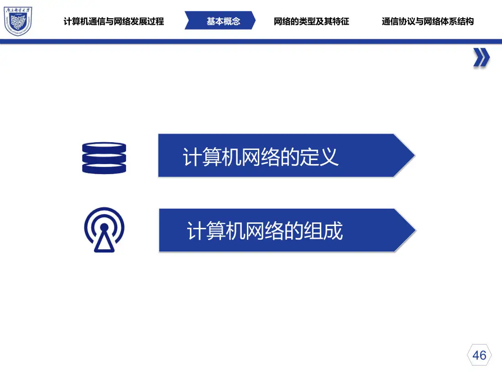

原文：

计算机网络的定义

计算机网络的组成

南志郵電大學

计算机通信与网络发展过程

基本概念

网络的类型及其特征

通信协议与网络体系结构

》

46

### 1.2.1 计算机网络的定义

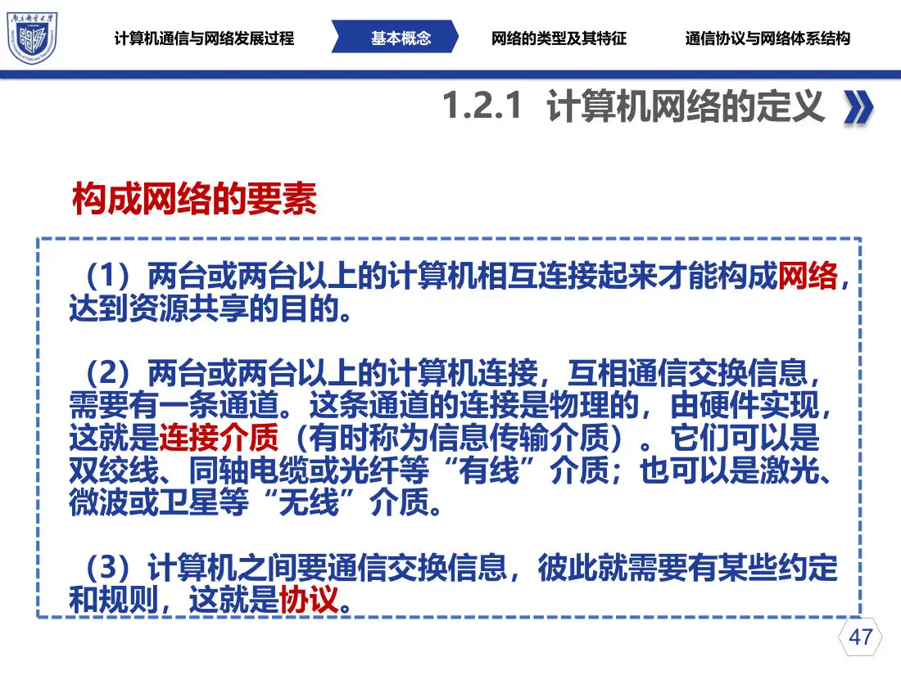

原文：

1.2.1 计算机网络的定义

构成网络的要素

（1）两台或两台以上的计算机相互连接起来才能构成网络，达到资源共享的目的。

（2）两台或两台以上的计算机连接，互相通信交换信息，需要有一条通道。这条通道的连接是物理的，由硬件实现这就是连接介质（有时称为信息传输介质）。它们可以是双绞线、同轴电缆或光纤等“有线”介质；也可以是激光、微波或卫星等“无线”介质。

（3）计算机之间要通信交换信息，彼此就需要有某些约定和规则，这就是协议。

南志郵電大學

计算机通信与网络发展过程

基本概念

网络的类型及其特征

通信协议与网络体系结构

47

### 1.2.1 计算机网络的定义

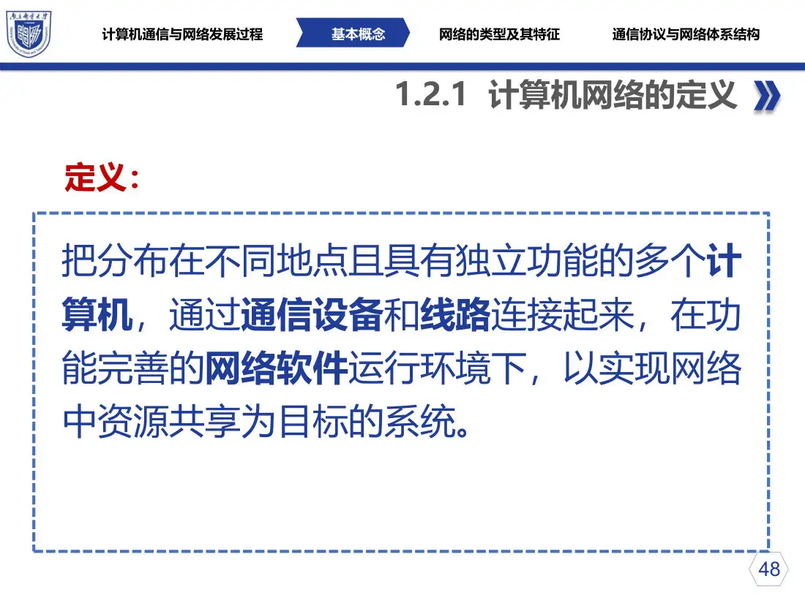

原文：

1.2.1 计算机网络的定义

定义：

把分布在不同地点且具有独立功能的多个计算机，通过通信设备和线路连接起来，在功能完善的网络软件运行环境下，以实现网络中资源共享为目标的系统。

南志郵電大學Nanjing Un

计算机通信与网络发展过程

基本概念

网络的类型及其特征 通信协议与网络体系结构

48

### 1.2.2 计算机网络的组成

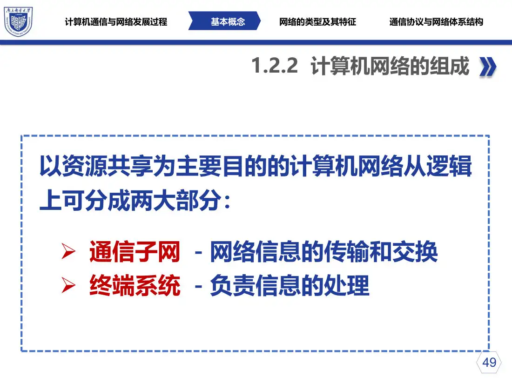

原文：

1.2.2 计算机网络的组成

以资源共享为主要目的的计算机网络从逻辑上可分成两大部分：

➢ 通信子网 －网络信息的传输和交换

➢ 终端系统 －负责信息的处理

南志郵電大學

计算机通信与网络发展过程

基本概念

网络的类型及其特征

通信协议与网络体系结构

49

### 1.2.2 计算机网络的组成

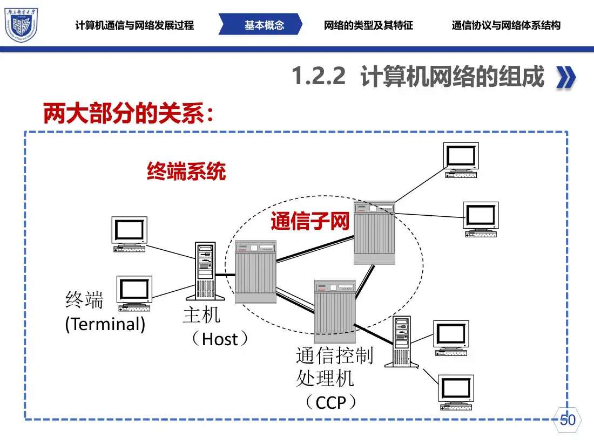

原文：

1.2.2 计算机网络的组成

两大部分的关系：

南志郵電大學Nanjing Une

计算机通信与网络发展过程

基本概念

网络的类型及其特征

通信协议与网络体系结构

50

### 1.2.2 计算机网络的组成

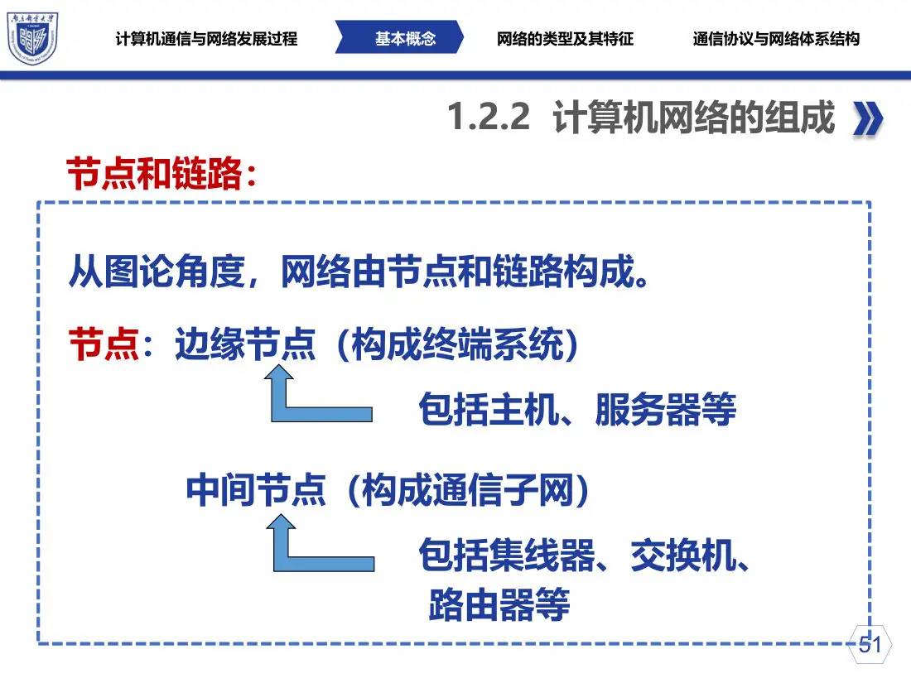

原文：

1.2.2 计算机网络的组成

节点和链路：

从图论角度，网络由节点和链路构成。

节点：边缘节点（构成终端系统）

包括主机、服务器等

中间节点（构成通信子网）

包括集线器、交换机、路由器等

网络的类型及其特征 通信协议与网络体系结构

南志執電大學Nanjing Ue ofPo

计算机通信与网络发展过程

基本概念

51

### 网络软件系统：

原文：

网络软件系统：

网络软件

1.2.2 计算机网络的组成

网络管理及网络应用软件

通信程序

网络协议和协议软件

网络操作系统

网络系统的逻辑结构

通信子网

终端系统

南志郵電大學

计算机通信与网络发展过程

基本概念

网络的类型及其特征

通信协议与网络体系结构

52

### 根据网络拓扑结构分类

原文：

根据网络拓扑结构分类

根据网络覆盖范围分类

无线网络

》

南志郵電大學

计算机通信与网络发展过程

基本概念

网络的类型及其特征

通信协议与网络体系结构

53

### 1.3.1 网络拓扑结构分类

原文：

1.3.1 网络拓扑结构分类

可根据不同的分类标准划分：

按网络的作用范围划分

按通信介质划分

按通信传播方式划分

按通信速率划分

按网络使用者划分

LAN、MAN、WAN、AN

有线网、无线网

点到点、广播、多播

1.544Mbps-100Mbps-1000Mbps

公用网、专用网

南志郵電大學

计算机通信与网络发展过程

基本概念

网络的类型及其特征

通信协议与网络体系结构

### 1.3.1 网络拓扑结构分类

原文：

1.3.1 网络拓扑结构分类

可根据不同的分类标准划分：

按网络交换功能划分

按网络控制方式划分

按网络环境划分

按网络拓扑结构划分电路交换、报文交换、分组交换、混合交换

集中式、分布式

部门网、企业网、校园网

• 星形结构

• 层次结构或树形结构

• 总线形结构

• 环形结构

南志郵電大學

计算机通信与网络发展过程

基本概念

网络的类型及其特征

通信协议与网络体系结构

### 1.3.1 网络拓扑结构分类

原文：

1.3.1 网络拓扑结构分类

根据网络拓扑结构划分：

南志郵電大學Nanjing Une

计算机通信与网络发展过程

基本概念

网络的类型及其特征

通信协议与网络体系结构

56

### 根据网络拓扑结构划分：

原文：

根据网络拓扑结构划分：

1.3.1 网络拓扑结构分类

57

南志郵電大學Nanjing Une

计算机通信与网络发展过程

基本概念

网络的类型及其特征

通信协议与网络体系结构

### 1.3.1 网络拓扑结构分类

原文：

1.3.1 网络拓扑结构分类

根据网络覆盖范围划分：

个人区域网（PAN)

局域网 (LAN)

城域网 (MAN)

广域网 (WAN)

因特网 (Internet)

南志郵電大學

计算机通信与网络发展过程

基本概念

网络的类型及其特征

通信协议与网络体系结构

58

### 1.3.1 网络拓扑结构分类

原文：

1.3.1 网络拓扑结构分类

无线网络：

无线个域网

无线局域网

无线城域网

无线广域网

南志郵電大學

计算机通信与网络发展过程

基本概念

网络的类型及其特征

通信协议与网络体系结构

59

### 通信协议与分层体系结构

原文：

通信协议与分层体系结构

OSI-RM体系结构

TCP/IP体系结构

两种体系结构比较

网络通信标准化组织

》

南志郵電大學Nanjing Une

计算机通信与网络发展过程

基本概念

网络的类型及其特征

通信协议与网络体系结构

60

### 1.4.1 通信协议与分层体系结构

原文：

1.4.1 通信协议与分层体系结构

为什么要分层？

计算机通信是一个复杂的过程，相互通信的两个计算机系统必须高度协调工作才行，而这种“协调”是相当复杂的。

“分层”可以将庞大而复杂的问题，转化为若干较小的局部问题，而这些较小的局部问题就比较易于研究和处理。

南志執電大學Nanjing Ue ofPo

计算机通信与网络发展过程

基本概念

网络的类型及其特征

通信协议与网络体系结构

61

### 1.4.1 通信协议与分层体系结构

原文：

1.4.1 通信协议与分层体系结构

分层协议演化

ISO/OSI-RM

SNA

ARPANET

1977年，ISO网络标准化，设SC16。1984年制定了OSI-RM

1974年，IBM公司首先公布了SNA（系统网络体系结构）

1969年，第一个计算机网络ARPANET资源共享

分布式控制

分组交换方式

从逻辑上分为通信子网和资源子网

采用层次化网络结构

南志執電大學Nanjing Ue ofPo

计算机通信与网络发展过程

基本概念

网络的类型及其特征

通信协议与网络体系结构

62

### 1.4.1 通信协议与分层体系结构

原文：

1.4.1 通信协议与分层体系结构

例题 ：一封信件的写作与发送过程

① 首先发信人采用某种语言写成一封信，按照某种格式填好地址，投入到信箱中。

② 邮局收集信件，按照目的地址进行分类打包，并送到邮政处理中心。

③ 处理中心汇集各个邮包，并进行再次分类，送到铁路等运输部门。

④ 运输部门将邮包送到目的地的邮政处理中心。

⑤ 目的地的邮政处理中心解包后根据目的地址，将信件送到相应的邮政分理处。分理处将信件送到收信人。收信人最终拆开信封，阅读信函。

南志郵電大學Nanjing Un

计算机通信与网络发展过程

基本概念

网络的类型及其特征

通信协议与网络体系结构

63

### 1.4.1 通信协议与分层体系结构

原文：

1.4.1 通信协议与分层体系结构

例题 ：一封信件的写作与发送过程

发信人

写好一封信填好信封邮局分类打包运输部门打包

收信人

收到一封信按地址投送邮局拆包分类运输部门拆包

2个特点：不同的部门相互独立，又有联系地址等信息都有相应的格式

南志郵電大學

计算机通信与网络发展过程

基本概念

网络的类型及其特征

通信协议与网络体系结构

64

### 1.4.1 通信协议与分层体系结构

原文：

1.4.1 通信协议与分层体系结构

网络协议定义 ：

简单地说，协议是指通信双方必须遵循的、控制信息交换的规则的集合，是一套语义和语法规则，用来规定有关功能部件在通信过程中的操作，它定义了数据发送和接收工作中必经的过程。协议规定了网络中使用的格式、定时方式、顺序和检错。

南志執電大學Nanjing Ue ofPo

计算机通信与网络发展过程

基本概念

网络的类型及其特征

通信协议与网络体系结构

65

### 1.4.1 通信协议与分层体系结构

原文：

1.4.1 通信协议与分层体系结构

网络协议的组成 ：

① 语法：指数据与控制信息的结构或格式，确定通信时采用的数据格式，编码及信号电平等，回答“怎么讲”；

② 语义：协议的语义是指对构成协议的协议元素含义的解释“讲什么” ；

③ 同步：规定了事件的执行顺序 。

南志郵電大學

计算机通信与网络发展过程

基本概念

网络的类型及其特征

通信协议与网络体系结构

66

### 1.4.1 通信协议与分层体系结构

原文：

1.4.1 通信协议与分层体系结构

网络协议的特点 ：

① 网络通信协议的特点是层次性、可靠性和有效性。

② 协议的分层可以将复杂的问题简单化

③ 协议可靠性和有效性是正常和正确通信的保证，只有协议可靠和有效，才能实现系统内各种资源共享。

南志郵電大學

计算机通信与网络发展过程

基本概念

网络的类型及其特征

通信协议与网络体系结构

67

### 1.4.1 通信协议与分层体系结构

原文：

1.4.1 通信协议与分层体系结构

协议层次模型 ：

(n+1)层与n层协议接口，n层提供服务

n层与(n-1)层协议接口，(n-1)层提供服务

南志執電大學Nanjing Ue ofPo

计算机通信与网络发展过程

基本概念

网络的类型及其特征

通信协议与网络体系结构

68

### 1.4.1 通信协议与分层体系结构

原文：

1.4.1 通信协议与分层体系结构

协议层次模型 ：

• 实体(Entity)：是通信时能发送和接收信息的任何软硬件设施；

• 接口(Interface)：是指网络分层结构中各相邻层之间的通信接口。

南志郵電大學

计算机通信与网络发展过程

基本概念

网络的类型及其特征

通信协议与网络体系结构

69

### 1.4.1 通信协议与分层体系结构

原文：

1.4.1 通信协议与分层体系结构

协议分层的意义 ：

• 各层之间是独立的。

• 灵活性好。

• 结构上可分割开。

• 易于实现和维护。

• 能促进标准化工作。

南志郵電大學

计算机通信与网络发展过程

基本概念

网络的类型及其特征

通信协议与网络体系结构

70

### 1.4.1 通信协议与分层体系结构

原文：

1.4.1 通信协议与分层体系结构

层次多少要恰当：

① 若层数太少，就会使每一层的协议太复杂。

② 层数太多又会在描述和综合各层功能的系统工程任务时遇到较多的困难。

③ 设置合理的层数，有利于描述和综合这些层次功能。

南志郵電大學

计算机通信与网络发展过程

基本概念

网络的类型及其特征

通信协议与网络体系结构

71

### 1.4.1 通信协议与分层体系结构

原文：

1.4.1 通信协议与分层体系结构

分层的原则：

➢ 按功能分层、归类，每层功能应明确、独立。

➢ 层与层的接口适合于标准化，其边界的信息流应尽可能少。

➢ 每一层只与相邻层有边界。

➢ 为满足各种通信服务需要，在一层内可形成若干子层。

南志郵電大學

计算机通信与网络发展过程

基本概念

网络的类型及其特征

通信协议与网络体系结构

72

### OSI-RM模型：

原文：

OSI-RM模型：

7 应用层

6 表示层

5 会话层

4 传输层

3 网络层

2 数据链路层

1 物理层

1.4.2 OSI-RM体系结构

OSI参考模型中高层，面向信息处理。

OSI参考模型中低层，面向数据通信。

南志執電大學Nanjing Ue ofPo

计算机通信与网络发展过程

基本概念

网络的类型及其特征

通信协议与网络体系结构

73

### 1.4.2 OSI-RM体系结构

原文：

1.4.2 OSI-RM体系结构

计算机通信网的信息流动

南志郵電大學

计算机通信与网络发展过程

基本概念

网络的类型及其特征

通信协议与网络体系结构

### 1.4.2 OSI-RM体系结构

原文：

1.4.2 OSI-RM体系结构

OSI-RM模型：

➢ 物理层：利用传输介质为通信的网络节点之间建立、维护和释放物理连接，实现比特流的透明传输，进而为数据链路层提供数据传输服务。

➢ 数据链路层：在物理层提供服务的基础上，在通信的实体间建立数据链路连接，传输以帧(frame)为单位的数据包，并采取差错控制和流量控制的方法，使有差错的物理线路变成无差错的数据链路。

➢ 网络层：为分组交换网络上的不同主机提供通信服务，为以分组为单位的数据报通过通信子网选择适当的路由，并实现拥塞控制、网络互连等功能。

南志郵電大學Nanjing Un

计算机通信与网络发展过程

基本概念

网络的类型及其特征

通信协议与网络体系结构

75

### 1.4.2 OSI-RM体系结构

原文：

1.4.2 OSI-RM体系结构

OSI-RM模型：

传输层：向用户提供端到端（end-to-end）的数据传输服务，实现为上层屏蔽低层的数据传输问题。

➢ 会话层：负责维护通信中两个节点之间的会话连接的建立、维护和断开，以及数据的交换。

➢ 表示层：用于处理在两个通信系统中交换信息的表示方式，主要包括数据格式变换、数据的加密与解密、数据压缩与恢复等功能。

➢ 应用层：为应用程序通过网络服务，它包含了各种用户使用的协议。

南志郵電大學Nanjing Un

计算机通信与网络发展过程

基本概念

网络的类型及其特征

通信协议与网络体系结构

76

### OSI-RM模型：

原文：

OSI-RM模型：

1.4.2 OSI-RM体系结构

应 用 程 序 数 据

H7 应 用 程 序 数 据

南志郵電大學

计算机通信与网络发展过程

基本概念

网络的类型及其特征

通信协议与网络体系结构

### OSI-RM模型：

原文：

OSI-RM模型：

1.4.2 OSI-RM体系结构

应 用 程 序 数 据

H7 应 用 程 序 数 据

H 6 H7 应 用 程 序 数 据

南志郵電大學

计算机通信与网络发展过程

基本概念

网络的类型及其特征

通信协议与网络体系结构

### OSI-RM模型：

原文：

OSI-RM模型：

1.4.2 OSI-RM体系结构

应 用 程 序 数 据

H7 应 用 程 序 数 据

H 6 H7 应 用 程 序 数 据

H5 H6 H7 应 用 程 序 数 据

南志郵電大學

计算机通信与网络发展过程

基本概念

网络的类型及其特征

通信协议与网络体系结构

### OSI-RM模型：

原文：

OSI-RM模型：

1.4.2 OSI-RM体系结构

应 用 程 序 数 据

H7 应 用 程 序 数 据

H 6 H7 应 用 程 序 数 据

H5 H6 H7 应 用 程 序 数 据

H4 H5 H6 H7 应 用 程 序 数 据

南志郵電大學Nanjing Un

计算机通信与网络发展过程

基本概念

网络的类型及其特征

通信协议与网络体系结构

### OSI-RM模型：

原文：

OSI-RM模型：

1.4.2 OSI-RM体系结构

应 用 程 序 数 据

H7 应 用 程 序 数 据

H 6 H7 应 用 程 序 数 据

H5 H6 H7 应 用 程 序 数 据

H4 H5 H6 H7 应 用 程 序 数 据

H3 H4 H5 H6 H7 应 用 程 序 数 据

南志郵電大學Nanjing Un

计算机通信与网络发展过程

基本概念

网络的类型及其特征

通信协议与网络体系结构

### OSI-RM模型：

原文：

OSI-RM模型：

1.4.2 OSI-RM体系结构

应 用 程 序 数 据

H7 应 用 程 序 数 据

H 6 H7 应 用 程 序 数 据

H5 H6 H7 应 用 程 序 数 据

H4 H5 H6 H7 应 用 程 序 数 据

H3 H4 H5 H6 H7 应 用 程 序 数 据

T2H2 H3 H4 H5 H6 H7 应 用 程 序 数 据

T2H1 H2 H3 H4 H5 H6 H7 应 用 程 序 数 据

南志郵電大學Nanjing Un

计算机通信与网络发展过程

基本概念

网络的类型及其特征

通信协议与网络体系结构

### 1.4.2 OSI-RM体系结构

原文：

1.4.2 OSI-RM体系结构

OSI-RM模型：

应 用 程 序 数 据

H7 应 用 程 序 数 据

H6 H7 应 用 程 序 数 据

H5 H6 H7

应 用 程 序 数 据

H4 H5 H 6 H7

应 用 程 序 数 据

H3 H4 H5 H6 H7 应 用 程 序 数 据

H2 H3 H4 H5 H6 H7

应 用 程 序 数 据

H1 H2 H3 H4 H5 H6 H7

应 用 程 序 数 据

南志郵電大學Nanjing Un

计算机通信与网络发展过程

基本概念

网络的类型及其特征

通信协议与网络体系结构

### 1.4.2 OSI-RM体系结构

原文：

1.4.2 OSI-RM体系结构

服务服务点（SAP）：

➢ OSI各层间存在信息交换，一个系统中的相邻两个层次间的信息交换是通过服务访问点(ServiceAccess Point, SAP)这样的接口实现的。

➢ SAP实际上就是(N)层实体和上一层(N+1)层实体之间的逻辑接口。

N层服务用户

（N+1）层协议

N层服务用户

（N）层协议

（N）层SAP

N层服务提供者

南志郵電大學Nanjing Un

计算机通信与网络发展过程

基本概念

网络的类型及其特征

通信协议与网络体系结构

84

### 1.4.2 OSI-RM体系结构

原文：

1.4.2 OSI-RM体系结构

协议数据单元（PDU）：

（N）层PDU

南志郵電大學Nanjing Une

计算机通信与网络发展过程

基本概念

网络的类型及其特征

通信协议与网络体系结构

85

### 1.4.2 OSI-RM体系结构

原文：

1.4.2 OSI-RM体系结构

OSI中的服务原语：

<table><tr><td>服务原语类型</td><td>名称</td><td>含义</td></tr><tr><td>request</td><td>请求</td><td>一个实体希望获得某种服务</td></tr><tr><td>indication</td><td>指示</td><td>把关于某种事件的信息告诉某一实体</td></tr><tr><td>response</td><td>回应</td><td>一个实体对某一事件的回应</td></tr><tr><td>confirm</td><td>确认</td><td>一个实体对某一事件的确认</td></tr></table>

南志郵電大學

计算机通信与网络发展过程

基本概念

网络的类型及其特征

通信协议与网络体系结构

86

### 1.4.2 OSI-RM体系结构

原文：

1.4.2 OSI-RM体系结构

OSI中的服务原语：

南志郵電大學Nanjing Une

计算机通信与网络发展过程

基本概念

网络的类型及其特征

通信协议与网络体系结构

87

### 1.4.3 TCP/IP体系结构

原文：

1.4.3 TCP/IP体系结构

各层的协议：

SMTP, Telent, FTP, HTTP等

TCP

SNMP, RIP等

UDP

ICMP, IGMP

IP

ARP/RARP

各类物理网络，如FDDI, Ethernet等

应用层 Application Layer

传输层 Transport Layer

互连网络层Internet Layer

网络接入层Host to NetworkLayer

南志郵電大學

计算机通信与网络发展过程

基本概念

网络的类型及其特征

通信协议与网络体系结构

88

### 1.4.3 TCP/IP体系结构

原文：

1.4.3 TCP/IP体系结构

漏斗状协议族：

应用层

传输层

互连网络层

网络接入层

南志郵電大學

计算机通信与网络发展过程

基本概念

网络的类型及其特征

通信协议与网络体系结构

89

### 1.4.3 TCP/IP体系结构

原文：

1.4.3 TCP/IP体系结构

各层的协议：

➢ 应用层的协议相对较多，分别使用UDP和TCP协议进行承载，它们位于各自的上方。

➢ 网络层除核心协议IP外，还有ICMP、IGMP、ARP和RARP，分别位于IP协议的上下方。

➢ TCP/IP模型中的核心协议是TCP、UDP和IP，且呈现漏斗状，IP协议处于漏斗的最窄处。

南志郵電大學Nanjing Un

计算机通信与网络发展过程

基本概念

网络的类型及其特征

通信协议与网络体系结构

90

### TCP/IP 的体系结构

原文：

TCP/IP 的体系结构

1.4.4 OSI-RM和TCP/IP体系结构比较

1 物理层

南志郵電大學

计算机通信与网络发展过程

基本概念

网络的类型及其特征

通信协议与网络体系结构

91

### 1.4.4 OSI-RM和TCP/IP体系结构比较

原文：

1.4.4 OSI-RM和TCP/IP体系结构比较

• 出发点不同 ：

➢ OSI-RM是作为国际标准而制定的,不得不兼顾各方,考虑各种情况,造成OSI-RM相对比较复杂,协议的数量和复杂性都远高于TCP/IP。

➢ 早期TCP/IP协议是为军用网ARPANET设计的体系结构，一开始就考虑了一些特殊要求,如可用性,残存性，安全性，网络互联性以及处理瞬间大信息量的能力等。

南志郵電大學Nanjing Un

计算机通信与网络发展过程

基本概念

网络的类型及其特征

通信协议与网络体系结构

92

### 1.4.4 OSI-RM和TCP/IP体系结构比较

原文：

1.4.4 OSI-RM和TCP/IP体系结构比较

• 对一些问题的处理方法不同 ：

➢ 对层次间的关系：OSI-RM模型严格按层次结构，而TCP/IP可以跨层；

➢ 无连接服务问题 ：OSI-RM模型只考虑面向连接的服务，而TCP/IP同时还考虑无连接服务

南志郵電大學Nanjing Un

计算机通信与网络发展过程

基本概念

网络的类型及其特征

通信协议与网络体系结构

93

### 1.4.4 OSI-RM和TCP/IP体系结构比较

原文：

1.4.4 OSI-RM和TCP/IP体系结构比较

按照一般的概念，网络技术和设备只有符合有关的国际标准才能在大范围获得工程上的应用。但现在情况却反过来了，得到最广泛应用的不是法律上的国际标准OSI，而是非国际标准TCP/IP。这样，TCP/IP就常被称为是事实上的国际标准。

南志執電大學Nanjing Ue ofPo

计算机通信与网络发展过程

基本概念

网络的类型及其特征

通信协议与网络体系结构

94

### 1.4.5 网络通信标准化组织

原文：

1.4.5 网络通信标准化组织

两个国际标准化组织：

➢ ISO（1947年成立）和ITU（1865年成立）;

➢ ISO的前身是国际标准化协会 ISA;

➢ ITU于1993年重组设立了三个部门：ITU-T 电信标准化ITU-R 无线电通信规范ITU-D 电信发展

南志郵電大學Nanjing Un

计算机通信与网络发展过程

基本概念

网络的类型及其特征

通信协议与网络体系结构

95

### 1.4.5 网络通信标准化组织

原文：

1.4.5 网络通信标准化组织

两个国际标准化组织：

因特网的标准化工作由称为IAB（InternetActivities Board，1983年成立）的组织负责，下设Task Force负责具体的某一方面标准。如IETF(Internet Engineering TaskForce)负责因特网近期发展的工程与标准问题。

南志執電大學Nanjing Ue ofPo

计算机通信与网络发展过程

基本概念

网络的类型及其特征

通信协议与网络体系结构

96

### 1.4.5 网络通信标准化组织

原文：

1.4.5 网络通信标准化组织

因特网的标准化工作：1989年重组成立了IETF和IRIF

因特网协会 ISOC

因特网体系结构研究委员会 IAB因特网研究部 IRTF

因特网研究指导小组IRSG

因特网工程部 IETF

因特网工程指导小组IESG

领域

领域

RG

RG

WG

WG

WG

南志郵電大學Nanjing Une

计算机通信与网络发展过程

基本概念

网络的类型及其特征

通信协议与网络体系结构

97

### 1.4.5 网络通信标准化组织

原文：

1.4.5 网络通信标准化组织

RFC ( Request For Comments)：www.ietf.org

南志郵電大學Nanjing Une

计算机通信与网络发展过程

基本概念

网络的类型及其特征

通信协议与网络体系结构

98

### 本章小结：

原文：

本章小结：

① 计算机通信与网络发展的四个阶段

② 计算机网络的定义

③ 计算机网络不同的分类方法

④ 计算机网络体系结构

⑤ 通信网络协议

⑥ OSI七层模型 ，TCP/IP模型

⑦ 服务访问点

⑧ 国际标准化组织

南志執電大學Nanjing Ue ofPo

计算机通信与网络发展过程

基本概念

网络的类型及其特征

通信协议与网络体系结构

99

### Thank You

原文：

Thank You

H a v e A N i c e D a y

南京邮电大学通信与信息工程学院
