# 《计算机通信与网络》第2章 数据通信技术基础（课件）

原件的每一页，下面附识别出的文字。

### 第 1 页

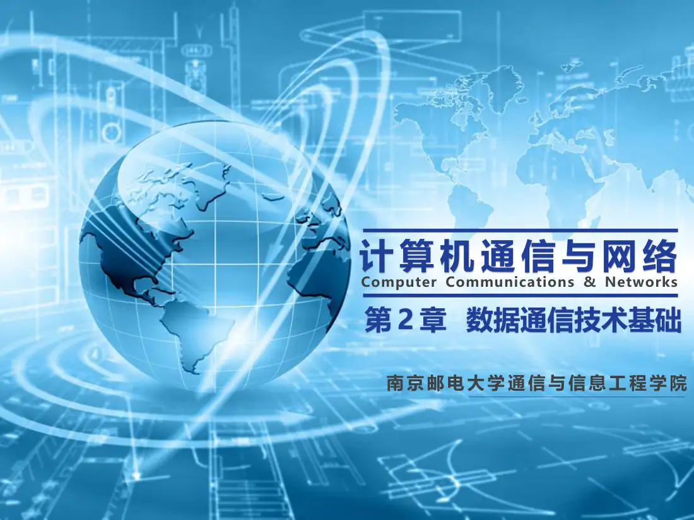

原文：

计算机通信与网络Computer Communications & Networks第2章 数据通信技术基础

南京邮电大学通信与信息工程学院大纲要求R e q u i r e m e n t s

### 01 掌握数据通信的基本概念；掌握通信速率、时延等性能指标的计算

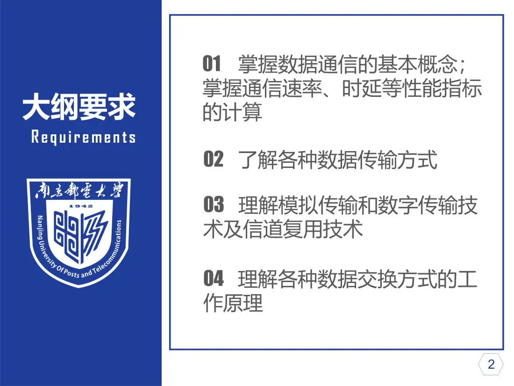

原文：

01 掌握数据通信的基本概念；掌握通信速率、时延等性能指标的计算

02 了解各种数据传输方式

03 理解模拟传输和数字传输技术及信道复用技术

04 理解各种数据交换方式的工作原理

2

### 大纲要求R e q u i r e m e n t s

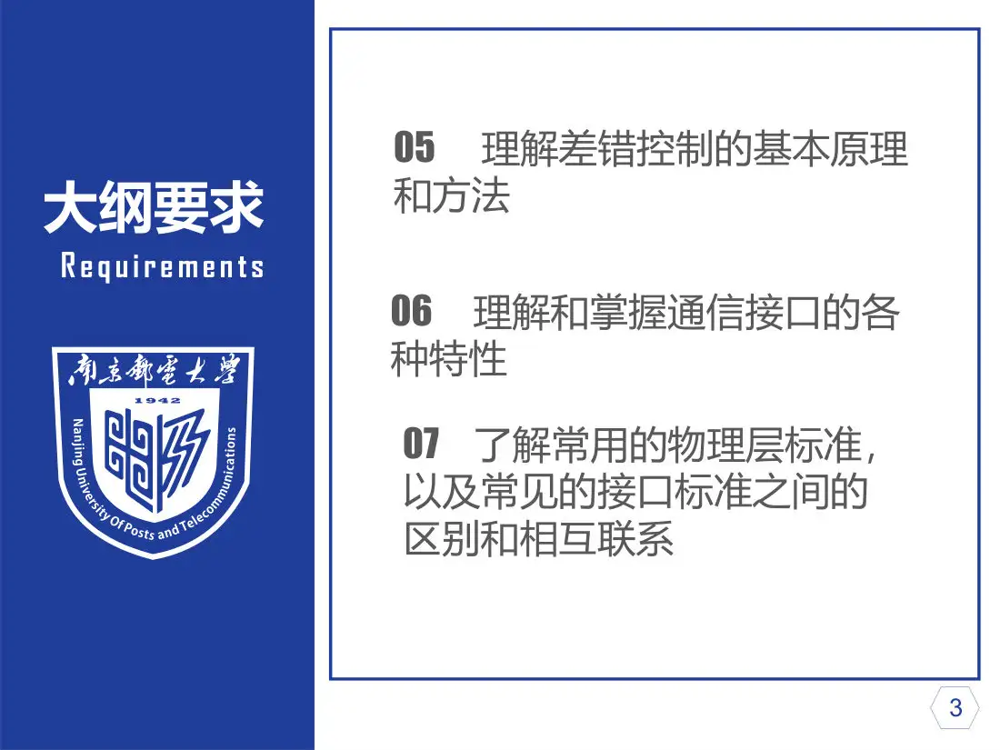

原文：

大纲要求R e q u i r e m e n t s

05 理解差错控制的基本原理和方法

06 理解和掌握通信接口的各种特性

07 了解常用的物理层标准，以及常见的接口标准之间的区别和相互联系

3

### 内容纲要C o n t e n t s P a g e

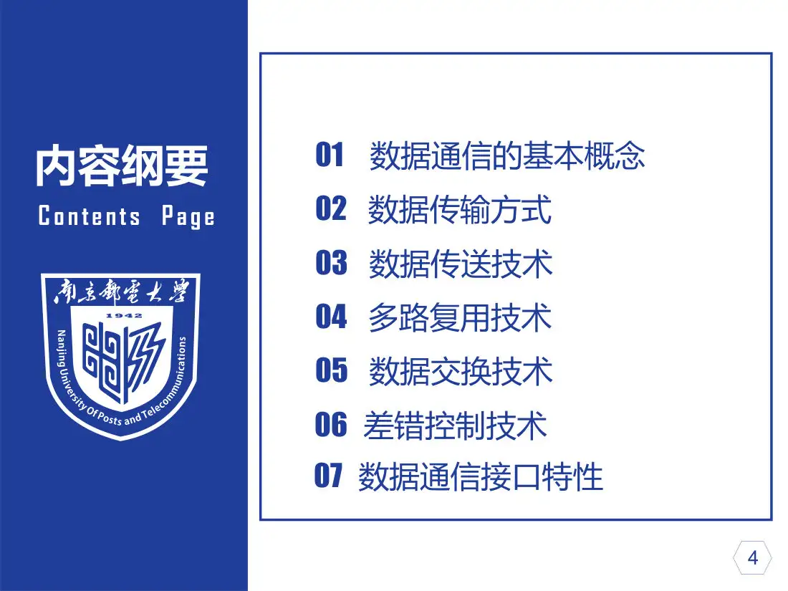

原文：

内容纲要C o n t e n t s P a g e

01 数据通信的基本概念  
02 数据传输方式  
03 数据传送技术  
04 多路复用技术  
05 数据交换技术  
06 差错控制技术  
07 数据通信接口特性

4

### 过渡页 T r a n s i t i o n P a g e

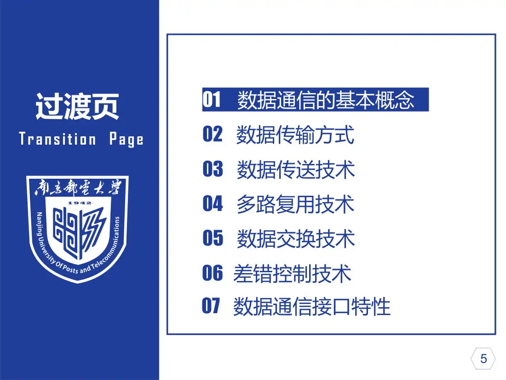

原文：

过渡页 T r a n s i t i o n P a g e

01 数据通信的基本概念
02 数据传输方式
03 数据传送技术
04 多路复用技术
05 数据交换技术
06 差错控制技术
07 数据通信接口特性

5

### 信息、数据和信号

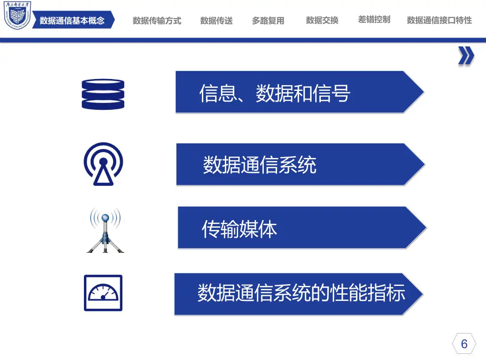

原文：

信息、数据和信号
数据通信系统
传输媒体
数据通信系统的性能指标

南志郵電大學Nanjing Ur

数据通信基本概念

数据传输方式 数据传送 多路复用 数据交换 差错控制 数据通信接口特性

6

### 基本概念

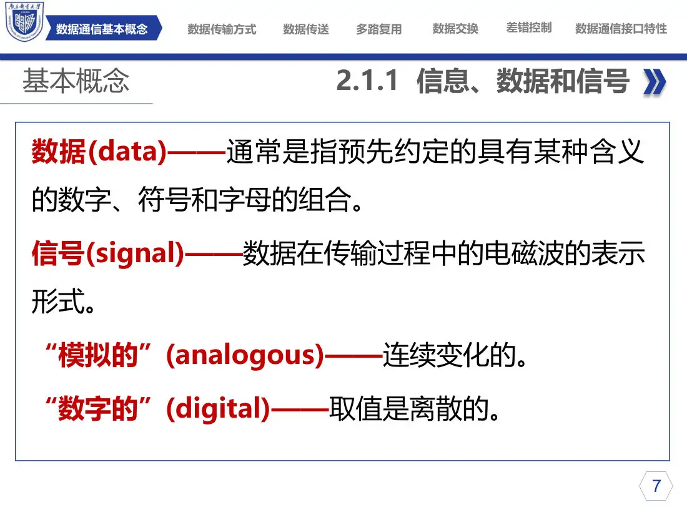

原文：

基本概念

2.1.1 信息、数据和信号

数据(data)——通常是指预先约定的具有某种含义的数字、符号和字母的组合。

信号(signal)——数据在传输过程中的电磁波的表示形式。

“模拟的”(analogous)— —连续变化的。

“数字的”(digital)— —取值是离散的。

南志郵電大學Nanjing Ur

数据通信基本概念

数据传输方式 数据传送 多路复用 数据交换 差错控制 数据通信接口特性

7

### 数据和信号

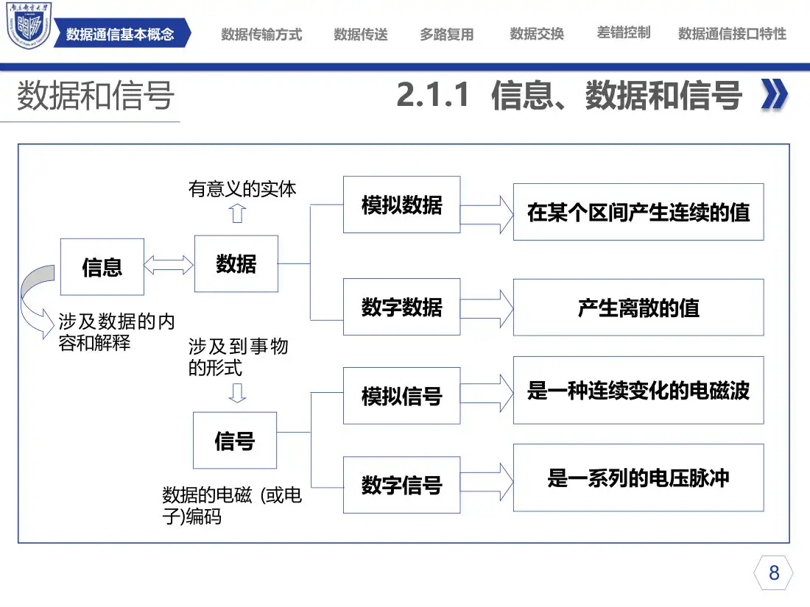

原文：

数据和信号

2.1.1 信息、数据和信号

南立都電大學Naning

数据通信基本概念

数据传输方式

数据传送

多路复用

数据交换

差错控制

数据通信接口特性

8

### 数据和信号

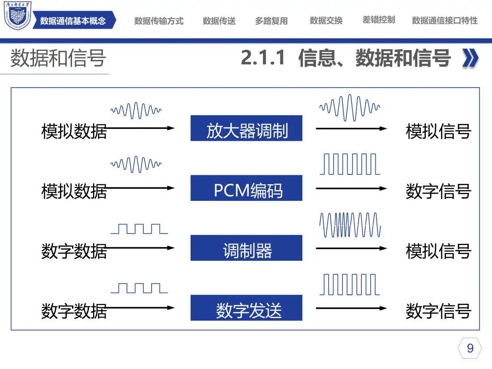

原文：

数据和信号

2.1.1 信息、数据和信号

数据传输方式 数据传送 多路复用 数据交换 差错控制 数据通信接口特性

南志郵電大學Nanjing Ur

数据通信基本概念

9

### 基本模型

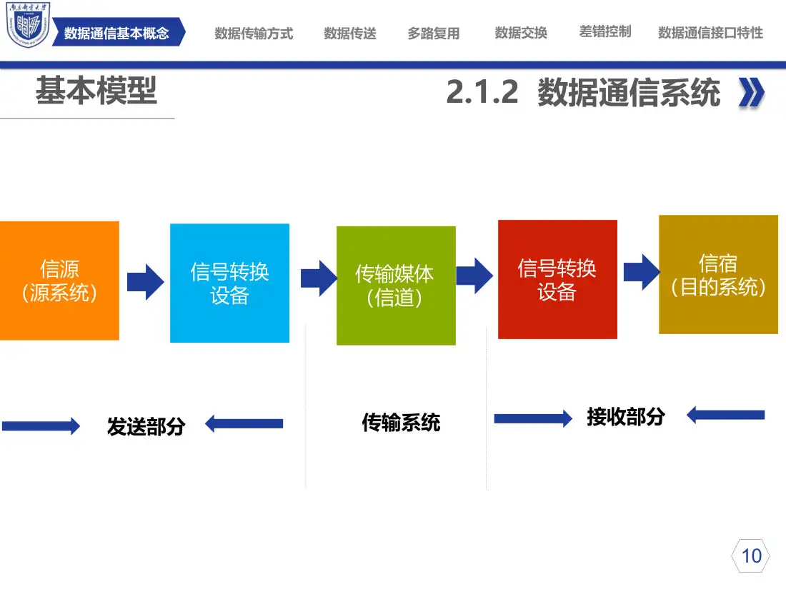

原文：

基本模型

信源（源系统）

2.1.2 数据通信系统

信号转换设备传输媒体（信道）

信号转换设备

信宿（目的系统）

发送部分

传输系统

接收部分

南志郵電大學Nanjing Ur

数据通信基本概念

数据传输方式

数据传送

多路复用

数据交换

差错控制

数据通信接口特性

10

### 2.1.2 数据通信系统

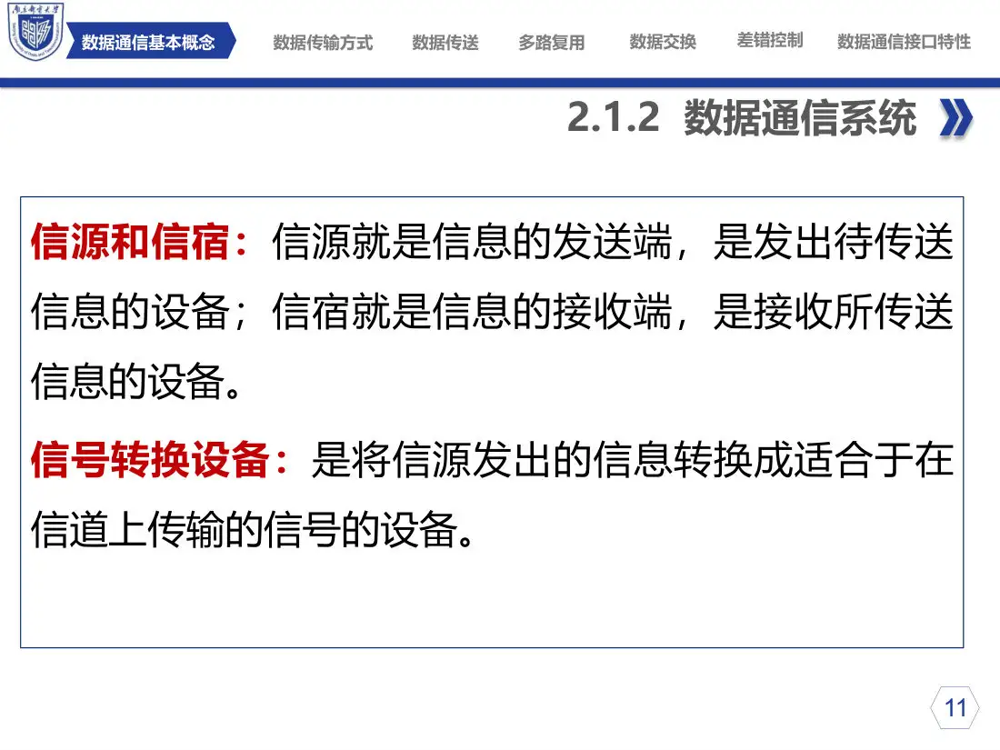

原文：

2.1.2 数据通信系统

信源和信宿：信源就是信息的发送端，是发出待传送信息的设备；信宿就是信息的接收端，是接收所传送信息的设备。

信号转换设备：是将信源发出的信息转换成适合于在信道上传输的信号的设备。

南志郵電大學Nanjing Ur

数据通信基本概念

数据传输方式 数据传送 多路复用 数据交换 差错控制 数据通信接口特性

11

### 数据通信系统举例

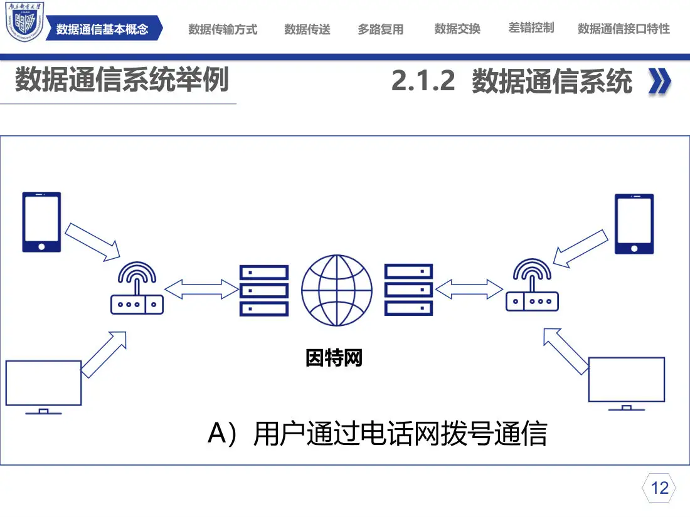

原文：

数据通信系统举例

2.1.2 数据通信系统

A）用户通过电话网拨号通信

南志郵電大學Nanjing Ur

数据通信基本概念

数据传输方式

数据传送

多路复用

数据交换

差错控制

数据通信接口特性

12

### 数据通信系统举例

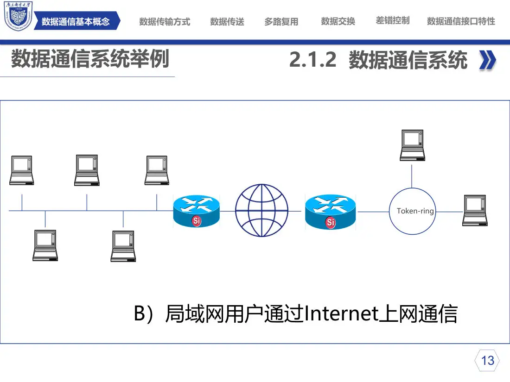

原文：

数据通信系统举例

2.1.2 数据通信系统

南志郵電大學Nanjing Ur

数据通信基本概念

数据传输方式 数据传送 多路复用 数据交换 差错控制 数据通信接口特性

13

### 2.1.3 传输媒体

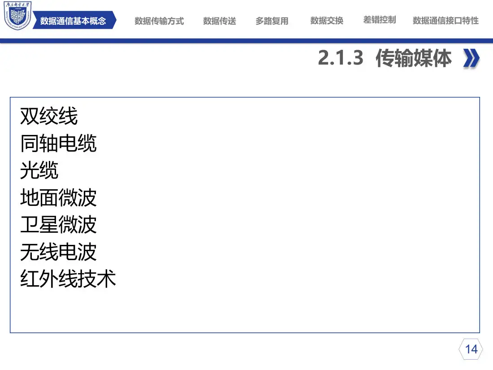

原文：

2.1.3 传输媒体

双绞线

同轴电缆

光缆

地面微波

卫星微波

无线电波

红外线技术

南志郵電大學Nanjing Ur

数据通信基本概念

数据传输方式 数据传送 多路复用 数据交换 差错控制 数据通信接口特性

14

### 双绞线

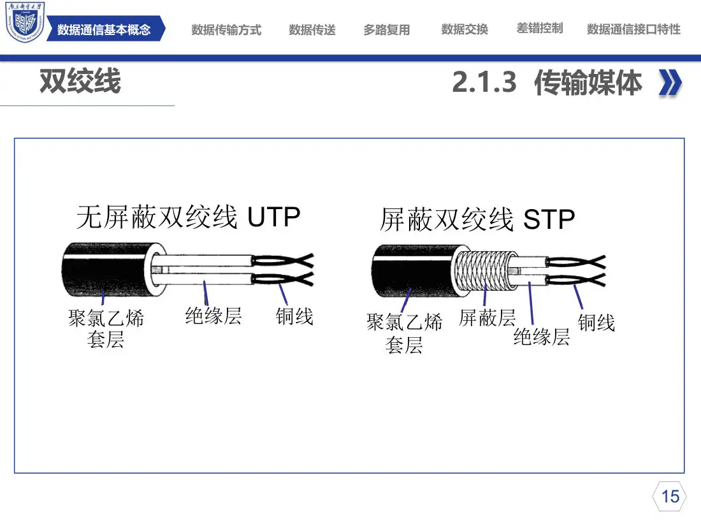

原文：

双绞线

2.1.3 传输媒体

无屏蔽双绞线 UTP

聚氯乙烯 套层

屏蔽双绞线 STP

聚氯乙烯 套层

南志郵電大學Nanjing Ur

数据通信基本概念

数据传输方式 数据传送 多路复用 数据交换 差错控制 数据通信接口特性

15

### 双绞线

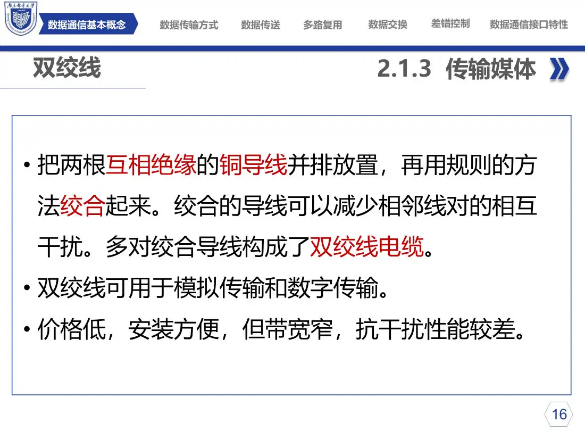

原文：

双绞线

2.1.3 传输媒体

• 把两根互相绝缘的铜导线并排放置，再用规则的方法绞合起来。绞合的导线可以减少相邻线对的相互干扰。多对绞合导线构成了双绞线电缆。

• 双绞线可用于模拟传输和数字传输。

• 价格低，安装方便，但带宽窄，抗干扰性能较差。

南志郵電大學Nanjing Ur

数据通信基本概念

数据传输方式 数据传送 多路复用 数据交换 差错控制 数据通信接口特性

16

### 双绞线

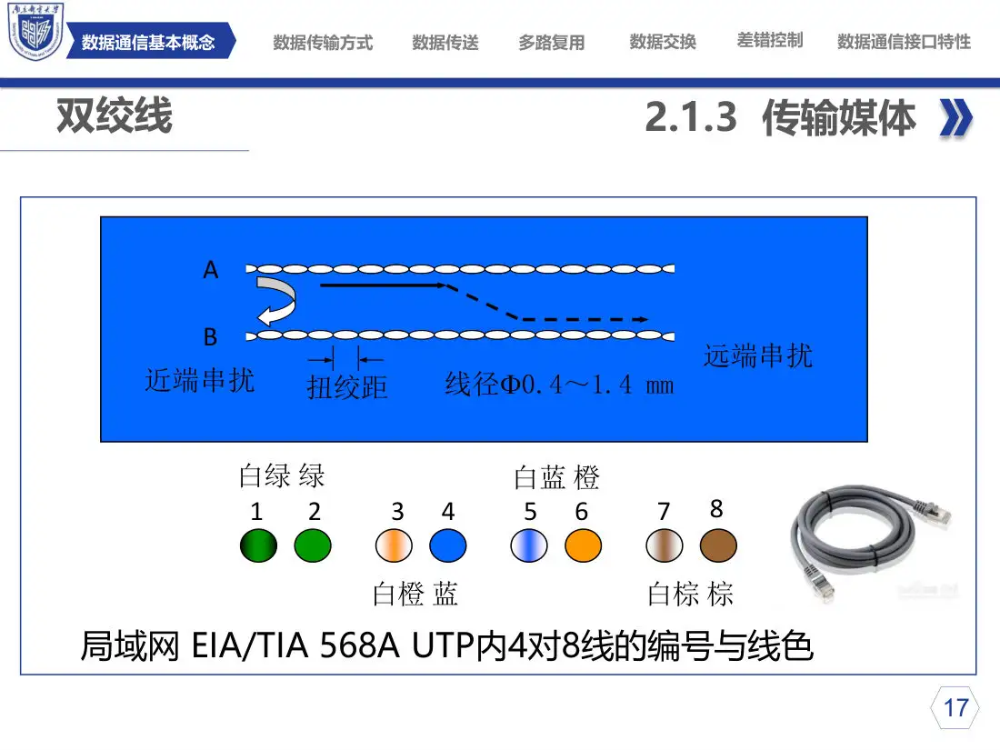

原文：

双绞线

2.1.3 传输媒体

南志郵電大學Nanjing Ur

数据通信基本概念

数据传输方式 数据传送 多路复用 数据交换 差错控制 数据通信接口特性

17

### 同轴电缆

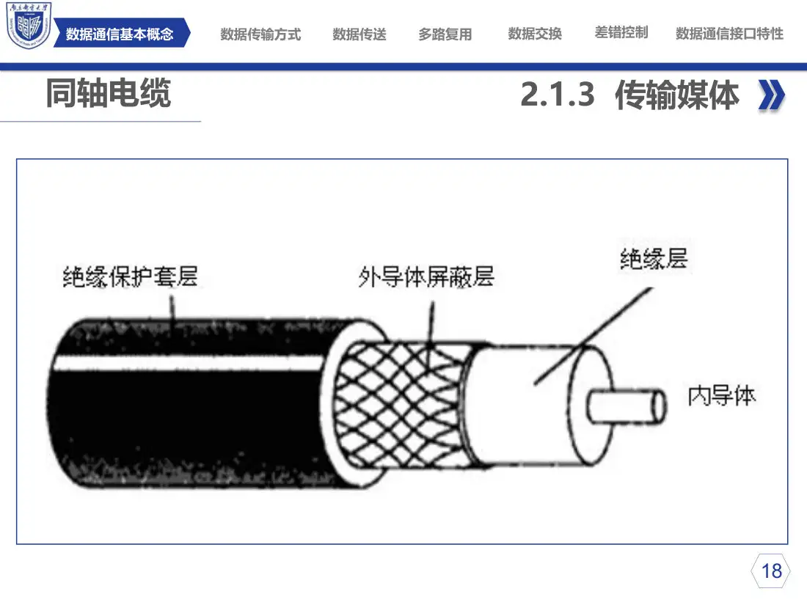

原文：

同轴电缆

2.1.3 传输媒体

南志郵電大學Nanjing Ur

数据通信基本概念

数据传输方式 数据传送 多路复用 数据交换 差错控制 数据通信接口特性

18

### 同轴电缆

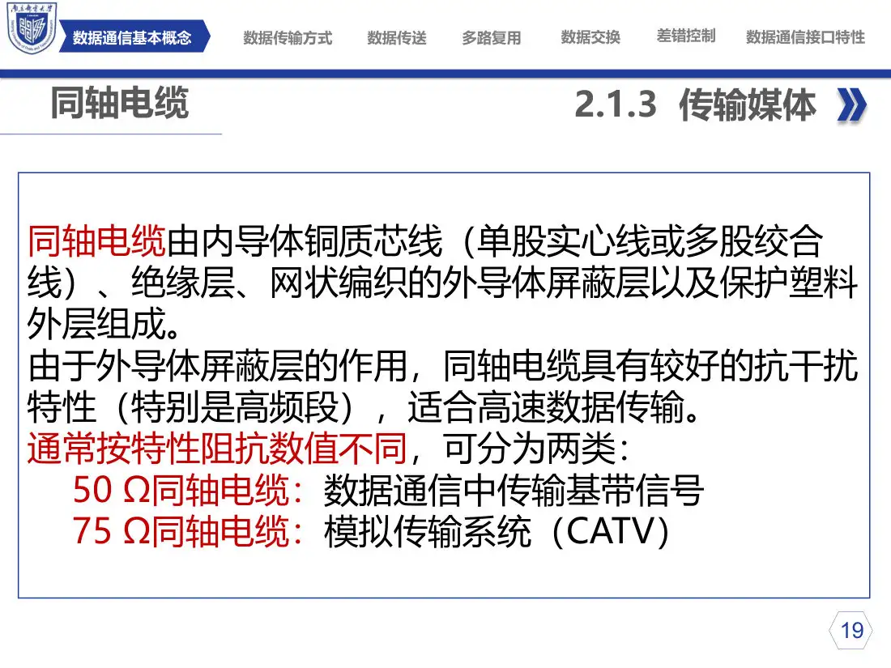

原文：

同轴电缆

2.1.3 传输媒体

同轴电缆由内导体铜质芯线（单股实心线或多股绞合线）、绝缘层、网状编织的外导体屏蔽层以及保护塑料外层组成。

由于外导体屏蔽层的作用，同轴电缆具有较好的抗干扰特性（特别是高频段），适合高速数据传输。

通常按特性阻抗数值不同，可分为两类：

50 Ω同轴电缆：数据通信中传输基带信号

75 Ω同轴电缆：模拟传输系统（CATV）

南志郵電大學Nanjing Ur

数据通信基本概念

数据传输方式 数据传送 多路复用 数据交换 差错控制 数据通信接口特性

19

### 光缆

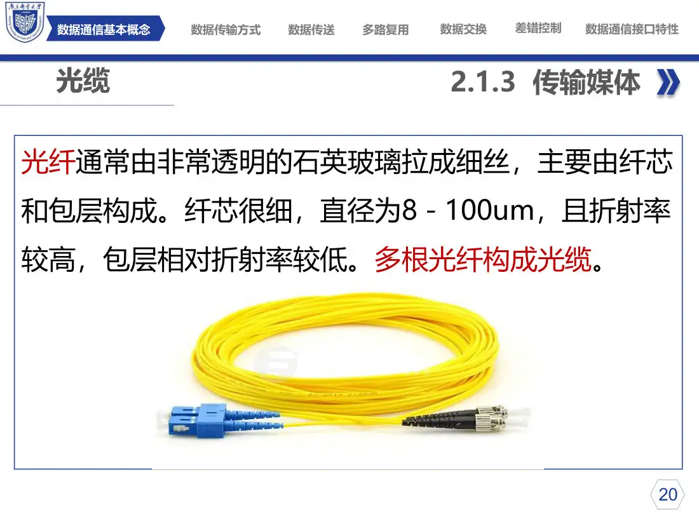

原文：

光缆

2.1.3 传输媒体

光纤通常由非常透明的石英玻璃拉成细丝，主要由纤芯和包层构成。纤芯很细，直径为8－100um，且折射率较高，包层相对折射率较低。多根光纤构成光缆。

南志郵電大學Nanjing Ur

数据通信基本概念

数据传输方式 数据传送 多路复用 数据交换 差错控制 数据通信接口特性

20

### 光缆

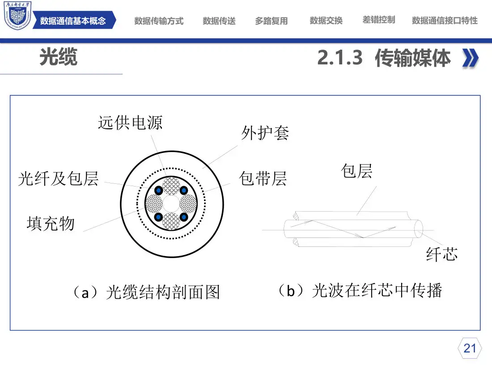

原文：

光缆

2.1.3 传输媒体

南志郵電大學Nanjing Ur

数据通信基本概念

数据传输方式 数据传送 多路复用 数据交换 差错控制 数据通信接口特性

21

### 光缆

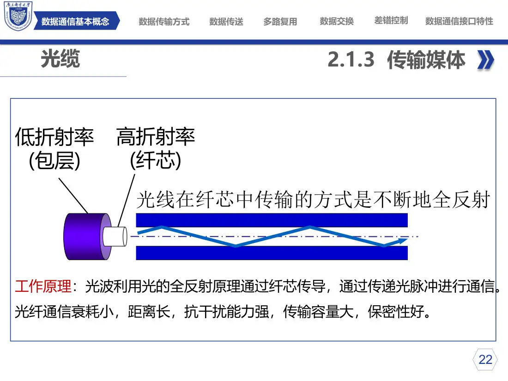

原文：

光缆

2.1.3 传输媒体

低折射率 (包层)

高折射率(纤芯)

光线在纤芯中传输的方式是不断地全反射

工作原理：光波利用光的全反射原理通过纤芯传导，通过传递光脉冲进行通信。光纤通信衰耗小，距离长，抗干扰能力强，传输容量大，保密性好。

南志郵電大學Nanjing Ur

数据通信基本概念

数据传输方式 数据传送 多路复用 数据交换 差错控制 数据通信接口特性

22

### 光缆

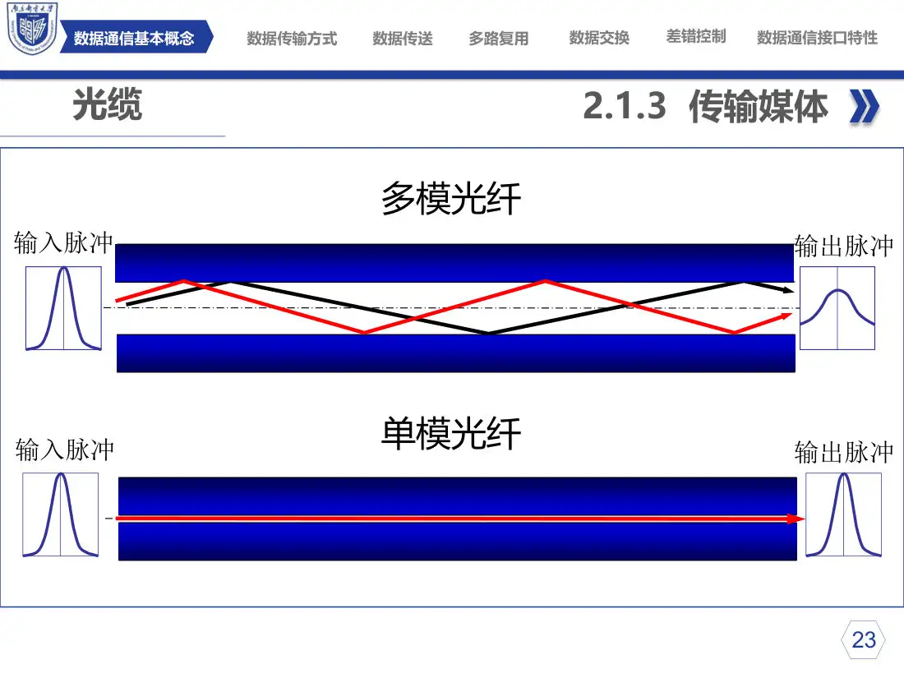

原文：

光缆

2.1.3 传输媒体

南志郵電大學Nanjing Ur

数据通信基本概念

数据传输方式 数据传送 多路复用 数据交换 差错控制 数据通信接口特性

23

### 无线电波

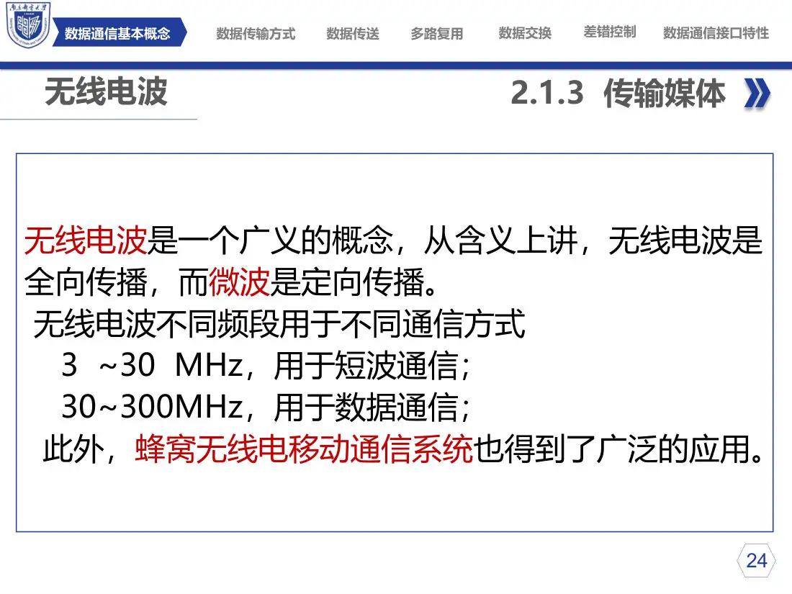

原文：

无线电波

2.1.3 传输媒体

无线电波是一个广义的概念，从含义上讲，无线电波是全向传播，而微波是定向传播。

无线电波不同频段用于不同通信方式

3 \~30 MHz，用于短波通信；

30\~300MHz，用于数据通信；

此外，蜂窝无线电移动通信系统也得到了广泛的应用。

南志郵電大學Nanjing Ur

数据通信基本概念

数据传输方式 数据传送 多路复用 数据交换 差错控制 数据通信接口特性

24

### 微波通信

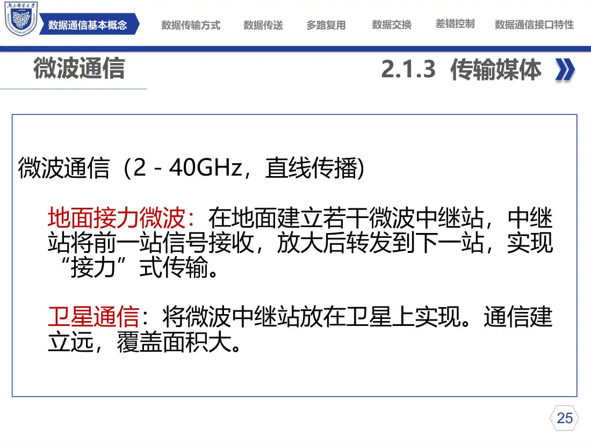

原文：

微波通信

2.1.3 传输媒体

微波通信（2－40GHz，直线传播)

地面接力微波：在地面建立若干微波中继站，中继站将前一站信号接收，放大后转发到下一站，实现“接力”式传输。

卫星通信：将微波中继站放在卫星上实现。通信建立远，覆盖面积大。

南志郵電大學Nanjing Ur

数据通信基本概念

数据传输方式 数据传送 多路复用 数据交换 差错控制 数据通信接口特性

25

### 地面微波

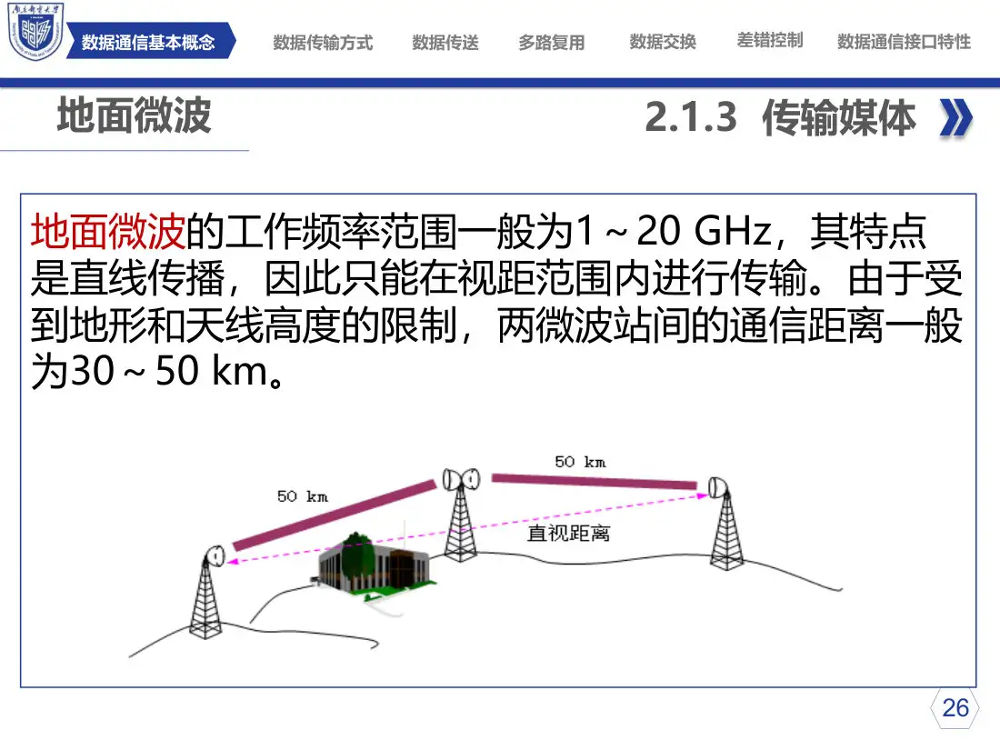

原文：

地面微波

2.1.3 传输媒体

地面微波的工作频率范围一般为1～20 GHz，其特点是直线传播，因此只能在视距范围内进行传输。由于受到地形和天线高度的限制，两微波站间的通信距离一般为30～50 km。

南志郵電大學Nanjing Ur

数据通信基本概念

数据传输方式 数据传送 多路复用 数据交换 差错控制 数据通信接口特性

26

### 卫星微波

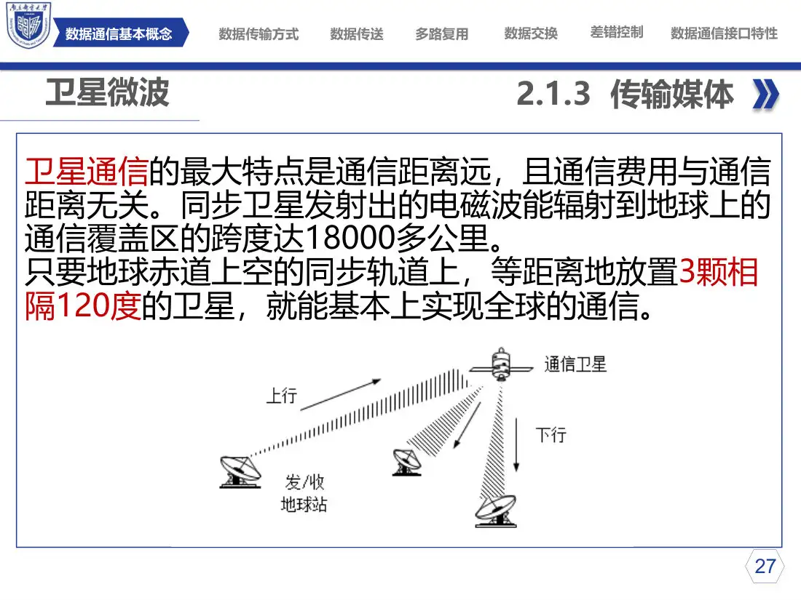

原文：

卫星微波

2.1.3 传输媒体

卫星通信的最大特点是通信距离远，且通信费用与通信距离无关。同步卫星发射出的电磁波能辐射到地球上的通信覆盖区的跨度达18000多公里。

只要地球赤道上空的同步轨道上，等距离地放置3颗相隔120度的卫星，就能基本上实现全球的通信。

南志郵電大學Nanjing Ur

数据通信基本概念

数据传输方式 数据传送 多路复用 数据交换 差错控制 数据通信接口特性

27

### 红外线

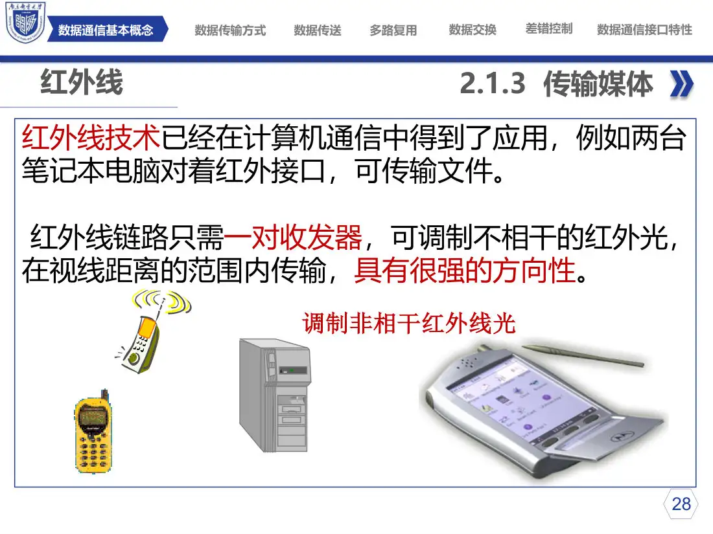

原文：

红外线

2.1.3 传输媒体

红外线技术已经在计算机通信中得到了应用，例如两台笔记本电脑对着红外接口，可传输文件。

红外线链路只需一对收发器，可调制不相干的红外光，在视线距离的范围内传输，具有很强的方向性。

南志郵電大學Nanjing Ur

数据通信基本概念

数据传输方式 数据传送 多路复用 数据交换 差错控制 数据通信接口特性

28

### 2.1.4 数据通信系统的技术指标

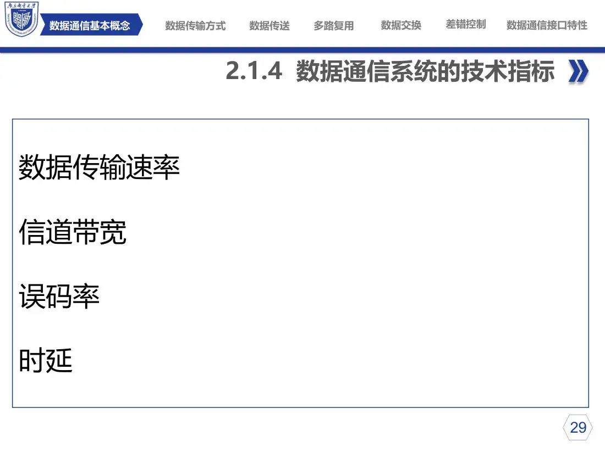

原文：

2.1.4 数据通信系统的技术指标

数据传输速率

信道带宽

误码率

时延

南志郵電大學Nanjing Ur

数据通信基本概念

数据传输方式 数据传送 多路复用 数据交换 差错控制 数据通信接口特性

29

### 数据传输速率

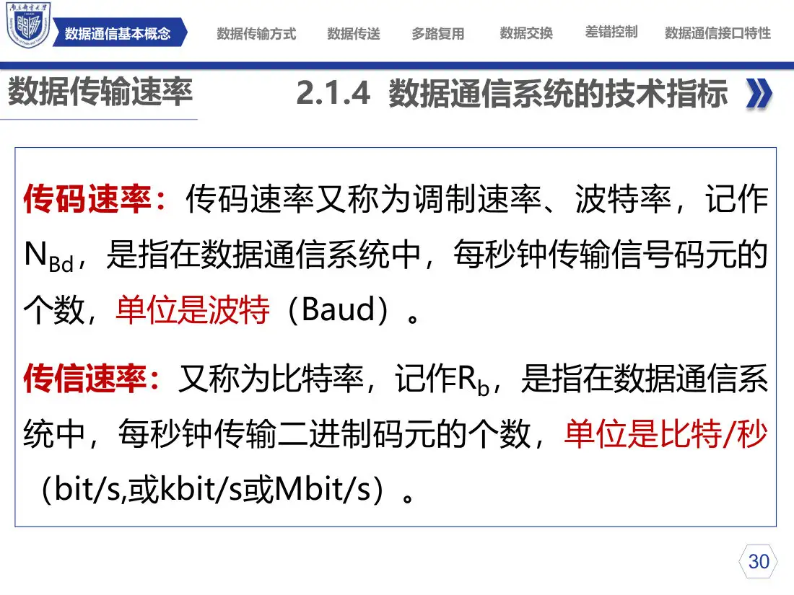

原文：

数据传输速率

2.1.4 数据通信系统的技术指标

传码速率：传码速率又称为调制速率、波特率，记作$\mathsf { N } _ { \mathsf { B d } }$ ，是指在数据通信系统中，每秒钟传输信号码元的个数，单位是波特（Baud）。

传信速率：又称为比特率，记作 $\mathsf { R } _ { \mathsf { b } }$ ，是指在数据通信系统中，每秒钟传输二进制码元的个数，单位是比特/秒（bit/s,或kbit/s或Mbit/s）。

南志郵電大學Nanjing Ur

数据通信基本概念

数据传输方式 数据传送 多路复用 数据交换 差错控制 数据通信接口特性

30

### 2.1.4 数据通信系统的技术指标

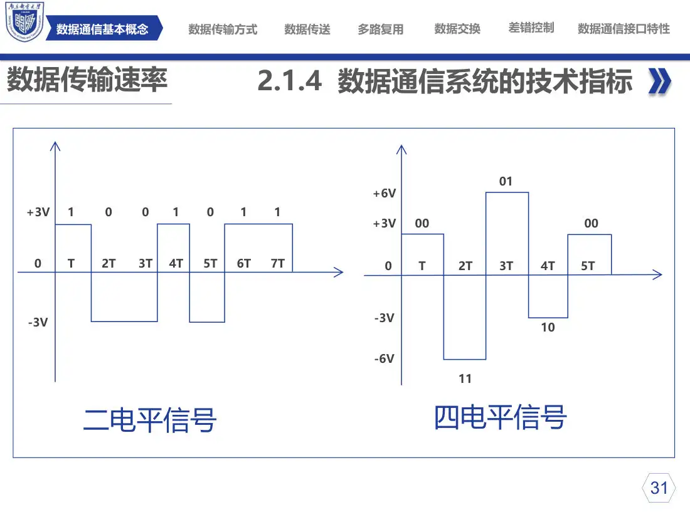

原文：

2.1.4 数据通信系统的技术指标

数据传输速率

南志郵電大學Nanjing Ur

数据通信基本概念

数据传输方式 数据传送 多路复用 数据交换 差错控制 数据通信接口特性

31

### 数据传输速率

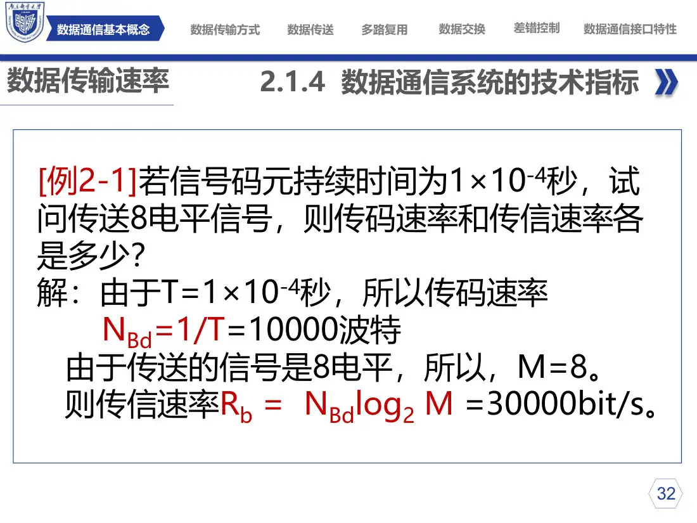

原文：

数据传输速率

2.1.4 数据通信系统的技术指标

[例2-1]若信号码元持续时间为1×10-4秒，试 问传送8电平信号，则传码速率和传信速率各 是多少？

解：由于 $\cdot T { = } 1 \times 1 0 ^ { - 4 } $ 秒，所以传码速率

$\Nu _ { \mathrm { B d } } = 1 / \top = 1 0 0 0 0$ 波特

由于传送的信号是8电平，所以， $M = 8$ 0则传信速率 $\mathsf { R } _ { \mathsf { b } } = \mathsf { N } _ { \mathsf { B d } } | \mathsf { o g } _ { 2 } \mathsf { M } = 3 0 0 0 0 \mathsf { b i t } / \mathsf { s }$ 0

南志郵電大學Nanjing Ur

数据通信基本概念

数据传输方式 数据传送 多路复用 数据交换 差错控制 数据通信接口特性

32

### 信道带宽

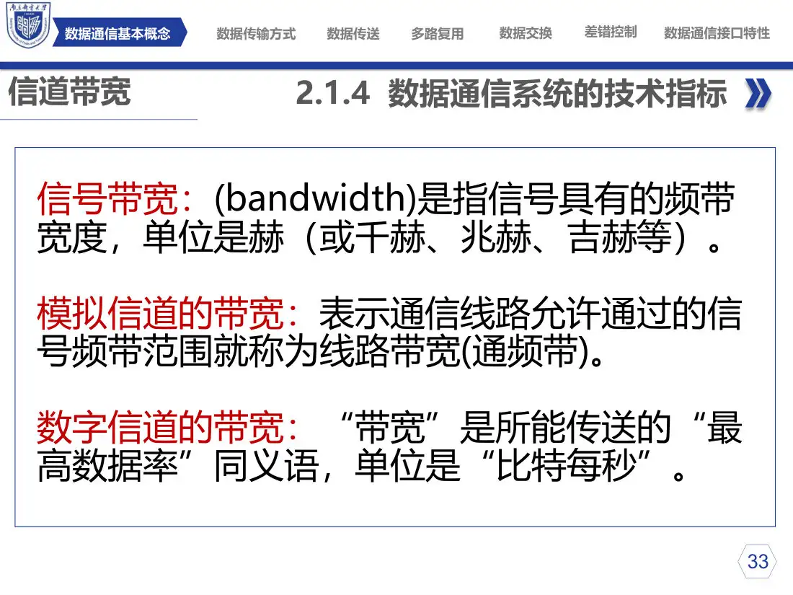

原文：

信道带宽

2.1.4 数据通信系统的技术指标

信号带宽：(bandwidth)是指信号具有的频带宽度，单位是赫（或千赫、兆赫、吉赫等）。

模拟信道的带宽：表示通信线路允许通过的信号频带范围就称为线路带宽(通频带)。

数字信道的带宽：“带宽”是所能传送的“最高数据率”同义语，单位是“比特每秒”。

南志郵電大學Nanjing Ur

数据通信基本概念

数据传输方式 数据传送 多路复用 数据交换 差错控制 数据通信接口特性

33

### 信道带宽

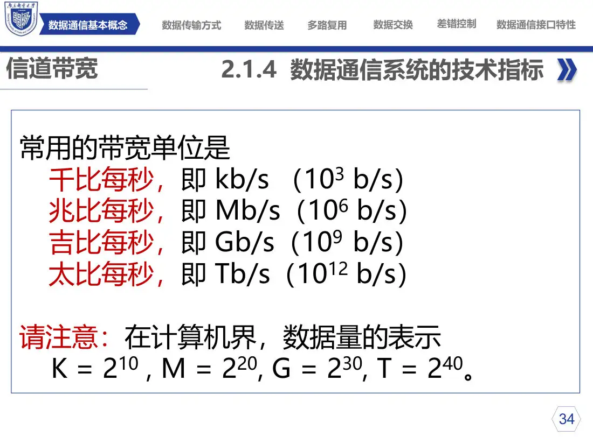

原文：

信道带宽

2.1.4 数据通信系统的技术指标

常用的带宽单位是

千比每秒，即 kb/s （103 b/s）兆比每秒，即 Mb/s（106 b/s）吉比每秒，即 Gb/s（109 b/s）太比每秒，即 Tb/s（1012 b/s）

请注意：在计算机界，数据量的表示

$$
K = 2 ^ {1 0}, M = 2 ^ {2 0}, G = 2 ^ {3 0}, T = 2 ^ {4 0}.
$$

南志郵電大學Nanjing Ur

数据通信基本概念

数据传输方式 数据传送 多路复用 数据交换 差错控制 数据通信接口特性

34

### 误码率

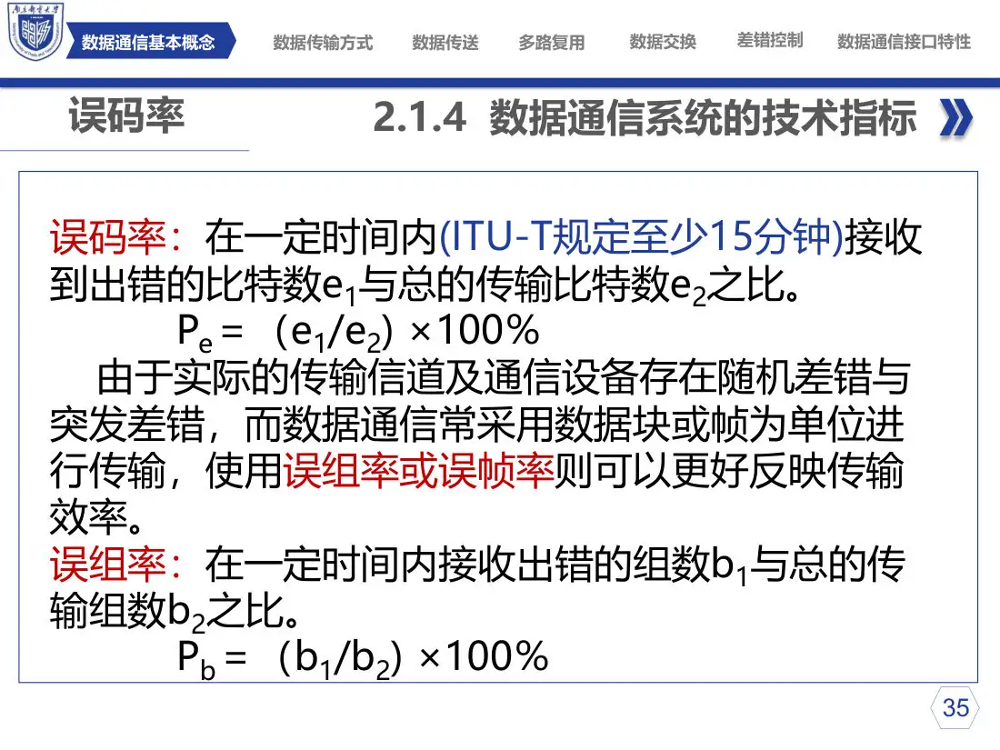

原文：

误码率

2.1.4 数据通信系统的技术指标

误码率：在一定时间内(ITU-T规定至少15分钟)接收到出错的比特数 $\epsilon _ { 1 }$ 与总的传输比特数 $\displaystyle \mathrm { e } _ { 2 }$ 之比。

$$
P _ {e} = (e _ {1} / e _ {2}) \times 100 \%
$$

由于实际的传输信道及通信设备存在随机差错与突发差错，而数据通信常采用数据块或帧为单位进行传输，使用误组率或误帧率则可以更好反映传输效率。

误组率：在一定时间内接收出错的组数 $\mathsf { b } _ { 1 }$ 与总的传输组数 ${ \sf b } _ { 2 }$ 之比。

$$
P _ {b} = (b _ {1} / b _ {2}) \times 100 \%
$$

南志郵電大學Nanjing Ur

数据通信基本概念

数据传输方式 数据传送 多路复用 数据交换 差错控制 数据通信接口特性

35

### 误码率

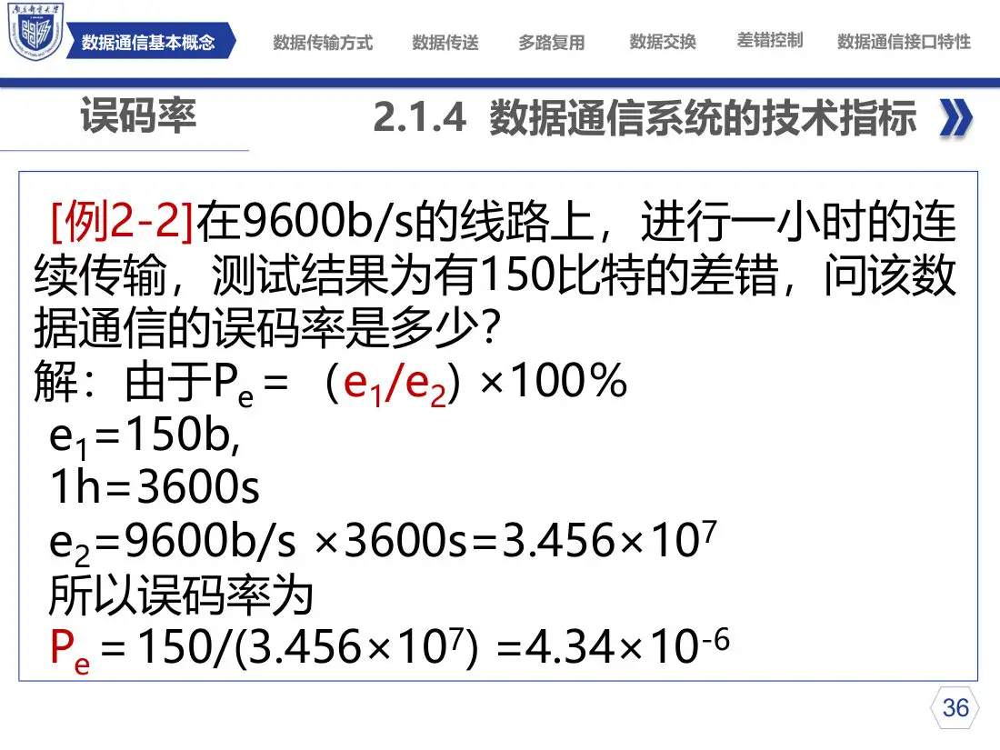

原文：

误码率

2.1.4 数据通信系统的技术指标

南志郵電大學Nanjing Ur

数据通信基本概念

数据传输方式 数据传送 多路复用 数据交换 差错控制 数据通信接口特性

36

### 时延

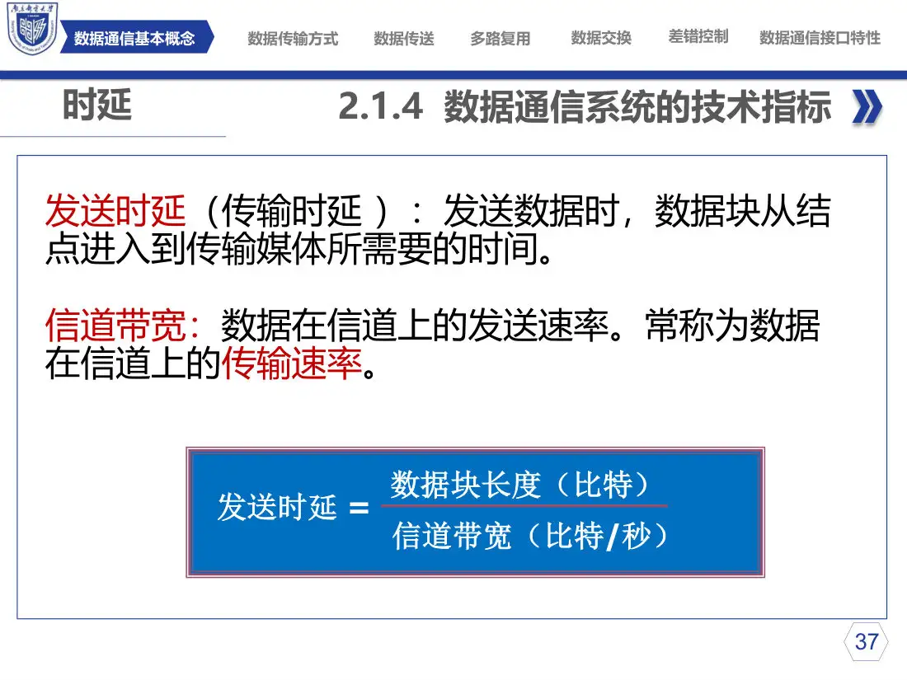

原文：

时延

2.1.4 数据通信系统的技术指标

发送时延（传输时延 ）：发送数据时，数据块从结点进入到传输媒体所需要的时间。

信道带宽：数据在信道上的发送速率。常称为数据在信道上的传输速率。

数据块长度 （比特）发送时延 =信道带宽（比特/秒）

南志郵電大學Nanjing Ur

数据通信基本概念

数据传输方式 数据传送 多路复用 数据交换 差错控制 数据通信接口特性

37

### 时延

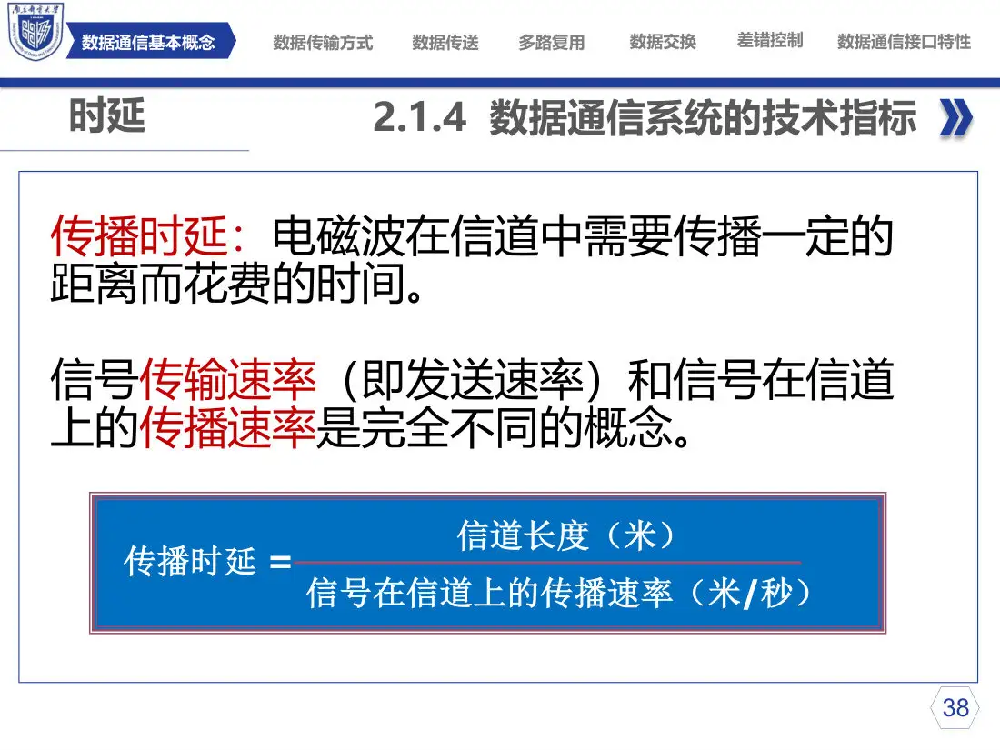

原文：

时延

2.1.4 数据通信系统的技术指标

传播时延：电磁波在信道中需要传播一定的距离而花费的时间。

信号传输速率（即发送速率）和信号在信道上的传播速率是完全不同的概念。

传播时延

信道长度（米）

信号在信道上的传播速率（米/秒）

南志郵電大學Nanjing Ur

数据通信基本概念

数据传输方式 数据传送 多路复用 数据交换 差错控制 数据通信接口特性

38

### 时延

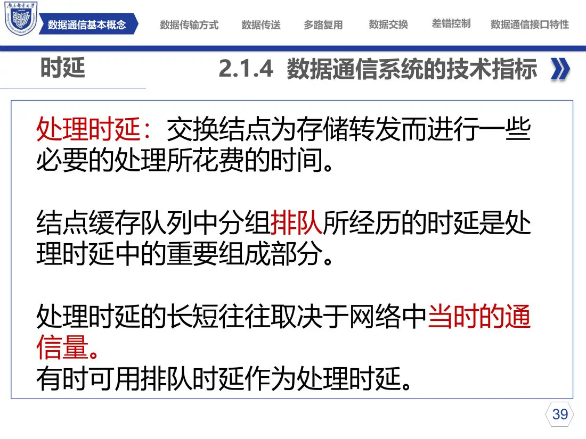

原文：

时延

2.1.4 数据通信系统的技术指标

处理时延：交换结点为存储转发而进行一些必要的处理所花费的时间。

结点缓存队列中分组排队所经历的时延是处理时延中的重要组成部分。

数据块长度（比特）处理时延的长短往往取决于网络中当时的通信量。

有时可用排队时延作为处理时延。

南志郵電大學Nanjing Ur

数据通信基本概念

数据传输方式 数据传送 多路复用 数据交换 差错控制 数据通信接口特性

39

### 时延

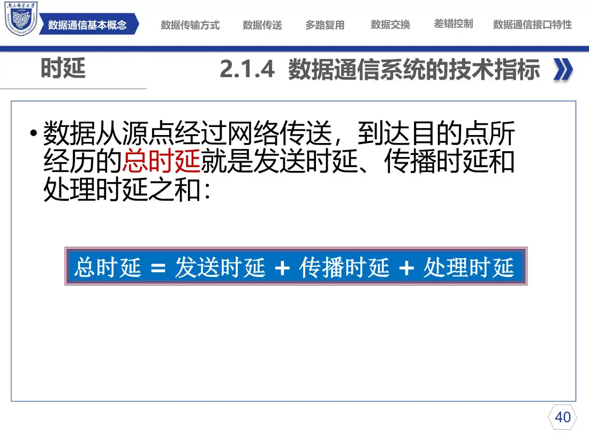

原文：

时延

2.1.4 数据通信系统的技术指标

• 数据从源点经过网络传送，到达目的点所经历的总时延就是发送时延、传播时延和处理时延之和：

总时延 = 发送时延 + 传播时延 + 处理时延

南志郵電大學Nanjing Ur

数据通信基本概念

数据传输方式 数据传送 多路复用 数据交换 差错控制 数据通信接口特性

40

### 时延

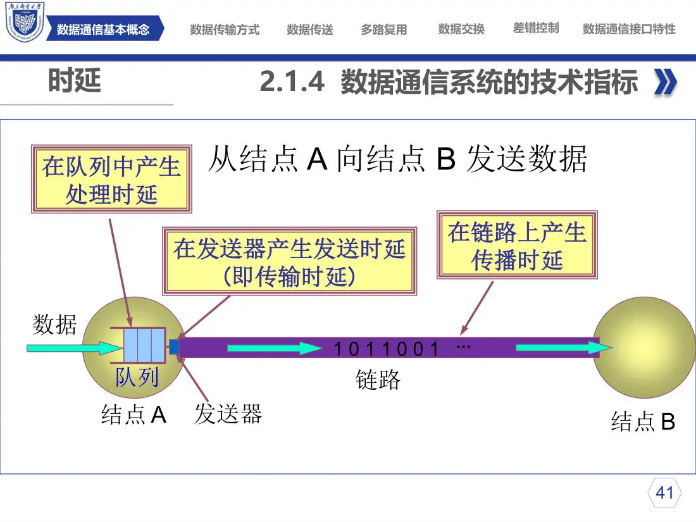

原文：

时延

2.1.4 数据通信系统的技术指标

在队列中产生处理时延

从结点A 向结点 B 发送数据

在发送器产生发送时延(即传输时延)

在链路上产生传播时延

数据

队列

块长链路

发送器结点 A

结点 B

南志郵電大學Nanjing Ur

数据通信基本概念

数据传输方式 数据传送 多路复用 数据交换 差错控制 数据通信接口特性

41

### 时延

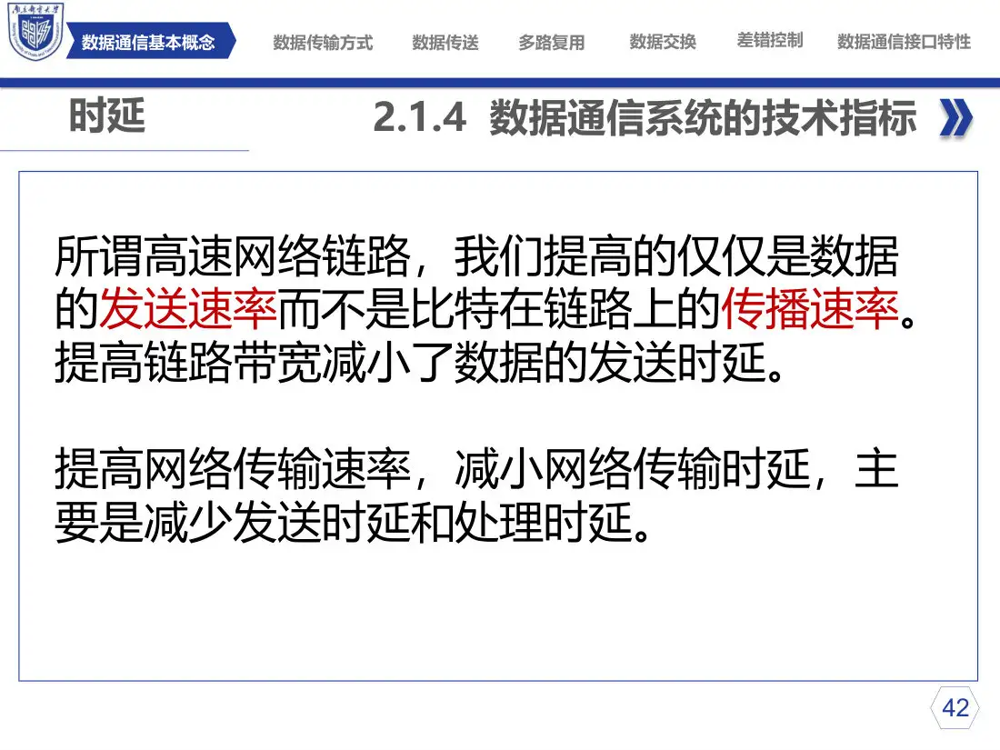

原文：

时延

2.1.4 数据通信系统的技术指标

所谓高速网络链路，我们提高的仅仅是数据的发送速率而不是比特在链路上的传播速率。提高链路带宽减小了数据的发送时延。

提高网络传输速率，减小网络传输时延，主要是减少发送时延和处理时延。

南志郵電大學Nanjing Ur

数据通信基本概念

数据传输方式 数据传送 多路复用 数据交换 差错控制 数据通信接口特性

42

### 时延

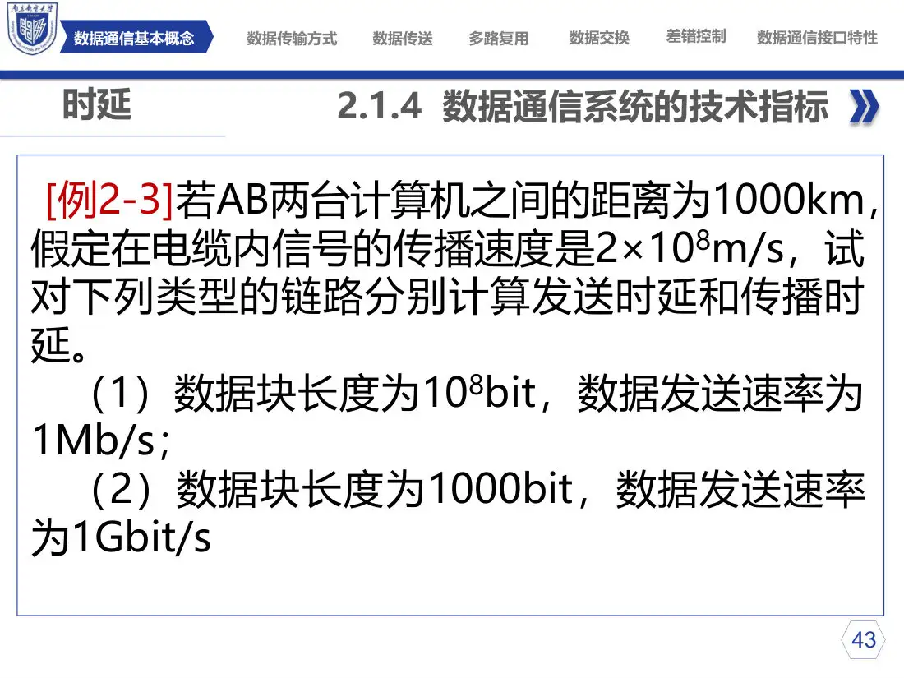

原文：

时延

2.1.4 数据通信系统的技术指标

[例2-3]若AB两台计算机之间的距离为1000km，假定在电缆内信号的传播速度是 $2 \times 1 0 ^ { 8 } \mathrm { m } / s$ ，试对下列类型的链路分别计算发送时延和传播时延。

（1）数据块长度为 $1 0 ^ { 8 } b i t$ ，数据发送速率为1Mb/s；

（2）数据块长度为1000bit，数据发送速率为1Gbit/s

南志郵電大學Nanjing Ur

数据通信基本概念

数据传输方式 数据传送 多路复用 数据交换 差错控制 数据通信接口特性

43

### 时延

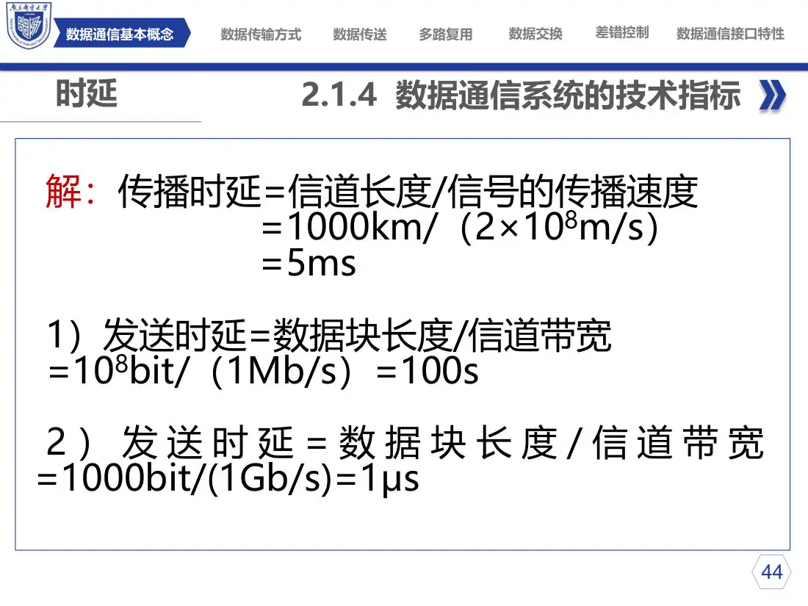

原文：

时延

2.1.4 数据通信系统的技术指标

解：传播时延=信道长度/信号的传播速度=1000km/（2×108m/s）=5ms

1）发送时延=数据块长度/信道带宽$= 1 0 ^ { 8 } \mathsf { b i t } / \ \left( 1 \mathsf { M b } / \mathsf { s } \right) \ = 1 0 0 \mathsf { s }$

发送时延2 ） 发 送 时 延 = 数 据 块 长 度/ 信 道 带 宽$= 1 0 0 0 0 \dot { 1 } \dot { 5 } / ( 1 5 0 / { \mathsf { s } } ) = 1 \mu { \mathsf { s } }$

南志郵電大學Nanjing Ur

数据通信基本概念

数据传输方式 数据传送 多路复用 数据交换 差错控制 数据通信接口特性

44

### 过渡页 T r a n s i t i o n P a g e

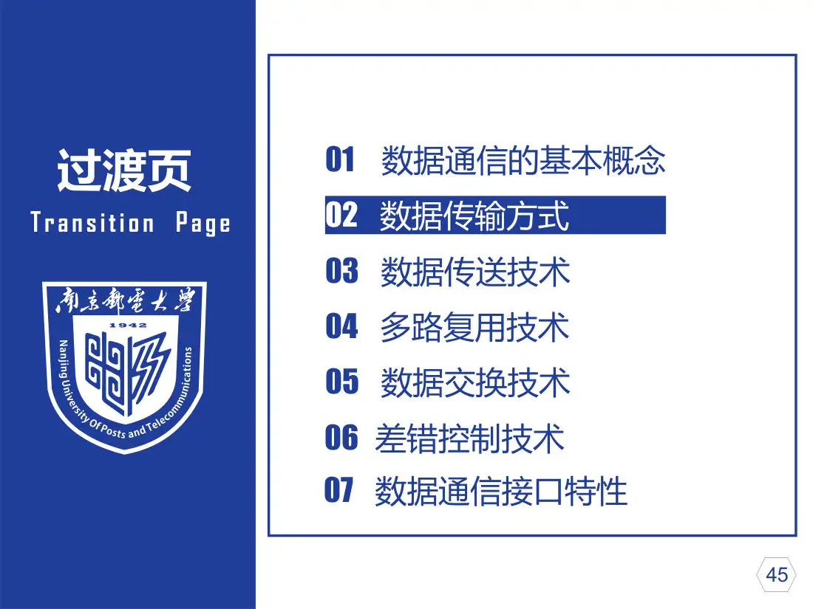

原文：

过渡页 T r a n s i t i o n P a g e

01 数据通信的基本概念
02 数据传输方式
03 数据传送技术
04 多路复用技术
05 数据交换技术
06 差错控制技术
07 数据通信接口特性

45

### 并行传输与串行传输

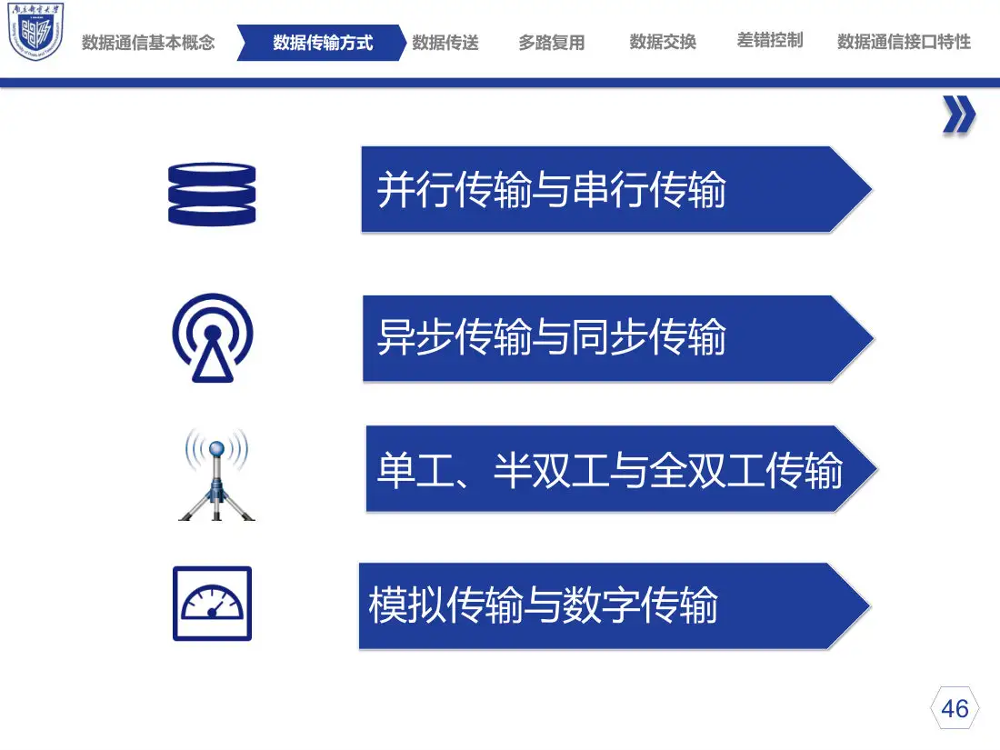

原文：

并行传输与串行传输

异步传输与同步传输

单工、半双工与全双工传输

模拟传输与数字传输

南志郵電大學Nanjing Ur

数据通信基本概念

数据传输方式 数据传送 多路复用 数据交换 差错控制 数据通信接口特性

46

### 并行传输

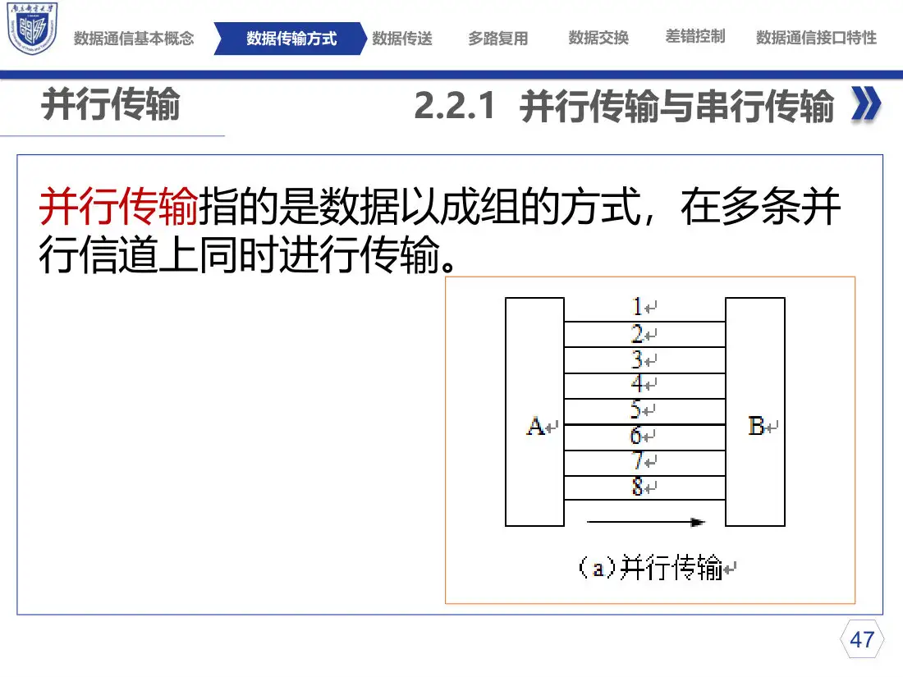

原文：

并行传输

2.2.1 并行传输与串行传输

并行传输指的是数据以成组的方式，在多条并行信道上同时进行传输。

(a)并行传输

南志郵電大學Nanjing Ur

数据通信基本概念

数据传输方式 数据传送 多路复用 数据交换 差错控制 数据通信接口特性

47

### 串行传输

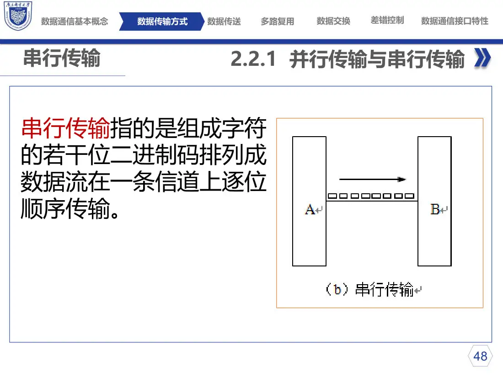

原文：

串行传输

2.2.1 并行传输与串行传输

串行传输指的是组成字符的若干位二进制码排列成数据流在一条信道上逐位顺序传输。

(b) 串行传输

南志郵電大學Nanjing Ur

数据通信基本概念

数据传输方式 数据传送 多路复用 数据交换 差错控制 数据通信接口特性

48

### 异步传输

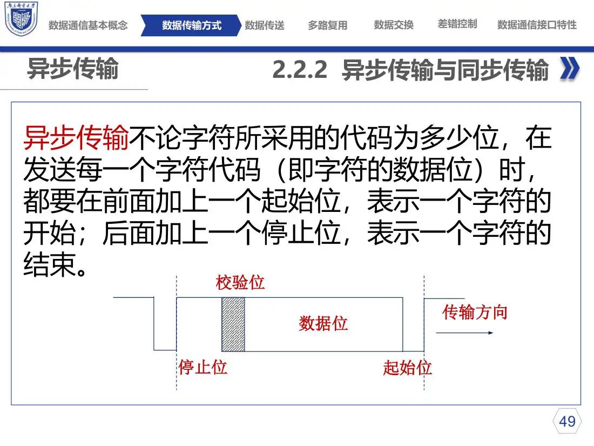

原文：

异步传输

2.2.2 异步传输与同步传输

异步传输不论字符所采用的代码为多少位，在发送每一个字符代码（即字符的数据位）时，都要在前面加上一个起始位，表示一个字符的开始；后面加上一个停止位，表示一个字符的结束。

南志郵電大學Nanjing Ur

数据通信基本概念

数据传输方式 数据传送 多路复用 数据交换 差错控制 数据通信接口特性

49

### 异步传输

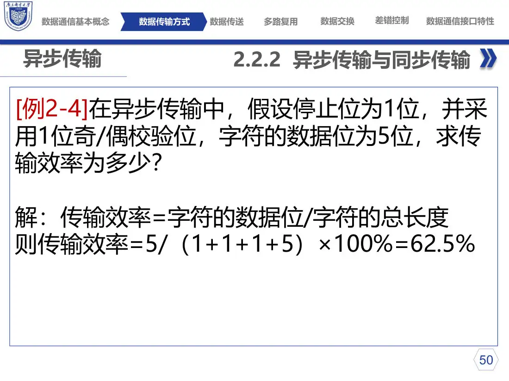

原文：

异步传输

2.2.2 异步传输与同步传输

[例2-4]在异步传输中，假设停止位为1位，并采用1位奇/偶校验位，字符的数据位为5位，求传输效率为多少？

解：传输效率=字符的数据位/字符的总长度则传输效率=5/（1+1+1+5）×100%=62.5%

南志郵電大學Nanjing Ur

数据通信基本概念

数据传输方式 数据传送 多路复用 数据交换 差错控制 数据通信接口特性

50

### 同步传输

原文：

同步传输

2.2.2 异步传输与同步传输

同步传输方式要比异步传输复杂，它是以固定的时钟节拍来发送数据信号的，因此在一个串行数据流中，各信号码元之间的相对位置是固定的（即同步）。

接收端为了从接收到的数据流中正确地区分一个个信号码元，必须具有与发送端一致的时钟信号。

南志郵電大學Nanjing Ur

数据通信基本概念

数据传输方式 数据传送 多路复用 数据交换 差错控制 数据通信接口特性

51

### 同步传输

原文：

同步传输

2.2.2 异步传输与同步传输

在同步通信方式中，发送的数据一般以帧为单位，通常一帧数据中包含多个字符，在一帧数据的前后分别加上若干个同步字符和校验字段传输结束字符来表示一帧的开始和结束。

南志郵電大學Nanjing Ur

数据通信基本概念

数据传输方式 数据传送 多路复用 数据交换 差错控制 数据通信接口特性

52

### 2.2.3 单工、半双工与全双工传输

原文：

2.2.3 单工、半双工与全双工传输

单工传输——只能有一个方向的通信而没有反方向的交互。

半双工传输——通信的双方都可以发送信息，但不能双方同时发送(当然也就不能同时接收)。

全双工传输— —通信的双方可以同时发送和接收信息。

南志郵電大學Nanjing Ur

数据通信基本概念

数据传输方式 数据传送 多路复用 数据交换 差错控制 数据通信接口特性

53

### 模拟传输

原文：

模拟传输

2.2.4 模拟传输与数字传输

模拟信号：时间和幅度取值连续变化的信号量。

模拟信道：适于模拟信号传输的信道

模拟传输系统：传输模拟信号的通信系统

差错控制 数据通信接口特性

数据传送 多路复用

南志郵電大學Nanjing Ur

数据通信基本概念

数据传输方式

数据交换

54

### 2.2.4 模拟传输与数字传输

原文：

2.2.4 模拟传输与数字传输

数字传输

数字信号：时间和幅度取值离散 （不连续 变化）的信号量。

数字信道：适于数字信号传输的信道

数字传输系统：传输数字信号的通信系统

幅度

时间

南志郵電大學Nanjing Ur

数据通信基本概念

数据传输方式 数据传送 多路复用 数据交换 差错控制 数据通信接口特性

55

### 过渡页 T r a n s i t i o n P a g e

原文：

过渡页 T r a n s i t i o n P a g e

01 数据通信的基本概念  
02 数据传输方式  
03 数据传送技术  
04 多路复用技术  
05 数据交换技术  
06 差错控制技术  
07 数据通信接口特性

56

### 数据序列的电信号表示

原文：

数据序列的电信号表示
信道容量的概念
基带传输
频带传输
数字数据传输

数据交换 差错控制 数据通信接口特性

南志郵電大學Nanjing Ur

数据通信基本概念 数据传输方式

数据传送技术

多路复用

57

### 2.3.1 数据序列的电信号表示

原文：

2.3.1 数据序列的电信号表示

数据序列

单极性不归零码

单极性归零码

双极性不归零码

双极性归零码

南志郵電大學Nanjing Ur

数据通信基本概念 数据传输方式

数据传送技术

多路复用 数据交换 差错控制 数据通信接口特性

58

### 2.3.1 数据序列的电信号表示

原文：

2.3.1 数据序列的电信号表示

差分编码

伪三元编码

曼彻斯特编码

差分曼彻斯特编码

南志郵電大學Nanjing Ur

数据通信基本概念 数据传输方式

数据传送技术

多路复用 数据交换 差错控制 数据通信接口特性

59

### 2.3.2 信道容量的概念

原文：

2.3.2 信道容量的概念

任何实际的信道都不是理想的，在传输信号时会产生各种失真以及带来多种干扰。

码元传输的速率越高，或信号传输的距离越远，在信道的输出端的波形的失真就越严重。

南志郵電大學Nanjing Ur

数据通信基本概念 数据传输方式

数据传送技术

多路复用 数据交换 差错控制 数据通信接口特性

60

### 数字信号通过实际的信道

原文：

数字信号通过实际的信道

2.3.2 信道容量的概念

南志郵電大學Nanjing Ur

数据通信基本概念 数据传输方式

数据传送技术

多路复用

数据交换

差错控制

61

### 2.3.2 信道容量的概念

原文：

2.3.2 信道容量的概念

• 信道容量是指在一定的条件下，给定通信路径（信道）上所能达到的最大数据传输速率。

数据传输速率

↑

误码率

信道容量

带宽

噪声

南志郵電大學Nanjing Ur

数据通信基本概念 数据传输方式

数据传送技术

多路复用 数据交换 差错控制 数据通信接口特性

62

### 奈奎斯特定理

原文：

奈奎斯特定理

2.3.2 信道容量的概念

理想低通信道的最高码元传输速率

$$
N = 2 W \text {Baud}
$$

是理想低通信道的带宽，单位为赫(Hz)

南志郵電大學Nanjing Ur

数据通信基本概念 数据传输方式

数据传送技术

多路复用 数据交换 差错控制 数据通信接口特性

63

### 奈奎斯特定理

原文：

奈奎斯特定理

2.3.2 信道容量的概念

无噪声的情况下，在带宽为W 赫兹的信道，其最大的数据传输速率C（信道容量）为C=2Wlog2M

[例2-6] 一个无噪声的话音信道带宽为4000Hz，采用8相调制解调器传送信号，试问信道容量是多少？

南志郵電大學Nanjing Ur

数据通信基本概念 数据传输方式

数据传送技术

多路复用 数据交换 差错控制 数据通信接口特性

64

### 仙农定理

原文：

仙农定理

2.3.2 信道容量的概念

• 仙农(Shannon)用信息论的理论推导出了带宽受限且有高斯白噪声干扰的信道的极限、无差错的信息传输速率。

•信道的极限信息传输速率 C(信道容量） 可表达为 $C = W \log _ { 2 } ( 1 + S / N ) \ b / s$

• W 为信道的带宽（以 Hz 为单位）；

• S为信道内所传信号的平均功率；

• N 为信道内部的高斯噪声功率。

• 信噪比 $( \mathsf { d B } ) \ = \ 1 0 \ \mathsf { l o g } _ { 1 0 } \quad ( \mathsf { S } / N )$

南志郵電大學Nanjing Ur

数据通信基本概念 数据传输方式

数据传送技术

多路复用 数据交换 差错控制 数据通信接口特性

65

### 应用举例

原文：

应用举例

2.3.2 信道容量的概念

[例2-7] 若通过一个信噪比为20dB，带宽为3kHz的信道去传送数字数据，则其数据传信速率不会超过多少？

解：根据 信噪比 $( \mathsf { d B } ) \ = \ 1 0 \ \mathsf { l o g } _ { 1 0 } ( \mathcal { S } / N )$ 可以得到 $S / N = 1 0 0$

按照香农公式，该信道的最大传信速率为：

$$
\begin{array}{r l} {C = W \log_ {2} (1 + S / N)} & {= 3 0 0 0 \times \log_ {2} (1 + 1 0 0)} \\ {= 3 0 0 0 \times 6. 6 6} & {= 1 9. 9 8 \mathrm{kbit/s}} \end{array}
$$

也就是说，该信道的数据传信速率不会超过19.98kbit/s

南志郵電大學Nanjing Ur

数据通信基本概念 数据传输方式

数据传送技术

多路复用 数据交换 差错控制 数据通信接口特性

66

### 仙农公式表明

原文：

仙农公式表明

2.3.2 信道容量的概念

•信道的带宽或信道中的信噪比越大，则信息的极限传输速率就越高。

•只要信息传输速率低于信道的极限信息传输速率，就一定可以找到某种办法来实现无差错的传输。

多路复用 数据交换 差错控制 数据通信接口特性

南志郵電大學NanjingU

数据通信基本概念 数据传输方式

数据传送技术

67

### 仙农公式表明

原文：

仙农公式表明

2.3.2 信道容量的概念

• 若信道带宽 W 或信噪比 S/N 没有上限（当然实际信道不可能是这样的），则信道的极限信息传输速率 C也就没有上限。

•实际信道上能够达到的信息传输速率要比仙农的极限传输速率低不少。

南志郵電大學Nanjing Ur

数据通信基本概念 数据传输方式

数据传送技术

多路复用 数据交换 差错控制 数据通信接口特性

68

### 两者的作用范围

原文：

两者的作用范围

2.3.2 信道容量的概念

南志郵電大學Nanjing Ur

数据通信基本概念 数据传输方式

数据传送技术

多路复用

数据交换

差错控制

69

### 2.3.3 基带传输

原文：

2.3.3 基带传输

在数据通信中，表示计算机中二进制比特序列的数字数据信号是典型的矩形脉冲信号。人们把矩形脉冲信号的固有频带称作基本频带(简称为基带)，这种矩形脉冲信号就叫做基带信号。

在数字信道上，计算机中的数据是以矩形脉冲信号直接传送的，这种传送方法称为基带传输。

数据通信基本概念 数据传输方式 数据传送技术 多路复用 数据交换 差错控制 数据通信接口特性

南志郵電大學Nanjing Ur

70

### 2.3.4 频带传输

原文：

2.3.4 频带传输

•频带传输又称为调制传输，就是先将基带信号变换成便于在模拟信道中传输的、具有较高频率范围的信号（频带信号），再将这种频带信号在信道中传输。

数据通信基本概念 数据传输方式 数据传送技术 多路复用 数据交换 差错控制 数据通信接口特性

南志郵電大學Nanjing Ur

71

### 数字数据，模拟传输

原文：

数字数据，模拟传输

2.3.4 频带传输

•有些传输媒体只适合于传输模拟信号，为充分利用现有的传输资源，必须将数字数据转换为模拟信号才能传输。

•将数字数据转换为模拟信号的过程叫调制（实际上是用数字信号控制模拟信号的某些参数，使模拟信号携带信息）。

•将携带信息的模拟信号转换成数字数据（或称从已调制的模拟信号中提取数字数据）的过程叫解调。

南志郵電大學Nanjing Ur

数据通信基本概念 数据传输方式

数据传送技术

多路复用

数据交换 差错控制 数据通信接口特性

72

### 数字数据，模拟传输

原文：

数字数据，模拟传输

2.3.4 频带传输

• 最常用的数字数据－模拟信号转换设备是调制解调器（MODEM），同时具有调制和解调的功能。

•常用的调制技术：

• 载波：一种便于发射和接收，及技术实现的高频简谐波或周期性脉冲信号。

• 当载波为高频简谐波时，可用三个参数描述：振幅、频率、相位。控制这三个参数变化，可以实现调制功能。

南志郵電大學Nanjing Ur

数据通信基本概念 数据传输方式

数据传送技术

多路复用

数据交换 差错控制 数据通信接口特性

73

### 数字数据，模拟传输

原文：

数字数据，模拟传输

2.3.4 频带传输

•以数字数据控制载波的幅度，称为数字调幅，又称幅移键控，简称ASK。

•以数字数据控制载波的相位，称为数字调相，又称相移键控，简称PSK。

•以数字数据控制载波的频率，称为数字调频，又称频移键控，简称FSK。

南志郵電大學Nanjing Ur

数据通信基本概念 数据传输方式

数据传送技术

多路复用

数据交换 差错控制 数据通信接口特性

74

### 数字数据，模拟传输

原文：

数字数据，模拟传输

2.3.4 频带传输

基带信号

调幅

调频

调相

南志郵電大學Nanjing Ur

数据通信基本概念 数据传输方式

数据传送技术

多路复用

数据交换 差错控制 数据通信接口特性

75

### 数字数据，模拟传输

原文：

数字数据，模拟传输

2.3.5 数字数据传输

在数字信道中传输数据信号称为数据信号的数字传输，简称为数字数据传输。

模拟数据

抽样量化

编码

模拟数据

数字信号

数字信道

解码

数字信号

恢复

南志郵電大學Nanjing Ur

数据通信基本概念 数据传输方式

数据传送技术

多路复用 数据交换 差错控制 数据通信接口特性

76

### 数字数据，模拟传输

原文：

数字数据，模拟传输

2.3.5 数字数据传输

南志郵電大學Nanjing Ur

数据通信基本概念 数据传输方式

数据传送技术

多路复用 数据交换 差错控制 数据通信接口特性

77

### 过渡页 T r a n s i t i o n P a g e

原文：

过渡页 T r a n s i t i o n P a g e

01 数据通信的基本概念  
02 数据传输方式  
03 数据传送技术  
04 多路复用技术  
05 数据交换技术  
06 差错控制技术  
07 数据通信接口特性

78

### • 信道复用技术是在一条传输信道中传输多路信号，以提高传输媒体的利用率。

原文：

•随着电子技术和计算机技术的发展，通信终端和交换设备的性能不断提高，而价格却迅速降低。

•传输媒体由于资源有限，制造成本增加，即使采用原料丰富的光纤线路，但铺设费用也在增长。其投资在整个通信网络占有的比重越来越大。

• 信道复用技术是在一条传输信道中传输多路信号，以提高传输媒体的利用率。

》

南志郵電大學Nanjing Ur

数据通信基本概念 数据传输方式 数据传送

多路复用技术

数据交换 差错控制 数据通信接口特性

79

### 频分复用

原文：

频分复用
时分复用
码分复用
波分复用

南志郵電大學Nanjing Ur

数据通信基本概念 数据传输方式 数据传送

多路复用技术

数据交换 差错控制 数据通信接口特性

80

### 3.4.1 频分复用

原文：

3.4.1 频分复用

当传输信道的带宽较大，而所传输的信号只需部分带宽就可实现有效传送，则可以在信道中同时传输多路信号，每路信号占用部分带宽。

•频分复用是按频率划分不同的子信道，每个子信道占用不同的频率范围。采用调制技术，将信号搬移到信道相应的频段上。

•频分复用常用于载波电话系统、电视等。

南志郵電大學Nanjing Ur

数据通信基本概念 数据传输方式 数据传送

多路复用技术

数据交换 差错控制 数据通信接口特性

81

### 实传a·sin(t)

原文：

实传a·sin(t)

3.4.1 频分复用

南志郵電大學Nanjing Ur

数据通信基本概念 数据传输方式 数据传送

多路复用技术

数据交换 差错控制 数据通信接口特性

82

### 3.4.1 频分复用

原文：

3.4.1 频分复用

频率

时间

南志郵電大學Nanjing Ur

数据通信基本概念 数据传输方式 数据传送

多路复用技术

数据交换 差错控制 数据通信接口特性

83

### 静态时分复用

原文：

静态时分复用

3.4.2 时分复用

• 时分复用是采用时间分片方式来实现传输信道的多路复用，即每一路信号传输都使用信道的全部带宽，但只能使用其中某个时隙。

• 静态时分复用中，多个数据终端的信号分别在预定的时隙内传输，其分配关系固定，周期性使用，收发双方保持同步，又称同步时分复用。若无数据传输时，对应时隙空闲。

•静态时分复用时高速传输介质容量等于各个低速终端数据速率之和。

南志郵電大學Nanjing Ur

数据通信基本概念 数据传输方式 数据传送

多路复用技术

数据交换 差错控制 数据通信接口特性

84

### 静态时分复用

原文：

静态时分复用

3.4.2 时分复用

南志郵電大學Nanjing Ur

数据通信基本概念 数据传输方式 数据传送

多路复用技术

数据交换 差错控制 数据通信接口特性

85

### 静态时分复用

原文：

静态时分复用

3.4.2 时分复用

南志郵電大學Nanjing Ur

数据通信基本概念 数据传输方式 数据传送

多路复用技术

数据交换 差错控制 数据通信接口特性

86

### 静态时分复用

原文：

静态时分复用

3.4.2 时分复用

南志郵電大學Nanjing Ur

数据通信基本概念 数据传输方式 数据传送

多路复用技术

数据交换 差错控制 数据通信接口特性

87

### 静态时分复用

原文：

静态时分复用

3.4.2 时分复用

南志郵電大學Nanjing Ur

数据通信基本概念 数据传输方式 数据传送

多路复用技术

数据交换 差错控制 数据通信接口特性

88

### 动态时分复用

原文：

动态时分复用

3.4.2 时分复用

• 静态时分复用中，每个数据终端的信号与传输时隙分配关系固定，无数据传输时，对应时隙空闲。因此效率较低。

• 动态时分复用又称异步时分复用，或称统计时分复用（STDM），是按需分配媒体资源，提高了传输媒体的利用率。

• 动态时分复用中，用户数据传输速率之和可以大于高速线路传输容量。

• 动态时分复用中需要使用缓冲存储和流量控制技术来保证数据正确传送。

南志郵電大學Nanjing Ur

数据通信基本概念 数据传输方式 数据传送

多路复用技术

数据交换 差错控制 数据通信接口特性

89

### 静态时分复用

原文：

静态时分复用

3.4.2 时分复用

用户

南志郵電大學Nanjing Ur

数据通信基本概念 数据传输方式 数据传送

多路复用技术

数据交换 差错控制 数据通信接口特性

90

### 动态时分复用

原文：

动态时分复用

3.4.2 时分复用

用户

南志郵電大學Nanjing Ur

数据通信基本概念 数据传输方式 数据传送

多路复用技术

数据交换 差错控制 数据通信接口特性

91

### 3.4.3 码分复用

原文：

3.4.3 码分复用

• 码分复用是蜂窝移动通信中迅速发展的一种信号处理方式。

• 常用的名词是码分多址 CDMA(Code Division Multiple Access)。

• 这种系统发送的信号有很强的抗干扰能力，其频谱类似于白噪声，不易被敌人发现。

• 每一个比特时间划分为 m 个短的间隔，称为码片(chip)。

南志郵電大學Nanjing Ur

数据通信基本概念 数据传输方式 数据传送

多路复用技术

数据交换 差错控制 数据通信接口特性

92

### 3.4.3 码分复用

原文：

3.4.3 码分复用

• 每个站被指派一个惟一的 m bit 码片序列。

• 如发送比特 1，则发送自己的 mbit 码片序列。

• 如发送比特 0，则发送该码片序列二进制反码。

• 例如，S 站的 8 bit 码片序列是 00011011。

• 发送比特 1 时，就发送序列 00011011，

• 发送比特 0 时，就发送序列 11100100。

• S 站的码片序列：(–1 –1 –1 +1 +1 –1 +1 +1)

南志郵電大學Nanjing Ur

数据通信基本概念 数据传输方式 数据传送

多路复用技术

数据交换 差错控制 数据通信接口特性

93

### 3.4.3 码分复用

原文：

3.4.3 码分复用

• 每个站分配的码片序列不仅必须各不相同，并且还必须互相正交(orthogonal)。

• 在实用的系统中是使用伪随机码序列。

混合信息：

信今因牌我天感纸的嘛觉天息气不并不更听且的错课现它就我性以不编们舒单去真到服踢美原好球靠吧量的向

挡板2：

我 感 觉 不 听 课挡板1： 就 不 舒 服

今 天 的 天 气 不 错我 们 去 踢 球 吧

南志郵電大學Nanjing Ur

数据通信基本概念 数据传输方式 数据传送

多路复用技术

数据交换 差错控制 数据通信接口特性

94

### 3.4.3 码分复用

原文：

3.4.3 码分复用

• 令向量 S 表示站 S 的码片向量，令 T 表示其他任何站的码片向量。

• 两个不同站的码片序列正交，就是向量 S 和T的规格化内积(inner product)都是 0：

$$
\mathrm{S} \bullet \mathrm{T} \equiv \frac {1}{\mathrm{m}} \sum_ {\mathrm{i=1}} ^ {\mathrm{m}} \mathrm{S} _ {\mathrm{i}} \mathrm{T} _ {\mathrm{i}} = 0
$$

南志郵電大學Nanjing Ur

数据通信基本概念 数据传输方式 数据传送

多路复用技术

数据交换 差错控制 数据通信接口特性

95

### 3.4.3 码分复用

原文：

3.4.3 码分复用

• 令向量 S 为(–1 –1 –1 +1

$$
+ 1 - 1 + 1 + 1),
$$

向量 T 为(–1 –1 +1 –1 +1 +1 +1 –1)。

• 把向量 S 和 T 的各分量值代入公式就可看出这两个码片序列是正交的。

$$
\left( \begin{array}{c c c c c c c c} + & + & + & + & + & + & + & + \\ - & - & - & - & + & + & + & + \\ - & - & + & + & + & + & - & - \\ + & + & - & - & + & + & - & - \\ + & - & - & + & + & - & - & + \\ - & + & + & - & + & - & - & + \\ - & + & - & + & + & - & + & - \\ + & - & + & - & + & - & + & - \end{array} \right)
$$

南志郵電大學Nanjing Ur

数据通信基本概念 数据传输方式 数据传送

多路复用技术

数据交换 差错控制 数据通信接口特性

96

### 3.4.3 码分复用

原文：

3.4.3 码分复用

•任何一个码片向量和该码片向量自己的规格化内积都是1 。

$$
\mathbf {S} \bullet \mathbf {S} = \frac {1}{m} \sum_ {i = 1} ^ {m} S _ {i} S _ {i} = \frac {1}{m} \sum_ {i = 1} ^ {m} S _ {i} ^ {2} = \frac {1}{m} \sum_ {i = 1} ^ {m} (\pm 1) ^ {2} = 1
$$

•一个码片向量和该码片反码的向量的规格化内积值是 –1。

南志郵電大學Nanjing Ur

数据通信基本概念 数据传输方式 数据传送

多路复用技术

数据交换 差错控制 数据通信接口特性

97

### 举例

原文：

举例

3.4.3 码分复用

发

送

端

接

收

端

数据码元比特

S 站的码片序列 S

S 站发送的信号 S x

T 站发送的信号

总的发送信号 Sx + Tx

规格化内积 S  Sx

规格化内积 S  Tx

m 个码片

南志郵電大學Nanjing Ur

数据通信基本概念 数据传输方式 数据传送

多路复用技术

数据交换 差错控制 数据通信接口特性

98

### 3.4.4 波分复用

原文：

3.4.4 波分复用

接收端（解扩）

用户1的数据：d1 = (ST\*S)/8 = 110…

用户2的数据：d2 = (ST\*T)/8 = 010…

南志郵電大學Nanjing Ur

数据通信基本概念 数据传输方式 数据传送

多路复用技术

数据交换 差错控制 数据通信接口特性

99

### 3.4.4 波分复用

原文：

3.4.4 波分复用

8  2.5 Gb/s1310 nm

南志郵電大學Nanjing Ur

数据通信基本概念 数据传输方式 数据传送

多路复用技术

数据交换 差错控制 数据通信接口特性

100

### 过渡页 T r a n s i t i o n P a g e

原文：

过渡页 T r a n s i t i o n P a g e

01 数据通信的基本概念  
02 数据传输方式  
03 数据传送技术  
04 多路复用技术  
05 数据交换技术  
06 差错控制技术  
07 数据通信接口特性

### •交换是一种集中和转接的概念。

原文：

•交换是一种集中和转接的概念。

• 如果网络的分布范围广，用户众多，网络拓扑结构复杂。多个用户之间的通信，如果采用点对点直接连接的方式，网络规模大，费用高，线路利用率低。

• 采用交换方式，利用集中和转接的概念，通过选择和复用技术，可以提高线路资源的利用率，简化网络拓扑结构，降低网络成本。

南志郵電大學Nanjing Ur

数据通信基本概念 数据传输方式 数据传送 多路复用

数据交换技术 差错控制 数据通信接口特性

102

### 南志郵電大學Nanjing Ur

原文：

• 一个通信网络由许多交换节点组成，信息在网络中的传输要经过一系列的交换节点，从一条线路转换的另一条线路，最后到达目的地。交换节点转发信息的方式，就称为交换方式。

南志郵電大學Nanjing Ur

数据通信基本概念 数据传输方式 数据传送 多路复用

数据交换技术 差错控制 数据通信接口特性

103

### 电路交换

原文：

电路交换
报文交换
分组交换

104

南志郵電大學Nanjing Ur

数据通信基本概念 数据传输方式 数据传送 多路复用

数据交换技术 差错控制 数据通信接口特性

### 3.5.1 电路交换

原文：

3.5.1 电路交换

连接 释放

数据交换技术 差错控制 数据通信接口特性

南志郵電大學Nanjing Ur

数据通信基本概念 数据传输方式 数据传送 多路复用

105

### 3.5.1 电路交换

原文：

3.5.1 电路交换

南志郵電大學Nanjing Ur

数据通信基本概念 数据传输方式 数据传送 多路复用

数据交换技术

差错控制 数据通信接口特性

106

### 特点

原文：

特点

3.5.1 电路交换

1. 电路交换是一种实时交换，适用于实时要求高的话音通信( 全程  200 ms ) 。

2. 在通信前要通过呼叫为主、被叫用户建立一条物理连接。如果呼叫请求数超过交换网的连接能力(过负荷)，用户会听到忙音。衡量电话交换服务质量指标之一：呼叫损失率。

3. 电路交换是预分配带宽，话路接通后，即使无信息传送也白白占电路，据统计，传送话音时电路利用率仅为36%。

4. 在传送信息时，没有任何差错控制措施，不利于传输可靠性要求高的突发性数据业务。

南志郵電大學Nanjing Ur

数据通信基本概念 数据传输方式 数据传送 多路复用

数据交换技术 差错控制 数据通信接口特性

107

### 3.5.2 报文交换

原文：

3.5.2 报文交换

用户电报机A A局 B局 C局 用户电报机B

南志郵電大學Nanjing Ur

数据通信基本概念 数据传输方式 数据传送 多路复用

数据交换技术

差错控制 数据通信接口特性

108

### 3.5.2 报文交换

原文：

3.5.2 报文交换

数据交换技术 差错控制 数据通信接口特性

南志郵電大學Nanjing Ur

数据通信基本概念 数据传输方式 数据传送 多路复用

109

### 特点

原文：

特点

3.5.2 报文交换

(1) 交换节点采用存储－转发方式对每份报文完整地加以处理。

(2) 每份报文中含有报头，包含收、发双方的地址，以便交换节点进行路由选择，可以一对多地传送报文。

(3) 报文交换可进行速率、码型的变换，具有差错控制措施。

(4)存储－转发时延大，随机性也大，过负荷时将会导致报文延迟。

南志郵電大學Nanjing Ur

数据通信基本概念 数据传输方式 数据传送 多路复用

数据交换技术 差错控制 数据通信接口特性

110

### 3.5.3 分组交换

原文：

3.5.3 分组交换

南志郵電大學Nanjing Ur

数据通信基本概念 数据传输方式 数据传送 多路复用

数据交换技术

差错控制 数据通信接口特性

### 3.5.3 分组交换

原文：

3.5.3 分组交换

南志郵電大學Nanjing Ur

数据通信基本概念 数据传输方式 数据传送 多路复用

数据交换技术

差错控制 数据通信接口特性

### 特点

原文：

特点

3.5.3 分组交换

（1）可实现多路通信功能。

（2）采用统计时分多路复用，提高了线路利用率。

（3）能够实现不同类型的数据终端设备（含有不同的传输速率、不同的编码、不同的通信控制规程等）之间的通信。

（4）数据传输质量高、可靠性高，可使用优先级。

（5）提高了链路利用率，经济性好。

南志郵電大學Nanjing Ur

数据通信基本概念 数据传输方式 数据传送 多路复用

数据交换技术 差错控制 数据通信接口特性

113

### 总结

原文：

总结

3.5.3 分组交换

•由于采用存储—转发方式处理分组，所以分组在网内的平均时延可达几百毫秒。

• 每个分组附加的分组标题，都会需要交换机分析处理，而增加开销，因此分组交换适宜于计算机通信的突发性或断续性业务的需求，而不适合于在实时性要求高、信息量大的环境中应用。

• 分组交换技术比较复杂，涉及到网络的流量控制、差错控制、编码、速率的变换方法和接口；网络的管理和控制的智能化等 。

南志郵電大學Nanjing Ur

数据通信基本概念 数据传输方式 数据传送 多路复用

数据交换技术 差错控制 数据通信接口特性

114

### 过渡页 T r a n s i t i o n P a g e

原文：

过渡页 T r a n s i t i o n P a g e

01 数据通信的基本概念  
02 数据传输方式  
03 数据传送技术  
04 多路复用技术  
05 数据交换技术  
06 差错控制技术  
07 数据通信接口特性

115

### • 所谓差错，就是在通信接收端收到的数据和发送端发送的数据不一致的情况。

原文：

• 所谓差错，就是在通信接收端收到的数据和发送端发送的数据不一致的情况。

• 由于数据通信系统传输特性的不理想和外部干扰的存在，传输中出现差错是不可避免的。

•差错控制的目的：用来提高数据传输的可靠性与传输效率 。

南志郵電大學Nanjing Ur

数据通信基本概念 数据传输方式 数据传送 多路复用 数据交换 差错控制技术 数据通信接口特性

116

### 差错控制原理

原文：

差错控制原理

差错控制的方式

差错控制编码

南志郵電大學Nanjing Ur

数据通信基本概念 数据传输方式

数据传送

多路复用

数据交换

差错控制技术

数据通信接口特性

### 差错产生的原因

原文：

差错产生的原因

3.6.1 差错控制原理

•随机差错

• 原因： 信道热噪声

• 特点： 随机的、单个的

•突发差错

• 原因： 脉冲噪声（如闪电）

• 特点： 成片的、连续的

南志郵電大學Nanjing Ur

数据通信基本概念 数据传输方式 数据传送 多路复用 数据交换

差错控制技术

数据通信接口特性

118

### 3.6.1 差错控制原理

原文：

3.6.1 差错控制原理

在发送的数据码元序列中加入监督位，并进行某种变换，使它们和原来相互独立的数据码元之间具有某种约束关系。在接收端检测接收的数据码元和监督码元的约束关系，如果这种约束关系被破坏，则接收端就可以发现传输中的错误，甚至纠正错误。

南志郵電大學Nanjing Ur

数据通信基本概念 数据传输方式 数据传送 多路复用

数据交换

差错控制技术

数据通信接口特性

119

### 3.6.1 差错控制原理

原文：

3.6.1 差错控制原理

• 变换的方法不同，就构成了不同的编码，因而产生不同的差错控制方法。

• 检错码可以发现传输错误，但不能自动纠正

• 纠错码可以自动纠正传输错误。

•差错控制是以降低效率为代价的。

数据交换

南志郵電大學Nanjing Ur

数据通信基本概念 数据传输方式 数据传送 多路复用

差错控制技术

数据通信接口特性

120

### 3.6.2 差错控制的方式

原文：

3.6.2 差错控制的方式

• 自动请求重发：接收端在收到的信码中检测出错码时，即设法通知发送端重发。

• 前向纠错：接收端不仅能在收到的信码中发现有错码，而且能够纠正错码。

• 混合方式：对少量差错予以自动纠正，而超过其纠正能力的差错则通过重发的方法加以纠正。

• 信息反馈：接收端将收到的信码原封不动地转发会发送端，并与原发送信码相比较。

南志郵電大學Nanjing Ur

数据通信基本概念 数据传输方式 数据传送 多路复用 数据交换

差错控制技术

数据通信接口特性

121

### 3.6.3 差错控制编码

原文：

3.6.3 差错控制编码

•在二进制编码中，设：

• 消息长度 k 比特，冗余信息 r 比特

•实际传输长度为 n 比特， $n = k + r$

$2 ^ { k } < 2 ^ { n }$

• 在 n 位二进制编码的 $2 ^ { n }$ 种组合中，能表示信息的 2k 种码组称为许用码组，其余的称为禁用码组。

•在数据中出现禁用码组，则表示差错。

南志郵電大學Nanjing Ur

数据通信基本概念 数据传输方式 数据传送 多路复用 数据交换

差错控制技术

数据通信接口特性

122

### 码距与汉明距离

原文：

码距与汉明距离

3.6.3 差错控制编码

◼ 码间距离（d） ：两个码字的对应位取值不同的个数。例：1000100110110001

◼ 汉明距离（d0） ：一个有效编码集中，任意两个码字的码间距离的最小值。即一组编码中的最小码距。

数据通信基本概念 数据传输方式 数据传送 多路复用 数据交换 差错控制技术 数据通信接口特性

南志郵電大學Nanjing Ur

123

### 汉明距离与纠检错能力

原文：

汉明距离与纠检错能力

3.6.3 差错控制编码

•如果要能检测 e 个差错，则编码集的汉明距离至少为 $e + 1$

•如果要能纠正 t 个差错，则编码集的 汉明距离至少为 $2 t + 1 ;$

•如果要能检测 e 个差错，同时能纠正 t 个差错 $( \textsf { e } > \textsf { t } )$ ，则编码集的汉明距离至少为 $\mathrm { ~ e ~ } + \mathrm { ~ t ~ } + 1$

南志郵電大學Nanjing Ur

数据通信基本概念 数据传输方式 数据传送 多路复用 数据交换 差错控制技术 数据通信接口特性

124

### 汉明距离与纠检错能力

原文：

汉明距离与纠检错能力

3.6.3 差错控制编码

<table><tr><td>例1 数据</td><td>编码</td><td></td><td></td></tr><tr><td>0</td><td>0</td><td>00</td><td>000</td></tr><tr><td>1</td><td>1</td><td>11</td><td>111</td></tr><tr><td>汉明距离</td><td>d=1</td><td>d=2</td><td>d=3</td></tr><tr><td>例2 000000</td><td></td><td>4</td><td></td></tr><tr><td>000111</td><td rowspan="3">收到010111</td><td>1</td><td>恢复000111</td></tr><tr><td>111000</td><td>5</td><td></td></tr><tr><td>111111</td><td>2</td><td></td></tr></table>

数据通信基本概念 数据传输方式 数据传送 多路复用 数据交换

南志郵電大學Nanjing Ur

差错控制技术

数据通信接口特性

125

### 3.6.3 差错控制编码

原文：

3.6.3 差错控制编码

•检错码

• 恒比码

• 正反码

• 奇偶校验码

• 循环冗余码（CRC）

•纠错码

• 汉明码（Hamming)

南志郵電大學Nanjing U

数据通信基本概念 数据传输方式

数据传送

多路复用

数据交换

差错控制技术

数据通信接口特性

126

### 汉明码

原文：

汉明码

3.6.3 差错控制编码

• 码长为n，信息位为k，则监督位数 ${ \sf r } = { \sf n } - { \sf k }$

• r个监督位构造出r个监督关系式来指示一位错码的n 种可能位置：

$$
2 ^ {r} - 1 \geq n \text {或} 2 ^ {r} \geq k + r + 1
$$

南志郵電大學Nanjing Ur

数据通信基本概念 数据传输方式 数据传送 多路复用

差错控制技术

数据通信接口特性

127

### 3.6.3 差错控制编码

原文：

3.6.3 差错控制编码

校正子与错码位置关系

<table><tr><td> $S_1$   $S_2$   $S_3$  出错码</td><td> $S_1$   $S_2$   $S_3$  出错码</td></tr><tr><td>0 0 0 无差错</td><td>0 1 1  $c_3$ </td></tr><tr><td>0 0 1  $c_0$ </td><td>1 0 1  $c_4$ </td></tr><tr><td>0 1 0  $c_1$ </td><td>1 1 0  $c_5$ </td></tr><tr><td>1 0 0  $c_2$ </td><td>1 1 1  $c_6$ </td></tr></table>

南志郵電大學Nanjing Ur

数据通信基本概念 数据传输方式

数据传送

多路复用

数据交换

差错控制技术

数据通信接口特性

汉明码

》

128

### 3.6.3 差错控制编码

原文：

3.6.3 差错控制编码

汉明码偶校验关系

$$
\bullet S _ {1} = c _ {6} \oplus c _ {5} \oplus c _ {4} \oplus c _ {2}
$$

$$
\bullet S _ {2} = c _ {6} \oplus c _ {5} \oplus c _ {3} \oplus c _ {1}
$$

$$
\bullet S _ {3} = c _ {6} \oplus c _ {4} \oplus c _ {3} \oplus c _ {0}
$$

南志郵電大學Nanjing Ur

数据通信基本概念 数据传输方式

数据传送

多路复用

数据交换

差错控制技术

数据通信接口特性

汉明码

》

129

### 3.6.3 差错控制编码

原文：

3.6.3 差错控制编码

汉明码校验位生成式

$$
\bullet \mathsf {c} _ {2} = \mathsf {c} _ {6} \oplus \mathsf {c} _ {5} \oplus \mathsf {c} _ {4}
$$

$$
\bullet \mathsf {c} _ {1} = \mathsf {c} _ {6} \oplus \mathsf {c} _ {5} \oplus \mathsf {c} _ {3}
$$

$$
\bullet \mathsf {c} _ {0} = \mathsf {c} _ {6} \oplus \mathsf {c} _ {4} \oplus \mathsf {c} _ {3}
$$

》

南志郵電大學Nanjing Ur

数据通信基本概念 数据传输方式 数据传送 多路复用

差错控制技术

数据通信接口特性

汉明码

130

### 汉明码

原文：

汉明码

3.6.3 差错控制编码

（7,4）汉明码的许用码组

<table><tr><td>信息位</td><td>监督位</td><td>信息位</td><td>监督位</td></tr><tr><td> $a_6a_5a_4a_3$ </td><td> $a_2a_1a_0$ </td><td> $a_6a_5a_4a_3$ </td><td> $a_2a_1a_0$ </td></tr><tr><td>0 0 0 0</td><td>0 0 0</td><td>1 0 0 0</td><td>1 1 1</td></tr><tr><td>0 0 0 1</td><td>0 1 1</td><td>1 0 0 1</td><td>1 0 0</td></tr><tr><td>0 0 1 0</td><td>1 0 1</td><td>1 0 1 0</td><td>0 1 0</td></tr><tr><td>0 0 1 1</td><td>1 1 0</td><td>1 0 1 1</td><td>0 0 1</td></tr><tr><td>0 1 0 0</td><td>1 1 0</td><td>1 1 0 0</td><td>0 0 1</td></tr><tr><td>0 1 0 1</td><td>1 0 1</td><td>1 1 0 1</td><td>0 1 0</td></tr><tr><td>0 1 1 0</td><td>0 1 1</td><td>1 1 1 0</td><td>1 0 0</td></tr><tr><td>0 1 1 1</td><td>0 0 0</td><td>1 1 1 1</td><td>1 1 1</td></tr></table>

131

数据交换

南志郵電大學Nanjing Ur

数据通信基本概念 数据传输方式 数据传送 多路复用

差错控制技术

数据通信接口特性

### 汉明码

原文：

汉明码

3.6.3 差错控制编码

[例2-8 ]假如在接收端收到码字0000011，请判断是否有错？如何纠正？

解：按校正因子的计算式 可得：

$$
S _ {1} = c _ {6} \oplus c _ {5} \oplus c _ {4} \oplus c _ {2} = 0,
$$

$$
S _ {2} = c _ {6} \oplus c _ {5} \oplus c _ {3} \oplus c _ {1} = 1,
$$

$$
S _ {3} = c _ {6} \oplus c _ {4} \oplus c _ {3} \oplus c _ {0} = 1
$$

因为三个校正因子不全为0，说明码字有错，错误位置为 ${ \mathsf { S } } = { \mathsf { S } } _ { 1 } { \mathsf { S } } _ { 2 } { \mathsf { S } } _ { 3 } = 0 1 1$ 即信息 $\langle \dot { \underline { { \Pi } } } \mathsf C _ { 3 }$ 有错，将 $\mathsf { C } _ { 3 }$ 上的0变为1，即可纠正错误。最后去掉校验位，得到正确信息位为0001。

南志郵電大學Nanjing Ur

数据通信基本概念 数据传输方式 数据传送 多路复用 数据交换 差错控制技术 数据通信接口特性

132

### 循环冗余码

原文：

循环冗余码

3.6.3 差错控制编码

• 循环冗余码 （CRC）是一种特殊的线性分组码。

• 循环冗余码各码组中的码元循环左移(或右移)，所形成的码组仍然是一个许用码组(全零码组除外)，称为循环性。

• 循环冗余码具有较高的检错能力。

南志郵電大學Nanjing Ur

数据通信基本概念 数据传输方式 数据传送 多路复用 数据交换

差错控制技术

数据通信接口特性

133

### 循环冗余码

原文：

循环冗余码

3.6.3 差错控制编码

(n，k)循环码中，为了便于描述与计算，经常使用 n-1 次 码多项式来表示码字，码字 $\mathsf { A } = [ \mathsf { a } _ { \mathsf { n } - 1 }$ $\mathsf { a } _ { \mathsf { n } - 2 } \ldots \mathsf { a } _ { 1 } \mathsf { a } _ { 0 } ]$ ，它对应的码多项式为：

$$
A (x) = a _ {n - 1} x ^ {n - 1} + a _ {n - 2} x ^ {n - 2} + \dots + a _ {2} x ^ {2} + a _ {1} x + a _ {0}
$$

例如 $A _ { 4 } { = } 0 1 1 1 0 0 1$ ，对应的码多项式为 ：

$$
\begin{array}{c} {A _ {4} (x) = 0 \cdot x ^ {6} + 1 \cdot x ^ {5} + 1 \cdot x ^ {4} + 1 \cdot x ^ {3} + 0 \cdot x ^ {2} + 0 \cdot x + 1} \\ {= x ^ {5} + x ^ {4} + x ^ {3} + 1} \end{array}
$$

数据通信基本概念 数据传输方式 数据传送 多路复用 数据交换

南志郵電大學Nanjing Ur

差错控制技术

数据通信接口特性

134

### 循环冗余码

原文：

循环冗余码

3.6.3 差错控制编码

生成多项式g(x)

在(n，k)循环码中，存在惟一的最高幂次为(n-k)，最多 k-1 个连续的 0 项，且常数项必须为1 的码多项式g(x)，此码多项式的幂次最低（0 元除外）；其它所有的码多项式都能被g(x)整除；并且g(x)是 $X ^ { n } + 1$ 的一个因式。g(x)称为该编码集的生成多项式。

南志郵電大學Nanjing Ur

数据通信基本概念 数据传输方式 数据传送 多路复用

差错控制技术

数据通信接口特性

135

### 循环冗余码

原文：

循环冗余码

3.6.3 差错控制编码

标准的生成多项式g(x)

CRC-16

$$
g (x) = x ^ {1 6} + x ^ {1 5} + x ^ {2} + 1
$$

CRC-CCITT

CRC-32

$$
g (x) = x ^ {1 6} + x ^ {1 2} + x ^ {5} + 1
$$

$$
\begin{array}{r} g (x) = x ^ {3 2} + x ^ {2 6} + x ^ {2 3} + x ^ {2 2} + x ^ {1 6} + x ^ {1 2} + x ^ {1 1} + x ^ {1 0} \\ + x ^ {8} + x ^ {7} + x ^ {5} + x ^ {4} + x ^ {2} + x + 1 \end{array}
$$

南志郵電大學Nanjing Ur

数据通信基本概念 数据传输方式 数据传送 多路复用 数据交换

差错控制技术

数据通信接口特性

136

### 循环冗余码

原文：

循环冗余码

3.6.3 差错控制编码

循环冗余码CRC的编码步骤（发送端）

1）求M(x)所对应的码字，可先求M(x), 并乘 以x n - k；

2）然后被G（x）除，求其余式R(x)；

3）码字多项式为 ${ \sf x } ^ { \sf n - k } { \sf M } ( { \sf x } ) + { \sf R } ( { \sf x } )$

数据通信基本概念 数据传输方式 数据传送 多路复用 数据交换 差错控制技术 数据通信接口特性

南志郵電大學Nanjing Ur

137

### 循环冗余码

原文：

循环冗余码

3.6.3 差错控制编码

循环冗余码CRC的检错步骤

在接收端，校验的方法是用生成多项式G（x）除接收下来的 $\textsf { x r M } \left( \mathsf { x } \right) + \textsf { R } \left( \mathsf { x } \right)$ ，如能整除，则表明传输无差错。

数据通信基本概念 数据传输方式 数据传送 多路复用 数据交换

南志郵電大學Nanjing Ur

差错控制技术

数据通信接口特性

138

### 循环冗余码

原文：

循环冗余码

3.6.3 差错控制编码

[例2-9 ]一个报文的比特序列为1101011011通过数据链路传输，采用CRC进行差错检测，如所用的生成多项式为g $( x ) = x ^ { 4 } + x + 1$ ，试说明：

1）CRC码的产生过程及所产生的发送序列；

2）CRC码的检测过程（有差错及无差错）。

南志郵電大學Nanjing Ur

数据通信基本概念 数据传输方式 数据传送 多路复用 数据交换 差错控制技术 数据通信接口特性

139

### 循环冗余码

原文：

循环冗余码

3.6.3 差错控制编码

解：生成多项式为 $g ( x ) = x ^ { 4 } + x + 1$

则其编码为10011，r＝4。

因为r＝4，所以CRC校验码是4位的。

对于报文1101011011，将其左移4位，

即在报文末尾加4个“0”，这等于报文乘以24 ，然后被生成多项式模2除。

数据通信基本概念 数据传输方式 数据传送 多路复用 数据交换 差错控制技术 数据通信接口特性

南志郵電大學Nanjing Ur

140

### 循环冗余码

原文：

循环冗余码

3.6.3 差错控制编码

<table><tr><td>110000101010011 1101011011000010011100111001110011101101001110100100111010011110</td><td>110000101010011 11010110111110100111001110011100111011110011100111001110011100111001110011100111001110011100111001110011100111001110011100111001110011100111010000000000000000000000000000000000000000000000000000000000000000000000000000000000000000000000000000</td><td>110000101010011 110101101111101001110011100111001110011100111001110011100111001110011100111001110011100111001110011100111001110010011100111001110011100111001110011100111001110011100111001110011100111001110011100111001110011100000000000000000000000000000000000000000000000000000000000000000000000000000000000000000000000000</td></tr><tr><td>生成发送序列11010110110000+ 111011010111110</td><td>无差错</td><td>有差错</td></tr></table>

141

数据通信基本概念 数据传输方式 数据传送 多路复用 数据交换

南志郵電大學Nanjing Ur

差错控制技术

数据通信接口特性

### 循环冗余码

原文：

循环冗余码

3.6.3 差错控制编码

• 在数据链路层的帧结构中，有一个字段为后面添加上的冗余码称为帧检验序列 FCS (Frame CheckSequence)。

• 循环冗余检验 CRC 和帧检验序列 FCS并不等同。

• CRC 是一种常用的检错方法，而 FCS 是添加在数据后面的冗余码。

• FCS 可以用 CRC 这种方法得出，但 CRC 并非用来获得 FCS 的惟一方法。

数据通信基本概念 数据传输方式 数据传送 多路复用 数据交换 差错控制技术 数据通信接口特性

南志郵電大學Nanjing Ur

142

### 循环冗余码

原文：

循环冗余码

3.6.3 差错控制编码

• 得出的余数 R 不为 0，就表示检测到差错。但这种检测方法并不能确定究竟是哪一个或哪几个比特出现了差错。

•一旦检测出差错，就丢弃这个出现差错的帧。

• 只要经过严格的挑选，并使用位数足够多的除数 P，那么出现检测不到的差错的概率就很小很小。

南志郵電大學Nanjing Ur

数据通信基本概念 数据传输方式 数据传送 多路复用

数据交换

差错控制技术

数据通信接口特性

143

### 循环冗余码

原文：

循环冗余码

3.6.3 差错控制编码

• 仅用循环冗余检验 CRC 差错检测技术只能做到无差错接受(accept)。

•“无差错接受”是指：“凡是接受的帧（即不包括丢弃的帧），我们都能以非常接近于1 的概率认为这些帧在传输过程中没有产生差错”。

•要做到“可靠传输”（即发送什么就收到什么）就必须再加上确认和重传机制。

南志郵電大學Nanjing Ur

数据通信基本概念 数据传输方式 数据传送 多路复用 数据交换 差错控制技术 数据通信接口特性

144

### 过渡页 T r a n s i t i o n P a g e

原文：

过渡页 T r a n s i t i o n P a g e

01 数据通信的基本概念
02 数据传输方式
03 数据传送技术
04 多路复用技术
05 数据交换技术
06 差错控制技术
07 数据通信接口特性

### 基本模型

原文：

基本模型

2.1.2 数据通信系统

DTE（计算机系统）

DCE（信号转换设备）

传输介质传输介质

DCE（信号转换设备）

DTE（计算机系统）

通信接口通信接口

• 数据终端设备（ Data Terminal Equipment,DTE ）：智能终端（计算机、服务器、打印机等）内含数据控制单元，也称为计算机系统。

• 数据电路终端设备（ Data Circuit TerminatingEquipment, DCE ）：用于处理网络通信的设备。

146

南志郵電大學Nanjing Ur

数据通信基本概念

数据传输方式 数据传送 多路复用 数据交换 差错控制 数据通信接口特性

### 物理层的基本概念

原文：

物理层的基本概念

• 物理层是OSI参考模型中的最低一层，向下是与物理设备之间的接口，直接与传输介质相连接，使二进制数据位流通过该接口从一台设备传送给相邻的另一台设备；向上为数据链路层提供透明的比特流传输服务。

• 物理层接口不仅包括DTE－DCE之间的接口，也包括DCE－DCE之间的接口。

数据通信基本概念 数据传输方式 数据传送 多路复用

南志郵電大學Nanjing Ur

数据交换

差错控制

数据通信接口特性

147

### 物理层协议

原文：

物理层协议

•物理层通过执行建立物理连接和数据传输等功能向数据链路层提供服务。从物理链路的构成来看，物理层可处于多种环境之中，不同类型和特性的物理链路由不同的物理层协议描述。

•物理层协议与通信设备的接口特性密切相关，通信设备接口有机械、电气、功能、规程四个方面的特性。

南志郵電大學Nanjing Ur

数据通信基本概念 数据传输方式 数据传送 多路复用

数据交换

差错控制

数据通信接口特性

148

### 通信接口特性

原文：

通信接口特性

•通信接口特性是指DTE和DCE之间连接的物理特性。

• 这种连接特性与所选用的DCE类型、传输信道（模拟/数字）、通信方式（半双工/全双工）和通信速率有关。

•物理层标准主要描述了通信接口的相关特性。包括机械特性、电气特性、功能特性和规程特性。

南志郵電大學Nanjing U

数据通信基本概念 数据传输方式 数据传送 多路复用

数据交换

差错控制

数据通信接口特性

149

### 通信接口特性

原文：

通信接口特性

• 机械特性：指明接口所用接线器的形状和尺寸、引线数目和排列、固定和锁定装置等等。

• 电气特性：指明在接口电缆的各条线上出现的电压的范围。

• 功能特性：指明某条线上出现的某一电平的电压表示何种意义。

• 规程特性：指明对于不同功能的各种可能事件的出现顺序和条件。

南志郵電大學Nanjing Ur

数据通信基本概念 数据传输方式 数据传送 多路复用

数据交换

差错控制

数据通信接口特性

150

### 机械特性

原文：

机械特性

• 机械特性描述接口接插件的插头、插座的规格、尺寸、几何形状，插针/插孔的数量与排列情况等。

• 机械特性主要使用ISO标准。

ISO 2110 25芯（2排，13/12）ISO 2593 34芯（4排，9/8/9/8 ）ISO 4902 37芯（2排，19/18）ISO 4903 15芯（2排，8/7）9 芯（2排，5/4）

数据通信基本概念 数据传输方式 数据传送 多路复用

南志郵電大學Nanjing Ur

数据交换

差错控制

数据通信接口特性

151

### V.35 接口/ ISO2593

原文：

V.35 接口/ ISO2593

$$
\begin{array}{c c c c c c} & & A & & B \\ & C & & D & & F \\ & E & & J & & L \\ H & K & & N & & R \\ M & P & & T & & V \\ S & U & & X & & Z \\ W & Y & & b & d \\ a & c & & g & l \\ f & h & & k & n \end{array}
$$

V.24接口/ RS-232 / ISO2110

$$
\begin{array}{c c c c c c c c c c c} \bullet & \bullet & \bullet & \bullet & \bullet & \bullet & \bullet & \bullet & \bullet & \bullet & \bullet \\ \bullet & \bullet & \bullet & \bullet & \bullet & \bullet & \bullet & \bullet & \bullet & \bullet & \bullet \\ 1 4 & & & & & & & & & & 2 5 \end{array}
$$

X.21接口/ ISO4903

$$
\begin{array}{c c c c c c c c c} 1 & & & & & 8 \\ & & \bullet & \bullet & \bullet & \bullet & \bullet & \bullet & \bullet \\ & & \bullet & \bullet & \bullet & \bullet & \bullet & \bullet & \bullet \\ & 9 & & & & & 1 5 \end{array}
$$

南志郵電大學Nanjing Ur

数据通信基本概念 数据传输方式 数据传送 多路复用 数据交换 差错控制

数据通信接口特性

机械特性

》

152

### 电气特性

原文：

电气特性

• 电气特性描述通信接口的发信器（驱动器）和接收器的电气连接方法及其电气参数。

•电气连接方法：不平衡型、半平衡型、平衡型

• 电气参数：电压（电流）值、单极性/双极性，等效电路和阻抗值、分布电容、信号上升时间等。

南志郵電大學Nanjing Ur

数据通信基本概念 数据传输方式 数据传送 多路复用

数据交换

差错控制

数据通信接口特性

153

### 功能特性

原文：

功能特性

•功能特性描述接口执行的功能，定义接插件的每一引脚的功能。

•功能特性分为：地线（或公共回线），数据信号，控制信号，定时信号。

南志郵電大學Nanjing Ur

数据通信基本概念 数据传输方式

数据传送

多路复用

数据交换

差错控制

数据通信接口特性

154

### • 地线或公共回线

原文：

• 地线或公共回线

• 数据电路

• 数据发送，数据接收

• 控制电路

•实现通信规程的控制和测试

• 定时电路

• 发送定时，接收定时

南立都電大學Naning

数据通信基本概念 数据传输方式

数据传送

多路复用

数据交换

差错控制

数据通信接口特性

功能特性

》

155

### 计算机常用接口

原文：

计算机常用接口

DB9

<table><tr><td colspan="3">9针串口(DB9)</td></tr><tr><td>针号</td><td>功能说明</td><td>缩写</td></tr><tr><td>1</td><td>数据载波检测</td><td>DCD</td></tr><tr><td>2</td><td>接收数据</td><td>RXD</td></tr><tr><td>3</td><td>发送数据</td><td>TXD</td></tr><tr><td>4</td><td>数据终端准备</td><td>DTR</td></tr><tr><td>5</td><td>信号地</td><td>GND</td></tr><tr><td>6</td><td>数据设备准备好</td><td>DSR</td></tr><tr><td>7</td><td>请求发送</td><td>RTS</td></tr><tr><td>8</td><td>清除发送</td><td>CTS</td></tr><tr><td>9</td><td>振铃指示</td><td>DELL</td></tr></table>

南立都電大學Naning

数据通信基本概念 数据传输方式 数据传送 多路复用

数据交换

差错控制

数据通信接口特性

》

功能特性

156

### 规程特性

原文：

规程特性

• 规程特性描述接口上的传输事件与控制传输所需要执行的事件的顺序和条件。

•V系列接口由V.24建议描述其规程特性。

• X系列接口常使用X.20、X.21建议描述其规程特性，使用状态转移图说明通信过程。

数据通信基本概念 数据传输方式 数据传送 多路复用

南志郵電大學Nanjing Ur

数据交换

差错控制

数据通信接口特性

157

### 思考题：

原文：

思考题：

• 1. 设数据信号码元长度为 $8 3 3 \times 1 0 ^ { - 6 }$ ，若采用16点评传输，试求穿吗速率和传信速率。

• 2. 假设带宽为3000Hz的模拟信道中只存在高斯白噪声，并且信噪比是20dB，则该信道能否可靠地传输速率为64kb/s的数据流？

• 3. 在循环冗余校验系统中，利用生成多项式$G ( x ) = x ^ { 5 } + x ^ { 4 } + x +$ 1判断接受到的报文1010110001101是否正确? 并计算100110001的循环冗余校验码?

南志郵電大學Nanjing Ur

数据通信基本概念 数据传输方式

数据传送

多路复用

数据交换

差错控制

数据通信接口特性

158

### Thank You

原文：

Thank You

H a v e A N i c e D a y

南京邮电大学通信与信息工程学院
